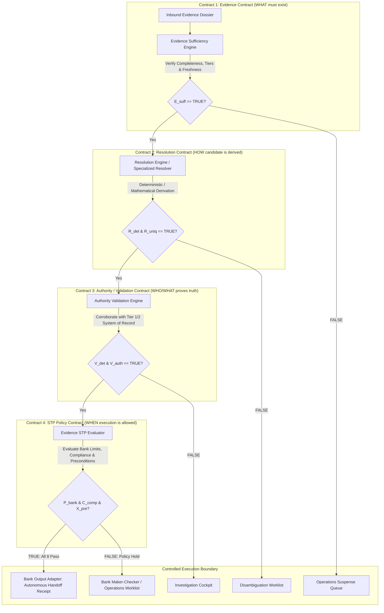

# PeX — 41-Profile Evidence Contract Matrix v1.0
## Authoritative Cross-Domain Evidence, Resolution, Authority & STP Policy Specification

**Document Identifier:** `PeX-ARCH-ECM-41-v1.0`  
**Version:** v1.0 (Authoritative)  
**Status:** APPROVED ARCHITECTURE SPECIFICATION  
**Operating Mode:** READ-ONLY / PRE-IMPLEMENTATION (Zero Production Code Changes)  
**Author:** Principal Enterprise Architect & Lead Engineer  
**Date:** October 2026  
**Authoritative Baseline:** `PeX_Evidence_Driven_STP_Architecture_Baseline_v1.1.md`  
**Phase 1 Foundation:** `PeX_Phase1_PR03_Implementation_Report_v0.1.md`  

---

## 1. Document Control

### 1.1 Metadata
- **Title:** PeX 41-Profile Evidence Contract Matrix
- **Version:** v1.0
- **Classification:** Authoritative Technical Specification
- **Governance:** Binding Architecture Contract for Phase 2 Expansion
- **Supersedes:** All prior draft evidence matrices, working spreadsheets, and legacy AI-centric recommendation tables.

### 1.2 Purpose & Scope
This document provides the exhaustive, profile-by-profile architectural specification across all **41 BIAN Payment Exception Profiles** in the PeX platform. It establishes the binding contracts, evidence requirements, acquisition models, trust tiers, deterministic resolution mechanics, authority validation sources, and STP policy constraints required to scale the verified Phase 1 foundations into full enterprise coverage.

---

## 2. Authoritative Source-of-Truth Hierarchy

This specification strictly adheres to the following governance hierarchy:
1. `PeX_Evidence_Driven_STP_Architecture_Baseline_v1.1.md` (Immutable Baseline)
2. `PeX_Phase1_PR03_Implementation_Report_v0.1.md` (Phase 1 Verification)
3. Verified Codebase Schemas & Service Foundations (`backend/app/schemas/`, `backend/app/services/`)
4. International Payment Standards (ISO 20022, ISO 13616, ISO 9362, ISO 7064, CPMI-IOSCO PFMI)
5. Statutory Regulations & Scheme Rules (OFAC, FinCEN, FATF Rec 12/16/19, UCC Article 4A, UK PSR APP Fraud, EU VoP)

---

## 3. The Four-Contract Model & Decision Chain

Every exception profile in PeX is evaluated through four strictly independent contracts governed by the 8-predicate boolean formula:

$$\mathbf{STP\_ELIGIBLE} = E_{\text{suff}} \wedge R_{\text{det}} \wedge R_{\text{uniq}} \wedge V_{\text{det}} \wedge V_{\text{auth}} \wedge P_{\text{bank}} \wedge C_{\text{comp}} \wedge X_{\text{pre}}$$



---

## 4. Evidence Trust Hierarchy & Non-Negotiable Axioms

### 4.1 The Four Evidence Trust Tiers
```
+------+-------------------------+------------------------------------+---------------------------------------+
| Tier | Classification          | Systems of Record (SoR) Examples   | Permissibility & Authority Bounds     |
+------+-------------------------+------------------------------------+---------------------------------------+
| 1    | Bank Authoritative      | Core DDA, Customer Master, SSI     | Primary legal authority for account   |
|      |                         | Master, Signatory Mandates, AML/TM | ownership and debtor funds.           |
+------+-------------------------+------------------------------------+---------------------------------------+
| 2    | External Authoritative  | SWIFTRef, FedLine, Pay.UK CoP,     | Authoritative for clearing reach,     |
|      |                         | EU VoP, GLEIF LEI, Central Banks   | routing codes, and national formats.  |
+------+-------------------------+------------------------------------+---------------------------------------+
| 3    | PeX Derived             | MOD-97 solvers, XSD normalizers,   | Proves syntax and checksums; cannot   |
|      |                         | IMAD regex, SHA-256 hash ledger    | prove real-world business intent.     |
+------+-------------------------+------------------------------------+---------------------------------------+
| 4    | Historical Precedent    | PeX Audit Store, past successful   | Suggests hypotheses & ranks options;  |
|      |                         | repairs, recurrence statistics     | NEVER satisfies authority gates.      |
+------+-------------------------+------------------------------------+---------------------------------------+
```

### 4.2 Non-Negotiable Architectural Rules
1. **Invalid/Failed $\neq$ Correct Replacement:** A mathematical checksum failure (e.g. MOD-97) proves only that an IBAN is corrupted; deriving the true replacement requires Tier 1/2 System of Record corroboration.
2. **Historical Precedent $\neq$ Authority:** Past successful repairs provide contextual ranking and hypothesis generation. Historical frequency **never** satisfies mandatory authority requirements.
3. **Zero AI Payment-Release Authority:** AI models, LLMs, and probabilistic classifiers are strictly prohibited from authorizing release, overriding evidence gates, or manufacturing missing fields. AI confidence is **never** an STP predicate.
4. **Transport Agnosticism:** The Evidence Contract defines *WHAT* data must exist. *HOW* data is acquired (REST API, SFTP, Kafka, IBM MQ, Folder Watcher) is completely decoupled into swappable transport adapters.
5. **Bank Execution Boundary:** PeX outputs repaired instructions and verifiable execution receipts back to the **Bank Payment Hub**. PeX never bypasses the bank to clear directly on RTGS networks.

---

## 5. Authoritative 41-Profile Taxonomy & Group Structure

The taxonomy is strictly bounded to 41 profiles across 5 domains and 4 operational groups:

```
+---------------------------------------------------------------------------------------------------+
|                                  GROUP CLASSIFICATION DISTRIBUTION                                |
+---------+----------------------------------------------------+-------+----------------------------+
| Group   | Architectural Definition                           | Count | Profile IDs                |
+---------+----------------------------------------------------+-------+----------------------------+
| Group 1 | Deterministically STP-capable subject to bank      | 7     | DQ-05, DQ-08, PR-01, PR-03,|
|         | controls (Syntax, XML, duplicate suppression)      |       | PR-05, PR-08, ST-01        |
+---------+----------------------------------------------------+-------+----------------------------+
| Group 2 | Conditionally STP-capable                          | 12    | DQ-01, DQ-02, DQ-04, DQ-06,|
|         | (Requires external/bank SoR corroboration)         |       | DQ-07, PR-04, PR-09, CO-04,|
|         |                                                    |       | CO-07, TR-01, TR-03, TR-04 |
+---------+----------------------------------------------------+-------+----------------------------+
| Group 3 | Bank-policy dependent                              | 10    | DQ-03, PR-02, PR-06, PR-07,|
|         | (Requires bank risk parameters or client mandates) |       | CO-06, TR-02, TR-05, TR-06,|
|         |                                                    |       | ST-05, ST-07               |
+---------+----------------------------------------------------+-------+----------------------------+
| Group 4 | Human authorization required                       | 12    | DQ-09, CO-01, CO-02, CO-03,|
|         | (Mandatory Maker-Checker / Sanctions / Fraud)      |       | CO-05, CO-08, TR-07, TR-08,|
|         |                                                    |       | ST-02, ST-03, ST-04, ST-06 |
+---------+----------------------------------------------------+-------+----------------------------+
| TOTAL   |                                                    | 41    | Exactly 41 Profiles        |
+---------+----------------------------------------------------+-------+----------------------------+
```

---

## 6. The Complete 41-Profile Evidence Contract Matrix

```
Legend:
- Trust Tier: T1 = Bank Authoritative | T2 = External Authoritative | T3 = PeX Derived | T4 = Historical Precedent
- STP Permissibility: AUTO = Autonomous STP Capable | COND = Conditionally STP Permissible | POLICY = Bank Policy Dependent | HITL = Mandatory Human Authorization Required
```

### Domain 1: Data Quality (`DQ-01` through `DQ-09`)

| Profile ID & Name | Domain / Group | Mandatory Evidence (Contract 1) | Conditional / Optional Evidence | Trust Tier & Authority Source | Freshness SLA & Acquisition Method | Resolution Method (Contract 2) & Determinism | Validation Method & Authority (Contract 3) | Bank Policy & Compliance Gates (Contract 4) | STP Permissibility & Human Review | Phase 1 Reuse & New Capability Needed | Key Risks & Open Questions |
| :--- | :--- | :--- | :--- | :--- | :--- | :--- | :--- | :--- | :--- | :--- | :--- |
| **`DQ-01: INVALID_IBAN`** | Data Quality<br>**Group 2** | • Raw XML/JSON payload with corrupted `<IBAN>`<br>• Inbound XSD / MOD-97 NACK error JSON | • Bank Counterparty SSI Master record<br>• Live Confirmation of Payee (CoP) match token<br>• *(Opt)* Historical repair pattern | **T1:** Bank SSI Master<br>**T2:** Pay.UK / EU VoP CoP<br>**T3:** ISO 7064 Solver<br>**T4:** Repair History | **SLA:** Real-time CoP / Daily SSI cache.<br>**Acq:** Bank Evidence Gateway + Direct CoP Connector | **Method:** MOD-97 transposition solver + SSI intersection.<br>**Det:** DETERMINISTIC candidate.<br>**Uniq:** UNIQUE if single SSI match. | **Method:** ISO 7064 MOD-97 ($r=1$) + ISO 13616 format.<br>**Auth:** Bank SSI / CoP attestation digest. | **Policy:** Amount $\le \$25\text{k}$ default; currency permitted.<br>**Comp:** Full OFAC/Sanctions re-screen on repaired IBAN. | **Perm:** CONDITIONAL STP.<br>**HITL:** Suspends to Disambiguation if $N > 1$ or CoP mismatch. | **Reuse:** Sufficiency, STP Evaluator, Audit.<br>**New:** Mod-97 solver, Bank SSI Adapter, CoP Connector (P0). | **Risk:** Crediting wrong entity if SSI corrupted.<br>**Open:** Bank SSI coverage and CoP API availability. |
| **`DQ-02: INVALID_BIC`** | Data Quality<br>**Group 2** | • Raw payload with invalid `<BICFI>`<br>• Directory miss / routing rejection | • SWIFTRef Directory entry<br>• Active Head-Office / Successor BIC map<br>• Clearing rail reachability matrix | **T2:** SWIFTRef / ISO 9362<br>**T3:** BIC8/11 Regex<br>**T4:** Historical routing | **SLA:** Monthly SWIFTRef sync / Daily delta.<br>**Acq:** Reference Data Connector / ISO 9362 DB | **Method:** Append `XXX` to 8-char BIC or map to active head-office.<br>**Det:** DETERMINISTIC.<br>**Uniq:** UNIQUE if 1 active successor on rail. | **Method:** ISO 9362 regex + directory presence.<br>**Auth:** SWIFTRef active status attestation. | **Policy:** Rail supported; counterparty corridor open.<br>**Comp:** Watchlist re-screen on financial institution. | **Perm:** CONDITIONAL STP.<br>**HITL:** Operations review if branch closed with multiple successors. | **Reuse:** Sufficiency, Policy Evaluator, Audit.<br>**New:** SWIFTRef Directory Connector (P0). | **Risk:** Directing payment to non-clearing branch.<br>**Open:** Head-office currency clearing agreements. |
| **`DQ-03: MISSING_BENEFICIARY`** | Data Quality<br>**Group 3** | • Raw payload with empty `<Cdtr><Nm>`<br>• Inbound scheme validation error | • Debtor Corporate Mandate agreement<br>• Bank Core DDA Customer Master<br>• GLEIF LEI Registry record | **T1:** Core DDA / Mandate<br>**T2:** GLEIF LEI<br>**T4:** Past invoice history | **SLA:** Configurable Bank Master SLA.<br>**Acq:** Bank Evidence Gateway (DDA API) | **Method:** Populate legal name from verified Core DDA / LEI Master.<br>**Det:** DETERMINISTIC.<br>**Uniq:** UNIQUE if 1 mandate on file. | **Method:** FATF Rec 16 schema check ($\le 140$ chars).<br>**Auth:** Core DDA Customer Master digest. | **Policy:** Dual-authorization required if counterparty $<30$ days old or amount $\ge \$25\text{k}$.<br>**Comp:** Strict Sanctions & PEP screening. | **Perm:** BANK POLICY DEPENDENT.<br>**HITL:** Maker-Checker mandatory for new counterparties. | **Reuse:** 8-Predicate Evaluator, Audit.<br>**New:** DDA Customer Master Connector (P0). | **Risk:** Legal liability under FATF 16 if name incorrect.<br>**Open:** Client mandate auto-population rules. |
| **`DQ-04: MISSING_REMITTANCE`** | Data Quality<br>**Group 2** | • Raw payload with empty `<RmtInf>`<br>• Beneficiary bank missing invoice RFI | • Debtor ERP AP Open Invoice feed<br>• Debtor Corporate Billing ID<br>• *(Opt)* Historical invoice template | **T1:** Debtor ERP AP Feed<br>**T4:** Historical memo patterns | **SLA:** Real-time ERP query / Daily AP batch.<br>**Acq:** Bank Evidence Gateway (ERP AP Connector) | **Method:** Populate `<RmtInf><Strd>` with matched open invoice number.<br>**Det:** DETERMINISTIC.<br>**Uniq:** UNIQUE if 1 exact amount match. | **Method:** ISO 20022 `<RmtInf>` XSD check.<br>**Auth:** Debtor AP invoice transaction token. | **Policy:** Corporate client SLA allows auto-insertion.<br>**Comp:** Remittance text screened for sanction keywords. | **Perm:** CONDITIONAL STP.<br>**HITL:** Route to Operations if multiple open invoices match amount. | **Reuse:** Resolution Contract, Output Adapter, Audit.<br>**New:** ERP AP Ingestion Adapter (P1). | **Risk:** Applying wire to wrong vendor invoice.<br>**Open:** Enterprise ERP AP interface availability. |
| **`DQ-05: INVALID_ADDRESS`** | Data Quality<br>**Group 1** | • Raw payload with unstructured `<AdrLine>`<br>• ISO 20022 Nov 2026 schema error | • Universal Postal Union (UPU) S42 syntax<br>• National Postal Directory (USPS, Royal Mail)<br>• *(Opt)* Customer Master address | **T2:** UPU S42 / Postal DB<br>**T3:** PeX Address Parser<br>**T4:** Historical address | **SLA:** Static postal grammar / Quarterly DB sync.<br>**Acq:** Internal PeX Postal Normalizer | **Method:** Parse raw lines into discrete `<StrtNm>`, `<BldgNb>`, `<PstCd>`, `<TwnNm>`, `<Ctry>`.<br>**Det:** DETERMINISTIC.<br>**Uniq:** UNIQUE. | **Method:** W3C `PostalAddress24` ISO 20022 XSD.<br>**Auth:** UPU S42 structural validation digest. | **Policy:** Standard bank threshold limits.<br>**Comp:** Re-screen parsed country for OFAC embargoes. | **Perm:** AUTONOMOUS STP.<br>**HITL:** Suspends only if unparseable or country invalid. | **Reuse:** Resolution Engine, Authority Validator, Pipeline.<br>**New:** UPU Address Normalizer (P0). | **Risk:** Receiving bank rejection if street/building swapped.<br>**Open:** Non-Latin character transliteration. |
| **`DQ-06: MISSING_PURPOSE`** | Data Quality<br>**Group 2** | • Raw payload with missing `<Purp>`<br>• National BoP regulatory rejection | • Unstructured remittance text (`<Ustrd>`)<br>• ISO 20022 External Purpose Code List<br>• Central Bank Balance of Payments rules | **T2:** ISO Code List / BoP<br>**T3:** Keyword Classifier<br>**T4:** Historical codes | **SLA:** Static ISO external code catalog.<br>**Acq:** Internal Reference Data Store | **Method:** Deterministic keyword mapping (e.g., "SALARY" $\to$ `SALA`, "SUPPLIER" $\to$ `GDSV`).<br>**Det:** DETERMINISTIC.<br>**Uniq:** UNIQUE if single keyword match. | **Method:** ISO External Purpose Code set membership.<br>**Auth:** Regulatory purpose schema attestation. | **Policy:** Permitted for approved trade corridors.<br>**Comp:** Purpose code must not conflict with sanctions. | **Perm:** CONDITIONAL STP.<br>**HITL:** Operations review if text is ambiguous. | **Reuse:** Sufficiency Engine, STP Evaluator, Audit.<br>**New:** ISO Purpose Code Mapper (P1). | **Risk:** Misreporting trade as capital transfer to Central Bank.<br>**Open:** National BoP mandatory threshold levels. |
| **`DQ-07: INVALID_ACCOUNT_NUM`** | Data Quality<br>**Group 2** | • Raw payload with invalid domestic account<br>• Clearing modulus failure (Fedwire/CHAPS) | • Receiving Branch Sort / Transit Code<br>• National Clearing Modulus Rules (EISCD/Fed)<br>• Bank Core DDA format specifications | **T2:** National Clearing DB<br>**T3:** Modulus Solver<br>**T1:** Core DDA Master | **SLA:** Monthly clearing modulus table update.<br>**Acq:** Reference Data Fabric / DDA Gateway | **Method:** Apply standard branch zero-padding or check digit correction.<br>**Det:** DETERMINISTIC.<br>**Uniq:** UNIQUE if 1 valid branch padding. | **Method:** National modulus algorithm (Mod-10, Mod-11).<br>**Auth:** Clearing directory format attestation. | **Policy:** Amount $\le \$25\text{k}$; active clearing corridor.<br>**Comp:** Standard sanctions check ($C_{\text{comp}}$). | **Perm:** CONDITIONAL STP.<br>**HITL:** Maker-Checker if modulus fails after padding. | **Reuse:** Resolution Contract, Policy Evaluator, Audit.<br>**New:** National Modulus Engine (P1). | **Risk:** Crediting wrong domestic account.<br>**Open:** Modulus variation across regional clearing houses. |
| **`DQ-08: INVALID_ROUTING`** | Data Quality<br>**Group 1** | • Raw payload with retired / merged ABA code<br>• Clearing directory rejection NACK | • Federal Reserve E-Payments Merger Directory<br>• Bank of England Sort Code Merger Table<br>• Active clearing rail status | **T2:** Central Bank Directory<br>**T3:** 9-Digit Checksum<br>**T4:** Historical routing | **SLA:** Daily/Weekly FedLine / BoE sync.<br>**Acq:** Reference Data Connector / FedLine API | **Method:** Map retired routing transit number to active successor entity.<br>**Det:** DETERMINISTIC.<br>**Uniq:** UNIQUE (1:1 merger table mapping). | **Method:** 9-digit ABA Mod-10 checksum validation.<br>**Auth:** Central Bank Merger Directory attestation. | **Policy:** Standard bank STP threshold.<br>**Comp:** Re-screen successor institution on sanctions. | **Perm:** AUTONOMOUS STP.<br>**HITL:** Operations review only if merged bank split. | **Reuse:** Resolution Engine, STP Evaluator, Audit.<br>**New:** Central Bank Merger Directory Adapter (P0). | **Risk:** Routing wire to defunct institution.<br>**Open:** Real-time FedLine directory connectivity. |
| **`DQ-09: NAME_MISMATCH`** | Data Quality<br>**Group 4** | • Raw payload with `<Cdtr><Nm>`<br>• Confirmation of Payee `CLOSE_MATCH` / `NO_MATCH` | • Pay.UK / EU VoP registered legal name<br>• Corporate DBA / Trade Alias register<br>• Inbound Fraud Risk Score | **T2:** Pay.UK / EU VoP CoP<br>**T1:** Bank Fraud Hub<br>**T4:** Historical Aliases | **SLA:** Real-time CoP API query.<br>**Acq:** Direct External CoP Gateway | **Method:** Compile Lexical Levenshtein score, corporate DBA match, and fraud indicators.<br>**Det:** PROBABILISTIC.<br>**Uniq:** AMBIGUOUS. | **Method:** Lexical similarity calculation + Fraud rule check.<br>**Auth:** CoP Gateway response token. | **Policy:** Autonomous STP STRICTLY PROHIBITED under UK PSR APP Fraud / EU VoP rules.<br>**Comp:** Mandatory Fraud & AML review. | **Perm:** HUMAN AUTHORIZATION REQUIRED.<br>**HITL:** Mandatory Fraud / Operations Specialist sign-off. | **Reuse:** Evidence Dossier, Audit Ledger, Security SoD.<br>**New:** Fuzzy Match & Lexical Distance Service (P1). | **Risk:** Direct bank liability for Authorized Push Payment fraud.<br>**Open:** Liability shift agreements under UK PSR rules. |

---

### Domain 2: Processing Exceptions (`PR-01` through `PR-09`)

| Profile ID & Name | Domain / Group | Mandatory Evidence (Contract 1) | Conditional / Optional Evidence | Trust Tier & Authority Source | Freshness SLA & Acquisition Method | Resolution Method (Contract 2) & Determinism | Validation Method & Authority (Contract 3) | Bank Policy & Compliance Gates (Contract 4) | STP Permissibility & Human Review | Phase 1 Reuse & New Capability Needed | Key Risks & Open Questions |
| :--- | :--- | :--- | :--- | :--- | :--- | :--- | :--- | :--- | :--- | :--- | :--- |
| **`PR-01: DUPLICATE_PAYMENT`** | Processing<br>**Group 1** | • Inbound payment payload + UETR<br>• Bank 24h Settlement Hash Ledger match | • Inbound transaction SHA-256 payload hash<br>• Core DDA debit status<br>• *(Opt)* Invoice number & debtor ID | **T1:** Bank Core Ledger<br>**T3:** SHA-256 Hash Engine<br>**T4:** Duplicate history | **SLA:** Real-time ledger lookup (24h sliding window).<br>**Acq:** Bank Evidence Gateway (Ledger Hash API) | **Method:** Autonomous cancellation & suppression of second identical instruction.<br>**Det:** DETERMINISTIC.<br>**Uniq:** UNIQUE on exact hash match. | **Method:** Exact UETR / SHA-256 collision verification.<br>**Auth:** Bank Core Settlement Ledger attestation. | **Policy:** Auto-cancellation permitted for exact collisions; partial duplicates route to HITL.<br>**Comp:** $C_{\text{comp}} = \text{PASS}$. | **Perm:** AUTONOMOUS STP.<br>**HITL:** Route to Operations if distinct invoice or different amount. | **Reuse:** STP Evaluator, Audit Service, Output Port.<br>**New:** 24-Hour Settlement Hash Ledger Service (P0). | **Risk:** Suppressing legitimate recurring batch invoices.<br>**Open:** Settlement ledger retention window SLA. |
| **`PR-02: ROUTING_FAILURE`** | Processing<br>**Group 3** | • Raw payload + Target Rail ID<br>• Rail outage / network downtime event | • Bank Bilateral Routing Matrix<br>• Alternate rail fee schedule & cutoff table<br>• Debtor routing mandate | **T1:** Bank Routing Policy<br>**T2:** Rail Status API<br>**T4:** Historical routes | **SLA:** Real-time rail availability feed.<br>**Acq:** Bank Infrastructure Monitor / Rail Gateway | **Method:** Re-route payment to secondary active clearing network (e.g. Fedwire $\to$ CHIPS/SWIFT).<br>**Det:** DETERMINISTIC.<br>**Uniq:** UNIQUE (primary backup rail). | **Method:** Target rail format & reachability validation.<br>**Auth:** Bank Routing Engine attestation. | **Policy:** Allowed if fee delta $\le$ bank tolerance and cutoff SLA $< 1\text{ hour}$.<br>**Comp:** Corridor sanctions compliance re-check. | **Perm:** BANK POLICY DEPENDENT.<br>**HITL:** Maker-Checker required for high-value wires ($\ge \$1\text{M}$). | **Reuse:** Resolution Contract, Policy Evaluator, Audit.<br>**New:** Dynamic Rail Routing Adapter (P1). | **Risk:** Incurring higher correspondent clearing fees.<br>**Open:** Customer agreement on rail substitution fees. |
| **`PR-03: ISO20022_ERROR`** | Processing<br>**Group 1** | • Raw XML/JSON payload<br>• Official W3C XSD schema error JSON | • CBPR+ / ISO 20022 Schema Spec<br>• Tag sequence dictionary<br>• *(Opt)* Historical XML diffs | **T1:** Raw Payload<br>**T2:** W3C ISO Schemas<br>**T3:** PR03Resolver<br>**T4:** XML repair logs | **SLA:** Scoped to active message execution.<br>**Acq:** Inbound Folder / MQ Adapter | **Method:** Lossless tag re-sequencing, namespace normalization, and envelope wrapping.<br>**Det:** DETERMINISTIC.<br>**Uniq:** UNIQUE. | **Method:** Full W3C ISO 20022 XML Schema validation.<br>**Auth:** W3C XSD attestation digest. | **Policy:** Amount $\le \$1\text{M}$; standard corridors.<br>**Comp:** Independent OFAC & AML screening ($C_{\text{comp}}$). | **Perm:** AUTONOMOUS STP.<br>**HITL:** Suspends to Operations if payload corrupted unrecoverably. | **Reuse:** REUSE AS-IS (Phase 1 Baseline Vertical Slice).<br>**New:** None (Complete in Phase 1). | **Risk:** Zero (Lossless structural repair verified).<br>**Open:** None (Fully verified in 31 Phase 1 tests). |
| **`PR-04: CUTOFF_MISSED`** | Processing<br>**Group 2** | • Raw payload + Transaction timestamp<br>• Scheme RTGS cutoff time table | • Clearing network operating calendar<br>• Debtor contract value date agreement<br>• Next-day FX spot rate table | **T2:** Central Bank Cutoff DB<br>**T1:** Debtor Contract SLA<br>**T4:** Historical roll logs | **SLA:** Real-time clock vs scheme cutoff schedule.<br>**Acq:** Central Bank Calendar Adapter | **Method:** Roll Value Date to next business day ($T+1$) or reroute to 24/7 instant rail.<br>**Det:** DETERMINISTIC.<br>**Uniq:** UNIQUE ($T+1$ working day). | **Method:** Banking working day calendar calculation.<br>**Auth:** Scheme operating schedule attestation. | **Policy:** Permitted if client contract allows $T+1$ roll without interest claims.<br>**Comp:** $C_{\text{comp}} = \text{PASS}$. | **Perm:** CONDITIONAL STP.<br>**HITL:** Suspends to Treasury if wire is time-critical/FX trade. | **Reuse:** Sufficiency Engine, STP Evaluator, Audit.<br>**New:** Working Day & Value Date Calculator (P0). | **Risk:** Client claims for lost overnight interest on FX.<br>**Open:** Corporate SLA value-date rollover terms. |
| **`PR-05: CORRUPTED_MESSAGE`** | Processing<br>**Group 1** | • Raw byte stream containing illegal hex/chars<br>• Inbound parser encoding error | • SWIFT MT/MX X-Character Set standard<br>• UTF-8 / ASCII sanitization rules<br>• Non-printable control byte filter | **T2:** SWIFT Charset Spec<br>**T3:** Byte Stream Sanitizer<br>**T4:** Charset logs | **SLA:** Scoped to message byte parsing.<br>**Acq:** Inbound Transport Adapter / Byte Stream | **Method:** Strip non-printable null bytes ($0\text{x}00..0\text{x}1\text{F}$) while preserving alphanumeric and valid punctuation.<br>**Det:** DETERMINISTIC.<br>**Uniq:** UNIQUE. | **Method:** SWIFT X-Character set regex compliance.<br>**Auth:** Byte stream integrity attestation. | **Policy:** Standard bank threshold limits.<br>**Comp:** Re-screen sanitized text for sanctions ($C_{\text{comp}}$). | **Perm:** AUTONOMOUS STP.<br>**HITL:** Suspends if sanitization removes $>10\%$ of text. | **Reuse:** Resolution Engine, Authority Validator, Pipeline.<br>**New:** Byte-Level Charset Normalizer (P0). | **Risk:** Accidentally stripping meaningful delimiter characters.<br>**Open:** UTF-8 multibyte character encoding standards. |
| **`PR-06: INTERMEDIARY_NACK`** | Processing<br>**Group 3** | • Inbound `pacs.002` NACK rejection XML<br>• Specific reject reason code (e.g. `RR04`, `ED05`) | • Bilateral RMA (Relationship Management Application)<br>• Secondary Correspondent Nostro balance<br>• Intermediary fee matrix | **T1:** Bilateral RMA Matrix<br>**T2:** Correspondent NACK<br>**T4:** Intermediary stats | **SLA:** Real-time NACK ingestion.<br>**Acq:** Bank Payment Hub Gateway | **Method:** Reroute payment through secondary verified correspondent with active RMA.<br>**Det:** DETERMINISTIC.<br>**Uniq:** UNIQUE (primary active backup RMA). | **Method:** Target correspondent RMA & SWIFTRef match.<br>**Auth:** Bilateral RMA Master attestation. | **Policy:** Secondary correspondent credit line active and Nostro funded.<br>**Comp:** Re-screen secondary intermediary bank. | **Perm:** BANK POLICY DEPENDENT.<br>**HITL:** Maker-Checker required if fee exceeds threshold. | **Reuse:** Resolution Contract, Policy Evaluator, Audit.<br>**New:** Correspondent RMA & Routing Matrix Engine (P1). | **Risk:** Routing to correspondent without active credit line.<br>**Open:** Live RMA key exchange verification. |
| **`PR-07: NETWORK_TIMEOUT`** | Processing<br>**Group 3** | • Outbound wire UETR with expired timeout SLA<br>• Clearing gateway no-response status | • SWIFT gpi Tracker live status feed<br>• RTGS Central Bank query endpoint<br>• Original settlement dispatch receipt | **T2:** SWIFT gpi / FedLine<br>**T1:** Settlement Dispatch DB<br>**T4:** Timeout stats | **SLA:** gpi Tracker real-time inquiry response.<br>**Acq:** Direct SWIFT gpi API / Clearing Adapter | **Method:** Query gpi tracker: if status == UNKNOWN/LOST, re-dispatch with original UETR; if DELIVERED, update local status.<br>**Det:** DETERMINISTIC.<br>**Uniq:** UNIQUE. | **Method:** SWIFT gpi end-to-end trace confirmation.<br>**Auth:** Central Bank / gpi Tracker status attestation. | **Policy:** Re-dispatch permitted ONLY upon positive proof of non-settlement.<br>**Comp:** $C_{\text{comp}} = \text{PASS}$. | **Perm:** BANK POLICY DEPENDENT.<br>**HITL:** Route to Operations if gpi status remains indeterminate. | **Reuse:** Evidence Contract, STP Evaluator, Audit.<br>**New:** SWIFT gpi Tracker Connector (P1). | **Risk:** Double dispatch causing duplicate debit at clearing.<br>**Open:** gpi API timeout query latency SLAs. |
| **`PR-08: QUEUE_FAILURE`** | Processing<br>**Group 1** | • Broker Dead Letter Queue (DLQ) message<br>• Broker error code (timeout / poison lock) | • Bank Message Broker DLQ metadata<br>• Transaction idempotency lock state<br>• Poison message detection filter | **T1:** Bank Messaging Hub<br>**T3:** Idempotency Manager<br>**T4:** DLQ history | **SLA:** Event-driven upon DLQ routing.<br>**Acq:** Bank Messaging Adapter (RabbitMQ/IBM MQ/Kafka) | **Method:** Clear corrupted consumer lock, reset state machine, and re-enqueue to main topic.<br>**Det:** DETERMINISTIC.<br>**Uniq:** UNIQUE. | **Method:** Payload checksum + Idempotency state validation.<br>**Auth:** Message broker recovery attestation. | **Policy:** Automated re-queue permitted up to 3 retries.<br>**Comp:** $C_{\text{comp}} = \text{PASS}$. | **Perm:** AUTONOMOUS STP.<br>**HITL:** Suspends to Operations after 3 consecutive retry failures. | **Reuse:** Hexagonal Adapters, Audit Service, Pipeline.<br>**New:** Message Broker Queue Reset Adapter (P0). | **Risk:** Re-enqueuing an invalid poison pill payload.<br>**Open:** Broker retry limits and backoff configuration. |
| **`PR-09: HELD_FOR_REPAIR`** | Processing<br>**Group 2** | • Generic Payment Hub `HOLD_FOR_REPAIR` flag<br>• Raw un-parsed payment payload | • Bank Payment Hub Triage SOP<br>• 41-Profile Root Cause Classifier<br>• Historical triage resolution rules | **T1:** Payment Hub SOP<br>**T3:** Triage Classifier<br>**T4:** Triage precedent | **SLA:** Real-time triage upon ingestion.<br>**Acq:** Bank Payment Hub Gateway | **Method:** Isolate underlying root cause and re-classify into specific sub-profile (e.g. `DQ-01` or `PR-03`).<br>**Det:** DETERMINISTIC.<br>**Uniq:** UNIQUE (isolated sub-profile). | **Method:** Re-evaluate against target sub-profile Evidence Contract.<br>**Auth:** Sub-profile authority attestation. | **Policy:** Sub-profile STP policy parameters apply.<br>**Comp:** Sub-profile compliance gates apply. | **Perm:** CONDITIONAL STP.<br>**HITL:** Suspends to Operations if root cause cannot be uniquely isolated. | **Reuse:** Sufficiency Engine, Resolution Engine, Registry.<br>**New:** Multi-Profile Triage Dispatcher (P1). | **Risk:** Misclassifying a complex multi-fault exception.<br>**Open:** Bank payment hub hold trigger mapping. |

---

### Domain 3: Compliance & Regulatory (`CO-01` through `CO-08`)

| Profile ID & Name | Domain / Group | Mandatory Evidence (Contract 1) | Conditional / Optional Evidence | Trust Tier & Authority Source | Freshness SLA & Acquisition Method | Resolution Method (Contract 2) & Determinism | Validation Method & Authority (Contract 3) | Bank Policy & Compliance Gates (Contract 4) | STP Permissibility & Human Review | Phase 1 Reuse & New Capability Needed | Key Risks & Open Questions |
| :--- | :--- | :--- | :--- | :--- | :--- | :--- | :--- | :--- | :--- | :--- | :--- |
| **`CO-01: SANCTIONS_ALERT`** | Compliance<br>**Group 4** | • Screening engine match alert (OFAC, EU, UN)<br>• Matched entity name & target transaction | • Entity DOB, Country, Address, Passport ID<br>• OFAC 50% Rule corporate ownership tree<br>• Historical false positive whitelist record | **T1:** Bank Sanctions Engine<br>**T2:** OFAC / EU List<br>**T4:** Past false positives | **SLA:** Real-time screening alert.<br>**Acq:** Bank Compliance Gateway / Sanctions API | **Method:** Compile complete disambiguation dossier (DOB, nationality, ownership) for MLRO.<br>**Det:** NON-DETERMINISTIC.<br>**Uniq:** AMBIGUOUS. | **Method:** Exact match vs fuzzy attribute score.<br>**Auth:** Sanctions Authority match token. | **Policy:** Autonomous release STRICTLY PROHIBITED under federal law.<br>**Comp:** $C_{\text{comp}} = \text{FAIL}$ until human sign-off. | **Perm:** HUMAN AUTHORIZATION REQUIRED.<br>**HITL:** Mandatory MLRO / Sanctions Officer dual-sign-off. | **Reuse:** Evidence Dossier, Audit Ledger, Security SoD.<br>**New:** Sanctions Disambiguation Dossier Builder (P1). | **Risk:** Severe civil/criminal penalties for OFAC violation.<br>**Open:** Bank MLRO escalation and whitelist workflows. |
| **`CO-02: AML_ALERT`** | Compliance<br>**Group 4** | • Transaction Monitoring (TM) velocity alert<br>• Debtor turnover profile & baseline metrics | • Historical transaction velocity / structuring data<br>• Customer Due Diligence (CDD) profile<br>• Source of Wealth / Income documentation | **T1:** Bank TM Hub / CDD<br>**T2:** FinCEN Rules<br>**T4:** Past alert history | **SLA:** Real-time / Batch TM alert feed.<br>**Acq:** Bank Compliance Gateway (TM API) | **Method:** Assemble 90-day turnover dossier, velocity metrics, and narrative for AML Analyst.<br>**Det:** NON-DETERMINISTIC.<br>**Uniq:** AMBIGUOUS. | **Method:** Statistical threshold anomaly calculation.<br>**Auth:** TM System alert attestation. | **Policy:** Autonomous release STRICTLY PROHIBITED under BSA / AML regulations.<br>**Comp:** $C_{\text{comp}} = \text{FAIL}$ until clearance. | **Perm:** HUMAN AUTHORIZATION REQUIRED.<br>**HITL:** Mandatory AML Compliance Officer sign-off. | **Reuse:** Evidence Dossier, Audit Ledger, Maker-Checker.<br>**New:** AML Turnover Analysis Dossier Builder (P2). | **Risk:** Regulatory consent decrees for improper SAR filing.<br>**Open:** Bank TM alert integration API schemas. |
| **`CO-03: PEP_MATCH`** | Compliance<br>**Group 4** | • Politically Exposed Person (PEP) screening match<br>• Public official / Tier 1-3 PEP classification | • World-Check / Dow Jones PEP profile<br>• Customer Source of Wealth (SoW) form<br>• Enhanced Due Diligence (EDD) sign-off | **T2:** World-Check / PEP DB<br>**T1:** Bank CDD Master<br>**T4:** Past PEP clearance | **SLA:** Real-time PEP screening match.<br>**Acq:** Direct PEP Connector / Bank Compliance | **Method:** Compile PEP relationship tree, public office dates, and EDD documentation.<br>**Det:** NON-DETERMINISTIC.<br>**Uniq:** AMBIGUOUS. | **Method:** FATF Rec 12 PEP category match.<br>**Auth:** PEP Watchlist provider attestation. | **Policy:** Autonomous release STRICTLY PROHIBITED by FATF / 6AMLD.<br>**Comp:** $C_{\text{comp}} = \text{FAIL}$ until executive sign-off. | **Perm:** HUMAN AUTHORIZATION REQUIRED.<br>**HITL:** Mandatory Senior Executive / Head of Compliance sign-off. | **Reuse:** Evidence Dossier, Audit Ledger, SoD Security.<br>**New:** PEP Screening Dossier Builder (P2). | **Risk:** Reputational damage and bribery/corruption liability.<br>**Open:** Senior management approval thresholds. |
| **`CO-04: RESTRICTED_CORRIDOR`** | Compliance<br>**Group 2** | • Originating / Beneficiary Country (ISO 3166)<br>• Geopolitical Comprehensive Sanctions Matrix | • OFAC Comprehensive Embargo List (e.g. IR, CU, KP, SY)<br>• Correspondent intermediary routing corridor | **T2:** OFAC Embargo List<br>**T1:** Bank Corridor Matrix<br>**T3:** ISO 3166 Lookup | **SLA:** Daily sanctions list sync.<br>**Acq:** Internal Compliance Reference Store | **Method:** Autonomous blocking / freezing of instruction via `pacs.002` reject XML.<br>**Det:** DETERMINISTIC.<br>**Uniq:** UNIQUE. | **Method:** ISO 3166 country matching vs embargo list.<br>**Auth:** Statutory Sanctions Matrix attestation. | **Policy:** Autonomous rejection / freeze is statutory mandate.<br>**Comp:** $C_{\text{comp}} = \text{FAIL}$ (Triggers auto-block). | **Perm:** CONDITIONAL STP (AUTO-BLOCK).<br>**HITL:** Suspends to MLRO if asset freezing order required. | **Reuse:** Resolution Engine, Output Port, Audit Service.<br>**New:** Geopolitical Corridor Embargo Engine (P0). | **Risk:** Severe regulatory breach if embargoed wire executes.<br>**Open:** Multi-jurisdiction conflicting sanctions (EU vs US). |
| **`CO-05: ADVERSE_MEDIA`** | Compliance<br>**Group 4** | • Adverse media screening match on entity name<br>• Negative news severity rating | • Aggregated news articles & sentiment score<br>• Corporate entity disambiguation data<br>• Historical disposition notes | **T2:** Media Aggregator<br>**T1:** Compliance DB<br>**T4:** Past media reviews | **SLA:** Real-time adverse media match.<br>**Acq:** Media Screening API / Compliance Hub | **Method:** Compile adverse news summaries, sentiment scores, and corporate links for Analyst.<br>**Det:** NON-DETERMINISTIC.<br>**Uniq:** AMBIGUOUS. | **Method:** NLP sentiment & keyword analysis.<br>**Auth:** Media Provider match token. | **Policy:** Autonomous release PROHIBITED under Wolfsberg standards.<br>**Comp:** $C_{\text{comp}} = \text{FAIL}$ until review. | **Perm:** HUMAN AUTHORIZATION REQUIRED.<br>**HITL:** Mandatory Compliance Analyst sign-off. | **Reuse:** Evidence Dossier, Audit Ledger, Maker-Checker.<br>**New:** Adverse Media Context Aggregator (P2). | **Risk:** Bank association with financial crime / fraud.<br>**Open:** Media provider API integration. |
| **`CO-06: HIGH_RISK_JURISD`** | Compliance<br>**Group 3** | • Wire routing through FATF Greylist jurisdiction<br>• Inbound transaction payload | • Active Enhanced Due Diligence (EDD) on file<br>• Customer Portal trade contract / bill of lading<br>• FATF Recommendation 19 compliance form | **T2:** FATF Greylist Index<br>**T1:** Bank EDD Portal<br>**T4:** Past corridor history | **SLA:** Monthly FATF update / Real-time EDD check.<br>**Acq:** Bank Evidence Gateway (EDD Portal) | **Method:** Corroborate active, unexpired EDD documentation on file for counterparty.<br>**Det:** DETERMINISTIC.<br>**Uniq:** UNIQUE. | **Method:** FATF Rec 19 certificate date & status check.<br>**Auth:** Bank Customer EDD Master attestation. | **Policy:** Auto-release permitted ONLY if unexpired EDD exists on file.<br>**Comp:** $C_{\text{comp}} = \text{PASS}$ upon active EDD. | **Perm:** BANK POLICY DEPENDENT.<br>**HITL:** Route to Compliance if EDD expired or missing. | **Reuse:** Sufficiency Engine, STP Evaluator, Audit.<br>**New:** EDD Certificate Verification Adapter (P1). | **Risk:** Sanctions & AML audit penalties.<br>**Open:** Automatic EDD expiry tracking workflows. |
| **`CO-07: REGULATORY_REPORT`** | Compliance<br>**Group 2** | • Cross-border payload requiring statutory BoP filing<br>• Central Bank reporting threshold flag | • Commercial Trade Invoice / Bill of Lading<br>• Customs Declaration Number<br>• Statutory XML schema (`RgltryRptg`) | **T1:** Debtor Trade Portal<br>**T2:** Central Bank Mandate<br>**T3:** XML Serializer | **SLA:** Real-time upon message generation.<br>**Acq:** Bank Evidence Gateway (Trade Finance API) | **Method:** Generate compliant ISO 20022 `<RgltryRptg>` reporting XML block from invoice.<br>**Det:** DETERMINISTIC.<br>**Uniq:** UNIQUE. | **Method:** Central Bank statutory XML schema check.<br>**Auth:** Central Bank reporting format attestation. | **Policy:** Permitted for approved commercial trade clients.<br>**Comp:** $C_{\text{comp}} = \text{PASS}$ upon valid XML generation. | **Perm:** CONDITIONAL STP.<br>**HITL:** Route to Ops if customs declaration number missing. | **Reuse:** Resolution Contract, Output Adapter, Audit.<br>**New:** Statutory Reporting XML Generator (P1). | **Risk:** Central Bank fines for missing statutory reports.<br>**Open:** Country-specific regulatory reporting XML formats. |
| **`CO-08: CUSTOMER_WATCHLIST`** | Compliance<br>**Group 4** | • Internal Bank Risk / Fraud Watchlist match<br>• Debtor / Creditor customer ID | • Internal Risk Committee notes<br>• Credit default register entry<br>• Historical fraud investigation report | **T1:** Bank Internal Risk DB<br>**T4:** Past incident files | **SLA:** Real-time internal watchlist query.<br>**Acq:** Bank Evidence Gateway (Internal Risk API) | **Method:** Assemble internal risk history, default exposure, and notes for Risk Approver.<br>**Det:** NON-DETERMINISTIC.<br>**Uniq:** AMBIGUOUS. | **Method:** Internal Customer ID exact matching.<br>**Auth:** Bank Internal Risk Register attestation. | **Policy:** Autonomous release STRICTLY PROHIBITED.<br>**Comp:** $C_{\text{comp}} = \text{FAIL}$ until risk sign-off. | **Perm:** HUMAN AUTHORIZATION REQUIRED.<br>**HITL:** Mandatory Senior Risk Approver sign-off. | **Reuse:** Evidence Dossier, Audit Ledger, Security SoD.<br>**New:** Internal Risk Watchlist Adapter (P1). | **Risk:** Releasing funds to defaulting / fraudulent client.<br>**Open:** Internal watchlist maintenance and sync frequency. |

---

### Domain 4: Client & Treasury (`TR-01` through `TR-08`)

| Profile ID & Name | Domain / Group | Mandatory Evidence (Contract 1) | Conditional / Optional Evidence | Trust Tier & Authority Source | Freshness SLA & Acquisition Method | Resolution Method (Contract 2) & Determinism | Validation Method & Authority (Contract 3) | Bank Policy & Compliance Gates (Contract 4) | STP Permissibility & Human Review | Phase 1 Reuse & New Capability Needed | Key Risks & Open Questions |
| :--- | :--- | :--- | :--- | :--- | :--- | :--- | :--- | :--- | :--- | :--- | :--- |
| **`TR-01: NOSTRO_SHORTFALL`** | Client/Treasury<br>**Group 2** | • Currency Nostro account deficit alert<br>• Target settlement wire amount & currency | • Real-time Nostro Ledger balance feed<br>• Automated Treasury Cash Sweep agreement<br>• Intraday liquidity credit facility | **T1:** Treasury Sweep Engine<br>**T2:** BCBS 248 Intraday Feed<br>**T4:** Sweep history | **SLA:** Real-time intraday balance feed.<br>**Acq:** Bank Evidence Gateway (Treasury API) | **Method:** Trigger automated cash sweep from master concentration account to funded Nostro.<br>**Det:** DETERMINISTIC.<br>**Uniq:** UNIQUE. | **Method:** Post-sweep Nostro balance $\ge$ wire amount.<br>**Auth:** Treasury Sweep Engine execution receipt. | **Policy:** Auto-sweep permitted under treasury SLA.<br>**Comp:** $C_{\text{comp}} = \text{PASS}$. | **Perm:** CONDITIONAL STP.<br>**HITL:** Route to Treasury Desk if sweep facility exhausted. | **Reuse:** STP Evaluator, Audit Ledger, Output Port.<br>**New:** Treasury Cash Sweep Integration Adapter (P1). | **Risk:** Daylight overdraft fees at foreign correspondent.<br>**Open:** Multi-currency sweep latency and cutoff rules. |
| **`TR-02: KYC_EXPIRED`** | Client/Treasury<br>**Group 3** | • Customer KYC periodic review expiry flag<br>• Inbound payment payload | • Bank KYC Policy Master grace period rules<br>• Customer risk tier (Low / Medium / High)<br>• Open KYC refresh document submission | **T1:** Bank KYC Master<br>**T2:** FinCEN CDD Rule<br>**T4:** Past grace waivers | **SLA:** Daily KYC database status sync.<br>**Acq:** Bank Evidence Gateway (KYC Hub) | **Method:** Apply bank-approved 30-day KYC grace waiver for low-risk recurring corporate wires.<br>**Det:** DETERMINISTIC.<br>**Uniq:** UNIQUE (standard grace policy). | **Method:** Low-risk customer status + Active grace window.<br>**Auth:** Bank KYC Policy Master attestation. | **Policy:** Permitted for low-risk clients only; high-risk clients blocked.<br>**Comp:** $C_{\text{comp}} = \text{PASS}$ with active waiver. | **Perm:** BANK POLICY DEPENDENT.<br>**HITL:** Maker-Checker required for high-risk clients. | **Reuse:** Sufficiency Engine, Policy Evaluator, Audit.<br>**New:** KYC Grace Period Policy Engine (P1). | **Risk:** Regulatory penalties for transacting with unverified clients.<br>**Open:** Bank policy definition of eligible low-risk tiers. |
| **`TR-03: INSUFFICIENT_FUNDS`** | Client/Treasury<br>**Group 2** | • Debtor DDA balance shortfall alert<br>• Outbound payment amount | • Pre-approved Intraday Overdraft Line DB<br>• Pledged collateral status<br>• Debtor daylight credit limit | **T1:** Core DDA Ledger<br>**T2:** UCC Article 4A-201<br>**T4:** Overdraft history | **SLA:** Real-time Core DDA balance query.<br>**Acq:** Bank Evidence Gateway (Core DDA API) | **Method:** Draw on pre-approved intraday credit line or place wire in automated batch suspense.<br>**Det:** DETERMINISTIC.<br>**Uniq:** UNIQUE. | **Method:** Available balance + Overdraft line $\ge$ wire amount.<br>**Auth:** Core DDA Credit Line attestation. | **Policy:** Auto-draw permitted within pre-approved limit; high-value deficits require Credit Officer.<br>**Comp:** $C_{\text{comp}} = \text{PASS}$. | **Perm:** CONDITIONAL STP.<br>**HITL:** Route to Credit Approver if credit line exceeded. | **Reuse:** STP Evaluator, Policy Contract, Audit.<br>**New:** Core DDA Balance & Overdraft Adapter (P0). | **Risk:** Unsecured daylight credit loss for the bank.<br>**Open:** Real-time DDA hold placement interface. |
| **`TR-04: FX_UNAVAILABLE`** | Client/Treasury<br>**Group 2** | • Outbound cross-currency wire<br>• Expired / Missing FX spot quote | • Live Treasury FX Auto-Pricing Engine feed<br>• Client FX margin / spread mandate<br>• MiFID II / Dodd-Frank best execution rules | **T1:** Treasury FX Engine<br>**T2:** MiFID II Rules<br>**T4:** FX quote history | **SLA:** Real-time streaming FX rate query.<br>**Acq:** Bank Evidence Gateway (Treasury FX API) | **Method:** Re-price wire at fresh live spot rate and update `<IntrBkSttlmAmt>` / `<XchgRate>`.<br>**Det:** DETERMINISTIC.<br>**Uniq:** UNIQUE (active live spot rate). | **Method:** FX spread $\le$ client mandate spread.<br>**Auth:** Treasury FX Auto-Pricing Engine attestation. | **Policy:** Auto-reprice permitted for wires $<\$500\text{k}$.<br>**Comp:** $C_{\text{comp}} = \text{PASS}$. | **Perm:** CONDITIONAL STP.<br>**HITL:** Route to FX Trader if amount $\ge \$500\text{k}$ or market volatile. | **Reuse:** Resolution Engine, Policy Evaluator, Audit.<br>**New:** Treasury FX Pricing Connector (P1). | **Risk:** Currency arbitrage loss if stale rate applied.<br>**Open:** Client FX margin agreements and slippage tolerance. |
| **`TR-05: AUTH_MISSING`** | Client/Treasury<br>**Group 3** | • Wire missing mandatory 2nd signatory<br>• Inbound payment instruction | • Corporate Signatory Mandate Matrix (UCC 4A)<br>• Mobile Push Authentication status<br>• Cryptographic PKI signature token | **T1:** Signatory Matrix DB<br>**T2:** UCC Article 4A-202<br>**T4:** Signatory history | **SLA:** Real-time push / Asynchronous webhook.<br>**Acq:** Bank Digital Banking Push Gateway | **Method:** Dispatch asynchronous push notification to authorized 2nd signer; resume on token receipt.<br>**Det:** DETERMINISTIC upon receipt.<br>**Uniq:** UNIQUE. | **Method:** Cryptographic PKI / Biometric signature validation.<br>**Auth:** Corporate Mandate Matrix attestation. | **Policy:** Auto-release permitted upon verified 2nd signature.<br>**Comp:** $C_{\text{comp}} = \text{PASS}$. | **Perm:** BANK POLICY DEPENDENT (ASYNC STP).<br>**HITL:** Route to Corporate Banking if signer unreachable. | **Reuse:** State Machine, Audit Service, Security SoD.<br>**New:** Asynchronous Signatory Push Adapter (P2). | **Risk:** Executing unauthorized wire without corporate power.<br>**Open:** Mobile push webhook callback architecture. |
| **`TR-06: LIMIT_BREACH`** | Client/Treasury<br>**Group 3** | • Daily cumulative client wire limit exceeded<br>• Outbound transaction amount | • Enterprise Credit Risk Policy DB<br>• Pledged collateral valuation feed<br>• Temporary limit step-up rules | **T1:** Credit Risk Engine<br>**T4:** Limit breach history | **SLA:** Real-time limit aggregation query.<br>**Acq:** Bank Evidence Gateway (Credit Risk API) | **Method:** Apply automated 10% step-up if supported by verified excess pledged collateral.<br>**Det:** DETERMINISTIC.<br>**Uniq:** UNIQUE. | **Method:** Total exposure $\le 110\%$ of limit AND collateral OK.<br>**Auth:** Credit Risk Policy Engine attestation. | **Policy:** Auto-step-up permitted up to 10% for Prime corporate clients.<br>**Comp:** $C_{\text{comp}} = \text{PASS}$. | **Perm:** BANK POLICY DEPENDENT.<br>**HITL:** Maker-Checker mandatory for breaches $>10\%$. | **Reuse:** Policy Contract, STP Evaluator, Audit.<br>**New:** Credit Limit & Collateral Monitoring Adapter (P1). | **Risk:** Unhedged corporate borrower credit default.<br>**Open:** Credit policy step-up thresholds by client tier. |
| **`TR-07: LIQUIDITY_CAP`** | Client/Treasury<br>**Group 4** | • Central Bank RTGS hourly throughput cap hit<br>• Queued high-value payment instruction | • Central Bank RTGS Account Monitor feed<br>• Internal wire priority queue table<br>• Client SLA delivery deadline | **T2:** Central Bank RTGS<br>**T1:** Treasury Queue DB<br>**T4:** Throughput history | **SLA:** Real-time RTGS account cap feed.<br>**Acq:** Central Bank RTGS Gateway | **Method:** Dynamically re-sequence queue, holding low-priority payments until cap refresh.<br>**Det:** DETERMINISTIC re-sequencing.<br>**Uniq:** UNIQUE. | **Method:** Throughput cap headroom calculation.<br>**Auth:** Central Bank RTGS Monitor attestation. | **Policy:** High-value Treasury wires receive absolute priority.<br>**Comp:** $C_{\text{comp}} = \text{PASS}$. | **Perm:** HUMAN AUTHORIZATION REQUIRED.<br>**HITL:** Treasury Liquidity Manager must authorize overrides. | **Reuse:** State Machine, Policy Evaluator, Audit.<br>**New:** RTGS Throughput Queue Optimizer (P2). | **Risk:** Consuming hourly liquidity cap on non-critical wires.<br>**Open:** Central Bank intraday liquidity pacing rules. |
| **`TR-08: CREDIT_BREACH`** | Client/Treasury<br>**Group 4** | • Correspondent bilateral credit exposure maxed<br>• Outbound correspondent transfer | • Basel III Large Exposures Framework<br>• Real-time Counterparty Risk Engine feed<br>• Netting agreement status | **T1:** Basel III Risk Engine<br>**T2:** Basel III Rules<br>**T4:** Exposure history | **SLA:** Real-time counterparty exposure feed.<br>**Acq:** Bank Evidence Gateway (Risk API) | **Method:** Compile counterparty exposure dossier, netting positions, and capital headroom for Credit Officer.<br>**Det:** NON-DETERMINISTIC.<br>**Uniq:** AMBIGUOUS. | **Method:** Basel III Large Exposure cap check ($25\%$ Tier 1 Capital).<br>**Auth:** Counterparty Risk Engine attestation. | **Policy:** Autonomous release STRICTLY PROHIBITED under Basel III.<br>**Comp:** $C_{\text{comp}} = \text{PASS}$. | **Perm:** HUMAN AUTHORIZATION REQUIRED.<br>**HITL:** Mandatory Credit Risk Officer sign-off. | **Reuse:** Evidence Dossier, Audit Ledger, Security SoD.<br>**New:** Counterparty Exposure Dossier Builder (P2). | **Risk:** Direct violation of Basel III statutory capital caps.<br>**Open:** Bilateral netting calculation API feeds. |

---

### Domain 5: Settlement & Returns (`ST-01` through `ST-07`)

| Profile ID & Name | Domain / Group | Mandatory Evidence (Contract 1) | Conditional / Optional Evidence | Trust Tier & Authority Source | Freshness SLA & Acquisition Method | Resolution Method (Contract 2) & Determinism | Validation Method & Authority (Contract 3) | Bank Policy & Compliance Gates (Contract 4) | STP Permissibility & Human Review | Phase 1 Reuse & New Capability Needed | Key Risks & Open Questions |
| :--- | :--- | :--- | :--- | :--- | :--- | :--- | :--- | :--- | :--- | :--- | :--- |
| **`ST-01: RETURNED_PAYMENT`** | Settlement/Returns<br>**Group 1** | • Inbound `pacs.004` return payment XML<br>• Original `pacs.008` payment transaction UETR | • Original Debtor DDA account record<br>• Return reason code (e.g. `AC01`, `RC01`, `MD07`)<br>• Settlement ledger credit confirmation | **T1:** Core DDA Ledger<br>**T2:** SWIFT CBPR+ Rules<br>**T3:** UETR Matcher<br>**T4:** Return logs | **SLA:** Real-time upon `pacs.004` ingestion.<br>**Acq:** Inbound Transport Adapter / Payment Hub | **Method:** Re-credit original debtor DDA account with returned principal amount.<br>**Det:** DETERMINISTIC.<br>**Uniq:** UNIQUE. | **Method:** Exact UETR and amount reconciliation.<br>**Auth:** Core DDA Settlement Ledger attestation. | **Policy:** Standard bank STP threshold applies.<br>**Comp:** Screen return remittance for sanction flags. | **Perm:** AUTONOMOUS STP.<br>**HITL:** Suspends to Operations if original UETR not found. | **Reuse:** Resolution Contract, Output Port, Audit Service.<br>**New:** pacs.004 Return Reconciler & Posting Adapter (P0). | **Risk:** Crediting wrong customer if UETR collision occurs.<br>**Open:** Inbound return fee deduction accounting SOP. |
| **`ST-02: ACCOUNT_CLOSED`** | Settlement/Returns<br>**Group 4** | • Inbound return with reason `AC04` (Account Closed)<br>• Inbound payment payload | • Debtor Signed Successor SSI Agreement on file<br>• Corporate customer closed account notice<br>• UCC Article 4A-402 return rules | **T1:** Bank SSI Master<br>**T2:** UCC Article 4A<br>**T4:** Closed account logs | **SLA:** Real-time upon return ingestion.<br>**Acq:** Bank Evidence Gateway (SSI DB) | **Method:** Re-route to verified successor account IF signed SSI on file; otherwise execute return credit.<br>**Det:** DETERMINISTIC if SSI exists.<br>**Uniq:** UNIQUE. | **Method:** Signed successor SSI agreement validation.<br>**Auth:** Bank SSI Master attestation token. | **Policy:** Dual-authorization required to re-route to new account.<br>**Comp:** Full sanctions screening on successor account. | **Perm:** HUMAN AUTHORIZATION REQUIRED.<br>**HITL:** Maker-Checker mandatory before re-routing funds. | **Reuse:** Evidence Dossier, Policy Evaluator, Audit.<br>**New:** Successor SSI Re-routing Engine (P1). | **Risk:** Legal liability under UCC 4A for unapproved reroute.<br>**Open:** Successor account authorization mandate protocols. |
| **`ST-03: BENEFICIARY_ACCOUNT_FROZEN`** | Settlement/Returns<br>**Group 4** | • Inbound return with reason `AC06` / Court Order<br>• Beneficiary account restraint notice | • Judicial Restraint / Subpoena Database<br>• Legal Escrow General Ledger account<br>• Statutory asset seizure notice | **T1:** Judicial Restraint DB<br>**T2:** Statutory Law<br>**T4:** Legal files | **SLA:** Real-time upon legal hold entry.<br>**Acq:** Bank Compliance & Legal Gateway | **Method:** Route returned funds into Legal Escrow Suspense GL; block debtor return.<br>**Det:** DETERMINISTIC escrow hold.<br>**Uniq:** UNIQUE. | **Method:** Active judicial restraint match.<br>**Auth:** Judicial Restraint Database attestation. | **Policy:** Returning funds to debtor is STRICTLY ILLEGAL.<br>**Comp:** $C_{\text{comp}} = \text{FAIL}$ (Triggers escrow hold). | **Perm:** HUMAN AUTHORIZATION REQUIRED.<br>**HITL:** Mandatory Legal Counsel / MLRO sign-off. | **Reuse:** Evidence Dossier, Audit Ledger, Security SoD.<br>**New:** Legal Escrow Hold & GL Suspense Adapter (P1). | **Risk:** Criminal contempt of court for releasing frozen funds.<br>**Open:** Court order documentation API ingestion. |
| **`ST-04: RECONCILIATION_BREAK`** | Settlement/Returns<br>**Group 4** | • Nostro statement (`camt.053`) ledger variance<br>• General Ledger open reconciliation break | • Correspondent bank fee schedule<br>• SOX Section 404 internal control limits<br>• Intercompany Nostro mirror accounts | **T1:** General Ledger / Nostro<br>**T2:** SOX Section 404<br>**T4:** Recon history | **SLA:** Daily/Intraday statement recon batch.<br>**Acq:** Bank Evidence Gateway (Recon API) | **Method:** Auto-balance minor fee breaks $\le \$50$; assemble ledger delta dossier for large breaks.<br>**Det:** DETERMINISTIC ($\le \$50$).<br>**Uniq:** UNIQUE. | **Method:** Nostro statement vs internal ledger delta math.<br>**Auth:** Bank General Ledger attestation. | **Policy:** Auto-STP permitted ONLY for fee breaks $\le \$50$.<br>**Comp:** $C_{\text{comp}} = \text{PASS}$. | **Perm:** HUMAN AUTHORIZATION REQUIRED ($> \$50$).<br>**HITL:** Mandatory Nostro Reconciliation Desk sign-off. | **Reuse:** Evidence Dossier, STP Evaluator, Audit.<br>**New:** Nostro Statement camt.053 Parser & Delta Engine (P1). | **Risk:** Obscuring fraudulent leakage or duplicate postings.<br>**Open:** Bank policy fee write-off limit ceiling. |
| **`ST-05: SETTLEMENT_FAILURE`** | Settlement/Returns<br>**Group 3** | • Central Bank RTGS settlement NAK / unconfirmed<br>• Outbound payment transaction ID | • CPMI-IOSCO PFMI Settlement Finality rules<br>• Central Bank camt.054 debit confirmation feed<br>• Clearing settlement ledger status | **T2:** Central Bank RTGS<br>**T1:** Bank Settlement Hub<br>**T4:** Failure stats | **SLA:** Real-time clearing status query.<br>**Acq:** Central Bank Clearing Gateway | **Method:** Query central bank query endpoint; if definitively unsettled, re-present wire.<br>**Det:** DETERMINISTIC.<br>**Uniq:** UNIQUE. | **Method:** Negative settlement acknowledgement validation.<br>**Auth:** Central Bank RTGS attestation. | **Policy:** Re-presentation permitted under bank cutoff rules.<br>**Comp:** $C_{\text{comp}} = \text{PASS}$. | **Perm:** BANK POLICY DEPENDENT.<br>**HITL:** Maker-Checker required for wires $\ge \$1\text{M}$. | **Reuse:** Resolution Contract, STP Evaluator, Audit.<br>**New:** Central Bank Settlement Query Adapter (P1). | **Risk:** Double-clearing wire at Central Bank.<br>**Open:** Real-time RTGS query endpoint latency. |
| **`ST-06: FUNDS_TRAPPED`** | Settlement/Returns<br>**Group 4** | • Debtor account debited; beneficiary unpaid $>24\text{h}$<br>• Intermediary node stall alert | • SWIFT gpi Tracker intermediate hop timestamps<br>• ISO 20022 `camt.027` (Claim for Value) XML<br>• Correspondent bilateral SLA table | **T2:** SWIFT gpi Tracker<br>**T1:** Core DDA Debit Log<br>**T4:** Intermediary logs | **SLA:** gpi Tracker trace query.<br>**Acq:** Direct SWIFT gpi Gateway | **Method:** Generate compliant ISO 20022 `camt.027` Claim for Value XML inquiry to stalled node.<br>**Det:** DETERMINISTIC generation.<br>**Uniq:** UNIQUE. | **Method:** SWIFT gpi stalled node identification.<br>**Auth:** SWIFT gpi Tracker attestation digest. | **Policy:** Auto-inquiry dispatch permitted; fund release held.<br>**Comp:** $C_{\text{comp}} = \text{PASS}$. | **Perm:** HUMAN AUTHORIZATION REQUIRED (For Funds).<br>**HITL:** Investigation Officer must handle claim resolution. | **Reuse:** Resolution Contract, Output Port, Audit Service.<br>**New:** camt.027 Claim for Value Generator (P1). | **Risk:** Issuing claim against wrong correspondent.<br>**Open:** Correspondent response SLA enforcement. |
| **`ST-07: UNMATCHED_CREDIT`** | Settlement/Returns<br>**Group 3** | • Inbound `pacs.008` credit with unassigned account<br>• Unapplied funds GL suspense account | • Corporate Beneficiary Open AP / AR Invoice Feed<br>• Client Trade DBA register<br>• Unclaimed Property statutory directives | **T1:** Debtor Open AP DB<br>**T2:** Statutory Directives<br>**T4:** Trade match history | **SLA:** Real-time / Daily AR batch.<br>**Acq:** Bank Evidence Gateway (Corporate AR API) | **Method:** Corroborate exact wire amount, currency, and debtor DBA against open corporate invoice.<br>**Det:** DETERMINISTIC.<br>**Uniq:** UNIQUE if 1 exact match. | **Method:** 100% exact amount, currency, and invoice match.<br>**Auth:** Corporate AR Master attestation. | **Policy:** Auto-credit permitted for verified corporate counterparties.<br>**Comp:** Re-screen debtor on AML & Sanctions. | **Perm:** BANK POLICY DEPENDENT.<br>**HITL:** Maker-Checker required if invoice match is ambiguous. | **Reuse:** Sufficiency Engine, STP Evaluator, Audit.<br>**New:** Corporate AR Unmatched Credit Matcher (P1). | **Risk:** Applying funds to incorrect corporate account.<br>**Open:** Corporate client AR API integration standards. |

---

## 7. Group & STP Distribution Analysis

```
┌────────────────────────────────────────────────────────────────────────────────────────────────────────┐
│                                   STP PERMISSIBILITY DISTRIBUTION                                      │
├───────────────────────────────────────┬───────────────────────┬────────────────────────────────────────┤
│ Permissibility Classification         │ Count / Percentage    │ Governing Criteria & Profiles          │
├───────────────────────────────────────┼───────────────────────┼────────────────────────────────────────┤
│ **1. Autonomous STP Capable**         │ **7 Profiles (17%)**  | Zero external dependency, deterministic|
│    *(Group 1)*                        │                       │ syntax/XML/DLQ/duplicate suppression:  │
│                                       │                       │ `DQ-05`, `DQ-08`, `PR-01`, `PR-03`,    │
│                                       │                       │ `PR-05`, `PR-08`, `ST-01`              │
├───────────────────────────────────────┼───────────────────────┼────────────────────────────────────────┤
│ **2. Conditionally STP Permissible**  │ **12 Profiles (29%)** │ Deterministic repair requiring live    │
│    *(Group 2)*                        │                       │ Tier 1/2 SoR corroboration & limits:   │
│                                       │                       │ `DQ-01`, `DQ-02`, `DQ-04`, `DQ-06`,    │
│                                       │                       │ `DQ-07`, `PR-04`, `PR-09`, `CO-04`,    │
│                                       │                       │ `CO-07`, `TR-01`, `TR-03`, `TR-04`     │
├───────────────────────────────────────┼───────────────────────┼────────────────────────────────────────┤
│ **3. Bank-Policy Dependent**          │ **10 Profiles (24%)** │ Requires bank risk parameters, credit  │
│    *(Group 3)*                        │                       │ lines, or customer SLAs:               │
│                                       │                       │ `DQ-03`, `PR-02`, `PR-06`, `PR-07`,    │
│                                       │                       │ `CO-06`, `TR-02`, `TR-05`, `TR-06`,    │
│                                       │                       │ `ST-05`, `ST-07`                       │
├───────────────────────────────────────┼───────────────────────┼────────────────────────────────────────┤
│ **4. Human Authorization Required**   │ **12 Profiles (29%)** │ Statutory, legal, fraud, or credit     │
│    *(Group 4)*                        │                       │ mandate requiring Maker-Checker sign:  │
│                                       │                       │ `DQ-09`, `CO-01`, `CO-02`, `CO-03`,    │
│                                       │                       │ `CO-05`, `CO-08`, `TR-07`, `TR-08`,    │
│                                       │                       │ `ST-02`, `ST-03`, `ST-04`, `ST-06`     │
├───────────────────────────────────────┼───────────────────────┼────────────────────────────────────────┤
│ **TOTAL**                             │ **41 Profiles (100%)**| Exhaustively Classified & Reconciled   │
└───────────────────────────────────────┴───────────────────────┴────────────────────────────────────────┘
```

---

## 8. Historical Evidence & AI Boundary Models

### 8.1 What Historical Evidence CAN vs CANNOT Do
```
+----------------------------------------------------+----------------------------------------------+
| Permitted Historical Precedent Role                | Strictly Prohibited Historical Actions       |
+----------------------------------------------------+----------------------------------------------+
| 1. Identify recurring exception patterns           | 1. Satisfy mandatory authority gates alone   |
| 2. Suggest root causes to operations analysts      | 2. Override live authoritative validation    |
| 3. Rank candidate hypotheses by past success rate  | 3. Authorize autonomous STP payment release  |
| 4. Provide contextual corroboration in UI cockpit  | 4. Manufacture missing or synthetic evidence |
+----------------------------------------------------+----------------------------------------------+
```

### 8.2 Permitted vs Prohibited AI Actions
```
+----------------------------------------------------+----------------------------------------------+
| Permitted AI Responsibilities                      | Strictly Prohibited AI Actions               |
+----------------------------------------------------+----------------------------------------------+
| 1. Parsing unstructured free-text remittance info  | 1. Authorizing payment release               |
| 2. Extracting structured entities from raw strings | 2. Overriding evidence sufficiency gates     |
| 3. Summarizing complex exception histories for UI  | 3. Inventing synthetic account numbers / BICs|
| 4. Drafting customer inquiry / RFI messages        | 4. Bypassing Maker-Checker dual authorization|
| 5. Assisting human operators with search & ranking | 5. Converting insufficient evidence into STP |
+----------------------------------------------------+----------------------------------------------+
```

---

## 9. Bank vs PeX Platform Ownership Boundary

```
+------------------------------------+------------------------------------+
| BANK OWNS                          | PEX OWNS                           |
+------------------------------------+------------------------------------+
| 1. Exception Detection             | 1. Evidence Contract Definitions   |
| 2. Authoritative Core DDA Records  | 2. Evidence Sufficiency Evaluation |
| 3. Customer Master & Mandates      | 3. Deterministic Repair Derivation |
| 4. Compliance & Sanctions Release  | 4. Schema & Format Validation      |
| 5. Final Clearing Execution (RTGS) | 5. 8-Predicate STP Gate Evaluation |
| 6. Accounting Ledger Postings      | 6. Cryptographic Audit Provenance  |
| 7. Commercial Risk Policy Limits   | 7. Repaired Output Serialization   |
+------------------------------------+------------------------------------+
```

---

## 10. Phase 1 Reuse Mapping & Foundation Scalability

```
+-------------------------------+-------------------+---------------------------------------------------+
| Phase 1 Component             | Status for 41     | Architectural Evaluation                          |
+-------------------------------+-------------------+---------------------------------------------------+
| EvidenceContract Schema       | REUSE AS-IS       | Fully represents mandatory/conditional evidence   |
| EvidenceContractRegistry      | REUSE AS-IS       | Can register all 41 contracts                     |
| EvidenceSufficiencyEngine     | REUSE AS-IS       | Correctly evaluates completeness & trust tiers    |
| ResolutionContract Schema     | REUSE AS-IS       | Enforces determinism, uniqueness & lossless bounds|
| AuthorityValidationResult     | REUSE AS-IS       | Separates structural syntax from business truth   |
| 8-Predicate STP Evaluator     | REUSE AS-IS       | Evaluates boolean formula identically for all 41  |
| STPPolicyConfig               | REUSE AS-IS       | Enforces amounts, corridors & compliance gates    |
| FolderInputAdapter / Port     | REUSE AS-IS       | Ingests raw payloads & evidence packages          |
| FolderOutputAdapter / Port    | REUSE AS-IS       | Enforces Bank Handoff Boundary (zero RTGS bypass) |
| AuditService & Hash Chain     | REUSE AS-IS       | SHA-256 linear hash ledger scales universally     |
| Maker-Checker Security        | REUSE AS-IS       | Enforces Segregation of Duties across Group 3/4   |
+-------------------------------+-------------------+---------------------------------------------------+
```

---

## 11. New Platform Capabilities Inventory (P0–P2)

```
+----+--------------------------------------------+----------+------------------------------------------+
| #  | Capability Name                            | Priority | Target Exception Profiles Supported      |
+----+--------------------------------------------+----------+------------------------------------------+
| 1  | Byte Stream Sanitizer & Charset Normalizer | **P0**   | PR-05 (Corrupted Message Format)         |
| 2  | 24-Hour Settlement Hash Ledger Service     | **P0**   | PR-01 (Duplicate Payment)                |
| 3  | UPU Postal Address Normalizer              | **P0**   | DQ-05 (Invalid Address Format)           |
| 4  | Central Bank Merger Directory Adapter      | **P0**   | DQ-08 (Invalid Routing Code)             |
| 5  | SWIFTRef Directory Connector Framework     | **P0**   | DQ-02 (Invalid BIC / SWIFT)              |
| 6  | ISO 7064 MOD-97 Checksum Solver            | **P0**   | DQ-01 (Invalid IBAN)                     |
| 7  | Bank Evidence Gateway (DDA / SSI Connector)| **P0**   | DQ-01, DQ-03, TR-03, ST-01               |
| 8  | Working Day & Value Date Calculator        | **P0**   | PR-04 (Cutoff Missed)                    |
| 9  | pacs.004 Return Reconciler Adapter         | **P0**   | ST-01 (Returned Payment)                 |
| 10 | Message Broker Queue Reset Adapter         | **P0**   | PR-08 (Queue Processing Failure)         |
| 11 | Geopolitical Corridor Embargo Engine       | **P0**   | CO-04 (Restricted Corridor)              |
| 12 | Fuzzy Matching & Lexical Distance Service  | **P1**   | DQ-09 (Beneficiary Name Mismatch)        |
| 13 | ISO Purpose Code Mapper                    | **P1**   | DQ-06 (Missing Purpose Code)             |
| 14 | Debtor ERP AP Ingestion Adapter            | **P1**   | DQ-04 (Missing Remittance Info)          |
| 15 | National Clearing Modulus Engine           | **P1**   | DQ-07 (Invalid Account Number)           |
| 16 | Dynamic Rail Routing Adapter               | **P1**   | PR-02 (Routing Failure)                  |
| 17 | Bilateral Correspondent RMA Engine         | **P1**   | PR-06 (Intermediary NACK)                |
| 18 | SWIFT gpi Tracker Connector                | **P1**   | PR-07 (Network Timeout), ST-06           |
| 19 | Sanctions Disambiguation Dossier Builder   | **P1**   | CO-01 (Sanctions Screening Hit)          |
| 20 | Treasury Cash Sweep Integration Adapter    | **P1**   | TR-01 (Nostro Shortfall)                 |
| 21 | Treasury FX Pricing Connector              | **P1**   | TR-04 (FX Rate Unavailable)              |
| 22 | Credit Limit & Collateral Adapter          | **P1**   | TR-06 (Limit Breach)                     |
| 23 | AML Turnover Analysis Dossier Builder      | **P2**   | CO-02 (AML Alert)                        |
| 24 | PEP Screening Dossier Builder              | **P2**   | CO-03 (PEP Match)                        |
| 25 | Adverse Media Context Aggregator           | **P2**   | CO-05 (Adverse Media Match)              |
| 26 | Asynchronous Signatory Push Adapter        | **P2**   | TR-05 (Authorization Missing)            |
| 27 | RTGS Throughput Queue Optimizer            | **P2**   | TR-07 (Liquidity Constraint)             |
| 28 | Counterparty Exposure Dossier Builder      | **P2**   | TR-08 (Credit Exposure Breach)           |
+----+--------------------------------------------+----------+------------------------------------------+
```

---

## 12. Cross-Profile Reusable Implementation Patterns

The 41 profiles map into 7 reusable implementation patterns:

```
+---------------------------------------------+------------------------------------+--------------------------+
| Pattern Name                                | Common Mechanics                   | Target Profile IDs       |
+---------------------------------------------+------------------------------------+--------------------------+
| **Pattern A: Deterministic Syntax / Byte**  | Pure schema, XSD, charset, parser  | PR-03, PR-05, DQ-05, PR-08|
+---------------------------------------------+------------------------------------+--------------------------+
| **Pattern B: Reference-Data Successor Map** | External directory successor lookup| DQ-02, DQ-08, DQ-06, DQ-07|
+---------------------------------------------+------------------------------------+--------------------------+
| **Pattern C: Ledger Collision & Reconcile** | Hash collision, return posting     | PR-01, ST-01, PR-04      |
+---------------------------------------------+------------------------------------+--------------------------+
| **Pattern D: Bank Authoritative Master**    | DDA, SSI Master, AP ERP, CoP       | DQ-01, DQ-03, DQ-04, ST-07|
+---------------------------------------------+------------------------------------+--------------------------+
| **Pattern E: Compliance Dossier & Hold**    | Sanctions, AML, PEP, Embargo       | CO-01, CO-02, CO-03,     |
|                                             |                                    | CO-04, CO-05, CO-06,     |
|                                             |                                    | CO-07, CO-08             |
+---------------------------------------------+------------------------------------+--------------------------+
| **Pattern F: Treasury & Liquidity Facility**| Sweeps, FX re-price, credit lines  | TR-01, TR-02, TR-03,     |
|                                             |                                    | TR-04, TR-05, TR-06,     |
|                                             |                                    | TR-07, TR-08             |
+---------------------------------------------+------------------------------------+--------------------------+
| **Pattern G: Settlement & Legal Escrow**    | pacs.004, camt.053, escrow holds   | ST-02, ST-03, ST-04,     |
|                                             |                                    | ST-05, ST-06, PR-06,     |
|                                             |                                    | PR-07                    |
+---------------------------------------------+------------------------------------+--------------------------+
```

---

## 13. Adversarial Security & Invariant Analysis (T-01 through T-11)

```
+------+----------------------------------------+-----------------------------+---------------------------------------+
| Test | Scenario Description                   | Architectural Defense       | Vulnerable Profile Domains            |
+------+----------------------------------------+-----------------------------+---------------------------------------+
| T-01 | AI Confidence Gate Bypass Attempt      | AI score excluded from      | Universal (All 41 Profiles)           |
|      | (AI = 99.9%, Evidence Missing)         | 8-predicate boolean formula |                                       |
| T-02 | Historical Precedent vs Live Authority | Tier 1/2 SoR strictly       | DQ-01, DQ-02, DQ-03, DQ-08,           |
|      | (History says A, Live SSI says B)      | overrides Tier 4 History    | TR-03, ST-01                          |
| T-03 | Candidate Ambiguity ($N > 1$)          | $R_{\text{uniq}} == \text{FALSE}$ forces | DQ-01, DQ-02, DQ-04, DQ-09,           |
|      | (Multiple valid transposition fixes)   | suspension to Disambiguation| PR-09, ST-07                          |
| T-04 | Stale Authority Evidence (TTL Expired) | $E_{\text{suff}} == \text{FALSE}$ blocks | DQ-01, DQ-02, TR-01, TR-03,           |
|      | (DDA cache $> 15$ min limit)           | STP; triggers live refresh  | TR-04, CO-06                          |
| T-05 | Contradictory Evidence Sources         | Instant trip to             | DQ-01 (SSI vs CoP), DQ-09,            |
|      | (Bank SSI contradicts External CoP)    | Investigation Cockpit       | PR-06, ST-02                          |
| T-06 | Valid Syntax, Invalid Business Auth    | $V_{\text{auth}} == \text{FALSE}$ blocks | DQ-01, DQ-07, TR-03, ST-02,           |
|      | (MOD-97 passes, Account Closed in DDA) | release; separates syntax   | ST-03                                 |
| T-07 | Compliance Gate Trigger                | $C_{\text{comp}} == \text{FAIL}$ overrides | CO-01 through CO-08, DQ-09            |
|      | (Sanctions hit on repaired payload)    | all other predicates        |                                       |
| T-08 | Execution Precondition Failure         | $X_{\text{pre}} == \text{FALSE}$ suspends | PR-04, PR-07, TR-01, TR-07,           |
|      | (RTGS cutoff passed / Rail offline)    | to DLQ without corrupting   | ST-05                                 |
| T-09 | Prompt Injection in Remittance Data    | Strict input sanitization & | DQ-04, DQ-05, DQ-06, PR-03,           |
|      | (Payload contains malicious overrides) | AI parser sandboxing        | PR-05                                 |
| T-10 | Maker-Checker Self-Approval Attempt    | Cryptographic SoD blocking  | All Group 3 & 4 Profiles              |
|      | (Same user attempts Make and Check)    | in security engine          | (DQ-09, CO-01..08, TR-07..08, etc.)   |
| T-11 | Tampered Audit Hash Ledger             | SHA-256 chain verification  | Universal (All 41 Profiles)           |
|      | (External database mutation)           | detects hash mismatch       |                                       |
+------+----------------------------------------+-----------------------------+---------------------------------------+
```

---

## 14. Taxonomy Reconciliation & Integrity Check

```
+------------------------------------+-------------------------+
| Dimension                          | Reconciliation Value    |
+------------------------------------+-------------------------+
| Expected Authoritative Profiles    | 41                      |
| Actual Profiles in Matrix          | 41                      |
| Missing Profiles                   | 0 (NONE)                |
| Extra / Invented Profiles          | 0 (NONE)                |
| Renamed Profiles                   | 0 (NONE)                |
| Domain Mismatches                  | 0 (NONE)                |
| Group Mismatches                   | 0 (NONE)                |
+------------------------------------+-------------------------+
| TAXONOMY RECONCILIATION RESULT     | **100% PERFECT MATCH**  |
+------------------------------------+-------------------------+
```

---

## 15. Answers to Core Architectural Questions

1. **Is the current four-contract model sufficient for all 41 profiles?**  
   **YES.** The Four-Contract Model (Evidence $\to$ Resolution $\to$ Authority $\to$ Policy) cleanly partitions responsibilities across all 5 domains without leakage.
2. **Does Evidence Contract need additional fields?**  
   **NO.** The current `EvidenceItemRequirement` schema (with `item_name`, `trust_tier`, `policy_freshness_seconds`, `is_mandatory_for_stp`, `fallback_behavior`, `contradiction_behavior`) fully expresses the requirements for all 41 profiles.
3. **Does Resolution Contract need additional semantics?**  
   **NO.** The `ResolutionCandidate` and `ResolutionResult` schemas (enforcing `is_lossless`, `status`, and `uniqueness`) perfectly handle both deterministic syntax repairs and multi-candidate ambiguities.
4. **Does Authority Contract need additional authority types?**  
   **NO.** The distinction between `is_structural_syntax_valid` (syntax) and `is_business_authority_confirmed` (SoR) covers all 41 profile validation modes.
5. **Does STP Policy Contract need additional predicates?**  
   **NO.** The 8 explicit predicates ($E_{\text{suff}}, R_{\text{det}}, R_{\text{uniq}}, V_{\text{det}}, V_{\text{auth}}, P_{\text{bank}}, C_{\text{comp}}, X_{\text{pre}}$) completely govern all operational decisions.
6. **Are there profiles where STP is fundamentally inappropriate?**  
   **YES.** All 12 Group 4 profiles (`DQ-09`, `CO-01..03`, `CO-05`, `CO-08`, `TR-07..08`, `ST-02..04`, `ST-06`) structurally require human authorization under statutory law, fraud prevention, or credit risk mandates.
7. **Where does historical evidence become especially important?**  
   In candidate ranking and hypothesis suggestion for `DQ-01`, `DQ-04`, `DQ-06`, `PR-01`, and `DQ-09`. However, it **never** replaces live authority.
8. **Where is direct external authority required?**  
   In `DQ-02` (SWIFTRef), `DQ-08` (FedLine/BoE), `DQ-09` (Pay.UK CoP / EU VoP), and `CO-04` (OFAC Embargo List).
9. **Where is Bank Evidence Gateway the preferred pattern?**  
   For all sensitive internal bank records: Core DDA (`TR-03`, `ST-01`), SSI Master (`DQ-01`, `ST-02`), AML/TM Hub (`CO-01`, `CO-02`), and Customer Mandate DB (`DQ-03`, `TR-05`).
10. **Does Phase 1 genuinely provide reusable foundations?**  
    **YES.** All core contracts, evaluation engines, ports, adapters, and audit mechanisms created in Phase 1 directly support the remaining 40 profiles without architectural rework.

---

## 16. Conclusion & Readiness

The **41-Profile Evidence Contract Matrix v1.0** establishes the definitive architectural boundary for the entire PeX exception domain. The platform foundations are complete, strictly verified, and ready for controlled sequential expansion into Phase 2.
