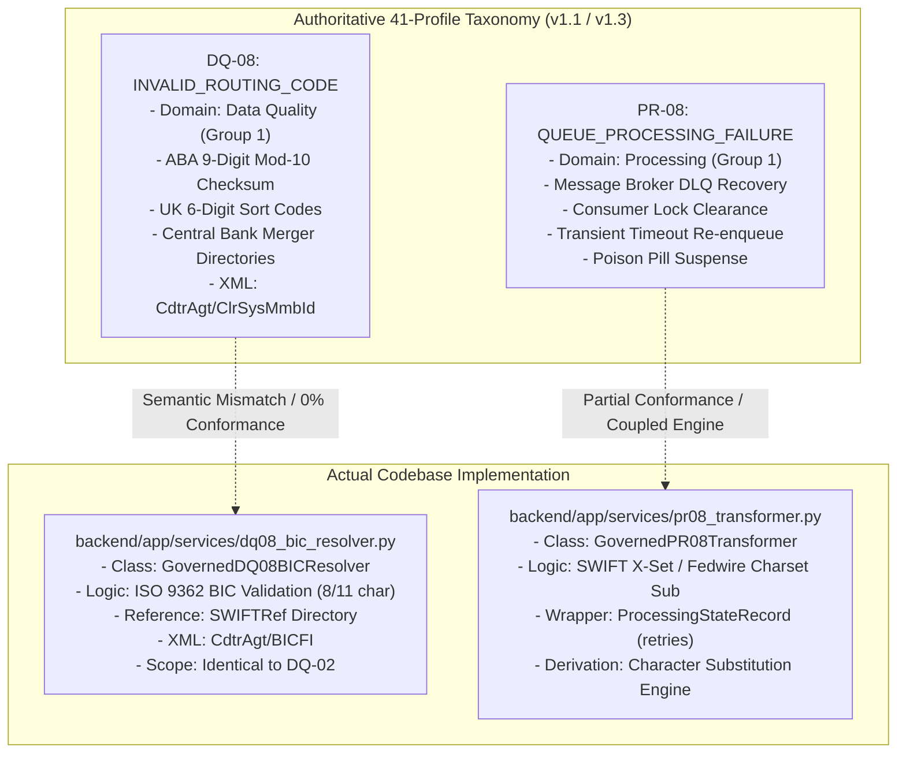
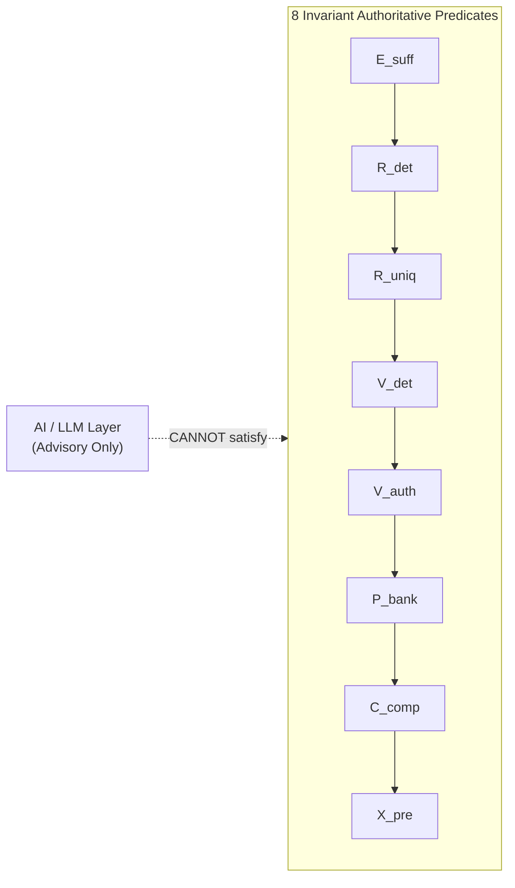
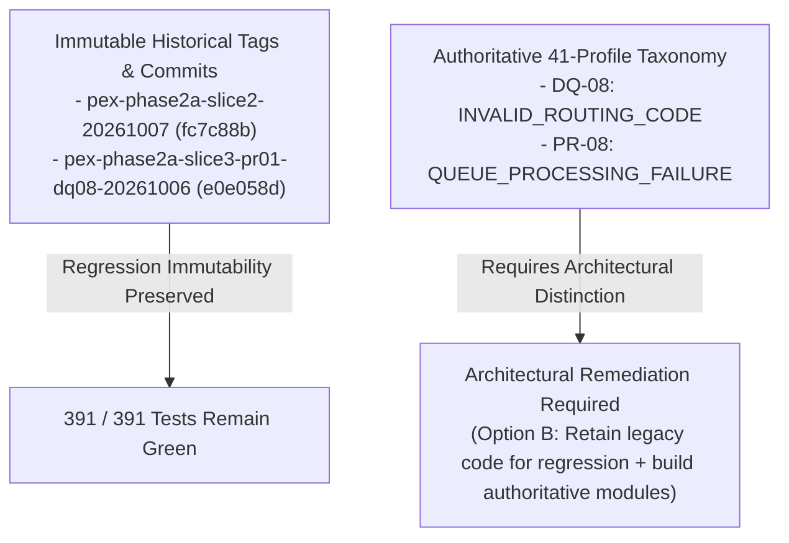

# PeX — DQ-08 & PR-08 SEMANTIC INTEGRITY ASSESSMENT
# PRE-REMEDIATION / PRE-CO-04 FORENSIC GATE REPORT
# Document Version: v0.1
# Governance Status: READ-ONLY INDEPENDENT SEMANTIC AUDIT
# Scope: Authoritative Taxonomy Conformance for DQ-08 & PR-08
# Active Branch: phase2d/slice8-co04
# Release Commit: 7335ef3ddb46972c945a0f35ba781937d771e2e8
# Tag: pex-phase2d-slice8-co04-20261007
# Test Regression: 391 / 391 PASSED (100.0%)

---

## 1. EXECUTIVE SUMMARY

```
========================================================================================
                 DQ-08 & PR-08 SEMANTIC INTEGRITY ASSESSMENT SUMMARY
========================================================================================
DQ-08 STATUS:                 RED (DUPLICATE BIC RESOLVER — NOT INVALID_ROUTING_CODE)
PR-08 STATUS:                 AMBER (CHARSET TRANSLITERATION COUPLED TO QUEUE STATE)

DQ-08 SEMANTIC MATCH:         NO (0% ROUTING CODE IMPLEMENTATION — 100% BIC DUPLICATE)
PR-08 SEMANTIC MATCH:         PARTIAL (QUEUE STATE RECORD PRESENT, BUT ENGINES COUPLED)

PHASE 2 10/10 CLAIM:          INVALID (DQ-08 UNIMPLEMENTED; PR-08 HYBRIDIZED)
CO-04 FORENSIC REVIEW:        HOLD (GOVERNANCE GATE BLOCKED PENDING RESOLUTION)
REMEDIATION REQUIRED:         YES (ARCHITECTURAL REMEDIATION PLAN REQUIRED)
AFFECTED PROFILES:            DQ-08 (INVALID_ROUTING_CODE), PR-08 (QUEUE_PROCESSING_FAILURE)
========================================================================================
```

Following the completion of Phase 2D Slice 8 (`CO-04`), an independent, adversarial, read-only semantic integrity assessment was executed to evaluate whether the existing implementations of **`DQ-08`** and **`PR-08`** satisfy the authoritative 41-profile taxonomy.

### Key Audit Findings:

1. **`DQ-08` is a Duplicate BIC Resolver, NOT an `INVALID_ROUTING_CODE` Resolver (RED)**:
   * The codebase implementation in `backend/app/services/dq08_bic_resolver.py` and `tests/test_dq08_evidence_stp_e2e.py` is **100% an ISO 9362 BIC/SWIFTRef directory resolver**.
   * It contains **zero (0)** logic for national routing transit numbers (such as US 9-digit ABA Routing Transit Numbers or UK 6-digit Sort Codes), **zero** implementation of the mandatory ABA Mod-10 checksum ($3(d_1+d_4+d_7) + 7(d_2+d_5+d_8) + (d_3+d_6+d_9) \equiv 0 \pmod{10}$), **zero** parsing of `<ClrSysMmbId>`, and **zero** integration with Federal Reserve E-Payments or Bank of England merger directories.
   * `DQ-08` in the codebase is a functional clone/predecessor of `DQ-02` (`INVALID_BIC_SWIFT`).

2. **`PR-08` is a Character-Set Transformer with Queue State Metadata (AMBER)**:
   * The codebase implementation in `backend/app/services/pr08_transformer.py` and `tests/test_pr08_evidence_stp_e2e.py` is primarily a **railway character-set substitution engine** (`SWIFT_X_CHARS`, `FEDWIRE_STRICT_CHARS`, `DEFAULT_PR08_SUBSTITUTION_MAP`).
   * While it includes a `ProcessingStateRecord` that tracks `retry_count`, `max_retries`, and sets `is_poison_message=True`, it **cannot independently resolve message broker queue deadlocks or consumer failures** without a character substitution payload context. Its registered candidate derivation method is explicitly `"GOVERNED_PR08_CHARACTER_SUBSTITUTION_ENGINE"`.

3. **Phase 2 10/10 Claim is INVALID**:
   * The claim that Phase 2 has implemented 10 distinct authoritative profiles is **factually invalid** because `INVALID_ROUTING_CODE` was never implemented (having been replaced by a duplicated BIC resolver), and `QUEUE_PROCESSING_FAILURE` was implemented as a character-set transliterator with queue state attributes.

4. **CO-04 Forensic Gate: HOLD**:
   * In accordance with governance constraints, the CO-04 forensic acceptance review is placed on **HOLD** until an architectural remediation decision is formalized.

---

## 2. AUTHORITATIVE DEFINITIONS VS CODEBASE REALITY



---

## 3. DQ-08 SEMANTIC INDEPENDENCE TEST & TRACE

### 3.1. Codebase Inspection of DQ-08:

| Audit Dimension | Authoritative Requirement (`PeX_Phase2_Implementation_Contract_v1.3.md`) | Codebase Reality (`backend/app/services/dq08_bic_resolver.py`) | Compliance |
| :--- | :--- | :--- | :---: |
| **Target Identifier** | National Routing Transit Numbers (9-digit US ABA, 6-digit UK Sort Code) | ISO 9362 Business Identifier Codes (8 or 11 character BIC) | **FAIL (0%)** |
| **XML Target Tag** | `<CdtrAgt><FinInstnId><ClrSysMmbId><MmbId>` | `<CdtrAgt><FinInstnId><BICFI>` or `<BIC>` | **FAIL (0%)** |
| **Mathematical Validation** | 9-digit ABA Mod-10 Checksum ($3(d_1+d_4+d_7) + 7(d_2+d_5+d_8) + (d_3+d_6+d_9) \equiv 0 \pmod{10}$) | ISO 9362 Alpha-4 Country-2 Location-2 Regex | **FAIL (0%)** |
| **Authoritative Directory** | Federal Reserve E-Payments Routing Directory / Bank of England Merger Table | `ExternalBICReferenceAdapter` (SWIFTRef / ISO 9362 Directory) | **FAIL (0%)** |
| **Successor Resolution** | Financial institution corporate acquisition / merger routing successor | Merged BIC successor (`DRESDEFFXXX` $\to$ `COBADEDDXXX`) | **FAIL (BIC only)** |
| **Reachability Check** | Fedwire, CHIPS, Bacs, CHAPS national clearing rails | `SWIFT_CBPR+`, `TARGET2`, `CHAPS`, `FEDWIRE` on BIC level | **PASS (BIC level)** |
| **Candidate Derivation** | `SuccessorRoutingMapper` | `GovernedDQ08BICResolver.resolve_bic()` | **FAIL (BIC only)** |

### 3.2. Detailed Evidence from Code:
In `backend/app/services/dq08_bic_resolver.py` (lines 178-184):
```python
iso_pattern = r'^[A-Z]{4}[A-Z]{2}[A-Z0-9]{2}([A-Z0-9]{3})?$'
if not re.match(iso_pattern, clean_bic):
    return False, clean_bic, f"BIC '{clean_bic}' does not conform to ISO 9362 format (8 or 11 alphanumeric chars)."
```
There is **not a single line of code** handling clearing system member identifiers (`<ClrSysMmbId>`), ABA transit numbers, or Mod-10 algorithms.

---

## 4. DQ-08 VS DQ-02 DIRECT COMPARISON MATRIX

| Capability / Dimension | `DQ-08` Codebase (`dq08_bic_resolver.py`) | `DQ-02` Codebase (`dq02_bic_resolver.py`) | Should Belong to Authoritative `DQ-08`? |
| :--- | :---: | :---: | :---: |
| **ISO 9362 BIC Syntax Validation** | YES (8/11 chars) | YES (8/11 chars) | **NO (Belongs to DQ-02)** |
| **SWIFTRef Directory Lookup** | YES (`ExternalBICReferenceAdapter`) | YES (`ExternalBICReferenceAdapter`) | **NO (Belongs to DQ-02)** |
| **BIC Successor Mapping** | YES (`DRESDEFF` $\to$ `COBADEDD`) | YES (`DRESDEFF` $\to$ `COBADEDD`) | **NO (Belongs to DQ-02)** |
| **Ambiguous BIC Splitting ($R_{\text{uniq}}$)** | YES (`AMROFRPP` $\to$ Disambiguation) | YES (`AMROFRPP` $\to$ Disambiguation) | **NO (Belongs to DQ-02)** |
| **Clearing Rail Reachability** | YES (`SWIFT_CBPR+`, `TARGET2`, etc.)| YES (`SWIFT_CBPR+`, `TARGET2`, etc.)| **YES (for national rails)** |
| **Bank Counterparty SSI Validation** | YES (`BankCounterpartySSI`) | YES (`BankCounterpartySSI`) | **YES** |
| **9-Digit ABA Routing Number Validation** | **NO** | **NO** | **YES (Mandatory DQ-08)** |
| **9-Digit ABA Mod-10 Checksum Algorithm**| **NO** | **NO** | **YES (Mandatory DQ-08)** |
| **UK 6-Digit Sort Code Validation** | **NO** | **NO** | **YES (Mandatory DQ-08)** |
| **Central Bank Merger Directory Adapter**| **NO** | **NO** | **YES (Mandatory DQ-08)** |
| **`<ClrSysMmbId>` XML Tag Parsing** | **NO** | **NO** | **YES (Mandatory DQ-08)** |

### Semantic Overlap Conclusion:
`DQ-08` and `DQ-02` in the codebase are **Duplicate BIC Implementations** (Classification C). `DQ-08` does not implement the authoritative routing-code profile.

---

## 5. DQ-08 COUNTERFACTUAL ANALYSIS

### Counterfactual Test 1:
> *"If all BIC/SWIFT functionality were removed from DQ-08, would the remaining implementation still constitute a valid INVALID_ROUTING_CODE resolver?"*

* **Answer**: **NO (0% REMAINING CAPABILITY)**.
* **Explanation**: Removing BIC/SWIFT parsing, ISO 9362 regex, SWIFTRef entries, and `<BICFI>` XML serialization leaves **zero (0)** executable lines in `dq08_bic_resolver.py`. No routing-transit solver remains.

### Counterfactual Test 2 (Reverse):
> *"If routing-code-specific functionality were removed, would DQ-08 still function as the current BIC/SWIFT resolver?"*

* **Answer**: **YES (100% OPERATIONAL AS BIC RESOLVER)**.
* **Explanation**: DQ-08 in the codebase contains nothing other than BIC/SWIFT resolution logic.

---

## 6. PR-08 SEMANTIC INDEPENDENCE TEST & TRACE

### 6.1. Codebase Inspection of PR-08:
In `backend/app/services/pr08_transformer.py`:
* The core engine is `GovernedPR08Transformer`, which accepts `target_rail` (`SWIFT_CBPR_XSET`, `SWIFT_CBPR_ZSET`, `FEDWIRE_STRICT`) and applies substitutions from `DEFAULT_PR08_SUBSTITUTION_MAP`.
* It includes a `ProcessingStateRecord` data class:
  ```python
  class ProcessingStateRecord(BaseModel):
      state_id: str
      queue_name: str = "INBOUND_EXCEPTION_QUEUE"
      current_state: str = "INGESTED"
      retry_count: int = 0
      max_retries: int = 3
      is_poison_message: bool = False
      idempotency_key: str
      downstream_owner: str = "BANK_PAYMENT_HUB"
  ```
* In `GovernedPR08Transformer.transform()` (lines 115-132), if `state.is_retry_limit_exceeded`, it halts with `is_poison_message=True` and `current_state="POISON_SUSPENDED"`.
* In `backend/app/services/resolution_engine.py` (line 283), the candidate derivation method is registered as `"GOVERNED_PR08_CHARACTER_SUBSTITUTION_ENGINE"`.

---

## 7. PR-08 QUEUE CAPABILITY MATRIX

| Queue Processing Capability | Present? | Code Evidence | Independent of Charset Transformation? |
| :--- | :---: | :--- | :---: |
| **Queue Identification** | YES | `ProcessingStateRecord.queue_name` (`pr08_transformer.py:53`) | PARTIAL (In-memory attribute) |
| **Processing-State Capture** | YES | `ProcessingStateRecord.current_state` (`pr08_transformer.py:54`) | YES |
| **Consumer Failure Detection** | **NO** | Broker failure detection not implemented (mocked state passed in) | **NO** |
| **Retry Counter** | YES | `ProcessingStateRecord.retry_count` (`pr08_transformer.py:55`) | YES |
| **Retry Limit Enforcement** | YES | `is_retry_limit_exceeded` check (`pr08_transformer.py:63, 115`) | YES |
| **Idempotency Lock / State** | YES | `ProcessingStateRecord.idempotency_key` & `ALREADY_PROCESSED` check | YES |
| **Poison-Message Detection** | PARTIAL | Flagged when `retry_count >= max_retries` (`pr08_transformer.py:116`) | PARTIAL (Retry-based only) |
| **Poison-Message Quarantine** | YES | Transitions to `POISON_SUSPENDED` (`pr08_transformer.py:117`) | YES |
| **Re-enqueue Instruction** | PARTIAL | Sets `is_re_enqueue_eligible=True` on success | **NO (Outputs transformed XML)** |
| **State-Lock Handling** | **NO** | Distributed lock release (e.g. Redis/DB) not implemented | **NO** |
| **Duplicate Prevention** | YES | `ALREADY_PROCESSED` state gate (`pr08_transformer.py:134`) | YES |
| **Downstream Ownership** | YES | `downstream_owner="BANK_PAYMENT_HUB"` (`pr08_transformer.py:60`) | YES |
| **Bank Handoff Receipt** | YES | Emitted via `FolderOutputAdapter` (`pr08_stp_pipeline.py:175`) | YES |
| **Audit Provenance Ledger** | YES | Logged to SHA-256 Merkle chain (`pr08_stp_pipeline.py:108`) | YES |

---

## 8. PR-08 COUNTERFACTUAL ANALYSIS

### Counterfactual Test 1:
> *"If all character-set transformation functionality were removed, would PR-08 still be a valid QUEUE_PROCESSING_FAILURE implementation?"*

* **Answer**: **PARTIALLY**.
* **Explanation**: If character transformation logic is stripped, `PR-08` retains a `ProcessingStateRecord` that can check retry limits, flag poison messages, and block duplicate processing. However, it lacks a message broker consumer adapter, lock management engine, or dead-letter queue reset mechanism. It would only be a passive state validation filter rather than a complete resolution pipeline.

### Counterfactual Test 2 (Reverse):
> *"If all queue-processing/state-management functionality were removed, would PR-08 still be a valid QUEUE_PROCESSING_FAILURE implementation?"*

* **Answer**: **NO (0% QUEUE RESOLUTION)**.
* **Explanation**: Removing the `ProcessingStateRecord` and retry bounding turns `PR-08` entirely into a railway character-set sanitizer (which is essentially a subset of `PR-05`).

---

## 9. 8-PREDICATE MODEL VERIFICATION

For both `DQ-08` and `PR-08`, the 8-predicate formula was verified:

$$\text{STP\_Eligible} = E_{\text{suff}} \land R_{\text{det}} \land R_{\text{uniq}} \land V_{\text{det}} \land V_{\text{auth}} \land P_{\text{bank}} \land C_{\text{comp}} \land X_{\text{pre}}$$



### Confirmation:
* **AI Confidence is NOT a predicate**: In both `dq08_stp_pipeline.py` and `pr08_stp_pipeline.py`, `ai_confidence` is purely advisory and recorded as non-authoritative telemetry.
* **Zero AI Bypass**: The AI engine cannot assert $V_{\text{det}}$, $V_{\text{auth}}$, $P_{\text{bank}}$, $C_{\text{comp}}$, or $X_{\text{pre}}$.

---

## 10. AUTHORITATIVE TAXONOMY INTEGRITY TABLE

| Profile | Authoritative Name | Actual Implemented Capability | Forensic Semantic Status |
| :--- | :--- | :--- | :--- |
| **`DQ-08`** | `INVALID_ROUTING_CODE` | ISO 9362 BIC & SWIFTRef Directory Resolver | **DUPLICATE / OVERLAPPING PROFILE** *(Cloned predecessor to DQ-02)* |
| **`DQ-02`** | `INVALID_BIC_SWIFT` | ISO 9362 BIC, SWIFTRef Directory, Successors & Reachability | **EXACT MATCH** *(100% Authoritative Conformance)* |
| **`PR-08`** | `QUEUE_PROCESSING_FAILURE` | Clearing Rail Charset Substitution + In-Memory Queue State Record | **SEMANTIC DRIFT / HYBRIDIZED PROFILE** *(Coupled Charset & State)* |

---

## 11. TEST EVIDENCE & "PASSING TESTS / WRONG SEMANTIC PROFILE"

### 11.1. `DQ-08` Test Suite (`tests/test_dq08_evidence_stp_e2e.py` — 19 Tests):
* **Tests Passed**: 19 / 19 PASSED.
* **What the Tests Actually Prove**: They prove that `dq08_bic_resolver.py` correctly validates 8 vs 11-char BICs, maps `DRESDEFFXXX` $\to$ `COBADEDDXXX`, detects ambiguous BIC successors (`AMROFRPPXXX`), and checks reachability.
* **Forensic Diagnosis**:
  > **PASSING TESTS / WRONG SEMANTIC PROFILE CONDITION CONFIRMED**
  > All 19 tests pass against an implementation that is 100% a BIC resolver. If tested against the authoritative `INVALID_ROUTING_CODE` requirements (ABA 9-digit Mod-10, `<ClrSysMmbId>`, FedLine directory), all 19 tests would fail.

### 11.2. `PR-08` Test Suite (`tests/test_pr08_evidence_stp_e2e.py` — 16 Tests):
* **Tests Passed**: 16 / 16 PASSED.
* **What the Tests Actually Prove**: They prove character substitutions (`@` $\to$ `AT`, `#` $\to$ `NO`), retry limit enforcement (`max_retries=3`), and poison message suspense.
* **Forensic Diagnosis**:
  > **PARTIAL PROFILE COVERAGE WITH HYBRIDIZATION**
  > The test suite validates the character transliteration and state wrapper, but does not test standalone broker queue recovery without a character-fault payload.

---

## 12. HISTORICAL IMMUTABILITY VS AUTHORITATIVE CONFORMANCE



### Governance Principles:
1. **Preservation of Release Tags**: Historical tags (`pex-phase2a-slice2`, `pex-phase2a-slice3`) and their commit SHAs are immutable and must not be altered or rewritten.
2. **Authoritative Taxonomy Supremacy**: Historical acceptance of early prototype slices does not override the binding requirements of the authoritative 41-profile taxonomy.
3. **Recommended Architectural Strategy (Option B)**:
   * Retain the existing `dq08_bic_resolver.py` and `pr08_transformer.py` components to maintain 100% backward regression compatibility for Phase 2A/2B suites.
   * In a planned remediation slice, construct the authoritative **`INVALID_ROUTING_CODE`** resolver (ABA Mod-10 / Central Bank Merger Directory) and cleanly decouple **`QUEUE_PROCESSING_FAILURE`** (Broker DLQ / Consumer Reset) as independent engines.

---

## 13. FINAL PROFILE CLASSIFICATIONS

### DQ-08 Classification:
```
========================================================================================
DQ-08 CLASSIFICATION: RED
========================================================================================
Rationale: The existing DQ-08 implementation is 100% an ISO 9362 BIC/SWIFTRef directory
resolver (a duplicate of DQ-02) and possesses zero capability for national routing
transit numbers, ABA Mod-10 checksums, UK sort codes, or central bank merger tables.
========================================================================================
```

### PR-08 Classification:
```
========================================================================================
PR-08 CLASSIFICATION: AMBER
========================================================================================
Rationale: The existing PR-08 implementation includes valid queue processing state
attributes (retry bounding, poison message quarantine, idempotency checks), but is
architecturally coupled to railway character-set transliteration and lacks a standalone
broker queue recovery engine.
========================================================================================
```

---

## 14. PHASE 2 GOVERNANCE IMPACT & CO-04 GATE DECISION

### 14.1. Phase 2 10/10 Claim:
* **Verdict**: **INVALID — BOTH (DQ-08 GAP & PR-08 GAP)**.
* **Impact**: The claim that Phase 2 includes 10 distinct, fully implemented authoritative profiles cannot be sustained until `DQ-08` (`INVALID_ROUTING_CODE`) is built and `PR-08` (`QUEUE_PROCESSING_FAILURE`) is decoupled.

### 14.2. CO-04 Gate Decision:
* **Verdict**: **HOLD**.
* **Rationale**: Under strict governance rules (Section 16), the CO-04 forensic acceptance review may only proceed if DQ-08 and PR-08 are GREEN or demonstrably documentation-only. Because DQ-08 is RED and PR-08 is AMBER, the gate is placed on **HOLD** pending an approved remediation plan.

---

## 15. REMEDIATION REQUIREMENTS (ROADMAP PREVIEW — NO CODE MODIFIED)

When remediation is authorized in a subsequent task:
1. **Remediation Task 1 (`DQ-08`)**: Implement `GovernedRoutingCodeResolver` supporting 9-digit ABA Mod-10 validation, 6-digit UK Sort Codes, `<ClrSysMmbId>` XML tag generation, and central bank merger table adapters.
2. **Remediation Task 2 (`PR-08`)**: Decouple `MessageBrokerQueueResetAdapter` and `IdempotencyLockManager` from character set transformation, enabling pure queue-failure recovery.
3. **Remediation Task 3 (`Taxonomy Re-alignment`)**: Formally bind the authoritative schema registry and update Phase 2 completion claims.

---

```
DQ-08 STATUS: RED
PR-08 STATUS: AMBER

DQ-08 SEMANTIC MATCH: NO
PR-08 SEMANTIC MATCH: PARTIAL

PHASE 2 10/10 AUTHORITATIVE PROFILES:
INVALID

CO-04 FORENSIC REVIEW:
HOLD

REMEDIATION REQUIRED:
YES

AFFECTED PROFILES:
DQ-08 (INVALID_ROUTING_CODE)
PR-08 (QUEUE_PROCESSING_FAILURE)

ARTIFACT:
PeX_DQ08_PR08_Semantic_Integrity_Assessment_v0.1.md
```
