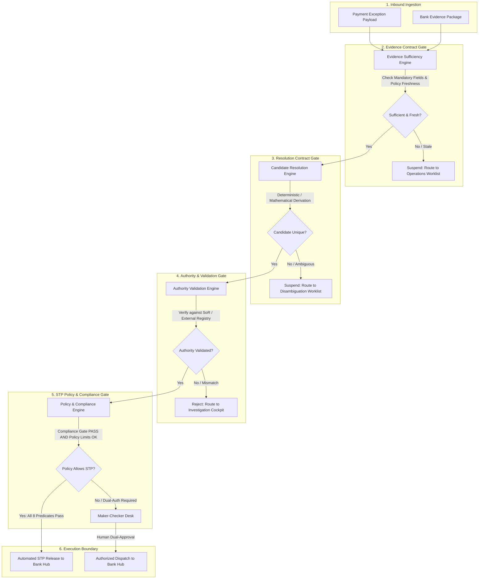
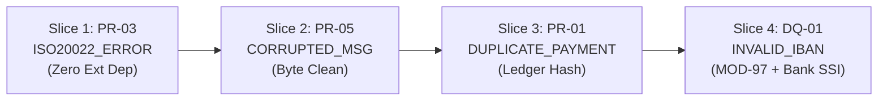

# PeX — Evidence-Driven STP Architecture Baseline v1.1
> **Document Type:** Authoritative Enterprise Payment Architecture Baseline & Specification  
> **Target Audience:** Principal Enterprise Architects, Head of Payment Operations, Chief Risk Officers, Payment Engineering Teams  
> **Status:** AUTHORITATIVE ARCHITECTURE BASELINE  
> **Operating Mode:** READ-ONLY / PRE-IMPLEMENTATION (Zero Production Code Modifications)  
> **Date:** October 2026  

---

## 1. Document Control

### 1.1 Document Information
- **Title:** PeX Payment Exception Resolution — Evidence-Driven STP Architecture Baseline
- **Version:** v1.1 (Authoritative)
- **Status:** **AUTHORITATIVE ARCHITECTURE BASELINE**
- **Operating Mode:** READ-ONLY / PRE-IMPLEMENTATION
- **Baseline Date:** October 2026
- **Supersession Notice:** This document establishes the definitive architectural specification for the PeX platform. It formally **supersedes** all prior draft assessments, working papers, and legacy AI-centric recommendation specifications wherever conflicts exist.

### 1.2 Purpose & Governance
This baseline defines the architectural principles, contract boundaries, data taxonomies, eligibility predicates, evidence trust tiers, and lifecycle stages governing Straight-Through Processing (STP) and Human-in-the-Loop (HITL) exception resolution in PeX. No implementation work may commence until this baseline is approved and formal authorization to enter Implementation Mode is granted.

---

## 2. Executive Architecture Principles

The PeX architecture is governed by nine non-negotiable architectural axioms:

```
+---------------------------------------------------------------------------------------------------+
|                                  EXECUTIVE ARCHITECTURAL PRINCIPLES                               |
+----+------------------------------------+---------------------------------------------------------+
| #  | Principle                          | Operational Definition                                  |
+----+------------------------------------+---------------------------------------------------------+
| 1  | Evidence Before AI                 | Resolution and eligibility evaluate verified evidence;  |
|    |                                    | AI is strictly an investigative copilot, not authority. |
| 2  | Authority Before Confidence        | Mathematical / heuristic confidence cannot substitute    |
|    |                                    | for authoritative System of Record (SoR) attestation.   |
| 3  | Historical Precedent ≠ Authority   | Past successful repairs suggest hypotheses and rank     |
|    |                                    | candidates; they never satisfy live authority gates.    |
| 4  | Invalid / Failed ≠ Correct         | Detecting an error (e.g. bad check digit) proves only    |
|    |                                    | invalidity; deriving the true replacement requires SoR. |
| 5  | Support ≠ Autonomous STP           | PeX supports all 41 profiles in its canonical model;     |
|    |                                    | autonomous STP is permitted only when all 8 gates pass. |
| 6  | Zero AI Payment-Release Authority  | AI models, agents, and LLMs are strictly prohibited     |
|    |                                    | from releasing funds or overriding control gates.       |
| 7  | Bank Retains Execution Control     | PeX emits repaired instructions back to the Bank        |
|    |                                    | Payment Hub; PeX never bypasses bank clearing gateways. |
| 8  | Insufficient Evidence is a State   | When evidence is missing, stale, or ambiguous, the case |
|    |                                    | cleanly suspends to human operations without guessing.  |
| 9  | Bank Policy Governs Execution      | Bank risk policy can restrict or disable STP, but can   |
|    |                                    | NEVER bypass mandatory authority or evidence controls.  |
+----+------------------------------------+---------------------------------------------------------+
```

---

## 3. The Four-Contract Model

The architecture decouples exception lifecycle evaluation into four strictly independent contracts.

```
+-----------------------------------------------------------------------------------------------+
|                                    THE FOUR-CONTRACT MODEL                                     |
+-----------------------------------------------------------------------------------------------+
|  1. EVIDENCE CONTRACT           | Defines WHAT evidence must exist, who owns it, and freshness|
|  2. RESOLUTION CONTRACT         | Defines HOW candidate repairs are deterministically derived |
|  3. AUTHORITY CONTRACT          | Defines WHO/WHAT proves correctness (System of Record)      |
|  4. STP POLICY CONTRACT         | Defines WHEN automated release is legally & safely allowed  |
+-----------------------------------------------------------------------------------------------+
```



### 3.1 Contract 1: Evidence Contract (*What Evidence Must Exist*)
- **Purpose**: Establishes the mandatory, conditional, and contextual data items required to evaluate an exception before repair logic executes.
- **Inputs**: Parsed canonical exception payload, inbound evidence package.
- **Outputs**: Evaluated evidence dossier, sufficiency boolean ($E_{\text{suff}}$), missing fields list, staleness violations.
- **Owner**: Ingestion & Evidence Engine.
- **Responsibilities**: Validate schema presence, verify configured freshness TTLs, check digital signatures and trust tiers.
- **Prohibited Responsibilities**: Deriving repair candidates, validating business correctness, evaluating bank risk limits.
- **Transport Agnosticism**: The Evidence Contract is strictly decoupled from network transport (REST, SFTP, MQ, Kafka, Folder Watcher). It operates solely on canonicalized data structures.

### 3.2 Contract 2: Resolution Contract (*How Candidate Repair is Derived*)
- **Purpose**: Defines the mathematical, grammatical, or deterministic logic that generates the candidate corrected payment instruction.
- **Inputs**: Validated evidence dossier, canonical exception.
- **Outputs**: Candidate repaired instruction(s), candidate uniqueness count ($R_{\text{uniq}}$), derivation audit metadata.
- **Owner**: Resolution & Normalization Engine.
- **Responsibilities**: Execute deterministic algorithms (MOD-97 checksum solver, ISO 20022 XSD re-sequencer, IMAD regex sanitizer, duplicate suppression flag).
- **Prohibited Responsibilities**: Asserting real-world truth, contacting external registries directly, authorizing payment release.

### 3.3 Contract 3: Authority / Validation Contract (*How Correctness is Proven*)
- **Purpose**: Proves that the candidate resolution matches the real-world ground truth of the beneficiary, bank, or clearing system.
- **Inputs**: Candidate repaired instruction, authoritative System of Record (SoR) connectors.
- **Outputs**: Cryptographic validation attestation ($V_{\text{auth}}$), authoritative source timestamp, verification response payload.
- **Owner**: Authority Validation Service.
- **Responsibilities**: Corroborate candidate against Tier 1 Bank SoR (Core DDA, SSI Master) or Tier 2 External Registries (SWIFTRef, Pay.UK CoP, FedLine).
- **Prohibited Responsibilities**: Generating repairs, bypassing SoR checks using historical similarity, evaluating bank commercial policy.

### 3.4 Contract 4: STP Policy Contract (*When Autonomous Execution is Permitted*)
- **Purpose**: Enforces bank-defined risk, governance, compliance, and dual-authorization rules governing execution.
- **Inputs**: Validated candidate repair, bank policy configuration, compliance screening results, execution environment status.
- **Outputs**: Final STP eligibility determination ($\text{STP\_ELIGIBLE}$), routing directive (Auto-STP vs Maker-Checker Worklist).
- **Owner**: Bank Policy & Governance Engine.
- **Responsibilities**: Enforce monetary ceilings, evaluate compliance screening results (`PASS`), enforce dual-authorization thresholds, verify corridor permissions.
- **Prohibited Responsibilities**: Mutating payment payloads, modifying authority attestations, generating synthetic compliance clearances.

---

## 4. STP Eligibility Model

The decision to execute an exception via Straight-Through Processing is governed by an 8-predicate boolean formula:

$$\mathbf{STP\_ELIGIBLE} = E_{\text{suff}} \wedge R_{\text{det}} \wedge R_{\text{uniq}} \wedge V_{\text{det}} \wedge V_{\text{auth}} \wedge P_{\text{bank}} \wedge C_{\text{comp}} \wedge X_{\text{pre}}$$

```
+---------------------------------------------------------------------------------------------------+
|                                  STP ELIGIBILITY PREDICATE MATRIX                                 |
+----+-----------------------+----------------------------------------------------------------------+
| #  | Predicate             | Definition & Evaluation Criteria                                     |
+----+-----------------------+----------------------------------------------------------------------+
| 1  | Evidence_Sufficient   | All mandatory evidence items are present, valid, within configured   |
|    | (E_suff)              | policy freshness window, and meet the required Trust Tier.           |
| 2  | Resolution_Determined | A deterministic algorithm or rule successfully produced a candidate  |
|    | (R_det)               | repaired instruction.                                                |
| 3  | Resolution_Unique     | Exactly one candidate repair exists (Count == 1). Multiple candidate |
|    | (R_uniq)              | hypotheses force human disambiguation.                               |
| 4  | Deterministic_Valid   | Candidate repair conforms 100% to ISO 20022 schemas, regex formats,  |
|    | (V_det)               | and mathematical checksums.                                          |
| 5  | Authority_Valid       | Authoritative System of Record (Core DDA, SSI Master, SWIFTRef, CoP) |
|    | (V_auth)              | confirms candidate correctness (Attestation == TRUE).                |
| 6  | Bank_Policy_Allows    | Transaction amount <= Bank STP limit, corridor permitted, and dual-  |
|    | (P_bank)              | authorization is not mandated for this exception profile.            |
| 7  | Compliance_Gate_Passed| Configurable compliance and sanctions screening policy evaluates to  |
|    | (C_comp)              | PASS under applicable bank rules.                                    |
| 8  | Execution_Precondition| RTGS cutoff is active, settlement ledger is reachable, and the       |
|    | (X_pre)               | transaction idempotency lock is secured.                             |
+----+-----------------------+----------------------------------------------------------------------+
```

### Absolute AI Boundary Rule
- **AI Confidence is NOT an STP Predicate**: Probabilistic confidence scores (e.g. 99.8%) from neural networks, LLMs, or heuristic classifiers cannot satisfy any of the 8 predicates.
- **Zero Bypass**: AI outputs must traverse all 8 deterministic predicates identically to any other candidate hypothesis.

---

## 5. The 12-Stage Lifecycle

```
[1. Exception Detection] ──> [2. Evidence Acquisition] ──> [3. Evidence Normalization]
                                                                      │
[6. Authority Validation] <── [5. Resolution Determination] <── [4. Evidence Sufficiency]
         │
[7. Bank Policy Evaluation] ──> [8. STP Eligibility Gate] ──> [9. Output Instruction]
                                                                      │
[12. Cryptographic Audit] <── [11. Outcome Reconciliation] <── [10. Bank Execution]
```

1. **Stage 1: Exception Detection** — Ingestion of error payload from Bank Payment Hub or clearing network.
2. **Stage 2: Evidence Acquisition** — Gathering associated evidence package via configured transport.
3. **Stage 3: Evidence Normalization** — Parsing raw evidence into canonical schema representations.
4. **Stage 4: Evidence Sufficiency Evaluation** — Verifying completeness, freshness, and trust tiers ($E_{\text{suff}}$).
5. **Stage 5: Resolution Determination** — Deterministic generation of unique candidate repair ($R_{\text{det}} \wedge R_{\text{uniq}}$).
6. **Stage 6: Authority Validation** — Corroboration against authoritative System of Record ($V_{\text{auth}}$).
7. **Stage 7: Bank Policy Evaluation** — Evaluating monetary limits, dual-auth mandates, and corridor rules ($P_{\text{bank}}$).
8. **Stage 8: STP Eligibility Determination** — Evaluating the 8-predicate boolean formula.
9. **Stage 9: Output Serialization** — Serializing repaired ISO 20022 XML/JSON payload.
10. **Stage 10: Bank-Controlled Execution** — Dispatching repaired instruction back into Bank Payment Hub.
11. **Stage 11: Outcome Reconciliation** — Ingesting execution ack/nack and updating case disposition.
12. **Stage 12: Cryptographic Audit** — Appending immutable SHA-256 linear hash ledger entry with full provenance.

> **Architectural Note on Vertical Slices**: A vertical slice demonstrates the applicable stages for that specific exception profile; it does not constitute universal proof that every profile traverses every stage identically.

---

## 6. Evidence Architecture

### 6.1 Evidence Trust Hierarchy (4 Tiers)

```
+---------------------------------------------------------------------------------------------------+
|                                     EVIDENCE TRUST HIERARCHY                                      |
+------+-----------------------+------------------------------------+-------------------------------+
| Tier | Classification        | Description & Systems of Record    | Authority & Permissibility    |
+------+-----------------------+------------------------------------+-------------------------------+
| 1    | Bank Authoritative    | Core DDA, Customer Master, Bank SSI| Primary legal authority for   |
|      |                       | Master, Signatory Mandates, AML/TM | bank account ownership.       |
| 2    | External Authoritative| SWIFTRef, FedLine, Pay.UK CoP,     | Authoritative for clearing,   |
|      |                       | EU VoP, GLEIF LEI, Central Banks   | routing, and national codes.  |
| 3    | PeX Derived           | MOD-97 solvers, XSD normalizers,   | Validates syntax and math;    |
|      |                       | IMAD regex, SHA-256 hash collision | cannot prove real-world SoR.  |
| 4    | Historical Precedent  | PeX Audit Store, past successful   | Proposes candidates & ranks;  |
|      |                       | repairs, recurrence patterns       | NEVER satisfies authority.    |
+------+-----------------------+------------------------------------+-------------------------------+
```

### 6.2 Evidence Decoupling & Configurable Freshness
- **Separation of Concerns**: *What* evidence is required (Evidence Contract) is strictly decoupled from *How* it is acquired (Transport Adapters: Inbound Folder Watcher, REST API, MQ, Kafka, SFTP).
- **Configurable Freshness**: Evidence freshness is **not** a hardcoded constant (e.g. 15 minutes or 24 hours). Freshness criteria ($PolicyFreshness(e)$) are configurable per profile, evidence source, and bank operating SLA.
- **Contradictory Evidence**: When two authoritative sources conflict (e.g. Bank SSI contradicts External CoP), STP is immediately blocked and the case is escalated to human operations with highlighted discrepancies.

---

## 7. Invalid IBAN Authoritative Design (`DQ-01: INVALID_IBAN`)

```
+---------------------------------------------------------------------------------------------------+
|                           INVALID IBAN: FACT & AUTHORITY MATRIX                                   |
+--------------------------+------------------------------+--------------------+--------------------+
| Dimension                | Source / Mechanism           | Proves             | Does NOT Prove     |
+--------------------------+------------------------------+--------------------+--------------------+
| Mathematical Validity    | ISO 7064 MOD-97-10 Checksum  | Syntactic check-   | Account exists or  |
|                          |                              | digit integrity    | belongs to client  |
| BBAN / Routing Structure | SWIFTRef / National Directory| Country format,    | Beneficiary name,  |
|                          |                              | bank code & branch | active account     |
| Candidate Generation     | Check-digit recalculation /  | Formatted string   | Correctness of the |
|                          | Historical transposition fix | hypothesis         | intended target    |
| Beneficiary Authority    | Bank SSI Master / Core DDA / | Legal account-name | Routing feasibility|
|                          | Confirmation of Payee (CoP)  | ownership & status | in external RTGS   |
| Historical Precedent     | PeX Historical Corpus        | Past successful    | Current account    |
|                          |                              | repairs for remitter validity / mandate   |
+--------------------------+------------------------------+--------------------+--------------------+
```

### Key Architectural Rules for `DQ-01`:
1. **MOD-97 Math**: Proves only mathematical checksum validity ($r = 1$); does not prove which character was mistyped.
2. **SWIFTRef**: Validates national BBAN length and bank/branch code existence; has **zero visibility** into customer account ownership.
3. **Mandatory Corroboration**: An IBAN repair cannot achieve STP eligibility without corroboration from **Bank SSI Master**, **Core DDA**, or live **Confirmation of Payee (CoP)**.

---

## 8. Historical Precedent Model

```
+----------------------------------------------------+----------------------------------------------+
| What Historical Evidence CAN Do                    | What Historical Evidence CANNOT Do           |
+----------------------------------------------------+----------------------------------------------+
| 1. Identify recurring exception patterns           | 1. Satisfy mandatory authority evidence alone|
| 2. Suggest likely root causes to analysts          | 2. Override live authoritative validation    |
| 3. Rank candidate hypotheses by past success rate  | 3. Authorize autonomous STP release          |
| 4. Provide contextual corroboration in UI cockpit  | 4. Create synthetic or hallucinated evidence |
+----------------------------------------------------+----------------------------------------------+
```

---

## 9. AI & LLM Boundaries

```
+----------------------------------------------------+----------------------------------------------+
| Permitted AI Responsibilities                      | Strictly Prohibited AI Actions               |
+----------------------------------------------------+----------------------------------------------+
| 1. Parsing unstructured free-text remittance info  | 1. Authorizing payment release               |
| 2. Extracting structured entities from messy text  | 2. Overriding evidence sufficiency gates     |
| 3. Summarizing complex exception histories for UI  | 3. Inventing synthetic account numbers / BICs|
| 4. Drafting customer inquiry / RFI messages        | 4. Bypassing Maker-Checker dual authorization|
| 5. Assisting human operators with search & ranking | 5. Converting insufficient evidence into STP |
+----------------------------------------------------+----------------------------------------------+
```

---

## 10. Authoritative 41-Profile Taxonomy

The PeX platform taxonomy is strictly defined across 5 canonical BIAN domains and 41 profiles:

1. **Data Quality (9 Profiles)**: `DQ-01` through `DQ-09`
2. **Processing (9 Profiles)**: `PR-01` through `PR-09`
3. **Compliance (8 Profiles)**: `CO-01` through `CO-08`
4. **Client / Treasury (8 Profiles)**: `TR-01` through `TR-08`
5. **Settlement / Returns (7 Profiles)**: `ST-01` through `ST-07`

---

## 11. Group Classification (Authoritative v1.1)

```
+---------------------------------------------------------------------------------------------------+
|                                  GROUP CLASSIFICATION DISTRIBUTION                                |
+---------+----------------------------------------------------+-------+----------------------------+
| Group   | Architectural Definition                           | Count | Profile IDs                |
+---------+----------------------------------------------------+-------+----------------------------+
| Group 1 | Deterministically STP-capable subject to bank      | 7     | DQ-05, DQ-08, PR-01, PR-03,|
|         | controls (Syntax, XML, duplicate suppression)      |       | PR-05, PR-08, ST-01        |
+---------+----------------------------------------------------+-------+----------------------------+
| Group 2 | Conditionally STP-capable                          | 12    | DQ-01, DQ-02, DQ-04, DQ-06,|
|         | (Requires external/bank SoR corroboration)         |       | DQ-07, PR-04, PR-09, CO-04,|
|         |                                                    |       | CO-07, TR-01, TR-03, TR-04 |
+---------+----------------------------------------------------+-------+----------------------------+
| Group 3 | Bank-policy dependent                              | 10    | DQ-03, PR-02, PR-06, PR-07,|
|         | (Requires bank risk parameters or client mandates) |       | CO-06, TR-02, TR-05, TR-06,|
|         |                                                    |       | ST-05, ST-07               |
+---------+----------------------------------------------------+-------+----------------------------+
| Group 4 | Human authorization required                       | 12    | DQ-09, CO-01, CO-02, CO-03,|
|         | (Mandatory Maker-Checker / Sanctions / Fraud)      |       | CO-05, CO-08, TR-07, TR-08,|
|         |                                                    |       | ST-02, ST-03, ST-04, ST-06 |
+---------+----------------------------------------------------+-------+----------------------------+
| TOTAL   |                                                    | 41    | All 41 Profiles Reconciled |
+---------+----------------------------------------------------+-------+----------------------------+
```

---

## 12. Complete 41-Profile Forensic Matrix

```
+----+------------------------------+-------+-------------------------+----------------------+----------------------+--------------------+-----------------+
| #  | Profile ID & Name            | Group | Required Evidence       | Authority Source     | Resolution Method    | Deterministic Valid| STP Eligibility |
+----+------------------------------+-------+-------------------------+----------------------+----------------------+--------------------+-----------------+
| 1  | DQ-01: INVALID_IBAN          | Grp 2 | Payload, SSI, CoP       | Bank SSI Master, CoP | Check-digit / SSI    | ISO 7064 MOD-97    | Conditional STP |
| 2  | DQ-02: INVALID_BIC           | Grp 2 | Payload, BIC Directory  | SWIFTRef / ISO 9362  | BIC8/11 Normalizer   | ISO 9362 Format    | Conditional STP |
| 3  | DQ-03: MISSING_BENEFICIARY   | Grp 3 | Payload, Mandate, DDA   | Bank Customer Master | Populate from DDA    | Non-empty string   | Policy-Dependent|
| 4  | DQ-04: MISSING_REMITTANCE    | Grp 2 | Payload, AP Invoice DB  | Debtor ERP AP Feed   | Populate RmtInf tag  | ISO 20022 Schema   | Conditional STP |
| 5  | DQ-05: INVALID_ADDRESS       | Grp 1 | Malformed Address Lines | Universal Postal UPU | Parse discrete tags  | PostalAddress24 XSD| STP-Capable     |
| 6  | DQ-06: MISSING_PURPOSE       | Grp 2 | Remittance text, BoP Dir| ISO External Codes   | Keyword code mapper  | ISO External Set   | Conditional STP |
| 7  | DQ-07: INVALID_ACCOUNT_NUM   | Grp 2 | Domestic Account, Transit| Core DDA / Clearing  | Modulus / Zero Pad   | Modulo check       | Conditional STP |
| 8  | DQ-08: INVALID_ROUTING       | Grp 1 | Retired Routing Transit | FedLine / BOE Dir    | Successor ABA Mapper | 9-digit Fed Check  | STP-Capable     |
| 9  | DQ-09: NAME_MISMATCH         | Grp 4 | Inbound Name, CoP Feed  | Pay.UK CoP / Fraud   | Compile Fuzzy Dossier| Lexical similarity | Human Auth Only |
| 10 | PR-01: DUPLICATE_PAYMENT     | Grp 1 | Hash Ledger, Core DDA   | Bank Core Ledger     | Suppress Duplicate   | SHA-256 Collision  | STP-Capable     |
| 11 | PR-02: ROUTING_FAILURE       | Grp 3 | Rail Status, Matrix DB  | Bank Routing Policy  | Alternate Rail Route | Rail Schema Match  | Policy-Dependent|
| 12 | PR-03: ISO20022_ERROR        | Grp 1 | Malformed XML Tagged    | ISO 20022 XSD Schema | Tag Re-sequencer     | XSD Compliant      | STP-Capable     |
| 13 | PR-04: CUTOFF_MISSED         | Grp 2 | System Time, Cutoff DB  | Central Bank Spec    | Roll Value Date (T+1)| Working Day Cal    | Conditional STP |
| 14 | PR-05: CORRUPTED_MESSAGE     | Grp 1 | Raw Byte Stream         | SWIFT X-Char Set     | Strip Null/Non-print | Byte Integrity     | STP-Capable     |
| 15 | PR-06: INTERMEDIARY_NACK     | Grp 3 | pacs.002 NACK, RMA DB   | Bilateral RMA Matrix | Alternate Corr Route | SWIFTRef RMA Match | Policy-Dependent|
| 16 | PR-07: NETWORK_TIMEOUT       | Grp 3 | UETR, gpi Tracker Feed  | SWIFT gpi Tracker    | Re-dispatch / Status | UETR Identity      | Policy-Dependent|
| 17 | PR-08: QUEUE_FAILURE         | Grp 1 | Broker DLQ Metadata     | Bank Internal MQ SOP | Reset State & Re-enq | Idempotency Check  | STP-Capable     |
| 18 | PR-09: HELD_FOR_REPAIR       | Grp 2 | Hold Flag, Raw Payload  | Bank Payment Hub SOP | Re-classify Sub-prof | Sub-profile rules  | Conditional STP |
| 19 | CO-01: SANCTIONS_ALERT       | Grp 4 | OFAC/EU Watchlist Match | Sanctions Authority  | Disambiguation Doss  | Exact/Fuzzy Score  | Human Auth Only |
| 20 | CO-02: AML_ALERT             | Grp 4 | TM Alert, Customer Hist | FinCEN / Bank TM Hub  | Turnover Dossier     | Velocity Metrics   | Human Auth Only |
| 21 | CO-03: PEP_MATCH             | Grp 4 | PEP Screening Dossier   | World-Check / FATF   | EDD Dossier Assembly | PEP Tier Match     | Human Auth Only |
| 22 | CO-04: RESTRICTED_CORRIDOR   | Grp 2 | Country, Sanctions Matrix| Geopolitical OFAC Mat| Auto-Block / Reject   | ISO 3166 Sanctioned| Conditional STP |
| 23 | CO-05: ADVERSE_MEDIA         | Grp 4 | Media Feed, Entity Name  | Media Aggregator / TM | Media Dossier Compile | Sentiment Score    | Human Auth Only |
| 24 | CO-06: HIGH_RISK_JURISD      | Grp 3 | FATF Greylist, EDD Master| FATF Rec 19 / CDD DB  | EDD Certificate Verify| Active EDD Date     | Policy-Dependent|
| 25 | CO-07: REGULATORY_REPORT     | Grp 2 | Payload, Customs Invoice | Central Bank Mandate  | Generate RgltryRptg   | Statutory XML XSD   | Conditional STP |
| 26 | CO-08: CUSTOMER_WATCHLIST    | Grp 4 | Debtor ID, Risk Register | Internal Risk Comm    | Risk Dossier Assembly | Customer ID Match   | Human Auth Only |
| 27 | TR-01: NOSTRO_SHORTFALL      | Grp 2 | Nostro Balance, Sweep DB | Treasury Sweep Engine | Trigger Cash Sweep    | Post-sweep Balance  | Conditional STP |
| 28 | TR-02: KYC_EXPIRED           | Grp 3 | Review Date, Grace DB    | Bank KYC Policy Master| Apply Policy Grace    | Low-risk & Date OK  | Policy-Dependent|
| 29 | TR-03: INSUFFICIENT_FUNDS    | Grp 2 | DDA Balance, Credit Line | Core DDA / UCC 4A-201 | Overdraft Draw / Hold | Balance + Limit OK  | Conditional STP |
| 30 | TR-04: FX_UNAVAILABLE        | Grp 2 | Expired FX Quote, Spot DB| Treasury FX Engine    | Live Spot Re-price    | Spread <= Mandate   | Conditional STP |
| 31 | TR-05: AUTH_MISSING          | Grp 3 | Signatory Matrix, Push DB| Corporate Mandate DB  | Async Signatory Push  | PKI Signature Valid | Policy-Dependent|
| 32 | TR-06: LIMIT_BREACH          | Grp 3 | Accumulated Total, Limit | Credit Risk Policy DB | Apply 10% Step-Up     | Exposure <= 110%    | Policy-Dependent|
| 33 | TR-07: LIQUIDITY_CAP         | Grp 4 | RTGS Throughput Cap Feed | Central Bank RTGS Hub | Re-sequence Queue     | Throughput Cap Fit  | Human Auth Only |
| 34 | TR-08: CREDIT_BREACH         | Grp 4 | Bilateral Exposure Feed  | Basel III Risk Engine | Credit Breach Dossier | Real-time Exposure  | Human Auth Only |
| 35 | ST-01: RETURNED_PAYMENT      | Grp 1 | Inbound pacs.004, Ledger | SWIFT CBPR+ Rules     | Auto-credit Debtor DDA| UETR & Amt Match    | STP-Capable     |
| 36 | ST-02: ACCOUNT_CLOSED        | Grp 4 | pacs.004 AC04, SSI DB    | UCC 4A-402 / Scheme   | Return / Reroute Doss | Signed Successor SSI| Human Auth Only |
| 37 | ST-03: ACCOUNT_FROZEN        | Grp 4 | pacs.004 AC06, Restraint | Judicial Restraint DB | Route GL Escrow Hold  | Restraint Active    | Human Auth Only |
| 38 | ST-04: RECON_BREAK           | Grp 4 | camt.053, GL Balance DB  | SOX 404 / Nostro SOP  | Ledger Variance Doss  | Delta Calculation   | Human Auth Only |
| 39 | ST-05: SETTLE_FAILURE        | Grp 3 | Central Bank NAK / Status| CPMI-IOSCO / RTGS Hub | Re-present Wire       | Negative Settle Ack | Policy-Dependent|
| 40 | ST-06: FUNDS_TRAPPED         | Grp 4 | gpi Trace, Stalled Node  | SWIFT gpi / camt.027  | Generate Claim XML    | Stalled Node ID     | Human Auth Only |
| 41 | ST-07: UNMATCHED_CREDIT      | Grp 3 | pacs.008, Open AP Feed   | Corporate AP Master   | Match Open Invoice    | Exact Amt & Invoice | Policy-Dependent|
+----+------------------------------+-------+-------------------------+----------------------+----------------------+--------------------+-----------------+
```

---

## 13. Discrepancy & Correction Log

```
+-------------------------------------------------------------------------------------------------------------------------+
|                                                  TAXONOMY DISCREPANCY LOG                                               |
+----+-----------------------+-----------------------+-----------------------------+--------------------------------------+
| #  | Incorrect Review ID   | Correct Authoritative | Category / Nature of Error  | Architectural Correction Made        |
+----+-----------------------+-----------------------+-----------------------------+--------------------------------------+
| 1  | DQ-04 (Orig Missing)  | DQ-04: MISSING_REMITT | Taxonomy Drift / Name Error | Restored DQ-04 as Missing Remittance |
| 2  | DQ-05 (Acct Modulus)  | DQ-05: INVALID_ADDR   | Taxonomy Drift / Name Error | Restored DQ-05 as Invalid Address    |
| 3  | DQ-06 (Routing Error) | DQ-06: MISSING_PURPOSE| Taxonomy Drift / Name Error | Restored DQ-06 as Missing Purpose    |
| 4  | DQ-07 (Truncated Name)| DQ-07: INVALID_ACCT_NO| Taxonomy Drift / Name Error | Restored DQ-07 as Invalid Account No |
| 5  | DQ-08 (Special Char)  | DQ-08: INVALID_ROUTING| Taxonomy Drift / Name Error | Restored DQ-08 as Invalid Routing    |
| 6  | DQ-09 (Invalid LEI)   | DQ-09: NAME_MISMATCH  | Taxonomy Drift / Name Error | Restored DQ-09 as Name Mismatch      |
| 7  | DQ-10, DQ-11, DQ-12   | *Non-existent baseline*| Invented Profiles Dropped   | Removed DQ-10, DQ-11, DQ-12          |
| 8  | PR-02 (Msg Parse Err) | PR-02: ROUTING_FAILURE| Taxonomy Drift / Name Error | Restored PR-02 as Routing Failure    |
| 9  | PR-04 (Encoding Err)  | PR-04: CUTOFF_MISSED  | Taxonomy Drift / Name Error | Restored PR-04 as Cutoff Missed      |
| 10 | PR-05 (Corrupted Msg) | PR-05: CORRUPTED_MSG  | Maintained Baseline         | Reconciled correctly                 |
| 11 | PR-06 (Routing Fail)  | PR-06: INTERMED_NACK  | Taxonomy Drift / Name Error | Restored PR-06 as Intermediary NACK  |
| 12 | PR-07 (Cutoff Missed) | PR-07: NETWORK_TIMEOUT| Taxonomy Drift / Name Error | Restored PR-07 as Network Timeout    |
| 13 | PR-08 (Value Date)    | PR-08: QUEUE_FAILURE  | Taxonomy Drift / Name Error | Restored PR-08 as Queue Failure      |
| 14 | PR-09 (Currency Disc) | PR-09: HELD_FOR_REPAIR| Taxonomy Drift / Name Error | Restored PR-09 as Held for Repair    |
| 15 | PR-10, PR-11          | *Non-existent baseline*| Invented Profiles Dropped   | Removed PR-10, PR-11                 |
| 16 | CP-01 through CP-07   | CO-01 through CO-08   | Prefix Drift & Name Drift   | Restored CO-01..08 prefix and names  |
| 17 | TR-01 (Insuff Funds)  | TR-01: NOSTRO_SHORT   | Taxonomy Drift / Name Error | Restored TR-01 as Nostro Shortfall   |
| 18 | TR-02 (Liquidity)     | TR-02: KYC_EXPIRED    | Taxonomy Drift / Name Error | Restored TR-02 as KYC Expired        |
| 19 | TR-03 (Acct Closed)   | TR-03: INSUFF_FUNDS   | Taxonomy Drift / Name Error | Restored TR-03 as Insufficient Funds |
| 20 | TR-04 (Acct Frozen)   | TR-04: FX_UNAVAILABLE | Taxonomy Drift / Name Error | Restored TR-04 as FX Unavailable     |
| 21 | TR-05 (Mandate Unauth)| TR-05: AUTH_MISSING   | Taxonomy Drift / Name Error | Restored TR-05 as Auth Missing       |
| 22 | TR-06 (FX Expired)    | TR-06: LIMIT_BREACH   | Taxonomy Drift / Name Error | Restored TR-06 as Limit Breach       |
| 23 | TR-07, TR-08          | TR-07: LIQUIDITY_CAP  | Reconciled Baseline         | Restored TR-07 Liquidity, TR-08 Cred |
| 24 | ST-01 through ST-07   | ST-01 through ST-07   | Alignment & Group Drift     | Reconciled exact 7 settlement profiles|
+----+-----------------------+-----------------------+-----------------------------+--------------------------------------+
```

---

## 14. Codebase Architecture Mapping

```
+--------------------------+-----------------------+------------------------------------------------+
| Component                | Current Codebase File | Status & Architectural Action Required         |
+--------------------------+-----------------------+------------------------------------------------+
| Canonical Data Model     | schemas/canonical.py  | REUSE: Fully compliant with ISO 20022 / BIAN   |
| Cryptographic Audit      | services/audit_*.py   | REUSE: SHA-256 linear hash chain intact        |
| Maker-Checker Engine     | services/approval_*.  | REUSE: Dual-authorization state machine solid  |
| Deterministic Rules      | services/rule_engine  | REFACTOR: Decouple evaluation from execution   |
| STP Engine               | services/stp_engine   | REFACTOR: Replace confidence gate with formula |
| Evidence Registry        | Missing               | BUILD LATER: Implement EvidenceContractRegistry|
| Sufficiency Engine       | Missing               | BUILD LATER: Implement EvidenceSufficiencyEngine|
| Inbound Folder Poller    | Missing               | BUILD LATER: Implement InputFolderPoller adapter|
| Outbound Folder Writer   | Missing               | BUILD LATER: Implement OutputFolderWriter adapter|
| Core DDA / SSI ICD       | icd_staging_service   | REFACTOR: Formalize Tier 1 SoR interfaces      |
+--------------------------+-----------------------+------------------------------------------------+
```

---

## 15. Adversarial Test Suite Design (Architecture Requirements)

```
+------+----------------------------------------+-----------------------------+---------------------+
| Test | Scenario Description                   | Injected Condition          | Expected Outcome    |
+------+----------------------------------------+-----------------------------+---------------------+
| T-01 | AI Confidence Gate Bypass Attempt      | AI Confidence = 99.99%, but | HARD BLOCK STP;     |
|      |                                        | Mandatory Evidence Missing  | Route to Operations |
| T-02 | Historical Precedent vs Live Authority | History says IBAN_A, but    | AUTHORITY WINS;     |
|      |                                        | Live Bank SSI says IBAN_B   | Use IBAN_B or Route |
| T-03 | Candidate Ambiguity (N > 1)            | Two candidate IBANs with    | HARD BLOCK STP;     |
|      |                                        | identical match scores      | Route Disambiguation|
| T-04 | Stale Authority Evidence (TTL Expired) | Core DDA cache timestamp >  | HARD BLOCK STP;     |
|      |                                        | Policy Freshness Limit      | Trigger Live Refresh|
| T-05 | Contradictory Evidence Sources         | Bank SSI contradicts        | HARD BLOCK STP;     |
|      |                                        | External Pay.UK CoP         | Flag Conflict in UI |
| T-06 | Valid Syntax, Invalid Business Auth    | MOD-97 passes, SWIFTRef ok, | HARD BLOCK STP;     |
|      |                                        | but Account Closed in DDA   | Route to Exception  |
| T-07 | Compliance / Sanctions Gate Trigger    | Valid repair, but Sanctions | HARD BLOCK STP;     |
|      |                                        | screening returns FAIL/Hit  | Suspense to MLRO    |
| T-08 | Execution Precondition Failure         | Valid repair, but RTGS      | SUSPEND TO DLQ;     |
|      |                                        | Cutoff has passed           | Roll Date or Hold   |
| T-09 | Prompt Injection in Remittance Data    | Payload contains malicious  | SANITIZE PAYLOAD;   |
|      |                                        | instructions in tag :70:    | AI ignores override |
| T-10 | Maker-Checker Self-Approval Attempt    | Same user attempts to Make  | REJECT ACTION;      |
|      |                                        | and Check high-value wire   | Log Security Audit  |
| T-11 | Tampered Audit Hash Ledger             | Database row altered        | DETECT CORRUPTION;  |
|      |                                        | externally                  | System Alert Raised |
+------+----------------------------------------+-----------------------------+---------------------+
```

---

## 16. Business Hypotheses & Non-Architectural Metrics

The following metrics are formally labeled as **Commercial Hypotheses & Bank Policy Configurations**, NOT architectural truth:
- ❌ *"25% of all payment exceptions will be resolved via autonomous STP."*
- ❌ *"50% of exceptions will pass through the fast-lane."*
- ❌ *"95% taxonomy coverage guarantees 95% automation."*
- ❌ *"$25,000 is the universal bank STP threshold."*
- ❌ *"98% AI confidence is sufficient for auto-release."*

**Architectural Reality**: Actual STP rates are strictly a function of bank-specific data quality, evidence completeness, and client risk policies. PeX guarantees deterministic correctness when evidence is complete; it does not guarantee arbitrary commercial volume targets.

---

## 17. Security & Governance Boundary

1. **Tokenization Boundary**: PII and sensitive payment attributes are isolated via cryptographic tokens; detokenization is restricted to outbound dispatch interfaces.
2. **Cryptographic Provenance**: Every lifecycle state transition, evidence attestation, and human approval is cryptographically chained via SHA-256 linear hashing.
3. **Segregation of Duties (SoD)**: Maker-Checker dual authorization is enforced at the database and state machine layers; self-approval is cryptographically blocked.
4. **Bank Execution Control**: PeX operates inside the bank security boundary and dispatches exclusively to authorized internal payment queues.

---

## 18. Sequential Vertical Slice Implementation Recommendation

Implementation must proceed in strict sequential vertical slices:



- **Slice 1 (`PR-03: ISO20022_ERROR`)**: Validates the end-to-end file-based lifecycle (Inbound Folder $\to$ XSD Validation $\to$ Tag Re-sequencing $\to$ Policy Check $\to$ Outbound Folder) with zero external dependencies.
- **Slice 2 (`PR-05: CORRUPTED_MESSAGE_FORMAT`)**: Proves low-level byte-stream sanitization.
- **Slice 3 (`PR-01: DUPLICATE_PAYMENT`)**: Proves internal ledger authority validation and duplicate suppression.
- **Slice 4 (`DQ-01: INVALID_IBAN`)**: Proves Group 2 multi-contract resolution (Candidate Generation $\to$ MOD-97 Solver $\to$ SWIFTRef Format $\to$ Bank SSI Authority Corroboration).

---

## 19. Architecture Review Decision & Remediation Gate

### Final Decision: **ARCHITECTURE APPROVED WITH CONDITIONS**

#### Remediation Conditions:
1. **Condition 1 (Strict Read-Only Preservation)**: Zero production code, schema, test, or database files shall be modified until formal sign-off.
2. **Condition 2 (Exact 41-Profile Taxonomy Binding)**: All downstream adapters, registries, and rule engines must strictly use the authoritative 41-profile taxonomy (`DQ-01..09`, `PR-01..09`, `CO-01..08`, `TR-01..08`, `ST-01..07`).
3. **Condition 3 (Boolean Formula Implementation)**: The STP Engine must strictly implement the 8-predicate boolean formula with zero probabilistic AI confidence bypass.
4. **Condition 4 (AI Confidence Boundary)**: AI confidence must never serve as an STP eligibility predicate.
5. **Condition 5 (Configurable Freshness)**: Evidence freshness must remain configurable per profile and bank policy.
6. **Condition 6 (Configurable Compliance Gate)**: The Compliance Gate must remain a configurable policy predicate.
7. **Condition 7 (Historical Boundary)**: Historical precedent can propose hypotheses but can never satisfy mandatory authority evidence.
8. **Condition 8 (Sequential Vertical Slices)**: Implementation must follow the sequential order `PR-03` $\to$ `PR-05` $\to$ `PR-01` $\to$ `DQ-01`.
9. **Condition 9 (Adversarial Verification Gate)**: Adversarial test suite `T-01` through `T-11` must pass before any slice is deemed production-ready.

---

## 20. Implementation Gate

```
================================================================================
CURRENT STATUS:
ARCHITECTURE APPROVED WITH CONDITIONS

IMPLEMENTATION STATUS:
NOT YET AUTHORIZED (READ-ONLY MODE MAINTAINED)

NEXT DECISION REQUIRED:
User explicit authorization to enter Phase 1 Implementation Mode.
================================================================================
```

---
*End of PeX Evidence-Driven STP Architecture Baseline v1.1*
