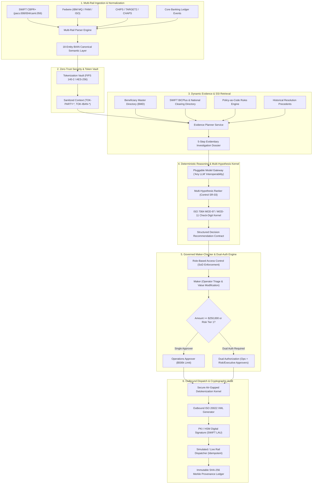

# PeX — Master Product Requirements Document (PRD) & Technical Blueprint
**Document Version:** 1.0.0  
**Classification:** Institutional / Restricted  
**Target Audience:** Solution Architects, Lead Engineers, Payment SMEs, Compliance & Model Risk Officers  
**System Name:** Payment Exception Resolution Platform (PeX)  
**Author:** Capgemini Financial Services Architecture & AI Practice  

---

## 1. Executive Summary & Product Scope

### 1.1 Product Vision
PeX (Payment Exception Platform) is an institutional-grade, cognitive resolution overlay designed for Tier-1 corporate transaction banking. It unifies fragmented payment exception handling across global clearing rails (SWIFT CBPR+, Fedwire, CHIPS, TARGET2, CHAPS, SEPA) into a centralized, deterministic, and human-governed operational cockpit. 

PeX combines a **Canonical Semantic Layer (18 BIAN relational entities)**, a **Zero-Knowledge Sensitive Token Vault**, an **ISO 7064 Deterministic Modulo Guardrail Kernel**, a **Multi-Hypothesis Reasoner with Elimination Proofs**, and a **Tamper-Evident SHA-256 Merkle Provenance Ledger**.

### 1.2 Target Business Metrics & Research Baselines
* **Straight-Through Processing (STP) Recovery**: Restores baseline STP from <60% post-ISO 20022 migration to **>85%** clean automated/assisted resolution.
* **Mean Time to Resolve (MTTR)**: Slashes average exception triage latency from **4.5–24 hours down to < 3 minutes**.
* **Operational Touch-Cost Takeout**: Delivers **60%–75% touch-cost reduction** across bilateral SWIFT tracer fees ($12–$50/ticket) and Federal Reserve cutoff extension penalties ($1,000–$10,000/incident).
* **Capacity Multiplier**: Enables existing operations squads to absorb **4.2x higher exception volume** during peak clearing cutoffs without headcount expansion.
* **Responsible AI Model**: Enforces a **100% Advisory AI Operating Model** (zero unattended funds releases) with mandatory Maker-Checker RACI and Dual-Authorization ($\ge \$250,000$).

### 1.3 4-Phase Structured Rollout Blueprint
1. **Phase 1: Sandbox Pilot (Weeks 1–4)**: Ingestion of synthetic/sanitized ISO 20022 messages; validation of 41 exception taxonomy profiles.
2. **Phase 2: Shadow Evaluation (Weeks 5–8)**: Read-only parallel processing of live production streams; benchmarking algorithmic recommendations against human operator decisions.
3. **Phase 3: Governed Assisted Mode (Weeks 9–14)**: Live operator-in-the-loop triage; automated dossier assembly; one-click maker-checker approvals.
4. **Phase 4: Full Multi-Rail Production Cutover (Weeks 15–20)**: Outbound signed ISO XML dispatch; live ICD adapters to SWIFT Alliance and Fedwire MQ.

---

## 2. End-to-End System Architecture



### 2.1 Core Architectural Principles
1. **Canonical Semantic Data Normalization**: Ingests raw heterogeneous payloads (SWIFT MT103, pacs.008 XML, Fedwire MQ, JSON) and normalizes them into 18 BIAN-aligned relational tables with zero data loss.
2. **Zero-Knowledge Token Vault**: In-memory pseudonymization replaces sensitive party names, account numbers, and Tax IDs with persistent format-preserving tokens (`TOK-PARTY-XXXX`, `TOK-IBAN-XXXX`). AI prompts never receive unmasked PII.
3. **Deterministic Mathematical Grounding**: Eliminates probabilistic hallucinations by coupling LLM semantic understanding with deterministic C-engines executing ISO 7064 Modulo arithmetic (MOD 97-10, MOD 11-2, Luhn).
4. **Multi-Hypothesis Ranking (Control SR-03)**: Evaluates multiple competing root-cause hypotheses simultaneously. The system explicitly records disqualified alternative hypotheses and their mathematical/policy elimination reasons.
5. **Maker-Checker Segregation of Duties (SoD)**: Strict enforcement prohibiting operators from approving their own repair actions. High-value exceptions ($\ge \$250,000$) mandate two distinct signers.
6. **Immutable Cryptographic Provenance**: Every lifecycle state transition generates a SHA-256 block hash incorporating the previous block hash, timestamp, actor ID, and action payload.

---

## 3. 41 Pre-Built Payment Exception Taxonomy

The platform includes 41 pre-built exception taxonomy profiles categorized across all 5 BIAN Payment Service Domains:

### Domain 1: Data Quality & Format Errors (10 Profiles)
1. `PEX-INV-0001` (MOD97-IBAN-001): Invalid IBAN Check Digits (DE89370400440532013000) — Detected transposed check digits; repaired via ISO 7064 MOD-97 algorithm.
2. `PEX-INV-0002` (BIC-SYNTAX-002): Invalid BIC / SWIFT Format (DEUTDEDDXXX) — Identified invalid branch code; resolved against SWIFT BICPlus directory.
3. `PEX-INV-0003` (PURP-CODE-003): Missing or Non-Compliant Purpose Code (`<Purp>`) — Populated mandatory CBPR+ purpose code based on remittance unstructured text.
4. `PEX-INV-0004` (ADDR-STRUCT-004): Unstructured Beneficiary Address (<AdrLine> vs <StrtNm>) — Parsed multi-line address into ISO 20022 structured tags (`<StrtNm>`, `<BldgNb>`, `<PstCd>`, `<TwnNm>`).
5. `PEX-INV-0005` (CHAR-ENCODE-005): Non-UTF8 / Illegal Character Set in Remittance — Sanitized illegal hex bytes into valid SWIFT X-Character set.
6. `PEX-INV-0006` (NAT-ID-006): Missing National Clearing Identifier — Inferred Canadian routing code (CC) from beneficiary institution name.
7. `PEX-INV-0007` (LEI-VALID-007): Expired or Invalid Legal Entity Identifier (LEI) — Queried GLEIF database to refresh expired LEI record.
8. `PEX-INV-0008` (CCY-DECIMAL-008): Currency Decimal Precision Violation (e.g. JPY with decimals) — Formatted amount to comply with ISO 4217 fractional units.
9. `PEX-INV-0009` (CHRG-BEAR-009): Ambiguous Charge Bearer (`<ChrgBr>`) Mismatch — Adjusted OUR/BEN/SHA charge code to align with bilateral correspondent agreement.
10. `PEX-INV-0010` (UETR-FORMAT-010): Malformed UETR UUIDv4 Syntax — Generated valid RFC 4122 Version 4 UUID for end-to-end tracking.

### Domain 2: Routing & Processing Exceptions (10 Profiles)
11. `PEX-RUT-0011` (INTERMED-BIC-011): Missing Intermediary Routing BIC for Cross-Currency Wire.
12. `PEX-RUT-0012` (CLOSED-RAIL-012): Target Clearing Rail Closed for Weekend / Holiday.
13. `PEX-RUT-0013` (CUTOFF-EXCEED-013): High-Value Fedwire Cutoff Approaching (18:30 EST).
14. `PEX-RUT-0014` (DUPL-UETR-014): Duplicate Payment Instruction Detected on Same Day.
15. `PEX-RUT-0015` (CLR-CODE-015): Invalid US Fedwire ABA Routing Number (MOD-10 Check Digit).
16. `PEX-RUT-0016` (TARGET2-SUB-016): Missing TARGET2 Direct Participant Clearing Account.
17. `PEX-RUT-0017` (CHAPS-SORT-017): UK Sort Code Not Reachable on CHAPS Direct Net.
18. `PEX-RUT-0018` (CORR-NOSTRO-018): Correspondent Bank No-Nostro Agreement for Currency.
19. `PEX-RUT-0019` (MT-MX-TRUNC-019): MT103 to pacs.008 Translation Truncation Error.
20. `PEX-RUT-0020` (SPLIT-WIRE-020): Wire Amount Exceeds Real-Time Gross Settlement (RTGS) Single-Transaction Limit.

### Domain 3: Compliance, Sanctions & Fraud Holds (8 Profiles)
21. `PEX-SNC-0021` (OFAC-FUZZY-021): Fuzzy Match on OFAC Specially Designated Nationals (SDN) List.
22. `PEX-SNC-0022` (PEP-SCREEN-022): Politically Exposed Person (PEP) Tier-1 Screening Hit.
23. `PEX-SNC-0023` (DEBANK-GEO-023): Anti-Debanking Corridor Fairness Alert (Flagged Remittance to Emerging Market).
24. `PEX-SNC-0024` (EMBARGO-CNTRY-024): Comprehensive Country Embargo Keyword Match.
25. `PEX-SNC-0025` (DUAL-USE-025): Export Control / Dual-Use Goods remittence keyword hit.
26. `PEX-SNC-0026` (FRAUD-ANOM-026): Velocity / Out-of-Pattern Beneficiary Account Alert.
27. `PEX-SNC-0027` (KYC-EXPIRE-027): Ordering Customer Annual KYC Refresh Overdue.
28. `PEX-SNC-0028` (NEGATIVE-NEWS-028): Adverse Media Entity Match on Remittance Intermediary.

### Domain 4: Client Treasury & Account Issues (7 Profiles)
29. `PEX-ACC-0029` (ACCT-CLOSED-029): Beneficiary Account Flagged as Closed / Inactive.
30. `PEX-ACC-0030` (NAME-MISMATCH-030): Beneficiary Name Confirmation of Payee (CoP) Mismatch.
31. `PEX-ACC-0031` (CCY-RESTRICT-031): Beneficiary Account Does Not Accept Instructed Currency.
32. `PEX-ACC-0032` (INSUF-FUNDS-032): Debtor Account Insufficient Settled Liquidity.
33. `PEX-ACC-0033` (DEBIT-BLOCK-033): Corporate Debtor Administrative Debit Block Active.
34. `PEX-ACC-0034` (CREDIT-BLOCK-034): Creditor Account Post-No-Credits Restriction.
35. `PEX-ACC-0035` (VAL-DATE-035): Stale or Back-Dated Payment Value Date.

### Domain 5: Settlement Failures & Returns (6 Profiles)
36. `PEX-SET-0036` (NOSTRO-LIQ-036): Central Bank Nostro Account Liquidity Shortfall.
37. `PEX-SET-0037` (PACS004-RET-037): Inbound `pacs.004` Payment Return Processing (AC01/AC04/AC06).
38. `PEX-SET-0038` (CAMT056-REQ-038): Inbound `camt.056` Request for Recall of Payment.
39. `PEX-SET-0039` (FEE-DEDUCT-039): Disputed Intermediary Bank Lifting Fee Deductions.
40. `PEX-SET-0040` (RTGS-TIMEOUT-040): Clearing Rail Central Queue Execution Timeout.
41. `PEX-SET-0041` (UNMATCHED-ACK-041): Unmatched `pacs.002` Negative Settlement Acknowledgment.

---

## 4. User Personas & Role-Based Access Control (RBAC)

The platform enforces strict Segregation of Duties (SoD) across 5 institutional roles:

| User ID | Persona Name | Institutional Role | Approval Authority Limit | Primary Responsibilities |
| :--- | :--- | :--- | :--- | :--- |
| `OP-8472` | **Amina Okafor** | `OPERATOR` (Maker) | Maker Only ($0) | Case Intake, Exception Triage, Investigation Dossier Assembly, Proposal Drafting. |
| `OP-9104` | **Priya Nair** | `OPERATOR` (Maker) | Maker Only ($0) | Secondary Intake Verification, Manual Evidence Upload, Dossier Refresh. |
| `APR-3191` | **Daniel Osei** | `OPERATIONS_APPROVER` | Up to $500,000 | Operational Repair Review, Value Modification, Resubmission Authorization. |
| `CMP-4419` | **Marisol Vega** | `COMPLIANCE_APPROVER` | Unlimited (Compliance) | Sanctions Hit Adjudication, PEP Clearance, Anti-Debanking Overrides. |
| `RSK-7714` | **Kenji Watanabe** | `RISK_APPROVER` | Up to $2,000,000 | Tier-2 Dual Authorization for High-Value Repairs ($\ge \$250	ext{k}$) & Liquidity Waivers. |
| `ADM-0001` | **Alex Whitfield** | `ADMIN` | Unlimited | Policy-as-Code Studio, Model Risk Inventory, Bank Onboarding, Audit Verification. |

### Governance Rules:
1. **Self-Approval Prohibition**: An Operator who modified or initiated a case cannot act as the Approver on the same case.
2. **Dual Authorization Threshold**: Any repair involving an amount $\ge \$250,000$ or classified as Federal Reserve SR 11-7 Tier-1 Risk requires approval by **two distinct officers** (`OPERATIONS_APPROVER` + `RISK_APPROVER` or `COMPLIANCE_APPROVER`).
3. **Compliance Sovereign Lock**: If a case triggers a Sanctions or PEP hold, it cannot be settled or repaired until explicitly unlocked by `CMP-4419`.

---

## 5. UI/UX Specifications & Guided Workflow Engine

### 5.1 Screen Hierarchy & Navigation
1. **Navigation Sidebar**:
   - Header with Bank Logo & Persona Card (Name, Role, Approval Limit).
   - Core Queues: `📥 Payment Intake`, `📋 Exception Worklist`, `✅ Approvals & Dual-Auth`.
   - Governance & Config: `🛡️ Trust & Governance`, `⚙️ Configuration Studio` (Admin Only).
   - Quick Demo Scenario Runner (`IBAN-REPAIR-001`, `BEN-SANCTION-002`, `NOSTRO-LIQ-003`).

2. **Exception Worklist Screen**:
   - Multi-facet filters: Search by Case ID, UETR, Debtor, Amount range, Urgency (`NORMAL`, `URGENT`, `CRITICAL`), Domain.
   - Real-time SLA Countdown badges showing time remaining until clearing cutoff.
   - One-click row selection loading the Guided Investigation Workbench.

3. **Guided Investigation & Resolution Workbench**:
   - **Case Header Banner**: Case ID, UETR, Amount, Currency, Rail, Status, SLA Timer.
   - **5-Step Evidentiary Dossier Tab**:
     - *Step 1: Ingestion & Raw Payload* (Formatted ISO 20022 XML / JSON).
     - *Step 2: Canonical Normalization* (BIAN Entity Mappings).
     - *Step 3: Sensitive Token Vault* (Interactive Sandbox showing sanitized vs masked PII).
     - *Step 4: Corroborating Evidence* (Beneficiary Master Records, SWIFT BIC lookups).
     - *Step 5: Algorithmic Recommendation* (Deterministic Modulo math proof + AI confidence score).
   - **Competing Hypotheses Card (Control SR-03)**:
     - Prominent purple header indicating Federal Reserve SR 11-7 alignment.
     - *Selected Hypothesis Card (Green)*: Root-cause description, proposed repair payload, confidence score, and justification.
     - *Disqualified Hypotheses Cards (Red/Slate)*: Alternative explanations evaluated with explicit mathematical, directory, or policy rejection reasons.

4. **Approvals & Dual-Authorization Screen**:
   - Maker-Checker Audit Diff showing Original Value vs Proposed Repaired Value side-by-side.
   - Action Buttons: `Approve & Dispatch`, `Reject with Comments`, `Escalate to Compliance`.
   - Dual-Auth Progress Indicator for transactions $\ge \$250,000$ (Showing 1st Signer Approved + 2nd Signer Pending).

5. **Trust & Governance Center**:
   - **Pillar 1: Data & Privacy Framework** (Zero-Knowledge token vault, FIPS 140-2 AES-256, BCBS 239 90-day minimization).
   - **Pillar 2: Human Control & Oversight** (100% Advisory model, Maker-Checker RACI table, Sovereign human override).
   - **Pillar 3: Safety & Ethical AI** (Deterministic Modulo check-digit engine, 85% confidence floor, Corridor Parity Index 99.8%, Anti-debanking matrix).
   - **Pillar 4: Model Risk & Compliance** (Federal Reserve SR 11-7 Model Inventory Tier 1–3, 3-Tier Vendor SLAs, SHA-256 Provenance Chain).

6. **Platform Administration & Configuration Studio (Admin Role)**:
   - 6 Dual-Panel Policy-as-Code Modules:
     1. *Exception Profiles*: Enable/disable profiles, set confidence floors, configure auto-triage.
     2. *Rules & Routing*: Modulo engine parameters, clearing rail cutoff timetables.
     3. *Control Policies*: Dual-auth financial limits, maker-checker strictness rules.
     4. *Exception Workflows*: Multi-stage escalation paths and timeout handling.
     5. *Reference Data*: Beneficiary directory sync, SWIFT BIC master tables.
     6. *Bank Rail Onboarding*: Multi-tenant adapter settings, MQ queues, mTLS certificates.
   - Mandatory Change-Rationale input generating cryptographically sealed configuration audit blocks.

---

## 6. The 8 Production-Readiness Workflows & Fresh Build Specifications

For an engineering team creating a fresh production deployment, the following 8 architectural modules must be implemented:

```mermaid
flowchart LR
    subgraph Storage["1. Persistence & Messaging"]
        DB["PostgreSQL 16 Relational DB"]
        MQ["Kafka / IBM MQ Consumers"]
    end
    subgraph Connectors["2. Live ICD Connectors"]
        SWIFT_C["SWIFT Alliance gCase API"]
        FED_C["Fedwire MQ Connector"]
    end
    subgraph AI_Core["3. AI & Vector RAG"]
        LLM["Vertex AI / Azure OpenAI"]
        VEC["pgvector RAG over SOPs"]
    end
    subgraph IAM_Sec["4. IAM & Token Vault"]
        SSO["OAuth2 / OIDC SSO"]
        HSM["AES-256 HSM Token Vault"]
    end
    subgraph Outbound["5. Settlement & Audit"]
        XML["Signed pacs.008 Generator"]
        WORM["Immutable Audit / SIEM"]
    end
    subgraph Sched["6. Async Worker"]
        CRON["Background SLA Worker"]
    end

    Storage --> Connectors --> AI_Core --> IAM_Sec --> Outbound --> Sched
```



### Module 1: Relational Database & Streaming Ingestion Queue
* **Database Architecture**: PostgreSQL 16+ or CockroachDB with connection pooling (`pgbouncer` or `asyncpg`).
* **Table Schema**:
  - `cases` (case_id PK, uetr, original_msg_id, rail, amount, currency, status, urgency, sla_due_at, debtor_tok, creditor_tok, created_at, updated_at).
  - `canonical_transactions` (18 BIAN entity tables with foreign keys to case_id).
  - `investigation_dossiers` (dossier_id PK, case_id FK, evidence_json, hypothesis_json, confidence_score).
  - `approvals` (approval_id PK, case_id FK, signer_id, signer_role, action, comments, timestamp, signature_hash).
  - `audit_ledger` (block_index PK, prev_hash, current_hash, actor_id, event_type, payload_hash, timestamp).
* **Streaming Consumer**:
  - Apache Kafka / IBM MQ consumer listening to `payments.exceptions.inbound`.
  - Distributed idempotency lock using Redis `SETNX (UETR, MessageId, Timestamp)`.

### Module 2: Live External Banking ICD Connectors
* **Connector Abstraction**: Implement `BaseICDConnector` with concrete drivers:
  - `SWIFTAllianceConnector`: REST/mTLS to SWIFT gCase API for status and tracer updates.
  - `FedwireMQConnector`: IBM MQ client connecting to Fedwire Funds Service.
  - `CoreBankingConnector`: gRPC / REST connector with mutual TLS (mTLS) certificates.
* **Resilience Patterns**: Circuit breaker (Tenacity / Resilience4j) with 3 retry attempts, exponential backoff (100ms, 200ms, 400ms), and automated fallback routing.

### Module 3: Pluggable AI Model Gateway & Vector RAG Pipeline
* **Model Gateway Providers**: Pluggable adapter supporting Google Cloud Vertex AI (Gemini 1.5 Pro), Azure OpenAI (GPT-4o), AWS Bedrock (Claude 3.5 Sonnet), or air-gapped private models.
* **Vector Database**: `pgvector` or ChromaDB storing vector embeddings (384/1536 dim) of all 41 SOP documents, BIAN Service Domains, and Fed Operating Circulars.
* **Guardrail Kernel**: Before presenting LLM recommendations to the user, an algorithmic Python/C module recalculates checksums (ISO 7064 MOD-97-10) to guarantee 100% mathematical validity.

### Module 4: Enterprise SSO & Role-Based Access Control (RBAC)
* **Authentication**: Enterprise Single Sign-On (SSO) via OAuth2 / OpenID Connect (OIDC) / SAML 2.0 with Okta, Microsoft Entra ID, or Ping Identity.
* **Token Management**: RS256-signed short-lived JWT access tokens (15-minute expiry) and refresh tokens stored in secure `HttpOnly; SameSite=Strict; Secure` cookies.
* **Segregation of Duties Middleware**: Enforces that `jwt.claims.sub` (Maker) cannot equal `jwt.claims.sub` (Approver) on any approval endpoint.

### Module 5: Outbound ISO 20022 XML Generator & Digital PKI Signing
* **XML Builder**: Construct valid, schema-compliant ISO 20022 XML documents:
  - `pacs.008.001.10` for customer credit transfers.
  - `pacs.004.001.11` for payment returns.
  - `camt.056.001.10` for recall requests.
* **Digital Signature**: Sign XML payloads using the bank's PKI HSM X.509 certificate adhering to SWIFT Local Authentication Unit (LAU) standards.
* **Acknowledgment Listener**: Asynchronous webhook handler receiving `pacs.002.001.12` payment status reports to transition cases from `DISPATCHED` $
ightarrow$ `SETTLED`.

### Module 6: Immutable Audit Ledger & Enterprise SIEM Streaming
* **Storage**: Persistent Write-Once-Read-Many (WORM) storage or append-only PostgreSQL table partitions.
* **Chaining Algorithm**: SHA-256 Merkle block hashing:
  $$	ext{Hash}_n = 	ext{SHA256}(	ext{Index}_n \parallel 	ext{Hash}_{n-1} \parallel 	ext{Timestamp}_n \parallel 	ext{ActorID}_n \parallel 	ext{EventType}_n \parallel 	ext{PayloadHash}_n)$$
* **SIEM Integration**: Real-time asynchronous streaming via Syslog / FluentBit / Splunk HEC to corporate security information and event management systems.

### Module 7: Production Hardware Security Module (HSM) Token Vault
* **Cryptographic Engine**: Integration with HashiCorp Vault Transit Engine, Protegrity, or Thales CipherTrust.
* **Encryption Standards**: AES-256-GCM / Format-Preserving Encryption (FPE / FF3-1).
* **Zero-Trust Boundary**: Prompts sent to AI Model Gateway contain exclusively token strings (`TOK-PARTY-9941`, `TOK-IBAN-8812`). Detokenization occurs only in memory inside the isolated Settlement Dispatch Kernel immediately prior to XML generation.

### Module 8: Background Async SLA & Cutoff Escalation Scheduler
* **Scheduler Architecture**: Distributed task worker using Temporal.io, Celery Beat, or APScheduler.
* **Polling Interval**: Runs every 30 seconds to query cases where `status IN ('INGESTED', 'INVESTIGATING', 'RECOMMENDED', 'APPROVAL_PENDING')`.
* **Escalation Rules**:
  - If $	ext{Time Remaining} \le 60	ext{ mins} 
ightarrow 	ext{Urgency} = 	ext{URGENT}$.
  - If $	ext{Time Remaining} \le 30	ext{ mins} 
ightarrow 	ext{Urgency} = 	ext{CRITICAL}$, fire WebSocket broadcast to supervisor dashboards and send webhook notification.

---

## 7. Compliance, Regulatory & Responsible AI Governance

### 7.1 Federal Reserve SR 11-7 Model Risk Management Concordance
* **Model Tiering**:
  - *Tier 1 (High Impact)*: Liquidity settlement actions, sanctions overrides, and amounts $\ge \$250,000$. Requires dual-authorization and quarterly model drift validation.
  - *Tier 2 (Moderate Impact)*: Standard account and routing code repairs (< $250,000). Single approver required.
  - *Tier 3 (Low Impact)*: Advisory format corrections (< $50,000) and purpose code enrichments.
* **Model Drift Telemetry**: Continuous monitoring of recommendation acceptance rates, manual edit frequency, and disparate corridor impact.

### 7.2 Safety & Ethical AI Guardrails
* **Corridor Fairness Parity Index**: Continuous statistical monitoring ensuring equitable repair success rates across all geographic corridors (Target: $\ge 99.8\%$).
* **Anti-Debanking Disambiguation Engine**: Prevents algorithmic exclusion of remittances directed toward developing markets or non-standard beneficiary names.
* **Zero Model Training Pledge**: Strict contractual guarantee that zero client transaction payloads, PII, or tokens are retained or used for foundational model training.

---

## 8. Automated Testing & Verification Suite

The platform includes a 7-tier test harness ensuring zero regressions:

```powershell
# Run entire test suite
.\.venv\Scripts\pytest -v

# Run deterministic 10-step demo scenario runner
.\.venv\Scripts\python scripts/run_demo.py
```

### Test Harness Coverage:
1. **`test_canonicalization.py`**: Validates lossless parsing of SWIFT MX/MT, Fedwire MQ, and BIAN entity mappings.
2. **`test_tokenization.py`**: Asserts strict PII sanitization and zero-leakage inside AI context payloads.
3. **`test_mod97_guardrails.py`**: Verifies ISO 7064 MOD-97-10 check-digit algorithms across 40+ international country formats.
4. **`test_maker_checker_rbac.py`**: Enforces segregation of duties and dual-authorization constraints.
5. **`test_competing_hypotheses.py`**: Validates multi-hypothesis ranking and explicit elimination reason generation.
6. **`test_audit_merkle_chain.py`**: Tests cryptographic hash chaining and verifies tamper-detection when payloads are altered.
7. **`test_scenarios_e2e.py`**: End-to-end simulation of the 20-step operational lifecycle across all 5 user roles.

---

## 9. Appendix: Project Directory Structure

```
pex_platform/
├── backend/
│   ├── app/
│   │   ├── api/
│   │   │   ├── endpoints/          # REST route handlers (cases, approvals, intake, etc.)
│   │   │   └── api_router.py
│   │   ├── core/
│   │   │   ├── security.py         # RBAC & authentication middleware
│   │   │   ├── tokenization.py     # Sensitive data token vault
│   │   │   ├── hashing.py          # SHA-256 Merkle chain engine
│   │   │   └── config.py
│   │   ├── models/                 # SQLAlchemy & domain models
│   │   ├── schemas/                # Pydantic schemas (BIAN, ISO 20022, contracts)
│   │   ├── services/
│   │   │   ├── data_loader.py      # 41-profile repository & lifecycle state manager
│   │   │   ├── model_gateway.py    # Pluggable AI reasoner
│   │   │   ├── audit_service.py    # Cryptographic ledger manager
│   │   │   └── action_executor.py  # Outbound settlement dispatcher
│   │   └── main.py                 # FastAPI application
├── frontend/
│   ├── dist/
│   │   └── index.html              # Standalone zero-dependency compiled SPA
│   └── src/                        # Component sources & Tailwind styling
├── synthetic_data/
│   ├── raw_messages/               # Multi-rail message payloads (XML, MQ, JSON)
│   ├── canonical/                  # 18 BIAN canonical entities
│   └── reference/                  # Master Beneficiary & SWIFT directories
├── tests/                          # 7 Pytest suites
├── scripts/                        # Deterministic CLI demo runners
├── README.md                       # Quick start & API guide
├── requirements.txt                # Pinned dependencies
└── build_guided_frontend.py        # Single-command frontend compiler
```
