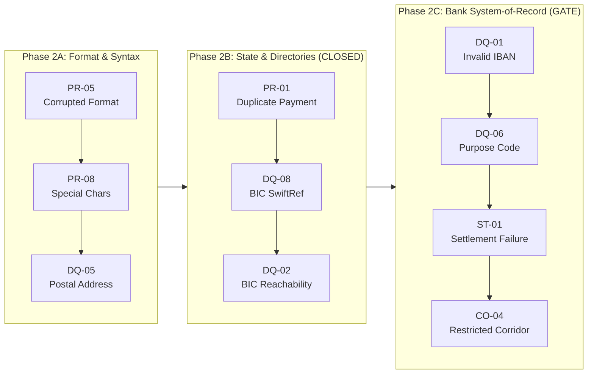
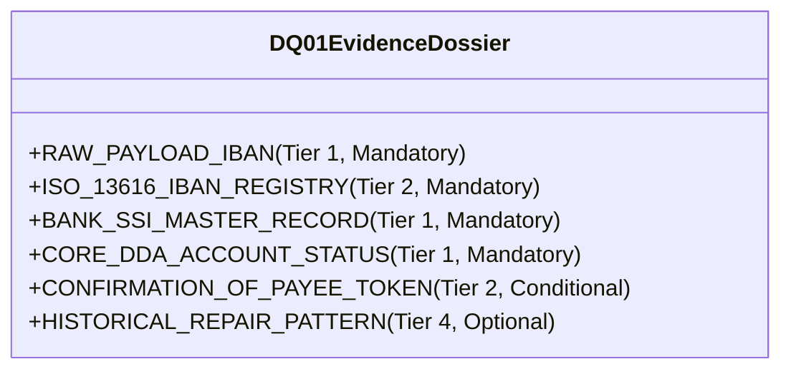

# PeX — Phase 2B Completion & Phase 2C Readiness Gate
## Architecture & Governance Assessment: External Authority $\longrightarrow$ Bank System-of-Record Authority

```
===============================================================================
Document ID:         PeX-GOV-P2B-CLOSE-P2C-GATE-v0.1
Review Type:         Formal Phase Transition, Architecture & Readiness Gate
Mode:                GOVERNANCE & ARCHITECTURE REVIEW ONLY (No Code/Test Changes)
Phase 2B Status:     PHASE 2B CLOSED
Phase 2C Readiness:  READY WITH CONDITIONS (DQ-01 — INVALID_IBAN)
Target Profile:      DQ-01 — INVALID_IBAN
Current Commit:      867375c369707653da6c58262e6055ccc0b310fb
Release Tag:         pex-phase2b-slice4-dq02-20261007
Baseline Verified:   276 / 276 PASSED (100% GREEN)
===============================================================================
```

---

## 1. Executive Decision

```
===============================================================================
1. PHASE 2B FORMAL STATUS:   PHASE 2B CLOSED
   - PR-01 (DUPLICATE_PAYMENT) accepted (251/251 baseline)
   - DQ-08 (INVALID_BIC_SWIFT) accepted (251/251 baseline)
   - DQ-02 (INVALID_BIC_SWIFT) accepted (276/276 baseline, P0=0, P1=0, P2=0, P3=1)
   - P3-01 (Synthetic SWIFTRef provider fixture) accepted as KNOWN_DEFERRED.

2. PHASE 2C READINESS STATUS: READY WITH CONDITIONS
   - Target Profile: DQ-01 (INVALID_IBAN)
   - Architectural Contract: Fully specified in Implementation Contract v1.3.
   - Bank Discovery: Bank SSI Master API, Core DDA interface, and CoP/VoP gateway
     parameters identified as mandatory bank integration prerequisites.
   - Production STP: Remains BLOCKED / NOT ENABLED pending live bank certification.
   - Next Slice Authorization: DQ-01 ONLY (unbundled from DQ-06, ST-01, CO-04).
===============================================================================
```

---

## 2. Phase 2B Closure Assessment

Phase 2B focused on **External Authority, State & Directory Resolution**:
* **`PR-01` (`DUPLICATE_PAYMENT`)**: Proved multi-factor identity fingerprinting, current bank settlement ledger state gating (`SETTLED`, `UNSETTLED`, `CANCELLED`), duplicate suppression vs operator routing, and prompt-injection-immune identity hashing.
* **`DQ-08` & `DQ-02` (`INVALID_BIC_SWIFT`)**: Proved ISO 9362 structural syntax validation (`V_det`), external reference directory lookups, freshness TTL enforcement (86,400s), single-successor mapping, multi-successor ambiguity routing (`DISAMBIGUATION_DESK`), target clearing rail reachability (`SWIFT_CBPR+`, `TARGET2`, `CHAPS`, `FEDWIRE`), and Bank Counterparty SSI corroboration (`V_auth`).



All Phase 2B forensic acceptance criteria have been verified with **0 P0, 0 P1, and 0 P2 findings**. Phase 2B is formally **CLOSED**.

---

## 3. Phase 2B Proven Capabilities

| Architectural Capability | Classification | Forensic Evidence in Code & Tests |
| :--- | :--- | :--- |
| **4-Contract Architecture** | **PROVEN** | Decoupled Evidence, Resolution, Authority, and Policy contracts across all 6 implemented profiles. |
| **8-Predicate Boolean Formula** | **PROVEN** | Evaluates $E_{\text{suff}} \land R_{\text{det}} \land R_{\text{uniq}} \land V_{\text{det}} \land V_{\text{auth}} \land P_{\text{bank}} \land C_{\text{comp}} \land X_{\text{pre}}$ deterministically without probabilistic bypass. |
| **$V_{\text{det}}$ vs $V_{\text{auth}}$ Separation** | **PROVEN** | Technical/checksum validity ($V_{\text{det}}$) strictly decoupled from commercial/business authority ($V_{\text{auth}}$). |
| **Reference Data TTL Gating** | **PROVEN** | Freshness checked deterministically; stale reference data fails closed ($E_{\text{suff}} = \text{False}$). |
| **Active $\neq$ Reachable Gating** | **PROVEN** | Active directory status verified independently from clearing rail reachability. |
| **Ambiguity Detection** | **PROVEN** | Multiple plausible resolutions force $R_{\text{uniq}} = \text{False}$ and route to `DISAMBIGUATION_DESK`. |
| **Bank SSI Corroboration** | **PROVEN** | Successor BICs corroborated against Bank SSI Master; contradictions fail closed to operations. |
| **Zero-Hallucination AI Boundary** | **PROVEN** | AI confidence strictly excluded from STP predicates; prompt injections parsed as literal strings. |
| **Maker-Checker Segregation** | **PROVEN** | `maker_id == checker_id` throws `PermissionError` across all HITL workflows. |
| **Bank Execution Isolation** | **PROVEN** | Outbound envelope halts at `BANK_HANDOFF_READY` with `execution_owner = "BANK"`. |
| **Live Enterprise Connectors** | **NOT YET PROVEN** | Local/synthetic adapters used; live Kafka, SWIFTRef API, and AWS KMS deferred to enterprise deployment. |

---

## 4. Reusable Platform Capabilities for Phase 2C

Phase 2C inherits an already hardened, tested platform foundation:
1. **`EvidenceContractRegistry` & `EvidenceSufficiencyEngine`**: Plug-and-play contract registration, trust hierarchy enforcement (Tiers 1–4), and TTL freshness checking.
2. **`ResolutionEngine`**: Dispatch framework for registering profile-specific deterministic solvers.
3. **`AuthorityValidationEngine`**: Established two-level validation harness ($V_{\text{det}}$ syntax vs $V_{\text{auth}}$ business authority).
4. **`EvidenceSTPEvaluator`**: Canonical 8-predicate boolean evaluator with configurable `STPPolicyConfig`.
5. **Transport-Neutral Envelopes**: `CanonicalIntakeEnvelope` (`pex.intake.v1`) and `CanonicalOutboundEnvelope` (`pex.outbound.v1`).
6. **Audit & Provenance Ledger**: Linear SHA-256 Merkle-like hash chaining with automated tamper detection.
7. **HITL & Dual-Authorization Engine**: Maker submit and Checker approval state machine with Segregation of Duties.

---

## 5. Remaining Phase 2B Known Deferred Items

The following items remain formally classified as `KNOWN_DEFERRED` and do not block engineering progression:

| Finding ID | Capability | Current Prototype Status | Target Enterprise Requirement | Classification |
| :--- | :--- | :--- | :--- | :--- |
| **P3-01** | External BIC Reference Provider | In-memory synthetic adapter (`ExternalBICReferenceAdapter`) | Real-time SWIFTRef / ISO API Gateway | `KNOWN_DEFERRED` |
| **SEC-01** | Token Vault & Detokenization | AES-256 + HMAC-SHA256 in memory | Hardware Security Module (HSM) / AWS KMS | `KNOWN_DEFERRED` |
| **DAT-01** | Relational Canonical Database | SQLite with session sync | Amazon Aurora PostgreSQL 3NF | `KNOWN_DEFERRED` |
| **ING-01** | High-Throughput Streaming | File drops and REST APIs | Apache Kafka / AWS MSK / IBM MQ | `KNOWN_DEFERRED` |
| **DIS-01** | Outbound LAU Message Signer | Simulated handoff receipts | W3C pacs.008 XML with SWIFT LAU HMAC | `KNOWN_DEFERRED` |
| **IAM-01** | Enterprise IAM Gateway | Persona switcher and role headers | Okta / Azure AD OAuth2 / OIDC Gateway | `KNOWN_DEFERRED` |

---

## 6. Phase 2C Transition Assessment: External Authority $\longrightarrow$ Bank System-of-Record

Moving from Phase 2B to Phase 2C represents a fundamental shift in the **governing authority domain**:

```
┌─────────────────────────────────────────────────────────────────────────────┐
│ PHASE 2B: EXTERNAL DIRECTORY AUTHORITY                                      │
│ • Validates against public/industry standards (SWIFTRef, ISO 9362, Rails).   │
│ • Focus: Does the institution exist? Is it active? Is it reachable on rail? │
│ • Failure Impact: Routing bounce, payment delay.                            │
└─────────────────────────────────────────────────────────────────────────────┘
                                      │
                                      ▼
┌─────────────────────────────────────────────────────────────────────────────┐
│ PHASE 2C: BANK SYSTEM-OF-RECORD (SoR) AUTHORITY                             │
│ • Validates against proprietary bank ledgers (Core DDA, Bank SSI, CoP/VoP). │
│ • Focus: Does the account exist? Does it belong to the beneficiary? Is it   │
│   open and credit-ready? Does bank risk policy authorize autonomous debit?  │
│ • Failure Impact: Misdirected funds, fraud, regulatory non-compliance.      │
└─────────────────────────────────────────────────────────────────────────────┘
```

> [!IMPORTANT]
> In Phase 2C (`DQ-01 — INVALID_IBAN`), mathematical validity (MOD-97) proves **only** that a string is a well-formed IBAN. It provides **zero proof** of account existence, beneficiary ownership, ledger status, or payment authorization.

---

## 7. `DQ-01` (`INVALID_IBAN`) Authority Model

To prevent collapsing syntax, mathematical validity, account existence, ownership, and authorization into a single decision, the following authority matrix governs `DQ-01`:

| Assertion | Deterministic vs Derived | Authoritative Source | Evidence Tier | Validation Method | Freshness TTL | Failure Behavior | Supports STP? |
| :--- | :--- | :--- | :--- | :--- | :--- | :--- | :---: |
| **IBAN Format / Syntax** | Deterministic | ISO 13616 IBAN Registry | Tier 2 External | National length & regex check | Static Release | Reject ($V_{\text{det}} = \text{False}$) | **Yes ($V_{\text{det}}$)** |
| **MOD-97 Checksum** | Deterministic | ISO 7064 MOD-97-10 | Tier 3 Derived | Math remainder: $r = 1$ | Scoped to Message | Reject ($V_{\text{det}} = \text{False}$) | **Yes ($V_{\text{det}}$)** |
| **National Bank / Branch** | Deterministic | National Clearing Directory | Tier 2 External | Routing code lookup | 86,400s (24h) | Reject ($R_{\text{det}} = \text{False}$) | **Yes ($R_{\text{det}}$)** |
| **Account Existence** | Deterministic | Core DDA / Account Master | Tier 1 Bank | Account status query | Real-time / 3,600s | Suspend ($E_{\text{suff}} = \text{False}$) | **Yes ($V_{\text{auth}}$)** |
| **Account Active Status** | Deterministic | Core DDA Ledger | Tier 1 Bank | Open/Closed/Frozen flag | Real-time / 3,600s | Suspend ($V_{\text{auth}} = \text{False}$) | **Yes ($V_{\text{auth}}$)** |
| **Beneficiary Ownership** | Deterministic | Bank SSI Master / Customer Master | Tier 1 Bank | Mandated IBAN match for entity | 86,400s (24h) | Mismatch ($V_{\text{auth}} = \text{False}$) | **Yes ($V_{\text{auth}}$)** |
| **Confirmation of Payee** | Deterministic | Pay.UK CoP / EU VoP Gateway | Tier 2 External | External Name-Match Token | Real-time / 300s | Suspend ($V_{\text{auth}} = \text{False}$) | **Yes ($V_{\text{auth}}$)** |
| **Clearing Rail Usability** | Deterministic | Target Clearing Rail Spec | Tier 2 External | SEPA / Fedwire reachability | Static Release | Suspend ($X_{\text{pre}} = \text{False}$) | **Yes ($X_{\text{pre}}$)** |
| **Bank Policy Authorization**| Policy | Bank Operational Risk Policy | Tier 1 Bank | Amount cap & corridor check | Static Release | Route HITL ($P_{\text{bank}} = \text{False}$) | **Yes ($P_{\text{bank}}$)** |

---

## 8. Conceptual `DQ-01` Evidence Contract



* **Mandatory Evidence**:
  1. `RAW_PAYLOAD_IBAN` (Tier 1, Ingested payload string).
  2. `ISO_13616_IBAN_REGISTRY` (Tier 2, Structure & character length specification).
  3. `BANK_SSI_MASTER_RECORD` (Tier 1, Authoritative counterparty settlement instruction).
  4. `CORE_DDA_ACCOUNT_STATUS` (Tier 1, Account state: `OPEN`, `CLOSED`, `FROZEN`, `RESTRICTED`).
* **Conditional Evidence**:
  * `CONFIRMATION_OF_PAYEE_TOKEN` (Tier 2, Pay.UK CoP or EU Verification of Payee match response).
* **Optional Evidence**:
  * `HISTORICAL_REPAIR_PATTERN` (Tier 4, Past successful IBAN corrections for similarity context).
* **Contradiction Rules**:
  * If a mathematical MOD-97 candidate contradicts the Bank SSI Master record, **Bank SSI Master wins** or fails closed to `OPERATIONS_SUSPENSE`.
  * If the account is marked `CLOSED` or `FROZEN` in Core DDA, STP is **strictly blocked** ($V_{\text{auth}} = \text{False}$).

---

## 9. `DQ-01` Resolution Model & The "Invalid $\neq$ Correct Replacement" Principle

1. **Root Cause Analysis**: Typical errors include single-digit transposition (e.g. `12` $\to$ `21`), check digit mistype, omitted leading zeros, or corrupted country prefix.
2. **Deterministic Candidate Generation**:
   * Execute an ISO 7064 MOD-97-10 permutation algorithm generating all single-transposition and single-digit substitution permutations satisfying:
     $$\text{Integer}(\text{rearranged string}) \pmod{97} = 1$$
3. **Intersection with Bank System of Record**:
   * Intersect the mathematically valid candidate set with active `BANK_SSI_MASTER_RECORD` and `CORE_DDA_ACCOUNT_STATUS` entries for the named beneficiary.
4. **Candidate Uniqueness ($R_{\text{uniq}}$)**:
   * $R_{\text{uniq}} = \text{True}$ **ONLY IF** exactly ONE candidate satisfies BOTH $\text{MOD-97} = 1$ AND matches the authoritative Bank SSI Master / Core DDA record.
   * If multiple permutations satisfy MOD-97 and no single SSI record disambiguates them, $R_{\text{uniq}} = \text{False} \implies$ route to `DISAMBIGUATION_DESK`.

---

## 10. `DQ-01` STP Predicate Mapping

```
E_suff = True  <== Raw IBAN, ISO 13616 spec, Bank SSI Master & Core DDA status verified fresh
R_det  = True  <== Deterministic ISO 7064 MOD-97 permutation candidate derived
R_uniq = True  <== Exactly 1 candidate satisfies MOD-97 AND matches Bank SSI Master
V_det  = True  <== ISO 13616 length valid AND ISO 7064 MOD-97 remainder == 1 AND lossless XML
V_auth = True  <== Bank SSI Master confirms beneficiary ownership AND Core DDA confirms account OPEN
P_bank = True  <== Amount <= Bank policy limit AND corridor allowed AND auto_stp enabled
C_comp = True  <== Repaired IBAN / Creditor cleared real-time Sanctions & PEP screening (PASS)
X_pre  = True  <== Payment rail operational, cutoffs active, idempotency lock secured
------------------------------------------------------------------------------------------------
STP_ELIGIBLE = True ==> Emit Repaired IBAN Envelope to Bank Output Port (BANK_HANDOFF_READY)
```

---

## 11. `DQ-01` AI Boundary

```
┌─────────────────────────────────────────────────────────────────────────────┐
│ AI / LLM PERMITTED ACTIONS (INVESTIGATIVE COPILOT ONLY)                     │
│ • Parse unstructured error narratives and exception codes.                  │
│ • Rank candidate hypotheses for human operator review.                      │
│ • Explain MOD-97 checksum discrepancies and transposition mechanics.        │
│ • Assemble investigation dossiers for Maker-Checker desks.                  │
└─────────────────────────────────────────────────────────────────────────────┘
                                      │
                                      ▼
┌─────────────────────────────────────────────────────────────────────────────┐
│ AI / LLM STRICT PROHIBITIONS (ZERO HALLUCINATION & SAFETY BOUNDARY)         │
│ • MUST NOT invent or hallucinate an IBAN string.                            │
│ • MUST NOT declare account existence or ownership.                          │
│ • MUST NOT override Core DDA, Bank SSI Master, or Customer Master records.   │
│ • MUST NOT establish or satisfy V_auth, V_det, or P_bank predicates.        │
│ • MUST NOT release funds, dispatch wires, or debit/credit accounts.        │
│ • MUST NOT convert insufficient evidence into autonomous STP.               │
└─────────────────────────────────────────────────────────────────────────────┘
```

---

## 12. Bank Integration Boundary & Minimum Bank-Owned Systems

```
+-----------------------------------------------------------------------------+
|                            BANK IT ECOSYSTEM                                |
|                                                                             |
|  +---------------------+  +---------------------+  +---------------------+  |
|  |   Bank SSI Master   |  |      Core DDA       |  |   Customer Master   |  |
|  | (Counterparty SSIs) |  | (Account & Ledger)  |  |  (KYC & Beneficiary)|  |
|  +----------+----------+  +----------+----------+  +----------+----------+  |
|             |                        |                        |             |
+-------------|------------------------|------------------------|-------------+
              |                        |                        |
              +-------------------+----+------------------------+
                                  | (Bank Evidence Gateway)
                                  v
+-----------------------------------------------------------------------------+
|                               PeX PLATFORM                                  |
|   1. Evidence Dossier Assembly & Sufficiency Evaluation (E_suff)            |
|   2. MOD-97 Permutation Solver & SSI Intersect (R_det, R_uniq)              |
|   3. Two-Level Validation (V_det: MOD-97=1, V_auth: SSI Attestation)        |
|   4. Canonical 8-Predicate Boolean STP Evaluation                           |
|   5. SHA-256 Provenance Ledger & Audit Chaining                             |
|   6. Bank Handoff Boundary (execution_owner = "BANK", BANK_HANDOFF_READY)   |
+-----------------------------------------------------------------------------+
```

---

## 13. Required Bank Discovery Register for `DQ-01`

| Discovery Item ID | Bank System / Capability | Discovery Question | Classification |
| :--- | :--- | :--- | :--- |
| **DISC-01** | **Bank SSI Master Interface** | What REST/gRPC/MQ interface provides counterparty Standard Settlement Instructions? | `BANK DISCOVERY REQUIRED` |
| **DISC-02** | **Core DDA Account Lookup** | What API validates account open/closed/frozen status in real time? | `BANK DISCOVERY REQUIRED` |
| **DISC-03** | **Customer / Beneficiary Master** | What data store provides legal entity to account number mappings? | `BANK DISCOVERY REQUIRED` |
| **DISC-04** | **Confirmation of Payee (CoP)** | Is a Pay.UK CoP or EU Verification of Payee (VoP) gateway available? | `EXTERNAL DEPENDENCY` |
| **DISC-05** | **Account Status Semantics** | What exact status codes indicate credit-ready accounts (e.g. `ACTV`, `REST`, `DORM`)? | `BANK POLICY REQUIRED` |
| **DISC-06** | **Beneficiary Name Matching** | What string matching tolerance (Exact vs Levenshtein vs Jaro-Winkler) is mandated? | `BANK POLICY REQUIRED` |
| **DISC-07** | **STP Monetary Threshold** | What is the bank's maximum autonomous STP dollar limit for IBAN repair? | `BANK POLICY REQUIRED` |
| **DISC-08** | **Corridor Allowlist** | Which currency corridors (EUR, GBP, USD) are authorized for autonomous IBAN STP? | `BANK POLICY REQUIRED` |
| **DISC-09** | **SSI Cache Freshness TTL** | What is the maximum acceptable cache age for Bank SSI Master records? | `BANK POLICY REQUIRED` |
| **DISC-10** | **Dual-Authorization Ceilings**| What transaction amount mandates Maker-Checker dual authorization? | `BANK POLICY REQUIRED` |
| **DISC-11** | **Audit Retention Policy** | What cryptographic ledger retention window (e.g. 7 years) is required? | `BANK POLICY REQUIRED` |
| **DISC-12** | **Production Gateway Auth** | What mTLS / OAuth2 client credential architecture protects bank API gateways? | `BANK DISCOVERY REQUIRED` |

---

## 14. Phase 2B vs Phase 2C Risk Transition Comparison

| Risk Dimension | Phase 2B (`DQ-02`, `PR-01`, `DQ-08`) | Phase 2C (`DQ-01`, `DQ-06`, `ST-01`, `CO-04`) | Risk Delta | Why? | Required Engineering Control |
| :--- | :--- | :--- | :---: | :--- | :--- |
| **Authority Domain** | External directories & Public BIC data | Proprietary Bank DDA & Customer Master | **HIGHER** | Private bank ledger records govern account validity. | Mock-to-live decoupled adapter architecture with strict Tier 1 gating. |
| **Financial Impact** | Routing delay or scheme bounce | Misdirected funds to wrong account holder | **CRITICAL** | Repaired IBAN directs credit to a specific bank ledger account. | Mandatory Bank SSI / CoP corroboration ($V_{\text{auth}}$) before STP. |
| **PII Sensitivity** | Institution BIC & routing codes | Individual & Corporate IBANs & Account Names | **HIGHER** | Subject to GDPR, GLBA, and bank PII data isolation policies. | Zero PII in AI context; tokenization and field masking. |
| **False Repair Impact** | Institution rejection at clearing hub | Erroneous credit execution / Loss of funds | **CRITICAL** | Mathematical validity alone does not guarantee correct recipient. | MOD-97 satisfies $V_{\text{det}}$ only; never satisfies $V_{\text{auth}}$. |
| **Compliance Risk** | Rail reachability & sanction screening | Sanctions hit on newly resolved account | **HIGHER** | Corrected account must be screened prior to release. | Mandatory real-time $C_{\text{comp}}$ re-screening post-repair. |

---

## 15. Business Value Assessment

* **Proven Technical Value**:
  * 100% deterministic, zero-hallucination exception classification and repair pipelines.
  * Rigorous fail-closed execution on ambiguity, stale data, or authority contradiction.
  * Fully isolated Maker-Checker dual authorization with immutable audit chaining.
* **Expected Operational Value**:
  * Up to 60–80% touchless resolution for high-frequency transposition errors matching bank SSI records.
  * Significant reduction in manual investigation cycle times (from hours to sub-second handoff).
* **Business Hypotheses Requiring Bank Production Data**:
  * True production STP throughput percentage (depends entirely on bank counterparty SSI match coverage).
  * Net operational ROI (depends on bank exception volumes, staffing costs, and clearing penalties).

---

## 16. Platform Maturity Assessment

| Architecture Domain | Current Maturity Status | Evaluation & Basis |
| :--- | :--- | :--- |
| **Core Architecture** | **PROVEN** | 4-contract model and 8-predicate boolean formula fully operational. |
| **Evidence Model** | **PROVEN** | Evidence Contract Registry and Dossier Sufficiency Engine operational. |
| **Resolution Engine** | **PROVEN** | Deterministic resolution and candidate ranking operational across 6 profiles. |
| **Authority Validation** | **PROVEN** | Separation of technical syntax ($V_{\text{det}}$) and business authority ($V_{\text{auth}}$) verified. |
| **STP Policy Gate** | **PROVEN** | Risk limits, corridor allowlists, and dual-auth thresholds enforced. |
| **HITL Workflows** | **PROVEN** | Disambiguation desk, Maker-Checker, and SoD cryptographic blocking verified. |
| **Audit Ledger** | **PROVEN** | SHA-256 linear hash chaining with automated tamper detection operational. |
| **Bank Execution Isolation** | **PROVEN** | PeX halts at `BANK_HANDOFF_READY` (`execution_owner = "BANK"`). |
| **Bank SoR Integration** | **PARTIALLY PROVEN** | Clean adapter interfaces established; live API connectors require bank discovery. |
| **Production Deployment** | **NOT PROVEN** | Prototype architecture (SQLite, local adapters) pending enterprise cloud rollout. |

---

## 17. Phase 2C Readiness Decision

```
===============================================================================
PHASE 2C READINESS DECISION: READY WITH CONDITIONS (DQ-01 — INVALID_IBAN)
===============================================================================
```

### Readiness Assessment Basis
1. **Architecture Is Ready**: The 4-contract framework, 8-predicate formula, and two-level validation engine are fully implemented and verified.
2. **Implementation Contract Is Binding**: `PeX_Phase2_Implementation_Contract_v1.3.md` (lines 907–1020) provides the complete technical specification for `DQ-01`.
3. **Engineering Scope Is Clear**: Level 1 platform implementation (MOD-97 permutation solver, ISO 13616 structural validator, `BankSSIMasterAdapter`, and comprehensive test suite) can proceed under controlled authorization.
4. **Production Gating Remains Enforced**: Level 2 Production STP execution remains **STRICTLY BLOCKED / NOT ENABLED** until live Bank SSI Master and Core DDA connectors are certified.

---

## 18. Recommended Next Slice

**Recommended Implementation Target**: **`DQ-01` (`INVALID_IBAN`) ONLY**

### Rationale for Single-Profile Isolation
* `DQ-01` introduces the first **Bank System-of-Record (SoR)** account authority patterns and the MOD-97-10 permutation mathematics.
* Bundling `DQ-01` with `DQ-06` (Purpose Codes), `ST-01` (Settlement Failures), or `CO-04` (Restricted Corridors) would introduce unneeded cross-domain complexity.
* Strictly following the sequential expansion cadence:
  $$\text{DQ-01} \longrightarrow \text{DQ-06} \longrightarrow \text{ST-01} \longrightarrow \text{CO-04}$$
  ensures rigorous, test-verified engineering governance.

---

## 19. Governance Conditions for Future `DQ-01` Authorization

When `DQ-01` implementation is formally authorized, engineering must strictly adhere to the following conditions:
1. **MOD-97 $\neq V_{\text{auth}}$**: ISO 7064 MOD-97-10 remainder $r = 1$ satisfies $V_{\text{det}}$ only. $V_{\text{auth}}$ **must** require Bank SSI Master or Core DDA account verification.
2. **Ambiguity Gating**: Multiple mathematical permutations with no unique SSI match **must** set $R_{\text{uniq}} = \text{False}$ and suspend to `DISAMBIGUATION_DESK`.
3. **Synthetic Data Labeling**: All local test fixtures must be explicitly labeled `DEMO/SYNTHETIC`.
4. **Lossless Transformation**: Account number and check-digit modifications must preserve all other XML tags (Amounts, UETR, Remittance) with 100% invariance.
5. **Execution Ownership**: Outbound envelope must designate `execution_owner = "BANK"` and halt at `BANK_HANDOFF_READY`.

---

## 20. Final Decision & Sign-Off

```
===============================================================================
FORMAL GOVERNANCE CONCLUSION:
1. PHASE 2B IS OFFICIALLY CLOSED.
2. PHASE 2C IS READY FOR CONTROLLED IMPLEMENTATION AUTHORIZATION (DQ-01 ONLY).
3. ENGINEERING REMAINS AT A HARD STOP PENDING USER AUTHORIZATION.
===============================================================================
```
