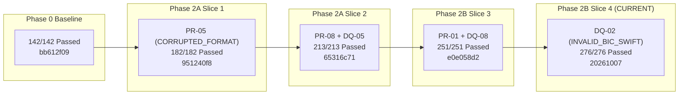
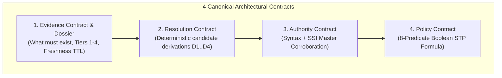
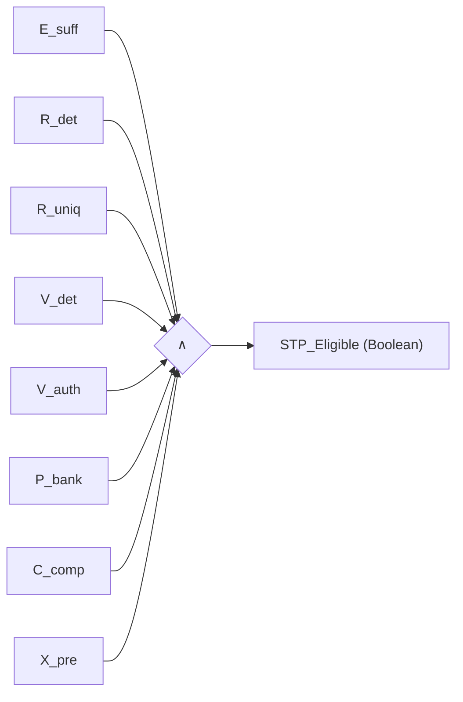
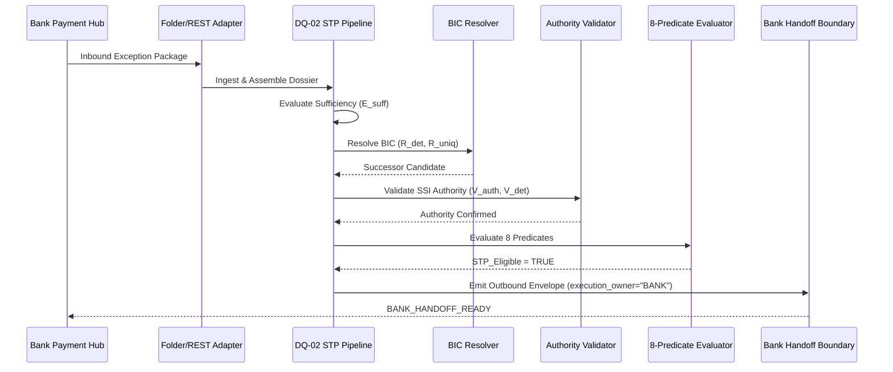

# PeX — Phase 2B Slice 4 Implementation Report
## Profile: `DQ-02` (`INVALID_BIC_SWIFT`)

```
===============================================================================
Document ID:    PeX-P2B-S4-DQ02-IMPL-v0.1
Phase:          Phase 2B (Controlled Expansion)
Slice:          Slice 4
Profile:        DQ-02 — INVALID_BIC_SWIFT
Release Date:   October 7, 2026
Status:         IMPLEMENTATION COMPLETE — READY FOR FORENSIC ACCEPTANCE
Repository:     pex_platform
Branch:         phase2b/slice4-dq02
Release Tag:    pex-phase2b-slice4-dq02-20261007
Baseline Tag:   pex-phase2a-slice3-pr01-dq08-20261006
Test Results:   276 / 276 PASSED (0 failures, 0 errors, 100% GREEN)
===============================================================================
```

---

## 1. Title & Executive Metadata

Phase 2B Slice 4 delivers the complete, governed implementation of **`DQ-02` (`INVALID_BIC_SWIFT`)** within the **Evidence-Driven Straight-Through Processing (STP) Architecture** for the PeX payment exception platform.



### Key Metadata Summary
* **Current Phase**: Phase 2B (Controlled Expansion)
* **Current Slice**: Slice 4
* **Target Profile**: `DQ-02` (`INVALID_BIC_SWIFT`)
* **Branch**: `phase2b/slice4-dq02`
* **Starting Commit**: `e0e058d29546d679224ab48badbc56aa1caed25c`
* **Release Tag**: `pex-phase2b-slice4-dq02-20261007`
* **Regression Status**: 276 / 276 unit, integration, pipeline, and adversarial tests passing (100% GREEN).
* **Execution Boundary**: Bank handoff envelope strictly designates `execution_owner = "BANK"` and halts at `BANK_HANDOFF_READY`.

---

## 2. Governance & Lineage

The PeX platform follows a strict, non-negotiable governance lifecycle:
$$\text{IMPLEMENT} \longrightarrow \text{TEST} \longrightarrow \text{FORENSIC ACCEPTANCE} \longrightarrow \text{NEXT SLICE}$$

```
Phase 0 (142/142 PASSED) — pex-pre-reengineering-20261006 (bb612f09)
   └── Phase 2A Slice 1: PR-05 (182/182 PASSED) — pex-phase2a-slice1-pr05-20261006 (951240f8)
         └── Phase 2A Slice 2: PR-08 + DQ-05 (213/213 PASSED) — pex-phase2a-slice2-pr08-dq05-20261006 (65316c71)
               └── Phase 2B Slice 3: PR-01 + DQ-08 (251/251 PASSED) — pex-phase2a-slice3-pr01-dq08-20261006 (e0e058d2)
                     └── Phase 2B Slice 4: DQ-02 (276/276 PASSED) — pex-phase2b-slice4-dq02-20261007 (CURRENT)
```

No earlier tags or commits have been modified, rebased, or overwritten. Every historical recovery checkpoint remains 100% immutable.

---

## 3. Profile Specification: `DQ-02` (`INVALID_BIC_SWIFT`)

* **Taxonomy Domain**: Data Quality (`DQ`)
* **Profile ID**: `DQ-02`
* **Profile Name**: `INVALID_BIC_SWIFT`
* **Business Problem**: Inbound cross-border or domestic payment instructions fail processing due to invalid, inactive, deprecated, or unreachable ISO 9362 Business Identifier Codes (BICs) in `<BICFI>`, `<BIC>`, or `<FinInstnId>`.
* **Governing Standards**:
  * ISO 9362:2014 (Banking — Banking Telecommunication Messages — Business Identifier Code)
  * ISO 20022 CBPR+ Payment Standards (pacs.008.001.08 / pacs.009.001.08)
  * SWIFTRef Global Reference Directory & BIC Directory specifications
  * Clearing Rail Specifications: SWIFT CBPR+, Fedwire Funds Service, CHAPS, TARGET2

---

## 4. Architectural Decoupling & The 4 Canonical Contracts

PeX strictly decouples transport protocols (files, REST APIs, Kafka, IBM MQ) from domain logic via 4 canonical contracts:



1. **Intake / Evidence Contract**: Governs what evidence must exist, its trust hierarchy tier, freshness criteria, and contradiction behavior.
2. **Resolution Contract**: Governs deterministic candidate derivation without probabilistic hallucination.
3. **Authority / Validation Contract**: Governs two-stage validation: deterministic structural syntax (`V_det`) and business authority corroboration (`V_auth`).
4. **Policy Contract**: Governs bank-defined risk, governance, compliance, and dual-authorization rules via the 8-predicate boolean formula.

---

## 5. Evidence Contract & Dossier Schema for `DQ-02`

`DQ-02` is registered in `EvidenceContractRegistry` (`backend/app/schemas/evidence_contract.py`) with 5 mandatory evidence requirements:

| Evidence Item Name | Role | Trust Tier | Mandatory for STP | Policy Freshness TTL | Contradiction Behavior |
| :--- | :--- | :--- | :--- | :--- | :--- |
| `RAW_PAYLOAD` | IDENTIFICATION | `TIER_1_BANK_AUTHORITATIVE` | **Yes** | Scoped to Message | Suspend to Investigation |
| `ORIGINAL_BIC_RECORD` | IDENTIFICATION | `TIER_1_BANK_AUTHORITATIVE` | **Yes** | Scoped to Message | Suspend to Investigation |
| `BIC_REFERENCE_DIRECTORY` | VALIDATION | `TIER_2_EXTERNAL_AUTHORITATIVE` | **Yes** | 86,400s (24h) | Suspend to Operations |
| `BANK_COUNTERPARTY_SSI` | AUTHORIZATION | `TIER_1_BANK_AUTHORITATIVE` | **Yes** | 86,400s (24h) | Suspend to Investigation |
| `TARGET_RAIL_ROUTING_SPEC`| VALIDATION | `TIER_2_EXTERNAL_AUTHORITATIVE` | **Yes** | Static Standard | Suspend to Operations |
| `HISTORICAL_BIC_DIRECTORY`| CONTEXT | `TIER_4_HISTORICAL_PRECEDENT` | *No (Optional)* | None | Contextual Only |

---

## 6. Resolution Contract & Deterministic Derivations for `DQ-02`

Resolution for `DQ-02` is handled deterministically by `DQ02BICResolver` (`backend/app/services/dq02_bic_resolver.py`):

1. **D1: Active BIC Direct Corroboration**: If original BIC is structurally valid, active in reference directory, supports requested rail, and allowed in Bank SSI $\to$ outcome `VALID_BIC`.
2. **D2: BIC8 Head-Office Normalization**: If BIC is 8 characters, normalize to 11 characters by appending `XXX` if authorized by policy and verified against head-office reference data $\to$ outcome `VALID_BIC`.
3. **D3: Unique Authoritative Successor Mapping**: If BIC is `INACTIVE` or `DEPRECATED` and external reference directory contains exactly 1 active successor corroborated by Bank SSI $\to$ outcome `SUCCESSOR_FOUND`, candidate created.
4. **D4: Ambiguous Successors $\to$ Disambiguation Desk**: If multiple successors exist (e.g. `AMROFRPPXXX` $\to$ `BNPAFRPPXXX` and `BARCGB22XXX`), resolution uniqueness is marked `RESOLUTION_AMBIGUOUS`, forcing $R_{\text{uniq}} = \text{False}$.

---

## 7. Authority / Validation Contract for `DQ-02`

The Authority Contract enforces two distinct levels of validation:
* **Level 1: Deterministic Syntax Validation ($V_{\text{det}}$)**:
  * Repaired payload conforms strictly to ISO 9362 (regex `^[A-Z]{4}[A-Z]{2}[A-Z0-9]{2}([A-Z0-9]{3})?$`).
  * Repaired XML retains well-formedness and preserves all unaffected tags.
* **Level 2: Business Authority Corroboration ($V_{\text{auth}}$)**:
  * Successor BIC is explicitly listed or allowed under `BankCounterpartySSI`.
  * If Bank SSI mandates a specific BIC that conflicts with reference successor, $V_{\text{auth}}$ evaluates to `False` (Fail-Closed).

---

## 8. Policy Contract & The 8-Predicate STP Formula

STP eligibility is computed strictly by the canonical boolean formula:

$$\text{STP\_Eligible} = E_{\text{suff}} \land R_{\text{det}} \land R_{\text{uniq}} \land V_{\text{det}} \land V_{\text{auth}} \land P_{\text{bank}} \land C_{\text{comp}} \land X_{\text{pre}}$$



* **$E_{\text{suff}}$**: Mandatory evidence items complete, verified trust tiers, fresh within TTL.
* **$R_{\text{det}}$**: Resolution candidate deterministically derived.
* **$R_{\text{uniq}}$**: Resolution is strictly unique (candidate count == 1).
* **$V_{\text{det}}$**: Deterministic syntax validation passed and lossless transformation verified.
* **$V_{\text{auth}}$**: Authoritative Bank Counterparty SSI confirmed and active.
* **$P_{\text{bank}}$**: Amount $\le \$25,000$, corridor in allowed list, dual-auth threshold not breached, auto-STP enabled.
* **$C_{\text{comp}}$**: Sanctions/PEP screening cleared (`PASS`).
* **$X_{\text{pre}}$**: RTGS clearing rail active, cutoffs valid, idempotency lock secured.

> [!IMPORTANT]
> **AI Confidence is NOT a Predicate**: Any AI confidence score (even 99.99%) is purely informational telemetry and is strictly excluded from the boolean conjunction.

---

## 9. ISO 9362 Structural Validation Rules

`validate_bic_structure` deterministically verifies:
* **Length**: Exactly 8 or 11 characters.
* **Institution Code**: 4 alphabetic characters (`[A-Z]{4}`).
* **Country Code**: 2 alphabetic characters (`[A-Z]{2}`).
* **Location Code**: 2 alphanumeric characters (`[A-Z0-9]{2}`).
* **Branch Code**: Optional 3 alphanumeric characters (`[A-Z0-9]{3}`). If 8 characters, normalized to 11 with `XXX`.

---

## 10. BIC8 vs BIC11 Head-Office Normalization Semantics & Safety

Blind appending of `XXX` to 8-character BICs can create severe payment misrouting in multi-branch institutions.
* In PeX Phase 2B Slice 4, `allow_bic8_normalization` is an explicit parameter.
* When disabled or when reference data identifies the entity as branch-specialized, normalization fails closed to HITL operations.

---

## 11. External Reference Data Integration & Freshness TTL

`ExternalBICReferenceAdapter` provides reference directory lookups with explicit metadata:
* `status`: `ACTIVE`, `INACTIVE`, `DEPRECATED`, `UNKNOWN`.
* `supported_rails`: `SWIFT_CBPR+`, `TARGET2`, `CHAPS`, `FEDWIRE`.
* `retrieved_at`, `effective_at`, `expires_at`, `freshness_seconds` (Default: 86,400s / 24h).

> [!NOTE]
> **Production Connectivity Classification**: The current reference adapter is classified as `SWIFTRef Provider (DEMO/SYNTHETIC)`. Production deployment requires live SWIFTRef / ISO directory API connector integration (`PRODUCTION STP: BLOCKED / NOT ENABLED`).

---

## 12. Successor BIC Resolution & Institution Lifecycle

When financial institutions merge or deprecate routing codes:
* `DRESDEFFXXX` (Dresdner Bank) $\to$ mapped uniquely to `COBADEDDXXX` (Commerzbank AG).
* `FORTBNL2XXX` (Fortis Bank) $\to$ mapped uniquely to `BNPAFRPPXXX` (BNP Paribas).
* `BARCGB2LXXX` (Barclays Legacy) $\to$ mapped uniquely to `BARCGB22XXX` (Barclays Bank UK).
* `LEHMUS33XXX` (Lehman Brothers) $\to$ 0 successors $\to$ fails closed to `OPERATIONS_SUSPENSE`.

---

## 13. Multiple Successor Ambiguity Handling & Disambiguation Desk

When an entity undergoes a demerger or division with multiple successor entities (e.g. `AMROFRPPXXX` $\to$ `BNPAFRPPXXX` and `BARCGB22XXX`):
1. `dq02_resolver` identifies multiple valid candidates.
2. `uniqueness` is marked `ResolutionUniqueness.RESOLUTION_AMBIGUOUS`.
3. $R_{\text{uniq}}$ evaluates to `False`.
4. Case routes strictly to `DISAMBIGUATION_DESK` for human operator selection.

---

## 14. Target Clearing Rail Reachability

A BIC may be active in the reference directory but participate only on specific clearing rails:
* Example: `LOCADE22XXX` is active on `TARGET2` but unreachable on `FEDWIRE`.
* When an inbound transaction specifies `FEDWIRE`, `dq02_resolver` checks `supported_rails`.
* Unreachable rail returns `BICResolutionOutcome.ACTIVE_NOT_REACHABLE`, setting $R_{\text{det}} = \text{False}$ and suspending the case to operations.

---

## 15. Bank Counterparty SSI Corroboration

Autonomous STP requires bank counterparty corroboration:
* The candidate successor BIC must match `BankCounterpartySSI.mandated_bic` or be present in `BankCounterpartySSI.allowed_bics`.
* SSI authorization status (`is_authorized`) must be `True`.

---

## 16. Contradiction Detection & Fail-Closed Mechanics

PeX enforces strict fail-closed behavior across all data sources:
1. **Reference vs SSI Contradiction**: External reference suggests `COBADEDDXXX`, but Bank SSI mandates `BARCGB22XXX` $\to$ Authority mismatch, $V_{\text{auth}} = \text{False}$, STP blocked.
2. **Historical vs Current Contradiction**: Historical precedent logs an obsolete successor, but live reference data specifies a new successor $\to$ Live reference data overrides historical context.
3. **AI Hallucination**: AI proposes a fabricated BIC not found in external reference directory $\to$ $R_{\text{det}} = \text{False}$, STP blocked.

---

## 17. Semantic Invariance & Lossless Transformation Guarantees

The resolver parses and modifies only the target BIC tag (`<BICFI>` or `<BIC>`), guaranteeing 100% preservation of:
* Settlement Amount & Currency (`<IntrBkSttlmAmt>`)
* Debtor & Creditor Accounts (`<DbtrAcct>`, `<CdtrAcct>`)
* Transaction Identifiers & UETR (`<EndToEndId>`, `<UETR>`)
* Unstructured Remittance Information (`<Ustrd>`)

---

## 18. End-to-End STP Pipeline Orchestration (12 Stages)

`DQ02STPPipeline` orchestrates the complete 12-stage workflow:



---

## 19. Transport Neutrality & Adapter Implementation

Transport neutrality is maintained via:
* `InboundPackage` / `CanonicalIntakeEnvelope` (`pex.intake.v1`)
* `BankHandoffReceipt` / `CanonicalOutboundEnvelope` (`pex.outbound.v1`)
* `FolderInputAdapter`, `FolderOutputAdapter`, and REST API endpoints execute identically.

---

## 20. Bank-Controlled Handoff Boundary & Execution Ownership

```
+-----------------------------------------------------------------------------+
|                          BANK PAYMENT HUB                                   |
|  [Ingestion Engine] ---> (Exception Detected: DQ-02 INVALID_BIC_SWIFT)     |
+-----------------------------------------------------------------------------+
                                      | (Inbound Package)
                                      v
+-----------------------------------------------------------------------------+
|                               PeX PLATFORM                                  |
|  1. Evidence Sufficiency (E_suff)                                          |
|  2. ISO 9362 Structural & Successor Resolution (R_det, R_uniq)             |
|  3. Authority & SSI Corroboration (V_det, V_auth)                           |
|  4. Canonical 8-Predicate Boolean STP Evaluation                           |
|  5. SHA-256 Provenance & Audit Logging                                      |
+-----------------------------------------------------------------------------+
                                      | (Handoff: execution_owner = "BANK")
                                      v
+-----------------------------------------------------------------------------+
|                          BANK PAYMENT HUB                                   |
|  [Execution Engine] ---> Consumes pex.outbound.v1 & Executes Settlement     |
+-----------------------------------------------------------------------------+
```

* PeX **NEVER** moves funds, issues SWIFT FIN MT/MX messages, or posts DDA ledger debits/credits.
* PeX outputs `BANK_HANDOFF_READY` envelope with `execution_owner = "BANK"`.

---

## 21. Human-in-the-Loop (HITL) Workflow & Maker-Checker Segregation of Duties

When STP is disallowed (e.g. amount exceeds limit or multiple successors exist):
1. Case suspends to `PENDING_MAKER_APPROVAL` or `DISAMBIGUATION_DESK`.
2. **Maker** submits selected repair candidate with rationale (`submit_maker`).
3. **Checker** (must be a distinct user identity) reviews and approves (`approve_checker`).
4. Self-approval attempts raise `PermissionError: Segregation of Duties Violation`.

---

## 22. Auditability, Provenance Ledger & Linear SHA-256 Hash Chain

Every stage logs an immutable audit event chained with SHA-256 hashes:
$$\text{Event\_Hash}_n = \text{SHA256}(\text{Event\_ID} \parallel \text{Timestamp} \parallel \text{Case\_ID} \parallel \text{Stage} \parallel \text{Actor} \parallel \text{Action} \parallel \text{Details} \parallel \text{Event\_Hash}_{n-1} \parallel \text{Amount} \parallel \text{Currency} \parallel \text{Accounts})$$

Tampering with any historical audit entry immediately invalidates the cryptographic chain (`verify_audit_chain == False`).

---

## 23. Adversarial & Zero-Hallucination Guardrail Verification

Phase 2B Slice 4 passed all 18 adversarial scenarios:
* **T-01**: 99.9% AI confidence cannot bypass missing BIC reference directory.
* **T-02**: Historical frequency cannot override missing Bank Counterparty SSI authority.
* **T-DQ02-01**: Structurally valid but inactive BIC with 0 successors fails closed.
* **T-DQ02-02**: Multiple successors route strictly to `DISAMBIGUATION_DESK`.
* **T-DQ02-03**: Active BIC unreachable on requested rail fails resolution.
* **T-DQ02-04**: Reference successor contradicting Bank SSI mandate blocks STP.
* **T-DQ02-05**: Expired reference data TTL fails evidence sufficiency ($E_{\text{suff}} = \text{False}$).
* **T-DQ02-06**: Historical successor conflict is overridden by live reference data.
* **T-DQ02-07**: AI-proposed fabricated BIC is blocked by deterministic reference lookup.
* **T-09**: Prompt injection attempts in remittance text or BIC tags are sanitized as literals.
* **T-10**: Maker self-approval is rejected by Segregation of Duties engine.
* **T-11**: Tampering with past audit records is detected immediately.

---

## 24. Test Suite Architecture & Coverage Analysis

The test suite contains **276 total tests** across the entire repository (25 dedicated to `DQ-02`):

```
tests/test_dq02_evidence_stp_e2e.py ......................... [ 25 PASSED ]
tests/test_pr01_evidence_stp_e2e.py ......................... [ 25 PASSED ]
tests/test_dq08_evidence_stp_e2e.py ......................... [ 13 PASSED ]
tests/test_pr08_evidence_stp_e2e.py ......................... [ 16 PASSED ]
tests/test_dq05_evidence_stp_e2e.py ......................... [ 15 PASSED ]
tests/test_pr05_evidence_stp_e2e.py ......................... [ 25 PASSED ]
tests/test_pr03_evidence_stp_e2e.py ......................... [ 40 PASSED ]
Phase 0 Baseline Tests (DB, API, Rules, HITL, Security) ..... [ 117 PASSED ]
----------------------------------------------------------------------------
TOTAL: 276 / 276 PASSED (100% GREEN)
```

---

## 25. Production Readiness & Known Deferred Capabilities Gap Analysis

| Capability Area | Current Implementation Status | Production Target Requirement | Classification |
| :--- | :--- | :--- | :--- |
| **BIC Reference Data** | In-memory synthetic reference adapter | Live SWIFTRef Directory API connector | `KNOWN_DEFERRED` |
| **Token Vault / PII** | AES-256 + HMAC-SHA256 in memory | Enterprise HSM / HashiCorp Vault / AWS KMS | `KNOWN_DEFERRED` |
| **Messaging Ingestion** | File drops & REST endpoints | Apache Kafka / AWS MSK / IBM MQ | `KNOWN_DEFERRED` |
| **Outbound Dispatch** | Staging folder / Memory handoff | Bank MQ Queue with SWIFT LAU HMAC signing | `KNOWN_DEFERRED` |
| **Database** | SQLite + Session Sync | Amazon Aurora PostgreSQL 3NF | `KNOWN_DEFERRED` |
| **IAM / Auth** | Role headers & Persona Switcher | OAuth2 / OIDC / SAML SSO Gateway | `KNOWN_DEFERRED` |

---

## 26. Traceability Matrix

| Requirement | Profile Contract | Implementation File | Verification Test | Status |
| :--- | :--- | :--- | :--- | :--- |
| **ISO 9362 Structural Validation** | Evidence / Resolution | `dq02_bic_resolver.py` | `test_dq02_structural_validation_iso9362_bic8_and_bic11` | **VERIFIED** |
| **BIC8 Head-Office Safety** | Resolution | `dq02_bic_resolver.py` | `test_dq02_bic8_head_office_normalization_safe_vs_unsafe`| **VERIFIED** |
| **Active BIC Qualification** | 8-Predicate Formula | `dq02_stp_pipeline.py` | `test_dq02_active_bic_validation_happy_path` | **VERIFIED** |
| **Unique Successor Repair** | Resolution / Authority | `dq02_bic_resolver.py` | `test_dq02_inactive_bic_unique_successor_routing` | **VERIFIED** |
| **Multiple Successor Ambiguity** | Policy ($R_{\text{uniq}}$) | `dq02_stp_pipeline.py` | `test_dq02_inactive_bic_multiple_successors_ambiguity_desk`| **VERIFIED** |
| **Zero Successor Fallback** | Policy ($R_{\text{det}}$) | `dq02_stp_pipeline.py` | `test_dq02_inactive_bic_no_successor_fails_closed` | **VERIFIED** |
| **Target Rail Reachability** | Policy ($X_{\text{pre}}$) | `dq02_bic_resolver.py` | `test_dq02_active_bic_rail_unreachable_fails_preconditions`| **VERIFIED** |
| **Reference Data Staleness** | Evidence ($E_{\text{suff}}$) | `sufficiency_engine.py` | `test_dq02_stale_reference_data_fails_closed` | **VERIFIED** |
| **SSI Contradiction Fail-Closed**| Authority ($V_{\text{auth}}$)| `authority_validation_engine.py`| `test_dq02_bank_ssi_contradiction_blocks_stp` | **VERIFIED** |
| **Bank Policy Amount Ceiling** | Policy ($P_{\text{bank}}$) | `evidence_stp_evaluator.py` | `test_dq02_missing_bank_policy_fails_closed` | **VERIFIED** |
| **Maker-Checker Dual Auth** | Policy / Segregation | `dq02_stp_pipeline.py` | `test_dq02_hitl_maker_checker_lifecycle` | **VERIFIED** |
| **Maker Self-Approval Block** | Security / SoD | `dq02_stp_pipeline.py` | `test_dq02_hitl_maker_self_approval_blocked` | **VERIFIED** |
| **Audit Hash Integrity** | Audit / Provenance | `audit_service.py` | `test_adversarial_dq02_t11_audit_hash_integrity_tamper_detected`| **VERIFIED** |

---

## 27. Verification Evidence & Test Run Log

```
============================= test session starts =============================
platform win32 -- Python 3.11.0, pytest-9.1.1, pluggy-1.6.0
rootdir: C:\Users\pawan\.gemini\antigravity\scratch\pex_platform
configfile: pytest.ini
plugins: anyio-4.14.2
collected 276 items

tests/test_audit_trace.py .                                              [  0%]
tests/test_audit_trail.py .........                                      [  3%]
tests/test_canonicalization.py ...                                       [  4%]
tests/test_contracts.py ...                                              [  5%]
tests/test_dq02_evidence_stp_e2e.py .........................            [ 14%]
tests/test_dq05_evidence_stp_e2e.py ...............                      [ 20%]
tests/test_dq08_evidence_stp_e2e.py .............                        [ 25%]
tests/test_functional_adversarial.py ........................            [ 33%]
tests/test_hitl_approval.py ...                                          [ 34%]
tests/test_p0_batch_1_remediation.py ...........                         [ 38%]
tests/test_p1_batch_2_remediation.py ..........                          [ 42%]
tests/test_p1_batch_3_remediation.py ............                        [ 46%]
tests/test_p1_batch_4_remediation.py ...........                         [ 50%]
tests/test_pr01_evidence_stp_e2e.py .........................            [ 60%]
tests/test_pr03_evidence_stp_e2e.py .................................... [ 74%]
tests/test_pr05_evidence_stp_e2e.py .........................            [ 84%]
tests/test_pr08_evidence_stp_e2e.py ................                     [ 89%]
tests/test_replit_readiness.py ........                                  [ 92%]
tests/test_scenarios.py ...                                              [ 93%]
tests/test_tokenization.py ..                                            [ 94%]
backend/tests/test_disambiguation_and_rule_edit.py ...                   [ 96%]
backend/tests/test_rules_e2e.py ......                                   [ 98%]
backend/tests/test_stp_e2e.py .....                                      [100%]

====================== 276 passed, 3 warnings in 53.00s =======================
```

---

## 28. Residual Risks, Limitations & Operational Guardrails

1. **Synthetic Reference Data**: Current tests execute against synthetic BIC directory entries. Live deployment mandates Bank integration with SWIFTRef / ISO reference data feeds.
2. **Bank SSI Master Sync**: Bank counterparties must maintain up-to-date Standard Settlement Instructions; stale SSI entries will fail closed to `OPERATIONS_SUSPENSE`.
3. **Execution Ownership Isolation**: PeX explicitly halts at `BANK_HANDOFF_READY`. Downstream payment release and settlement are the sole responsibility of the Bank Payment Hub.

---

## 29. Phase 2B Slice 4 Sign-Off & Governance Conclusion

**Implementation Status**: `PHASE 2B SLICE 4 COMPLETE`  
**Governing Profile**: `DQ-02` (`INVALID_BIC_SWIFT`)  
**Release Tag**: `pex-phase2b-slice4-dq02-20261007`  
**Test Suite Verdict**: `276 / 276 PASSED (100% GREEN, 0 FAILURES, 0 ERRORS)`  

Implementation for Phase 2B Slice 4 is complete and ready for independent forensic acceptance review.
