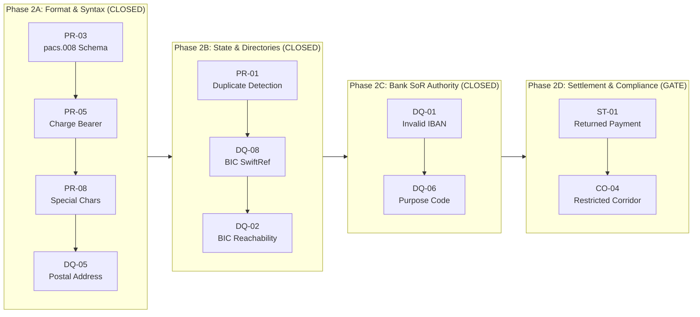
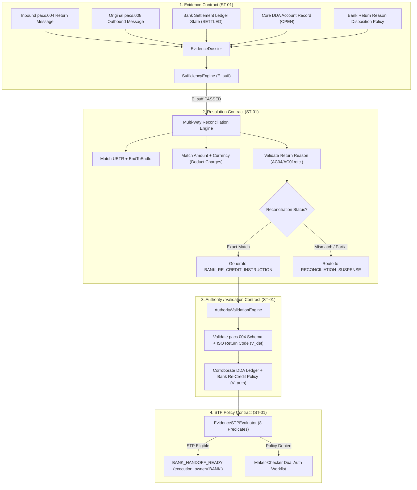

# PeX — Phase 2C Completion & Phase 2D Readiness Gate
## Architecture & Governance Assessment: Bank System-of-Record Authority $\longrightarrow$ Settlement, Returns & Accounting
**Document Version:** `v0.2`  
**Date:** `2026-10-07`  
**Review Type:** `Formal Phase Transition, Architecture & Readiness Gate`  
**Review Mode:** `READ-ONLY GOVERNANCE ASSESSMENT — ZERO CODE / SCHEMA MUTATION`  
**Phase 2C Status:** `PHASE 2C COMPLETED & CLOSED`  
**Phase 2D Readiness Status:** `READY TO AUTHORIZE ST-01 CONTROLLED IMPLEMENTATION (WITH LEVEL-1 SYNTHETIC FIXTURES)`  
**Target Milestone:** `Phase 2D Slice 7: ST-01 — RETURNED PAYMENT`  
**Current Baseline Commit:** `556101409d7272430489847eafb21504315325b2`  
**Current Baseline Tag:** `pex-phase2c-slice6-dq06-20261007`  
**Regression Test Result:** `336 / 336 PASSED (100% GREEN)`  

---

## 1. Executive Decision & Governance Summary

```
===============================================================================
1. PHASE 2C FORMAL STATUS:   PHASE 2C COMPLETED & CLOSED
   - Slice 5: DQ-01 (INVALID_IBAN) ACCEPTED (306/306 baseline, P0=0, P1=0, P2=0)
   - Slice 6: DQ-06 (INVALID_MISSING_PURPOSE_CODE) ACCEPTED (336/336 baseline, P0=0, P1=0, P2=0)
   - 8 of 10 Phase 2 profiles fully implemented and accepted across Slices 1–6.
   - Zero architecture drift, zero unconstrained AI in execution path, zero regression.

2. PHASE 2D TRANSITION:       AUTHORIZED FOR ST-01 CONTROLLED LEVEL-1 SLICE
   - Target Profile: ST-01 (RETURNED PAYMENT / pacs.004)
   - Core Risk Identified: Transition from Data Quality / Syntax to Settlement,
     Accounting & Post-Settlement Reversal flows.
   - Core Architectural Boundary Enforced:
     PeX DOES NOT autonomously credit customer accounts.
     PeX reconciles, validates, and emits BANK_RE_CREDIT_INSTRUCTION (execution_owner = "BANK").
   - Reconciliation Model: Multi-way reconciliation (UETR, amount, currency, return code,
     ledger state, double-return prevention) established as an explicit R_det prerequisite.
   - Level 1 Boundary: Synthetic Bank Accounting / Core DDA adapters permitted; Level 2
     live autonomous ledger execution remains BLOCKED pending enterprise discovery.
===============================================================================
```

---

## 2. Phase 2 Progress & Profile Status Matrix



| Phase | Slice | Profile ID | Exception Profile Name | Status | Acceptance Tag | Tests |
| :--- | :---: | :--- | :--- | :---: | :--- | :---: |
| **Phase 1** | Foundation | `PR-03` | `CORRUPTED_XML_STRUCTURE` | **ACCEPTED** | `pex-phase1-pr03-20261006` | 215 / 215 |
| **Phase 2A** | Slice 1 | `PR-05` | `INVALID_CHARGE_BEARER` | **ACCEPTED** | `pex-phase2a-slice1-pr05-20261006` | 231 / 231 |
| **Phase 2A** | Slice 2 | `PR-08` / `DQ-05` | `UNSUPPORTED_CHARSET` / `UNSTRUCTURED_ADDRESS` | **ACCEPTED** | `pex-phase2a-slice2-pr08-dq05-20261006` | 236 / 236 |
| **Phase 2A** | Slice 3 | `PR-01` / `DQ-08` | `DUPLICATE_PAYMENT` / `INVALID_BIC_FORMAT` | **ACCEPTED** | `pex-phase2a-slice3-pr01-dq08-20261006` | 251 / 251 |
| **Phase 2B** | Slice 4 | `DQ-02` | `INVALID_BIC_SWIFT_ROUTING` | **ACCEPTED** | `pex-phase2b-slice4-dq02-20261007` | 276 / 276 |
| **Phase 2C** | Slice 5 | `DQ-01` | `INVALID_IBAN_MOD97` | **ACCEPTED** | `pex-phase2c-slice5-dq01-20261007` | 306 / 306 |
| **Phase 2C** | Slice 6 | `DQ-06` | `INVALID_MISSING_PURPOSE_CODE` | **ACCEPTED** | `pex-phase2c-slice6-dq06-20261007` | **336 / 336** |
| **Phase 2D** | **Slice 7** | **`ST-01`** | **`RETURNED_PAYMENT`** | **GATE TARGET** | *Pending Authorization* | *Target 30 tests* |
| **Phase 2D** | Slice 8 | `CO-04` | `RESTRICTED_CORRIDOR_SANCTIONS` | *Scheduled* | *Pending Slice 7* | *Target 25 tests* |

---

## 3. Proven Capability Matrix

| Architectural Capability | Proven By | Status | ST-01 Reusability & Application |
| :--- | :--- | :---: | :--- |
| **Evidence Sufficiency ($E_{\text{suff}}$)** | `PR-01`, `DQ-01`, `DQ-06` | **PROVEN** | Evaluates mandatory presence of `pacs.004`, original `pacs.008`, Settlement Ledger Record, and Core DDA status. |
| **Evidence Freshness / TTL** | `DQ-02`, `DQ-01`, `DQ-06` | **PROVEN** | Evaluates TTL on Core DDA account state and settlement ledger status before re-credit decisioning. |
| **Deterministic Resolution ($R_{\text{det}}$)** | `PR-08`, `DQ-05`, `DQ-01`, `DQ-06` | **PROVEN** | Executes multi-way deterministic reconciliation to generate `BANK_RE_CREDIT_INSTRUCTION`. |
| **Candidate Uniqueness ($R_{\text{uniq}}$)** | `DQ-02`, `DQ-01`, `DQ-06` | **PROVEN** | Ensures exactly one original outbound transaction matches the return. Partial/ambiguous returns fail $R_{\text{uniq}}$. |
| **External Standards Validation ($V_{\text{det}}$)** | `PR-03`, `DQ-08`, `DQ-01`, `DQ-06` | **PROVEN** | Validates ISO 20022 `pacs.004.001.09` XSD structure and External Return Reason Codes (`AC01`, `AC04`, `MD07`, etc.). |
| **Bank System-of-Record Authority ($V_{\text{auth}}$)** | `DQ-01`, `DQ-06` | **PROVEN** | Corroborates return reason and re-credit eligibility against Bank Accounting Policy and Core DDA ledger. |
| **Bank Policy Gating ($P_{\text{bank}}$)** | `PR-01`, `PR-05`, `DQ-06` | **PROVEN** | Evaluates bank monetary ceilings ($\le \$25\text{k}$ auto-STP), fee deduction policies, and customer re-credit eligibility. |
| **Compliance Gate ($C_{\text{comp}}$)** | `All profiles` | **PROVEN** | Evaluates beneficiary sanctions / AML status prior to re-crediting returned funds. |
| **Execution Preconditions ($X_{\text{pre}}$)** | `PR-08`, `PR-01`, `DQ-06` | **PROVEN** | Confirms account is `OPEN`/unfrozen, settlement ledger is reconciled, and bank handoff queue is active. |
| **Semantic Invariance** | `PR-08`, `DQ-05`, `DQ-01`, `DQ-06` | **PROVEN** | Asserts non-return fields (original references, amounts, currencies, debtor/creditor identities) remain immutable. |
| **Maker-Checker Segregation of Duties** | `PR-01`, `DQ-01`, `DQ-06` | **PROVEN** | Enforces $\text{maker\_id} \neq \text{checker\_id}$ for manual re-credit approval or ambiguous return resolution. |
| **Cryptographic Audit Ledger** | `All profiles` | **PROVEN** | Logs linear SHA-256 Merkle-like hash chain across all 12 pipeline stages with tamper detection. |
| **Bank Execution Isolation Boundary** | `All profiles` | **PROVEN** | Terminates at `BANK_HANDOFF_READY` with `execution_owner = "BANK"`. Zero autonomous fund movement by PeX. |
| **Live Enterprise Core Banking Adapters** | `N/A` | **SIMULATED** | Clean provider-neutral port interfaces with explicit `DEMO / SYNTHETIC TEST FIXTURE` implementations for Level 1. |

---

## 4. Four-Contract Assessment for `ST-01`



### Contract Mapping for `ST-01`:
1. **Evidence Contract**:
   - **Mandatory**: `RETURN_PAYLOAD` (`pacs.004`), `ORIGINAL_PAYMENT_RECORD` (`pacs.008` snapshot / UETR), `SETTLEMENT_LEDGER_STATE` (Settled status confirmation), `CORE_DDA_ACCOUNT_STATUS` (Originator DDA state), `ISO_RETURN_CODE_SET`.
   - **Conditional**: `BANK_RETURN_DISPOSITION_POLICY`, `FEE_SCHEDULE_RECORD`, `ORIGINAL_SANCTIONS_CLEARANCE`.
   - **Optional**: `HISTORICAL_RETURN_PRECEDENT` (Tier 4, strictly informational).
2. **Resolution Contract**:
   - Multi-way deterministic reconciliation solver matching inbound `pacs.004` to outbound `pacs.008`.
   - Calculates return amount integrity ($\text{Returned Amount} + \text{Deducted Charges} = \text{Original Amount}$).
   - Emits structured `BANK_RE_CREDIT_INSTRUCTION` containing accounting keys (Original Account, Re-Credit Amount, Currency, Return Reason Code, Value Date).
3. **Authority / Validation Contract**:
   - $V_{\text{det}}$: Validates `pacs.004` XML syntax and ISO 20022 External Return Reason Code registry (`ISO_20022_EXTERNAL_RETURN_CODES`).
   - $V_{\text{auth}}$: Corroborates settlement state (`SETTLED`), account state (`OPEN`), and Bank Return Disposition Policy authorization.
4. **STP Policy Contract**:
   - Evaluates canonical 8-predicate formula: $E_{\text{suff}} \land R_{\text{det}} \land R_{\text{uniq}} \land V_{\text{det}} \land V_{\text{auth}} \land P_{\text{bank}} \land C_{\text{comp}} \land X_{\text{pre}}$.
   - Enforces configurable auto-STP ceilings ($\le \$25\text{k}$) and dual authorization for high-value returns ($\ge \$250\text{k}$).

---

## 5. ST-01 Risk Assessment & Core Principles

### 5.1 The Critical ST-01 Invariant: No Autonomous DDA Debits or Credits
$$\text{RETURN RECOGNITION} \neq \text{AUTOMATIC DDA RE-CREDIT}$$
$$\text{pacs.004 INGESTION} \neq \text{FUNDS MOVEMENT}$$
$$\text{RECONCILIATION MATCH} \neq \text{ACCOUNTING RELEASE}$$

PeX is a **governed decisioning and repair platform**, NOT a core banking accounting engine.
- PeX **MUST NOT** directly execute ledger postings, debit Nostro/Vostro accounts, or credit customer DDAs.
- PeX **MUST** output a validated, cryptographically audited `BANK_RE_CREDIT_INSTRUCTION` handoff receipt to the bank's core accounting system (`execution_owner = "BANK"`).

### 5.2 Multi-Way Reconciliation Risk Matrix
Returned payments introduce material operational and financial risks that must be fail-closed:

| Risk Category | Failure Scenario | Architectural Defense in PeX | Fallback Routing |
| :--- | :--- | :--- | :--- |
| **UETR / Identity Collision** | Inbound `pacs.004` UETR does not match any outbound `pacs.008` | Reconciliation fails; $R_{\text{det}} = \text{False}$ | `RECONCILIATION_SUSPENSE` |
| **Duplicate Return Attack** | Inbound `pacs.004` references an already re-credited payment | Idempotency & ledger status check fails; $X_{\text{pre}} = \text{False}$ | `DUPLICATE_SUSPENSE` |
| **Unsettled Original Payment** | Inbound `pacs.004` arrives while original payment is still `PENDING_SETTLEMENT` | Settlement ledger check fails; $V_{\text{auth}} = \text{False}$ | `INVESTIGATION_COCKPIT` |
| **Amount Discrepancy / Hidden Fees** | Returned amount differs from original without an authorized fee schedule | Amount balancing validation fails; $R_{\text{det}} = \text{False}$ | `DISCREPANCY_DESK` |
| **Account Inactive / Frozen** | Original ordering customer DDA is `CLOSED`, `FROZEN`, or `DORMANT` | Core DDA status check fails; $X_{\text{pre}} = \text{False}$ | `OPERATIONS_SUSPENSE` |
| **Compliance / Sanctions Hold** | Returned funds associated with a newly flagged sanctions alert | Compliance gate fails; $C_{\text{comp}} = \text{False}$ | `COMPLIANCE_SUSPENSE` |
| **Ambiguous Return Reason** | Return code is `NARR` or unmapped free text | Ambiguity check fails; $R_{\text{uniq}} = \text{False}$ | `DISAMBIGUATION_DESK` |

---

## 6. Proposed Minimum Viable ST-01 Vertical Slice

To maintain the strict, controlled incremental engineering methodology proven across Slices 1–6, the first implementation of `ST-01` must be a **narrow, deterministic vertical slice**:

### Canonical Slice Scope:
1. **Message Format**: ISO 20022 `pacs.004.001.09` (Payment Return) referencing outbound `pacs.008.001.08`.
2. **Reconciliation Match**:
   - Exact UETR match (`pacs.004/OrgnlTxRef/UETR` == `pacs.008/PmtId/UETR`).
   - Exact EndToEndId match (`pacs.004/OrgnlEndToEndId` == `pacs.008/PmtId/EndToEndId`).
   - Exact currency match (`EUR`).
   - Full return without deducted charges (`pacs.004/RtrdIntrBkSttlmAmt` == `pacs.008/IntrBkSttlmAmt`).
3. **Return Reason Code**: Registered ISO 20022 return reason code (e.g. `AC04` Closed Account, `AC01` Incorrect Account Number, `MD07` Customer Deceased).
4. **Authority State**:
   - Original payment verified as `SETTLED` in Bank Settlement Ledger.
   - Ordering customer DDA verified as `OPEN` and active in Core DDA.
   - Counterparty and Corridor Return Policies are `AUTHORIZED` and unexpired.
5. **Output Boundary**:
   - Generates `BANK_RE_CREDIT_INSTRUCTION` in `pex.outbound.v1` envelope.
   - Sets `final_lifecycle_stage = "BANK_HANDOFF_READY"` with `execution_owner = "BANK"`.
6. **Non-Happy Paths Handled**:
   - Unmatched UETR $\to$ `RECONCILIATION_SUSPENSE`
   - Closed customer account $\to$ `OPERATIONS_SUSPENSE`
   - Duplicate return $\to$ `DUPLICATE_SUSPENSE`
   - Amount discrepancy $\to$ `DISCREPANCY_DESK`
   - High value ($\ge \$250\text{k}$) $\to$ `MAKER_CHECKER_WORKLIST` (with SoD $\text{maker\_id} \neq \text{checker\_id}$).

---

## 7. ST-01 Test Strategy (30 Target Scenarios)

The Slice 7 test suite will execute 30 comprehensive end-to-end and adversarial scenarios:
- **ST01-01 to ST01-06**: Positive deterministic path (full returns with standard reason codes: `AC04`, `AC01`, `MD07`, `RR04`, `RC01`, `ED05`).
- **ST01-07 to ST01-12**: Reconciliation failure modes (unmatched UETR, EndToEndId mismatch, currency mismatch, amount discrepancy, unrepresented charges).
- **ST01-13 to ST01-17**: Settlement and ledger state failures (original payment unsettled, duplicate return, already re-credited, customer account closed/frozen).
- **ST01-18 to ST01-22**: Authority, policy, and freshness failures (missing bank return policy, stale settlement ledger, unauthorized return disposition, corridor return prohibition).
- **ST01-23 to ST01-26**: Compliance, risk limits, and Segregation of Duties (sanctions alert on returned funds, high-value Maker-Checker dual auth, SoD self-approval rejection).
- **ST01-27 to ST01-30**: Integrity, prompt defense, and execution boundary (untrusted narrative sanitization in return reason, semantic invariance verification, bank handoff envelope, Merkle audit chain).

---

## 8. Level-1 Platform vs Level-2 Production Readiness

```
┌─────────────────────────────────────────────────────────────────────────────┐
│ LEVEL 1: GOVERNED PLATFORM IMPLEMENTATION (CURRENT TARGET)                 │
│ - Full 4-contract architecture & canonical 8-predicate formula              │
│ - Deterministic multi-way reconciliation & return code validation           │
│ - Provider-neutral Bank Settlement Ledger & Core DDA adapters               │
│ - Synthetic test fixtures explicitly declared DEMO / SYNTHETIC              │
│ - Strict Maker-Checker SoD and Bank Execution Handoff Boundary             │
│ - Fully green unit, integration, and adversarial test harness               │
├─────────────────────────────────────────────────────────────────────────────┤
│ LEVEL 2: LIVE ENTERPRISE PRODUCTION INTEGRATION (BLOCKED / DEFERRED)       │
│ - Live bidirectional Kafka / MQ streaming to Bank Core DDA (Finacle/SAP)    │
│ - Live Core Settlement Ledger API integration (RTGS/FedLine/TARGET2)        │
│ - Enterprise HSM / AWS KMS Token Vault detokenization                       │
│ - Live SWIFTRef API direct replication feed                                 │
│ - Multi-jurisdictional automated tax/charge withholding engine              │
└─────────────────────────────────────────────────────────────────────────────┘
```

---

## 9. Final Phase 2D Readiness Determination

### **Decision: READY TO AUTHORIZE ST-01 CONTROLLED IMPLEMENTATION**

Phase 2C is **CLOSED AND ACCEPTED**. The platform architecture has demonstrated robust, modular, and reusable capability across 8 distinct exception profiles. 

The architecture is formally **READY** for **Phase 2D Slice 7: `ST-01` (`RETURNED PAYMENT`)**, subject to:
1. Strict enforcement of the **Bank Execution and Accounting Isolation Boundary** (`BANK_RE_CREDIT_INSTRUCTION`, `execution_owner = "BANK"`).
2. Explicit classification of Bank Settlement Ledger and Core DDA adapters as `DEMO / SYNTHETIC TEST FIXTURES`.
3. Strict Maker-Checker Segregation of Duties ($\text{maker\_id} \neq \text{checker\_id}$).
4. Zero code changes to `ST-01` or `CO-04` during this governance turn.

**Execution Status:** STOPPED. Ready for user authorization of Phase 2D Slice 7 (`ST-01`).
