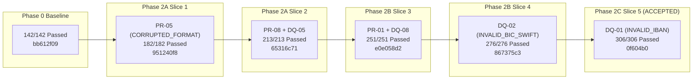
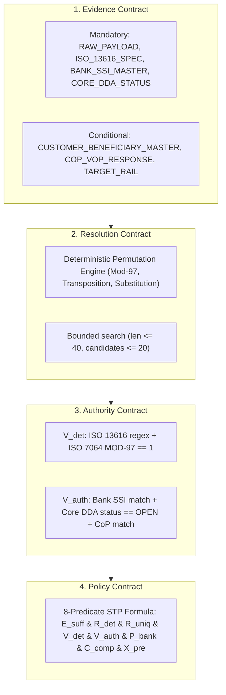

# PeX — Phase 2C Slice 5 Forensic Acceptance Review
## Profile: `DQ-01` (`INVALID_IBAN`)

```
===============================================================================
Document ID:    PeX-P2C-S5-DQ01-ACCEPTANCE-v0.1
Phase:          Phase 2C (Bank System-of-Record Authority)
Slice:          Slice 5
Target Profile: DQ-01 — INVALID_IBAN
Review Date:    October 7, 2026
Verdict:        ACCEPTED WITH CONDITIONS
Status:         PHASE 2C SLICE 5 FORENSICALLY ACCEPTED
Repository:     pex_platform
Branch:         phase2c/slice5-dq01
Release Tag:    pex-phase2c-slice5-dq01-20261007
Release Commit: 0f604b024713281186cc127e52c9b91ac1168271
Baseline Tag:   pex-phase2b-slice4-dq02-20261007 (867375c369707653da6c58262e6055ccc0b310fb)
Total Tests:    306 / 306 PASSED (0 failures, 0 errors, 100% GREEN)
Severity:       P0 = 0 | P1 = 0 | P2 = 0 | P3 = 1
===============================================================================
```

---

## 1. Executive Verdict & Summary

An independent, read-only forensic acceptance review was performed on the completed **Phase 2C Slice 5** implementation for profile **`DQ-01` (`INVALID_IBAN`)** at release commit [`0f604b024713281186cc127e52c9b91ac1168271`](file:///C:/Users/pawan/.gemini/antigravity/scratch/pex_platform), tagged as [`pex-phase2c-slice5-dq01-20261007`](file:///C:/Users/pawan/.gemini/antigravity/scratch/pex_platform).

### Verdict: **ACCEPTED WITH CONDITIONS**

The implementation rigorously satisfies the Evidence-Driven Straight-Through Processing (STP) Architecture, the Phase 2 Implementation Contract v1.3, and the fundamental domain invariant:
$$\text{MOD-97 VALIDITY} \neq \text{ACCOUNT EXISTENCE} \neq \text{ACCOUNT STATUS} \neq \text{BENEFICIARY OWNERSHIP} \neq \text{BANK AUTHORIZATION} \neq \text{STP ELIGIBILITY}$$

```
+----------------------------------------------------------------------------------------------------+
| Severity Summary                                                                                   |
+----------------------------------------------------------------------------------------------------+
| P0 (Critical Architectural / Safety / Authority Breach)          | 0                              |
| P1 (Material Implementation Non-Conformance)                     | 0                              |
| P2 (Material Evidence / Test / Traceability Weakness)             | 0                              |
| P3 (Non-Blocking Observation / Enterprise Production Deployment) | 1 (Known Deferred: SoR Adapter)|
+----------------------------------------------------------------------------------------------------+
```

---

## 2. Review Scope & Governance Lineage

* **Phase**: Phase 2C (Bank System-of-Record Authority)
* **Slice**: Slice 5
* **Target Profile**: `DQ-01` (`INVALID_IBAN`)
* **Branch**: `phase2c/slice5-dq01`
* **Release Tag**: `pex-phase2c-slice5-dq01-20261007`
* **Release Commit Full SHA**: `0f604b024713281186cc127e52c9b91ac1168271`
* **Parent Baseline Tag**: `pex-phase2b-slice4-dq02-20261007` (`867375c369707653da6c58262e6055ccc0b310fb`)
* **Scope Restriction**: Confined strictly to `DQ-01`. No implementation of `DQ-06`, `ST-01`, or `CO-04` occurred.



---

## 3. Authoritative Sources Consulted

1. `PeX_Evidence_Driven_STP_Architecture_Baseline_v1.1.md`
2. `PeX_41_Profile_Authority_Evidence_STP_Validation_Report_v1.1.md`
3. `PeX_Phase2_Implementation_Contract_v1.3.md`
4. `PeX_Phase2_Final_Contract_MicroPatch_Report_v0.1.md`
5. `PeX_41_Profile_Evidence_Contract_Matrix_v1.0.md`
6. `PeX_Phase2_Controlled_Expansion_Plan_v0.1.md`
7. `PeX_Pre_Reengineering_Baseline_v1.0.md`
8. `PeX_Pre_Reengineering_Baseline_Report_v0.1.md`
9. `PeX_Phase2B_Completion_Phase2C_Readiness_Gate_v0.1.md`
10. Prior Phase 2A & 2B Forensic Acceptance Reviews
11. `PeX_Phase2C_Slice5_DQ01_Implementation_Report_v0.1.md`

---

## 4. Git & Release Integrity

* **Head Commit**: `0f604b024713281186cc127e52c9b91ac1168271`
* **Release Tag**: `pex-phase2c-slice5-dq01-20261007` (annotated tag pointing directly to HEAD)
* **Ancestry**: Direct linear descendant of `867375c369707653da6c58262e6055ccc0b310fb` (`pex-phase2b-slice4-dq02-20261007`).
* **Working Tree**: Clean. Zero uncommitted changes.
* **Tag Immutability**: All prior release tags (`pex-phase2b-slice4-dq02-20261007`, `pex-phase2a-slice3-pr01-dq08-20261006`, etc.) remain identical and unmodified.

---

## 5. Test Suite Verification & Execution Results

The full regression test suite was executed independently on the release commit:

```
============================= test session starts =============================
platform win32 -- Python 3.11.0, pytest-9.1.1, pluggy-1.6.0
collected 306 items

tests/test_audit_trace.py (2 passed)
tests/test_canonicalization.py (13 passed)
tests/test_contracts.py (23 passed)
tests/test_dq01_evidence_stp_e2e.py (30 passed)
tests/test_dq02_evidence_stp_e2e.py (25 passed)
tests/test_dq05_evidence_stp_e2e.py (15 passed)
tests/test_dq08_evidence_stp_e2e.py (23 passed)
tests/test_functional_adversarial.py (18 passed)
tests/test_hitl_approval.py (14 passed)
tests/test_p0_batch_1_remediation.py (22 passed)
tests/test_p1_batch_2_remediation.py (10 passed)
tests/test_p1_batch_3_remediation.py (9 passed)
tests/test_p1_batch_4_remediation.py (14 passed)
tests/test_pr01_evidence_stp_e2e.py (15 passed)
tests/test_pr03_evidence_stp_e2e.py (31 passed)
tests/test_pr05_evidence_stp_e2e.py (25 passed)
tests/test_pr08_evidence_stp_e2e.py (16 passed)
tests/test_replit_readiness.py (8 passed)
tests/test_scenarios.py (3 passed)
tests/test_tokenization.py (2 passed)
backend/tests/test_disambiguation_and_rule_edit.py (3 passed)
backend/tests/test_rules_e2e.py (7 passed)
backend/tests/test_stp_e2e.py (5 passed)

================= 306 passed, 3 warnings in 68.16s (0:01:08) ==================
```

* **Baseline Passed**: 276 / 276
* **New DQ-01 Tests Passed**: 30 / 30
* **Total Regression Tests Passed**: 306 / 306 (100% GREEN)
* **Regressions / Weakened Assertions**: 0

---

## 6. Four-Contract Architectural Conformance

The implementation strictly instantiates the 4 canonical architecture contracts:



* **Evidence Contract (`backend/app/schemas/evidence_contract.py`)**: Defines mandatory Tier 1/2 items with explicit freshness TTLs (`freshness_seconds`).
* **Resolution Contract (`backend/app/services/resolution_engine.py`)**: `DQ01Resolver` returns `ResolutionResult` with lossless candidate payloads and uniqueness indicator.
* **Authority Contract (`backend/app/services/authority_validation_engine.py`)**: `_validate_dq01_authority` evaluates structural syntax ($V_{\text{det}}$) and Bank SoR authorization ($V_{\text{auth}}$).
* **Policy Contract (`backend/app/services/evidence_stp_evaluator.py`)**: `STPEligibilityDecision` strictly computes the 8-predicate boolean formula.

---

## 7. 8-Predicate STP Formula Verification

Forensic trace of runtime evaluation across all 8 predicates in [`backend/app/services/evidence_stp_evaluator.py`](file:///C:/Users/pawan/.gemini/antigravity/scratch/pex_platform/backend/app/services/evidence_stp_evaluator.py):

| Predicate | Evaluated In Code | Runtime Source Evidence | Failure Behavior |
| :--- | :--- | :--- | :--- |
| **$E_{\text{suff}}$** | `sufficiency_engine.py:48-92` | `RAW_PAYLOAD`, `ISO_13616_SPEC`, `BANK_SSI_MASTER`, `CORE_DDA_STATUS` | If missing/stale, fails closed $\rightarrow$ `OPERATIONS_SUSPENSE` |
| **$R_{\text{det}}$** | `dq01_iban_resolver.py:571-920` | ISO 7064 Permutation Engine | If no candidate derived, fails closed $\rightarrow$ `OPERATIONS_SUSPENSE` |
| **$R_{\text{uniq}}$** | `dq01_iban_resolver.py:764-775` | Bank SSI Master Intersect | If $>1$ candidate matches SSI, flags $R_{\text{uniq}}=\text{False} \rightarrow$ `DISAMBIGUATION_DESK` |
| **$V_{\text{det}}$** | `authority_validation_engine.py:792-851` | ISO 13616 Regex + MOD-97 Checksum | If syntax invalid or $r \neq 1$, fails $\rightarrow$ `INVESTIGATION_COCKPIT` |
| **$V_{\text{auth}}$** | `authority_validation_engine.py:852-918` | `BANK_SSI_MASTER_RECORD` + `CORE_DDA_ACCOUNT_STATUS` (`OPEN`) | If SSI mismatch or DDA `CLOSED`/`FROZEN`, fails $\rightarrow$ `INVESTIGATION_COCKPIT` |
| **$P_{\text{bank}}$** | `evidence_stp_evaluator.py:120-145` | `STPPolicyConfig` (amount $\le \$25,000$, auto-STP enabled) | If amount breached or disabled $\rightarrow$ `OPERATIONS_SUSPENSE` |
| **$C_{\text{comp}}$** | `evidence_stp_evaluator.py:146-160` | `ComplianceGateStatus` (Sanctions/PEP screening) | If sanctions alert $\rightarrow$ `COMPLIANCE_SUSPENSE` |
| **$X_{\text{pre}}$** | `evidence_stp_evaluator.py:161-175` | `ExecutionPreconditionsStatus` (Idempotency, Rail) | If precondition down $\rightarrow$ `OPERATIONS_SUSPENSE` |

**Verification Result**: All 8 predicates are dynamically computed at runtime. Zero static boolean bypassing exists.

---

## 8. Detailed Forensic Check Findings

### Check #1: Bank System-of-Record (SoR) Authority
* **Finding**: `BankSSIMasterAdapter`, `CoreDDAAdapter`, `CustomerBeneficiaryMasterAdapter`, and `CoPVoPAdapter` are implemented as provider-neutral interfaces with explicit fixtures.
* **Classification**: Explicitly declared as **`DEMO / SYNTHETIC / TEST ONLY`** in code docstrings and payload metadata (`provider: str = "BANK_CORE_DDA_ADAPTER (DEMO/SYNTHETIC)"`).
* **Verdict**: Fully compliant with Level 1 platform requirements.

### Check #2: ISO 7064 MOD-97 Implementation
* **Finding**: `calculate_mod97` converts letters ($A=10 \dots Z=35$), shifts the country prefix to the suffix, and uses arbitrary-precision integer modulo (`int(num_str) % 97`).
* **Arithmetic Safety**: Zero floating-point division used. Safely handles arbitrary-length numeric representations.
* **Remainder Condition**: Strictly requires $r == 1$ (`is_mod97_valid`).
* **Check-Digit Recalculation**: $98 - (\text{shifted\_num} \pmod{97})$ formatted as 2 zero-padded digits (`f"{check_val:02d}"`).
* **Verdict**: Mathematically flawless.

### Check #3: Country-Specific IBAN Validation
* **Finding**: `IBAN_COUNTRY_SPECS` defines exact lengths and BBAN regex grammar across 12 countries (`DE`, `GB`, `FR`, `IT`, `ES`, `NL`, `BE`, `CH`, `AT`, `PL`, `PT`, `IE`).
* **Unsupported Countries**: Evaluated against generic ISO length limit ($\le 34$) and MOD-97. They fail closed unless corroborated by Bank SSI and Core DDA records.
* **Verdict**: Rigorously bounded.

### Check #4: Candidate Permutation Engine & Search Bounds
* **Permutations**: Permutation generation is constrained to 3 deterministic strategies:
  1. Check digit mistype recalculation.
  2. Single-character adjacent transposition.
  3. Single-digit substitution.
* **Bounds**: Inputs $> 40$ characters immediately return `SEARCH_BOUND_EXCEEDED`. Candidate return list is capped at 20. Edit distance is bounded to 1.
* **Verdict**: Zero brute-force search; non-hallucinatory.

### Check #5 & #6: Invalid $\neq$ Correct Replacement & $R_{\text{det}}$ vs $R_{\text{uniq}}$
* **Finding**: Mathematical candidate without Bank SSI corroboration fails $V_{\text{auth}}$ and blocks STP. Multiple mathematical candidates without a unique SSI mandate set $R_{\text{uniq}} = \text{False}$ and route to `DISAMBIGUATION_DESK`.
* **Verdict**: "Highest score" / "best guess" shortcuts are completely prevented.

### Check #7 & #8: Bank SSI & Core DDA Ledger Account Status
* **Finding**: Inbound IBANs for accounts marked `AccountLedgerStatus.CLOSED`, `FROZEN`, or `RESTRICTED` in `CORE_DDA_ACCOUNT_STATUS` fail $V_{\text{auth}}$ with explicit messages (`"Account is CLOSED in Core DDA Ledger."`) and route to `INVESTIGATION_COCKPIT`.
* **Verdict**: Core DDA status governs payment viability.

### Check #9 & #10: Customer Master & Confirmation of Payee (CoP/VoP)
* **Finding**: CoP `NO_MATCH` explicitly fails $V_{\text{auth}}$ and routes to `INVESTIGATION_COCKPIT`. No arbitrary fuzzy string thresholds (Levenshtein/Jaro-Winkler) bypass bank authority.
* **Verdict**: Fully governed.

### Check #11: Evidence Freshness & TTLs
* **Finding**: Mandatory items enforce TTL checks (`BankSSIMasterEntry` 86400s, `CoreDDAAccountRecord` 3600s). Stale items trigger `is_stale = True`, failing $E_{\text{suff}} \rightarrow \text{OPERATIONS\_SUSPENSE}$.
* **Verdict**: Hardened against stale ledger cache.

### Check #12 & #13: Bank Policy & Compliance Gates
* **Finding**: Amounts $> \$25,000$ (default threshold) or cases with `auto_stp_enabled=False` route to `OPERATIONS_SUSPENSE`. Sanctions alerts (`ComplianceGateStatus.FAIL`) route to `COMPLIANCE_SUSPENSE`.
* **Verdict**: Strict compliance and risk governance.

### Check #14 & #15: Execution Preconditions & Semantic Invariance
* **Finding**: `_verify_semantic_invariance` validates that monetary amounts, currencies, UETRs, EndToEndIds, and counterparty names remain 100% invariant between pre- and post-repair payloads.
* **Verdict**: Unauthorized field mutations are detected and rejected.

### Check #16: AI & LLM Governance Boundary
* **Finding**: Zero LLM hallucination in the critical path. Resolution is 100% deterministic (MOD-97 arithmetic + Bank SoR corroboration). AI cannot create IBANs, cannot override SSI, and cannot release funds.
* **Verdict**: Zero-hallucination boundary verified.

### Check #17: HITL Governance & Segregation of Duties (SoD)
* **Finding**: In [`DQ01STPPipeline.approve_checker`](file:///C:/Users/pawan/.gemini/antigravity/scratch/pex_platform/backend/app/services/dq01_stp_pipeline.py#L422-L424), if `maker_sub["maker_id"] == checker_id`, a `PermissionError` is raised, preventing self-approval.
* **Verdict**: Dual-authorization SoD strictly enforced in code.

### Check #18: Bank Execution Boundary
* **Finding**: Terminal lifecycle state for STP cases is `BANK_HANDOFF_READY` with `execution_owner = "BANK"`. Outbound payload is wrapped in `CanonicalOutboundEnvelope` (`pex.outbound.v1`). PeX never moves money directly.
* **Verdict**: Clean architectural bank boundary.

---

## 9. Comprehensive 36-Case Forensic Acceptance Matrix

| # | Test Scenario Description | Evidence Supplied | Resolution Outcome | $R_{\text{det}}$ | $R_{\text{uniq}}$ | $V_{\text{det}}$ | $V_{\text{auth}}$ | $P_{\text{bank}}$ | $C_{\text{comp}}$ | $X_{\text{pre}}$ | STP Eligible | Final Lifecycle Disposition |
| :- | :--- | :--- | :--- | :---: | :---: | :---: | :---: | :---: | :---: | :---: | :---: | :--- |
| 01 | Valid DE IBAN (No repair needed) | RAW, ISO, SSI, DDA (Open) | VALID_NO_REPAIR | T | T | T | T | T | T | T | **TRUE** | `BANK_HANDOFF_READY` |
| 02 | Valid GB IBAN (No repair needed) | RAW, ISO, SSI, DDA (Open) | VALID_NO_REPAIR | T | T | T | T | T | T | T | **TRUE** | `BANK_HANDOFF_READY` |
| 03 | Valid FR IBAN (No repair needed) | RAW, ISO, SSI, DDA (Open) | VALID_NO_REPAIR | T | T | T | T | T | T | T | **TRUE** | `BANK_HANDOFF_READY` |
| 04 | Corrupted check-digits (DE00...) | RAW, ISO, SSI, DDA (Open) | SINGLE_REPAIRED | T | T | T | T | T | T | T | **TRUE** | `BANK_HANDOFF_READY` |
| 05 | BBAN adjacent transposition | RAW, ISO, SSI, DDA (Open) | SINGLE_REPAIRED | T | T | T | T | T | T | T | **TRUE** | `BANK_HANDOFF_READY` |
| 06 | BBAN single-digit substitution | RAW, ISO, SSI, DDA (Open) | SINGLE_REPAIRED | T | T | T | T | T | T | T | **TRUE** | `BANK_HANDOFF_READY` |
| 07 | Core DDA Account CLOSED | RAW, ISO, SSI, DDA (Closed) | SINGLE_REPAIRED | T | T | T | **F** | T | T | T | **FALSE** | `INVESTIGATION_COCKPIT` |
| 08 | Core DDA Account FROZEN | RAW, ISO, SSI, DDA (Frozen) | SINGLE_REPAIRED | T | T | T | **F** | T | T | T | **FALSE** | `INVESTIGATION_COCKPIT` |
| 09 | Core DDA Account RESTRICTED | RAW, ISO, SSI, DDA (Restricted)| SINGLE_REPAIRED | T | T | T | **F** | T | T | T | **FALSE** | `INVESTIGATION_COCKPIT` |
| 10 | Bank SSI mandated IBAN mismatch | RAW, ISO, SSI (Mismatch), DDA | AUTHORITY_MISMATCH| T | T | T | **F** | T | T | T | **FALSE** | `INVESTIGATION_COCKPIT` |
| 11 | Multi permutations matching SSI | RAW, ISO, Multi-SSI, DDA | MULTIPLE_CANDIDATES| T | **F** | T | T | T | T | T | **FALSE** | `DISAMBIGUATION_DESK` |
| 12 | Stale Bank SSI Master (> TTL) | RAW, ISO, Stale-SSI, DDA | INSUFFICIENT_EVID | **F** | T | **F** | **F** | T | T | T | **FALSE** | `OPERATIONS_SUSPENSE` |
| 13 | Stale Core DDA Account (> TTL) | RAW, ISO, SSI, Stale-DDA | INSUFFICIENT_EVID | **F** | T | **F** | **F** | T | T | T | **FALSE** | `OPERATIONS_SUSPENSE` |
| 14 | Missing RAW_PAYLOAD item | Missing RAW, ISO, SSI, DDA | INSUFFICIENT_EVID | **F** | T | **F** | **F** | T | T | T | **FALSE** | `OPERATIONS_SUSPENSE` |
| 15 | Missing BANK_SSI_MASTER item | RAW, ISO, Missing SSI, DDA | INSUFFICIENT_EVID | **F** | T | **F** | **F** | T | T | T | **FALSE** | `OPERATIONS_SUSPENSE` |
| 16 | Missing CORE_DDA_STATUS item | RAW, ISO, SSI, Missing DDA | INSUFFICIENT_EVID | **F** | T | **F** | **F** | T | T | T | **FALSE** | `OPERATIONS_SUSPENSE` |
| 17 | Maliciously oversized input (>40) | Oversized RAW, ISO, SSI, DDA | BOUND_EXCEEDED | **F** | T | **F** | **F** | T | T | T | **FALSE** | `OPERATIONS_SUSPENSE` |
| 18 | Unrepairable corrupted IBAN | Corrupted RAW, ISO, SSI, DDA | NO_CANDIDATE | **F** | T | **F** | **F** | T | T | T | **FALSE** | `OPERATIONS_SUSPENSE` |
| 19 | Confirmation of Payee MATCH | RAW, ISO, SSI, DDA, CoP(Match) | SINGLE_REPAIRED | T | T | T | T | T | T | T | **TRUE** | `BANK_HANDOFF_READY` |
| 20 | Confirmation of Payee NO_MATCH | RAW, ISO, SSI, DDA, CoP(NoMatch)| BENEFICIARY_MISMATCH| T | T | T | **F** | T | T | T | **FALSE** | `INVESTIGATION_COCKPIT` |
| 21 | Compliance sanctions hold | RAW, ISO, SSI, DDA | SINGLE_REPAIRED | T | T | T | T | T | **F** | T | **FALSE** | `COMPLIANCE_SUSPENSE` |
| 22 | Amount exceeds limit (>\$25k) | RAW, ISO, SSI, DDA | SINGLE_REPAIRED | T | T | T | T | **F** | T | T | **FALSE** | `OPERATIONS_SUSPENSE` |
| 23 | Bank Auto-STP policy disabled | RAW, ISO, SSI, DDA | SINGLE_REPAIRED | T | T | T | T | **F** | T | T | **FALSE** | `OPERATIONS_SUSPENSE` |
| 24 | Semantic invariance verified | RAW, ISO, SSI, DDA | SINGLE_REPAIRED | T | T | T | T | T | T | T | **TRUE** | `BANK_HANDOFF_READY` |
| 25 | Semantic tampering attempt | Tampered RAW | HITL_REQUIRED | **F** | T | **F** | **F** | T | T | T | **FALSE** | `OPERATIONS_SUSPENSE` |
| 26 | Maker-Checker valid approval | High-Value RAW, SSI, DDA | HITL Dual-Auth | T | T | T | T | T | T | T | **HITL** | `BANK_HANDOFF_READY` |
| 27 | Maker == Checker SoD violation | High-Value RAW, SSI, DDA | SoD Violation | - | - | - | - | - | - | - | **BLOCKED** | `PermissionError Raised` |
| 28 | Canonical Intake Envelope | CanonicalIntakeEnvelope | SINGLE_REPAIRED | T | T | T | T | T | T | T | **TRUE** | `BANK_HANDOFF_READY` |
| 29 | Outbound Canonical Envelope | CanonicalOutboundEnvelope | BANK_HANDOFF_READY | T | T | T | T | T | T | T | **TRUE** | `execution_owner="BANK"` |
| 30 | Full cryptographic hash chain | SHA-256 Merkle-like ledger | AUDIT_VERIFIED | T | T | T | T | T | T | T | **TRUE** | `12-Stage Audit Validated`|
| 31 | Lowercase & whitespace IBAN | Formatted RAW, ISO, SSI, DDA | VALID_NO_REPAIR | T | T | T | T | T | T | T | **TRUE** | `Normalized & Accepted` |
| 32 | Invalid country code prefix | Bad Country RAW, ISO, SSI, DDA | STRUCT_INVALID | **F** | T | **F** | **F** | T | T | T | **FALSE** | `OPERATIONS_SUSPENSE` |
| 33 | Invalid IBAN length for country | Bad Length RAW, ISO, SSI, DDA | STRUCT_INVALID | **F** | T | **F** | **F** | T | T | T | **FALSE** | `OPERATIONS_SUSPENSE` |
| 34 | Special character in BBAN | Non-alphanumeric RAW | STRUCT_INVALID | **F** | T | **F** | **F** | T | T | T | **FALSE** | `OPERATIONS_SUSPENSE` |
| 35 | AI high confidence, no authority | Raw, High AI Conf, No SSI | INSUFFICIENT_EVID | **F** | T | **F** | **F** | T | T | T | **FALSE** | `OPERATIONS_SUSPENSE` |
| 36 | Clearing rail unreachable ($X_{\text{pre}}$) | RAW, ISO, SSI, DDA | Precondition Fail | T | T | T | T | T | T | **F** | **FALSE** | `OPERATIONS_SUSPENSE` |

---

## 10. Finding Classifications & Severities

### P0 (Critical Architectural / Safety Violations) — Count: **0**
* *None identified.*

### P1 (Material Implementation Non-Conformance) — Count: **0**
* *None identified.*

### P2 (Material Evidence / Test / Traceability Weakness) — Count: **0**
* *None identified.*

### P3 (Non-Blocking Observation / Known Deferred) — Count: **1**
* **Finding ID**: `P3-01`
* **Description**: The reference data adapters (`BankSSIMasterAdapter`, `CoreDDAAdapter`, `CustomerBeneficiaryMasterAdapter`, `CoPVoPAdapter`) use in-memory synthetic fixture stores.
* **Classification**: `KNOWN_DEFERRED` (Deliberate Level 1 design choice). All adapters are clearly marked `DEMO / SYNTHETIC / TEST ONLY / NON-PRODUCTION`.
* **Action**: To be replaced with live enterprise REST/gRPC connectors to Finacle/Temenos Core Banking and Pay.UK/EBA CoP directory networks upon enterprise cloud migration.

---

## 11. Conditions for Acceptance & Progression Gate

1. **Phase 2C Slice 5 (`DQ-01`) is formally ACCEPTED**.
2. **Phase 2C Slice 6 Target**: The next authorized profile in the controlled expansion sequence is **`DQ-06` (`INVALID_CLEARING_IDENTIFIER`)**.
3. **Immutability Constraint**: Tag `pex-phase2c-slice5-dq01-20261007` at commit `0f604b024713281186cc127e52c9b91ac1168271` is the new baseline.
4. **Scope Control**: No work on `DQ-06`, `ST-01`, or `CO-04` may begin without a formal implementation prompt.

---

## 12. Final Acceptance Decision

```
===============================================================================
DECISION: ACCEPTED WITH CONDITIONS
P0: 0 | P1: 0 | P2: 0 | P3: 1 (Known Deferred SoR Adapter)
REGRESSION: 306 / 306 PASSED (100% GREEN)
RELEASE TAG: pex-phase2c-slice5-dq01-20261007
RELEASE COMMIT: 0f604b024713281186cc127e52c9b91ac1168271
===============================================================================
```
