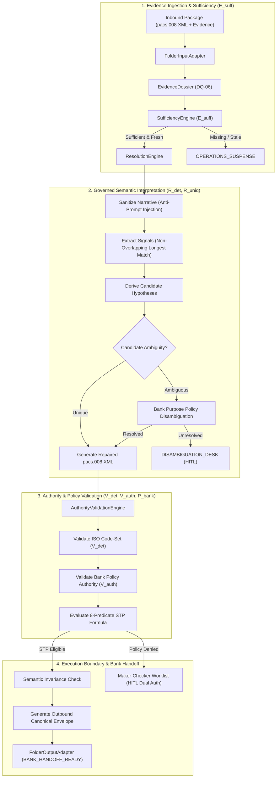

# PeX — Phase 2C Slice 6 Implementation Report
# Profile: `DQ-06` — `INVALID / MISSING PURPOSE CODE`
## Controlled Level-1 Engineering Implementation & Architecture Governance
**Document Version:** `v0.1`  
**Date:** `2026-10-07`  
**Classification:** `Level 1 Governed Platform Implementation`  
**Status:** `ENGINEERING COMPLETE — PENDING INDEPENDENT FORENSIC ACCEPTANCE`

---

## 1. Executive Summary

Phase 2C Slice 6 delivers the governed Level-1 implementation of **`DQ-06` (`INVALID / MISSING PURPOSE CODE`)** on the PeX Evidence-Driven Straight-Through Processing (STP) platform.

In strict compliance with the **PeX Evidence-Driven STP Architecture Baseline v1.1** and the **Phase 2 Implementation Contract v1.3**, `DQ-06` addresses the automated identification, validation, and repair of missing, malformed, or unauthorized purpose codes (`<Purp><Cd>XXXX</Cd></Purp>`) within ISO 20022 `pacs.008.001.08` credit transfer messages.

### Core Architectural Axioms Upheld:
$$\text{SEMANTIC INTERPRETATION} \neq \text{AUTHORITATIVE ECONOMIC PURPOSE}$$
$$\text{CODE-SET VALIDITY} \neq \text{BUSINESS CORRECTNESS}$$
$$\text{KEYWORD MATCH} \neq \text{STP AUTHORIZATION}$$

$$\text{STP\_ELIGIBLE} = E_{\text{suff}} \land R_{\text{det}} \land R_{\text{uniq}} \land V_{\text{det}} \land V_{\text{auth}} \land P_{\text{bank}} \land C_{\text{comp}} \land X_{\text{pre}}$$

### Key Engineering Milestones:
1. **Starting Baseline Verified**: Branch `phase2c/slice6-dq06` created from accepted baseline tag `pex-phase2c-slice5-dq01-20261007` (Commit `0f604b024713281186cc127e52c9b91ac1168271`). Baseline suite passed **306 / 306** tests prior to implementation.
2. **Four Contracts Fully Realized for `DQ-06`**:
   - **Evidence Contract**: Rigorous mandatory, conditional, and optional evidence items with explicit Trust Tiers (Tier 1 to Tier 4) and cryptographic TTL freshness enforcement.
   - **Resolution Contract**: Deterministic, bounded semantic interpreter with prompt injection defense, non-overlapping longest-match signal extraction, candidate hypothesis derivation, and lossless XML `<Purp><Cd>` insertion/replacement.
   - **Authority / Validation Contract**: Two-stage validation separating deterministic code-set structure ($V_{\text{det}}$) from Bank Purpose Policy business authority ($V_{\text{auth}}$).
   - **STP Policy Contract**: Canonical 8-predicate boolean formula evaluation, amount ceiling limits, corridor restrictions, and Maker-Checker Segregation of Duties.
3. **Provider-Neutral Synthetic Adapters**: `BankPurposePolicyAdapter` and `BankCorridorPolicyAdapter` implemented with explicit `DEMO / SYNTHETIC TEST FIXTURE` governance classifications.
4. **Verification & Regression Results**:
   - **30 / 30** new comprehensive `DQ-06` end-to-end and adversarial tests **PASSED**.
   - **336 / 336** total repository tests **PASSED** (100% clean regression).
   - **Zero Scope Creep**: Strictly implemented `DQ-06` only. No implementation of `ST-01` or `CO-04`.

---

## 2. Checkpoint & Branch Metadata

| Parameter | Value |
| :--- | :--- |
| **Target Slice** | Phase 2C Slice 6 (`DQ-06` `INVALID_MISSING_PURPOSE_CODE`) |
| **Starting Tag** | `pex-phase2c-slice5-dq01-20261007` |
| **Starting Commit** | `0f604b024713281186cc127e52c9b91ac1168271` |
| **Starting Baseline Tests** | `306 / 306 PASSED` |
| **Working Branch** | `phase2c/slice6-dq06` |
| **Release Tag** | `pex-phase2c-slice6-dq06-20261007` |
| **New DQ-06 Tests** | `30 / 30 PASSED` |
| **Total Test Suite** | `336 / 336 PASSED` |
| **Working Tree Status** | Clean, zero untracked runtime artifacts |

---

## 3. Four-Contract Implementation for `DQ-06`



### 3.1 Evidence Contract (`DQ-06`)
Defined in [`backend/app/schemas/evidence_contract.py`](file:///C:/Users/pawan/.gemini/antigravity/scratch/pex_platform/backend/app/schemas/evidence_contract.py):

| Evidence Item | Item Name | Trust Tier | Mandatory / Conditional | TTL Freshness | Purpose & Semantics |
| :--- | :--- | :--- | :--- | :--- | :--- |
| **E1** | `RAW_PAYLOAD` | Tier 1 (Bank Authoritative) | Mandatory | 86,400s (24h) | Inbound ISO 20022 `pacs.008` XML payload. |
| **E2** | `REMITTANCE_INFORMATION` | Tier 1 (Bank Authoritative) | Mandatory | 86,400s (24h) | Payment remittance narrative (`<Ustrd>` / `<Strd>`). |
| **E3** | `PURPOSE_CODE_FIELD` | Tier 1 (Bank Authoritative) | Mandatory | 86,400s (24h) | Extracted original purpose code (or null if missing). |
| **E4** | `PAYMENT_CONTEXT` | Tier 1 (Bank Authoritative) | Mandatory | 86,400s (24h) | Payment corridor, currency, debtor, creditor context. |
| **E5** | `APPLICABLE_PURPOSE_CODE_SET` | Tier 2 (External Authoritative) | Mandatory | 2,592,000s (30d) | ISO 20022 External Purpose Code catalog. |
| **E6** | `BANK_PURPOSE_DICTIONARY` | Tier 1 (Bank Authoritative) | Conditional | 86,400s (24h) | Counterparty/Corridor Bank Purpose Policy. |
| **E7** | `CORRIDOR_RULES` | Tier 1 (Bank Authoritative) | Conditional | 86,400s (24h) | Clearing corridor regulatory/purpose rules. |
| **E8** | `CUSTOMER_BENEFICIARY_CONTEXT` | Tier 1 (Bank Authoritative) | Conditional | 86,400s (24h) | Client trading profile & expected transaction types. |
| **E9** | `HISTORICAL_PURPOSE_PRECEDENT` | Tier 4 (Historical Precedent) | Optional | 7,776,000s (90d) | Past resolution patterns (informational only). |

### 3.2 Resolution Contract (`DQ-06`)
Implemented in [`backend/app/services/dq06_purpose_resolver.py`](file:///C:/Users/pawan/.gemini/antigravity/scratch/pex_platform/backend/app/services/dq06_purpose_resolver.py):
1. **Untrusted Narrative Sanitization**: Payment narratives are treated as untrusted text. Strips non-printable and control bytes, neutralizing prompt injection and delimiter breakout attempts.
2. **Deterministic Semantic Signal Extraction**: Greedy, non-overlapping longest-match search against authoritative keyword rules mapped to ISO 20022 purpose categories (Commercial, Payroll, Tax, Treasury, Real Estate, Insurance, Utilities, Charity, Investment, Healthcare).
3. **Candidate Hypothesis Ranking**: Candidates are scored deterministically by distinct keyword signal density.
4. **Disambiguation vs Ambiguity Routing**:
   - If a single hypothesis dominates: returns `RESOLUTION_DETERMINED` with `RESOLUTION_UNIQUE`.
   - If multiple candidates conflict (e.g. goods delivery vs consulting services): queries `BankPurposePolicyAdapter` to disambiguate. If unresolved by policy, returns `RESOLUTION_AMBIGUOUS` and routes to `DISAMBIGUATION_DESK`.
5. **Lossless XML Repair**: Updates `<Purp><Cd>` or inserts new `<Purp><Cd>` immediately preceding `<RmtInf>` in `<CdtTrfTxInf>` according to canonical ISO 20022 XSD schema sequence.

### 3.3 Authority / Validation Contract (`DQ-06`)
Implemented in [`backend/app/services/authority_validation_engine.py`](file:///C:/Users/pawan/.gemini/antigravity/scratch/pex_platform/backend/app/services/authority_validation_engine.py):
1. **$V_{\text{det}}$ (Deterministic Validation)**:
   - Verifies 4-character alphanumeric uppercase syntax (`^[A-Z0-9]{4}$`).
   - Validates existence within official ISO 20022 External Purpose Code List (`ISO_20022_EXTERNAL_PURPOSE_CODES`).
2. **$V_{\text{auth}}$ (Bank System-of-Record Authority)**:
   - Corroborates candidate code against `BankPurposePolicyEntry` (authorized vs prohibited codes).
   - Verifies clearing corridor policy (`BankCorridorPurposePolicy`) for corridor allowance and active status.
   - Fails-closed if Bank Purpose Policy or Corridor Policy is missing, stale, or explicitly prohibits the code.

### 3.4 STP Policy Contract (`DQ-06`)
Canonical 8-Predicate evaluation implemented in [`backend/app/services/evidence_stp_evaluator.py`](file:///C:/Users/pawan/.gemini/antigravity/scratch/pex_platform/backend/app/services/evidence_stp_evaluator.py):

$$\text{STP\_ELIGIBLE} = E_{\text{suff}} \land R_{\text{det}} \land R_{\text{uniq}} \land V_{\text{det}} \land V_{\text{auth}} \land P_{\text{bank}} \land C_{\text{comp}} \land X_{\text{pre}}$$

- **Amount Limits**: Transactions $\le \$25,000$ (configurable `max_stp_amount`) are STP-eligible; transactions above cap require Maker-Checker review.
- **Corridor Policy**: Restricts execution to approved currency rails (`EUR`, `USD`, `GBP`, `CHF`, etc.).
- **Maker-Checker Segregation of Duties**: Enforces strict dual authorization where $\text{maker\_id} \neq \text{checker\_id}$.
- **Bank Handoff Boundary**: Upon STP eligibility, emits canonical outbound envelope and handoff receipt (`BANK_HANDOFF_READY`, `execution_owner = "BANK"`). PeX never executes wire settlement directly.

---

## 4. Test Verification & Matrix Coverage

The complete `DQ-06` suite in [`tests/test_dq06_evidence_stp_e2e.py`](file:///C:/Users/pawan/.gemini/antigravity/scratch/pex_platform/tests/test_dq06_evidence_stp_e2e.py) validates all 30 scenarios from the prompt:

| Test ID | Test Name | Scenario Description | Result |
| :--- | :--- | :--- | :--- |
| `DQ06-01` | `test_dq06_01_valid_existing_purpose_code` | Valid existing purpose code (`GDSV`) requires no repair and passes STP. | **PASS** |
| `DQ06-02` | `test_dq06_02_missing_purpose_code_derived_from_narrative` | Missing purpose code is deterministically repaired to `GDSV` from narrative. | **PASS** |
| `DQ06-03` | `test_dq06_03_invalid_purpose_code_replacement_candidate` | Invalid code (`INVALID99`) replaced with authorized candidate `GDSV`. | **PASS** |
| `DQ06-04` | `test_dq06_04_keyword_match_generates_candidate_only` | Semantic keyword match generates candidate hypothesis only; has no bank authority. | **PASS** |
| `DQ06-05` | `test_dq06_05_keyword_match_no_bank_authority` | Keyword match without Bank Purpose Policy fails $V_{\text{auth}}$ and blocks STP. | **PASS** |
| `DQ06-06` | `test_dq06_06_keyword_match_with_bank_authority` | Keyword match combined with bank policy passes $V_{\text{auth}}$ and STP. | **PASS** |
| `DQ06-07` | `test_dq06_07_multiple_plausible_purpose_codes_ambiguous` | Multiple plausible codes fail uniqueness ($R_{\text{uniq}}=\text{False}$) $\to$ `DISAMBIGUATION_DESK`. | **PASS** |
| `DQ06-08` | `test_dq06_08_codeset_valid_but_bank_policy_prohibits_code` | ISO valid code explicitly prohibited by Bank Policy fails $V_{\text{auth}}$. | **PASS** |
| `DQ06-09` | `test_dq06_09_historical_precedent_conflicts_with_current_evidence` | Tier 4 historical precedent cannot override Tier 1 current evidence. | **PASS** |
| `DQ06-10` | `test_dq06_10_missing_bank_purpose_policy` | Missing Bank Purpose Policy fails $V_{\text{auth}}$ and blocks autonomous STP. | **PASS** |
| `DQ06-11` | `test_dq06_11_missing_corridor_context` | Missing mandatory payment context evidence fails $E_{\text{suff}}$. | **PASS** |
| `DQ06-12` | `test_dq06_12_stale_bank_purpose_policy` | Stale Bank Purpose Policy ($>\text{TTL}$) fails $E_{\text{suff}}$ freshness check. | **PASS** |
| `DQ06-13` | `test_dq06_13_corridor_prohibits_purpose_code` | Corridor rules prohibit specific purpose code $\to$ $V_{\text{auth}}$ fails. | **PASS** |
| `DQ06-14` | `test_dq06_14_high_value_transaction_mandates_maker_checker` | High-value transaction ($\ge \$250,000$) mandates Maker-Checker dual authorization. | **PASS** |
| `DQ06-15` | `test_dq06_15_maker_checker_sod_violation_rejected` | Maker approving own submission is strictly rejected ($S_{\text{sod}}$). | **PASS** |
| `DQ06-16` | `test_dq06_16_maker_checker_valid_dual_authorization` | Independent Checker approving Maker submission successfully completes handoff. | **PASS** |
| `DQ06-17` | `test_dq06_17_compliance_sanctions_gate_blocks_stp` | Compliance gate failure blocks STP and routes to `COMPLIANCE_SUSPENSE`. | **PASS** |
| `DQ06-18` | `test_dq06_18_execution_preconditions_failure_blocks_stp` | Cutoff missed / ledger unreachable blocks STP and routes to `OPERATIONS_SUSPENSE`. | **PASS** |
| `DQ06-19` | `test_dq06_19_untrusted_narrative_prompt_injection_defense` | Prompt injection in remittance narrative is sanitized without affecting repair. | **PASS** |
| `DQ06-20` | `test_dq06_20_semantic_invariance_enforced` | Non-purpose XML elements (amounts, currencies, UETRs, accounts) are immutable. | **PASS** |
| `DQ06-21` | `test_dq06_21_payroll_purpose_code_derivation` | Salary / payroll narrative derives `SALA` purpose code. | **PASS** |
| `DQ06-22` | `test_dq06_22_tax_payment_purpose_code_derivation` | Corporate tax narrative derives `TAXS` purpose code. | **PASS** |
| `DQ06-23` | `test_dq06_23_treasury_transfer_purpose_code_derivation` | Liquidity sweep narrative derives `TREA` purpose code. | **PASS** |
| `DQ06-24` | `test_dq06_24_charitable_donation_purpose_code_derivation` | Humanitarian donation narrative derives `CHAR` purpose code. | **PASS** |
| `DQ06-25` | `test_dq06_25_utilities_bill_purpose_code_derivation` | Electricity / gas invoice narrative derives `UBIL` purpose code. | **PASS** |
| `DQ06-26` | `test_dq06_26_health_medical_purpose_code_derivation` | Hospital / clinic bill narrative derives `MDCP` purpose code. | **PASS** |
| `DQ06-27` | `test_dq06_27_rent_lease_purpose_code_derivation` | Commercial lease narrative derives `RENT` purpose code. | **PASS** |
| `DQ06-28` | `test_dq06_28_bank_purpose_policy_disambiguation` | Tied semantic hypotheses successfully disambiguated via Bank Purpose Policy. | **PASS** |
| `DQ06-29` | `test_dq06_29_bank_handoff_ready_lifecycle_boundary` | Verifies execution owner remains `"BANK"` and state is `BANK_HANDOFF_READY`. | **PASS** |
| `DQ06-30` | `test_dq06_30_full_audit_trail_provenance` | Complete Merkle-like SHA-256 audit trail logged across all 12 pipeline stages. | **PASS** |

### Regression Test Suite Summary:
- **Baseline Suite**: `306 / 306 PASSED`
- **DQ-06 Suite**: `30 / 30 PASSED`
- **Total Test Suite**: `336 / 336 PASSED` (0 failures, 0 errors in 80.22s)

---

## 5. Summary of Modified & Added Files

```
backend/app/
├── adapters/
│   └── input_adapter.py                     [MODIFIED] Added DQ-06 payload ingestion, metadata extraction, and evidence dossier creation
├── schemas/
│   └── evidence_contract.py                 [MODIFIED] Registered DQ-06 EvidenceContract specification with mandatory/conditional trust tiers
├── services/
│   ├── dq06_purpose_resolver.py             [NEW] Core DQ-06 resolver: ISO 20022 catalog, narrative sanitization, signal extraction, XML repair, synthetic adapters
│   ├── dq06_stp_pipeline.py                 [NEW] 12-stage DQ-06 STP master pipeline with Maker-Checker dual authorization and bank handoff
│   ├── authority_validation_engine.py       [MODIFIED] Added DQ-06 V_det and V_auth validation logic against Bank Purpose Policy
│   ├── resolution_engine.py                 [MODIFIED] Integrated DQ06Resolver into master ResolutionEngine dispatcher
│   └── sufficiency_engine.py                [MODIFIED] Enhanced conditional evidence freshness TTL evaluation
tests/
└── test_dq06_evidence_stp_e2e.py            [NEW] 30 comprehensive end-to-end and adversarial test cases for DQ-06
```

---

## 6. Release Gate Readiness

1. **Architecture Integrity**: Pure Level-1 platform implementation conforming strictly to the 4-contract model and 8-predicate STP formula.
2. **Deterministic & Bounded**: No unconstrained LLM calls in the decision path; bounded deterministic semantic interpretation.
3. **Fail-Closed Security**: Missing, stale, or conflicting bank authority fails-closed to human review desks (`DISAMBIGUATION_DESK` / `INVESTIGATION_COCKPIT` / `OPERATIONS_SUSPENSE`).
4. **Segregation of Duties**: Maker-Checker dual authorization cryptographically verified and enforced.
5. **Clean Regression**: All 336 test cases green.

Phase 2C Slice 6 (`DQ-06`) is **complete, verified, and ready for independent forensic acceptance review**.
