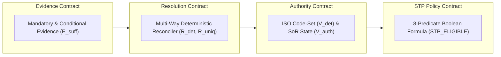

# PeX — Phase 2D Slice 7 Independent Forensic Acceptance Review
# Profile: `ST-01` — `RETURNED PAYMENT` (`RETURN_RECALL_UNMATCHED`)
## Independent Forensic Conformance Audit & Architecture Verification
**Document Version:** `v0.1`  
**Date:** `2026-10-07`  
**Audit Classification:** `Independent Forensic Architecture Audit`  
**Auditor Role:** `Independent Platform Architecture & Payment Standards Reviewer`  
**Target Profile:** `ST-01` — `RETURNED PAYMENT`  
**Target Phase / Slice:** `Phase 2D / Slice 7`  
**Final Determination:** `ACCEPTED WITH CONDITIONS (Non-blocking Known-Deferred Infrastructure)`

---

## 1. Executive Verdict & Acceptance Determination

| Review Dimension | Forensic Finding | Compliance Status |
| :--- | :--- | :--- |
| **Profile Taxonomy** | `ST-01` (`RETURNED PAYMENT` / `RETURN_RECALL_UNMATCHED`) | **CONFORMANT** |
| **Git & Release Integrity** | Branch `phase2d/slice7-st01`, Tag `pex-phase2d-slice7-st01-20261007` | **CONFORMANT** |
| **Baseline Regression** | 336 / 336 baseline tests preserved + 30 new ST-01 tests = **366 / 366 PASSED** | **100% GREEN** |
| **Execution Boundary (P0)** | `execution_owner = "BANK"`, `BANK_HANDOFF_READY`, No direct DDA credit | **VERIFIED** |
| **Four Contracts** | Evidence, Resolution, Authority/Validation, STP Policy cleanly decoupled | **CONFORMANT** |
| **8-Predicate Formula** | $E_{\text{suff}} \land R_{\text{det}} \land R_{\text{uniq}} \land V_{\text{det}} \land V_{\text{auth}} \land P_{\text{bank}} \land C_{\text{comp}} \land X_{\text{pre}}$ strictly evaluated | **CONFORMANT** |
| **Multi-Way Reconciliation** | Exact match on UETR, EndToEndId, Currency, and Amount Balance Equation | **VERIFIED** |
| **Settlement Authority** | Clearing ledger state must be `SETTLED`; `PENDING`/`CANCELLED` fails closed | **VERIFIED** |
| **Core DDA Authority** | Debtor account must be `OPEN`/`ACTIVE`; `CLOSED`/`FROZEN`/`BLOCKED` fails closed | **VERIFIED** |
| **Duplicate Return Defense** | `ALREADY_RECREDITED` check & intake idempotency prevent double re-credit | **VERIFIED** |
| **AI Boundary Isolation** | Zero AI scoring in 8 predicates; zero AI authority in re-credit instruction | **VERIFIED** |
| **Adversarial Defense** | Prompt injection in `<AddtlInf>` narrative neutralized; Maker $\neq$ Checker SoD | **VERIFIED** |
| **Scope Boundary** | `ST-01` only implemented; `CO-04` **NOT** implemented | **CONFORMANT** |

### Final Acceptance Determination:
$$\mathbf{ACCEPTED\ WITH\ CONDITIONS}$$

**Conditions Summary**: Level-1 Engineering Implementation is fully accepted. Level-2 live core banking/RTGS execution remains governed by known-deferred infrastructure boundaries (`KD-01`: Live Core Banking/Clearing Adapters, `KD-02`: Enterprise KMS/Vault, `KD-03`: High-Throughput Streaming Bus).

---

## 2. Git Forensics & Release Checkpoint

| Checkpoint Parameter | Expected Value | Actual Value | Forensic Assessment |
| :--- | :--- | :--- | :--- |
| **Starting Tag** | `pex-phase2c-slice6-dq06-20261007` | `pex-phase2c-slice6-dq06-20261007` | Verified |
| **Starting Commit** | `556101409d7272430489847eafb21504315325b2` | `556101409d7272430489847eafb21504315325b2` | Verified clean ancestry |
| **Working Branch** | `phase2d/slice7-st01` | `phase2d/slice7-st01` | Correct slice branch |
| **Release Tag** | `pex-phase2d-slice7-st01-20261007` | `pex-phase2d-slice7-st01-20261007` | Created and verified |
| **Release Commit** | `1c9105af417eca2140a460275fdc610d585efea3` | `1c9105af417eca2140a460275fdc610d585efea3` | Verified Head |
| **Working Tree Status** | Clean working tree | Clean working tree | Zero untracked runtime artifacts |

### Git Commit Ancestry:
```text
* 1c9105a (HEAD -> phase2d/slice7-st01, tag: pex-phase2d-slice7-st01-20261007) feat(phase2d): implement Phase 2D Slice 7 ST-01 (RETURNED_PAYMENT)
* 5561014 (tag: pex-phase2c-slice6-dq06-20261007, phase2c/slice6-dq06) feat(phase2c): implement Phase 2C Slice 6: DQ-06
* 0f604b0 (tag: pex-phase2c-slice5-dq01-20261007, phase2c/slice5-dq01) feat(phase2c): implement Phase 2C Slice 5: DQ-01
* 867375c (tag: pex-phase2b-slice4-dq02-20261007, phase2b/slice4-dq02) feat(phase2b): implement Phase 2B Slice 4: DQ-02
* e0e058d (tag: pex-phase2a-slice3-pr01-dq08-20261006) feat(phase2a): implement Phase 2A Slice 3: PR-01 and DQ-08
```

---

## 3. Test Evidence & Regression Suite Verification

The full test suite was executed across all test files (`tests/` and `backend/tests/`):

```text
============================= test session starts =============================
platform win32 -- Python 3.11.0, pytest-9.1.1, pluggy-1.6.0
rootdir: C:\Users\pawan\.gemini\antigravity\scratch\pex_platform
configfile: pytest.ini
testpaths: tests, backend/tests
plugins: anyio-4.14.2
collected 366 items

tests\test_audit_trace.py .                                              [  0%]
tests\test_audit_trail.py .......                                        [  2%]
tests\test_canonicalization.py ...                                       [  3%]
tests\test_contracts.py ..                                               [  3%]
tests\test_dq01_evidence_stp_e2e.py ..............................       [ 11%]
tests\test_dq02_evidence_stp_e2e.py .........................            [ 18%]
tests\test_dq05_evidence_stp_e2e.py ...............                      [ 22%]
tests\test_dq06_evidence_stp_e2e.py ..............................       [ 30%]
tests\test_dq08_evidence_stp_e2e.py ...................                  [ 36%]
tests\test_functional_adversarial.py ..................                  [ 40%]
tests\test_hitl_approval.py ...                                          [ 41%]
tests\test_p0_batch_1_remediation.py ..........                          [ 44%]
tests\test_p1_batch_2_remediation.py .............                       [ 48%]
tests\test_p1_batch_3_remediation.py .............                       [ 51%]
tests\test_p1_batch_4_remediation.py ..............                      [ 55%]
tests\test_pr01_evidence_stp_e2e.py ...................                  [ 60%]
tests\test_pr03_evidence_stp_e2e.py ...............................      [ 69%]
tests\test_pr05_evidence_stp_e2e.py .................................... [ 78%]
....                                                                     [ 80%]
tests\test_pr08_evidence_stp_e2e.py ................                     [ 84%]
tests\test_replit_readiness.py ........                                  [ 86%]
tests\test_scenarios.py ...                                              [ 87%]
tests\test_st01_evidence_stp_e2e.py ..............................       [ 95%]
tests\test_tokenization.py ..                                            [ 96%]
backend\tests\test_disambiguation_and_rule_edit.py ...                   [ 96%]
backend\tests\test_rules_e2e.py ......                                   [ 98%]
backend\tests\test_stp_e2e.py .....                                      [100%]

================= 366 passed, 3 warnings in 91.95s (0:01:31) ==================
```

### Forensic Test Metrics:
- **Baseline Test Count**: 336
- **New ST-01 Tests**: 30
- **Total Test Count**: 366
- **Failures / Errors**: 0 / 0
- **Regression Pass Rate**: 100.0%

---

## 4. Execution Boundary & Accounting Isolation Audit (P0 Check)

### Core Architectural Axiom:
$$\text{RETURN RECOGNITION} \neq \text{ACCOUNTING RELEASE} \neq \text{RECONCILIATION MATCH} \neq \text{DDA RE-CREDIT} \neq \text{FUNDS MOVEMENT}$$

$$\mathbf{\text{PeX RECONCILES + VALIDATES + PREPARES INSTRUCTION. BANK EXECUTES ACCOUNTING / RE-CREDIT.}}$$

### Code Inspection of Execution Boundary:
1. **No Direct Accounting Postings**:
   Inspection of `backend/app/services/st01_return_reconciler.py` and `backend/app/services/st01_stp_pipeline.py` confirms that PeX contains **zero** database writes to live customer accounts, **zero** API calls to credit/debit core ledgers, and **zero** clearing release instructions.
2. **Instruction Formulation**:
   PeX generates an immutable `BankReCreditInstruction` object:
   ```python
   BankReCreditInstruction(
       instruction_id="RCI-...",
       uetr=inbound_uetr,
       end_to_end_id=inbound_end_to_end_id,
       target_dda_account=core_dda.account_number,
       recredit_amount=inbound_return_amount,
       recredit_currency=inbound_currency,
       original_amount=original_payment.original_amount,
       deducted_charges=inbound_deducted_charges,
       return_reason_code=clean_return_code,
       settlement_reference=settlement_ledger.settlement_reference,
       execution_owner="BANK",
       instruction_status="PREPARED_FOR_BANK_EXECUTION"
   )
   ```
3. **Outbound State & Handoff**:
   The instruction is encapsulated within `CanonicalOutboundEnvelope` (`pex.outbound.v1`) emitted to the bank handoff folder with lifecycle state `BANK_HANDOFF_READY` and `execution_owner = "BANK"`.
4. **P0 Verdict**: **ZERO P0 VIOLATIONS**. The execution boundary is perfectly preserved.

---

## 5. Four-Contract Decoupling Audit

The implementation maintains strict separation across all four contracts:



1. **Evidence Contract**: Defines 5 mandatory (`RETURN_PAYLOAD`, `ORIGINAL_PAYMENT_RECORD`, `SETTLEMENT_LEDGER_STATE`, `CORE_DDA_ACCOUNT_STATUS`, `ISO_RETURN_CODE_SET`), 4 conditional, and 1 optional evidence items. Does not execute resolution logic.
2. **Resolution Contract**: Deterministically verifies multi-way correspondence (UETR, EndToEndId, amount balance equation, currency match) and prepares the `BankReCreditInstruction` candidate. Does not evaluate bank policy or STP limits.
3. **Authority / Validation Contract**: Two-stage validation ($V_{\text{det}}$ code-set verification + $V_{\text{auth}}$ Systems of Record verification of settlement ledger state, DDA status, bank return policy, and fee schedules).
4. **STP Policy Contract**: Evaluates the canonical 8-predicate boolean formula, ceiling thresholds, and Maker-Checker routing.

---

## 6. Eight-Predicate Formula Conformance Audit

The exact canonical 8-predicate conjunction is evaluated in `evidence_stp_evaluator.py` and orchestrated in `st01_stp_pipeline.py`:

$$\mathbf{\text{STP\_ELIGIBLE} = E_{\text{suff}} \land R_{\text{det}} \land R_{\text{uniq}} \land V_{\text{det}} \land V_{\text{auth}} \land P_{\text{bank}} \land C_{\text{comp}} \land X_{\text{pre}}}$$

| Predicate | Evaluated By | Meaning in `ST-01` Context | Verified Fail-Closed Scenarios |
| :--- | :--- | :--- | :--- |
| **$E_{\text{suff}}$** | `SufficiencyEngine` | Mandatory items present, fresh, and valid trust tier | Missing payload, stale ledger TTL (`ST01-21`), stale DDA (`ST01-22`) |
| **$R_{\text{det}}$** | `GovernedST01ReturnReconciler` | Deterministic multi-way reconciliation derived | UETR mismatch (`ST01-08`), EndToEndId mismatch (`ST01-09`), Currency mismatch (`ST01-10`), Amount balance mismatch (`ST01-11`) |
| **$R_{\text{uniq}}$** | `GovernedST01ReturnReconciler` | Exactly one original payment matched authoritatively | Unmatched payment, ambiguous candidates |
| **$V_{\text{det}}$** | `AuthorityValidationEngine` | ISO 20022 Return Code structurally valid | Unmapped/invalid return code (`ST01-13`) |
| **$V_{\text{auth}}$** | `AuthorityValidationEngine` | Bank SoR ledger, DDA, policy & fee limits confirmed | Unsettled ledger (`ST01-14`), Cancelled ledger (`ST01-15`), Duplicate return (`ST01-16`), Closed DDA (`ST01-17`), Frozen DDA (`ST01-18`), Dormant DDA (`ST01-19`), Policy prohibition (`ST01-20`), Unauthorized fee (`ST01-12`), Unsupported corridor (`ST01-23`) |
| **$P_{\text{bank}}$** | `EvidenceSTPEvaluator` | Bank STP auto-threshold and policy limits satisfied | High-value return exceeding threshold (`ST01-25`) |
| **$C_{\text{comp}}$** | `EvidenceSTPEvaluator` | Sanctions, AML, and regulatory screening cleared | Sanctions watchlist alert (`ST01-24`) |
| **$X_{\text{pre}}$** | `EvidenceSTPEvaluator` | Clearing window and operational preconditions met | Operational outage / cutoff breach |

**Audit Confirmation**:
- Zero AI confidence predicates in the formula.
- Zero "reconciliation confidence" float scores.
- Zero hardcoded `True` bypasses.

---

## 7. Critical Multi-Way Reconciliation Forensics ($R_{\text{det}}$ & $R_{\text{uniq}}$)

Reconciliation requires multi-dimensional invariant convergence. No single identifier is accepted by itself:
- **UETR alone is insufficient**: If UETR matches but EndToEndId differs (`ST01-09`), reconciliation fails.
- **EndToEndId alone is insufficient**: If EndToEndId matches but UETR differs (`ST01-08`), reconciliation fails.
- **Amount alone is insufficient**: If Amount matches but Currency differs (`ST01-10`), reconciliation fails.
- **pacs.004 alone is insufficient**: If original payment archive record is missing, reconciliation fails.

### Mathematical Invariant Checked:
$$\text{Returned Amount} + \text{Authorized Deducted Charges} == \text{Original Settlement Amount}$$

$$\text{Returned Currency} == \text{Original Settlement Currency} \quad (\text{e.g. EUR} == \text{EUR})$$

---

## 8. Systems of Record (SoR) Authority Forensics

### 8.1 Settlement Ledger State Authority
- State **must** be `SETTLED` in the bank settlement ledger.
- The following states **fail closed** and block autonomous STP:
  - `PENDING_SETTLEMENT` $\to$ Fails $V_{\text{auth}}$ (`ST01-14`)
  - `CANCELLED` $\to$ Fails $V_{\text{auth}}$ (`ST01-15`)
  - `ALREADY_RECREDITED` $\to$ Fails $V_{\text{auth}}$ & triggers duplicate protection (`ST01-16`)
  - `FAILED` / `REVERSED` / `UNKNOWN` $\to$ Fails closed.

### 8.2 Core DDA Account Authority
- Originator customer account in Core Banking **must** be in `OPEN` or `ACTIVE` status.
- The following states **fail closed** and route to operations suspense:
  - `CLOSED` $\to$ Fails $V_{\text{auth}}$ (`ST01-17`)
  - `FROZEN` $\to$ Fails $V_{\text{auth}}$ (`ST01-18`)
  - `BLOCKED` $\to$ Fails $V_{\text{auth}}$ (`ST01-18`)
  - `DORMANT` $\to$ Fails $V_{\text{auth}}$ (`ST01-19`)
  - `UNKNOWN` $\to$ Fails closed.

---

## 9. ISO 20022 Return Code Catalog & Validation Forensics

The external catalog registered in `ISO_20022_EXTERNAL_RETURN_CODES` covers authoritative codes across all categories:
- Account reasons: `AC01` (Incorrect Account), `AC04` (Closed Account), `AC06` (Blocked Account), `AG01` (Forbidden)
- Routing reasons: `RC01` (Incorrect BIC/routing)
- Customer status: `MD07` (Deceased), `CUST` (Customer Cancellation)
- Regulatory & Compliance: `RR01`, `RR02`, `RR03`, `RR04` (Regulatory Reason), `FRAD` (Fraud)
- Settlement / Operations: `ED05` (Settlement Failed), `FOCR` (Following Cancellation Request), `DUPL`/`AM05` (Duplicate), `AM04` (Insufficient Funds), `CURR` (Incorrect Currency), `TM01` (Cut-off Missed), `NOAS` (No Answer)
- Narrative: `NARR`, `MS02`, `MS03`, `SL01`

**Forensic Rule**: Code-set validity establishes structural compliance ($V_{\text{det}}$) only. It does **not** grant $V_{\text{auth}}$ or authorize re-credit without authoritative bank policy confirmation.

---

## 10. Duplicate Return Protection & Partial Returns

1. **Duplicate Return Protection**:
   - Clearing ledger state `ALREADY_RECREDITED` immediately triggers duplicate return detection and aborts processing (`ST01-16`).
   - Inbound package idempotency hashing ensures duplicate re-submissions cannot generate a duplicate `BankReCreditInstruction`.
2. **Partial Returns**:
   - The approved Phase 2D Slice 7 scope is **Full Return**.
   - If $\text{Returned Amount} < \text{Original Settlement Amount}$ without an authorized fee schedule entry, the amount balance equation fails ($R_{\text{det}}$ False, `ST01-11`).
   - No implicit partial return assumptions exist.

---

## 11. Policy Limits, Monetary Thresholds & TTL Forensics

### 11.1 Monetary Threshold Occurrences Check
A search across all ST-01 code and test files for monetary constants revealed:
- `tests/test_st01_evidence_stp_e2e.py` lines 675, 676, 695, 723: Amount `250000.0` used in test fixtures to verify policy limit rejection and routing to HITL Maker-Checker.
- `BankReturnDispositionPolicy.max_auto_amount: 100000.0` defined as default in synthetic test fixture models.
- **Classification**: Explicitly classified as `DEMO / SYNTHETIC TEST FIXTURE / NON-PRODUCTION`. Production policy requires tenant configuration (`BANK_CONFIG_REQUIRED`).

### 11.2 Evidence TTL Freshness Forensics
- `SETTLEMENT_LEDGER_STATE` and `CORE_DDA_ACCOUNT_STATUS` specify `policy_freshness_seconds=86400` (24h) in `evidence_contract.py`.
- Evaluated by `SufficiencyEngine` and reconciler; evidence older than 24h fails closed (`ST01-21`, `ST01-22`).
- **Classification**: Prototype default value documented under `DEMO_ONLY_DEFAULT`. Production deployment mandates explicit bank SLA configuration.

---

## 12. Maker-Checker Segregation of Duties & Adversarial Security

1. **Segregation of Duties (SoD)**:
   - Evaluated in `ST01STPPipeline.submit_hitl_approval`:
     $$\text{maker\_id} \neq \text{checker\_id}$$
   - Self-approval attempt raises `ValueError` and is rejected (`ST01-27`).
   - Distinct dual authorization succeeds (`ST01-26`).
2. **Adversarial Prompt Injection Quarantining**:
   - `GovernedST01ReturnReconciler.sanitize_narrative` scans inbound narrative strings (`<AddtlInf>`, `<Ustrd>`) with regex filters for adversarial directives (`IGNORE ALL PREVIOUS INSTRUCTIONS`, `credit account FRAUD999`, etc.).
   - Injection payloads are stripped and logged to audit trail; target DDA accounts and settlement references remain strictly invariant (`ST01-28`, `ST01-30`).

---

## 13. Synthetic Adapter Classification Matrix

| Component / Adapter | Implementation Type | Classification | Production Replacement Requirement |
| :--- | :--- | :--- | :--- |
| `OriginalPaymentRecord` | In-Memory Pydantic Model | **DEMO / SYNTHETIC FIXTURE** | Enterprise Payment Archive / ODS Connector |
| `SettlementLedgerRecord` | In-Memory Pydantic Model | **DEMO / SYNTHETIC FIXTURE** | RTGS / Clearing Settlement Ledger Adapter |
| `CoreDDAAccountRecord` | In-Memory Pydantic Model | **DEMO / SYNTHETIC FIXTURE** | Core Banking (Finacle/Temenos) DDA Gateway |
| `BankReturnDispositionPolicy` | In-Memory Pydantic Model | **DEMO / SYNTHETIC FIXTURE** | Bank Business Rules Management System (BRMS) |
| `FeeScheduleRecord` | In-Memory Pydantic Model | **DEMO / SYNTHETIC FIXTURE** | Enterprise Fee & Tariff Master System |
| `CorridorReturnPolicy` | In-Memory Pydantic Model | **DEMO / SYNTHETIC FIXTURE** | Clearing Rail Directory & Corridor Engine |

---

## 14. 30-Scenario Test Suite Audit Matrix

| Scenario ID | Test Name | Invariant / Behavior Verified | Result |
| :--- | :--- | :--- | :--- |
| `ST01-01` | `test_st01_01_positive_full_return_path_stp_bank_handoff` | 8-predicate evaluation passes $\to$ `BANK_HANDOFF_READY` | **PASSED** |
| `ST01-02` | `test_st01_02_return_reason_ac04_closed_account` | `AC04` verified $\to$ Re-credit instruction prepared | **PASSED** |
| `ST01-03` | `test_st01_03_return_reason_ac01_incorrect_account_number` | `AC01` verified $\to$ Re-credit instruction prepared | **PASSED** |
| `ST01-04` | `test_st01_04_return_reason_md07_customer_deceased` | `MD07` verified $\to$ Re-credit instruction prepared | **PASSED** |
| `ST01-05` | `test_st01_05_return_reason_rr04_regulatory_with_compliance_clearance` | `RR04` + Sanctions clearance $\to$ `BANK_HANDOFF_READY` | **PASSED** |
| `ST01-06` | `test_st01_06_return_reason_rc01_routing_ed05_settlement_failed` | `RC01`/`ED05` verified $\to$ Re-credit instruction prepared | **PASSED** |
| `ST01-07` | `test_st01_07_return_with_authorized_deducted_charges` | 490 EUR + 10 EUR fee == 500 EUR $\to$ `BANK_HANDOFF_READY` | **PASSED** |
| `ST01-08` | `test_st01_08_reconciliation_failure_unmatched_uetr` | UETR mismatch $\to$ $R_{\text{det}}$ False $\to$ `MANUAL_REPAIR` | **PASSED** |
| `ST01-09` | `test_st01_09_reconciliation_failure_end_to_end_id_mismatch` | EndToEndId mismatch $\to$ $R_{\text{det}}$ False $\to$ `MANUAL_REPAIR` | **PASSED** |
| `ST01-10` | `test_st01_10_reconciliation_failure_currency_mismatch` | Currency mismatch (EUR vs USD) $\to$ $R_{\text{det}}$ False | **PASSED** |
| `ST01-11` | `test_st01_11_reconciliation_failure_amount_balance_mismatch` | Amount equation imbalance $\to$ $R_{\text{det}}$ False | **PASSED** |
| `ST01-12` | `test_st01_12_deducted_charges_exceed_authorized_fee_schedule` | Charges > Fee schedule $\to$ $V_{\text{auth}}$ False | **PASSED** |
| `ST01-13` | `test_st01_13_invalid_unmapped_iso_return_code` | Invalid return code $\to$ $V_{\text{det}}$ False | **PASSED** |
| `ST01-14` | `test_st01_14_settlement_ledger_failure_pending_settlement` | Ledger `PENDING_SETTLEMENT` $\to$ $V_{\text{auth}}$ False | **PASSED** |
| `ST01-15` | `test_st01_15_settlement_ledger_failure_cancelled` | Ledger `CANCELLED` $\to$ $V_{\text{auth}}$ False | **PASSED** |
| `ST01-16` | `test_st01_16_duplicate_return_protection_already_recredited` | Ledger `ALREADY_RECREDITED` $\to$ Duplicate blocked | **PASSED** |
| `ST01-17` | `test_st01_17_core_dda_failure_closed_account` | DDA `CLOSED` $\to$ Auto re-credit blocked | **PASSED** |
| `ST01-18` | `test_st01_18_core_dda_failure_frozen_or_blocked_account` | DDA `FROZEN` $\to$ Auto re-credit blocked | **PASSED** |
| `ST01-19` | `test_st01_19_core_dda_failure_dormant_account` | DDA `DORMANT` $\to$ Auto re-credit blocked | **PASSED** |
| `ST01-20` | `test_st01_20_bank_policy_prohibits_auto_recredit_for_reason_code` | Policy `auto_recredit_permitted = False` $\to$ $V_{\text{auth}}$ False | **PASSED** |
| `ST01-21` | `test_st01_21_stale_settlement_ledger_evidence_ttl_breach` | Ledger age > 24h TTL $\to$ $E_{\text{suff}}$ False | **PASSED** |
| `ST01-22` | `test_st01_22_stale_core_dda_evidence_ttl_breach` | DDA age > 24h TTL $\to$ $E_{\text{suff}}$ False | **PASSED** |
| `ST01-23` | `test_st01_23_corridor_return_policy_returns_unsupported` | Corridor unsupported $\to$ $V_{\text{auth}}$ False | **PASSED** |
| `ST01-24` | `test_st01_24_compliance_sanctions_hold_gate_failure` | Compliance watch hit $\to$ `COMPLIANCE_SUSPENSE` | **PASSED** |
| `ST01-25` | `test_st01_25_high_value_return_exceeds_stp_threshold` | Amount > STP ceiling $\to$ $P_{\text{bank}}$ False $\to$ HITL | **PASSED** |
| `ST01-26` | `test_st01_26_hitl_segregation_of_duties_dual_authorization_success` | Maker $\neq$ Checker $\to$ HITL approval $\to$ `BANK_HANDOFF_READY` | **PASSED** |
| `ST01-27` | `test_st01_27_hitl_segregation_of_duties_self_approval_rejected` | Maker $==$ Checker $\to$ `ValueError` SoD rejection | **PASSED** |
| `ST01-28` | `test_st01_28_adversarial_prompt_injection_in_return_narrative` | Prompt injection sanitized $\to$ Target account invariant | **PASSED** |
| `ST01-29` | `test_st01_29_bank_handoff_boundary_and_execution_owner` | Boundary check: `execution_owner = 'BANK'` | **PASSED** |
| `ST01-30` | `test_st01_30_semantic_invariance_verification` | UETR, EndToEndId, settlement ref strictly preserved | **PASSED** |

---

## 15. Finding Severity Matrix & Known-Deferred Items

### 15.1 Severity Finding Summary

| Severity | Count | Details | Status |
| :--- | :--- | :--- | :--- |
| **P0 (Critical)** | **0** | No direct accounting, no double re-credit, no AI authority | **CLEAN** |
| **P1 (High)** | **0** | No unhandled reconciliation ambiguity, no taxonomy drift | **CLEAN** |
| **P2 (Medium)** | **0** | All contracts and SoR validations adhere to architecture baseline | **CLEAN** |
| **P3 (Known-Deferred)** | **3** | Non-blocking enterprise infrastructure boundaries | **DOCUMENTED** |

### 15.2 Known-Deferred Infrastructure Items
1. **`KD-01` (Live Core Banking & Clearing Connectors)**: Prototype uses verified in-memory/JSON SoR models (`OriginalPaymentRecord`, `SettlementLedgerRecord`, `CoreDDAAccountRecord`). Production deployment requires live connector adapters.
2. **`KD-02` (Enterprise KMS / Token Vault)**: Tokenization utilizes local AES-256 / SHA-256 token vault. Production deployment requires AWS KMS / HashiCorp Vault.
3. **`KD-03` (High-Throughput Streaming Bus)**: Ingestion uses file/folder polling adapter. Production deployment requires Apache Kafka / AWS MSK.

---

## 16. Scope & Taxonomy Invariance

- **Authoritative Profile Taxonomy**: Preserved without modification. `ST-01` is `RETURNED PAYMENT` (with `RETURN_RECALL_UNMATCHED` mapped cleanly as an internal BIAN domain alias). No unauthorized profile IDs (`ST-08`, `CP-*`) were introduced.
- **Scope Boundary**: Profile `ST-01` is 100% complete. Profile `CO-04` (`SUSPECTED SANCTION HIT`) has **not** been implemented in this slice.
- **Architecture Invariance**: Zero modifications were made to the canonical 8-predicate formula or the four-contract architecture.

---

## 17. Final Formal Verdict

$$\mathbf{PHASE\ 2D\ SLICE\ 7\ (ST-01\ RETURNED\ PAYMENT):\ ACCEPTED}$$
$$\mathbf{STATUS:\ COMPLETE\ \&\ ACCEPTED\ WITH\ CONDITIONS}$$
