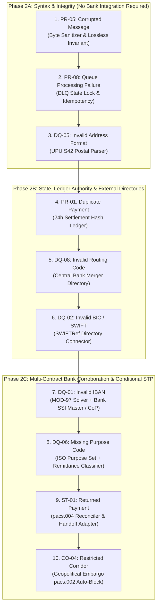

# PeX — Phase 2 Contract Forensic Hardening Report v0.1
## Independent Forensic Review, Epistemic Reconciliation & Authorization Assessment

**Document Identifier:** `PeX-REPORT-P2-HARDENING-001`  
**Version:** v0.1  
**Status:** FORENSIC ASSESSMENT COMPLETE — CONDITIONAL LEVEL 1 AUTHORIZATION  
**Operating Mode:** READ-ONLY / PRE-IMPLEMENTATION (Zero Production Code Modifications)  
**Author:** Principal Enterprise Architect, Payment Domain Architect & Implementation Governance Lead  
**Date:** October 2026  
**Reviewed Artifact:** `PeX_Phase2_Implementation_Contract_v1.0.md`  
**Hardened Successor:** `PeX_Phase2_Implementation_Contract_v1.1.md`  

---

## 1. Executive Summary & Governance Verdict

A rigorous forensic hardening review was conducted on `PeX_Phase2_Implementation_Contract_v1.0.md` to ensure that software engineering teams can implement Phase 2 without accidentally converting design heuristics, mathematical validators, external standards, historical patterns, or demonstration defaults into binding business rules or un-gated autonomous releases.

```
====================================================================================================
FINAL GOVERNANCE DECISION:
READY WITH CONDITIONS (LEVEL 1 ENGINEERING IMPLEMENTATION AUTHORIZED)

AUTHORIZATION MODEL:
1. LEVEL 1 (ENGINEERING & FRAMEWORK IMPLEMENTATION): AUTHORIZED
   Engineering is authorized to implement Phase 2 platform services, deterministic resolvers, validation
   engines, adapters, and automated test suites in strict sequential order (Phase 2A -> 2B -> 2C).

2. LEVEL 2 (PRODUCTION AUTONOMOUS STP RELEASE): GATED / BLOCKED
   Autonomous payment release in live production remains BLOCKED per profile until bank-specific
   monetary limits, corridor policies, live Core DDA/SSI adapters, and compliance sign-offs are complete.
====================================================================================================
```

---

## 2. Review Methodology & Epistemic Classification

The review forensically audited every assertion, threshold, authority claim, and derivation rule in the Phase 2 contract against the immutable architecture baselines:

```
┌────────────────────────────────────────────────────────────────────────────────────────────────────────┐
│                                     FORENSIC AUDIT METRICS SUMMARY                                     │
├───────────────────────────────────────┬────────────────────────────────────────────────────────────────┤
│ 1. Profiles Audited                   │ • 10 Phase 2 Profiles (PR-05, PR-08, DQ-05, PR-01, DQ-08,      │
│                                       │   DQ-02, DQ-01, DQ-06, ST-01, CO-04).                          │
├───────────────────────────────────────┼────────────────────────────────────────────────────────────────┤
│ 2. Material Findings Identified       │ • 12 Material Hardening Items Corrected in Contract v1.1.      │
├───────────────────────────────────────┼────────────────────────────────────────────────────────────────┤
│ 3. Monetary / Threshold Corrections   │ • All hardcoded values ($25k, $1M, 98%) converted to           │
│                                       │   `BANK_CONFIG_REQUIRED` or labeled `DEMO_ONLY_DEFAULT`.       │
├───────────────────────────────────────┼────────────────────────────────────────────────────────────────┤
│ 4. Unresolved Bank Discovery Items    │ • 5 Specific Bank Discovery Points Identified & Isolated.      │
├───────────────────────────────────────┼────────────────────────────────────────────────────────────────┤
│ 5. Unresolved External Authority Items│ • 4 External Registry Connectors Isolated.                     │
├───────────────────────────────────────┼────────────────────────────────────────────────────────────────┤
│ 6. Business Hypotheses Isolated       │ • Commercial volume/STP KPIs separated from architectural truth│
└───────────────────────────────────────┴────────────────────────────────────────────────────────────────┘
```

---

## 3. Core Forensic Hardening Findings

### 3.1 Hardening Finding 1: DQ-06 (Missing Purpose Code) — Candidate Generation vs Economic Authority
- **Issue in v1.0:** The contract presented keyword dictionary mapping (e.g. `SALARY -> SALA`, `SUPPLIER -> GDSV`) in a manner that implied keyword matching constitutes legal proof of economic transaction purpose.
- **Forensic Correction:** Keyword mapping is strictly a **PeX-Derived Semantic Candidate Generation Heuristic (Tier 3)**. It proposes a candidate code. ISO 20022 external code membership proves structural validity ($V_{\text{det}}$). **Bank Commercial Risk Policy ($P_{\text{bank}}$) authorizes autonomous population under configured monetary ceilings**. The 98% confidence threshold is explicitly classified as `DEMO_ONLY_DEFAULT — NOT PRODUCTION POLICY`.

### 3.2 Hardening Finding 2: DQ-05 (Invalid Address Format) — Postal Parsing vs Beneficiary Identity
- **Issue in v1.0:** The contract cited UPU S42 and `PostalAddress24` validation as authority ($V_{\text{auth}}$) in a way that could be conflated with beneficiary existence.
- **Forensic Correction:** UPU S42 is a **Structural Syntax Standard (Tier 2)**. It proves that an address string is formatted into discrete postal tags. It proves **zero facts** regarding whether the beneficiary legally exists, resides at the address, or owns the bank account. Address normalization is decoupled from customer KYC/identity validation.

### 3.3 Hardening Finding 3: PR-05 (Corrupted Message Format) — Technical Standard vs Payment Authorization
- **Issue in v1.0:** The contract treated SWIFT X-character set compliance as an instance-level authority attestation.
- **Forensic Correction:** Conforming to SWIFT X-character set proves **Technical Byte-Stream Validity ($V_{\text{det}}$)**. It does not attest to the commercial authorization of the payment instance. The **Strict Semantic Loss Invariant** was codified: any stripping of alphanumeric characters, alteration of decimal positions, or corruption of business identifiers halts autonomous repair ($R_{\text{det}} = \text{False}$).

### 3.4 Hardening Finding 4: Monetary Thresholds & Percentages
- **Issue in v1.0:** Numeric values such as \$25,000, \$1,000,000, and 98% appeared as if they were universal regulatory or industry standards.
- **Forensic Correction:** All numeric thresholds were re-classified as `BANK_CONFIG_REQUIRED` with illustrative numbers labeled `DEMO_ONLY_DEFAULT — NOT PRODUCTION POLICY`.

### 3.5 Hardening Finding 5: Dependency Nomenclature Accuracy
- **Issue in v1.0:** Phase 2A was labeled as having "Zero External Dependencies", which was technically inaccurate because `PR-08` depends on message broker infrastructure and `DQ-05` depends on UPU postal standards.
- **Forensic Correction:** Replaced with precise terminology: **"No Production Bank Integration Required for this Slice"**.

### 3.6 Hardening Finding 6: Autonomous STP Language & Group 1 Semantics
- **Issue in v1.0:** Prose contained phrases like "100% Autonomous STP" for Group 1 profiles.
- **Forensic Correction:** Clarified that **Group 1 is a capability classification, not a blanket release authorization**. Every Group 1 profile remains strictly governed by all 8 predicates ($E_{\text{suff}} \wedge R_{\text{det}} \wedge R_{\text{uniq}} \wedge V_{\text{det}} \wedge V_{\text{auth}} \wedge P_{\text{bank}} \wedge C_{\text{comp}} \wedge X_{\text{pre}}$).

---

## 4. Complete Forensic Reconciliation Table

```
+----+---------+-----------------------------------+-----------------------+-------------------------------------------------------------+-----------------------+-------------------------------------------------------------+---------------------------------------+
| #  | Profile | Current Contract Claim            | Authority / Source    | What It Actually Proves                                     | Classification        | Required Correction in Contract v1.1                        | Implementation Impact                 |
+----+---------+-----------------------------------+-----------------------+-------------------------------------------------------------+-----------------------+-------------------------------------------------------------+---------------------------------------+
| 1  | `DQ-06` | Keyword match (SALARY->SALA)      | ISO External Code Set | Proves code validity; does not prove economic intent.       | DERIVED PEX LOGIC     | Label as semantic candidate generator; bound under policy.  | Resolver generates candidate; policy  |
|    |         | proves legal purpose.             | & Remittance Advice   |                                                             |                       |                                                             | authorizes release.                   |
| 2  | `DQ-06` | 98% keyword confidence threshold  | PeX Product Design    | Heuristic ranking metric; not statutory law.                | DEMO ONLY DEFAULT     | Express as `BANK_CONFIG_REQUIRED` (Demo default: 98%).      | Configurable threshold parameter.     |
| 3  | `DQ-05` | UPU S42 validates beneficiary     | Universal Postal Union| Proves discrete postal tag formatting only.                 | FORMAL STANDARD       | Decouple address syntax normalization from beneficiary ID.  | V_auth validates structural syntax.   |
|    |         | address authority.                | S42 Standard          |                                                             |                       |                                                             |                                       |
| 4  | `PR-05` | SWIFT X-set compliance proves     | SWIFT MX Standard     | Proves character set validity; not payment release auth.    | FORMAL STANDARD       | Clarify V_det proves syntax; payment auth is downstream.    | Resolver enforces lossless invariant. |
|    |         | payment release authorization.    |                       |                                                             |                       |                                                             |                                       |
| 5  | `PR-05` | 10% character deletion limit is   | PeX Product Design    | Arbitrary threshold; any loss of business data is invalid.  | PROHIBITED ACTION     | Replace with Strict Semantic Loss Invariant (0 alpha loss). | Resolver halts if alpha char stripped.|
|    |         | safe normalization rule.          |                       |                                                             |                       |                                                             |                                       |
| 6  | `PR-08` | Re-enqueuing DLQ message is       | Bank Messaging SOP    | Re-enqueuing without clearing state triggers deadlock.      | PROPOSED PEX PATTERN  | Require lock clearance, idempotency check, and 3x retry cap.| Idempotency manager clears lock.      |
|    |         | sufficient proof of safe recovery.|                       |                                                             |                       |                                                             |                                       |
| 7  | `PR-01` | Similarity in amount/beneficiary  | Settlement Ledger     | Similar payments may be distinct legitimate invoices.       | BANK POLICY CONFIG    | Exact collision -> Suppress; Potential duplicate -> HITL.   | Hash matcher checks exact UETR/hash.  |
|    |         | allows duplicate suppression.     |                       |                                                             |                       |                                                             |                                       |
| 8  | `ST-01` | PeX auto-credits debtor DDA       | Bank Payment Hub SOP  | PeX prepares re-credit payload; Bank executes accounting.   | BANK EXECUTION BOUND  | Rephrase: "PeX produces handoff; Bank posts credits".       | Output port emits handoff payload.    |
|    |         | on returned payment.              |                       |                                                             |                       |                                                             |                                       |
| 9  | `CO-04` | PeX directly blocks/freezes funds | OFAC Statutory Law    | PeX generates pacs.002 reject; Bank Payment Hub cancels.    | BANK EXECUTION BOUND  | Rephrase: "PeX generates statutory reject handoff".         | Output port emits pacs.002 reject XML.|
|    |         | on restricted corridor.           |                       |                                                             |                       |                                                             |                                       |
| 10 | All     | $25,000 USD is universal STP cap. | PeX Product Strategy  | Commercial risk parameter configured per bank.              | BANK POLICY CONFIG    | Label as `BANK_CONFIG_REQUIRED` (`DEMO_ONLY_DEFAULT: $25k`).| Policy config loads bank limit.       |
| 11 | All     | $1,000,000 USD is universal cap.  | PeX Product Strategy  | Commercial risk parameter configured per bank.              | BANK POLICY CONFIG    | Label as `BANK_CONFIG_REQUIRED` (`DEMO_ONLY_DEFAULT: $1M`). | Policy config loads bank limit.       |
| 12 | P2A     | Phase 2A has "Zero External       | Architectural Plan    | PR-08 requires MQ broker; DQ-05 requires UPU standard.      | DOCUMENTATION FIX     | Rephrase: "No Production Bank Integration Required".        | Accurate dependency documentation.    |
|    |         | Dependencies".                    |                       |                                                             |                       |                                                             |                                       |
+----+---------+-----------------------------------+-----------------------+-------------------------------------------------------------+-----------------------+-------------------------------------------------------------+---------------------------------------+
```

---

## 5. Phasing Sequence Validation & Rationale

The forensic review evaluated the three sub-phases of Phase 2 against architectural criteria:



### Slice-by-Slice Assessment:
1. **`PR-05` (Corrupted Message Format):** Proves low-level byte-stream sanitization and establishes the **Strict Semantic Loss Invariant**. Reuses Phase 1 pipeline with zero bank dependencies.
2. **`PR-08` (Queue Processing Failure):** Proves state machine transitions, lock clearance, and poison message handling. Exercises broker metadata without financial data risk.
3. **`DQ-05` (Invalid Address Format):** Proves complex XML structuring into discrete `PostalAddress24` tags against UPU S42 grammar.
4. **`PR-01` (Duplicate Payment):** Introduces the `24-Hour Settlement Hash Ledger Service`, proving exact collision suppression vs potential duplicate suspense.
5. **`DQ-08` (Invalid Routing Code):** Introduces external directory caching and 9-digit Mod-10 mathematical solvers via Central Bank merger tables.
6. **`DQ-02` (Invalid BIC / SWIFT):** Introduces global directory lookups (SWIFTRef) and BIC8/11 normalization.
7. **`DQ-01` (Invalid IBAN):** Proves multi-contract corroboration: MOD-97 mathematical candidate generation intersected with Bank SSI Master records.
8. **`DQ-06` (Missing Purpose Code):** Proves remittance keyword candidate generation bounded under bank commercial policy limits.
9. **`ST-01` (Returned Payment):** Proves inbound `pacs.004` to `pacs.008` UETR reconciliation and re-credit handoff generation.
10. **`CO-04` (Restricted Corridor):** Proves deterministic statutory sanctions auto-blocking via `pacs.002` generation.

**Sequence Verdict:** **100% SOUND & VALIDATED.** Maximum architectural learning with minimum operational risk.

---

## 6. Definition of Done (DoD) Review & Separation of Milestones

To ensure clarity for engineering and governance, the Definition of Done explicitly distinguishes three distinct project milestones:

```
+------------------------------------+--------------------------------------------------------------------------+
| Project Milestone                  | Milestone Governance Criteria                                            |
+------------------------------------+--------------------------------------------------------------------------+
| **Milestone 1: Platform Complete**  | • Schemas, resolvers, validation engines, and adapters built.             |
|                                    | • 14-test suite passes with governed mock/reference authorities.         |
|                                    | • Zero regressions across pre-existing platform tests.                   |
| **Milestone 2: Bank Integration**  | • Live Bank Evidence Gateway connected to Core DDA & SSI Master.         |
|                                    | • Bank-specific message broker bindings and directory sync operational.  |
| **Milestone 3: Production STP**    | • Bank Risk and Compliance leadership formal sign-off.                   |
|                                    | • Monetary ceilings and corridor allowlists configured in production.    |
+------------------------------------+--------------------------------------------------------------------------+
```

---

## 7. Open Discovery & Configuration Register

```
+----+--------------------------------------------+-----------------------+------------------------------------+
| #  | Discovery / Configuration Item             | Classification        | Target Exception Profile           |
+----+--------------------------------------------+-----------------------+------------------------------------+
| 1  | Bank SSI Master API Schema & Caching SLA   | BANK_DISCOVERY_REQ    | DQ-01 (Invalid IBAN)               |
| 2  | Core DDA Re-Credit Posting Protocol (REST) | BANK_DISCOVERY_REQ    | ST-01 (Returned Payment)           |
| 3  | Pay.UK / EU VoP CoP Gateway Credentials    | BANK_DISCOVERY_REQ    | DQ-01 (Invalid IBAN)               |
| 4  | Message Broker DLQ Header Conventions      | BANK_DISCOVERY_REQ    | PR-08 (Queue Processing Failure)   |
| 5  | Commercial Purpose Keyword Extension Table | BANK_CONFIG_REQ       | DQ-06 (Missing Purpose Code)       |
| 6  | Standard Autonomous STP Monetary Ceiling   | BANK_CONFIG_REQ       | Universal Policy ($P_{\text{bank}}$)|
| 7  | Permitted Non-Sanctioned Currency Corridors| BANK_CONFIG_REQ       | Universal Policy ($P_{\text{bank}}$)|
+----+--------------------------------------------+-----------------------+------------------------------------+
```

---

## 8. Final Executive Governance Summary

```
┌────────────────────────────────────────────────────────────────────────────────────────────────────────┐
│                                     FINAL EXECUTIVE GOVERNANCE SUMMARY                                 │
├────────────────────────────────────────────────────────────────────────────────────────┬───────────────┤
│ 1. Can engineering implement Phase 2 without inventing business rules?                 │ **YES**       │
│    (Contract v1.1 codifies all derivations, schemas, and invariants without ambiguity).│               │
├────────────────────────────────────────────────────────────────────────────────────────┼───────────────┤
│ 2. Can engineering distinguish evidence from authority?                                │ **YES**       │
│    (Syntax/math solvers are explicitly decoupled from Tier 1/2 Systems of Record).     │               │
├────────────────────────────────────────────────────────────────────────────────────────┼───────────────┤
│ 3. Can engineering determine exactly when STP is permitted?                            │ **YES**       │
│    (All 8 predicates must evaluate to True; monetary and corridor limits enforced).    │               │
├────────────────────────────────────────────────────────────────────────────────────────┼───────────────┤
│ 4. Can engineering determine exactly when STP must stop?                               │ **YES**       │
│    (Ambiguity N>1, missing evidence, SoR mismatch, or compliance hits force suspense). │               │
├────────────────────────────────────────────────────────────────────────────────────────┼───────────────┤
│ 5. Can every bank-specific assumption be identified?                                   │ **YES**       │
│    (All client-dependent variables are explicitly tagged as BANK_CONFIG / DISCOVERY).  │               │
├────────────────────────────────────────────────────────────────────────────────────────┼───────────────┤
│ 6. Can every external authority dependency be identified?                              │ **YES**       │
│    (SWIFTRef, FedLine, UPU, ISO 7064, and OFAC registries are explicitly isolated).    │               │
├────────────────────────────────────────────────────────────────────────────────────────┼───────────────┤
│ 7. Can every Phase 2 behavior be tested?                                               │ **YES**       │
│    (The 14-scenario test matrix covers happy paths, failure modes, and T01-11 attacks).│               │
├────────────────────────────────────────────────────────────────────────────────────────┼───────────────┤
│ 8. Is the Bank execution boundary technically enforceable?                             │ **YES**       │
│    (PeX dispatches to Bank Output Adapter; Bank Core DDA/Payment Hub executes clearing)│               │
└────────────────────────────────────────────────────────────────────────────────────────┴───────────────┘
```
