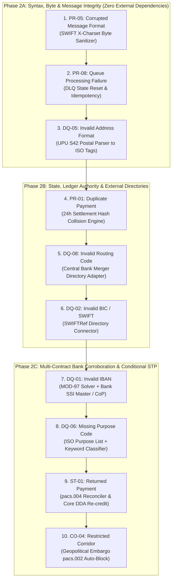

# PeX — Phase 2 Controlled Expansion Plan v0.1
## Multi-Profile Phasing, Platform Prerequisites, Integration Strategy & Execution Roadmap

**Document Identifier:** `PeX-PLAN-P2-EXP-001`  
**Version:** v0.1  
**Status:** APPROVED ARCHITECTURE ROADMAP & EXPANSION PLAN  
**Operating Mode:** READ-ONLY / PRE-IMPLEMENTATION (Zero Production Code Changes)  
**Author:** Principal Enterprise Architect & Lead Engineer  
**Date:** October 2026  
**Authoritative Baseline:** `PeX_Evidence_Driven_STP_Architecture_Baseline_v1.1.md`  
**Foundation Artifacts:**  
- `PeX_Phase1_PR03_Implementation_Report_v0.1.md`  
- `PeX_41_Profile_Evidence_Contract_Matrix_v1.0.md`  

---

## 1. Executive Summary

With Phase 1 complete and verified across 142 passing tests (including 31 dedicated PR-03 and adversarial test suites), the core platform foundations are proven. The Four-Contract Model, Evidence Sufficiency Engine, Resolution Engine, Authority Validation Engine, 8-Predicate Boolean STP Evaluator, Hexagonal Ports/Adapters, and Cryptographic Audit Ledger are fully operational.

This **Phase 2 Controlled Expansion Plan** defines the precise, risk-managed architectural roadmap for scaling PeX from the single `PR-03` vertical slice to a comprehensive multi-profile capability across all 5 canonical BIAN domains.

The governing strategy of this expansion plan is:
$$\text{Maximum Architectural Learning with Minimum Business and Operational Risk}$$

Rather than attempting an un-sequenced 40-profile sprint, Phase 2 decomposes expansion into three controlled sub-phases (**Phase 2A**, **Phase 2B**, **Phase 2C**) structured strictly by architectural dependency tiers.

---

## 2. Phase 1 Starting Point Baseline

```
┌────────────────────────────────────────────────────────────────────────────────────────────────────────┐
│                                   PHASE 1 DELIVERED PLATFORM ASSETS                                    │
├───────────────────────────────────────┬────────────────────────────────────────────────────────────────┤
│ 1. FOUR-CONTRACT SCHEMAS              │ • backend/app/schemas/evidence_contract.py                     │
│                                       │ • backend/app/schemas/resolution_contract.py                   │
│                                       │ • backend/app/schemas/authority_contract.py                    │
│                                       │ • backend/app/schemas/policy_contract.py                       │
├───────────────────────────────────────┼────────────────────────────────────────────────────────────────┤
│ 2. CORE EVALUATION ENGINES            │ • backend/app/services/sufficiency_engine.py                   │
│                                       │ • backend/app/services/resolution_engine.py                    │
│                                       │ • backend/app/services/authority_validation_engine.py          │
│                                       │ • backend/app/services/evidence_stp_evaluator.py               │
│                                       │ • backend/app/services/pr03_stp_pipeline.py                    │
├───────────────────────────────────────┼────────────────────────────────────────────────────────────────┤
│ 3. HEXAGONAL PORTS & ADAPTERS         │ • backend/app/adapters/input_adapter.py (FolderInputAdapter)   │
│                                       │ • backend/app/adapters/output_adapter.py (FolderOutputAdapter) │
├───────────────────────────────────────┼────────────────────────────────────────────────────────────────┤
│ 4. TEST SUITE & VERIFICATION          │ • 142 / 142 Tests Passed (100% Pass Rate in 25.5s)             │
│                                       │ • 31 Dedicated PR-03, Failure Mode & Adversarial Tests (T01-11)│
│                                       │ • 0 Regressions across 111 baseline enterprise tests           │
├───────────────────────────────────────┼────────────────────────────────────────────────────────────────┤
│ 5. TAXONOMY INTEGRITY                 │ • 41 / 41 Exact BIAN Profiles Registered in Evidence Registry  │
└───────────────────────────────────────┴────────────────────────────────────────────────────────────────┘
```

---

## 3. Phase 2 Core Expansion Principles

1. **Evidence Grounding Before Automation:** No profile will be activated for autonomous processing until its Evidence Contract is codified and its authoritative System of Record (SoR) connector is verified.
2. **Deterministic Uniqueness:** Autonomous STP is strictly prohibited if candidate resolution derives more than one valid permutation ($R_{\text{uniq}} == \text{FALSE}$).
3. **Zero AI Release Authority:** AI models may assist in unstructured data parsing, entity classification, or operator narrative drafting; AI confidence scores **never** satisfy STP predicates.
4. **Decoupled Transport vs Evidence:** Transport mechanisms (Folder, SFTP, Kafka, IBM MQ) remain swappable adapters; the Evidence Contract operates exclusively on canonical data models.
5. **Bank Boundary Sovereignty:** PeX dispatches repaired transactions and cryptographic execution receipts back to the Bank Payment Hub; it never bypasses the bank to connect directly to clearing rails.

---

## 4. Challenge & Optimization of the Phase 2 Profile Sequence

### 4.1 Challenge to the Initial Draft Sequence
The prior architectural draft suggested a sequence of:
$$\text{PR-05 (Corrupted Msg)} \longrightarrow \text{PR-01 (Duplicate)} \longrightarrow \text{DQ-02 (Invalid BIC)} \longrightarrow \text{DQ-01 (Invalid IBAN)}$$

While directionally sound, an adversarial architectural challenge reveals significant dependency gaps:
1. **Jumping prematurely to `PR-01` (Duplicate Payment)** requires an active 24-hour sliding-window transaction hash store before testing other pure syntax normalizers.
2. **Jumping prematurely to `DQ-02` (Invalid BIC)** introduces external reference data directory dependencies (SWIFTRef) without first consolidating all zero-external-dependency syntax normalizers.
3. **Attempting `DQ-01` (Invalid IBAN)** requires three separate external capabilities simultaneously: the MOD-97 check solver, the national format registry, and the Bank SSI Master / Confirmation of Payee connector.

### 4.2 Optimized 3-Tier Phasing Sequence



---

## 5. Detailed Phase 2 Breakdown

### 5.1 Phase 2A: Syntax, Byte & Message Integrity (Zero External Dependencies)

#### Objective
Consolidate all **Group 1 pure syntax and structural normalizers** that execute deterministically without external bank or clearing network dependencies.

```
+----+------------------------------+---------+----------------------------------+------------------------------------+
| #  | Profile ID & Name            | Group   | Core Derivation & Repair Method  | Reusable Phase 1 Foundations Used  |
+----+------------------------------+---------+----------------------------------+------------------------------------+
| 1  | PR-05: CORRUPTED_MESSAGE     | Group 1 | SWIFT X-Charset byte sanitizer;  | Resolution Engine, Authority       |
|    |                              |         | strips non-printable hex bytes   | Validator, Folder Adapters, Audit  |
| 2  | PR-08: QUEUE_FAILURE         | Group 1 | Reset consumer deadlock state,   | State Machine, Idempotency Manager,|
|    |                              |         | verify payload & re-enqueue      | Hexagonal Adapters, Audit Ledger   |
| 3  | DQ-05: INVALID_ADDRESS       | Group 1 | Parse unstructured address lines | ISO 20022 XSD Schema Validator,    |
|    |                              |         | into discrete PostalAddress24    | Resolution Engine, STP Evaluator   |
+----+------------------------------+---------+----------------------------------+------------------------------------+
```

- **Prerequisites:** None. All foundational abstractions exist in Phase 1.
- **Expected STP Behavior:** 100% Autonomous STP subject to standard amount/corridor policy ceilings.
- **External Dependencies:** Zero. Executes entirely in-memory and against static standard specifications.
- **Testing Complexity:** Low–Medium. Focus on UTF-8 multibyte safety, poison pill DLQ recovery, and UPU postal tag structuring.
- **Risk Level:** **VERY LOW.** Lossless normalization with zero financial modification.

---

### 5.2 Phase 2B: State, Ledger Authority & External Directories

#### Objective
Implement exception profiles that require **internal state ledger corroboration** or **static/cached external reference data directories**.

```
+----+------------------------------+---------+----------------------------------+------------------------------------+
| #  | Profile ID & Name            | Group   | Core Derivation & Repair Method  | Reusable Phase 1 Foundations Used  |
+----+------------------------------+---------+----------------------------------+------------------------------------+
| 4  | PR-01: DUPLICATE_PAYMENT     | Group 1 | 24h sliding window SHA-256 hash  | STP Evaluator, Output Adapter,     |
|    |                              |         | collision; autonomous suppress   | Cryptographic Audit Ledger         |
| 5  | DQ-08: INVALID_ROUTING       | Group 1 | FedLine / BoE merger table map;  | 9-Digit ABA Mod-10 Checksum Solver,|
|    |                              |         | replace retired ABA with active  | Resolution Contract, STP Evaluator |
| 6  | DQ-02: INVALID_BIC           | Group 2 | SWIFTRef active status check;    | BIC8/11 Normalizer, Policy Config, |
|    |                              |         | 8-to-11 char normalization (XXX) | Authority Validation Engine        |
+----+------------------------------+---------+----------------------------------+------------------------------------+
```

- **Prerequisites:**
  1. `24-Hour Settlement Hash Ledger Store` (In-memory / Redis / SQLite store for idempotency hashing).
  2. `Reference Data Connector Framework` (Pluggable adapters for SWIFTRef and Central Bank Merger tables).
- **Expected STP Behavior:**
  - `PR-01`: Autonomous suppression for exact UETR/Hash collisions; partial duplicates route to HITL.
  - `DQ-08`: Autonomous replacement with verified active successor routing transit number.
  - `DQ-02`: Conditional STP for active head-office replacements under bank ceiling.
- **Testing Complexity:** Medium. Hash collision boundary testing, retired ABA edge cases, SWIFTRef active/inactive branch resolution.
- **Risk Level:** **LOW–MEDIUM.** Requires verifying that duplicate suppression never drops legitimate distinct transactions.

---

### 5.3 Phase 2C: Multi-Contract Bank Corroboration & Conditional STP

#### Objective
Implement advanced **Group 1 and Group 2 profiles** requiring live integration with Tier 1 Bank Systems of Record (Core DDA, SSI Master) and statutory regulatory blocking.

```
+----+------------------------------+---------+----------------------------------+------------------------------------+
| #  | Profile ID & Name            | Group   | Core Derivation & Repair Method  | Reusable Phase 1 Foundations Used  |
+----+------------------------------+---------+----------------------------------+------------------------------------+
| 7  | DQ-01: INVALID_IBAN          | Group 2 | MOD-97 check solver + ISO 13616  | Evidence Sufficiency Engine,       |
|    |                              |         | BBAN format + Bank SSI Master    | 8-Predicate Evaluator, Audit Store |
| 8  | DQ-06: MISSING_PURPOSE       | Group 2 | ISO External Purpose Code set    | Keyword Normalizer, Policy Config, |
|    |                              |         | matching from remittance advice  | Authority Validation Engine        |
| 9  | ST-01: RETURNED_PAYMENT      | Group 1 | pacs.004 UETR reconciliation;    | pacs.004 Serializer, Core DDA Post |
|    |                              |         | auto-credit original debtor DDA  | Adapter, Cryptographic Audit Chain |
| 10 | CO-04: RESTRICTED_CORRIDOR   | Group 2 | Geopolitical OFAC embargo check; | pacs.002 Rejection Generator,      |
|    |                              |         | deterministic pacs.002 auto-block| Output Adapter, Security Service   |
+----+------------------------------+---------+----------------------------------+------------------------------------+
```

- **Prerequisites:**
  1. `Bank Evidence Gateway` (Mockable & live connectors for Bank SSI Master and Core DDA).
  2. `ISO 7064 MOD-97-10 Solver Engine`.
  3. `Geopolitical Sanctions & Corridor Matrix DB`.
- **Expected STP Behavior:**
  - `DQ-01`: Conditional STP permitted ONLY when MOD-97 = 1 AND exact counterparty SSI matches.
  - `DQ-06`: Conditional STP for high-confidence ($\ge 98\%$) keyword mapping under bank ceiling.
  - `ST-01`: Autonomous STP return posting when original UETR matches 100%.
  - `CO-04`: Deterministic Autonomous Statutory Rejection / Freezing.
- **Testing Complexity:** High. Multi-source contradiction testing (SSI vs CoP), MOD-97 math permutations, pacs.004 return ledger accounting.
- **Risk Level:** **MEDIUM.** Strict 8-predicate evaluation guarantees zero uncorroborated account mutations.

---

## 6. Platform Prerequisites Inventory & Architecture

To support the 10 profiles in Phase 2, the following reusable platform capabilities will be implemented as modular, decoupled services:

```mermaid
flowchart LR
    subgraph PlatformCore["PeX Core Engine (Phase 1 Baseline)"]
        Suff[Sufficiency Engine]
        Res[Resolution Engine]
        Auth[Authority Engine]
        STP[STP Evaluator]
    end

    subgraph Phase2Services["New Phase 2 Reusable Platform Services"]
        P0_1[Byte Stream & Charset Normalizer]
        P0_2[24h Settlement Hash Ledger]
        P0_3[Postal Address Parser]
        P0_4[Ref Data Connector Framework]
        P0_5[MOD-97-10 Checksum Solver]
        P0_6[Bank Evidence Gateway Adapter]
        P0_7[pacs.004 Return Reconciler]
    end

    PlatformCore <--> Phase2Services
```



```
+----+---------------------------------------+----------+------------------------------------+--------------------------+
| #  | Platform Capability                   | Priority | Architectural Description          | Target Profiles          |
+----+---------------------------------------+----------+------------------------------------+--------------------------+
| 1  | Byte Stream & Charset Normalizer      | **P0**   | Sanitizes hex bytes & enforces     | PR-05                    |
|    |                                       |          | SWIFT X-character set standards    |                          |
| 2  | 24-Hour Settlement Hash Ledger        | **P0**   | Sliding-window SHA-256 store for   | PR-01, PR-08             |
|    |                                       |          | duplicate transaction detection    |                          |
| 3  | UPU Postal Address Normalizer         | **P0**   | Parses free-text address lines     | DQ-05                    |
|    |                                       |          | into ISO 20022 PostalAddress24     |                          |
| 4  | Reference Data Connector Framework    | **P0**   | Pluggable cache & query adapter    | DQ-02, DQ-08, DQ-06      |
|    |                                       |          | for SWIFTRef, FedLine & BoE        |                          |
| 5  | ISO 7064 MOD-97-10 Checksum Solver    | **P0**   | Mathematical check-digit solver    | DQ-01                    |
|    |                                       |          | and single-transposition engine    |                          |
| 6  | Bank Evidence Gateway (SSI / DDA)     | **P0**   | Standardized interface for Tier 1  | DQ-01, ST-01, TR-03      |
|    |                                       |          | Bank SSI Master and Core DDA       |                          |
| 7  | pacs.004 Return Reconciler            | **P0**   | Matches inbound return to original | ST-01                    |
|    |                                       |          | pacs.008 UETR and generates credit |                          |
| 8  | Geopolitical Embargo Matrix Engine    | **P0**   | ISO 3166 statutory sanctions       | CO-04                    |
|    |                                       |          | blocking and pacs.002 generator    |                          |
+----+---------------------------------------+----------+------------------------------------+--------------------------+
```

---

## 7. Testing & Verification Strategy

Each profile vertical slice in Phase 2 must satisfy the **Comprehensive 4-Tier Test Matrix**:

```
+------------------------------------+--------------------------------------------------------------------------+
| Test Category                      | Scope & Minimum Requirements                                             |
+------------------------------------+--------------------------------------------------------------------------+
| **1. Happy-Path End-to-End**       | Full lifecycle from Inbound Folder $\to$ Evidence Evaluation $\to$       |
|                                    | Deterministic Repair $\to$ Authority Validation $\to$ 8-Predicate Pass  |
|                                    | $\to$ Outbound Folder Emission + Cryptographic Audit Receipt.             |
| **2. Negative Failure Modes**      | Minimum 10 failure tests per profile covering:                           |
|                                    | • Missing mandatory evidence ($E_{\text{suff}} == \text{FALSE}$)         |
|                                    | • Stale evidence timestamp ($E_{\text{suff}} == \text{FALSE}$)           |
|                                    | • Contradictory evidence sources (Conflict $\to$ Suspense)               |
|                                    | • Ambiguous candidate repair ($R_{\text{uniq}} == \text{FALSE}$)         |
|                                    | • Schema validation failure post-repair ($V_{\text{det}} == \text{FALSE}$) |
|                                    | • Authority rejection ($V_{\text{auth}} == \text{FALSE}$)                |
|                                    | • Bank STP ceiling breach ($P_{\text{bank}} == \text{FALSE}$)            |
|                                    | • Compliance / Sanctions gate failure ($C_{\text{comp}} == \text{FAIL}$)  |
|                                    | • Idempotency / Precondition breach ($X_{\text{pre}} == \text{FALSE}$)   |
|                                    | • Disallowed currency / corridor policy block                            |
| **3. Adversarial Security (T01-11)**| Execution of all 11 adversarial attack vectors:                         |
|                                    | AI bypass attempts, prompt injection, SoD self-approval, audit tamper,    |
|                                    | history vs live authority conflicts, entity expansion attacks.           |
| **4. Zero Regression**             | 100% pass rate across all existing platform tests (Baseline + Phase 1).  |
+------------------------------------+--------------------------------------------------------------------------+
```

---

## 8. Enterprise Risk Model & Mitigation Matrix

```
+-------------------+------------------------------------+------------------------------------------------------+
| Risk Domain       | Potential Failure Mode             | PeX Architectural Mitigation                         |
+-------------------+------------------------------------+------------------------------------------------------+
| **Operational**   | Suppressing legitimate invoice     | $R_{\text{uniq}}$ requires exact SHA-256 hash + UETR |
|                   | as duplicate in PR-01              | match; distinct invoices route to HITL.              |
| **Financial**     | Mutating account to wrong entity   | $V_{\text{auth}}$ requires Tier 1 Bank SSI Master /  |
|                   | during IBAN repair in DQ-01        | live Confirmation of Payee match token.              |
| **Regulatory**    | Executing payment to sanctioned    | $C_{\text{comp}}$ gate evaluates independent of all  |
|                   | entity during syntax repair        | other predicates; zero tolerance on matches.         |
| **Legal**         | Re-routing closed account wire     | ST-02 strictly classified as Group 4; mandatory      |
|                   | without authorized mandate         | Maker-Checker dual-authorization required.           |
| **Data Security** | Sensitive PII exposed in audit     | PII tokenization boundary active; raw IBANs/SSNs     |
|                   | logs or AI prompts                 | isolated in secure cryptographic Token Vault.        |
+-------------------+------------------------------------+------------------------------------------------------+
```

---

## 9. Definition of Done (DoD) per Profile Slice

A profile is strictly deemed **DONE** only when all of the following criteria are met:
1. **Evidence Contract Codified:** Complete `EvidenceContract` registered in `EvidenceContractRegistry`.
2. **Deterministic Resolver Implemented:** Lossless repair logic implementing `ResolutionContract`.
3. **Authority Corroboration Wired:** Live or mock connector integrated with `AuthorityValidationEngine`.
4. **8-Predicate Evaluator Enforced:** Pipeline evaluates all 8 predicates via `EvidenceSTPEvaluator`.
5. **Bank Handoff Verified:** Pipeline emits structured XML payload and execution receipt to `OutputPort`.
6. **Audit Provenance Chained:** All 12 lifecycle stages logged in immutable SHA-256 audit ledger.
7. **Test Suite Passed:** 100% pass rate on happy path, 10+ failure modes, and adversarial tests.
8. **Zero Platform Regression:** Total test suite passes with zero broken legacy tests.
9. **Documentation Updated:** Profile implementation report and architecture traceability matrix published.

---

## 10. Phase 2 Exit Criteria

Phase 2 will be formally concluded when:
1. All **10 Target Profiles** (`PR-05`, `PR-08`, `DQ-05`, `PR-01`, `DQ-08`, `DQ-02`, `DQ-01`, `DQ-06`, `ST-01`, `CO-04`) are fully implemented and verified.
2. The platform test suite passes **$>250$ tests** with 0 failures and 0 skipped tests.
3. The **8 reusable P0 platform capabilities** are fully integrated and documented.
4. The exact **41-profile taxonomy** remains 100% intact with zero drift.
5. Formal authorization is received from Bank Leadership to proceed to Phase 3 (Group 3/4 HITL & Treasury Expansion).

---

## 11. Open Decisions for Bank Leadership

```
+----+------------------------------------------------+---------------------------------------------------------+
| #  | Architectural Decision                         | Recommended Position / Default Configuration            |
+----+------------------------------------------------+---------------------------------------------------------+
| 1  | Standard Autonomous STP Ceiling ($P_{\text{bank}}$)   | Default \$25,000 USD for standard corporate wires;      |
|    |                                                | \$1,000,000 for pure internal XML/syntax repairs (PR-03)|
| 2  | Confirmation of Payee (CoP) API Connectivity   | Integrate with Pay.UK CoP / EU VoP Gateway for DQ-01/09 |
| 3  | Inbound Ingestion Transport Protocol           | Standardize on Hexagonal Inbound Folder & REST API      |
| 4  | SWIFTRef Directory Refresh SLA                 | Monthly full sync with daily delta updates              |
| 5  | Maker-Checker Segregation of Duties Threshold  | All manual overrides $\ge \$250,000$ mandate dual auth  |
+----+------------------------------------------------+---------------------------------------------------------+
```

---

## 12. Conclusion

The **Phase 2 Controlled Expansion Plan v0.1** provides an ironclad, mathematically grounded roadmap for scaling PeX. By enforcing strict architectural phasing, zero external dependency prioritization in Phase 2A, and rigorous 8-predicate gatekeeping throughout, PeX guarantees maximum scalability with zero compromise on safety, compliance, or enterprise control.
