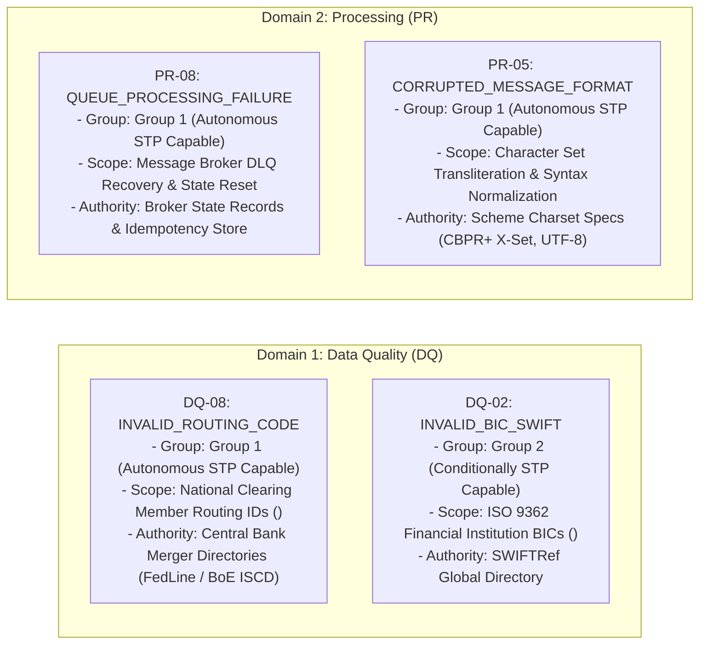
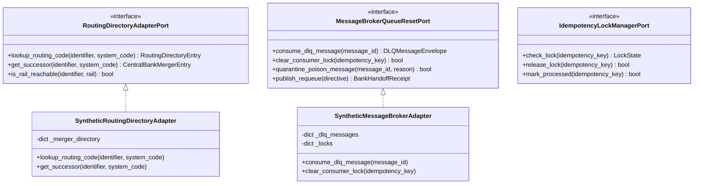
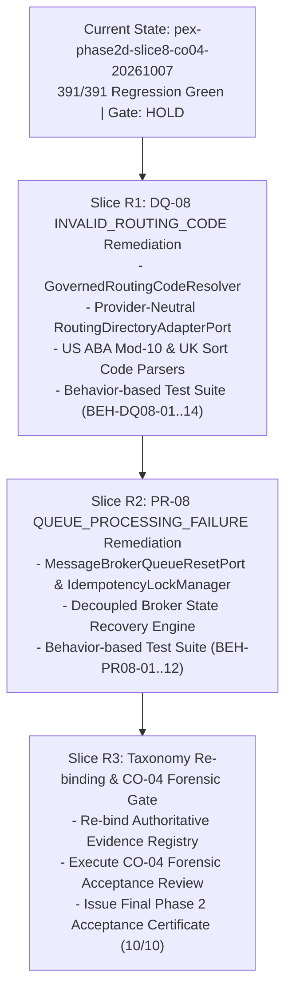

# PeX — Phase 2 DQ-08 & PR-08 Remediation Implementation Contract
# DQ-08 INVALID_ROUTING_CODE + PR-08 QUEUE_PROCESSING_FAILURE
# AUTHORITATIVE ENGINEERING SPECIFICATION & GOVERNANCE BINDING
# Document Version: v0.1
# Governance Status: IMPLEMENTATION CONTRACT READY — ENGINEERING NOT AUTHORIZED
# Target Profiles: DQ-08 (INVALID_ROUTING_CODE), PR-08 (QUEUE_PROCESSING_FAILURE)
# Reference: PeX_Phase2_Taxonomy_Remediation_Architecture_Decision_v0.2.md
# Baseline Tag: pex-phase2d-slice8-co04-20261007
# Baseline Commit: 7335ef3ddb46972c945a0f35ba781937d771e2e8

---

## 1. GOVERNANCE STATUS & EXECUTION BOUNDARIES

```
========================================================================================
             REMEDIATION IMPLEMENTATION CONTRACT GOVERNANCE BINDING
========================================================================================
CONTRACT STATUS:              AUTHORITATIVE SPECIFICATION READY (BINDING FOR REMEDIATION)
ENGINEERING AUTHORIZATION:    NOT GRANTED (NO CODE WRITTEN IN THIS TASK)
CO-04 FORENSIC REVIEW:        HOLD (PENDING REMEDIATION RESOLUTION)
PHASE 2 CLOSURE:              HOLD (PENDING 10/10 AUTHORITATIVE ACCEPTANCE)
PRODUCTION STP STATUS:        BLOCKED / NOT ENABLED (LEVEL 2 INTEGRATION GATED)

TARGET PROFILES FOR REMEDIATION:
  1. Profile ID: DQ-08        Authoritative Name: INVALID_ROUTING_CODE (Group 1)
  2. Profile ID: PR-08        Authoritative Name: QUEUE_PROCESSING_FAILURE (Group 1)
========================================================================================
```

> [!IMPORTANT]
> **READ-ONLY SPECIFICATION NOTICE**: This document specifies the binding technical requirements for engineering remediation of `DQ-08` and `PR-08`. Implementation is **NOT authorized** within the current task and requires a separate, explicit user instruction.

---

## 2. EXACT AUTHORITATIVE PROFILE IDENTITIES



---

## 3. PROFILE 1: `DQ-08` — `INVALID_ROUTING_CODE`

### 3.1. Domain Scope & Scope Classification:
* **Authoritative Architectural Abstraction**:
  $$\text{RoutingCode} = \langle \text{Jurisdiction}, \text{ClearingSystem}, \text{Identifier}, \text{ApplicableRail}, \text{Authority}, \text{Status}, \text{Successor}, \text{Reachability} \rangle$$
* **Scope Classification**:
  * **US Fedwire / ACH (ABA RTN)**: `PROPOSED MVP SCOPE` *(9-digit Mod-10 checksum; Federal Reserve E-Payments Directory)*.
  * **UK CHAPS / Bacs (Sort Code)**: `PROPOSED MVP SCOPE` *(6-digit format; Bank of England ISCD Merger Table)*.
  * **Generic `<ClrSysMmbId>` Model**: `AUTHORITATIVE ARCHITECTURAL ABSTRACTION` *(Pluggable `RoutingDirectoryAdapterPort`)*.
  * **Other National Schemes (AU BSB, CA CPA, IN IFSC)**: `BANK / PRODUCT SCOPE REQUIRED` *(Future extension via configuration)*.

### 3.2. DQ-08 Evidence Contract (Conditional Model):
* **Mandatory Evidence (Universal)**:
  1. `RAW_PAYLOAD`: Inbound ISO 20022 message payload containing routing tag (`Tier 1: Bank Authoritative`).
  2. `ROUTING_IDENTIFIER`: Extracted routing code string from `<CdtrAgt><FinInstnId><ClrSysMmbId><MmbId>` (`Tier 1: Bank Authoritative`).
  3. `CLEARING_SYSTEM`: National clearing system identifier (`USABA`, `GBDSC`, etc.) (`Tier 1`).
  4. `TARGET_RAIL`: Target clearing rail (`FEDWIRE`, `CHAPS`, `ACH`, etc.) (`Tier 1`).
  5. `APPLICABLE_ROUTING_DIRECTORY`: Authoritative routing registry dataset (`Tier 2: External Authoritative`, TTL: 86,400s / `BANK_CONFIG_REQUIRED`).
* **Conditional Evidence**:
  1. `SUCCESSOR_MERGER_RECORD`: **Required ONLY** when routing identifier is inactive/retired/merged (`Tier 2: External Authoritative`).
  2. `BANK_COUNTERPARTY_SSI`: **Required ONLY** where bank policy or corridor mandates counterparty SSI corroboration (`Tier 1`).
  3. `RECEIVING_INSTITUTION_STATUS`: Active node reachability on target rail (`Tier 2`).
* **Optional Evidence**:
  1. `HISTORICAL_ROUTING_PRECEDENT`: Historical log of prior routing substitutions (`Tier 4: Non-authoritative Context`).

### 3.3. DQ-08 Resolution Contract:
* **Active Routing Branch**: Identifier is verified active in directory $\to$ Output candidate confirms active routing status $\to R_{\text{det}} = \text{True}, R_{\text{uniq}} = \text{True}$.
* **Retired / Merged Successor Branch**: Identifier is retired in directory with 1:1 active successor $\to$ Deterministically substitute successor in `<ClrSysMmbId><MmbId>` $\to R_{\text{det}} = \text{True}, R_{\text{uniq}} = \text{True}$.
* **Ambiguity Handling**: If merger record indicates multiple branch successors (1:N split) $\to R_{\text{uniq}} = \text{False} \to$ Suspended to Disambiguation Desk.
* **Lossless Semantic Invariance**: Strict preservation on amounts, debtor/creditor accounts, currencies, and UETRs.

### 3.4. DQ-08 Authority / Validation Contract:
* **$V_{\text{det}}$ (Deterministic Validation)**:
  * Structural syntax validation (regex, length).
  * 9-Digit Federal Reserve Mod-10 Checksum Algorithm:
    $$3(d_1 + d_4 + d_7) + 7(d_2 + d_5 + d_8) + 1(d_3 + d_6 + d_9) \equiv 0 \pmod{10}$$
  * *Boundary*: Checksum passing validates syntax only; it does NOT establish institution reachability or STP authorization.
* **$V_{\text{auth}}$ (Authoritative Validation)**:
  * Verification against an **Authority Source Record** (Federal Reserve E-Payments Directory or BoE ISCD).
  * Active clearing-system membership, target rail reachability, and valid successor mapping.
  * Corroboration against Bank Counterparty SSI where mandated.
  * *Contradiction Gate*: If successor institution is sanctioned $\to C_{\text{comp}} = \text{FAIL} \to$ Suspended.

### 3.5. DQ-08 STP Policy Contract:
* **$P_{\text{bank}}$**: Amount $\le$ Bank policy ceiling (`DEMO_ONLY_DEFAULT: $1,000,000 USD`, `BANK_CONFIG_REQUIRED`).
* **$C_{\text{comp}}$**: Sanctions screening status PASS on successor entity.
* **$X_{\text{pre}}$**: Target clearing rail connection operational.
* **Output Contract**: Repaired pacs.008 XML containing active successor routing code in `<ClrSysMmbId><MmbId>`.

### 3.6. DQ-02 vs DQ-08 Explicit Domain Boundary:
* `DQ-02` (`INVALID_BIC_SWIFT`): Exclusively responsible for ISO 9362 BIC validation, SWIFTRef lookups, and BIC successors in `<BICFI>` or `<BIC>`.
* `DQ-08` (`INVALID_ROUTING_CODE`): Exclusively responsible for national clearing routing transit numbers (US ABA, UK Sort Code) in `<ClrSysMmbId>` and central bank merger directories.

---

## 4. PROFILE 2: `PR-08` — `QUEUE_PROCESSING_FAILURE`

### 4.1. Domain Scope & Decoupling from Charset Transformation:
* `PR-08` is an **independent message broker queue recovery engine**.
* It safely recovers, unlocks, and re-processes payment messages stalled in Dead Letter Queues (DLQs) due to consumer deadlocks, transient timeouts, or connection drops without creating duplicate disbursements or re-enqueuing poison pills.
* **Character transliteration is an optional subsidiary repair action**, NOT the definition of `PR-08`. PR-08 operates independently on perfectly formatted messages.

### 4.2. PR-08 Evidence Contract:
* **Mandatory Evidence ($E_{\text{suff}}$)**:
  1. `DLQ_MESSAGE_PAYLOAD`: Inbound dead-lettered message payload (`Tier 1: Bank Authoritative`).
  2. `BROKER_DLQ_METADATA`: Transport routing headers, retry counter, death reason code (`Tier 1: Bank Authoritative`).
  3. `PROCESSING_STATE_RECORD`: Inbound transaction processing state and idempotency key (`Tier 1: Bank Authoritative`).
* **Conditional Evidence**:
  1. `SETTLEMENT_LEDGER_STATE`: **Required ONLY** when failure mode involves potential in-flight duplicate disbursement (`Tier 1: Bank Authoritative`).
* **Optional Evidence**:
  1. `HISTORICAL_DLQ_METRICS`: Historical consumer timeout recovery metrics (`Tier 4: Non-authoritative Context`).

### 4.3. PR-08 Resolution Contract:
* **Transient Failure Branch**: Broker deadlock or consumer timeout with `retry_count < MAX_RETRIES` $\to$ Clear deadlocked consumer lock, increment retry counter, prepare clean re-enqueue directive $\to R_{\text{det}} = \text{True}, R_{\text{uniq}} = \text{True}$.
* **Subsidiary Payload Defect Branch**: If payload contains character faults $\to$ Invoke `PR-05` transformer as subsidiary action, verify semantic invariance, and prepare re-enqueue directive.
* **Poison Pill Branch**: Unparseable payload or `retry_count >= MAX_RETRIES` $\to$ Quarantine message to `POISON_SUSPENDED` with `is_re_enqueue_eligible = False` ($R_{\text{det}} = \text{False}$).
* **Duplicate Protection Branch**: If message state is `ALREADY_PROCESSED` or debited $\to$ Block re-enqueue with `POTENTIAL_DUPLICATE` ($V_{\text{auth}} = \text{False}$).

### 4.4. PR-08 Authority / Validation Contract:
* **$V_{\text{det}}$ (Deterministic Validation)**: Payload SHA-256 digest matches dispatch hash 100%; transport headers valid.
* **$V_{\text{auth}}$ (Authoritative Validation)**:
  * Primary: Message broker state confirms lock cleared and retry count within limit.
  * Conditional: Settlement Ledger confirms transaction is `UNSETTLED` when settlement dependency exists.
* **Contradiction Gate**: If ledger records posted debit $\to V_{\text{auth}} = \text{False} \to$ Blocked from re-enqueue.

### 4.5. PR-08 STP Policy Contract:
* **$P_{\text{bank}}$**: Retry count $\le$ max allowed policy limit (`DEMO_ONLY_DEFAULT: <= 3 retries`, `BANK_CONFIG_REQUIRED`); amount $\le$ policy ceiling.
* **$C_{\text{comp}}$**: Sanctions screening status preserved PASS.
* **$X_{\text{pre}}$**: Target broker queue active; consumer lock released.
* **Output Contract**: Clean re-enqueue directive with updated retry header and cleared lock state.

### 4.6. PR-05 vs PR-08 Explicit Domain Boundary:
* `PR-05` (`CORRUPTED_MESSAGE_FORMAT`): Owns character set transliteration (CBPR+ X-Set, UTF-8) and encoding recovery.
* `PR-08` (`QUEUE_PROCESSING_FAILURE`): Owns message broker state recovery, retry bounding, dead-letter suspense, and consumer deadlock clearance.

---

## 5. PROVIDER-NEUTRAL PORT SPECIFICATIONS



---

## 6. BEHAVIORAL TEST ACCEPTANCE CRITERIA (NO ARBITRARY COUNTS)

Acceptance is governed by **100% pass rate across all defined behavioral scenarios**:

### 6.1. `DQ-08` Behavioral Acceptance Scenarios:
* `BEH-DQ08-01`: Valid active routing identifier verified in directory passes without requiring merger lookup ($V_{\text{det}}=\text{True}, V_{\text{auth}}=\text{True}$).
* `BEH-DQ08-02`: Valid retired routing identifier with 1:1 active merger record maps to successor `<ClrSysMmbId><MmbId>`.
* `BEH-DQ08-03`: Invalid structural syntax fails deterministic validation ($V_{\text{det}} = \text{False}$).
* `BEH-DQ08-04`: 9-digit ABA failing Mod-10 mathematical checksum halts ($V_{\text{det}} = \text{False}$).
* `BEH-DQ08-05`: Unknown routing identifier absent from directory halts with $E_{\text{suff}} = \text{False} \to$ Operations.
* `BEH-DQ08-06`: Inactive routing identifier with zero successor halts with $R_{\text{det}} = \text{False} \to$ Suspense.
* `BEH-DQ08-07`: Ambiguous split merger (1:N branches) forces $R_{\text{uniq}} = \text{False} \to$ Disambiguation Desk.
* `BEH-DQ08-08`: Successor institution not reachable on target clearing rail halts with $X_{\text{pre}} = \text{False}$.
* `BEH-DQ08-09`: Stale or unavailable authority directory fails closed.
* `BEH-DQ08-10`: Bank Counterparty SSI contradiction halts STP ($V_{\text{auth}} = \text{False}$).
* `BEH-DQ08-11`: Amount exceeding bank policy ceiling routes to HITL Maker-Checker ($P_{\text{bank}} = \text{False}$).
* `BEH-DQ08-12`: Historical precedent cannot override live directory or bank SSI.
* `BEH-DQ08-13`: Adversarial prompt injection in routing references handled safely without state corruption.
* `BEH-DQ08-14`: Bank handoff envelope generated with `execution_owner = "BANK"`.

### 6.2. `PR-08` Behavioral Acceptance Scenarios:
* `BEH-PR08-01`: Transient consumer failure with retry=1 on a clean payload re-enqueues cleanly ($V_{\text{auth}}=\text{True}, \text{STP}=\text{True}$).
* `BEH-PR08-02`: Payload with subsidiary character fault executes authorized transliteration and prepares re-enqueue.
* `BEH-PR08-03`: Retry counter at or exceeding max allowed limit transitions to `POISON_SUSPENDED` ($R_{\text{det}} = \text{False}$).
* `BEH-PR08-04`: Unparseable binary/malformed payload quarantined as poison pill without retry loop.
* `BEH-PR08-05`: Message already debited/settled in Core Ledger blocked from re-enqueue ($V_{\text{auth}} = \text{False}$).
* `BEH-PR08-06`: Idempotency lock conflict detected and handled safely without race condition.
* `BEH-PR08-07`: Stalled message with deadlocked consumer lock cleared upon verified timeout.
* `BEH-PR08-08`: Missing mandatory bank retry policy fails closed to Operations.
* `BEH-PR08-09`: Stale or corrupted processing state record rejected.
* `BEH-PR08-10`: Amount exceeding policy threshold requires dual-authorization Maker-Checker.
* `BEH-PR08-11`: Adversarial replay attack intercepted by idempotency store.
* `BEH-PR08-12`: Bank handoff envelope emitted with `execution_owner = "BANK"`.

---

## 7. STRICT GOVERNANCE BOUNDARIES & DEFINITION OF DONE (DoD)

### 7.1. 8-Predicate Formula Verification:
$$\text{STP\_Eligible} = E_{\text{suff}} \land R_{\text{det}} \land R_{\text{uniq}} \land V_{\text{det}} \land V_{\text{auth}} \land P_{\text{bank}} \land C_{\text{comp}} \land X_{\text{pre}}$$
* No AI-confidence predicate exists. AI cannot independently assert any authority or policy predicate.

### 7.2. Bank Execution Boundary:
* All outputs terminate at `BANK_HANDOFF_READY` with `execution_owner = "BANK"`. PeX never moves funds, posts DDA accounting, releases payments, or operates clearing rails.

### 7.3. Non-Goals & Forbidden Behaviors:
* **Forbidden**: Cosmetically renaming historical classes to simulate compliance.
* **Forbidden**: Allowing AI confidence to override authority validation or retry limits.
* **Non-Goal**: Deploying live production AWS SQS / Kafka clusters (Level 1 uses provider-neutral port adapters).

### 7.4. Definition of Done (DoD) for Remediation Slices:
1. `GovernedRoutingCodeResolver` and `MessageBrokerQueueResetAdapter` operational.
2. 100% of defined behavioral test scenarios pass (`BEH-DQ08-01..14`, `BEH-PR08-01..12`).
3. 0 regressions across existing 391 baseline tests.
4. Authoritative Evidence Registry re-bound cleanly.
5. Independent Forensic Acceptance completed.

---

## 8. IMPLEMENTATION SEQUENCING & AUTHORIZATION GATE



```
========================================================================================
CURRENT GOVERNANCE STATUS:
========================================================================================
DQ-08:                        REMEDIATION REQUIRED (RED)
PR-08:                        REMEDIATION REQUIRED (AMBER)
REMEDIATION ARCHITECTURE:     READY (v0.2 Approved)
IMPLEMENTATION CONTRACT:      READY (v0.1 Published)
ENGINEERING AUTHORIZATION:    NOT GRANTED (AWAITING USER INVOCATION)
CO-04 FORENSIC REVIEW:        HOLD
PHASE 2 CLOSURE:              HOLD
========================================================================================
```

---

```
REMEDIATION ARCHITECTURE: READY
IMPLEMENTATION CONTRACT: READY
ENGINEERING AUTHORIZATION: NOT GRANTED
CO-04 FORENSIC REVIEW: HOLD
PHASE 2 CLOSURE: HOLD
ARTIFACT 1: PeX_Phase2_Taxonomy_Remediation_Architecture_Decision_v0.2.md
ARTIFACT 2: PeX_Phase2_DQ08_PR08_Remediation_Implementation_Contract_v0.1.md
```
