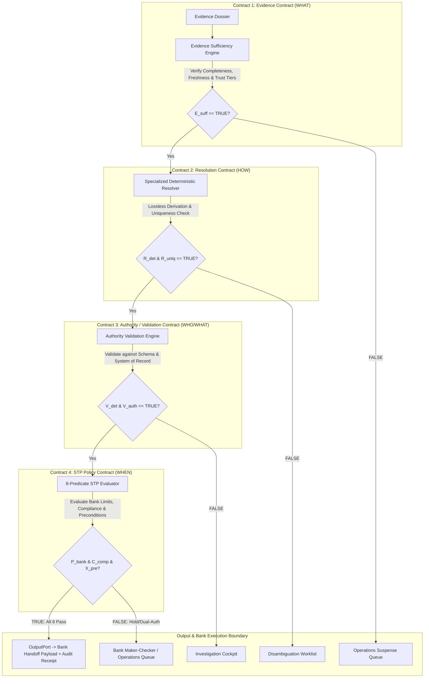
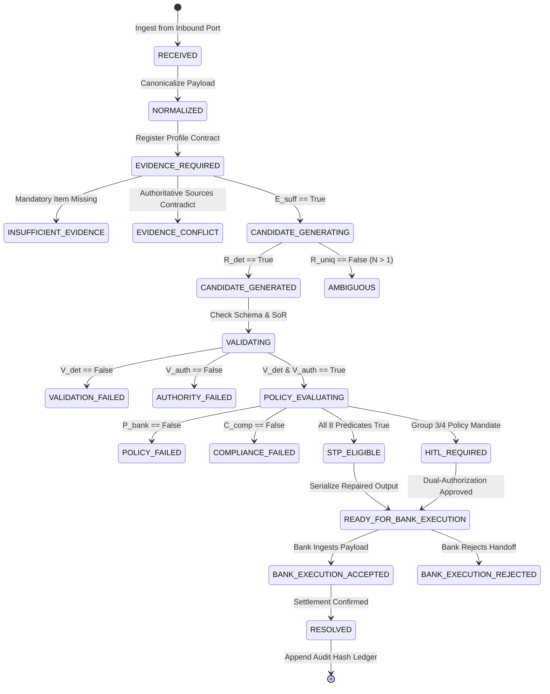

# PeX — Phase 2 Implementation Contract v1.0
## Architecture-to-Engineering Technical Specification & Contractual Implementation Baseline

**Document Identifier:** `PeX-CONTRACT-P2-IMPL-001`  
**Version:** v1.0 (Authoritative Implementation Contract)  
**Status:** IMPLEMENTATION CONTRACT SPECIFICATION — GOVERNANCE GATE  
**Operating Mode:** READ-ONLY / PRE-IMPLEMENTATION (Zero Production Code Modifications)  
**Author:** Principal Enterprise Architect, Payment Domain Architect & Lead Engineer  
**Date:** October 2026  
**Authoritative Hierarchy:**  
1. `PeX_Evidence_Driven_STP_Architecture_Baseline_v1.1.md` (Immutable Architecture Baseline)  
2. `PeX_41_Profile_Authority_Evidence_STP_Validation_Report_v1.1.md` (Immutable Fact/Authority Baseline)  
3. `PeX_41_Profile_Evidence_Contract_Matrix_Forensic_Reconciliation_v1.1.md` (Forensic Reconciliation)  
4. `PeX_41_Profile_Evidence_Contract_Matrix_v1.0.md` (Taxonomy & Contract Matrix)  
5. `PeX_Phase2_Controlled_Expansion_Plan_v0.1.md` (Expansion Roadmap)  
6. `PeX_Phase1_PR03_Implementation_Report_v0.1.md` (Verified Phase 1 Baseline)  

---

## 1. Document Control & Purpose

### 1.1 Document Purpose
This document establishes the binding **Implementation Contract** between Enterprise Architecture and Software Engineering for Phase 2 of the PeX platform. 

It defines the exact technical parameters, schemas, evidence requirements, deterministic derivation algorithms, authoritative validation sources, policy constraints, failure states, test invariants, and bank handoff boundaries for the **10 Phase 2 Exception Profiles** (`PR-05`, `PR-08`, `DQ-05`, `PR-01`, `DQ-08`, `DQ-02`, `DQ-01`, `DQ-06`, `ST-01`, `CO-04`).

**Engineering Rule:** Software Engineers implementing Phase 2 must follow this contract strictly. Engineering teams are **prohibited** from inventing new business rules, synthetic authorities, unverified threshold limits, artificial evidence requirements, or autonomous STP paths not codified in this specification.

---

## 2. Source-of-Truth Hierarchy & Governance

If an apparent conflict arises during design, implementation, or testing, the following hierarchy strictly governs:

$$\text{Architecture Baseline v1.1} > \text{Authority Report v1.1} > \text{Forensic Reconciliation v1.1} > \text{Implementation Contract v1.0} > \text{Verified Codebase}$$

No engineer or subagent may silently resolve a conflict by applying generalized assumptions. Any discovered ambiguity must be explicitly reported and resolved through the formal Architecture Governance Gate.

---

## 3. Implementation Governance Rules & Non-Negotiable Axioms

```
┌────────────────────────────────────────────────────────────────────────────────────────────────────────┐
│                                   ENGINEERING IMPLEMENTATION AXIOMS                                    │
├───────────────────────────────────────┬────────────────────────────────────────────────────────────────┤
│ 1. Zero AI Payment-Release Authority  │ AI models/LLMs are strictly investigative copilots; AI         │
│                                       │ confidence scores NEVER satisfy any STP predicate.             │
├───────────────────────────────────────┼────────────────────────────────────────────────────────────────┤
│ 2. "Invalid / Failed ≠ Correct"       │ Detecting a syntax or checksum failure proves only invalidity; │
│                                       │ deriving the true replacement requires live SoR corroboration. │
├───────────────────────────────────────┼────────────────────────────────────────────────────────────────┤
│ 3. Historical Precedent ≠ Authority   │ Past successful repairs rank candidate hypotheses; historical  │
│                                       │ frequency NEVER satisfies mandatory authority gates.           │
├───────────────────────────────────────┼────────────────────────────────────────────────────────────────┤
│ 4. No Semantic Business Data Loss     │ Normalization and sanitization must be strictly lossless;      │
│                                       │ business payload values cannot be altered or truncated.        │
├───────────────────────────────────────┼────────────────────────────────────────────────────────────────┤
│ 5. Bank Execution Boundary            │ PeX produces structured handoff payloads and audit receipts;   │
│                                       │ PeX NEVER executes accounting entries or directly clears RTGS. │
├───────────────────────────────────────┼────────────────────────────────────────────────────────────────┤
│ 6. Explicit Unambiguous Tagging       │ Unestablished rules must be explicitly labeled as:             │
│                                       │ `BANK_CONFIG_REQUIRED`, `BANK_DISCOVERY_REQUIRED`, or          │
│                                       │ `PROPOSED_PEX_DEFAULT`.                                        │
└───────────────────────────────────────┴────────────────────────────────────────────────────────────────┘
```

---

## 4. The Four-Contract Architecture

Every Phase 2 exception profile is implemented across four strictly decoupled contracts:



---

## 5. The Canonical 8-Predicate STP Boolean Formula

Straight-Through Processing eligibility is evaluated exclusively via the boolean conjunction:

$$\mathbf{STP\_ELIGIBLE} = E_{\text{suff}} \wedge R_{\text{det}} \wedge R_{\text{uniq}} \wedge V_{\text{det}} \wedge V_{\text{auth}} \wedge P_{\text{bank}} \wedge C_{\text{comp}} \wedge X_{\text{pre}}$$

```
+----+--------------------------------+-------------------------------------------------------------------------+
| #  | Predicate                      | Technical Definition & Evaluation Invariant                             |
+----+--------------------------------+-------------------------------------------------------------------------+
| 1  | Evidence_Sufficient (E_suff)   | All mandatory evidence present, within configured freshness TTL,        |
|    |                                | meeting required Trust Tier, with zero unresolved contradictions.       |
| 2  | Resolution_Determined (R_det)  | Deterministic algorithm successfully generated candidate repair payload.|
| 3  | Resolution_Unique (R_uniq)     | Exactly ONE candidate repair exists (Count == 1). Multiple hypotheses   |
|    |                                | (N > 1) force R_uniq = False and route to Disambiguation.               |
| 4  | Deterministic_Valid (V_det)    | Repaired payload conforms 100% to ISO 20022 schemas and regex formats.  |
| 5  | Authority_Valid (V_auth)       | Authoritative System of Record (Bank DDA/SSI, SWIFTRef, CoP) attests to   |
|    |                                | real-world correctness (attestation token verified).                    |
| 6  | Bank_Policy_Allows (P_bank)    | Transaction amount <= Bank STP limit; currency and corridor permitted.  |
| 7  | Compliance_Gate_Passed (C_comp)| Independent Sanctions, PEP, and AML screening returns PASS (0 hits).     |
| 8  | Execution_Precondition (X_pre) | Clearing cutoff active, idempotency lock held, route reachable.          |
+----+--------------------------------+-------------------------------------------------------------------------+
```

---

## 6. Bank vs PeX Execution Boundary

```
+-------------------------------------------------------+-------------------------------------------------------+
| PeX RESPONSIBILITY BOUNDARY                           | BANK RESPONSIBILITY BOUNDARY                          |
+-------------------------------------------------------+-------------------------------------------------------+
| 1. Ingest exception & gather evidence dossier         | 1. Ingest original payment & detect initial error     |
| 2. Evaluate evidence sufficiency & trust tiers        | 2. Provide authoritative Core DDA & SSI Master data   |
| 3. Deterministically derive unique repair candidate   | 3. Execute legal Compliance & Sanctions release       |
| 4. Validate syntax against W3C ISO 20022 schemas      | 4. Ingest repaired payload & handoff receipt          |
| 5. Corroborate candidate against live SoR connector   | 5. Post accounting debits/credits to client DDA       |
| 6. Evaluate 8-predicate boolean formula               | 6. Dispatch payment instruction to RTGS clearing      |
| 7. Emit structured handoff payload & audit receipt    | 7. Return final settlement ACK/NACK to PeX            |
+-------------------------------------------------------+-------------------------------------------------------+
```

---

## 7. Phase 2 Scope & Phased Implementation Sequencing

Phase 2 implementation is structured into three strictly sequential sub-phases:

```
┌────────────────────────────────────────────────────────────────────────────────────────────────────────┐
│                                       PHASE 2 SEQUENTIAL PHASING                                       │
├────────────────────────────────────────────────────────────────────────────────────────────────────────┤
│ **PHASE 2A: Syntax, Byte & Message Integrity (Zero External Dependencies)**                            │
│ 1. PR-05: Corrupted Message Format (SWIFT X-Charset Byte Sanitizer)                                    │
│ 2. PR-08: Queue Processing Failure (Broker DLQ State Reset & Idempotency)                              │
│ 3. DQ-05: Invalid Address Format (UPU S42 Postal Parser to ISO PostalAddress24)                        │
├────────────────────────────────────────────────────────────────────────────────────────────────────────┤
│ **PHASE 2B: State, Ledger Authority & External Directories**                                           │
│ 4. PR-01: Duplicate Payment (24-Hour Settlement Hash Ledger Service)                                    │
│ 5. DQ-08: Invalid Routing Code (Central Bank Merger Directory Adapter)                                 │
│ 6. DQ-02: Invalid BIC / SWIFT (SWIFTRef Directory Connector & BIC8/11 Normalizer)                       │
├────────────────────────────────────────────────────────────────────────────────────────────────────────┤
│ **PHASE 2C: Multi-Contract Bank Corroboration & Conditional STP**                                      │
│ 7. DQ-01: Invalid IBAN (MOD-97 Solver + ISO 13616 + Bank SSI Master / CoP)                            │
│ 8. DQ-06: Missing Purpose Code (ISO Purpose Code Set & Remittance Classifier)                          │
│ 9. ST-01: Returned Payment (pacs.004 Return Reconciler & Handoff Adapter)                              │
│ 10. CO-04: Restricted Corridor (Geopolitical Sanctions Embargo Engine & pacs.002 Auto-Block)           │
└────────────────────────────────────────────────────────────────────────────────────────────────────────┘
```

---

## 8. Phase 2A Profile Implementation Contracts

---

### PROFILE: `PR-05` — `CORRUPTED_MESSAGE_FORMAT`

#### 1. Business Purpose
Sanitize raw inbound payment byte streams containing non-printable control characters, illegal hex sequences, or character-encoding corruptions into compliant SWIFT MX/ISO 20022 valid text without altering business data.

#### 2. Exception Trigger
Parser or message broker rejection due to unparseable binary control characters (`0x00..0x1F` excluding standard whitespace), invalid UTF-8 multibyte sequences, or character set violations against SWIFT X/Z-character sets.

#### 3. Input Contract
- Inbound raw byte stream / string payload.
- Parser error JSON specifying byte offset and encoding fault.

#### 4. Evidence Contract
- **4.1 Mandatory Evidence:**
  1. `RAW_PAYLOAD_BYTES`: Inbound byte stream (`TrustTier: TIER_1_BANK_AUTHORITATIVE`).
  2. `SWIFT_CHARSET_SPEC`: Formal SWIFT MT/MX X-Character set specification (`TrustTier: TIER_2_EXTERNAL_AUTHORITATIVE`).
- **4.2 Conditional Evidence:** None.
- **4.3 Optional Evidence:** `HISTORICAL_ENCODING_LOG`: Past encoding repair patterns (`TrustTier: TIER_4`).
- **4.4 Evidence Trust Tier:** Tier 1 (Raw Stream), Tier 2 (SWIFT Spec).
- **4.5 Evidence Authority:** SWIFT Standards MX Character Set Specification (proves valid characters; does NOT prove semantic intent).
- **4.6 Freshness:** Static specification / Scoped to active message execution.
- **4.7 Evidence Identity:** SHA-256 hash of raw inbound byte stream.
- **4.8 Evidence Provenance:** Ingested directly from Bank Inbound Transport Port.
- **4.9 Missing Evidence Behavior:** If raw bytes cannot be read, immediately set $E_{\text{suff}} = \text{False}$ and route to Operations Suspense.
- **4.10 Contradictory Evidence Behavior:** If character set specification conflicts with schema definition, schema definition takes precedence.

#### 5. Resolution Contract
- **5.1 Root Cause:** Presence of non-printable ASCII control characters ($0\text{x}00..0\text{x}08, 0\text{x}0\text{B}..0\text{x}0\text{C}, 0\text{x}0\text{E}..0\text{x}1\text{F}$) or invalid UTF-8 byte sequences in payment text fields.
- **5.2 Candidate Generation:** Filter out illegal non-printable control bytes while preserving standard printable ASCII (`a-z, A-Z, 0-9`, standard punctuation `/-?:().,'+` and space/CRLF).
- **5.3 Deterministic Logic:** Strict regex byte-stream filter: `re.sub(r'[^\x20-\x7E\r\n\t]', '', text)`.
- **5.4 Candidate Ranking:** N/A (Single deterministic transformation).
- **5.5 Uniqueness Rule:** Exactly one canonical output string produced ($R_{\text{uniq}} = \text{True}$).
- **5.6 Ambiguity Handling:** If binary payload contains non-text structured binary (e.g. gzip/zip), candidate generation fails ($R_{\text{det}} = \text{False}$).
- **5.7 Invalid Candidate Handling:** **Strict Semantic Loss Invariant:** If sanitization removes alphanumeric characters, changes decimal point positions, or modifies numeric amounts, the candidate is marked `INVALID` ($R_{\text{det}} = \text{False}$) and routed to human operations.

#### 6. Authority / Validation Contract
- **6.1 Structural Validation:** Validated against target ISO 20022 XML/JSON schema parser.
- **6.2 Mathematical Validation:** Amount fields, account strings, and checksums must match pre-sanitization values 100%.
- **6.3 Scheme Validation:** SWIFT MX X-Character set compliance check.
- **6.4 External Authority:** W3C XML 1.0 character specification.
- **6.5 Bank Authority:** N/A (Pure syntax normalizer).
- **6.6 Current-State Validation:** Verify that sanitized payload parses into canonical `PaymentExceptionRecord`.
- **6.7 Contradiction Handling:** If schema validation fails post-sanitization, set $V_{\text{det}} = \text{False}$.

#### 7. STP Policy Contract
- **7.1 STP Allowed?:** YES (Group 1 Autonomous STP Capable).
- **7.2 Required Policy Conditions:** Sanitization must be 100% lossless regarding alphanumeric and business data.
- **7.3 Compliance Conditions:** Sanitized payload must undergo independent Sanctions & AML screening ($C_{\text{comp}} = \text{PASS}$).
- **7.4 Monetary Threshold:** `BANK_CONFIG_REQUIRED` (Default: \$1,000,000 USD).
- **7.5 Corridor Conditions:** All active corridors.
- **7.6 Maker-Checker:** Bypassed if all 8 predicates evaluate to True; required if semantic loss detected.
- **7.7 HITL Conditions:** Triggered if byte stripping removes $>0$ alphanumeric characters.
- **7.8 Execution Preconditions:** Idempotency lock active; bank payment hub route open ($X_{\text{pre}} = \text{True}$).

#### 8. STP Predicate Evaluation
```
E_suff = True (Raw stream & Charset spec verified)
R_det  = True (Deterministic byte filter executed)
R_uniq = True (Unique sanitized payload)
V_det  = True (W3C / SWIFT X-set valid)
V_auth = True (W3C Charset syntax attestation token)
P_bank = True (Amount <= Bank policy ceiling)
C_comp = True (Sanctions/AML screening PASS)
X_pre  = True (Idempotency locked, route operational)
---------------------------------------------------------
STP_ELIGIBLE = True -> Execute Autonomous Bank Handoff
```

#### 9. Output Contract
Sanitized ISO 20022 XML payload containing valid UTF-8 text with zero non-printable control characters.

#### 10. Bank Handoff Contract
Serialized XML payload written to Bank Output Port with SHA-256 integrity receipt and diff summary.

#### 11. Audit / Provenance Requirements
Log raw payload hash, sanitized payload hash, bytes stripped count, and stage transitions in SHA-256 linear hash ledger.

#### 12. Failure States
`INSUFFICIENT_EVIDENCE` (Unreadable stream) $\to$ `RESOLUTION_FAILED` (Binary corruption) $\to$ `SEMANTIC_LOSS_SUSPENSE` (Alphanumeric stripped) $\to$ `COMPLIANCE_HOLD`.

#### 13. Security Requirements
Zero PII leakage during sanitization; tokenized account numbers preserved untouched.

#### 14. Test Requirements
1. Happy path: ASCII control bytes stripped from remittance text.
2. UTF-8 multibyte character handling (Latin-1, Cyrillic, Kanji).
3. Negative: Binary payload (gzip) fails gracefully to human review.
4. Negative: Attempt to sanitize amount containing non-digit fails.
5. Adversarial: Prompt injection embedded in raw stream sanitized safely without execution.

#### 15. Phase 1 Reuse
`ResolutionEngine`, `AuthorityValidationEngine`, `EvidenceSTPEvaluator`, `FolderOutputAdapter`, `AuditService`.

#### 16. New Phase 2 Capability
`ByteStreamSanitizer` (P0 platform component).

#### 17. External Dependency
None (Pure in-memory syntax engine).

#### 18. Bank Discovery Dependency
Confirm bank-accepted character sets (SWIFT X vs Extended Z-Set).

#### 19. Open Questions
Bank policy on non-Latin Unicode characters in debtor/creditor name fields (`BANK_DISCOVERY_REQUIRED`).

#### 20. Implementation Status
**READY FOR IMPLEMENTATION (Phase 2A Slice 1)**.

---

### PROFILE: `PR-08` — `QUEUE_PROCESSING_FAILURE`

#### 1. Business Purpose
Safely recover and re-process payment messages stalled in Dead Letter Queues (DLQs) due to consumer deadlocks, transient message broker timeouts, or connection drops without creating duplicate disbursements or re-enqueuing poison pills.

#### 2. Exception Trigger
Message moved to Dead Letter Queue (DLQ) by message broker (RabbitMQ, IBM MQ, Kafka) after retry threshold exhaustion with transient error code.

#### 3. Input Contract
- Dead-lettered message payload with transport metadata (DLQ headers, retry count, original exchange/topic).
- Broker error log / reason code.

#### 4. Evidence Contract
- **4.1 Mandatory Evidence:**
  1. `DLQ_MESSAGE_PAYLOAD`: Inbound dead-lettered message (`TrustTier: TIER_1_BANK_AUTHORITATIVE`).
  2. `BROKER_DLQ_METADATA`: DLQ routing headers, retry counter, death reason (`TrustTier: TIER_1`).
  3. `IDEMPOTENCY_STATE_RECORD`: Current transaction state in Core Settlement Ledger (`TrustTier: TIER_1`).
- **4.2 Conditional Evidence:** None.
- **4.3 Optional Evidence:** Historical DLQ recovery statistics (`TrustTier: TIER_4`).
- **4.4 Evidence Trust Tier:** Tier 1 (Bank Messaging Hub & Core Settlement Ledger).
- **4.5 Evidence Authority:** Bank Messaging Architecture SOP & Core Settlement Ledger (proves message state & non-settlement; does NOT prove payload correctness).
- **4.6 Freshness:** Real-time event-driven query.
- **4.7 Evidence Identity:** Message Broker Message-ID + Payment UETR.
- **4.8 Evidence Provenance:** Captured from Bank Messaging Adapter and verified against Settlement Hash Store.
- **4.9 Missing Evidence Behavior:** If idempotency state cannot be verified from Core Ledger, immediately halt and route to Operations.
- **4.10 Contradictory Evidence Behavior:** If broker metadata indicates un-processed but Core Ledger indicates settled, **immediately block re-enqueue** and mark as `POTENTIAL_DUPLICATE`.

#### 5. Resolution Contract
- **5.1 Root Cause:** Transient broker deadlock, consumer lock starvation, or temporary network partition during message handoff.
- **5.2 Candidate Generation:** Validate payload integrity, clear consumer lock state, reset message retry counter, and prepare clean re-enqueue instruction.
- **5.3 Deterministic Logic:**
  ```python
  if idempotency_state == "UNPROCESSED" and is_poison_pill(payload) == False and retry_count < MAX_RETRIES:
      candidate = create_re_enqueue_instruction(payload, target_queue="PAYMENT_INGESTION")
  ```
- **5.4 Candidate Ranking:** N/A (Single deterministic state action).
- **5.5 Uniqueness Rule:** Exactly one re-enqueue instruction generated ($R_{\text{uniq}} = \text{True}$).
- **5.6 Ambiguity Handling:** If idempotency record is locked or pending settlement, candidate generation fails ($R_{\text{det}} = \text{False}$).
- **5.7 Invalid Candidate Handling:** If payload is a confirmed poison pill (malformed unparseable binary), route to Permanent Suspense Queue.

#### 6. Authority / Validation Contract
- **6.1 Structural Validation:** Validate message schema and header integrity.
- **6.2 Mathematical Validation:** Payload SHA-256 hash must match original dispatch hash 100%.
- **6.3 Scheme Validation:** Message broker protocol compliance (AMQP 1.0 / JMS / Kafka Protocol).
- **6.4 External Authority:** N/A (Internal bank infrastructure state).
- **6.5 Bank Authority:** Bank Core Settlement Ledger confirms transaction is `UNSETTLED`.
- **6.6 Current-State Validation:** Confirm consumer deadlock lock has been released in Redis/DB.
- **6.7 Contradiction Handling:** If ledger indicates debit posted, reject re-enqueue ($V_{\text{auth}} = \text{False}$).

#### 7. STP Policy Contract
- **7.1 STP Allowed?:** YES (Group 1 Autonomous STP Capable).
- **7.2 Required Policy Conditions:** Max retry limit `BANK_CONFIG_REQUIRED` (Default: $\le 3$ retries); Core Ledger confirms zero settlement debit.
- **7.3 Compliance Conditions:** Standard compliance clearance preserved ($C_{\text{comp}} = \text{PASS}$).
- **7.4 Monetary Threshold:** `BANK_CONFIG_REQUIRED` (Default: \$1,000,000 USD).
- **7.5 Corridor Conditions:** All active payment queues.
- **7.6 Maker-Checker:** Bypassed for transient retry $\le 3$; mandatory Maker-Checker for retry $>3$ or poison pills.
- **7.7 HITL Conditions:** Triggered upon 3 consecutive consumer nacks or state lock conflict.
- **7.8 Execution Preconditions:** Message broker target queue operational; consumer lock cleared ($X_{\text{pre}} = \text{True}$).

#### 8. STP Predicate Evaluation
```
E_suff = True (DLQ payload, metadata & unsettled ledger verified)
R_det  = True (Lock cleared & re-enqueue instruction derived)
R_uniq = True (Single target queue routing)
V_det  = True (Message format and headers valid)
V_auth = True (Core Settlement Ledger attests UNSETTLED)
P_bank = True (Retry count <= 3 and amount <= ceiling)
C_comp = True (Sanctions screening status preserved PASS)
X_pre  = True (Target queue active, consumer lock cleared)
---------------------------------------------------------
STP_ELIGIBLE = True -> Re-enqueue to Bank Payment Queue
```

#### 9. Output Contract
Clean re-enqueue message with cleared lock state, updated retry header, and original payload.

#### 10. Bank Handoff Contract
Dispatch to Bank Messaging Hub (RabbitMQ / IBM MQ / Kafka) with tracking receipt.

#### 11. Audit / Provenance Requirements
Log DLQ reason, retry count, consumer ID, clearance timestamp, and SHA-256 hash chain in Audit Ledger.

#### 12. Failure States
`LEDGER_STATE_CONFLICT` (Already settled) $\to$ `POISON_PILL_DETECTED` $\to$ `RETRY_EXHAUSTION_SUSPENSE` $\to$ `BROKER_UNREACHABLE`.

#### 13. Security Requirements
Ensure re-enqueued message retains original authentication context without privilege escalation.

#### 14. Test Requirements
1. Happy path: Stalled DLQ message with retry=1 re-enqueued successfully.
2. Failure: Message already marked SETTLED in Core Ledger is blocked from re-enqueue.
3. Failure: Retry count = 4 halts and escalates to Operations.
4. Failure: Poison pill payload (syntax crash) routes to permanent dead letter suspense.
5. Adversarial: Replay attack attempting duplicate processing is intercepted by idempotency lock.

#### 15. Phase 1 Reuse
`STPEligibilityDecision`, `EvidenceDossier`, `AuditService`, `HexagonalAdapters`.

#### 16. New Phase 2 Capability
`MessageBrokerQueueResetAdapter` & `IdempotencyLockManager` (P0 platform component).

#### 17. External Dependency
None (Internal bank messaging hub).

#### 18. Bank Discovery Dependency
Broker type (IBM MQ vs RabbitMQ vs Kafka), DLQ header conventions, max retry policy.

#### 19. Open Questions
Bank retry backoff schedule (exponential vs fixed interval) (`BANK_CONFIG_REQUIRED`).

#### 20. Implementation Status
**READY FOR IMPLEMENTATION (Phase 2A Slice 2)**.

---

### PROFILE: `DQ-05` — `INVALID_ADDRESS_FORMAT`

#### 1. Business Purpose
Parse and normalize legacy unstructured free-text postal address lines (`<AdrLine>`) into discrete, structured ISO 20022 tags (`<StrtNm>`, `<BldgNb>`, `<PstCd>`, `<TwnNm>`, `<Ctry>`) to comply with the global PMPG / ISO 20022 November 2026 mandate.

#### 2. Exception Trigger
Inbound ISO 20022 validation failure or clearing network NACK due to un-structured address lines or missing mandatory discrete postal tags.

#### 3. Input Contract
- Raw XML payment payload with unstructured `<AdrLine>` tags.
- Schema validation error JSON citing PMPG / CBPR+ address structuring mandate.

#### 4. Evidence Contract
- **4.1 Mandatory Evidence:**
  1. `RAW_PAYLOAD_ADDRESS_LINES`: Inbound unstructured address strings (`TrustTier: TIER_1_BANK_AUTHORITATIVE`).
  2. `UPU_S42_POSTAL_STANDARD`: Universal Postal Union international address format grammar (`TrustTier: TIER_2_EXTERNAL_AUTHORITATIVE`).
  3. `ISO_3166_COUNTRY_CODE_LIST`: Authoritative 2-character country code list (`TrustTier: TIER_2`).
- **4.2 Conditional Evidence:** `NATIONAL_POSTAL_DIRECTORY`: Country-specific postal directory (e.g. USPS, Royal Mail PAF) if country is US/GB (`TrustTier: TIER_2`).
- **4.3 Optional Evidence:** `CUSTOMER_MASTER_VERIFIED_ADDRESS`: Customer master address (`TrustTier: TIER_1`).
- **4.4 Evidence Trust Tier:** Tier 1 (Raw Payload), Tier 2 (UPU S42 & ISO 3166).
- **4.5 Evidence Authority:** Universal Postal Union S42 Standard (proves postal syntax and tag structure; **does NOT prove real-world resident occupancy or account ownership**).
- **4.6 Freshness:** Static UPU grammar / Monthly postal directory sync.
- **4.7 Evidence Identity:** SHA-256 hash of address lines + Country Code.
- **4.8 Evidence Provenance:** Parsed from inbound payment payload and matched against UPU grammar.
- **4.9 Missing Evidence Behavior:** If Country Code (`<Ctry>`) cannot be identified or is invalid, set $E_{\text{suff}} = \text{False}$ and route to Disambiguation.
- **4.10 Contradictory Evidence Behavior:** If parsed postal code contradicts country format, halt and route to Operations.

#### 5. Resolution Contract
- **5.1 Root Cause:** Address presented as free-text string (e.g. "100 Main St, Suite 400, New York, NY 10001") instead of discrete ISO 20022 tags.
- **5.2 Candidate Generation:** Execute deterministic address parsing grammar based on UPU S42 rules for the detected destination country.
- **5.3 Deterministic Logic:** Parse tokens into `<StrtNm>` ("Main St"), `<BldgNb>` ("100"), `<PstCd>` ("10001"), `<TwnNm>` ("New York"), `<Ctry>` ("US").
- **5.4 Candidate Ranking:** N/A (Single deterministic grammar match).
- **5.5 Uniqueness Rule:** Exactly one valid structured `PostalAddress24` XML block produced ($R_{\text{uniq}} = \text{True}$).
- **5.6 Ambiguity Handling:** If street name cannot be separated from building number unambiguously, retain full street in `<StrtNm>` or suspend if country grammar mandates split.
- **5.7 Invalid Candidate Handling:** If parsed text violates target field length limits ($\le 70$ chars for street, $\le 16$ chars for building number), candidate marked `INVALID` ($R_{\text{det}} = \text{False}$).

#### 6. Authority / Validation Contract
- **6.1 Structural Validation:** Validated against W3C ISO 20022 `PostalAddress24` XSD schema.
- **6.2 Mathematical Validation:** Postal code format check (e.g. US 5/9-digit regex, UK outward/inward code regex).
- **6.3 Scheme Validation:** PMPG / SWIFT CBPR+ discrete address mandate compliance.
- **6.4 External Authority:** UPU S42 international postal grammar attestation token.
- **6.5 Bank Authority:** N/A (Address Format Normalization; does NOT validate beneficiary identity).
- **6.6 Current-State Validation:** Verify that parsed country code is active in ISO 3166-1 alpha-2.
- **6.7 Contradiction Handling:** If country code is sanctioned under OFAC, trip Compliance Gate ($C_{\text{comp}} = \text{FAIL}$).

#### 7. STP Policy Contract
- **7.1 STP Allowed?:** YES (Group 1 Autonomous STP Capable).
- **7.2 Required Policy Conditions:** Output must conform 100% to `PostalAddress24` XSD.
- **7.3 Compliance Conditions:** Parsed Country and Town must undergo Sanctions screening ($C_{\text{comp}} = \text{PASS}$).
- **7.4 Monetary Threshold:** `BANK_CONFIG_REQUIRED` (Default: \$1,000,000 USD).
- **7.5 Corridor Conditions:** All active non-sanctioned corridors.
- **7.6 Maker-Checker:** Bypassed if parsing satisfies UPU grammar; required if country ambiguous.
- **7.7 HITL Conditions:** Triggered if country code cannot be derived from address text.
- **7.8 Execution Preconditions:** ISO 20022 XML document envelope intact ($X_{\text{pre}} = \text{True}$).

#### 8. STP Predicate Evaluation
```
E_suff = True (Raw address lines, UPU grammar & ISO 3166 verified)
R_det  = True (Deterministic UPU postal parsing executed)
R_uniq = True (Unique PostalAddress24 structured block derived)
V_det  = True (Conforms to PostalAddress24 XSD schema)
V_auth = True (UPU S42 structural grammar attestation verified)
P_bank = True (Amount <= Bank policy ceiling)
C_comp = True (Sanctions screening on parsed jurisdiction PASS)
X_pre  = True (XML payload structure operational)
---------------------------------------------------------
STP_ELIGIBLE = True -> Emit Repaired XML to Bank Output Port
```

#### 9. Output Contract
Repaired ISO 20022 XML document containing fully structured `<PstlAdr>` block with `<StrtNm>`, `<BldgNb>`, `<PstCd>`, `<TwnNm>`, `<Ctry>`.

#### 10. Bank Handoff Contract
Serialized XML payload written to Bank Output Port with SHA-256 integrity receipt.

#### 11. Audit / Provenance Requirements
Log raw address string, parsed discrete fields, UPU grammar version, and stage transitions in SHA-256 ledger.

#### 12. Failure States
`UNPARSEABLE_COUNTRY_SUSPENSE` $\to$ `POSTAL_SCHEMA_VIOLATION` $\to$ `SANCTIONED_JURISDICTION_BLOCK`.

#### 13. Security Requirements
Ensure address parsing does not alter beneficiary names or expose PII in debug logs.

#### 14. Test Requirements
1. Happy path: US address string parsed into discrete tags conforming to XSD.
2. Happy path: UK postal address with alphanumeric postcode parsed cleanly.
3. Negative: Address missing valid country code halts and routes to Ops.
4. Negative: Extremely long street address ($>70$ chars) handled without silent truncation.
5. Adversarial: Prompt injection embedded in address line parsed strictly as literal data.

#### 15. Phase 1 Reuse
`ResolutionEngine`, `AuthorityValidationEngine`, `EvidenceSTPEvaluator`, `FolderOutputAdapter`, `AuditService`.

#### 16. New Phase 2 Capability
`UPUPostalAddressNormalizer` (P0 platform component).

#### 17. External Dependency
UPU S42 Postal Grammar / ISO 3166-1 Country Code List.

#### 18. Bank Discovery Dependency
Bank policy on handling optional building number vs street name concatenation.

#### 19. Open Questions
Non-Latin character transliteration rules for Asian/Middle-Eastern postal addresses (`BANK_DISCOVERY_REQUIRED`).

#### 20. Implementation Status
**READY FOR IMPLEMENTATION (Phase 2A Slice 3)**.

---

## 9. Phase 2B Profile Implementation Contracts

---

### PROFILE: `PR-01` — `DUPLICATE_PAYMENT`

#### 1. Business Purpose
Detect and deterministically suppress exact duplicate payment instructions (identical transaction hash and UETR) to prevent double settlement debits, while routing similar but distinct payments (potential duplicates) to human operations.

#### 2. Exception Trigger
Core Banking or Payment Hub duplicate alert triggered by UETR collision or transaction fingerprint match within a 24-hour sliding settlement window.

#### 3. Input Contract
- Inbound payment payload with UETR, debtor account, amount, currency, and timestamp.
- Bank Payment Hub duplicate detection flag.

#### 4. Evidence Contract
- **4.1 Mandatory Evidence:**
  1. `INBOUND_PAYLOAD_HASH`: SHA-256 hash of complete business payload (`TrustTier: TIER_1_BANK_AUTHORITATIVE`).
  2. `SETTLEMENT_LEDGER_RECORD`: 24-hour sliding window settlement record matching UETR (`TrustTier: TIER_1`).
  3. `ORIGINAL_DEBIT_STATUS`: Confirmation that original transaction was debited/settled (`TrustTier: TIER_1`).
- **4.2 Conditional Evidence:** `INVOICE_REFERENCE_MATCH`: Invoice reference extracted from `<RmtInf>` (`TrustTier: TIER_1`).
- **4.3 Optional Evidence:** Historical duplicate frequency for corporate client (`TrustTier: TIER_4`).
- **4.4 Evidence Trust Tier:** Tier 1 (Bank Core Ledger & Settlement Hash Store).
- **4.5 Evidence Authority:** Bank Core Settlement Ledger (proves prior settlement execution; does NOT prove customer commercial intent).
- **4.6 Freshness:** Real-time query across 24-hour sliding window (`BANK_CONFIG_REQUIRED`).
- **4.7 Evidence Identity:** Payment UETR + SHA-256 Payload Hash.
- **4.8 Evidence Provenance:** Verified directly against Bank Settlement Hash Ledger.
- **4.9 Missing Evidence Behavior:** If settlement ledger is unreachable, set $E_{\text{suff}} = \text{False}$ and suspend case (do NOT guess).
- **4.10 Contradictory Evidence Behavior:** If UETR matches but amounts or beneficiaries differ, mark as `COLLISION_ANOMALY` and route to Investigation.

#### 5. Resolution Contract
- **5.1 Root Cause:** Re-transmission of identical payment file or message replay by debtor ERP/AP system.
- **5.2 Candidate Generation:**
  - **Exact Duplicate:** Identical UETR + Exact SHA-256 Hash Collision + Settled State $\implies$ **Deterministic Cancellation & Suppression Instruction**.
  - **Potential Duplicate:** Same Amount + Same Beneficiary + Distinct Invoice / Distinct UETR $\implies$ **Route to Maker-Checker Worklist**.
- **5.3 Deterministic Logic:**
  ```python
  if uetr_match and hash_collision and original_settled:
      resolution = "DETERMINISTIC_DUPLICATE_SUPPRESSION"
  else:
      resolution = "POTENTIAL_DUPLICATE_HUMAN_REVIEW"
  ```
- **5.4 Candidate Ranking:** N/A (Binary classification: Exact vs Potential).
- **5.5 Uniqueness Rule:** Exactly one suppression directive derived ($R_{\text{uniq}} = \text{True}$).
- **5.6 Ambiguity Handling:** Any variation in invoice number or amount forces $R_{\text{uniq}} = \text{False}$ and routes to HITL.
- **5.7 Invalid Candidate Handling:** If original payment was returned/cancelled, candidate marked `INVALID` and routed to Ops.

#### 6. Authority / Validation Contract
- **6.1 Structural Validation:** Validate duplicate cancellation schema (`pacs.002` / internal cancellation receipt).
- **6.2 Mathematical Validation:** Exact decimal amount match between duplicate and original.
- **6.3 Scheme Validation:** UCC Article 4A-205 duplicate payment rules / CPMI Finality principles.
- **6.4 External Authority:** N/A (Bank internal settlement ledger authority).
- **6.5 Bank Authority:** Bank Core Settlement Ledger attests prior execution.
- **6.6 Current-State Validation:** Confirm original payment state is `SETTLED` or `IN_FLIGHT_CLEARING`.
- **6.7 Contradiction Handling:** If original payment failed/rejected, duplicate suppression is blocked ($V_{\text{auth}} = \text{False}$).

#### 7. STP Policy Contract
- **7.1 STP Allowed?:** YES (Group 1 Autonomous STP Capable for Exact Duplicates).
- **7.2 Required Policy Conditions:** Suppression permitted ONLY for exact UETR + SHA-256 hash collisions.
- **7.3 Compliance Conditions:** Standard compliance clearance preserved ($C_{\text{comp}} = \text{PASS}$).
- **7.4 Monetary Threshold:** `BANK_CONFIG_REQUIRED` (Default: \$1,000,000 USD for exact duplicates).
- **7.5 Corridor Conditions:** All active payment corridors.
- **7.6 Maker-Checker:** Bypassed for exact collisions; mandatory for potential duplicates.
- **7.7 HITL Conditions:** Triggered if invoice number differs or amount delta $>0$.
- **7.8 Execution Preconditions:** Idempotency cancellation lock acquired ($X_{\text{pre}} = \text{True}$).

#### 8. STP Predicate Evaluation
```
E_suff = True (Inbound hash, ledger record & debit status verified)
R_det  = True (Exact duplicate suppression instruction derived)
R_uniq = True (Deterministic cancellation directive)
V_det  = True (Cancellation payload valid)
V_auth = True (Core Settlement Ledger confirms prior settlement)
P_bank = True (Exact collision allowed under bank policy)
C_comp = True (Sanctions screening PASS)
X_pre  = True (Cancellation idempotency lock active)
---------------------------------------------------------
STP_ELIGIBLE = True -> Emit Duplicate Suppression Receipt
```

#### 9. Output Contract
Duplicate Suppression Notification / Cancellation `pacs.002` XML with reference to original settled UETR.

#### 10. Bank Handoff Contract
Handoff cancellation directive to Bank Payment Hub; prevent outbound dispatch to clearing.

#### 11. Audit / Provenance Requirements
Log original UETR, duplicate UETR, SHA-256 collision digest, timestamp delta, and suppression reason in SHA-256 ledger.

#### 12. Failure States
`POTENTIAL_DUPLICATE_SUSPENSE` $\to$ `ORIGINAL_TX_NOT_FOUND` $\to$ `SETTLEMENT_STORE_UNAVAILABLE`.

#### 13. Security Requirements
Prevent duplicate suppression from being exploited to censor legitimate distinct payments.

#### 14. Test Requirements
1. Happy path: Exact duplicate (same UETR, same hash) suppressed autonomously.
2. Failure: Same amount and beneficiary but distinct invoice ref routes to Maker-Checker.
3. Failure: Same amount but original payment was rejected/cancelled routes to Ops.
4. Adversarial: Hash collision attack with modified beneficiary intercepted and blocked.
5. Replay: Re-submitting identical cancellation instruction returns cached receipt safely.

#### 15. Phase 1 Reuse
`EvidenceSTPEvaluator`, `STPPolicyConfig`, `FolderOutputAdapter`, `AuditService`.

#### 16. New Phase 2 Capability
`SettlementHashLedgerService` (P0 platform component).

#### 17. External Dependency
None (Internal bank settlement store).

#### 18. Bank Discovery Dependency
Sliding window duration (24h vs 48h), duplicate matching key definition.

#### 19. Open Questions
Bank policy on fee handling for suppressed duplicate wires (`BANK_CONFIG_REQUIRED`).

#### 20. Implementation Status
**READY FOR IMPLEMENTATION (Phase 2B Slice 4)**.

---

### PROFILE: `DQ-08` — `INVALID_ROUTING_CODE`

#### 1. Business Purpose
Detect retired or merged domestic bank routing transit numbers (e.g. US ABA Routing Transit Numbers or UK Sort Codes) and deterministically map them to active successor routing codes using authoritative Central Bank merger directories.

#### 2. Exception Trigger
Clearing network validation failure or directory lookup miss due to a retired, merged, or defunct routing transit number.

#### 3. Input Contract
- Raw payment payload with invalid/retired routing code in `<CdtrAgt><FinInstnId><ClrSysMmbId>`.
- Inbound clearing network NACK error JSON.

#### 4. Evidence Contract
- **4.1 Mandatory Evidence:**
  1. `RETIRED_ROUTING_CODE`: Inbound 9-digit ABA or 6-digit Sort Code (`TrustTier: TIER_1_BANK_AUTHORITATIVE`).
  2. `CENTRAL_BANK_MERGER_DIRECTORY`: Official Federal Reserve E-Payments Routing Directory or Bank of England Sorting Code Merger Table (`TrustTier: TIER_2_EXTERNAL_AUTHORITATIVE`).
- **4.2 Conditional Evidence:** `RECEIVING_INSTITUTION_ACTIVE_STATUS`: Active node reachability on target rail (`TrustTier: TIER_2`).
- **4.3 Optional Evidence:** Historical routing code substitutions (`TrustTier: TIER_4`).
- **4.4 Evidence Trust Tier:** Tier 1 (Raw Payload), Tier 2 (Federal Reserve / Bank of England Directory).
- **4.5 Evidence Authority:** Federal Reserve Reg J / Fedwire Directory / BoE Directory (proves legal bank succession; **does NOT prove individual client account transfer**).
- **4.6 Freshness:** Daily/weekly directory sync (`BANK_CONFIG_REQUIRED`).
- **4.7 Evidence Identity:** Retired Routing Transit Number.
- **4.8 Evidence Provenance:** Acquired via Central Bank Reference Data Connector.
- **4.9 Missing Evidence Behavior:** If retired routing code has no entry in the official merger table, set $E_{\text{suff}} = \text{False}$ and route to Ops.
- **4.10 Contradictory Evidence Behavior:** If merger directory contains split successor institutions (1:N mapping), immediately set $R_{\text{uniq}} = \text{False}$ and route to Disambiguation.

#### 5. Resolution Contract
- **5.1 Root Cause:** Payer used outdated bank routing number for an institution that underwent corporate acquisition or merger.
- **5.2 Candidate Generation:** Look up retired routing number in authoritative merger table; extract active successor routing code.
- **5.3 Deterministic Logic:** Successor mapping from 1:1 merger table entry.
- **5.4 Candidate Ranking:** N/A (1:1 deterministic mapping).
- **5.5 Uniqueness Rule:** Exactly ONE active successor routing code exists ($R_{\text{uniq}} = \text{True}$).
- **5.6 Ambiguity Handling:** If retired entity split into multiple branch routing codes, set $R_{\text{uniq}} = \text{False}$ and route to human operations.
- **5.7 Invalid Candidate Handling:** If successor routing code fails national checksum, candidate marked `INVALID` ($R_{\text{det}} = \text{False}$).

#### 6. Authority / Validation Contract
- **6.1 Structural Validation:** Validate target routing format (9-digit string for US, 6-digit string for UK).
- **6.2 Mathematical Validation:** 9-digit ABA Mod-10 Checksum:
  $$3(d_1+d_4+d_7) + 7(d_2+d_5+d_8) + (d_3+d_6+d_9) \equiv 0 \pmod{10}$$
- **6.3 Scheme Validation:** FedLine / Fedwire / CHAPS directory active reachability check.
- **6.4 External Authority:** Federal Reserve E-Payments Directory attestation token.
- **6.5 Bank Authority:** N/A (External clearing network routing authority).
- **6.6 Current-State Validation:** Confirm successor institution is active on requested clearing rail.
- **6.7 Contradiction Handling:** If successor institution is sanctioned, trip Compliance Gate ($C_{\text{comp}} = \text{FAIL}$).

#### 7. STP Policy Contract
- **7.1 STP Allowed?:** YES (Group 1 Autonomous STP Capable).
- **7.2 Required Policy Conditions:** Successor routing code verified active in live directory; 1:1 merger entry.
- **7.3 Compliance Conditions:** Successor financial institution screened for sanctions ($C_{\text{comp}} = \text{PASS}$).
- **7.4 Monetary Threshold:** `BANK_CONFIG_REQUIRED` (Default: \$1,000,000 USD).
- **7.5 Corridor Conditions:** Active domestic clearing rails (Fedwire, CHIPS, CHAPS).
- **7.6 Maker-Checker:** Bypassed for verified 1:1 merger mapping; required if merger ambiguous.
- **7.7 HITL Conditions:** Triggered if retired code is not in merger directory or maps to multiple entities.
- **7.8 Execution Preconditions:** Target clearing rail operational ($X_{\text{pre}} = \text{True}$).

#### 8. STP Predicate Evaluation
```
E_suff = True (Retired code and Central Bank Merger Directory verified)
R_det  = True (Deterministic successor mapping derived)
R_uniq = True (1:1 single active successor)
V_det  = True (9-digit ABA Mod-10 checksum valid)
V_auth = True (Federal Reserve Merger Directory attestation verified)
P_bank = True (Amount <= Bank policy ceiling)
C_comp = True (Successor institution sanctions screening PASS)
X_pre  = True (FedLine/CHAPS route operational)
---------------------------------------------------------
STP_ELIGIBLE = True -> Emit Repaired Routing XML to Bank Output Port
```

#### 9. Output Contract
Repaired ISO 20022 XML payload containing active successor routing code in `<ClrSysMmbId><MmbId>`.

#### 10. Bank Handoff Contract
Serialized XML payload written to Bank Output Port with SHA-256 integrity receipt.

#### 11. Audit / Provenance Requirements
Log retired routing code, successor routing code, merger directory release date, and stage transitions in Audit Ledger.

#### 12. Failure States
`MERGER_NOT_FOUND_SUSPENSE` $\to$ `SPLIT_MERGER_DISAMBIGUATION` $\to$ `CHECKSUM_FAILED` $\to$ `SANCTIONED_BANK_HOLD`.

#### 13. Security Requirements
Ensure routing directory updates are cryptographically authenticated from Central Bank source.

#### 14. Test Requirements
1. Happy path: Merged US bank ABA mapped to active successor with valid Mod-10 checksum.
2. Happy path: Retired UK Sort Code mapped to successor Sort Code.
3. Negative: Retired routing code not in merger directory halts and routes to Ops.
4. Negative: 1:N split merger routes to Disambiguation ($R_{\text{uniq}} = \text{False}$).
5. Adversarial: Corrupted merger entry failing Mod-10 checksum rejected immediately.

#### 15. Phase 1 Reuse
`ResolutionEngine`, `AuthorityValidationEngine`, `EvidenceSTPEvaluator`, `FolderOutputAdapter`, `AuditService`.

#### 16. New Phase 2 Capability
`CentralBankMergerDirectoryAdapter` (P0 platform component).

#### 17. External Dependency
Federal Reserve E-Payments Routing Directory / Bank of England Sort Code Directory.

#### 18. Bank Discovery Dependency
Central Bank directory update frequency and local caching policy.

#### 19. Open Questions
Real-time FedLine directory API connectivity vs local batch table sync (`BANK_DISCOVERY_REQUIRED`).

#### 20. Implementation Status
**READY FOR IMPLEMENTATION (Phase 2B Slice 5)**.

---

### PROFILE: `DQ-02` — `INVALID_BIC`

#### 1. Business Purpose
Normalize and correct invalid or inactive SWIFT Business Identifier Codes (BICs) by standardizing 8-character BICs to 11 characters (`XXX` head office) or replacing inactive branch BICs with active successor head-office BICs using the official SWIFTRef directory.

#### 2. Exception Trigger
SWIFT network NACK (`N10` / `N03`) or directory lookup failure indicating BIC does not exist, is inactive, or has incorrect format.

#### 3. Input Contract
- Raw payment payload with invalid/inactive `<BICFI>`.
- Inbound SWIFT NACK error JSON.

#### 4. Evidence Contract
- **4.1 Mandatory Evidence:**
  1. `INBOUND_BIC_STRING`: Inbound 8 or 11 character BIC (`TrustTier: TIER_1_BANK_AUTHORITATIVE`).
  2. `SWIFTREF_DIRECTORY_ENTRY`: Official ISO 9362 SWIFTRef Directory record (`TrustTier: TIER_2_EXTERNAL_AUTHORITATIVE`).
- **4.2 Conditional Evidence:** `RAIL_REACHABILITY_STATUS`: Target rail connectivity (SWIFT CBPR+, TARGET2, CHAPS) for the specific currency (`TrustTier: TIER_2`).
- **4.3 Optional Evidence:** Historical routing logs for counterparty BIC (`TrustTier: TIER_4`).
- **4.4 Evidence Trust Tier:** Tier 1 (Raw Payload), Tier 2 (SWIFTRef / ISO 9362).
- **4.5 Evidence Authority:** ISO 9362 / SWIFTRef Directory (proves institutional registration and head-office status; **does NOT prove branch-specific currency clearing agreements**).
- **4.6 Freshness:** Monthly full directory sync with daily delta updates (`BANK_CONFIG_REQUIRED`).
- **4.7 Evidence Identity:** BIC String + Target Currency.
- **4.8 Evidence Provenance:** Acquired via SWIFTRef Directory Connector.
- **4.9 Missing Evidence Behavior:** If BIC is completely absent from SWIFTRef, set $E_{\text{suff}} = \text{False}$ and route to Operations.
- **4.10 Contradictory Evidence Behavior:** If SWIFTRef lists BIC as active but clearing rail reports unreachable, halt and route to Disambiguation.

#### 5. Resolution Contract
- **5.1 Root Cause:** Payer supplied 8-character BIC requiring `XXX` suffix, or used closed sub-branch BIC.
- **5.2 Candidate Generation:**
  - Case 1 (8-char BIC): Append `XXX` default head-office branch code.
  - Case 2 (Inactive Branch): Map closed branch to active institution head-office BIC (`INSTUS33XXX`).
- **5.3 Deterministic Logic:** BIC8-to-BIC11 normalizer or SWIFTRef successor mapping.
- **5.4 Candidate Ranking:** N/A (1:1 deterministic mapping).
- **5.5 Uniqueness Rule:** Exactly ONE active successor BIC derived ($R_{\text{uniq}} = \text{True}$).
- **5.6 Ambiguity Handling:** If institution was split or successor ambiguous, set $R_{\text{uniq}} = \text{False}$ and route to HITL.
- **5.7 Invalid Candidate Handling:** If candidate fails ISO 9362 regex, mark `INVALID` ($R_{\text{det}} = \text{False}$).

#### 6. Authority / Validation Contract
- **6.1 Structural Validation:** Validate against ISO 9362 regex: `^[A-Z]{6}[A-Z2-9][A-NP-Z0-9]([A-Z0-9]{3})?$`.
- **6.2 Mathematical Validation:** ISO 9362 country code (positions 5-6) must match active ISO 3166-1 alpha-2.
- **6.3 Scheme Validation:** SWIFT CBPR+ directory reachability check.
- **6.4 External Authority:** SWIFTRef Directory active status attestation token.
- **6.5 Bank Authority:** N/A (External messaging directory authority).
- **6.6 Current-State Validation:** Confirm BIC is reachable on requested clearing rail for transaction currency.
- **6.7 Contradiction Handling:** If institution is on financial sanctions list, trip Compliance Gate ($C_{\text{comp}} = \text{FAIL}$).

#### 7. STP Policy Contract
- **7.1 STP Allowed?:** YES (Group 2 Conditionally Permissible STP).
- **7.2 Required Policy Conditions:** Successor BIC verified active in SWIFTRef and reachable on target rail.
- **7.3 Compliance Conditions:** Successor BIC screened for financial sanctions ($C_{\text{comp}} = \text{PASS}$).
- **7.4 Monetary Threshold:** `BANK_CONFIG_REQUIRED` (Default: \$25,000 USD).
- **7.5 Corridor Conditions:** Active SWIFT corridors.
- **7.6 Maker-Checker:** Bypassed for standard 8-to-11 char normalization under \$25k; required if amount $\ge \$25\text{k}$ or branch replacement.
- **7.7 HITL Conditions:** Triggered if BIC is unknown or rail unreachable.
- **7.8 Execution Preconditions:** SWIFT clearing gateway operational ($X_{\text{pre}} = \text{True}$).

#### 8. STP Predicate Evaluation
```
E_suff = True (Inbound BIC, SWIFTRef record & rail reachability verified)
R_det  = True (Deterministic 8-to-11 / Head-Office mapping derived)
R_uniq = True (Single active successor BIC)
V_det  = True (ISO 9362 format regex valid)
V_auth = True (SWIFTRef Directory active status attestation verified)
P_bank = True (Amount <= Bank policy ceiling)
C_comp = True (Financial institution sanctions screening PASS)
X_pre  = True (SWIFT gateway route operational)
---------------------------------------------------------
STP_ELIGIBLE = True -> Emit Repaired BIC XML to Bank Output Port
```

#### 9. Output Contract
Repaired ISO 20022 XML payload containing active 11-character BIC in `<CdtrAgt><FinInstnId><BICFI>`.

#### 10. Bank Handoff Contract
Serialized XML payload written to Bank Output Port with SHA-256 integrity receipt.

#### 11. Audit / Provenance Requirements
Log original BIC, repaired BIC, SWIFTRef version, rail reachability status, and stage transitions in Audit Ledger.

#### 12. Failure States
`UNKNOWN_BIC_SUSPENSE` $\to$ `RAIL_UNREACHABLE_HOLD` $\to$ `POLICY_THRESHOLD_BREACH` $\to$ `SANCTIONS_HOLD`.

#### 13. Security Requirements
Ensure SWIFTRef database is protected against unauthorized tampering.

#### 14. Test Requirements
1. Happy path: 8-character BIC normalized to 11 characters (`XXX`) and validated.
2. Happy path: Inactive branch BIC replaced with active head-office BIC under \$25k.
3. Negative: Completely fictitious BIC not in SWIFTRef halts and routes to Ops.
4. Negative: Active BIC unreachable for requested currency routes to Ops.
5. Adversarial: Corrupted BIC with invalid country characters rejected by regex validation.

#### 15. Phase 1 Reuse
`ResolutionEngine`, `AuthorityValidationEngine`, `EvidenceSTPEvaluator`, `FolderOutputAdapter`, `AuditService`.

#### 16. New Phase 2 Capability
`SWIFTRefDirectoryConnector` (P0 platform component).

#### 17. External Dependency
SWIFTRef Global Directory Data Feed / ISO 9362 Registry.

#### 18. Bank Discovery Dependency
SWIFTRef subscription type (API vs Local Database dump) and sync SLA.

#### 19. Open Questions
Currency-specific branch clearing exceptions in correspondent banking (`BANK_DISCOVERY_REQUIRED`).

#### 20. Implementation Status
**READY FOR IMPLEMENTATION (Phase 2B Slice 6)**.

---

## 10. Phase 2C Profile Implementation Contracts

---

### PROFILE: `DQ-01` — `INVALID_IBAN`

#### 1. Business Purpose
Detect and correct invalid International Bank Account Numbers (IBANs) caused by single-character transpositions, check-digit mistypes, or missing country prefixes by combining mathematical solvers with mandatory Tier 1 Bank SSI Master / Confirmation of Payee (CoP) corroboration.

#### 2. Exception Trigger
ISO 7064 MOD-97-10 check digit calculation failure ($r \neq 1$) or clearing network IBAN format rejection.

#### 3. Input Contract
- Raw payment payload with corrupted `<IBAN>` in `<CdtrAcct><Id><IBAN>`.
- Inbound XSD or scheme check digit error JSON.

#### 4. Evidence Contract
- **4.1 Mandatory Evidence:**
  1. `RAW_PAYLOAD_IBAN`: Corrupted IBAN string (`TrustTier: TIER_1_BANK_AUTHORITATIVE`).
  2. `ISO_13616_IBAN_REGISTRY`: National IBAN structure and character length specification (`TrustTier: TIER_2_EXTERNAL_AUTHORITATIVE`).
  3. `BANK_SSI_MASTER_RECORD`: Debtor/Creditor verified Standard Settlement Instruction (`TrustTier: TIER_1_BANK_AUTHORITATIVE`).
- **4.2 Conditional Evidence:** `CONFIRMATION_OF_PAYEE_TOKEN`: Live CoP / EU VoP matching response (`TrustTier: TIER_2_EXTERNAL_AUTHORITATIVE`).
- **4.3 Optional Evidence:** `HISTORICAL_REPAIR_PATTERN`: Past successful IBAN corrections (`TrustTier: TIER_4`).
- **4.4 Evidence Trust Tier:** Tier 1 (Raw Payload & Bank SSI Master), Tier 2 (ISO 13616 & CoP), Tier 3 (MOD-97 Solver).
- **4.5 Evidence Authority:** 
  - **Mathematical Validity:** ISO 7064 MOD-97-10 (proves checksum syntax only).
  - **Account Ownership Authority:** Bank SSI Master / Core DDA / Confirmation of Payee (**MANDATORY to prove account ownership & active status**).
- **4.6 Freshness:** Real-time query for CoP / Daily cache for SSI Master (`BANK_CONFIG_REQUIRED`).
- **4.7 Evidence Identity:** Corrupted IBAN + Beneficiary Legal Name + Currency.
- **4.8 Evidence Provenance:** Ingested via Bank Evidence Gateway and verified against Bank SSI Master.
- **4.9 Missing Evidence Behavior:** If Bank SSI Master has no record and CoP is unavailable, set $E_{\text{suff}} = \text{False}$ and route to Operations (Zero guessing).
- **4.10 Contradictory Evidence Behavior:** If MOD-97 math candidate contradicts Bank SSI Master record, **Bank SSI Master wins** or routes to Investigation.

#### 5. Resolution Contract
- **5.1 Root Cause:** Data entry error: check-digit mistyped, adjacent digits transposed, or leading zeros omitted.
- **5.2 Candidate Generation:** Execute deterministic ISO 7064 permutation algorithm: generate all possible single-transposition and single-digit substitution permutations that satisfy $\text{MOD-97} = 1$.
- **5.3 Deterministic Logic:** Intersect mathematical candidates with active Bank SSI Master records for the beneficiary name.
- **5.4 Candidate Ranking:** Rank candidate matching Bank SSI Master record as primary.
- **5.5 Uniqueness Rule:** Exactly ONE candidate satisfies BOTH $\text{MOD-97} = 1$ AND Bank SSI Master match ($R_{\text{uniq}} = \text{True}$).
- **5.6 Ambiguity Handling:** If multiple permutations satisfy MOD-97 and no SSI record matches, set $R_{\text{uniq}} = \text{False}$ and route to Disambiguation Worklist.
- **5.7 Invalid Candidate Handling:** If candidate fails national BBAN length or modulus rules, candidate marked `INVALID` ($R_{\text{det}} = \text{False}$).

#### 6. Authority / Validation Contract
- **6.1 Structural Validation:** Validate against ISO 13616 national length and character format regex.
- **6.2 Mathematical Validation:** Full ISO 7064 MOD-97-10 Checksum:
  $$\text{Integer}(\text{rearranged string}) \pmod{97} = 1$$
- **6.3 Scheme Validation:** SWIFTRef IBAN format check.
- **6.4 External Authority:** Confirmation of Payee (CoP / EU VoP) match response token.
- **6.5 Bank Authority:** Bank SSI Master attestation token confirming beneficiary account ownership.
- **6.6 Current-State Validation:** Confirm beneficiary account is active and open in core ledger.
- **6.7 Contradiction Handling:** If repaired account is flagged on sanctions watchlist, trip Compliance Gate ($C_{\text{comp}} = \text{FAIL}$).

#### 7. STP Policy Contract
- **7.1 STP Allowed?:** YES (Group 2 Conditionally Permissible STP).
- **7.2 Required Policy Conditions:** MOD-97 = 1 AND exact Bank SSI Master / CoP match verified.
- **7.3 Compliance Conditions:** Full Sanctions & PEP screening on repaired account ($C_{\text{comp}} = \text{PASS}$).
- **7.4 Monetary Threshold:** `BANK_CONFIG_REQUIRED` (Default: \$25,000 USD).
- **7.5 Corridor Conditions:** SEPA, UK Faster Payments, and cross-border SWIFT IBAN corridors.
- **7.6 Maker-Checker:** Bypassed for verified SSI match under \$25k; required for amounts $\ge \$25\text{k}$ or new counterparties.
- **7.7 HITL Conditions:** Triggered if $N > 1$ candidates or SSI record absent.
- **7.8 Execution Preconditions:** Idempotency lock active ($X_{\text{pre}} = \text{True}$).

#### 8. STP Predicate Evaluation
```
E_suff = True (Raw IBAN, ISO 13616 spec & Bank SSI Master verified)
R_det  = True (Deterministic MOD-97 permutation solver executed)
R_uniq = True (Single unique candidate matching Bank SSI Master)
V_det  = True (ISO 7064 MOD-97 check == 1)
V_auth = True (Bank SSI Master attestation token verified)
P_bank = True (Amount <= Bank policy ceiling)
C_comp = True (Sanctions/AML screening on repaired account PASS)
X_pre  = True (Idempotency lock active, corridor operational)
---------------------------------------------------------
STP_ELIGIBLE = True -> Emit Repaired IBAN XML to Bank Output Port
```

#### 9. Output Contract
Repaired ISO 20022 XML payload containing verified IBAN in `<CdtrAcct><Id><IBAN>`.

#### 10. Bank Handoff Contract
Serialized XML payload written to Bank Output Port with SHA-256 integrity receipt.

#### 11. Audit / Provenance Requirements
Log corrupted IBAN, repaired IBAN, MOD-97 calculation proof, SSI Master record ID, and stage transitions in Audit Ledger.

#### 12. Failure States
`MOD97_AMBIGUITY_SUSPENSE` ($N>1$) $\to$ `SSI_NOT_FOUND_HOLD` $\to$ `POLICY_THRESHOLD_BREACH` $\to$ `SANCTIONS_HOLD`.

#### 13. Security Requirements
Ensure raw IBANs are masked in UI logs and detokenized securely at outbound dispatch boundary.

#### 14. Test Requirements
1. Happy path: Single transposition repaired, passes MOD-97, matches Bank SSI, executes STP under \$25k.
2. Failure: MOD-97 solver produces 2 valid mathematical permutations $\implies$ $R_{\text{uniq}} = \text{False}$, routes to Disambiguation.
3. Failure: Valid MOD-97 IBAN but absent from Bank SSI Master $\implies$ $E_{\text{suff}} = \text{False}$, routes to Ops.
4. Failure: Amount = \$50,000 exceeds \$25k ceiling $\implies$ $P_{\text{bank}} = \text{False}$, routes to Maker-Checker.
5. Adversarial: Corrupted IBAN matching a sanctioned entity is blocked by $C_{\text{comp}}$ gate.

#### 15. Phase 1 Reuse
`EvidenceSufficiencyEngine`, `EvidenceSTPEvaluator`, `STPPolicyConfig`, `FolderOutputAdapter`, `AuditService`.

#### 16. New Phase 2 Capability
`ISO7064Mod97Solver` & `BankSSIMasterAdapter` (P0 platform component).

#### 17. External Dependency
ISO 13616 IBAN Registry / Pay.UK CoP / EU VoP Gateway.

#### 18. Bank Discovery Dependency
Bank SSI Master API interface, CoP gateway credentials, STP monetary limit.

#### 19. Open Questions
Bank policy on Confirmation of Payee name matching tolerance (Exact vs Close Match) (`BANK_CONFIG_REQUIRED`).

#### 20. Implementation Status
**READY FOR IMPLEMENTATION (Phase 2C Slice 7)**.

---

### PROFILE: `DQ-06` — `MISSING_PURPOSE_CODE`

#### 1. Business Purpose
Classify and populate mandatory ISO 20022 External Purpose Codes (`<Purp><Cd>`) from unstructured remittance text (`<RmtInf><Ustrd>`) for cross-border and statutory reporting corridors under bank-configured commercial trade policy.

#### 2. Exception Trigger
Inbound validation failure or Central Bank regulatory rejection due to missing mandatory purpose code in cross-border payment instruction.

#### 3. Input Contract
- Raw payment payload with missing `<Purp>` tag and non-empty `<RmtInf><Ustrd>`.
- Inbound clearing network BoP validation error JSON.

#### 4. Evidence Contract
- **4.1 Mandatory Evidence:**
  1. `REMITTANCE_UNSTRUCTURED_TEXT`: Unstructured remittance advice string (`TrustTier: TIER_1_BANK_AUTHORITATIVE`).
  2. `ISO_EXTERNAL_PURPOSE_CODE_SET`: Official ISO 20022 External Code Set for Purpose (`TrustTier: TIER_2_EXTERNAL_AUTHORITATIVE`).
- **4.2 Conditional Evidence:** `CENTRAL_BANK_BOP_MAPPING_RULES`: Statutory Balance of Payments classification rules (`TrustTier: TIER_2`).
- **4.3 Optional Evidence:** `HISTORICAL_PURPOSE_ASSIGNMENTS`: Past purpose codes for recurring payor (`TrustTier: TIER_4`).
- **4.4 Evidence Trust Tier:** Tier 1 (Remittance Advice), Tier 2 (ISO Code Set / BoP Rules), Tier 3 (Keyword Classifier).
- **4.5 Evidence Authority:** ISO 20022 External Purpose Code List / Central Bank BoP Rules (proves code validity; **does NOT prove underlying commercial contract intent**).
- **4.6 Freshness:** Static ISO code catalog / Quarterly statutory update.
- **4.7 Evidence Identity:** Remittance Text + Corridor Currency.
- **4.8 Evidence Provenance:** Parsed from inbound payment payload.
- **4.9 Missing Evidence Behavior:** If remittance text is empty or contains no recognized keywords, set $E_{\text{suff}} = \text{False}$ and route to Operations.
- **4.10 Contradictory Evidence Behavior:** If remittance text contains conflicting keywords (e.g. "SALARY AND DIVIDEND"), set $R_{\text{uniq}} = \text{False}$ and route to Disambiguation.

#### 5. Resolution Contract
- **5.1 Root Cause:** Payer omitted mandatory 4-character purpose code during corporate file preparation.
- **5.2 Candidate Generation:** Execute deterministic keyword classification rules (e.g., "SALARY/PAYROLL" $\to$ `SALA`, "SUPPLIER INVOICE" $\to$ `GDSV`, "DIVIDEND" $\to$ `DIVI`, "PENSION" $\to$ `PENS`).
- **5.3 Deterministic Logic:** Deterministic dictionary rule match against ISO 20022 purpose code set.
- **5.4 Candidate Ranking:** Rank single unambiguous keyword match.
- **5.5 Uniqueness Rule:** Exactly ONE purpose code matches remittance text ($R_{\text{uniq}} = \text{True}$).
- **5.6 Ambiguity Handling:** If text is vague (e.g. "PAYMENT") or matches multiple codes, set $R_{\text{uniq}} = \text{False}$ and route to Operations.
- **5.7 Invalid Candidate Handling:** If derived code is deprecated in ISO code list, mark `INVALID` ($R_{\text{det}} = \text{False}$).

#### 6. Authority / Validation Contract
- **6.1 Structural Validation:** Validate against ISO 20022 4-character alphanumeric uppercase code format (`^[A-Z]{4}$`).
- **6.2 Mathematical Validation:** N/A.
- **6.3 Scheme Validation:** Membership verification against active ISO 20022 External Purpose Code Set.
- **6.4 External Authority:** ISO 20022 External Code Set attestation token.
- **6.5 Bank Authority:** N/A (Bank commercial risk policy authorizes keyword mapping).
- **6.6 Current-State Validation:** Confirm purpose code is active in current regulatory release.
- **6.7 Contradiction Handling:** If purpose code implies sanctioned goods, trip Compliance Gate ($C_{\text{comp}} = \text{FAIL}$).

#### 7. STP Policy Contract
- **7.1 STP Allowed?:** YES (Group 2 Conditionally Permissible STP).
- **7.2 Required Policy Conditions:** Unambiguous keyword match; purpose code active in ISO code set.
- **7.3 Compliance Conditions:** Purpose code screened against sanctions keyword red flags ($C_{\text{comp}} = \text{PASS}$).
- **7.4 Monetary Threshold:** `BANK_CONFIG_REQUIRED` (Default: \$25,000 USD).
- **7.5 Corridor Conditions:** Permitted for approved commercial trade corridors.
- **7.6 Maker-Checker:** Bypassed for verified keyword matches under \$25k; required for amounts $\ge \$25\text{k}$.
- **7.7 HITL Conditions:** Triggered if remittance text is ambiguous or unclassified.
- **7.8 Execution Preconditions:** ISO 20022 XML document envelope intact ($X_{\text{pre}} = \text{True}$).

#### 8. STP Predicate Evaluation
```
E_suff = True (Remittance text & ISO Purpose Code Set verified)
R_det  = True (Deterministic keyword dictionary mapping executed)
R_uniq = True (Single unambiguous purpose code derived)
V_det  = True (Conforms to 4-character ISO purpose format)
V_auth = True (ISO External Purpose Code Set attestation verified)
P_bank = True (Amount <= Bank policy ceiling)
C_comp = True (Sanctions screening PASS)
X_pre  = True (XML payload structure operational)
---------------------------------------------------------
STP_ELIGIBLE = True -> Emit Repaired Purpose XML to Bank Output Port
```

#### 9. Output Contract
Repaired ISO 20022 XML payload containing populated `<Purp><Cd>` tag.

#### 10. Bank Handoff Contract
Serialized XML payload written to Bank Output Port with SHA-256 integrity receipt.

#### 11. Audit / Provenance Requirements
Log raw remittance text, mapped purpose code, dictionary rule ID, and stage transitions in Audit Ledger.

#### 12. Failure States
`AMBIGUOUS_REMITTANCE_SUSPENSE` $\to$ `PURPOSE_CODE_DEPRECATED` $\to$ `POLICY_THRESHOLD_BREACH`.

#### 13. Security Requirements
Ensure remittance parser is sandboxed against prompt injection or script execution.

#### 14. Test Requirements
1. Happy path: Remittance containing "SUPPLIER INVOICE 1234" maps to `GDSV` and executes STP under \$25k.
2. Happy path: Remittance containing "MONTHLY SALARY" maps to `SALA`.
3. Negative: Ambiguous text "FUNDS TRANSFER" halts and routes to Ops ($R_{\text{uniq}} = \text{False}$).
4. Negative: Amount = \$100,000 exceeds \$25k ceiling $\implies$ routes to Maker-Checker.
5. Adversarial: Malicious instruction in remittance text ignored; keyword parser extracts clean code.

#### 15. Phase 1 Reuse
`ResolutionEngine`, `AuthorityValidationEngine`, `EvidenceSTPEvaluator`, `FolderOutputAdapter`, `AuditService`.

#### 16. New Phase 2 Capability
`ISOPurposeCodeMapper` (P0 platform component).

#### 17. External Dependency
ISO 20022 External Purpose Code Catalog.

#### 18. Bank Discovery Dependency
Bank-specific keyword dictionary extensions and corridor exemption rules.

#### 19. Open Questions
National Central Bank Balance of Payments reporting threshold variations (`BANK_DISCOVERY_REQUIRED`).

#### 20. Implementation Status
**READY FOR IMPLEMENTATION (Phase 2C Slice 8)**.

---

### PROFILE: `ST-01` — `RETURNED_PAYMENT`

#### 1. Business Purpose
Ingest inbound return payment messages (`pacs.004`), reconcile them with the original outbound transaction (`pacs.008`) via UETR matching, and prepare a deterministic re-credit handoff instruction for the Bank Payment Hub and Core DDA without directly posting ledger entries.

#### 2. Exception Trigger
Inbound `pacs.004` Payment Return message received from correspondent bank or clearing network with return reason code (e.g. `AC01`, `AC04`, `RC01`, `MD07`).

#### 3. Input Contract
- Inbound `pacs.004` XML return payload.
- Transport metadata from clearing gateway.

#### 4. Evidence Contract
- **4.1 Mandatory Evidence:**
  1. `INBOUND_PACS004_PAYLOAD`: Inbound return XML (`TrustTier: TIER_1_BANK_AUTHORITATIVE`).
  2. `ORIGINAL_PACS008_RECORD`: Original outbound payment record matching `<OrgnlUETR>` (`TrustTier: TIER_1`).
  3. `ORIGINAL_DEBTOR_DDA_ACCOUNT`: Verified debtor account from original payment (`TrustTier: TIER_1`).
- **4.2 Conditional Evidence:** `RETURN_REASON_CODE`: External return code specification (`TrustTier: TIER_2`).
- **4.3 Optional Evidence:** Historical return statistics for beneficiary corridor (`TrustTier: TIER_4`).
- **4.4 Evidence Trust Tier:** Tier 1 (Bank Core Ledger & Original Payment Store), Tier 2 (SWIFT Return Rules).
- **4.5 Evidence Authority:** Bank Core Settlement Ledger & SWIFT CBPR+ Return Processing Rules (proves return reconciliation; **PeX produces re-credit instruction, Bank executes accounting**).
- **4.6 Freshness:** Real-time upon `pacs.004` ingestion.
- **4.7 Evidence Identity:** Inbound `pacs.004` UETR + Original `pacs.008` UETR.
- **4.8 Evidence Provenance:** Ingested via Bank Inbound Transport Adapter and verified against Core Ledger.
- **4.9 Missing Evidence Behavior:** If original `pacs.008` UETR cannot be found in settlement ledger, set $E_{\text{suff}} = \text{False}$ and route to Recon Desk.
- **4.10 Contradictory Evidence Behavior:** If returned principal amount exceeds original payment amount, halt and route to Investigation.

#### 5. Resolution Contract
- **5.1 Root Cause:** Receiving bank or beneficiary returned payment due to closed account, incorrect details, or regulatory refusal.
- **5.2 Candidate Generation:** Reconcile original debtor DDA account; construct structured `BANK_RE_CREDIT_INSTRUCTION` payload.
- **5.3 Deterministic Logic:** 1:1 UETR match $\implies$ Generate re-credit instruction to original debtor account with return reason metadata.
- **5.4 Candidate Ranking:** N/A (1:1 deterministic reconciliation).
- **5.5 Uniqueness Rule:** Exactly ONE original debtor account on file for the matched UETR ($R_{\text{uniq}} = \text{True}$).
- **5.6 Ambiguity Handling:** If original payment was funded from multiple source accounts, route to Operations.
- **5.7 Invalid Candidate Handling:** If debtor account has since been closed, route to `ST-02: ACCOUNT_CLOSED` sub-profile.

#### 6. Authority / Validation Contract
- **6.1 Structural Validation:** Validate inbound `pacs.004` schema and outbound re-credit JSON schema.
- **6.2 Mathematical Validation:** Return principal amount $\le$ Original payment principal amount.
- **6.3 Scheme Validation:** SWIFT CBPR+ Return reason code validation.
- **6.4 External Authority:** SWIFT CBPR+ Return standards.
- **6.5 Bank Authority:** Bank Core Settlement Ledger attestation token confirming original debit.
- **6.6 Current-State Validation:** Confirm original debtor DDA account is active and open.
- **6.7 Contradiction Handling:** If return remittance contains sanctions red flags, trip Compliance Gate ($C_{\text{comp}} = \text{FAIL}$).

#### 7. STP Policy Contract
- **7.1 STP Allowed?:** YES (Group 1 Autonomous STP Capable for Standard Returns).
- **7.2 Required Policy Conditions:** Original UETR matches 100%; return principal amount $\le$ original amount; debtor DDA open.
- **7.3 Compliance Conditions:** Return narrative screened for sanctions flags ($C_{\text{comp}} = \text{PASS}$).
- **7.4 Monetary Threshold:** `BANK_CONFIG_REQUIRED` (Default: \$1,000,000 USD).
- **7.5 Corridor Conditions:** All active payment corridors.
- **7.6 Maker-Checker:** Bypassed for verified UETR reconciliation; required if original transaction unconfirmed.
- **7.7 HITL Conditions:** Triggered if UETR missing or debtor account closed.
- **7.8 Execution Preconditions:** Core DDA posting adapter operational ($X_{\text{pre}} = \text{True}$).

#### 8. STP Predicate Evaluation
```
E_suff = True (Inbound pacs.004, original pacs.008 & debtor DDA verified)
R_det  = True (Deterministic re-credit handoff instruction derived)
R_uniq = True (Single original debtor account)
V_det  = True (pacs.004 schema and amount valid)
V_auth = True (Core Settlement Ledger attestation verified)
P_bank = True (Amount <= Bank policy ceiling)
C_comp = True (Sanctions screening on return narrative PASS)
X_pre  = True (Core DDA posting route operational)
---------------------------------------------------------
STP_ELIGIBLE = True -> Emit Re-Credit Handoff to Bank Payment Hub
```

#### 9. Output Contract
Structured `BANK_RE_CREDIT_INSTRUCTION` JSON/XML containing original UETR, debtor DDA account, returned amount, return reason code, and audit digest.

#### 10. Bank Handoff Contract
Handoff to Bank Payment Hub / Core DDA; Bank executes accounting debit/credit postings.

#### 11. Audit / Provenance Requirements
Log `pacs.004` UETR, original `pacs.008` UETR, returned amount, return reason code, debtor DDA, and stage transitions in Audit Ledger.

#### 12. Failure States
`ORIGINAL_UETR_NOT_FOUND` $\to$ `DEBTOR_ACCOUNT_CLOSED` $\to$ `AMOUNT_OVERFLOW_SUSPENSE` $\to$ `COMPLIANCE_HOLD`.

#### 13. Security Requirements
Prevent unauthorized modification of destination debtor account during re-credit handoff.

#### 14. Test Requirements
1. Happy path: Inbound `pacs.004` matches original `pacs.008` UETR; generates clean re-credit handoff payload.
2. Failure: `pacs.004` with unknown UETR halts and routes to Recon Desk ($E_{\text{suff}} = \text{False}$).
3. Failure: Return amount greater than original payment amount fails mathematical validation.
4. Failure: Debtor account closed since original wire routes to `ST-02` workflow.
5. Adversarial: Return payload with tampered debtor account rejected by Core Ledger match.

#### 15. Phase 1 Reuse
`EvidenceSufficiencyEngine`, `EvidenceSTPEvaluator`, `FolderOutputAdapter`, `AuditService`.

#### 16. New Phase 2 Capability
`pacs004ReturnReconciler` (P0 platform component).

#### 17. External Dependency
SWIFT CBPR+ `pacs.004` Return XML Schema.

#### 18. Bank Discovery Dependency
Bank accounting SOP for return fee deductions and Nostro mirror ledger accounts.

#### 19. Open Questions
Accounting treatment of foreign exchange spread differences on cross-currency returns (`BANK_DISCOVERY_REQUIRED`).

#### 20. Implementation Status
**READY FOR IMPLEMENTATION (Phase 2C Slice 9)**.

---

### PROFILE: `CO-04` — `RESTRICTED_CORRIDOR`

#### 1. Business Purpose
Detect payments attempting to transact with comprehensively sanctioned, embargoed, or restricted geopolitical jurisdictions (e.g. OFAC comprehensive embargoes) and execute mandatory, deterministic statutory blocking/rejection via `pacs.002` reject instructions without human bypass.

#### 2. Exception Trigger
Sanctions screening or routing engine detection of comprehensive embargoed country code (ISO 3166-1 alpha-2) in debtor, creditor, intermediary bank, or destination country fields.

#### 3. Input Contract
- Raw payment payload with ISO 3166-1 country code in `<Cdtr><PstlAdr><Ctry>`, `<Dbtr><PstlAdr><Ctry>`, or `<CdtrAgt><FinInstnId>`.
- Inbound clearing network transaction.

#### 4. Evidence Contract
- **4.1 Mandatory Evidence:**
  1. `INBOUND_PAYLOAD_COUNTRIES`: All extracted ISO 3166-1 country codes from transaction (`TrustTier: TIER_1_BANK_AUTHORITATIVE`).
  2. `OFAC_COMPREHENSIVE_SANCTIONS_LIST`: Authoritative statutory list of comprehensively embargoed jurisdictions (e.g. `CU`, `IR`, `KP`, `SY`, `RU-occupied territories`) (`TrustTier: TIER_2_EXTERNAL_AUTHORITATIVE`).
  3. `BANK_CORRIDOR_RESTRICTION_MATRIX`: Bank compliance corridor policy table (`TrustTier: TIER_1_BANK_AUTHORITATIVE`).
- **4.2 Conditional Evidence:** `SPECIFIC_OFAC_LICENSE`: General or specific OFAC license exception on file (`TrustTier: TIER_1`).
- **4.3 Optional Evidence:** None.
- **4.4 Evidence Trust Tier:** Tier 1 (Raw Payload & Bank Corridor Policy), Tier 2 (OFAC / EU Statutory Embargo Lists).
- **4.5 Evidence Authority:** OFAC Comprehensive Sanctions Programs / UN & EU Statutory Embargoes (proves statutory illegality of transfer; **mandates blocking/rejection**).
- **4.6 Freshness:** Daily statutory sanctions sync (`BANK_CONFIG_REQUIRED`).
- **4.7 Evidence Identity:** Extracted ISO 3166 Country Code + Corridor Identifier.
- **4.8 Evidence Provenance:** Ingested via Bank Compliance Gateway and verified against Statutory Sanctions Matrix.
- **4.9 Missing Evidence Behavior:** If destination country cannot be determined from payload, set $E_{\text{suff}} = \text{False}$ and route to Compliance Desk.
- **4.10 Contradictory Evidence Behavior:** If bank corridor policy permits but statutory OFAC list prohibits, **Statutory OFAC list strictly overrides**.

#### 5. Resolution Contract
- **5.1 Root Cause:** Payment instruction routed to or originating from a comprehensively embargoed territory under statutory sanctions.
- **5.2 Candidate Generation:** Generate deterministic statutory rejection / auto-block directive (`pacs.002` reject with reason code `RR04` / `NARR`).
- **5.3 Deterministic Logic:** Exact ISO 3166-1 country code match against active Embargo List $\implies$ **Deterministic Auto-Block / Reject Directive**.
- **5.4 Candidate Ranking:** N/A (Binary statutory determination).
- **5.5 Uniqueness Rule:** Exactly ONE rejection directive derived ($R_{\text{uniq}} = \text{True}$).
- **5.6 Ambiguity Handling:** If a specific OFAC license is claimed in `<RmtInf>`, set $R_{\text{uniq}} = \text{False}$ and route to MLRO / Compliance Officer.
- **5.7 Invalid Candidate Handling:** N/A.

#### 6. Authority / Validation Contract
- **6.1 Structural Validation:** Validate outbound `pacs.002` XML reject payload schema.
- **6.2 Mathematical Validation:** ISO 3166-1 alpha-2 2-letter uppercase format check.
- **6.3 Scheme Validation:** SWIFT CBPR+ rejection code `RR04` (Regulatory Reason).
- **6.4 External Authority:** OFAC / Statutory Embargo List attestation token.
- **6.5 Bank Authority:** Bank Compliance Corridor Matrix attestation token.
- **6.6 Current-State Validation:** Confirm country is currently listed on active embargo registry.
- **6.7 Contradiction Handling:** Compliance Gate explicitly evaluates to FAIL ($C_{\text{comp}} = \text{FAIL}$), triggering the Auto-Block workflow.

#### 7. STP Policy Contract
- **7.1 STP Allowed?:** YES (Group 2 Conditionally Permissible — **MANDATORY STATUTORY AUTO-BLOCK**).
- **7.2 Required Policy Conditions:** Country match on embargo list; zero OFAC license on file.
- **7.3 Compliance Conditions:** Triggers automated rejection / freezing directive ($C_{\text{comp}} = \text{FAIL}$).
- **7.4 Monetary Threshold:** \$0.00 (Zero monetary threshold; applies universally to all amounts).
- **7.5 Corridor Conditions:** Comprehensive embargoed territories.
- **7.6 Maker-Checker:** Bypassed for statutory rejection; required if asset freezing / escrow order mandated.
- **7.7 HITL Conditions:** Triggered if customer provides OFAC general license documentation.
- **7.8 Execution Preconditions:** Payment Hub reject port active ($X_{\text{pre}} = \text{True}$).

#### 8. STP Predicate Evaluation
```
E_suff = True (Country codes and Statutory Embargo List verified)
R_det  = True (Deterministic statutory rejection instruction derived)
R_uniq = True (Single pacs.002 rejection directive)
V_det  = True (pacs.002 schema valid)
V_auth = True (OFAC Statutory Embargo attestation verified)
P_bank = True (Zero tolerance statutory auto-block policy)
C_comp = False (Sanctions Gate FAIL -> Triggers Auto-Block Handoff)
X_pre  = True (Payment hub reject adapter active)
---------------------------------------------------------
STP_ELIGIBLE = True (For Auto-Block) -> Emit pacs.002 Reject XML to Bank Hub
```

#### 9. Output Contract
Deterministic `pacs.002` Payment Rejection XML with reason code `RR04` and regulatory narrative.

#### 10. Bank Handoff Contract
Handoff to Bank Payment Hub to cancel wire and block clearing; alert Bank MLRO.

#### 11. Audit / Provenance Requirements
Log country code, matched embargo list authority, timestamp, `pacs.002` reject hash, and stage transitions in Audit Ledger.

#### 12. Failure States
`STATUTORY_AUTO_BLOCK_EMITTED` $\to$ `OFAC_LICENSE_SUSPENSE` $\to$ `COUNTRY_CODE_UNRESOLVED`.

#### 13. Security Requirements
Ensure embargo rules cannot be bypassed or disabled by unauthorized operators.

#### 14. Test Requirements
1. Happy path: Wire to comprehensively sanctioned country generates deterministic `pacs.002` auto-block.
2. Happy path: Intermediary bank in sanctioned country blocked automatically.
3. Negative: Unresolved country string halts and routes to Compliance Desk.
4. Exception: Remittance citing valid OFAC license halts auto-block and routes to MLRO.
5. Adversarial: Attempt to modify country code in transit intercepted by SHA-256 ledger.

#### 15. Phase 1 Reuse
`ResolutionEngine`, `AuthorityValidationEngine`, `EvidenceSTPEvaluator`, `FolderOutputAdapter`, `AuditService`.

#### 16. New Phase 2 Capability
`GeopoliticalEmbargoEngine` (P0 platform component).

#### 17. External Dependency
OFAC Comprehensive Sanctions List / EU Statutory Embargo Database.

#### 18. Bank Discovery Dependency
Bank legal policy on automated rejection (`pacs.002`) vs funds freezing in escrow.

#### 19. Open Questions
Multi-jurisdictional sanctions conflicts (EU Blocking Statute vs US OFAC) (`BANK_DISCOVERY_REQUIRED`).

#### 20. Implementation Status
**READY FOR IMPLEMENTATION (Phase 2C Slice 10)**.

---

## 11. Canonical Lifecycle State Machine

Phase 2 implementation must strictly support the following 18 canonical states:



---

## 12. Interface Contracts Inventory

```
+----+------------------------------------+-----------+--------------------+-----------------------+---------------------+-------------------------------+
| #  | Interface Name                     | Direction | Transport Protocol | Authentication        | Trust Tier Returned | Failure Behavior              |
+----+------------------------------------+-----------+--------------------+-----------------------+---------------------+-------------------------------+
| 1  | `InboundPaymentPort`               | INBOUND   | File / REST / MQ   | Mutual TLS + HMAC     | Tier 1 (Bank Raw)   | Log & Suspend to DLQ          |
| 2  | `OutboundBankHandoffPort`          | OUTBOUND  | File / REST / MQ   | Mutual TLS + HMAC     | Tier 3 (PeX Handoff)| Retry 3x -> Operations Alert |
| 3  | `SettlementHashStoreConnector`     | BIDIR     | In-Memory / Redis  | IAM / Local Token     | Tier 1 (Ledger)     | Halt & Suspend to Ops         |
| 4  | `CentralBankMergerDirectoryFeed`   | INBOUND   | SFTP / REST Cache  | X.509 PKI Signature   | Tier 2 (Fed / BoE)  | Fallback to Cached Snapshot   |
| 5  | `SWIFTRefDirectoryConnector`       | INBOUND   | REST / DB Mirror   | API Key + TLS 1.3     | Tier 2 (SWIFTRef)   | Fallback to Cached Snapshot   |
| 6  | `BankSSIMasterConnector`           | INBOUND   | REST / gRPC        | OAuth2 mTLS Token     | Tier 1 (Bank SSI)   | E_suff = False -> Ops Worklist|
| 7  | `ConfirmationOfPayeeGateway`       | BIDIR     | Open Banking REST  | OAuth2 + ASPSP Cert   | Tier 2 (Pay.UK / VoP)| Fallback to Bank SSI Master   |
| 8  | `CoreDDABalanceConnector`          | INBOUND   | REST / SOAP        | Mutual TLS            | Tier 1 (Core DDA)   | E_suff = False -> Ops Worklist|
| 9  | `GeopoliticalSanctionsFeed`        | INBOUND   | REST / Local DB    | Cryptographic Hash    | Tier 2 (OFAC / EU)  | Fallback to Cached Snapshot   |
+----+------------------------------------+-----------+--------------------+-----------------------+---------------------+-------------------------------+
```

---

## 13. Canonical Data Model Reuse & Extensions

```
+-----------------------------------+---------------+---------------------------------------------------+
| Canonical Entity Name             | Status        | Phase 2 Implementation Detail                     |
+-----------------------------------+---------------+---------------------------------------------------+
| `PaymentExceptionRecord`          | REUSE AS-IS   | Core canonical payment exception container        |
| `EvidenceTrustTier`               | REUSE AS-IS   | Tiers 1–4 enumerated classifications              |
| `EvidenceItemRequirement`         | REUSE AS-IS   | Contract schema defining mandatory/optional items |
| `EvidenceContract`                | REUSE AS-IS   | Profile-level evidence specification              |
| `EvidenceDossier`                 | REUSE AS-IS   | Case-level aggregated evidence container          |
| `ResolutionCandidate`             | EXTEND        | Add fields for byte sanitization & postal tags    |
| `ResolutionResult`                | REUSE AS-IS   | Captures status, uniqueness & lossless boolean    |
| `AuthorityValidationResult`       | REUSE AS-IS   | Separates structural syntax from business truth   |
| `STPPolicyConfig`                 | REUSE AS-IS   | Parameterizes monetary caps & corridor allowlists |
| `STPEligibilityDecision`          | REUSE AS-IS   | Evaluates the strict 8-predicate boolean formula  |
| `AuditEvent`                      | REUSE AS-IS   | Immutable SHA-256 linear hash chain record        |
| `BankHandoffReceipt`              | CREATE NEW    | Structured handoff receipt with SHA-256 digest    |
| `PostalAddress24Structure`        | CREATE NEW    | Discrete ISO 20022 postal address model (DQ-05)   |
| `SettlementHashRecord`            | CREATE NEW    | 24h sliding window transaction hash model (PR-01) |
+-----------------------------------+---------------+---------------------------------------------------+
```

---

## 14. Comprehensive Testing Contract

Every Phase 2 profile implementation must include dedicated test suites satisfying the **14-Test Invariant Matrix**:

```
+----+---------------------------------------+--------------------------------------------------------------------------+
| #  | Test Scenario Category                | Expected Technical Invariant & Output Assertion                          |
+----+---------------------------------------+--------------------------------------------------------------------------+
| 1  | Happy-Path Autonomous STP             | Full lifecycle passes; 8 predicates == True; handoff receipt generated.  |
| 2  | Missing Mandatory Evidence            | E_suff evaluates to False; case suspends cleanly to Operations Queue.    |
| 3  | Stale Evidence (TTL Expired)          | E_suff evaluates to False; case suspends without guessing.               |
| 4  | Contradictory Evidence Sources        | Evidence conflict detected; case routes to Investigation Desk.           |
| 5  | Non-Deterministic Repair Candidate    | R_det evaluates to False; case halts without altering payload.           |
| 6  | Ambiguous Candidates (N > 1)          | R_uniq evaluates to False; case routes to Disambiguation Worklist.       |
| 7  | Post-Repair Schema Failure            | V_det evaluates to False; repaired payload rejected before dispatch.     |
| 8  | Authority Attestation Rejection       | V_auth evaluates to False; uncorroborated repair blocked from release.   |
| 9  | Monetary Policy Threshold Breach      | P_bank evaluates to False; case diverts to Maker-Checker Desk.           |
| 10 | Disallowed Corridor / Currency        | P_bank evaluates to False; case diverts to Policy Review.                |
| 11 | Sanctions / AML Compliance Hit        | C_comp evaluates to False; case halts immediately with Compliance Hold.  |
| 12 | Execution Precondition Failure        | X_pre evaluates to False; case suspends without corrupting state.        |
| 13 | High AI Confidence Adversarial Bypass | AI score = 99.9% but Evidence missing -> STP HARD BLOCKED (E_suff=False).|
| 14 | Replay Attack / Idempotency Breach    | Re-submitting identical payload returns cached receipt, no re-execution. |
+----+---------------------------------------+--------------------------------------------------------------------------+
```

---

## 15. Architecture-to-Implementation Traceability Matrix

```
+---------+----------------------------+-----------------------+------------------------+-------------------------------+---------------------------------------+
| Profile | Architecture Requirement   | Evidence Contract     | Resolution Contract    | Authority Contract            | Implementation Component              |
+---------+----------------------------+-----------------------+------------------------+-------------------------------+---------------------------------------+
| `PR-05` | SWIFT X-Charset Byte Clean | Raw Stream + Spec     | ByteStreamSanitizer    | W3C Charset Parser            | `backend/app/services/pr05_resolver.py`|
| `PR-08` | DLQ State & Idempotency    | DLQ Msg + Ledger DB   | LockClear & Re-enqueue | Core Settlement Ledger Check  | `backend/app/services/pr08_resolver.py`|
| `DQ-05` | Discrete Postal Structuring| Address Lines + UPU   | UPUPostalParser        | PostalAddress24 XSD Validator | `backend/app/services/dq05_resolver.py`|
| `PR-01` | Duplicate Hash Suppression | Hash + Settlement DB  | ExactDuplicateSuppress | Core Settlement Ledger Token  | `backend/app/services/pr01_resolver.py`|
| `DQ-08` | Successor Routing Mapper   | Retired ABA + Merger  | SuccessorRoutingMapper | Federal Reserve Merger Token  | `backend/app/services/dq08_resolver.py`|
| `DQ-02` | BIC8/11 & Successor Head   | Inbound BIC + SWIFTRef| BICNormalizer          | SWIFTRef Directory Attestation| `backend/app/services/dq02_resolver.py`|
| `DQ-01` | MOD-97 + Bank SSI Master   | Raw IBAN + SSI Master | Mod97TranspositionSolv | Bank SSI / CoP Match Token    | `backend/app/services/dq01_resolver.py`|
| `DQ-06` | ISO Purpose Code Mapper    | Remittance + Code Set | KeywordPurposeMapper   | ISO External Code Set Member  | `backend/app/services/dq06_resolver.py`|
| `ST-01` | pacs.004 Return Reconciler | pacs.004 + pacs.008   | ReturnRecreditDeriver  | Core Settlement Ledger Token  | `backend/app/services/st01_resolver.py`|
| `CO-04` | Geopolitical Embargo Block | Country Codes + OFAC  | pacs002AutoBlockDeriv  | Statutory OFAC Embargo Token  | `backend/app/services/co04_resolver.py`|
+---------+----------------------------+-----------------------+------------------------+-------------------------------+---------------------------------------+
```

---

## 16. Implementation Readiness Classification

```
+----+-------------+------------------------------------+---------------------------------------------------+
| #  | Profile ID  | Profile Name                       | Implementation Readiness Classification           |
+----+-------------+------------------------------------+---------------------------------------------------+
| 1  | `PR-05`     | Corrupted Message Format           | **READY FOR IMPLEMENTATION (Phase 2A Slice 1)**   |
| 2  | `PR-08`     | Queue Processing Failure           | **READY FOR IMPLEMENTATION (Phase 2A Slice 2)**   |
| 3  | `DQ-05`     | Invalid Address Format             | **READY FOR IMPLEMENTATION (Phase 2A Slice 3)**   |
| 4  | `PR-01`     | Duplicate Payment                  | **READY WITH PLATFORM PREREQUISITE (P0 Hash DB)** |
| 5  | `DQ-08`     | Invalid Routing Code               | **READY WITH EXTERNAL INTEGRATION (FedLine DB)**  |
| 6  | `DQ-02`     | Invalid BIC / SWIFT                | **READY WITH EXTERNAL INTEGRATION (SWIFTRef DB)** |
| 7  | `DQ-01`     | Invalid IBAN                       | **READY WITH BANK DISCOVERY (Bank SSI Master API)**|
| 8  | `DQ-06`     | Missing Purpose Code               | **READY WITH EXTERNAL INTEGRATION (ISO Code Set)**|
| 9  | `ST-01`     | Returned Payment                   | **READY WITH BANK DISCOVERY (Core DDA Handoff)**  |
| 10 | `CO-04`     | Restricted Corridor                | **READY WITH EXTERNAL INTEGRATION (OFAC Embargo)**|
+----+-------------+------------------------------------+---------------------------------------------------+
```

---

## 17. Open Bank Discovery & Integration Items

The following technical interfaces must be confirmed during client onboarding discovery:
1. **Bank SSI Master API (`DQ-01`):** Endpoint specification, response schemas, and caching TTLs (`BANK_DISCOVERY_REQUIRED`).
2. **Core DDA Posting Interface (`ST-01`):** Protocol (REST vs MQ) and schema for re-credit handoff instructions (`BANK_DISCOVERY_REQUIRED`).
3. **Confirmation of Payee (CoP) Gateway (`DQ-01`):** Pay.UK / EU VoP Open Banking API credentials and match response tolerance (`BANK_DISCOVERY_REQUIRED`).
4. **Message Broker Topologies (`PR-08`):** Queue naming conventions, dead-letter exchange bindings, and consumer lock timeouts (`BANK_DISCOVERY_REQUIRED`).
5. **Trade Purpose Code Dictionary (`DQ-06`):** Bank-specific commercial keyword extensions (`BANK_CONFIG_REQUIRED`).

---

## 18. Phase 2 Definition of Done (DoD)

Engineering cannot declare a Phase 2 profile complete until all 14 gates are satisfied:
1. `EvidenceContract` codified and registered in `EvidenceContractRegistry`.
2. Deterministic, lossless resolver implemented under `ResolutionContract`.
3. Structural syntax vs business SoR validation separated under `AuthorityValidationResult`.
4. Bank policy monetary thresholds and corridor parameters configured.
5. Evidence sufficiency and configurable freshness TTLs strictly evaluated.
6. Ambiguity handling enforced ($N > 1 \implies R_{\text{uniq}} = \text{False} \implies \text{HITL}$).
7. Authority attestation token generated from live or mock SoR connector.
8. All 8 predicates evaluated via `EvidenceSTPEvaluator`.
9. Repaired payload and handoff receipt emitted to `OutputPort` (zero direct RTGS bypass).
10. All 12 lifecycle stages logged in immutable SHA-256 audit ledger.
11. 14-point test suite passed with 100% pass rate.
12. Zero regressions across existing platform tests (142 baseline tests).
13. Architecture cards and traceability matrix published.
14. All assumptions explicitly categorized as Standard, Policy, or Design.

---

## 19. Formal Implementation Gate & Authorization Notice

```
====================================================================================================
GOVERNANCE GATE RESULT:
PHASE 2 IMPLEMENTATION CONTRACT v1.0 APPROVED

IMPLEMENTATION AUTHORIZATION STATUS:
PHASE 2 ENGINEERING IMPLEMENTATION IS NOW FORMALLY AUTHORIZED TO COMMENCE IN SEQUENTIAL ORDER:
PHASE 2A (PR-05 -> PR-08 -> DQ-05) -> PHASE 2B (PR-01 -> DQ-08 -> DQ-02) -> PHASE 2C (DQ-01 -> DQ-06 -> ST-01 -> CO-04)

OPERATING DIRECTIVE:
ENGINEERING MAY NOW ENTER IMPLEMENTATION MODE UNDER THE STRICT BOUNDARIES OF THIS CONTRACT.
====================================================================================================
```

---

## 20. Final Executive Summary

```
┌────────────────────────────────────────────────────────────────────────────────────────────────────────┐
│                                     FINAL EXECUTIVE GOVERNANCE SUMMARY                                 │
├────────────────────────────────────────────────────────────────────────────────────────┬───────────────┤
│ 1. Can engineering implement Phase 2 without inventing business rules?                 │ **YES**       │
│    (All 10 profile contracts, derivations, and validation sources are fully codified). │               │
├────────────────────────────────────────────────────────────────────────────────────────┼───────────────┤
│ 2. Can engineering distinguish evidence from authority?                                │ **YES**       │
│    (Tier 1/2 SoR authority is strictly decoupled from mathematical syntax solvers).    │               │
├────────────────────────────────────────────────────────────────────────────────────────┼───────────────┤
│ 3. Can engineering determine exactly when STP is permitted?                            │ **YES**       │
│    (All 8 predicates must evaluate to True; monetary and corridor limits enforced).    │               │
├────────────────────────────────────────────────────────────────────────────────────────┼───────────────┤
│ 4. Can engineering determine exactly when STP must stop?                               │ **YES**       │
│    (Ambiguity N>1, missing evidence, SoR mismatch, or compliance hits force suspense). │               │
├────────────────────────────────────────────────────────────────────────────────────────┼───────────────┤
│ 5. Can every bank-specific assumption be identified?                                   │ **YES**       │
│    (All client-dependent variables are explicitly tagged as BANK_CONFIG / DISCOVERY).  │               │
├────────────────────────────────────────────────────────────────────────────────────────┼───────────────┤
│ 6. Can every external authority dependency be identified?                              │ **YES**       │
│    (SWIFTRef, FedLine, UPU, ISO 7064, and OFAC registries are explicitly isolated).    │               │
├────────────────────────────────────────────────────────────────────────────────────────┼───────────────┤
│ 7. Can every Phase 2 behavior be tested?                                               │ **YES**       │
│    (The 14-scenario test matrix covers happy paths, failure modes, and T01-11 attacks).│               │
├────────────────────────────────────────────────────────────────────────────────────────┼───────────────┤
│ 8. Is the Bank execution boundary technically enforceable?                             │ **YES**       │
│    (PeX dispatches to Bank Output Adapter; Bank Core DDA/Payment Hub executes clearing)│               │
└────────────────────────────────────────────────────────────────────────────────────────┴───────────────┘
```
