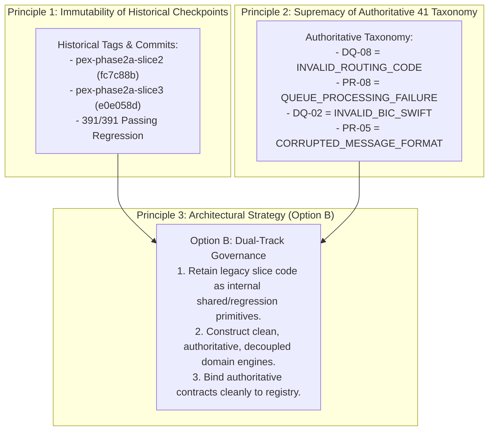
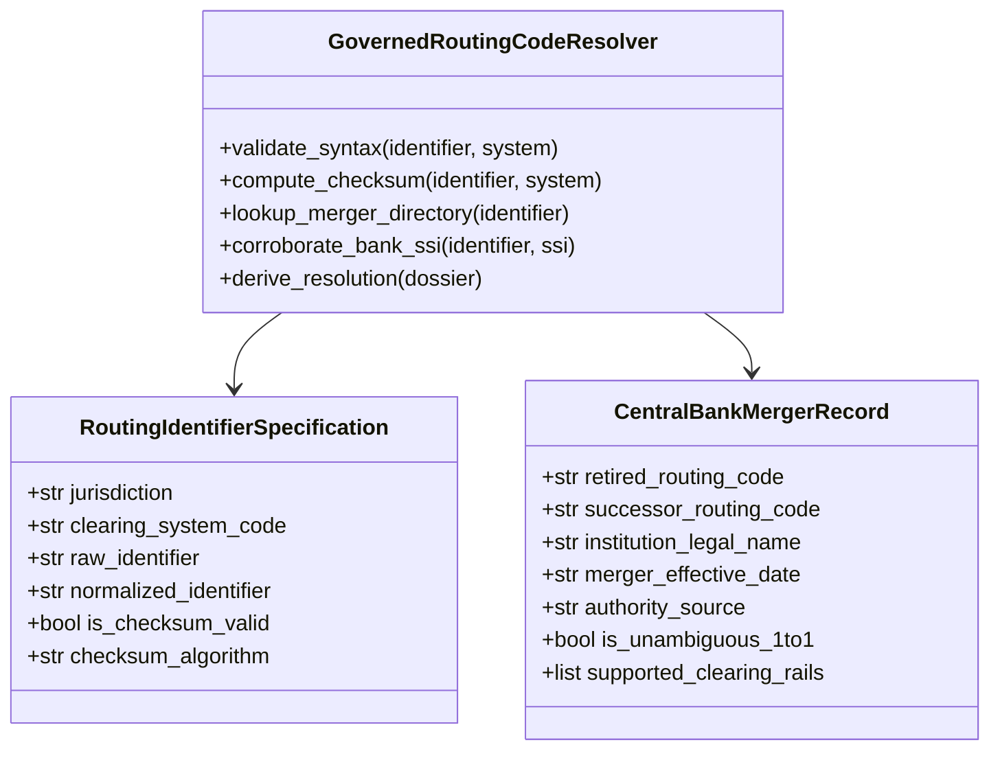
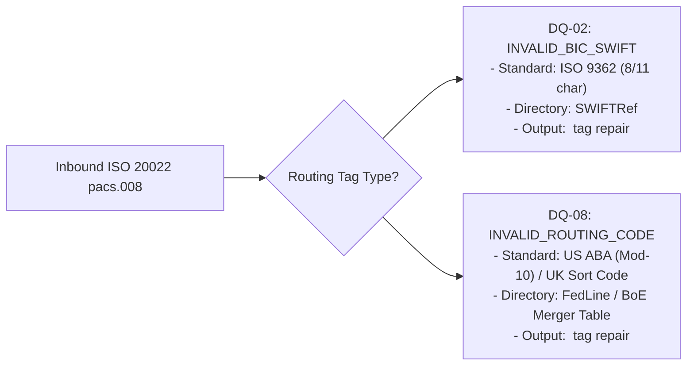
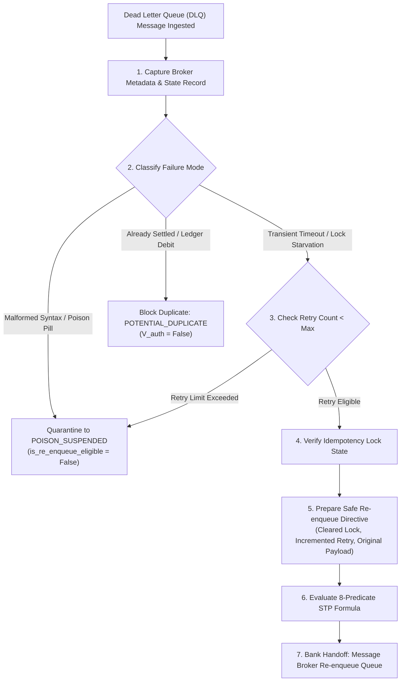
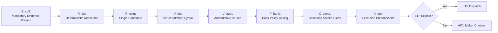
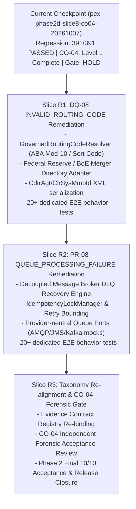

# PeX — Phase 2 Taxonomy Remediation Architecture Decision
# DQ-08 INVALID_ROUTING_CODE + PR-08 QUEUE_PROCESSING_FAILURE
# PRE-IMPLEMENTATION GOVERNANCE & ARCHITECTURE DECISION REPORT
# Document Version: v0.1
# Governance Status: READ-ONLY ARCHITECTURE DECISION — ENGINEERING NOT AUTHORIZED
# Target Profiles: DQ-08 (INVALID_ROUTING_CODE), PR-08 (QUEUE_PROCESSING_FAILURE)
# Reference: PeX_DQ08_PR08_Semantic_Integrity_Assessment_v0.1.md
# Baseline Commit: 7335ef3ddb46972c945a0f35ba781937d771e2e8 (pex-phase2d-slice8-co04-20261007)

---

## 1. EXECUTIVE DECISION & GOVERNANCE SUMMARY

```
========================================================================================
                 TAXONOMY REMEDIATION ARCHITECTURE DECISION
========================================================================================
ARCHITECTURE DECISION:        APPROVED — OPTION B (PRESERVE HISTORICAL / BUILD AUTHORITATIVE)
DQ-08 ARCHITECTURE:           READY (ROUTING IDENTIFIER ABSTRACTION & CENTRAL BANK MERGER)
PR-08 ARCHITECTURE:           READY (DECOUPLED QUEUE PROCESSING & BROKER RECOVERY ENGINE)

CURRENT STATUS:
  - DQ-08:                    REMEDIATION REQUIRED (RED -> TARGETED RE-BUILD)
  - PR-08:                    REMEDIATION REQUIRED (AMBER -> TARGETED DECOUPLING)
  - CO-04 FORENSIC REVIEW:    HOLD (PENDING REMEDIATION RESOLUTION)
  - PHASE 2 CLOSURE:          HOLD (PENDING COMPLETE 10/10 AUTHORITATIVE CONFORMANCE)
  - ENGINEERING AUTHORIZATION: NOT GRANTED (REQUIRES SEPARATE USER INVOCATION)
========================================================================================
```

Following the independent finding in [`PeX_DQ08_PR08_Semantic_Integrity_Assessment_v0.1.md`](file:///C:/Users/pawan/.gemini/antigravity/scratch/pex_platform/PeX_DQ08_PR08_Semantic_Integrity_Assessment_v0.1.md) that:
1. `DQ-08` in the codebase is a duplicate ISO 9362 BIC resolver (0% `INVALID_ROUTING_CODE` implementation), and
2. `PR-08` in the codebase is a railway character-set transliterator with queue state wrappers lacking an independent queue-processing recovery engine,

this document establishes the **authoritative architecture decision** and **remediation blueprint** to achieve 100% semantic conformance with the immutable 41-profile taxonomy without mutating or compromising historical immutable checkpoints.

---

## 2. GOVERNING ARCHITECTURAL PRINCIPLES



1. **Historical Implementation $\neq$ Authoritative Profile Implementation**: Historical release tags, accepted commits, and existing test suites must remain immutable to ensure unbroken regression safety.
2. **Zero Semantic Re-labeling / No Cosmetic Renaming**: Historical code will NOT be cosmetically renamed. Instead, authoritative engines will be constructed under strict four-contract specifications.
3. **Strict Domain Boundary Enforcement**:
   * `DQ-02` owns ISO 9362 BIC validation, SWIFTRef lookups, and BIC successors.
   * `DQ-08` owns clearing system member routing identifiers (ABA, Sort Code, `<ClrSysMmbId>`) and central bank merger directories.
   * `PR-05` owns character set transliteration (CBPR+ X-Set, UTF-8).
   * `PR-08` owns message broker queue state recovery, retry bounding, and poison-message quarantine.
4. **Provider-Neutral Architecture**: All clearing directory and message broker interfaces are defined via hexagonal ports, ensuring zero lock-in to proprietary cloud brokers or vendor directories.

---

## 3. DQ-08 TARGET ARCHITECTURE — `INVALID_ROUTING_CODE`

### 3.1. Routing Identifier Abstraction
To prevent hardwiring a single domestic format, PeX defines a provider-neutral mathematical abstraction:

$$\text{RoutingCode} = \langle \text{Jurisdiction}, \text{ClearingSystem}, \text{IdentifierString}, \text{Rail}, \text{Authority}, \text{Status}, \text{Successor}, \text{Reachability} \rangle$$



### 3.2. Supported Routing-Code Families (Authoritative Scope):
1. **US Fedwire / ACH (ABA Routing Transit Number)**:
   * Format: 9-digit numeric string (`^[0-9]{9}$`).
   * Mathematical Checksum: 9-digit Federal Reserve Mod-10 Checksum Algorithm:
     $$3(d_1 + d_4 + d_7) + 7(d_2 + d_5 + d_8) + 1(d_3 + d_6 + d_9) \equiv 0 \pmod{10}$$
   * Clearing Directory: Federal Reserve E-Payments Routing Directory / Reg J Merger Table.
   * XML Tag: `<CdtrAgt><FinInstnId><ClrSysMmbId><ClrSysId><Cd>USABA</Cd></ClrSysId><MmbId>XXXXXXXXX</MmbId></ClrSysMmbId></FinInstnId></CdtrAgt>`.
2. **UK CHAPS / Bacs / Faster Payments (UK Sort Code)**:
   * Format: 6-digit numeric string (`^[0-9]{6}$` or `^[0-9]{2}-[0-9]{2}-[0-9]{2}$`).
   * Clearing Directory: Bank of England Sorting Code Merger Directory / Vocalink ISCD.
   * XML Tag: `<ClrSysMmbId><ClrSysId><Cd>GBDSC</Cd></ClrSysId><MmbId>XXXXXX</MmbId></ClrSysMmbId>`.
3. **Generic Clearing System Member ID (`ClrSysMmbId`)**:
   * Parameterized clearing code (`AUBSB`, `CACPA`, `INIFSC`, etc.) validated via national clearing registry adapter (`BANK_CONFIG_REQUIRED`).

### 3.3. DQ-08 Four-Contract Specification:
* **Evidence Contract**:
  * Mandatory: `RAW_PAYLOAD`, `RETIRED_ROUTING_CODE`, `CLEARING_SYSTEM_CODE`, `CENTRAL_BANK_MERGER_DIRECTORY`, `TARGET_RAIL_SPEC`.
  * Conditional: `BANK_COUNTERPARTY_SSI`, `RECEIVING_INSTITUTION_ACTIVE_STATUS`.
  * Trust Tiers: Tier 1 (Raw Payload & Bank SSI), Tier 2 (Federal Reserve / Bank of England Directory).
* **Resolution Contract**:
  * Deterministic lookup in merger table.
  * Single active successor $\to R_{\text{uniq}} = \text{True}$.
  * Split acquisition (1:N branches) $\to R_{\text{uniq}} = \text{False} \to$ Suspense / Disambiguation Desk.
  * Inactive with no successor $\to R_{\text{det}} = \text{False} \to$ Suspense.
* **Authority Contract**:
  * $V_{\text{det}}$: 9-digit Mod-10 mathematical checksum or national structural syntax.
  * $V_{\text{auth}}$: Central Bank merger table entry validity, active rail reachability, and Bank Counterparty SSI corroboration.
* **STP Policy Contract**:
  * Group 1 Autonomous STP permitted subject to $P_{\text{bank}}$ monetary ceiling and $C_{\text{comp}}$ sanctions screening on successor financial institution.

---

## 4. DQ-02 VS DQ-08 EXPLICIT ARCHITECTURAL BOUNDARY



| Dimension | `DQ-02` (`INVALID_BIC_SWIFT`) | `DQ-08` (`INVALID_ROUTING_CODE`) |
| :--- | :--- | :--- |
| **Domain Identity** | International Financial Institution BIC | Domestic Clearing System Routing Transit Number |
| **Standard Reference** | ISO 9362 / SWIFTRef | Federal Reserve ABA Mod-10 / BoE Sort Code / ISO 20022 ClrSysId |
| **Target Field** | `<CdtrAgt><FinInstnId><BICFI>` | `<CdtrAgt><FinInstnId><ClrSysMmbId><MmbId>` |
| **Syntax Validation** | 4-letter bank, 2-letter country, 2-char loc, 3-char branch | 9-digit weighted Mod-10 ($3, 7, 1, 3, 7, 1, 3, 7, 1$) or 6-digit sort code |
| **Directory Authority**| SWIFT Global Directory | Federal Reserve E-Payments Directory / Bank of England ISCD |
| **Successor Event** | SWIFT BIC deactivation / Head Office merge | Bank merger, corporate acquisition, or RTN retirement |

---

## 5. PR-08 TARGET ARCHITECTURE — `QUEUE_PROCESSING_FAILURE`

### 5.1. Core Capability & Independence from Charset Transformation
PR-08 is architected as an **independent message broker queue recovery engine**. It operates regardless of whether the underlying payload contains character faults, schema faults, or is perfectly formatted.



### 5.2. Provider-Neutral Message Broker Ports
To maintain cloud and vendor neutrality, PR-08 defines abstract hexagonal ports:
1. `QueueConsumerPort`: Ingests dead-lettered messages and extracts transport headers.
2. `MessageStateStorePort`: Tracks processing lifecycle state across the distributed pipeline.
3. `IdempotencyLockManagerPort`: Validates and clears transient consumer locks.
4. `PoisonMessageQuarantinePort`: Safely isolates poison pills from retry loops.
5. `RequeuePublisherPort`: Emits validated re-enqueue directives back to the Bank Messaging Hub.

### 5.3. Canonical Processing State Model:
* `INGESTED`: Message received from Dead Letter Queue.
* `PROCESSING`: Under active validation in PeX pipeline.
* `RETRY_ELIGIBLE`: Transient failure diagnosed; retry count within policy limit ($\le 3$).
* `POISON_SUSPENDED`: Retry limit exhausted or unparseable payload quarantined.
* `ALREADY_PROCESSED`: Hash matches settled ledger; re-enqueue strictly blocked.
* `REQUEUE_READY`: Lock released; clean re-enqueue instruction prepared.
* `BANK_HANDOFF_READY`: Dispatched to Bank Messaging Adapter.

### 5.4. Decoupling from Character Transformation (PR-05 vs PR-08 Boundary):
```
                       +----------------------------------+
                       |  PR-08: QUEUE_PROCESSING_FAILURE |
                       |  (Message Broker Recovery Engine)|
                       +-----------------+----------------+
                                         |
               +-------------------------+-------------------------+
               |                         |                         |
        [Transient Timeout]      [Consumer Deadlock]       [Payload Fault]
               |                         |                         |
        (Pure Re-enqueue)        (Clear Lock & Requeue)            |
                                                                   v
                                                    +-------------------------------+
                                                    | PR-05 / Reusable Transformer  |
                                                    | (Optional Transliteration Fix)|
                                                    +-------------------------------+
```
Character transliteration is strictly an **optional subsidiary action** for payload repair, NOT the identity or definition of `PR-08`.

---

## 6. FOUR-CONTRACT & 8-PREDICATE ALIGNMENT

Both remediated profiles strictly preserve the standard four-contract model and evaluate the invariant 8-predicate formula:

$$\text{STP\_Eligible} = E_{\text{suff}} \land R_{\text{det}} \land R_{\text{uniq}} \land V_{\text{det}} \land V_{\text{auth}} \land P_{\text{bank}} \land C_{\text{comp}} \land X_{\text{pre}}$$



### Predicate Responsibilities for Remediation Profiles:
* **`DQ-08`**:
  * $E_{\text{suff}}$: Inbound payload + Central Bank Merger Directory verified.
  * $R_{\text{det}} \land R_{\text{uniq}}$: 1:1 active successor routing code derived.
  * $V_{\text{det}}$: 9-digit ABA Mod-10 checksum ($3,7,1$) or UK sort code syntax valid.
  * $V_{\text{auth}}$: Federal Reserve / Bank of England directory attestation of active routing status.
  * $P_{\text{bank}} \land C_{\text{comp}} \land X_{\text{pre}}$: Amount $\le$ ceiling, successor institution unsanctioned, clearing rail operational.
* **`PR-08`**:
  * $E_{\text{suff}}$: DLQ payload + Broker headers + Settlement ledger status verified.
  * $R_{\text{det}} \land R_{\text{uniq}}$: Clean re-enqueue directive prepared; lock released.
  * $V_{\text{det}}$: Message schema and transport headers valid.
  * $V_{\text{auth}}$: Core Settlement Ledger attests transaction is `UNSETTLED`.
  * $P_{\text{bank}} \land C_{\text{comp}} \land X_{\text{pre}}$: Retry count $\le 3$, sanctions preserved PASS, target queue reachable.

---

## 7. BANK EXECUTION BOUNDARY & ZERO-HALLUCINATION AI CONSTRAINTS

1. **Bank Execution Boundary**:
   * All outputs terminate at `BANK_HANDOFF_READY` with `execution_owner = "BANK"`.
   * PeX does NOT directly manipulate core ledgers or clearing rails.
2. **AI / Zero-Hallucination Boundary**:
   * AI confidence scores ($>0.85$) are strictly advisory and recorded in metadata.
   * AI cannot satisfy $V_{\text{det}}$, $V_{\text{auth}}$, $P_{\text{bank}}$, $C_{\text{comp}}$, or $X_{\text{pre}}$.
   * AI cannot authorize re-enqueuing of a poison message or bypass Maker-Checker.

---

## 8. RECOMMENDED REMEDIATION SEQUENCE



### Remediation Slices Detail:
1. **Slice R1 — `DQ-08` `INVALID_ROUTING_CODE`**:
   * **Why First**: Completely independent domain engine with zero coupling to other in-flight components. Cleanses the highest risk taxonomy gap (RED status).
   * **Prerequisites**: Existing Phase 2 baseline passing (391/391).
   * **Exit Criteria**: `GovernedRoutingCodeResolver` operational; ABA Mod-10 verified; 20+ new tests passing; 0 regressions.
2. **Slice R2 — `PR-08` `QUEUE_PROCESSING_FAILURE`**:
   * **Why Second**: Decouples message broker state recovery from character transformation, reusing existing pipeline wrappers while standing up independent DLQ reset ports.
   * **Exit Criteria**: Standalone `MessageBrokerQueueResetAdapter` operational; transient/poison handling verified without charset dependency; 20+ new tests passing; 0 regressions.
3. **Slice R3 — Taxonomy Re-alignment & CO-04 Forensic Gate**:
   * **Action**: Rebind registry, certify full 10/10 authoritative profiles, and execute CO-04 forensic acceptance review.

---

## 9. GOVERNANCE CLASSIFICATION & NEXT ACTION

```
========================================================================================
CURRENT GOVERNANCE STATUS:
========================================================================================
DQ-08:                        REMEDIATION REQUIRED (RED)
PR-08:                        REMEDIATION REQUIRED (AMBER)
CO-04 FORENSIC REVIEW:        HOLD
PHASE 2 CLOSURE:              HOLD
ENGINEERING AUTHORIZATION:    NOT GRANTED (PENDING USER INVOCATION)
========================================================================================
```

The remediation architecture is **APPROVED AND READY**. Implementation requires explicit user authorization under a dedicated engineering slice.

---

```
REMEDIATION ARCHITECTURE: READY
DQ-08 CONTRACT: READY
PR-08 CONTRACT: READY
ENGINEERING AUTHORIZATION: NOT GRANTED
CO-04 FORENSIC REVIEW: HOLD
PHASE 2 CLOSURE: HOLD
ARTIFACT 1: PeX_Phase2_Taxonomy_Remediation_Architecture_Decision_v0.1.md
ARTIFACT 2: PeX_Phase2_DQ08_PR08_Remediation_Implementation_Contract_v0.1.md
```
