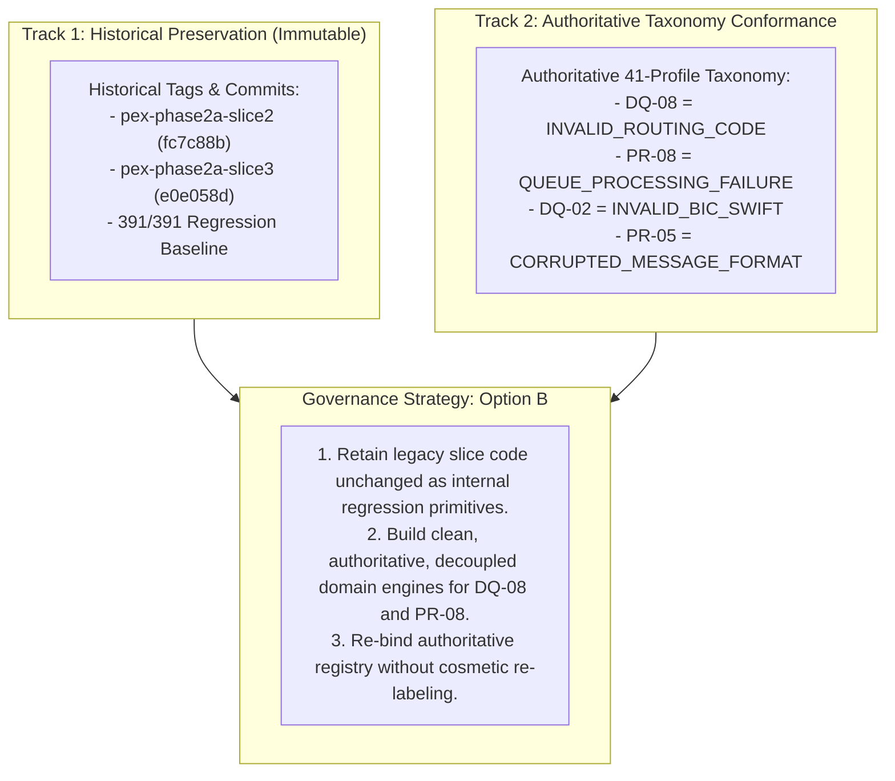
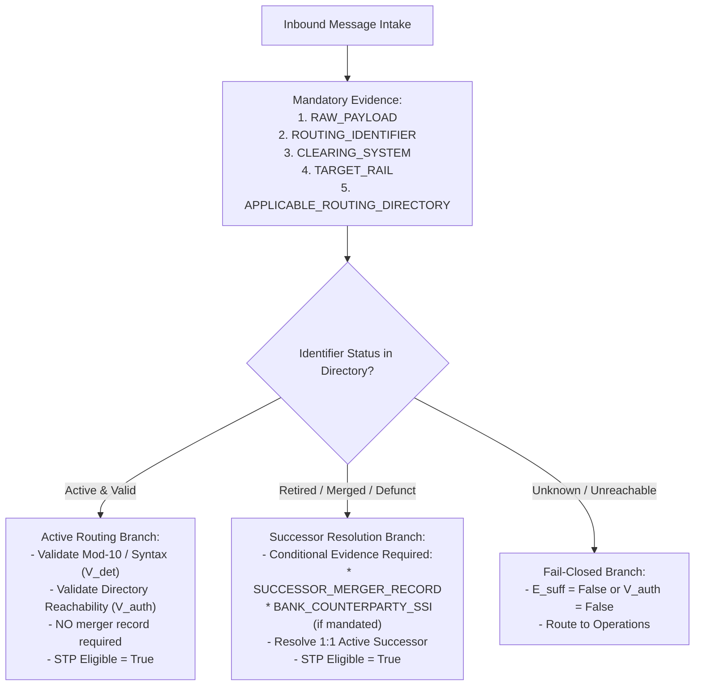
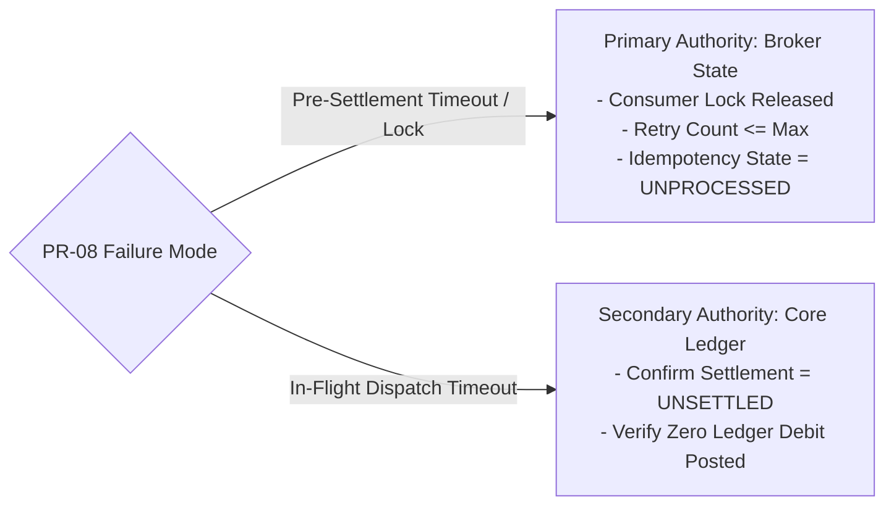
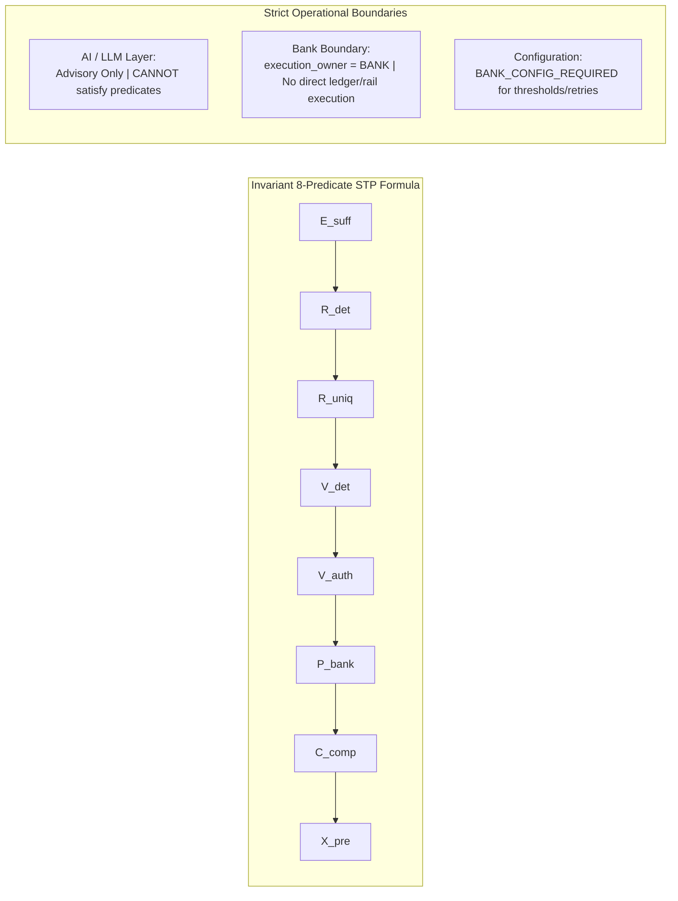
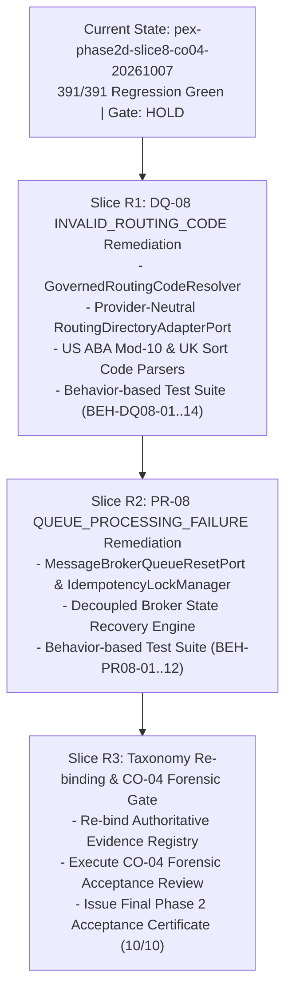

# PeX — Phase 2 Taxonomy Remediation Architecture Decision
# DQ-08 INVALID_ROUTING_CODE + PR-08 QUEUE_PROCESSING_FAILURE
# FINAL PRE-IMPLEMENTATION HARDENING & ARCHITECTURE DECISION REPORT
# Document Version: v0.2
# Governance Status: READ-ONLY HARDENED ARCHITECTURE DECISION — ENGINEERING NOT AUTHORIZED
# Target Profiles: DQ-08 (INVALID_ROUTING_CODE), PR-08 (QUEUE_PROCESSING_FAILURE)
# Reference: PeX_DQ08_PR08_Semantic_Integrity_Assessment_v0.1.md
# Baseline Commit: 7335ef3ddb46972c945a0f35ba781937d771e2e8 (pex-phase2d-slice8-co04-20261007)

---

## 1. EXECUTIVE DECISION & GOVERNANCE STATUS

```
========================================================================================
             HARDENED TAXONOMY REMEDIATION ARCHITECTURE DECISION (v0.2)
========================================================================================
ARCHITECTURE DECISION:        APPROVED — OPTION B (PRESERVE HISTORICAL / BUILD AUTHORITATIVE)
REMEDIATION ARCHITECTURE:     READY (HARDENED SPECIFICATIONS COMPLETED)
IMPLEMENTATION CONTRACT:      READY (SEPARATE BINDING CONTRACT PRODUCED)

GOVERNANCE STATUS SUMMARY:
  - DQ-08 STATUS:             REMEDIATION REQUIRED (RED -> TARGETED RE-BUILD)
  - PR-08 STATUS:             REMEDIATION REQUIRED (AMBER -> TARGETED DECOUPLING)
  - ENGINEERING AUTHORIZATION: NOT GRANTED (SEPARATE USER INVOCATION REQUIRED)
  - CO-04 FORENSIC REVIEW:    HOLD (PENDING REMEDIATION RESOLUTION)
  - PHASE 2 CLOSURE:          HOLD (PENDING 10/10 AUTHORITATIVE CONFORMANCE)
  - PRODUCTION STP STATUS:    BLOCKED / NOT ENABLED (LEVEL 2 INTEGRATION GATED)
========================================================================================
```

Following the formal semantic finding that `DQ-08` in the codebase is a duplicate ISO 9362 BIC resolver and `PR-08` is a character-set transliterator with queue-state wrappers, this document establishes the **hardened architecture decision (v0.2)** governing the remediation.

---

## 2. GOVERNING PRINCIPLE: DUAL-TRACK IMMUTABILITY (OPTION B)



* **Historical Implementation $\neq$ Authoritative Profile Implementation**: Historical release tags, commits, and tests remain immutable.
* **Zero Cosmetic Re-labeling**: Historical code will NOT be renamed merely to present a conformant surface. Authoritative capabilities will be constructed as distinct, clean domain engines.
* **Strict Domain Boundaries**:
  * `DQ-02` owns ISO 9362 BIC validation and SWIFTRef lookups (`<BICFI>`).
  * `DQ-08` owns national clearing routing identifiers (`<ClrSysMmbId>`) and clearing directory authority.
  * `PR-05` owns character set transliteration (CBPR+ X-Set, UTF-8).
  * `PR-08` owns message broker queue state recovery, retry bounding, and poison-message quarantine.

---

## 3. HARDENING #1 — DQ-08 SCOPE & JURISDICTION CLASSIFICATION

To avoid over-specifying or inventing product scope, PeX strictly separates the **Architectural Abstraction** from **Initial MVP Scope** and **Bank Scope Decisions**:

### 3.1. Authoritative Architectural Abstraction:
$$\text{RoutingCode} = \langle \text{Jurisdiction}, \text{ClearingSystem}, \text{Identifier}, \text{ApplicableRail}, \text{Authority}, \text{Status}, \text{Successor}, \text{Reachability} \rangle$$

### 3.2. Scope Classification Framework:

| Routing Identifier Family | Target Element | Scope Classification | Validation & Directory Authority |
| :--- | :--- | :--- | :--- |
| **US Fedwire / ACH (ABA RTN)** | `<ClrSysMmbId><ClrSysId><Cd>USABA</Cd></ClrSysId><MmbId>` | **PROPOSED MVP SCOPE** *(Established in Contract v1.3)* | 9-Digit Mod-10 Checksum; Federal Reserve E-Payments Directory |
| **UK CHAPS / Bacs (Sort Code)** | `<ClrSysMmbId><ClrSysId><Cd>GBDSC</Cd></ClrSysId><MmbId>` | **PROPOSED MVP SCOPE** *(Established in Contract v1.3)* | 6-Digit Format; Bank of England ISCD Merger Table |
| **Generic ISO 20022 Clearing Member** | `<ClrSysMmbId><ClrSysId><Cd>...</Cd></ClrSysId><MmbId>` | **AUTHORITATIVE ARCHITECTURAL ABSTRACTION** | Pluggable `RoutingDirectoryAdapterPort` (`BANK_CONFIG_REQUIRED`) |
| **Other National Schemes (AU BSB, CA CPA, IN IFSC)** | `<ClrSysMmbId>` | **BANK / PRODUCT SCOPE REQUIRED** *(Future Extension)* | National Clearing House Registries (`BANK_DISCOVERY_REQUIRED`) |

> [!NOTE]
> The authoritative PeX architecture baseline establishes the provider-neutral `<ClrSysMmbId>` routing abstraction. Specific national clearing scheme support beyond US ABA and UK Sort Code constitutes **BANK / PRODUCT SCOPE REQUIRED** and is configurable via pluggable adapters.

---

## 4. HARDENING #2 — DQ-08 CONDITIONAL EVIDENCE CONTRACT

The Evidence Contract is structured as a **conditional model**, supporting both active valid routing verification and retired successor resolution:



### Evidence Contract Specification:
1. **Mandatory Evidence (Universal)**:
   * `RAW_PAYLOAD`: Inbound ISO 20022 message payload containing routing tag (`Tier 1: Bank Authoritative`).
   * `ROUTING_IDENTIFIER`: Extracted routing code string (`Tier 1: Bank Authoritative`).
   * `CLEARING_SYSTEM`: National clearing system identifier code (`USABA`, `GBDSC`, etc.) (`Tier 1`).
   * `TARGET_RAIL`: Target clearing rail (`FEDWIRE`, `CHAPS`, `ACH`) (`Tier 1`).
   * `APPLICABLE_ROUTING_DIRECTORY`: Authoritative routing registry reference dataset (`Tier 2: External Authoritative`).
2. **Conditional Evidence**:
   * `SUCCESSOR_MERGER_RECORD`: **Required ONLY** when identifier is retired/merged (`Tier 2: External Authoritative`).
   * `BANK_COUNTERPARTY_SSI`: **Required ONLY** where bank policy or corridor mandates counterparty SSI corroboration (`Tier 1`).
   * `RECEIVING_INSTITUTION_STATUS`: Real-time node reachability on target rail (`Tier 2`).
3. **Optional Evidence**:
   * `HISTORICAL_ROUTING_PRECEDENT`: Historical log of prior routing substitutions (`Tier 4: Non-authoritative Context`).

---

## 5. HARDENING #3 & #4 — AUTHORITY MODELS (DQ-08 & PR-08)

### 5.1. DQ-08 Authority Model ($V_{\text{det}} \neq V_{\text{auth}}$):
* **Deterministic Validation ($V_{\text{det}}$)**:
  * Structural syntax validation (regex, length).
  * Mathematical algorithm validation (e.g. 9-digit ABA Mod-10 Checksum: $3(d_1+d_4+d_7) + 7(d_2+d_5+d_8) + 1(d_3+d_6+d_9) \equiv 0 \pmod{10}$).
  * *Boundary*: A valid checksum does NOT establish that the institution is active, reachable, or authorized.
* **Authoritative Validation ($V_{\text{auth}}$)**:
  * Verification against an **Authority Source Record** (e.g. Federal Reserve E-Payments Directory or BoE ISCD).
  * Confirmation of active status, clearing membership, requested-rail reachability, and valid 1:1 successor mapping.
  * Corroboration against Bank SSI where mandated.
  * *Constraint*: No synthetic "tokens" are invented. All validation references authoritative evidence records.

### 5.2. PR-08 Authority Model (Broker State vs Settlement State):
* **Primary Authority ($V_{\text{auth}}$)**:
  * Derived from **Message Broker & Processing State Records** (broker message headers, consumer state, idempotency lock status, retry counters).
* **Settlement State Authority (Conditional)**:
  * **Core Settlement Ledger evidence is required ONLY** when the specific failure mode involves potential duplicate payment release (e.g. timeout during dispatch where funds may already have posted).
  * Pure broker deadlocks, consumer timeouts prior to settlement dispatch, or network partitions do not require settlement ledger polling if idempotency locks confirm the message was unreleased.



---

## 6. HARDENING #5 — PR-08 DECOUPLED PROCESSING MODEL

PR-08 is architected as an **independent message broker recovery engine**. Character set transformation is an **optional subsidiary action**, not the core identity of PR-08.

```mermaid
flowchart TD
    DLQ["Dead Letter Queue (DLQ) Intake"] --> StateCapture["1. Capture Broker Metadata & ProcessingStateRecord"]
    StateCapture --> IdempCheck["2. Check Idempotency Key & Current State"]
    IdempCheck --> FailClassify{"3. Classify Failure Mode"}

    FailClassify -->|Transient Timeout / Lock Starvation| RetryCheck{"4. Check Retry Count < Max Limit"}
    FailClassify -->|Poison Pill / Unparseable Crash| Quarantine["5. Quarantine to POISON_SUSPENDED<br/>(is_re_enqueue_eligible = False)"]
    FailClassify -->|Duplicate / Already Settled| BlockDup["6. Block Duplicate: POTENTIAL_DUPLICATE<br/>(V_auth = False)"]

    RetryCheck -->|Retry Limit Exceeded| Quarantine
    RetryCheck -->|Retry Eligible| PayloadCheck{"7. Inspect Payload Condition"}

    PayloadCheck -->|Clean Payload (Zero Charset Faults)| PureRequeue["8. Prepare Pure Re-enqueue Directive<br/>(Cleared Lock, Incremented Retry, Original Payload)"]
    PayloadCheck -->|Subsidiary Charset Fault Detected| AuxFix["8b. Invoke PR-05 Transformer as Subsidiary Action"]

    PureRequeue --> EightPred["9. Evaluate 8-Predicate STP Formula"]
    AuxFix --> EightPred
    EightPred --> BankHandoff["10. Bank Handoff: Message Broker Re-enqueue Port"]
```

---

## 7. HARDENING #6 — BEHAVIOR-BASED TEST ACCEPTANCE (NO ARBITRARY COUNTS)

Test acceptance is governed by **comprehensive behavioral coverage**, not arbitrary numerical counts.

### 7.1. DQ-08 Behavioral Acceptance Coverage:
1. `BEH-DQ08-01`: Valid active routing identifier passes without requiring merger lookup ($V_{\text{det}}=\text{True}, V_{\text{auth}}=\text{True}$).
2. `BEH-DQ08-02`: Valid retired routing identifier with unambiguous 1:1 successor maps cleanly to active successor in `<ClrSysMmbId><MmbId>`.
3. `BEH-DQ08-03`: Invalid structural syntax fails deterministic validation ($V_{\text{det}} = \text{False}$).
4. `BEH-DQ08-04`: 9-digit ABA failing Mod-10 mathematical checksum halts ($V_{\text{det}} = \text{False}$).
5. `BEH-DQ08-05`: Unknown routing identifier absent from directory halts ($E_{\text{suff}} = \text{False} \to$ Operations).
6. `BEH-DQ08-06`: Inactive routing identifier with zero successor halts ($R_{\text{det}} = \text{False} \to$ Suspense).
7. `BEH-DQ08-07`: Ambiguous split merger (1:N branches) forces $R_{\text{uniq}} = \text{False} \to$ Disambiguation Desk.
8. `BEH-DQ08-08`: Successor institution not reachable on target clearing rail halts ($X_{\text{pre}} = \text{False}$).
9. `BEH-DQ08-09`: Stale or unavailable authority directory fails closed.
10. `BEH-DQ08-10`: Bank Counterparty SSI contradiction halts STP ($V_{\text{auth}} = \text{False}$).
11. `BEH-DQ08-11`: Amount exceeding bank policy ceiling routes to HITL Maker-Checker ($P_{\text{bank}} = \text{False}$).
12. `BEH-DQ08-12`: Historical precedent cannot override live directory or bank SSI.
13. `BEH-DQ08-13`: Adversarial prompt injection in routing references handled safely without state corruption.
14. `BEH-DQ08-14`: Bank handoff envelope generated with `execution_owner = "BANK"`.

### 7.2. PR-08 Behavioral Acceptance Coverage:
1. `BEH-PR08-01`: Transient consumer failure with retry=1 on a perfectly clean payload re-enqueues cleanly ($V_{\text{auth}}=\text{True}, \text{STP}=\text{True}$).
2. `BEH-PR08-02`: Payload with subsidiary character fault executes authorized transliteration and prepares re-enqueue.
3. `BEH-PR08-03`: Retry counter at or exceeding max allowed limit transitions to `POISON_SUSPENDED` ($R_{\text{det}} = \text{False}$).
4. `BEH-PR08-04`: Unparseable binary/malformed payload quarantined as poison pill without retry loop.
5. `BEH-PR08-05`: Message already debited/settled in Core Ledger blocked from re-enqueue ($V_{\text{auth}} = \text{False}$).
6. `BEH-PR08-06`: Idempotency lock conflict detected and handled safely without race condition.
7. `BEH-PR08-07`: Stalled message with deadlocked consumer lock cleared upon verified timeout.
8. `BEH-PR08-08`: Missing mandatory bank retry policy fails closed to Operations.
9. `BEH-PR08-09`: Stale or corrupted processing state record rejected.
10. `BEH-PR08-10`: Amount exceeding policy threshold requires dual-authorization Maker-Checker.
11. `BEH-PR08-11`: Adversarial replay attack intercepted by idempotency store.
12. `BEH-PR08-12`: Bank handoff envelope emitted with `execution_owner = "BANK"`.

---

## 8. HARDENING #7, #8, #9, #10 — GOVERNANCE & EXECUTION BOUNDARIES



### 1. 8-Predicate Formula:
$$\text{STP\_Eligible} = E_{\text{suff}} \land R_{\text{det}} \land R_{\text{uniq}} \land V_{\text{det}} \land V_{\text{auth}} \land P_{\text{bank}} \land C_{\text{comp}} \land X_{\text{pre}}$$
* No AI-confidence predicate exists. AI cannot independently assert any authority or policy predicate.

### 2. Bank Execution Boundary:
* All outputs terminate at `BANK_HANDOFF_READY` with `execution_owner = "BANK"`. PeX never moves funds, posts DDA accounting, releases payments, or operates clearing rails.

### 3. Production Configuration Boundary (`BANK_CONFIG_REQUIRED`):
* Monetary thresholds, retry limits, clearing rail allowlists, and directory sync endpoints require bank configuration. Test fixtures are explicitly marked `DEMO_ONLY_DEFAULT` or `TEST_ONLY`.

### 4. Lifecycle Status Model:
```
[ARCHITECTURE READY] (v0.2 Approved)
        |
        v
[IMPLEMENTATION CONTRACT READY] (v0.1 Published)
        |
        v
[ENGINEERING AUTHORIZED] (NOT GRANTED - Requires User Invocation)
        |
        v
[PLATFORM IMPLEMENTATION COMPLETE] (Pending Slices R1 & R2)
        |
        v
[BANK INTEGRATION READY] (Level 1 Sandbox Verified)
        |
        v
[PRODUCTION STP READY] (Gated - Level 2 Bank Controls Required)
```

---

## 9. REMEDIATION SEQUENCING & GOVERNANCE DECISION



### Final Governance Classification:
* **`DQ-08`**: `REMEDIATION REQUIRED (RED)`
* **`PR-08`**: `REMEDIATION REQUIRED (AMBER)`
* **Remediation Architecture**: **READY (v0.2 Approved)**
* **Implementation Contract**: **READY (v0.1 Published)**
* **Engineering Authorization**: **NOT GRANTED** *(Awaiting user invocation)*
* **CO-04 Forensic Review**: **HOLD**
* **Phase 2 Closure**: **HOLD**

---

```
REMEDIATION ARCHITECTURE: READY
IMPLEMENTATION CONTRACT: READY
ENGINEERING AUTHORIZATION: NOT GRANTED
CO-04 FORENSIC REVIEW: HOLD
PHASE 2 CLOSURE: HOLD
ARTIFACT 1: PeX_Phase2_Taxonomy_Remediation_Architecture_Decision_v0.2.md
ARTIFACT 2: PeX_Phase2_DQ08_PR08_Remediation_Implementation_Contract_v0.1.md
```
