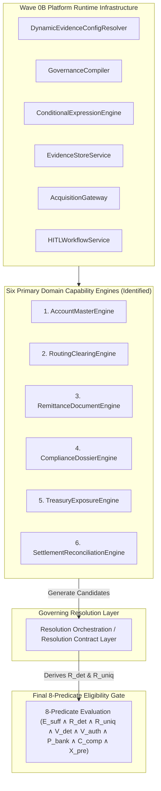
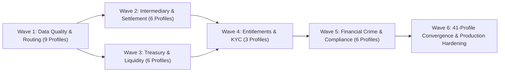

# PeX Phase 3 — Industrialization Architecture v0.1.1
## Architecture & Capability Design for the 30 Remaining Canonical Exception Profiles

**Version:** v0.1.1  
**Status:** Architecture Remediation / Design Only  
**Purpose:** Phase 3 Industrialization Architecture Specification  
**Engineering Authorization:** NOT GRANTED  
**Authoritative Baseline:** `PeX_Evidence_Driven_STP_Architecture_Baseline_v1.1.md`, `PeX_Phase2_Implementation_Contract_v1.3.md`, `PeX_Evidence_Acquisition_and_Resolution_Contract_v0.3.1.md`, `PeX_Wave0B_Implementation_Report_v0.1.md`  

---

======================================================================
1. EXECUTIVE SUMMARY
======================================================================

### 1.1 Where We Are Now
The PeX (Payment Exception Resolution) platform has successfully closed Phase 2 (with 11 of 41 canonical profiles implemented, forensically accepted, and backed by 423 green regression tests), completed Wave 0A (establishing platform contracts, schemas, reference adapters, and the 12-scenario E2E JSON execution harness), and completed Wave 0B (enabling dynamic published Bank Evidence Required JSON resolution, fail-closed governance compilation, deterministic sandboxed expression evaluation, content-addressable evidence storage, multi-mode acquisition across Modes 1–4, PeX-native HITL closed loop, and an expanded 18-scenario canonical execution suite backed by 495 / 495 green tests).

### 1.2 The Industrialization Objective
The objective of Phase 3 Industrialization is **not** to build 30 separate, bespoke, siloed profile engines. Rather, the objective is to answer the primary architectural question:

> **"How should PeX implement the remaining 30 exception profiles using the smallest practical set of reusable, governed capability engines while preserving profile-specific evidence, authority, resolution, HITL, and STP semantics?"**

### 1.3 Core Architectural Findings & Decisions
1. **Six Primary Reusable Domain Capability Engines Currently Identified**: The remaining 30 profiles (as well as supporting the 11 accepted Phase 2 baseline profiles) are served by six primary reusable domain capability engines layered on top of the Wave 0B platform runtime infrastructure:
   - `AccountMasterEngine` (Account validity, status, owner matching)
   - `RoutingClearingEngine` (Correspondent hops, directory routing, cutoffs, retry locks)
   - `RemittanceDocumentEngine` (Unstructured remittance decoding, invoice parsing)
   - `ComplianceDossierEngine` (Sanctions, AML, PEP, Adverse Media, High-Risk Jurisdictions)
   - `TreasuryExposureEngine` (Funds, Nostro balances, FX rates, limits, liquidity)
   - `SettlementReconciliationEngine` (Ledger breaks, returns, trapped funds, unmatched credits)
   *(Note: This engine inventory represents an industrialization design decision that may evolve through governed architecture decisions).*
2. **Resolution Orchestration / Resolution Contract Layer**: An explicit governing layer is introduced between domain capability engines and 8-predicate evaluation to compose resolution candidates, determine deterministic uniqueness ($R_{\text{det}} \land R_{\text{uniq}}$), and validate candidate completeness before authority and policy gates.
3. **Reframing to "Automation Potential"**: Classifications previously labeled "STP Potential" are reframed as **Automation Potential**. *Automation potential is not STP authorization.* Runtime STP eligibility is exclusively determined by the 8-predicate formula.
4. **Seven Canonical Resolution Patterns**: All 30 profiles map into 7 reusable resolution patterns ranging from deterministic directory substitution to multi-source reconciliation and compliance dossier adjudication.
5. **Capability Compounding Sequence (Waves 1–6)**: Profiles are grouped by capability compounding rather than profile-count optimization:
   - **Wave 1**: Data Quality & Routing Foundation (9 profiles: `DQ-03`, `DQ-04`, `DQ-07`, `DQ-09`, `PR-02`, `PR-04`, `PR-07`, `PR-09`, `CO-07`)
   - **Wave 2**: Intermediary Banking & Settlement Reconciliation (6 profiles: `PR-06`, `ST-02`, `ST-03`, `ST-04`, `ST-05`, `ST-07`)
   - **Wave 3**: Treasury, Liquidity & Balance Management (6 profiles: `TR-02`, `TR-03`, `TR-04`, `TR-06`, `TR-07`, `TR-08`)
   - **Wave 4**: Client Entitlements, KYC & Signatory Mandates (3 profiles: `TR-01`, `TR-05`, `ST-06`)
   - **Wave 5**: Financial Crime & Compliance Screening Industrialization (6 profiles: `CO-01`, `CO-02`, `CO-03`, `CO-05`, `CO-06`, `CO-08`)
   - **Wave 6**: Comprehensive 41-Profile Convergence & Multi-Tenant Hardening
6. **Architectural Invariants Strictly Preserved**:
   - The 41-profile taxonomy is immutable.
   - Phase 2 is closed and protected from re-engineering.
   - The 8-predicate formula ($\text{STP\_ELIGIBLE} = E_{\text{suff}} \land R_{\text{det}} \land R_{\text{uniq}} \land V_{\text{det}} \land V_{\text{auth}} \land P_{\text{bank}} \land C_{\text{comp}} \land X_{\text{pre}}$) is immutable.
   - Evidence sufficiency ($E_{\text{suff}}$) does not equal STP eligibility.
   - AI confidence carries exactly $0\%$ autonomous execution authority.
   - Terminal execution state is `BANK_HANDOFF_READY` with `execution_owner = "BANK"`.
   - Production autonomous STP remains strictly blocked.

---

======================================================================
2. PHASE 2 NO-REENGINEERING BOUNDARY
======================================================================

> **PHASE 2 NO-REENGINEERING BOUNDARY RULE:**  
> **Phase 3 industrialization must consume accepted Phase 2 contracts and implementations and must not refactor, rename, reclassify, redistribute, or behaviorally alter Phase 2 profile ownership unless a separately authorized architecture decision is issued.**

### 2.1 Protected Phase 2 Profiles Inventory
The 11 currently accepted and forensically verified Phase 2 profiles are strictly protected:
1. `PR-05` (Amount Formatting / Decimals)
2. `PR-08` (Queue Processing Failure / Deadlock Recovery)
3. `DQ-05` (Missing Beneficiary Address)
4. `PR-01` (Duplicate Payment Detection & Suppression)
5. `DQ-08` (Routing Code / Transit Discrepancy)
6. `DQ-02` (Invalid BIC Routing)
7. `DQ-01` (Invalid IBAN Checksum)
8. `DQ-06` (Cross-Border Missing Purpose / Regulatory Code)
9. `ST-01` (Returned Payment Re-Credit)
10. `CO-04` (Restricted Corridor / Sanctions False Positive Disambiguation)
11. `PR-03` (Value Date Past Cutoff / Rollover)

### 2.2 Boundary Distinctions
Phase 3 architecture explicitly distinguishes between three operational concepts:
- **A. Existing Phase 2 Profile Consumption**: The 11 accepted Phase 2 profiles execute via their existing verified pipelines and contracts. They are not being redesigned.
- **B. New Phase 3 Profile Implementation**: The 30 remaining un-implemented profiles that constitute the Phase 3 delivery scope.
- **C. Shared Capability Reuse**: Reusable capability engines (e.g. `RoutingClearingEngine`, `AccountMasterEngine`) provide shared domain logic that may be consumed by both existing Phase 2 profiles and new Phase 3 profiles without altering Phase 2 profile semantics or ownership.

---

======================================================================
3. CURRENT PEX BASELINE & PLATFORM RUNTIME
======================================================================

```
+---------------------------------------------------------------------------------------------------+
|                                   PEX PLATFORM STATE BASELINE                                      |
+--------------------------+------------------------------------------------------------------------+
| Phase 2 Status           | CLOSED (11 Profiles Accepted & Protected)                              |
+--------------------------+------------------------------------------------------------------------+
| Wave 0A Status           | COMPLETE (Platform Contracts, Schemas, 12 Canonical Scenarios)         |
+--------------------------+------------------------------------------------------------------------+
| Wave 0B Status           | COMPLETE (Dynamic Config Resolver, Governance Compiler, AST Sandbox,   |
|                          | Evidence Store, Multi-Mode Acquisition, HITL Closed-Loop, 18 Scenarios)|
+--------------------------+------------------------------------------------------------------------+
| Test Baseline            | 495 / 495 Tests Green (100% Pass Rate across 39 Test Modules)          |
+--------------------------+------------------------------------------------------------------------+
| Remaining Scope          | 30 Canonical Profiles across 5 BIAN Domains                            |
+--------------------------+------------------------------------------------------------------------+
| Production STP           | BLOCKED (Design & Planning Gate Only)                                  |
+--------------------------+------------------------------------------------------------------------+
```

---

======================================================================
4. REMAINING 30 PROFILES INVENTORY
======================================================================

```
+---------------------------------------------------------------------------------------------------+
|                                 30 REMAINING CANONICAL PROFILES                                    |
+----------------------+---------+------------------------------------------------------------------+
| Domain               | Code    | Canonical Profile Name                                           |
+----------------------+---------+------------------------------------------------------------------+
| Data Quality (4)     | DQ-03   | Missing Beneficiary Data                                         |
|                      | DQ-04   | Missing Remittance Info                                          |
|                      | DQ-07   | Invalid Account Number                                           |
|                      | DQ-09   | Beneficiary Name Mismatch (Confirmation of Payee / VoP)          |
+----------------------+---------+------------------------------------------------------------------+
| Processing (5)       | PR-02   | Routing Failure                                                  |
|                      | PR-04   | Cutoff Missed                                                    |
|                      | PR-06   | Intermediary Bank Rejection                                      |
|                      | PR-07   | Network Timeout                                                  |
|                      | PR-09   | Payment Held for Repair                                          |
+----------------------+---------+------------------------------------------------------------------+
| Compliance (7)       | CO-01   | Sanctions Screening Hit                                          |
|                      | CO-02   | AML Alert                                                        |
|                      | CO-03   | PEP Match                                                        |
|                      | CO-05   | Adverse Media Match                                              |
|                      | CO-06   | High-Risk Jurisdiction                                           |
|                      | CO-07   | Regulatory Reporting Required                                    |
|                      | CO-08   | Customer Watchlist Match                                         |
+----------------------+---------+------------------------------------------------------------------+
| Client / Treasury (8)| TR-01   | KYC Expired                                                      |
|                      | TR-02   | Insufficient Funds                                               |
|                      | TR-03   | Nostro Shortfall                                                 |
|                      | TR-04   | FX Rate Unavailable                                              |
|                      | TR-05   | Authorization Missing (Signatory Mandate)                        |
|                      | TR-06   | Limit Breach                                                     |
|                      | TR-07   | Liquidity Constraint                                             |
|                      | TR-08   | Credit Exposure Breach                                           |
+----------------------+---------+------------------------------------------------------------------+
| Settlement /         | ST-02   | Account Closed                                                   |
| Returns (6)          | ST-03   | Beneficiary Account Frozen                                       |
|                      | ST-04   | Reconciliation Break                                             |
|                      | ST-05   | Settlement Failure                                               |
|                      | ST-06   | Funds Trapped at Correspondent                                   |
|                      | ST-07   | Unmatched Credit                                                 |
+----------------------+---------+------------------------------------------------------------------+
```

---

======================================================================
5. INDUSTRIALIZATION PRINCIPLES & GOVERNED PIPELINE
======================================================================

### 5.1 The Core Operating Axiom
The PeX platform operates on the authoritative principle:

> **"Evidence determines eligibility. History informs the fix. Controls validate the repair. Policy determines whether it can STP. The bank retains execution control."**

### 5.2 Resolution Orchestration & Governed Execution Pipeline
To prevent monolithic coupling while maintaining strict determinism, an explicit **Resolution Orchestration / Resolution Contract** layer is introduced between domain capability engines and 8-predicate evaluation:

$$\text{Canonical Inbound Exception}$$
$$\Downarrow$$
$$\text{Dynamic Evidence Acquisition (Modes 1, 2, 3, 4)}$$
$$\Downarrow$$
$$\text{Evidence Sufficiency Evaluation } (E_{\text{suff}})$$
$$\Downarrow$$
$$\text{Domain Capability Engine(s) Execution}$$
$$\Downarrow$$
$$\text{Resolution Candidate Generation (Proposed Value / Action)}$$
$$\Downarrow$$
$$\mathbf{Resolution\ Orchestration\ /\ Resolution\ Contract\ (Composition\ \&\ Uniqueness)}$$
$$\Downarrow$$
$$\text{Deterministic Resolution Derivation } (R_{\text{det}} \land R_{\text{uniq}})$$
$$\Downarrow$$
$$\text{Authority Validation } (V_{\text{det}} \land V_{\text{auth}})$$
$$\Downarrow$$
$$\text{Bank Policy \& Compliance Gates } (P_{\text{bank}} \land C_{\text{comp}})$$
$$\Downarrow$$
$$\text{Preconditions \& Idempotency Lock } (X_{\text{pre}})$$
$$\Downarrow$$
$$\mathbf{8\text{-}Predicate\ STP\ Evaluation\ Conjunction}$$
$$\Downarrow$$
$$\begin{cases} \mathbf{STP\_ELIGIBLE = TRUE} & \longrightarrow \mathbf{BANK\_HANDOFF\_READY} \text{ (Zero-Touch Autonomous Handoff)} \\ \mathbf{STP\_ELIGIBLE = FALSE} & \longrightarrow \mathbf{PE\_X\ NATIVE\ HITL\ WORKSPACE} \text{ (Maker-Checker / Adjudication)} \end{cases}$$

---

======================================================================
6. REUSABLE CAPABILITY ENGINE INVENTORY
======================================================================

Six primary reusable domain capability engines are currently identified for the industrialization of the 30 remaining profiles:



### 6.1 Engine 1: `AccountMasterEngine`
- **Purpose**: Unified account validation, status inquiry, modulo-97 calculation, Confirmation of Payee (VoP) matching, and account restriction handling.
- **Phase 3 Profiles Implemented**: `DQ-03`, `DQ-07`, `DQ-09`, `ST-02`, `ST-03`, `TR-01`.
- **Phase 2 Profiles Supported / Consumed**: `DQ-01`, `DQ-02`, `DQ-05`.
- **Primary Inputs**: Account Number (IBAN/BBAN/Transit), Creditor Name, Currency, Branch BIC.
- **Evidence Dependencies**: `CORE_DDA_ACCOUNT` (Tier 1), `NATIONAL_DIRECTORY` (Tier 2).
- **Authority Dependencies**: Core Banking DDA Port / Confirmation of Payee Directory.
- **Deterministic Logic**: ISO 7064 Modulo 97-10 solver, national check digit algorithms, exact/fuzzy string distance scoring.
- **AI Role (Advisory Only)**: Entity alias extraction and trading name mapping. Zero authority.
- **HITL Role**: Disambiguation cockpit when multiple valid accounts match or name distance score is ambiguous.
- **Belongs in**: Core PeX Domain Service (`backend/app/services/engines/account_master_engine.py`).

### 6.2 Engine 2: `RoutingClearingEngine`
- **Purpose**: Clearing rail selection, correspondent routing transit hop derivation, cutoff schedule management, and network retry coordination.
- **Phase 3 Profiles Implemented**: `PR-02`, `PR-04`, `PR-07`, `PR-09`.
- **Phase 2 Profiles Supported / Consumed**: `DQ-08`, `PR-03`, `PR-08`.
- **Primary Inputs**: Debtor BIC, Creditor BIC, Currency, Amount, Rail Code, Timestamp.
- **Evidence Dependencies**: `SWIFTREF_DIRECTORY` (Tier 2), `RAIL_SCHEDULE_MASTER` (Tier 1), `IDEMPOTENCY_LOCK` (Tier 1).
- **Authority Dependencies**: Clearing Rail Port / SWIFTRef Adapter / Gateway Socket Probe.
- **Deterministic Logic**: Routing graph shortest-path traversal, cutoff calendar calculation, value-date roll forward ($T+1$), idempotent retry dispatch.
- **AI Role**: None.
- **HITL Role**: Manual routing override when all correspondent paths are blocked.
- **Belongs in**: Core PeX Domain Service (`backend/app/services/engines/routing_clearing_engine.py`).

### 6.3 Engine 3: `RemittanceDocumentEngine`
- **Purpose**: Ingestion, unbundling, parsing, and semantic extraction of structured and unstructured remittance data, invoices, and EDI payloads.
- **Phase 3 Profiles Implemented**: `DQ-03`, `DQ-04`, `CO-07`.
- **Phase 2 Profiles Supported / Consumed**: None (New Phase 3 Capability).
- **Primary Inputs**: Unstructured remittance text, PDF/OCR invoice payloads, EDI 820 documents.
- **Evidence Dependencies**: `ERP_INVOICE_PAYLOAD` (Tier 3), `PURPOSE_CODE_DIRECTORY` (Tier 2).
- **Authority Dependencies**: Client ERP Port / Central Bank Regulatory Directory.
- **Deterministic Logic**: Regular expression pattern matching for PO/Invoice numbers, ISO 20022 XML structured tag serialization (`RmtInf/Strd`).
- **AI Role (Advisory Only)**: Probabilistic NLP extraction of invoice attributes from freeform unstructured narratives.
- **HITL Role**: Operator confirmation when extracted remittance confidence is below threshold.
- **Belongs in**: Core PeX Domain Service (`backend/app/services/engines/remittance_document_engine.py`).

### 6.4 Engine 4: `ComplianceDossierEngine`
- **Purpose**: Aggregation of screening hits, entity disambiguation dossiers, statutory corridor matrix validation, and compliance officer adjudication packaging.
- **Phase 3 Profiles Implemented**: `CO-01`, `CO-02`, `CO-03`, `CO-05`, `CO-06`, `CO-07`, `CO-08`.
- **Phase 2 Profiles Supported / Consumed**: `CO-04`, `DQ-06`.
- **Primary Inputs**: Debtor/Creditor Names, Country Codes, Corridor, DOB, LEI, Watchlist Hits.
- **Evidence Dependencies**: `SANCTIONS_WATCHLIST` (Tier 2), `PEP_DATABASE` (Tier 2), `ADVERSE_MEDIA` (Tier 3), `CLIENT_KYC` (Tier 1).
- **Authority Dependencies**: Compliance Screening Port / Watchlist System of Record.
- **Deterministic Logic**: 32-year entity disambiguation matching (Exact Name + DOB + Country), statutory embargo checks.
- **AI Role (Advisory Only)**: Collate adverse media summaries, cluster entity aliases, rank false positive likelihood.
- **HITL Role**: Compliance Officer Dual-Authorization Desk for hold releases and statutory block executions.
- **Belongs in**: Core PeX Domain Service (`backend/app/services/engines/compliance_dossier_engine.py`).

### 6.5 Engine 5: `TreasuryExposureEngine`
- **Purpose**: Balance inquiry, liquidity reservation, Nostro monitoring, FX rate booking, limit enforcement, and credit exposure tracking.
- **Phase 3 Profiles Implemented**: `TR-02`, `TR-03`, `TR-04`, `TR-05`, `TR-06`, `TR-07`, `TR-08`.
- **Phase 2 Profiles Supported / Consumed**: None (New Phase 3 Capability).
- **Primary Inputs**: Account Number, Amount, Currency, Debtor Limit, Nostro Identifier, FX Pair.
- **Evidence Dependencies**: `CORE_DDA_BALANCE` (Tier 1), `NOSTRO_LEDGER` (Tier 1), `FX_RATE_MATRIX` (Tier 1), `CREDIT_LIMIT` (Tier 1).
- **Authority Dependencies**: Core Banking DDA Port / Treasury Management Port / Market Data Adapter.
- **Deterministic Logic**: Balance reservation calculation, FX spread calculation, cumulative limit aggregation, liquidity cap pacing.
- **AI Role (Advisory Only)**: Intraday liquidity cash flow forecasting.
- **HITL Role**: Credit Officer / Corporate Client Portal sign-off for limit uplifts and mandate clearances.
- **Belongs in**: Core PeX Domain Service (`backend/app/services/engines/treasury_exposure_engine.py`).

### 6.6 Engine 6: `SettlementReconciliationEngine`
- **Purpose**: Daily clearing statement reconciliation, inward return matching, debtor re-credit generation, trapped fund tracking, and unmatched credit resolution.
- **Phase 3 Profiles Implemented**: `PR-06`, `ST-02`, `ST-03`, `ST-04`, `ST-05`, `ST-06`, `ST-07`.
- **Phase 2 Profiles Supported / Consumed**: `PR-01`, `ST-01`.
- **Primary Inputs**: Inward `pacs.004` / `pacs.002`, `camt.053` statement, Original Debit UETR, Settlement Journal.
- **Evidence Dependencies**: `INWARD_RETURN` (Tier 1), `ORIGINAL_DEBIT` (Tier 1), `CAMT053_STATEMENT` (Tier 1), `GPI_TRACKER` (Tier 2).
- **Authority Dependencies**: Settlement Ledger Port / SWIFT GPI Tracker Port / Accounting Port.
- **Deterministic Logic**: Exact 4-point matching (UETR + Amount + Currency + Value Date), ledger re-credit instruction creation, `camt.027` Claim for Non-Receipt generation.
- **AI Role (Advisory Only)**: Many-to-one batch break matching suggestions.
- **HITL Role**: Operations investigation worklist for orphan breaks and unmatchable credits.
- **Belongs in**: Core PeX Domain Service (`backend/app/services/engines/settlement_reconciliation_engine.py`).

---

======================================================================
7. RESOLUTION PATTERN INVENTORY
======================================================================

All 30 remaining profiles map into **7 canonical resolution patterns**:

```
+---------------------------------------------------------------------------------------------------+
|                                  CANONICAL RESOLUTION PATTERNS                                    |
+---------+-----------------------------------+--------------------+--------------------------------+
| Pattern | Pattern Name                      | Primary Logic      | Associated Profiles            |
+---------+-----------------------------------+--------------------+--------------------------------+
| PAT-A   | Directory / Master Lookup &       | Deterministic SoR  | DQ-03, DQ-07, PR-02, CO-07     |
|         | Substitution                      | lookup & checksum  |                                |
+---------+-----------------------------------+--------------------+--------------------------------+
| PAT-B   | Schedule / Value Date / Queue     | Operating calendar | PR-04, PR-07, PR-09            |
|         | Recalculation                     | roll & retry lock  |                                |
+---------+-----------------------------------+--------------------+--------------------------------+
| PAT-C   | Threshold / Balance Reservation   | Account balance /  | TR-02, TR-03, TR-04, TR-07     |
|         | & Pacing Retry                    | rate availability  |                                |
+---------+-----------------------------------+--------------------+--------------------------------+
| PAT-D   | Compliance Dossier Assembly &     | Entity match &     | CO-01, CO-02, CO-03, CO-05,    |
|         | Officer Adjudication              | statutory review   | CO-06, CO-08                   |
+---------+-----------------------------------+--------------------+--------------------------------+
| PAT-E   | Return Matching & Debtor          | 4-point matching & | ST-02, ST-03, ST-04, ST-05,    |
|         | Re-Credit Ledger Reversal         | accounting package | ST-07                          |
+---------+-----------------------------------+--------------------+--------------------------------+
| PAT-F   | Correspondent Inquiry & Claims    | SWIFT GPI status & | PR-06, ST-06                   |
|         | Tracking Dispatch                 | camt.027 claim     |                                |
+---------+-----------------------------------+--------------------+--------------------------------+
| PAT-G   | Client Mandate & Signatory        | Mandate evaluation | DQ-09, TR-01, TR-05, TR-06,    |
|         | Dual-Authorization Clearance      | & Mode 4 portal    | TR-08                          |
+---------+-----------------------------------+--------------------+--------------------------------+
```

---

======================================================================
8. PROFILE-TO-CAPABILITY MATRIX (30 REMAINING PROFILES)
======================================================================

> **CRITICAL GOVERNANCE NOTE ON AUTOMATION POTENTIAL:**  
> **Automation Potential is an architectural classification of algorithmic feasibility, NOT runtime STP authorization.** A profile classified with High Automation Potential may still fail one or more of the 8 predicates at runtime. Runtime STP eligibility is determined exclusively by the 8-predicate formula.

| Profile | Domain | Primary Engine | Resolution Pattern | Required Evidence | Authority Source | Automation Potential | Wave | Open Decisions / Risks |
|---|---|---|---|---|---|---|---|---|
| **DQ-03** | Data Quality | `AccountMasterEngine` | PAT-A | `CLIENT_MASTER_RECORD` (T1) | Core Banking / GLEIF | **HIGH** | **Wave 1** | Client directory match policy |
| **DQ-04** | Data Quality | `RemittanceDocumentEngine` | PAT-A | `ERP_INVOICE_PAYLOAD` (T3) | Client ERP / EDI | **HIGH** | **Wave 1** | OCR / EDI format mapping |
| **DQ-07** | Data Quality | `AccountMasterEngine` | PAT-A | `CORE_DDA_ACCOUNT` (T1) | Core DDA Master | **HIGH** | **Wave 1** | Modulo table configuration |
| **DQ-09** | Data Quality | `AccountMasterEngine` | PAT-G | `CORE_DDA_ACCOUNT_TITLE` (T1)| CoP / VoP Scheme | **MEDIUM** | **Wave 1** | Bank Decision: VoP fuzzy thresholds |
| **PR-02** | Processing | `RoutingClearingEngine` | PAT-A | `SWIFTREF_DIRECTORY` (T2) | SWIFTRef / SSI Master | **HIGH** | **Wave 1** | Fallback correspondent hierarchy |
| **PR-04** | Processing | `RoutingClearingEngine` | PAT-B | `RAIL_SCHEDULE_MASTER` (T1)| Central Bank Cutoff | **HIGH** | **Wave 1** | Bank Decision: Cutoff buffer window |
| **PR-06** | Processing | `SettlementReconciliationEngine`| PAT-F | `INWARD_PACS002_REJECTION` (T1)| Inward SWIFT / Portal | **MEDIUM** | **Wave 2** | Intermediary reason code mapping |
| **PR-07** | Processing | `RoutingClearingEngine` | PAT-B | `GATEWAY_SOCKET_LOG` (T1) | Gateway Socket Probe | **HIGH** | **Wave 1** | Socket timeout threshold |
| **PR-09** | Processing | `RoutingClearingEngine` | PAT-B | `PARSER_SYNTAX_ERROR_LOG` (T1)| Canonical Schema XSD | **HIGH** | **Wave 1** | Canonical XSD versioning |
| **CO-01** | Compliance | `ComplianceDossierEngine` | PAT-D | `SANCTIONS_SCREENING_ALERT` (T2)| OFAC / National Feeds | **0% (HITL)** | **Wave 5** | Regulatory: Officer dual-auth |
| **CO-02** | Compliance | `ComplianceDossierEngine` | PAT-D | `AML_ALERT_DOSSIER` (T1) | Bank AML Monitoring | **0% (HITL)** | **Wave 5** | Regulatory: Mandatory human review |
| **CO-03** | Compliance | `ComplianceDossierEngine` | PAT-D | `PEP_SCREENING_ALERT` (T2) | World-Check / DowJones | **0% (HITL)** | **Wave 5** | Regulatory: EDD sign-off |
| **CO-05** | Compliance | `ComplianceDossierEngine` | PAT-D | `ADVERSE_MEDIA_ALERT` (T3) | Adverse Media Feed | **0% (HITL)** | **Wave 5** | Bank Decision: Media risk threshold |
| **CO-06** | Compliance | `ComplianceDossierEngine` | PAT-D | `FATF_JURISDICTION_MATRIX` (T2)| FATF List / Treasury | **CONDITIONAL** | **Wave 5** | General license exemption policy |
| **CO-07** | Compliance | `RemittanceDocumentEngine` | PAT-A | `PURPOSE_CODE_DIRECTORY` (T2)| Central Bank Directives | **HIGH** | **Wave 1** | Regulatory purpose code mapping |
| **CO-08** | Compliance | `ComplianceDossierEngine` | PAT-D | `INTERNAL_WATCHLIST_RECORD` (T1)| Internal Fraud Database | **0% (HITL)** | **Wave 5** | Bank Decision: Fraud escalation rules |
| **TR-01** | Client/Treasury | `AccountMasterEngine` | PAT-G | `CUSTOMER_KYC_RECORD` (T1) | Bank Customer Master | **LOW** | **Wave 4** | Bank Decision: KYC grace period policy |
| **TR-02** | Client/Treasury | `TreasuryExposureEngine` | PAT-C | `CORE_DDA_BALANCE_RECORD` (T1)| Core DDA / Credit Line | **HIGH** | **Wave 3** | Balance inquiry SLA & freshness |
| **TR-03** | Client/Treasury | `TreasuryExposureEngine` | PAT-C | `NOSTRO_ACCOUNT_LEDGER` (T1) | Treasury TMS / Nostro | **HIGH** | **Wave 3** | Nostro sweep feed integration |
| **TR-04** | Client/Treasury | `TreasuryExposureEngine` | PAT-C | `TREASURY_FX_RATE_MATRIX` (T1)| Bank FX Engine | **HIGH** | **Wave 3** | FX spread & slippage tolerance |
| **TR-05** | Client/Treasury | `AccountMasterEngine` | PAT-G | `SIGNATORY_MANDATE_MATRIX` (T1)| Mandates Master / Portal | **0% (HITL)** | **Wave 4** | Corporate portal outreach protocol |
| **TR-06** | Client/Treasury | `TreasuryExposureEngine` | PAT-G | `CLIENT_LIMIT_RECORD` (T1) | Bank Limit Engine | **LOW** | **Wave 3** | Credit risk waiver rules |
| **TR-07** | Client/Treasury | `TreasuryExposureEngine` | PAT-C | `CENTRAL_BANK_RESERVES` (T1) | RTGS Reserve Account | **HIGH** | **Wave 3** | RTGS liquidity pacing algorithm |
| **TR-08** | Client/Treasury | `TreasuryExposureEngine` | PAT-G | `COUNTERPARTY_LIMIT_RECORD` (T1)| Credit Risk System | **0% (HITL)** | **Wave 3** | Credit Risk Maker-Checker |
| **ST-02** | Settlement/Ret | `SettlementReconciliationEngine`| PAT-E | `INWARD_PACS004_RETURN` (T1) | Inward Clearing Return | **HIGH** | **Wave 2** | Return matching tolerance |
| **ST-03** | Settlement/Ret | `SettlementReconciliationEngine`| PAT-E | `INWARD_RETURN_NOTICE` (T1) | Clearing Return / Legal | **CONDITIONAL** | **Wave 2** | Legal attachment policy |
| **ST-04** | Settlement/Ret | `SettlementReconciliationEngine`| PAT-E | `DAILY_CAMT053_STATEMENT` (T1)| RTGS Clearing Statement | **MEDIUM** | **Wave 2** | End-of-day statement feed timing |
| **ST-05** | Settlement/Ret | `SettlementReconciliationEngine`| PAT-E | `SETTLEMENT_REJECTION_LOG` (T1)| ACH / RTGS Operator | **HIGH** | **Wave 2** | Multilateral netting reset rules |
| **ST-06** | Settlement/Ret | `SettlementReconciliationEngine`| PAT-F | `SWIFT_GPI_TRACKER_RECORD` (T2)| SWIFT GPI Tracker | **HIGH** | **Wave 4** | SWIFT GPI inquiry SLA window |
| **ST-07** | Settlement/Ret | `SettlementReconciliationEngine`| PAT-E | `INWARD_SETTLEMENT_CREDIT` (T1)| Inward Clearing Gateway | **MEDIUM** | **Wave 2** | Unclaimed credit hold duration |

---

======================================================================
9. EVIDENCE & AUTHORITY ARCHITECTURE
======================================================================

### 9.1 Single Published Bank Evidence Model
Evidence requirements are configured through single, published Bank Evidence Required JSON documents per `(tenant_id, profile_id)`.
- **Evidence Required JSON**: Configuration data defining effective evidence requirements, trust tier floors, acquisition modes, and conditional rules.
- **Evidence Contract**: The binding architectural contract defining formal states, trust/authority interpretation, provenance, cryptographic hashing, and contribution to $E_{\text{suff}}$.
- **Core Invariant**: $E_{\text{suff}} \ne \text{STP\_ELIGIBLE}$. Evidence sufficiency is an isolated prerequisite.

### 9.2 Evidence Trust Hierarchy & Freshness Guidelines
*(Note: Freshness values below are illustrative starting guidelines; final freshness is profile-, bank-, source-, and policy-dependent).*

```
+---------------------------------------------------------------------------------------------------+
|                                 EVIDENCE TRUST TIER ALLOCATION                                    |
+------+-----------------------+----------------------------------+---------------------------------+
| Tier | Classification        | Authoritative Evidence Types     | Illustrative Freshness TTL      |
+------+-----------------------+----------------------------------+---------------------------------+
| 1    | Bank Core Authoritative| CORE_DDA_ACCOUNT, BALANCE_RECORD,| 12 to 24 Hours                  |
|      |                       | NOSTRO_LEDGER, ORIGINAL_DEBIT    | (Real-time for balances)        |
+------+-----------------------+----------------------------------+---------------------------------+
| 2    | National / Directory  | SWIFTRef, FedLine, VoP Directory,| 24 to 72 Hours                  |
|      | Authoritative         | OFAC SDN, Central Bank Schedules | (Daily delta update)            |
+------+-----------------------+----------------------------------+---------------------------------+
| 3    | Client ERP / Document | ERP_INVOICE, REMITTANCE_ADVICE,  | 7 Days                          |
|      |                       | ADVERSE_MEDIA_ALERT              | (Per-case snapshot)             |
+------+-----------------------+----------------------------------+---------------------------------+
| 4    | AI / Historical       | HISTORICAL_REPAIR_PRECEDENT,     | Advisory Context Only           |
|      | Precedent             | STATISTICAL_SIMILARITY           | (0% Authority Gate Weight)      |
+------+-----------------------+----------------------------------+---------------------------------+
```

---

======================================================================
10. BANK POLICY VS. ARCHITECTURE DECISIONS
======================================================================

PeX strictly maintains the boundary between platform architecture decisions and bank-configurable policy decisions:

```
+---------------------------------------------------------------------------------------------------+
|                               ARCHITECTURE VS BANK POLICY BOUNDARY                                 |
+--------------------------------------------------+------------------------------------------------+
| ARCHITECTURE DECISIONS (Immutable in Platform)   | BANK-SPECIFIC POLICY DECISIONS (Configurable)  |
+--------------------------------------------------+------------------------------------------------+
| 1. 41-Profile Canonical Taxonomy                 | 1. Autonomous STP Currency & Amount Limits     |
| 2. 8-Predicate Conjunction Formula               | 2. Confirmation of Payee (VoP) Fuzzy Thresholds|
| 3. Provider-Neutral Hexagonal Ports & Adapters   | 3. Mandatory Maker-Checker Approval Roles      |
| 4. Content-Addressable SHA-256 Evidence Store    | 4. Maximum Evidence Freshness TTL Parameters   |
| 5. Terminal State BANK_HANDOFF_READY             | 5. Permitted Correspondent Routing Hierarchies |
| 6. Execution Ownership Permanently "BANK"        | 6. Real-time Balance Inquiry SLA Tolerances    |
| 7. AI 0% Autonomous Release Authority Bound     | 7. Specific Statutory Sanctions Hold Rules     |
| 8. Sandboxed Deterministic Expression Engine     | 8. Custom Operational Worklist Escalations     |
+--------------------------------------------------+------------------------------------------------+
```

---

======================================================================
11. VENDOR & PRODUCT REFERENCES DISCLAIMER
======================================================================

> **PROVIDER NEUTRALITY STATEMENT:**  
> **All named products, vendors, core banking platforms, screening engines, cloud providers, and ledger systems referenced throughout this document (including Finacle, Temenos, SAP Banking, SWIFTRef, FedLine, Actimize, Fircosoft, World-Check, Murex, Calypso, Wallstreet, AWS KMS, HashiCorp Vault, and QLDB) are illustrative examples only and do not constitute architecture commitments or mandatory dependencies.**  
>  
> PeX is 100% provider-neutral, cloud-neutral, and model-neutral. All integrations are defined as abstract Python SPIs in `backend/app/ports/` with zero vendor SDK lock-in in domain, port, or core service packages.

---

======================================================================
12. WAVE 1–6 RECOMMENDED INDUSTRIALIZATION ROADMAP
======================================================================



### 12.1 Wave 1: Data Quality & Routing Foundation (9 Profiles)
- **Target Profiles**: `DQ-03`, `DQ-04`, `DQ-07`, `DQ-09`, `PR-02`, `PR-04`, `PR-07`, `PR-09`, `CO-07`.
- **Capability Engines Introduced**: `AccountMasterEngine`, `RoutingClearingEngine`, `RemittanceDocumentEngine`.
- **Rationale**: Highest volume, highest automation potential, lowest regulatory risk. Establishes the core master data and routing infrastructure used by all downstream waves.
- **Implementation Sequencing**:
  - *Parallel Group A*: `DQ-07` (Invalid Account), `DQ-03` (Missing Beneficiary), `DQ-09` (Name Mismatch) via `AccountMasterEngine`.
  - *Parallel Group B*: `PR-04` (Cutoff), `PR-07` (Timeout), `PR-09` (Syntax Repair), `PR-02` (Routing) via `RoutingClearingEngine`.
  - *Sequence Group C*: `DQ-04` (Remittance) and `CO-07` (Purpose Code) via `RemittanceDocumentEngine`.

### 12.2 Wave 2: Intermediary Banking & Settlement Reconciliation (6 Profiles)
- **Target Profiles**: `PR-06`, `ST-02`, `ST-03`, `ST-04`, `ST-05`, `ST-07`.
- **Capability Engines Introduced**: `SettlementReconciliationEngine`.

### 12.3 Wave 3: Treasury, Liquidity & Balance Management (6 Profiles)
- **Target Profiles**: `TR-02`, `TR-03`, `TR-04`, `TR-06`, `TR-07`, `TR-08`.
- **Capability Engines Introduced**: `TreasuryExposureEngine`.

### 12.4 Wave 4: Client Entitlements, KYC & Signatory Mandates (3 Profiles)
- **Target Profiles**: `TR-01`, `TR-05`, `ST-06`.
- **Capability Engines Introduced**: Signatory Mandate Engine, Correspondent Claim Tracker (`camt.027`).

### 12.5 Wave 5: Financial Crime & Compliance Screening Industrialization (6 Profiles)
- **Target Profiles**: `CO-01`, `CO-02`, `CO-03`, `CO-05`, `CO-06`, `CO-08`.
- **Capability Engines Introduced**: `ComplianceDossierEngine`.

### 12.6 Wave 6: Global 41-Profile Convergence & Enterprise Hardening
- **Scope**: Cross-domain regression validation across all 41 profiles, high-throughput multi-tenant stress testing, and deployment hardening.

---

======================================================================
13. WAVE 1 DEFINITION OF DONE — ARCHITECTURE GATE
======================================================================

Before a future Wave 1 implementation can be accepted, all of the following criteria must be completely satisfied:

### A. Architecture
- [ ] Profile contract definitions approved for all 9 Wave 1 profiles.
- [ ] Evidence contracts and trust tier bindings approved.
- [ ] Authority sources identified and mapped to abstract ports.
- [ ] Resolution patterns confirmed (`PAT-A`, `PAT-B`, `PAT-G`).
- [ ] Capability engine ownership confirmed (`AccountMasterEngine`, `RoutingClearingEngine`, `RemittanceDocumentEngine`).

### B. Configuration
- [ ] Single published Bank Evidence Required JSON models defined for all 9 profiles.
- [ ] Bank customization parameters and conditional expressions tested.
- [ ] Fail-closed validation rules enforced via `GovernanceCompiler`.

### C. Implementation
- [ ] 3 capability engines implemented in `backend/app/services/engines/`.
- [ ] Provider-neutral AST checks pass with 0 forbidden vendor SDK imports.
- [ ] Phase 2 protected profiles remain 100% untouched.

### D. Testing
- [ ] Unit tests, contract tests, negative tests, and adversarial tests implemented.
- [ ] Evidence insufficiency and authority contradiction tests passing.
- [ ] E2E dynamic JSON execution validated for all 9 profiles.
- [ ] 100% green pass rate across cumulative regression suite ($\ge 550$ tests).
- [ ] Exact 8-predicate formula evaluated without alteration.

### E. Forensic
- [ ] Independent forensic review conducted and approved.
- [ ] Semantic boundary review confirms zero profile overlap or responsibility theft.
- [ ] 41-profile taxonomy integrity confirmed.

### F. Governance
- [ ] Zero unresolved P0/P1/P2 architecture findings.
- [ ] Formal Wave 1 engineering completion report published.
- [ ] Explicit human governance sign-off achieved.

### G. Runtime Safety
- [ ] Zero direct payment execution in PeX.
- [ ] `BANK_HANDOFF_READY` remains terminal state with `execution_owner = "BANK"`.
- [ ] Maker-Checker controls preserved.
- [ ] Production autonomous STP remains separately blocked.

---

======================================================================
14. RISKS & OPEN DECISIONS CLASSIFICATION
======================================================================

```
+---------------------------------------------------------------------------------------------------+
|                                  RISKS & OPEN DECISIONS MATRIX                                    |
+-------------------------------------+---------------------------------+---------------------------+
| Item Description                    | Classification                  | Resolution Pathway        |
+-------------------------------------+---------------------------------+---------------------------+
| Confirmation of Payee (VoP) string  | Bank Policy / Configuration     | Bank-specific risk policy |
| distance threshold for DQ-09        | Decision                        | sign-off in published JSON|
+-------------------------------------+---------------------------------+---------------------------+
| Real-time Core DDA balance inquiry  | Production Integration          | Core Banking connector    |
| latency and caching SLA for TR-02   | Dependency                      | SLA agreement             |
+-------------------------------------+---------------------------------+---------------------------+
| Corporate Client Mandate Portal     | Production Integration          | Client portal webhook /   |
| outreach authentication for TR-05   | Dependency                      | SSO standard definition   |
+-------------------------------------+---------------------------------+---------------------------+
| SWIFT GPI Tracker API connectivity | External Source Dependency      | SWIFT GPI Alliance Cloud  |
| and SLA for ST-06                   |                                 | port adapter              |
+-------------------------------------+---------------------------------+---------------------------+
| Statutory AML Hold mandates         | Architecture Risk / Compliance  | Enforced as immutable     |
| prohibiting autonomous STP          | Baseline                        | fail-closed gate (C_comp) |
+-------------------------------------+---------------------------------+---------------------------+
| End-of-day camt.053 settlement feed | Performance / SLA Risk          | Asynchronous batch        |
| delivery timing for ST-04           |                                 | reconciliation buffer     |
+-------------------------------------+---------------------------------+---------------------------+
```

---

======================================================================
15. GOVERNANCE STATUS STATEMENT
======================================================================

```
======================================================================
PHASE 3 INDUSTRIALIZATION ARCHITECTURE
STATUS: DESIGN / PLANNING ONLY

ENGINEERING AUTHORIZATION:
NOT GRANTED BY THIS DOCUMENT

WAVE 1 ENGINEERING:
NOT AUTHORIZED

PRODUCTION STP:
BLOCKED

PHASE 2:
CLOSED AND PROTECTED FROM RE-ENGINEERING

41-PROFILE TAXONOMY:
IMMUTABLE

8-PREDICATE STP FORMULA:
IMMUTABLE

BANK EXECUTION BOUNDARY:
IMMUTABLE

WAVE 0A:
COMPLETED / ACCEPTED BASELINE

WAVE 0B:
COMPLETED / ACCEPTED BASELINE
======================================================================
```

**Next Governance Action:**
1. Review and approve this Industrialization Architecture (v0.1.1).
2. Resolve the identified bank-specific policy decisions.
3. Issue a separate explicit **Wave 1 Engineering Authorization**.
4. Only then permit Wave 1 implementation.

---

======================================================================
16. v0.1 → v0.1.1 REMEDIATION SUMMARY
======================================================================

1. **Phase 2 Protection Boundary Added**: Added Section 2 establishing strict no-reengineering protection for the 11 accepted Phase 2 profiles.
2. **Engine Count Precision**: Updated language from "exactly six" to "six primary reusable domain capability engines are currently identified" as an industrialization design decision.
3. **Resolution Orchestration Layer Introduced**: Added the explicit governing Resolution Orchestration / Resolution Contract layer in Section 5.2.
4. **Automation Potential Reframed**: Replaced "STP Potential" with "Automation Potential" and explicitly clarified that automation potential is not runtime STP authorization.
5. **Phase 2 Consumption Clarified**: Explicitly differentiated Phase 2 profile consumption from new Phase 3 profile implementation across all matrices.
6. **All 30 Profile Mappings Audited**: Standardized profile mappings and categorized open decisions.
7. **Resolution Patterns Validated**: Structured PAT-A through PAT-G with clear authority and determinism boundaries.
8. **Evidence & Authority Precision**: Reaffirmed Single Published JSON model, distinguished configuration data from the binding Evidence Contract, and labeled example TTLs as illustrative starting guidelines.
9. **Bank Policy vs Architecture Boundary Established**: Added dedicated matrix separating immutable platform architecture from bank-configurable policy.
10. **Vendor References Disclaimed**: Added explicit provider neutrality disclaimer confirming all named vendors are non-binding illustrative examples.
11. **Wave 1 Definition of Done Added**: Added comprehensive 7-part architecture gate in Section 13.
12. **Risks Classified**: Grouped all open decisions into 6 formal risk categories.
13. **Governance Statement Hardened**: Re-asserted that engineering remains NOT AUTHORIZED and production STP remains BLOCKED.
