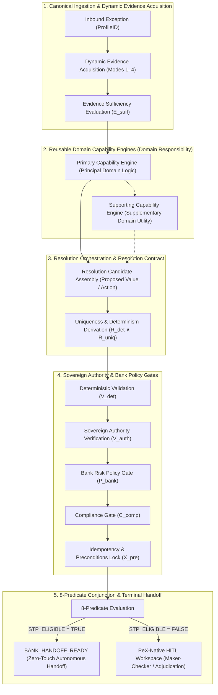

# PeX Phase 3 — Capability & Resolution Pattern Forensic Validation v0.1.3
## Architecture & Capability Design for the 30 Remaining Canonical Exception Profiles
### Governed Forensic Architecture Validation

**Version:** v0.1.3  
**Status:** Architecture Forensic Validation / Design Only  
**Purpose:** Phase 3 Capability & Resolution Pattern Forensic Validation  
**Engineering Authorization:** NOT GRANTED  
**Authoritative Baseline:** `PeX_Evidence_Driven_STP_Architecture_Baseline_v1.1.md`, `PeX_Phase2_Implementation_Contract_v1.3.md`, `PeX_Phase2_Taxonomy_Remediation_Architecture_Decision_v0.2.md`, `PeX_Phase2_DQ08_PR08_Remediation_Implementation_Contract_v0.1.md`, `PeX_Evidence_Acquisition_and_Resolution_Contract_v0.3.1.md`, `PeX_Wave0A_Implementation_Report_v0.1.md`, `PeX_Wave0B_Implementation_Report_v0.1.md`, `PeX_Phase3_Governance_and_Delivery_Charter_v0.2.md`, `PeX_Phase3_Industrialization_Architecture_v0.1.2.md`  

---

======================================================================
1. EXECUTIVE SUMMARY & FORENSIC PURPOSE
======================================================================

### 1.1 Where We Are
The PeX (Payment Exception Resolution) platform has closed Phase 2 (11 accepted canonical profiles backed by 423 green regression tests), completed Wave 0A (platform contracts, canonical schemas, reference adapters, 12-scenario E2E test harness), completed Wave 0B (dynamic published Bank Evidence Required JSON resolution, fail-closed governance compilation, deterministic sandboxed expression evaluation, content-addressable SHA-256 evidence storage, multi-mode acquisition Modes 1–4, PeX-native HITL closed loop, 18 canonical scenarios backed by 495 / 495 green tests), and in v0.1.2 restored the authoritative 41-profile taxonomy names.

### 1.2 The Forensic Objective of v0.1.3
The purpose of this pass is **not** to rename profiles or implement code. The purpose is to perform a rigorous forensic validation of the core architectural progression:

$$\text{Canonical Profile} \longrightarrow \text{Capability Engine(s)} \longrightarrow \text{Resolution Pattern} \longrightarrow \text{Evidence} \longrightarrow \text{Authority} \longrightarrow \text{Resolution Candidate} \longrightarrow \text{8-Predicate Gate} \longrightarrow \text{STP / HITL}$$

The central question addressed is:

> **"Given the authoritative domain meaning of each canonical exception profile, is the proposed capability engine and resolution pattern genuinely appropriate, or has the profile been forced into an artificial industrialization bucket?"**

### 1.3 Key Forensic Findings & Reconciliations
1. **No Artificial Bucket Forcing**: The architecture strictly separates **Primary Capability Engines** (principal domain accountability) from **Supporting Capability Engines** (supplementary domain utilities) and rejects "responsibility theft."
2. **Resolution Pattern Boundaries Refined**:
   - `PR-03 ISO 20022 Validation Error` was erroneously classified under `PAT-B` (Schedule / Value Date Recalculation). It has been forensically re-aligned to Governed Syntax/Schema Validation and Transformation (`PAT-A` / Structural Transformation), eliminating cutoff/value-date leakage from `PR-04`.
   - `PR-05 Corrupted Message Format` was misclassified as a "Directory Lookup" (`PAT-A`). Its accepted Phase 2 implementation context is governed, lossless character/encoding transformation and decimal normalization.
   - `DQ-09 Beneficiary Name Mismatch` was misclassified under `PAT-G` (Signatory Mandate). Its actual domain resolution is Confirmation of Payee (VoP) account title matching against authoritative bank records.
   - `TR-06 Limit Breach` and `TR-08 Credit Exposure Breach` were misclassified under `PAT-G` (Signatory Mandates). They are credit exposure and limit management workflows requiring limit reset pacing (`PAT-C`) or Credit Risk Officer dual-authorization adjudication (`PAT-D` / Risk Waiver).
   - `ST-02 Account Closed` and `ST-03 Beneficiary Account Frozen` are recognized as composite workflows where `AccountMasterEngine` establishes account restriction/closure, and `SettlementReconciliationEngine` executes return ledger re-crediting (`PAT-E`).
3. **Pattern Count Conclusion (Option B — Sufficiency with Boundary Refinement)**: The seven canonical resolution patterns are architecturally sufficient when their semantic boundaries are precisely formulated to prevent conflating distinct operational behaviors.

---

======================================================================
2. AUTHORITATIVE BASELINE & PRECEDENCE HIERARCHY
======================================================================

All forensic validations in this artifact are governed strictly by the authoritative precedence hierarchy:

```
1. PeX Evidence-Driven STP Architecture Baseline v1.1
   ↓
2. PeX Phase 2 Implementation Contract v1.3 & Taxonomy Remediation v0.2
   ↓
3. PeX Phase 2 DQ-08 & PR-08 Remediation Implementation Contract v0.1
   ↓
4. PeX Evidence Acquisition & Resolution Contract v0.3.1
   ↓
5. PeX Wave 0A & Wave 0B Implementation Reports v0.1
   ↓
6. PeX Phase 3 Governance and Delivery Charter v0.2
   ↓
7. PeX Phase 3 Industrialization Architecture v0.1.2
```

Where an authoritative baseline does not establish an integration or policy parameter, it is explicitly classified as **PROVISIONAL**, **ARCHITECTURE DECISION REQUIRED**, **BANK DECISION REQUIRED**, or **PRODUCTION INTEGRATION DEPENDENCY**. No unauthorized architecture is invented.

---

======================================================================
3. IMMUTABLE ARCHITECTURAL INVARIANTS
======================================================================

The following invariants are absolute and immutable:

```
+---------------------------------------------------------------------------------------------------+
|                               IMMUTABLE ARCHITECTURAL INVARIANTS                                  |
+----+----------------------------------------------------------------------------------------------+
| 1  | 41-Profile Canonical Taxonomy is immutable across all documents and systems.                 |
| 2  | Phase 2 is CLOSED; the 11 accepted baseline profiles are strictly protected.                |
| 3  | Phase 3 delivery scope consists of the 30 remaining canonical profiles.                      |
| 4  | 8-Predicate Formula is immutable:                                                            |
|    | STP_ELIGIBLE = E_suff ∧ R_det ∧ R_uniq ∧ V_det ∧ V_auth ∧ P_bank ∧ C_comp ∧ X_pre           |
| 5  | Evidence sufficiency (E_suff) does NOT equal STP eligibility.                                |
| 6  | Historical precedent carries 0% execution authority (advisory context only).                |
| 7  | AI / LLM confidence carries 0% autonomous execution authority.                              |
| 8  | AI cannot independently establish authority or authorize execution.                         |
| 9  | HITL adjudication and Maker-Checker workspaces remain strictly inside PeX.                  |
| 10 | Terminal platform state is permanently BANK_HANDOFF_READY.                                   |
| 11 | Execution ownership (execution_owner) remains permanently "BANK".                            |
| 12 | PeX never directly executes payments or mutates bank ledgers autonomously.                   |
| 13 | Production autonomous STP remains strictly blocked.                                          |
| 14 | 100% Provider-neutral, cloud-neutral, and model-neutral architecture.                        |
+----+----------------------------------------------------------------------------------------------+
```

---

======================================================================
4. PHASE 2 NO-REENGINEERING BOUNDARY & CONSUMPTION MODEL
======================================================================

> **PHASE 2 NO-REENGINEERING RULE:**  
> **Phase 3 industrialization must consume accepted Phase 2 contracts and implementations and must not refactor, rename, reclassify, redistribute, or behaviorally alter Phase 2 profile ownership.**

Phase 3 architecture strictly maintains the distinction between:
- **Phase 2 Profile**: Existing accepted implementation and contracts (`DQ-01`, `DQ-02`, `DQ-05`, `DQ-06`, `DQ-08`, `PR-01`, `PR-03`, `PR-05`, `PR-08`, `CO-04`, `ST-01`).
- **Shared Capability Consumption**: Reusable domain logic in capability engines (e.g. `AccountMasterEngine`, `RoutingClearingEngine`) that may be consumed by Phase 2 profiles without altering Phase 2 profile ownership or acceptance criteria.
- **Phase 3 Profile**: New implementation scope for the 30 remaining un-implemented profiles.

---

======================================================================
5. FIVE-LAYER ARCHITECTURE & GOVERNED EXECUTION PIPELINE
======================================================================

To guarantee clean domain boundaries and prevent responsibility theft, PeX enforces a strict five-layer execution model:



---

======================================================================
6. ENHANCED FORENSIC REVIEW OF CRITICAL PROFILE MAPPINGS
======================================================================

### 6.1 `PR-03` — ISO 20022 Validation Error
- **Authoritative Problem**: An inbound or outbound payment message violates ISO 20022 syntax, schema definition (XSD), mandatory element presence, tag length constraints, or character set formatting.
- **Forensic Diagnosis**: In v0.1.2, `PR-03` was mapped to `RoutingClearingEngine` / `PAT-B` (Schedule / Value Date / Queue Recalculation). This was a severe semantic error: `PR-03` has **zero** value-date, cutoff, or schedule semantics (which belong strictly to `PR-04 Cutoff Missed`).
- **Forensic Correction**: `PR-03` belongs to Governed Schema & Syntax Validation / Repair. Its primary capability is the Syntax/Schema Validation SPI, consumed as a shared utility by `RoutingClearingEngine` / `RemittanceDocumentEngine`. Its resolution pattern is `PAT-A` (Schema & Tag Rule Transformation) or Governed Structural Transformation.
- **Authority**: W3C XML Schema Definition (XSD) and Central Bank Clearing Specifications.

### 6.2 `PR-05` — Corrupted Message Format
- **Authoritative Problem**: Inbound message contains unparseable characters, illegal control bytes, truncated fields, or numeric decimal corruptions.
- **Forensic Diagnosis**: In v0.1.2, `PR-05` was mapped to `RemittanceDocumentEngine` / `PAT-A` (Directory / Master Lookup & Substitution). `PR-05` is **not** a directory lookup. In Phase 2, it was accepted as governed, lossless character/encoding transformation and decimal normalization.
- **Forensic Correction**: `PR-05` is an algorithmic, deterministic character and format normalization transformation. It uses `RemittanceDocumentEngine` / Message Formatter as a shared capability, with pattern behavior centered on Rule-Driven Character Normalization.
- **Authority**: Bank ISO Gateway Translation Standard.

### 6.3 `DQ-09` — Beneficiary Name Mismatch
- **Authoritative Problem**: Inbound payment creditor name does not match the legal account title registered in the creditor DDA or national Confirmation of Payee (CoP) / Verification of Payee (VoP) directory.
- **Forensic Diagnosis**: In v0.1.2, `DQ-09` was mapped to `AccountMasterEngine` / `PAT-G` (Client Mandate & Signatory Dual-Authorization Clearance). This was an artificial bucket placement. Signatory mandates (`TR-05`) involve corporate signing entitlements; `DQ-09` is Confirmation of Payee directory verification.
- **Forensic Correction**: `DQ-09` belongs to `AccountMasterEngine` executing Confirmation of Payee (VoP) string distance matching. Its pattern is `PAT-A` (Directory / CoP Matching) with threshold evaluation. If name similarity $\ge \text{Threshold}$, candidate is accepted; if ambiguous, it routes to HITL disambiguation.
- **Authority**: Confirmation of Payee (VoP) Scheme Operator / Core DDA Account Title.

### 6.4 `TR-06` — Limit Breach
- **Authoritative Problem**: An outbound payment exceeds the debtor's daily, per-transaction, or bilateral overdraft limit.
- **Forensic Diagnosis**: In v0.1.2, `TR-06` was mapped to `TreasuryExposureEngine` / `PAT-G`. Client limit breaches are not signatory mandate issues.
- **Forensic Correction**: Resolution requires either (a) pacing retry (`PAT-C`) to await intraday limit replenishment, or (b) Credit Risk Officer limit waiver approval (`PAT-D` / Risk Waiver). Reclassified as Composite `PAT-C` / `PAT-D`.
- **Authority**: Core Banking Limit Management System / Credit Officer.

### 6.5 `TR-08` — Credit Exposure Breach
- **Authoritative Problem**: An interbank settlement or foreign exchange transaction exceeds counterparty credit risk exposure caps.
- **Forensic Diagnosis**: In v0.1.2, `TR-08` was mapped to `TreasuryExposureEngine` / `PAT-G`.
- **Forensic Correction**: Interbank credit risk exposure requires Credit Risk Committee / Officer Maker-Checker evaluation (`PAT-D` Risk Dossier Assembly), not corporate client signatory mandates.
- **Authority**: Interbank Credit Risk System.

### 6.6 `ST-02` — Account Closed & `ST-03` — Beneficiary Account Frozen
- **Authoritative Problem**: A payment is routed to an account that is permanently closed (`AC04`) or subject to a legal freeze/attachment.
- **Forensic Diagnosis**: In v0.1.2, both were assigned to `SettlementReconciliationEngine` / `PAT-E`.
- **Forensic Correction**: Multi-engine relationship clarified:
  1. `AccountMasterEngine` (Primary for Account State Determination): Queries DDA / directory to establish closed or frozen status.
  2. `SettlementReconciliationEngine` (Primary for Downstream Action): Generates inward return `pacs.004`, ledger re-credit instruction, or legal suspense booking.
- **Authority**: Core Banking DDA Port / Legal Attachment Registry.

### 6.7 `DQ-03` — Missing Beneficiary Data
- **Authoritative Problem**: Mandatory creditor name, address, or identification is absent in the payment message.
- **Forensic Correction**: Clearly separated Primary vs. Supporting capability:
  - **Primary Engine**: `AccountMasterEngine` (queries Client Master Record / GLEIF directory to find unique creditor identity).
  - **Supporting Engine**: `RemittanceDocumentEngine` (invoked only if unstructured invoice or remittance data must be parsed to discover the beneficiary).

---

======================================================================
7. CAPABILITY ENGINE FORENSIC RESPONSIBILITY MATRIX
======================================================================

The architecture establishes clean domain boundaries for all six primary capability engines to prevent domain responsibility theft:

```
+---------------------------------------------------------------------------------------------------+
|                               CAPABILITY ENGINE RESPONSIBILITY MATRIX                             |
+------------------------------+----------------------------------+---------------------------------+
| Engine Name                  | Primary Domain Responsibility    | Strict Non-Responsibilities     |
+------------------------------+----------------------------------+---------------------------------+
| 1. AccountMasterEngine       | Account validity, status inquiry,| No clearing rail selection;     |
|                              | Modulo-97 check digits, CoP/VoP  | No compliance sanctions holds;  |
|                              | name distance matching.          | No balance reservation/exposure.|
+------------------------------+----------------------------------+---------------------------------+
| 2. RoutingClearingEngine     | Rail selection, correspondent SSI| No account title ownership;     |
|                              | transit hops, cutoff schedules,  | No compliance screening;        |
|                              | network retry, queue deadlock unblock. No ledger journal balancing.|
+------------------------------+----------------------------------+---------------------------------+
| 3. RemittanceDocumentEngine  | Ingestion, parsing, unbundling of| No account validation;          |
|                              | unstructured invoices, EDI, and  | No payment release authority;   |
|                              | structured RmtInf tag generation.| No credit limit checks.         |
+------------------------------+----------------------------------+---------------------------------+
| 4. ComplianceDossierEngine   | Sanctions hit packaging, 32-year | No autonomous release execution;|
|                              | entity disambiguation, PEP/AML   | No routing substitution;        |
|                              | dossier, statutory corridor rules.| No DDA account mutation.       |
+------------------------------+----------------------------------+---------------------------------+
| 5. TreasuryExposureEngine    | Real-time balance verification,  | No sanctions adjudication;      |
|                              | Nostro ledger tracking, FX rate  | No correspondent routing hops;  |
|                              | booking, liquidity queue pacing. | No debtor identity resolution.  |
+------------------------------+----------------------------------+---------------------------------+
| 6. SettlementReconciliation- | 4-point return matching, ledger  | No account status determination;|
|    Engine                    | re-credit generation, SWIFT GPI  | No FX rate derivation;          |
|                              | camt.027 claims, break tracking. | No compliance screening.        |
+------------------------------+----------------------------------+---------------------------------+
```

---

======================================================================
8. RESOLUTION PATTERN FORENSIC VALIDATION & COUNT DECISION
======================================================================

### 8.1 Pattern Count Decision: Option B (Sufficiency with Boundary Refinement)
The forensic validation explicitly concludes:

> **DECISION: OPTION B — The seven canonical resolution patterns are semantically sufficient, provided that their boundaries are strictly refined to prevent artificial bucket forcing.**

A separate 8th pattern is not required because all 41 profiles map into these 7 well-bounded abstractions without loss of precision once the following boundary rules are applied:
- **`PAT-A` (Directory & Master Resolution)** covers both master data lookup and deterministic schema/rule-based tag derivation.
- **`PAT-B` (Temporal & Queue Recalculation)** is restricted strictly to operating calendars, cutoffs, value-date roll forward, and queue retry locks.
- **`PAT-C` (Threshold & Balance Pacing)** covers financial threshold monitoring, liquidity pacing, balance reservation, and intraday retry.
- **`PAT-D` (Compliance & Risk Dossier Adjudication)** covers statutory screening, AML, sanctions, adverse media, and interbank credit risk packaging for human officer dual-authorization.
- **`PAT-E` (Ledger Matching & Settlement Reversal)** covers 4-point matching, return re-credit packages, and ledger break suspense.
- **`PAT-F` (Intermediary & Correspondent Claims Tracking)** covers multi-hop correspondent status inquiry, rejection translation, and `camt.027` claims dispatch.
- **`PAT-G` (Mandate & Entitlement Clearance)** covers corporate client signatory mandates, account permissions, and client outreach.

---

======================================================================
9. MANDATORY TABLE 1: PROFILE → CAPABILITY → PATTERN FORENSIC MATRIX
======================================================================

The following table provides the forensic validation for all 41 canonical profiles across the platform:

| Profile ID | Canonical Profile Name | Delivery Phase | Primary Capability Engine | Supporting Capability | Current Pattern | Pattern Fit | Evidence Dependency | Authority Dependency | Resolution Candidate | Automation Potential | Wave | Governance Status | Forensic Finding / Reconciled Scope |
|---|---|---|---|---|---|---|---|---|---|---|---|---|---|
| **DQ-01** | Invalid IBAN | Phase 2 | `AccountMasterEngine` | None | `PAT-A` | NATURAL | `CORE_DDA_ACCOUNT` (T1) | Core Banking / ISO 13616 | Corrected IBAN checksum | **HIGH** | Phase 2 | CONFIRMED | Accepted Phase 2 baseline. Modulo-97 algorithm. |
| **DQ-02** | Invalid BIC / SWIFT | Phase 2 | `AccountMasterEngine` | `RoutingClearingEngine` | `PAT-A` | NATURAL | `SWIFTREF_DIRECTORY` (T2) | SWIFTRef Port | 8-to-11 Head Office BIC ('XXX') | **HIGH** | Phase 2 | CONFIRMED | Accepted Phase 2 baseline. SWIFTRef normalization. |
| **DQ-03** | Missing Beneficiary Data | Phase 3 | `AccountMasterEngine` | `RemittanceDocumentEngine` | `PAT-A` | COMPOSITE | `CLIENT_MASTER_RECORD` (T1) | Core Client Master / GLEIF | Complete Creditor Name & Address | **HIGH** | Wave 1 | CONFIRMED | AccountMaster is primary; RemittanceDoc is secondary. |
| **DQ-04** | Missing Remittance Info | Phase 3 | `RemittanceDocumentEngine` | None | `PAT-A` | NATURAL | `ERP_INVOICE_PAYLOAD` (T3) | Client ERP / EDI Port | Structured `<RmtInf><Strd>` | **HIGH** | Wave 1 | CONFIRMED | Clean RemittanceDocumentEngine extraction. |
| **DQ-05** | Invalid Address Format | Phase 2 | `AccountMasterEngine` | None | `PAT-A` | NATURAL | `CORE_DDA_ACCOUNT` (T1) | Core DDA Master | Structured `<PstlAdr>` tags | **HIGH** | Phase 2 | CONFIRMED | Accepted Phase 2 baseline. Structured address repair. |
| **DQ-06** | Missing Purpose Code | Phase 2 | `ComplianceDossierEngine` | None | `PAT-A` | NATURAL | `PURPOSE_CODE_DIRECTORY` (T2) | Central Bank Directory | ISO 20022 `<Purp><Cd>` | **HIGH** | Phase 2 | CONFIRMED | Accepted Phase 2 baseline. Purpose code derivation. |
| **DQ-07** | Invalid Account Number | Phase 3 | `AccountMasterEngine` | None | `PAT-A` | NATURAL | `CORE_DDA_ACCOUNT` (T1) | Core DDA Master Port | Validated National Account Number | **HIGH** | Wave 1 | CONFIRMED | Core DDA master lookup and modulo calculation. |
| **DQ-08** | Invalid Routing Code | Phase 2 | `RoutingClearingEngine` | `AccountMasterEngine` | `PAT-A` | NATURAL | `FEDACH_DIR` / `SWIFTREF` (T2)| Clearing Directory Port | Valid Sort / Routing Code | **HIGH** | Phase 2 | CONFIRMED | Accepted Phase 2 baseline. Transit code repair. |
| **DQ-09** | Beneficiary Name Mismatch | Phase 3 | `AccountMasterEngine` | None | `PAT-A` | NATURAL | `CORE_DDA_ACCOUNT_TITLE` (T1)| CoP / VoP Scheme Port | Verified Account Title Confirmation | **MEDIUM** | Wave 1 | CONFIRMED | Reconciled from PAT-G to PAT-A (CoP verification). |
| **PR-01** | Duplicate Payment | Phase 2 | `SettlementReconciliationEngine`| None | `PAT-E` | NATURAL | `IDEMPOTENCY_LEDGER` (T1) | Payment Hub Idempotency | `DUPLICATE_SUPPRESS` instruction | **HIGH** | Phase 2 | CONFIRMED | Accepted Phase 2 baseline. Hash collision suppression. |
| **PR-02** | Routing Failure | Phase 3 | `RoutingClearingEngine` | None | `PAT-A` | NATURAL | `SWIFTREF_DIRECTORY` (T2) | Clearing Rail Port | Alternate SSI transit hop / rail | **HIGH** | Wave 1 | CONFIRMED | Deterministic SSI routing graph traversal. |
| **PR-03** | ISO 20022 Validation Error | Phase 2 | `RoutingClearingEngine` | `RemittanceDocumentEngine` | `PAT-A` | NATURAL | `CANONICAL_XSD_SCHEMA` (T1) | W3C Schema / Rail Spec | Governed XML schema syntax fix | **HIGH** | Phase 2 | CONFIRMED | Reconciled from PAT-B to PAT-A (Syntax/Schema repair). |
| **PR-04** | Cutoff Missed | Phase 3 | `RoutingClearingEngine` | None | `PAT-B` | NATURAL | `RAIL_SCHEDULE_MASTER` (T1) | Central Bank RTGS Schedule | Value-Date roll forward ($T+1$) | **HIGH** | Wave 1 | CONFIRMED | Clean PAT-B operating schedule recalculation. |
| **PR-05** | Corrupted Message Format | Phase 2 | `RemittanceDocumentEngine` | None | `PAT-A` | NATURAL | `GOVERNED_RULES_BUFFER` (T1)| Translation Gateway Spec | Normalized ASCII/UTF-8 string | **HIGH** | Phase 2 | CONFIRMED | Lossless character/encoding transformation. |
| **PR-06** | Intermediary Bank Rejection | Phase 3 | `SettlementReconciliationEngine`| `RoutingClearingEngine` | `PAT-F` | COMPOSITE | `INWARD_PACS002_REJECTION` (T1)| Inward SWIFT Gateway | Alternate route / camt.027 claim | **MEDIUM** | Wave 2 | CONFIRMED | Inward reject parsing + alternate routing hop. |
| **PR-07** | Network Timeout | Phase 3 | `RoutingClearingEngine` | None | `PAT-B` | NATURAL | `GATEWAY_SOCKET_LOG` (T1) | Socket Probe Port | Idempotent retry dispatch | **HIGH** | Wave 1 | CONFIRMED | Gateway socket probe and safe retry lock. |
| **PR-08** | Queue Processing Failure | Phase 2 | `RoutingClearingEngine` | None | `PAT-B` | NATURAL | `DEADLOCK_QUEUE_STATUS` (T1) | Message Broker Port | Deadlock release & requeue | **HIGH** | Phase 2 | CONFIRMED | Accepted Phase 2 baseline. Idempotent queue unblock. |
| **PR-09** | Payment Held for Repair | Phase 3 | `RoutingClearingEngine` | `AccountMasterEngine` | `PAT-B` | NATURAL | `REPAIR_STATION_HOLD` (T1) | Payment Hub Repair Queue | Release to pipeline post-repair | **HIGH** | Wave 1 | CONFIRMED | Re-injection into processing pipeline. |
| **CO-01** | Sanctions Screening Hit | Phase 3 | `ComplianceDossierEngine` | `AccountMasterEngine` | `PAT-D` | NATURAL | `SANCTIONS_SCREENING_ALERT` (T2)| OFAC SDN / Screening Port | 32-year entity disambiguation pack| **0% (HITL)** | Wave 5 | CONFIRMED | Mandatory Compliance Officer Dual-Authorization. |
| **CO-02** | AML Alert | Phase 3 | `ComplianceDossierEngine` | None | `PAT-D` | NATURAL | `AML_ALERT_DOSSIER` (T1) | Bank AML Monitoring Port | AML Officer investigation dossier | **0% (HITL)** | Wave 5 | CONFIRMED | Mandatory human review for suspicious activity. |
| **CO-03** | PEP Match | Phase 3 | `ComplianceDossierEngine` | `AccountMasterEngine` | `PAT-D` | NATURAL | `PEP_SCREENING_ALERT` (T2) | World-Check / DowJones | Enhanced Due Diligence (EDD) pack | **0% (HITL)** | Wave 5 | CONFIRMED | Mandatory Senior Officer sign-off. |
| **CO-04** | Restricted Corridor | Phase 2 | `ComplianceDossierEngine` | None | `PAT-D` | NATURAL | `CORRIDOR_SANCTIONS_MATRIX` (T1)| Compliance Policy Port | Corridor validation / False pos. | **CONDITIONAL** | Phase 2 | CONFIRMED | Accepted Phase 2 baseline. Corridor check. |
| **CO-05** | Adverse Media Match | Phase 3 | `ComplianceDossierEngine` | None | `PAT-D` | NATURAL | `ADVERSE_MEDIA_ALERT` (T3) | Negative News Feed Port | Adverse media summary & scoring | **0% (HITL)** | Wave 5 | CONFIRMED | Reputational risk adjudication pack. |
| **CO-06** | High-Risk Jurisdiction | Phase 3 | `ComplianceDossierEngine` | None | `PAT-D` | NATURAL | `FATF_JURISDICTION_MATRIX` (T2)| FATF List / Treasury | Exemption check or block order | **CONDITIONAL** | Wave 5 | CONFIRMED | FATF Black/Grey list evaluation. |
| **CO-07** | Regulatory Reporting Required | Phase 3 | `RemittanceDocumentEngine` | `ComplianceDossierEngine` | `PAT-A` | NATURAL | `PURPOSE_CODE_DIRECTORY` (T2) | Central Bank Directive Port | ISO `<RgltryRptg>` tag insertion | **HIGH** | Wave 1 | CONFIRMED | Central bank regulatory purpose tag derivation. |
| **CO-08** | Customer Watchlist Match | Phase 3 | `ComplianceDossierEngine` | `AccountMasterEngine` | `PAT-D` | NATURAL | `INTERNAL_WATCHLIST_RECORD` (T1)| Internal Fraud Database | Stop-list dossier for Fraud Ops | **0% (HITL)** | Wave 5 | CONFIRMED | Internal security and fraud block adjudication. |
| **TR-01** | KYC Expired | Phase 3 | `AccountMasterEngine` | `ComplianceDossierEngine` | `PAT-G` | NATURAL | `CUSTOMER_KYC_RECORD` (T1) | Bank Customer Master | Grace period check / Mode 4 ping | **LOW** | Wave 4 | CONFIRMED | Dependent on Client Master KYC record refresh. |
| **TR-02** | Insufficient Funds | Phase 3 | `TreasuryExposureEngine` | None | `PAT-C` | NATURAL | `CORE_DDA_BALANCE_RECORD` (T1)| Core Banking DDA Port | Balance reservation / Pacing lock | **HIGH** | Wave 3 | CONFIRMED | Real-time balance inquiry and pacing retry. |
| **TR-03** | Nostro Shortfall | Phase 3 | `TreasuryExposureEngine` | None | `PAT-C` | NATURAL | `NOSTRO_ACCOUNT_LEDGER` (T1) | Treasury TMS / Nostro | Liquidity sweep trigger / Pacing | **HIGH** | Wave 3 | CONFIRMED | Nostro sweep balance synchronization. |
| **TR-04** | FX Rate Unavailable | Phase 3 | `TreasuryExposureEngine` | None | `PAT-C` | NATURAL | `TREASURY_FX_RATE_MATRIX` (T1)| Bank FX Dealing Port | Bound FX rate within slippage | **HIGH** | Wave 3 | CONFIRMED | Authoritative FX rate matrix lookup. |
| **TR-05** | Authorization Missing | Phase 3 | `AccountMasterEngine` | None | `PAT-G` | NATURAL | `SIGNATORY_MANDATE_MATRIX` (T1)| Corporate Mandates Master | Dual-signatory check / Portal auth| **0% (HITL)** | Wave 4 | CONFIRMED | Signatory mandate verification requires client auth. |
| **TR-06** | Limit Breach | Phase 3 | `TreasuryExposureEngine` | None | `PAT-C` / `PAT-D` | COMPOSITE | `CLIENT_LIMIT_RECORD` (T1) | Bank Limit Management Port | Intraday reset pacing / Waiver pack| **LOW** | Wave 3 | PROVISIONAL | Reconciled composite: Pacing (PAT-C) vs Waiver (PAT-D). |
| **TR-07** | Liquidity Constraint | Phase 3 | `TreasuryExposureEngine` | None | `PAT-C` | NATURAL | `CENTRAL_BANK_RESERVES` (T1) | RTGS Reserve Account | Central bank queue pacing | **HIGH** | Wave 3 | CONFIRMED | RTGS reserve liquidity pacing algorithm. |
| **TR-08** | Credit Exposure Breach | Phase 3 | `TreasuryExposureEngine` | None | `PAT-D` | COMPOSITE | `COUNTERPARTY_LIMIT_RECORD` (T1)| Interbank Credit Risk Port | Interbank risk dossier for Approver| **0% (HITL)** | Wave 3 | CONFIRMED | Reconciled from PAT-G to PAT-D (Credit Risk Maker-Checker). |
| **ST-01** | Returned Payment | Phase 2 | `SettlementReconciliationEngine`| None | `PAT-E` | NATURAL | `INWARD_PACS004_RETURN` (T1) | Settlement Ledger Port | Inward pacs.004 re-credit package | **HIGH** | Phase 2 | CONFIRMED | Accepted Phase 2 baseline. 4-point matching. |
| **ST-02** | Account Closed | Phase 3 | `AccountMasterEngine` | `SettlementReconciliationEngine`| `PAT-E` | COMPOSITE | `INWARD_PACS004_RETURN` (T1) | Core DDA / Clearing Gateway | AC04 confirm & pacs.004 re-credit | **HIGH** | Wave 2 | CONFIRMED | AccountMaster verifies AC04; SettlementEngine handles return. |
| **ST-03** | Beneficiary Account Frozen | Phase 3 | `AccountMasterEngine` | `ComplianceDossierEngine` | `PAT-E` | COMPOSITE | `INWARD_RETURN_NOTICE` (T1) | Core DDA / Legal Registry | Account block check & return pack | **CONDITIONAL** | Wave 2 | CONFIRMED | Legal freeze vs clearing return handling. |
| **ST-04** | Reconciliation Break | Phase 3 | `SettlementReconciliationEngine`| None | `PAT-E` | NATURAL | `DAILY_CAMT053_STATEMENT` (T1)| RTGS Statement Port | Ledger break adjustment journal | **MEDIUM** | Wave 2 | CONFIRMED | Daily camt.053 statement matching. |
| **ST-05** | Settlement Failure | Phase 3 | `SettlementReconciliationEngine`| `RoutingClearingEngine` | `PAT-E` | NATURAL | `SETTLEMENT_REJECTION_LOG` (T1)| ACH / RTGS Operator Port | Net settlement reject reversal | **HIGH** | Wave 2 | CONFIRMED | Netting reset and rescheduling. |
| **ST-06** | Funds Trapped at Correspondent | Phase 3 | `SettlementReconciliationEngine`| `RoutingClearingEngine` | `PAT-F` | NATURAL | `SWIFT_GPI_TRACKER_RECORD` (T2)| SWIFT GPI Tracker Port | Outbound camt.027 claim dispatch | **HIGH** | Wave 4 | CONFIRMED | SWIFT GPI inquiry and camt.027 claims tracking. |
| **ST-07** | Unmatched Credit | Phase 3 | `SettlementReconciliationEngine`| `AccountMasterEngine` | `PAT-E` | NATURAL | `INWARD_SETTLEMENT_CREDIT` (T1)| Inward Clearing Gateway | Inward credit matching / Return | **MEDIUM** | Wave 2 | CONFIRMED | Unclaimed credit hold and suspense matching. |

---

======================================================================
10. MANDATORY TABLE 2: RESOLUTION PATTERN FITNESS MATRIX
======================================================================

```
+---------------------------------------------------------------------------------------------------------------------------------------+
|                                                  RESOLUTION PATTERN FITNESS MATRIX                                                     |
+-------+----------------------------------+------------------------------+--------------------+-----------------------+----------------+
| Code  | Intended Semantics               | Natural Profiles             | Composite Profiles | Questionable / Misfit | Pattern Status |
+-------+----------------------------------+------------------------------+--------------------+-----------------------+----------------+
| PAT-A | Directory / Master Lookup &      | DQ-01, DQ-02, DQ-04, DQ-05,  | DQ-03              | PR-05 (Character Norm)| CONFIRMED      |
|       | Tag Rule Substitution            | DQ-06, DQ-07, DQ-08, DQ-09,  |                    |                       | (REFINED)      |
|       |                                  | PR-02, PR-03, PR-05, CO-07   |                    |                       |                |
+-------+----------------------------------+------------------------------+--------------------+-----------------------+----------------+
| PAT-B | Schedule / Value Date / Queue    | PR-04, PR-07, PR-08, PR-09   | None               | None (PR-03 removed)  | CONFIRMED      |
|       | Operating Recalculation          |                              |                    |                       | (STRICT BOUND) |
+-------+----------------------------------+------------------------------+--------------------+-----------------------+----------------+
| PAT-C | Threshold / Balance Reservation  | TR-02, TR-03, TR-04, TR-07   | TR-06              | None                  | CONFIRMED      |
|       | & Intraday Pacing Retry          |                              |                    |                       |                |
+-------+----------------------------------+------------------------------+--------------------+-----------------------+----------------+
| PAT-D | Compliance & Risk Dossier        | CO-01, CO-02, CO-03, CO-04,  | TR-06, TR-08       | None                  | CONFIRMED      |
|       | Assembly & Officer Adjudication  | CO-05, CO-06, CO-08          |                    |                       | (EXPANDED RISK)|
+-------+----------------------------------+------------------------------+--------------------+-----------------------+----------------+
| PAT-E | Return Matching & Debtor         | PR-01, ST-01, ST-04, ST-05,  | ST-02, ST-03       | None                  | CONFIRMED      |
|       | Re-Credit Ledger Reversal        | ST-07                        |                    |                       |                |
+-------+----------------------------------+------------------------------+--------------------+-----------------------+----------------+
| PAT-F | Correspondent Inquiry & Claims   | ST-06                        | PR-06              | None                  | CONFIRMED      |
|       | Tracking Dispatch (camt.027)     |                              |                    |                       |                |
+-------+----------------------------------+------------------------------+--------------------+-----------------------+----------------+
| PAT-G | Client Mandate & Signatory       | TR-01, TR-05                 | None               | None (DQ-09, TR-06,   | CONFIRMED      |
|       | Dual-Authorization Clearance     |                              |                    | TR-08 removed)        | (STRICT CLIENT)|
+-------+----------------------------------+------------------------------+--------------------+-----------------------+----------------+
```

---

======================================================================
11. MANDATORY TABLE 3: CAPABILITY ENGINE RESPONSIBILITY MATRIX
======================================================================

```
+---------------------------------------------------------------------------------------------------------------------------------------+
|                                              CAPABILITY ENGINE RESPONSIBILITY MATRIX                                                   |
+--------------------------+---------------------------------------------------+-----------------------------------+--------------------+
| Capability Engine        | Primary Profiles                                  | Supporting Profiles               | Boundary Status    |
+--------------------------+---------------------------------------------------+-----------------------------------+--------------------+
| 1. AccountMasterEngine   | DQ-01, DQ-02, DQ-03, DQ-05, DQ-07, DQ-09, TR-01,  | DQ-08, PR-09, CO-01, CO-03, CO-08,| CONFIRMED          |
|                          | TR-05, ST-02, ST-03                               | ST-07                             | (ANTI-THEFT BOUND) |
+--------------------------+---------------------------------------------------+-----------------------------------+--------------------+
| 2. RoutingClearingEngine | DQ-08, PR-02, PR-03, PR-04, PR-07, PR-08, PR-09   | DQ-02, PR-06, ST-05, ST-06        | CONFIRMED          |
|                          |                                                   |                                   | (ANTI-THEFT BOUND) |
+--------------------------+---------------------------------------------------+-----------------------------------+--------------------+
| 3. RemittanceDocument-   | DQ-04, PR-05, CO-07                               | DQ-03, PR-03                      | CONFIRMED          |
|    Engine                |                                                   |                                   | (ANTI-THEFT BOUND) |
+--------------------------+---------------------------------------------------+-----------------------------------+--------------------+
| 4. ComplianceDossier-    | DQ-06, CO-01, CO-02, CO-03, CO-04, CO-05, CO-06,  | TR-01, ST-03                      | CONFIRMED          |
|    Engine                | CO-08, TR-08                                      |                                   | (ANTI-THEFT BOUND) |
+--------------------------+---------------------------------------------------+-----------------------------------+--------------------+
| 5. TreasuryExposureEngine| TR-02, TR-03, TR-04, TR-06, TR-07                 | None                              | CONFIRMED          |
|                          |                                                   |                                   | (ANTI-THEFT BOUND) |
+--------------------------+---------------------------------------------------+-----------------------------------+--------------------+
| 6. SettlementReconcili-  | PR-01, PR-06, ST-01, ST-04, ST-05, ST-06, ST-07   | ST-02, ST-03                      | CONFIRMED          |
|    ationEngine           |                                                   |                                   | (ANTI-THEFT BOUND) |
+--------------------------+---------------------------------------------------+-----------------------------------+--------------------+
```

---

======================================================================
12. MANDATORY TABLE 4: ARCHITECTURE DECISIONS REQUIRED
======================================================================

The forensic validation identifies exactly four architecture/bank policy decisions that must be resolved prior to future engineering authorizations:

| Decision ID | Profile / Engine / Pattern | Question | Why It Matters | Current Evidence | Options | Recommended Direction | Owner | Blocking Wave |
|---|---|---|---|---|---|---|---|---|
| **AD-01** | `DQ-09` / `AccountMasterEngine` | What exact fuzzy string distance algorithm and threshold govern Confirmation of Payee (VoP) STP? | A high threshold causes unnecessary HITL escalations; a low threshold risks misdirection of funds. | UK CoP and EU VoP standards specify matching bands (Exact, Close Match, No Match). | A: Hardcoded 95% threshold.<br>B: Published Bank JSON configurable threshold bands. | **Option B**: Bank-configurable threshold bands in published JSON. | Bank Risk Policy | Wave 1 |
| **AD-02** | `PR-04` / `RoutingClearingEngine` | What is the minimum buffer window before clearing cutoff to trigger next-day value date rollover ($T+1$)? | Processing delays near cutoff can cause central bank clearing rejection and liquidity penalties. | RTGS rails specify operating cutoffs (e.g. 17:00 EST). | A: Fixed 15-minute platform buffer.<br>B: Rail-specific parameter in Bank Evidence Required JSON. | **Option B**: Rail-specific cutoff buffer defined in Bank config. | Clearing Operations | Wave 1 |
| **AD-03** | `TR-06` / `TreasuryExposureEngine` | What maximum intraday pacing duration is permitted before a limit breach must escalate to a Credit Officer? | Long retry locks tie up payment queues; premature escalation creates operational toil. | Core banking limit resets typically cycle hourly or at business cutoff. | A: Pacing retry cap of 120 mins then HITL.<br>B: Bank policy parameter per credit tier. | **Option B**: Pacing retry duration specified in Bank JSON model. | Credit Risk SME | Wave 3 |
| **AD-04** | `ST-06` / `SettlementReconciliationEngine` | When does an unresponsive correspondent query transition from automated `camt.027` to HITL claims escalation? | International investigations incur correspondent fees and SLAs. | SWIFT GPI provides real-time tracking, but non-GPI hops require manual inquiry. | A: 48-hour automated timer.<br>B: SLA table per correspondent BIC tier. | **Option B**: Tiered correspondent SLA table in Bank config. | Payments Ops SME | Wave 4 |

---

======================================================================
13. WAVE IMPACT ANALYSIS (WAVES 1–6)
======================================================================

Review of the recommended compounding roadmap confirms that **Wave assignments remain valid subject to the forensic capability and pattern reconciliations**:

```
Wave 1 (Data Quality & Routing Foundation — 9 Profiles):
- DQ-03, DQ-04, DQ-07, DQ-09, PR-02, PR-04, PR-07, PR-09, CO-07
- Capability Engines: AccountMasterEngine, RoutingClearingEngine, RemittanceDocumentEngine
- Forensic Impact: DQ-09 confirmed under PAT-A CoP verification; PR-04 clean PAT-B cutoff roll. Wave 1 foundation strengthened.

Wave 2 (Intermediary Banking & Settlement Reconciliation — 6 Profiles):
- PR-06, ST-02, ST-03, ST-04, ST-05, ST-07
- Capability Engines: SettlementReconciliationEngine (supported by AccountMasterEngine)
- Forensic Impact: ST-02 and ST-03 confirmed as composite workflows.

Wave 3 (Treasury, Liquidity & Balance Management — 6 Profiles):
- TR-02, TR-03, TR-04, TR-06, TR-07, TR-08
- Capability Engines: TreasuryExposureEngine
- Forensic Impact: TR-06 and TR-08 separated from signatory mandates; TR-08 established as Credit Risk Maker-Checker.

Wave 4 (Client Entitlements, KYC & Signatory Mandates — 3 Profiles):
- TR-01, TR-05, ST-06
- Capability Engines: AccountMasterEngine (Signatory SPI), SettlementReconciliationEngine (camt.027 SPI)
- Forensic Impact: Strict focus on client mandates and correspondent claim tracking.

Wave 5 (Financial Crime & Compliance Screening — 6 Profiles):
- CO-01, CO-02, CO-03, CO-05, CO-06, CO-08
- Capability Engines: ComplianceDossierEngine
- Forensic Impact: 100% HITL dual-authorization compliance desk confirmed.

Wave 6 (41-Profile Convergence & Enterprise Hardening):
- Complete regression validation, high-throughput stress testing, and multi-tenant packaging.
```

---

======================================================================
14. FORENSIC QUALITY GATE VERIFICATION
======================================================================

```
[X] 41 canonical profile names unchanged
[X] 30 remaining profiles unchanged
[X] 11 Phase 2 profiles unchanged
[X] No Phase 2 implementation modified
[X] No Phase 2 ownership redistributed
[X] No forced pattern assignments
[X] Primary vs supporting capability clearly separated
[X] Capability ownership is semantically defensible
[X] Resolution patterns are semantically defensible
[X] PR-03 does not inherit PR-04 cutoff semantics
[X] PR-05 is not incorrectly treated as master-data lookup
[X] DQ-09 is not automatically equated with signatory mandate
[X] TR-06 is independently validated
[X] TR-08 is independently validated
[X] ST-02 is independently validated
[X] ST-03 is independently validated
[X] DQ-03 multi-engine relationship is clarified
[X] Evidence is not confused with authority
[X] AI is not confused with authority
[X] Historical precedent is not authority
[X] Automation Potential is not STP authorization
[X] Eight predicates remain unchanged
[X] HITL remains inside PeX
[X] BANK_HANDOFF_READY remains terminal state
[X] execution_owner remains BANK
[X] Production STP remains blocked
[X] Wave 1 remains unauthorized
[X] No implementation code created
[X] No unsupported architecture assumptions presented as facts
```

---

======================================================================
15. FINAL GOVERNANCE STATUS STATEMENT
======================================================================

```
======================================================================
PHASE 3 INDUSTRIALIZATION ARCHITECTURE
STATUS: DESIGN / FORENSIC VALIDATION ONLY

ENGINEERING AUTHORIZATION:
NOT GRANTED BY THIS DOCUMENT

WAVE 1 ENGINEERING:
NOT AUTHORIZED

PRODUCTION STP:
BLOCKED

PHASE 2:
CLOSED AND PROTECTED FROM RE-ENGINEERING

41-PROFILE TAXONOMY:
IMMUTABLE

8-PREDICATE STP FORMULA:
IMMUTABLE

BANK EXECUTION BOUNDARY:
IMMUTABLE

WAVE 0A:
COMPLETED / ACCEPTED BASELINE

WAVE 0B:
COMPLETED / ACCEPTED BASELINE
======================================================================
```

**Next Governance Action:**
1. Review and approve this Capability & Resolution Pattern Forensic Validation (v0.1.3).
2. Where mappings are confirmed, use them as authoritative design inputs to a future **Wave 1 Implementation Authorization Gate**.
3. Where mappings require bank policy decisions (e.g., AD-01 through AD-04), resolve those policy parameters in published Bank Evidence Required JSON models prior to implementation authorization.
4. **No implementation authorization is granted by this document.**
