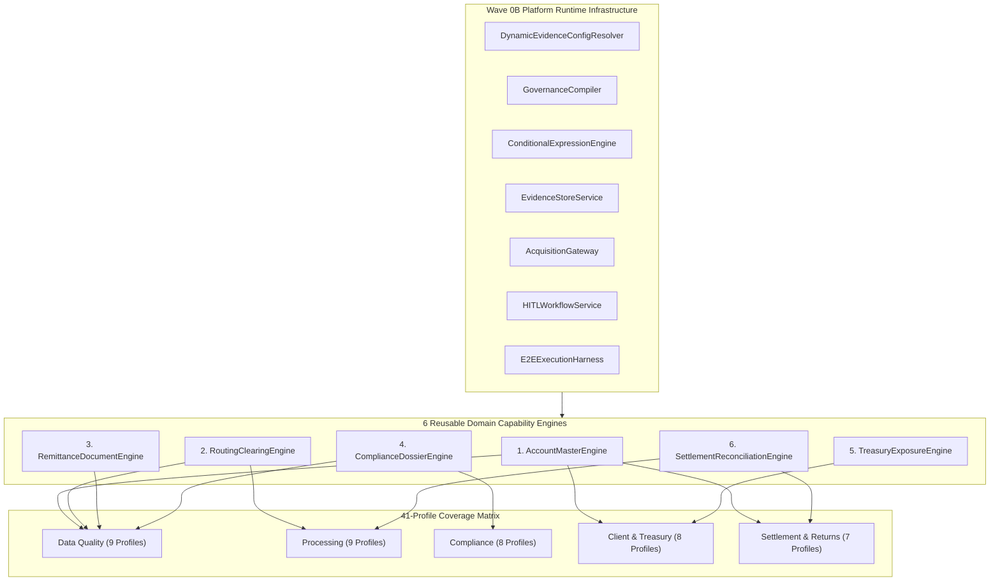
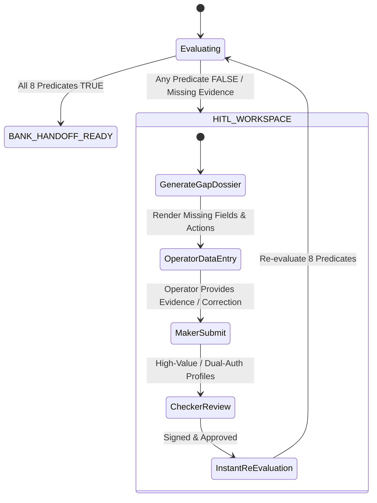
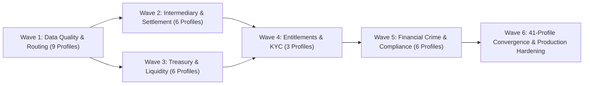

# PeX Phase 3 — Industrialization Architecture v0.1
## Architecture & Capability Design for the 30 Remaining Canonical Exception Profiles

======================================================================
1. EXECUTIVE SUMMARY
======================================================================

### 1.1 Where We Are Now
The PeX (Payment Exception Resolution) platform has successfully closed Phase 2 (with 11 of 41 canonical profiles implemented, forensically accepted, and backed by 423 green tests), completed Wave 0A (establishing platform contracts, schemas, reference adapters, and the 12-scenario E2E JSON execution harness), and completed Wave 0B (enabling dynamic published Bank Evidence Required JSON resolution, fail-closed governance compilation, deterministic sandboxed expression evaluation, content-addressable evidence storage, multi-mode acquisition across Modes 1–4, PeX-native HITL closed loop, and an expanded 18-scenario canonical execution suite backed by 495 / 495 green tests).

### 1.2 The Industrialization Objective
The objective of Phase 3 Industrialization is **not** to build 30 separate, bespoke, siloed profile engines. Rather, the objective is to answer the primary architectural question:

> **"How should PeX implement the remaining 30 exception profiles using the smallest practical set of reusable, governed capability engines while preserving profile-specific evidence, authority, resolution, HITL, and STP semantics?"**

### 1.3 Core Architectural Findings & Decisions
1. **6 Reusable Domain Capability Engines**: The remaining 30 profiles (and the 11 baseline profiles) require exactly **6 reusable domain capability engines** layered on top of the Wave 0B platform runtime infrastructure:
   - `AccountMasterEngine` (Account validity, status, owner matching)
   - `RoutingClearingEngine` (Correspondent hops, directory routing, cutoffs, retry locks)
   - `RemittanceDocumentEngine` (Unstructured remittance decoding, invoice parsing)
   - `ComplianceDossierEngine` (Sanctions, AML, PEP, Adverse Media, High-Risk Jurisdictions)
   - `TreasuryExposureEngine` (Funds, Nostro balances, FX rates, limits, liquidity)
   - `SettlementReconciliationEngine` (Ledger breaks, returns, trapped funds, unmatched credits)
2. **7 Canonical Resolution Patterns**: All 30 profiles map into 7 reusable resolution patterns ranging from deterministic directory substitution to multi-source reconciliation and compliance dossier adjudication.
3. **Capability Compounding Sequence (Waves 1–6)**: Profiles are grouped by capability compounding rather than profile-count optimization:
   - **Wave 1**: Data Quality & Routing Foundation (9 profiles: `DQ-03`, `DQ-04`, `DQ-07`, `DQ-09`, `PR-02`, `PR-04`, `PR-07`, `PR-09`, `CO-07`)
   - **Wave 2**: Intermediary Banking & Settlement Reconciliation (6 profiles: `PR-06`, `ST-02`, `ST-03`, `ST-04`, `ST-05`, `ST-07`)
   - **Wave 3**: Treasury, Liquidity & Balance Management (6 profiles: `TR-02`, `TR-03`, `TR-04`, `TR-06`, `TR-07`, `TR-08`)
   - **Wave 4**: Client Entitlements, KYC & Signatory Mandates (3 profiles: `TR-01`, `TR-05`, `ST-06`)
   - **Wave 5**: Financial Crime & Compliance Screening Industrialization (6 profiles: `CO-01`, `CO-02`, `CO-03`, `CO-05`, `CO-06`, `CO-08`)
   - **Wave 6**: Comprehensive 41-Profile Convergence & Multi-Tenant Hardening
4. **Architectural Invariants Strictly Preserved**:
   - The 41-profile taxonomy is immutable.
   - The 8-predicate formula ($\text{STP\_ELIGIBLE} = E_{\text{suff}} \land R_{\text{det}} \land R_{\text{uniq}} \land V_{\text{det}} \land V_{\text{auth}} \land P_{\text{bank}} \land C_{\text{comp}} \land X_{\text{pre}}$) is immutable.
   - AI confidence carries exactly $0\%$ autonomous execution authority.
   - Terminal execution state is `BANK_HANDOFF_READY` with `execution_owner = "BANK"`.
   - Production STP remains strictly blocked until all gates are forensically approved.

---

======================================================================
2. CURRENT PEX BASELINE
======================================================================

```
+---------------------------------------------------------------------------------------------------+
|                                   PEX PLATFORM STATE BASELINE                                      |
+--------------------------+------------------------------------------------------------------------+
| Phase 2 Status           | CLOSED (11 Profiles Accepted: DQ-01, DQ-02, DQ-05, DQ-06, DQ-08,      |
|                          | PR-01, PR-03, PR-05, PR-08, ST-01, CO-04)                              |
+--------------------------+------------------------------------------------------------------------+
| Wave 0A Status           | COMPLETE (Platform Contracts, Schemas, 12 Canonical Scenarios)         |
+--------------------------+------------------------------------------------------------------------+
| Wave 0B Status           | COMPLETE (Dynamic Config Resolver, Governance Compiler, AST Sandbox,   |
|                          | Evidence Store, Multi-Mode Acquisition, HITL Closed-Loop, 18 Scenarios)|
+--------------------------+------------------------------------------------------------------------+
| Test Baseline            | 495 / 495 Tests Green (100% Pass Rate across 39 Test Modules)          |
+--------------------------+------------------------------------------------------------------------+
| Remaining Scope          | 30 Canonical Profiles across 5 BIAN Domains                            |
+--------------------------+------------------------------------------------------------------------+
| Production STP           | BLOCKED (Design & Planning Gate Only)                                  |
+--------------------------+------------------------------------------------------------------------+
```

---

======================================================================
3. PHASE 3 OBJECTIVE
======================================================================

The Phase 3 Industrialization objective is to systematically industrialize the remaining 30 canonical payment-exception profiles through a shared, componentized architecture. 

Every profile in PeX follows the strict governed pipeline:

$$\text{Canonical Inbound Exception} \longrightarrow \text{Dynamic Evidence Acquisition} \longrightarrow \text{Evidence Sufficiency } (E_{\text{suff}}) \longrightarrow \text{Deterministic Resolution } (R_{\text{det}} \land R_{\text{uniq}})$$
$$\longrightarrow \text{Authority Validation } (V_{\text{det}} \land V_{\text{auth}}) \longrightarrow \text{Bank Policy \& Compliance } (P_{\text{bank}} \land C_{\text{comp}}) \longrightarrow \text{Preconditions } (X_{\text{pre}})$$
$$\longrightarrow \begin{cases} \mathbf{STP\_ELIGIBLE = TRUE} & \longrightarrow \mathbf{BANK\_HANDOFF\_READY} \text{ (Zero-Touch Autonomous)} \\ \mathbf{STP\_ELIGIBLE = FALSE} & \longrightarrow \mathbf{PE\_X\ HITL\ WORKSPACE} \text{ (Maker-Checker / Adjudication)} \end{cases}$$

---

======================================================================
4. REMAINING 30 PROFILES INVENTORY
======================================================================

```
+---------------------------------------------------------------------------------------------------+
|                                 30 REMAINING CANONICAL PROFILES                                    |
+----------------------+---------+------------------------------------------------------------------+
| Domain               | Code    | Canonical Profile Name                                           |
+----------------------+---------+------------------------------------------------------------------+
| Data Quality (4)     | DQ-03   | Missing Beneficiary Data                                         |
|                      | DQ-04   | Missing Remittance Info                                          |
|                      | DQ-07   | Invalid Account Number                                           |
|                      | DQ-09   | Beneficiary Name Mismatch                                        |
+----------------------+---------+------------------------------------------------------------------+
| Processing (5)       | PR-02   | Routing Failure                                                  |
|                      | PR-04   | Cutoff Missed                                                    |
|                      | PR-06   | Intermediary Bank Rejection                                      |
|                      | PR-07   | Network Timeout                                                  |
|                      | PR-09   | Payment Held for Repair                                          |
+----------------------+---------+------------------------------------------------------------------+
| Compliance (7)       | CO-01   | Sanctions Screening Hit                                          |
|                      | CO-02   | AML Alert                                                        |
|                      | CO-03   | PEP Match                                                        |
|                      | CO-05   | Adverse Media Match                                              |
|                      | CO-06   | High-Risk Jurisdiction                                           |
|                      | CO-07   | Regulatory Reporting Required                                    |
|                      | CO-08   | Customer Watchlist Match                                         |
+----------------------+---------+------------------------------------------------------------------+
| Client / Treasury (8)| TR-01   | KYC Expired                                                      |
|                      | TR-02   | Insufficient Funds                                               |
|                      | TR-03   | Nostro Shortfall                                                 |
|                      | TR-04   | FX Rate Unavailable                                              |
|                      | TR-05   | Authorization Missing                                            |
|                      | TR-06   | Limit Breach                                                     |
|                      | TR-07   | Liquidity Constraint                                             |
|                      | TR-08   | Credit Exposure Breach                                           |
+----------------------+---------+------------------------------------------------------------------+
| Settlement /         | ST-02   | Account Closed                                                   |
| Returns (6)          | ST-03   | Beneficiary Account Frozen                                       |
|                      | ST-04   | Reconciliation Break                                             |
|                      | ST-05   | Settlement Failure                                               |
|                      | ST-06   | Funds Trapped at Correspondent                                   |
|                      | ST-07   | Unmatched Credit                                                 |
+----------------------+---------+------------------------------------------------------------------+
```

---

======================================================================
5. INDUSTRIALIZATION PRINCIPLES
======================================================================

1. **Capability Engine Reusability**: Profile implementations must be thin configuration and contract bindings over shared capability engines. No duplicate business logic across profile definitions.
2. **Single Published Bank Evidence Model**: Every profile execution strictly binds to a single published JSON configuration per `(tenant_id, profile_id)`. Zero 3-way runtime merging.
3. **Sandboxed Determinism**: Resolution algorithms, validation logic, and expression evaluations must run in sandboxed, deterministic code. Zero dynamic `eval()` or unconstrained LLM execution.
4. **Authoritative Trust Floor**: Sovereign truth derives exclusively from Tier 1 (Bank Core / Ledger) and Tier 2 (National / Regulatory Directory) systems. Tier 4 (AI / Historical Precedents) carries exactly $0\%$ authority.
5. **PeX-Native HITL**: Unresolved exceptions, missing evidence, and high-risk compliance decisions remain within the PeX native workspace with dynamic gap generation and instant re-evaluation.
6. **Provider Neutrality & Zero Lock-In**: Hexagonal architecture with pure abstract Python SPIs in `backend/app/ports/` and dependency-free reference adapters in `backend/app/adapters/reference/`.

---

======================================================================
6. CAPABILITY-FIRST ANALYSIS FOR THE 30 REMAINING PROFILES
======================================================================

### 6.1 Data Quality Profiles (4)

#### DQ-03: Missing Beneficiary Data
- **Trigger**: Inbound pacs.008 or MT103 lacks mandatory creditor name, physical address, or national identifier.
- **Industry SOP Baseline**: FATF Recommendation 16 (Travel Rule) / CPMI cross-border transparency standard.
- **Evidence Required**: `CLIENT_MASTER_RECORD` (Tier 1) and/or `ERP_INVOICE_PAYLOAD` (Tier 3).
- **Authoritative Source**: Bank Client / Counterparty Master or Verified Legal Entity Identifier (GLEIF LEI).
- **Resolution Determination**: Deterministic lookup of debtor's verified beneficiary directory or extraction from structured remittance/invoice.
- **AI Role**: Probabilistic extraction of creditor details from unformatted remittance text (Advisory only).
- **STP Potential**: High for established corporate client beneficiary address book; HITL for novel entities.
- **Complexity**: Low-Medium | **Wave**: Wave 1

#### DQ-04: Missing Remittance Info
- **Trigger**: Commercial trade payment missing structured invoice reference or mandatory regulatory tax code.
- **Industry SOP Baseline**: ISO 20022 `RmtInf/Strd` or EDI 820 invoice standard.
- **Evidence Required**: `CLIENT_ERP_INVOICE` (Tier 3) or `DEBTOR_REMITTANCE_ADVICE` (Tier 3).
- **Authoritative Source**: Debtor ERP feed / Debtor trade portal.
- **Resolution Determination**: Extraction and structured formatting into ISO 20022 `pacs.008` structured remittance tags.
- **AI Role**: Extract purchase order / invoice numbers from unstructured narratives.
- **STP Potential**: High when client ERP connector or invoice match is verified.
- **Complexity**: Low | **Wave**: Wave 1

#### DQ-07: Invalid Account Number
- **Trigger**: Non-IBAN domestic account fails national modulo check (e.g. US Transit Account, UK Sort Code + Account, Australia BSB).
- **Industry SOP Baseline**: National clearing directory rules (FedLine, Pay.UK VocaLink, APCA).
- **Evidence Required**: `CORE_DDA_ACCOUNT` (Tier 1) and `NATIONAL_SORT_DIRECTORY` (Tier 2).
- **Authoritative Source**: Bank Core DDA / Clearing House Account Master.
- **Resolution Determination**: Deterministic check digit calculation and Core DDA account status confirmation.
- **AI Role**: Rank historical repair patterns for transpositions (Advisory only).
- **STP Potential**: High (Deterministic substitution if unique match in Core DDA).
- **Complexity**: Low-Medium | **Wave**: Wave 1

#### DQ-09: Beneficiary Name Mismatch
- **Trigger**: Creditor name in payment does not match account title in Core DDA (Confirmation of Payee / VoP mismatch).
- **Industry SOP Baseline**: UK Confirmation of Payee (CoP) / EU Verification of Payee (VoP) Rulebook.
- **Evidence Required**: `CORE_DDA_ACCOUNT_TITLE` (Tier 1) and `COP_VOP_DIRECTORY_MATCH` (Tier 2).
- **Authoritative Source**: Receiving Bank Core DDA / National VoP Scheme.
- **Resolution Determination**: Levenshtein / Jaro-Winkler phonetic similarity scoring against bank policy fuzzy threshold (e.g. >95% close match for DBA/trading names).
- **AI Role**: Entity resolution and alias disambiguation (Advisory only).
- **STP Potential**: Medium (Permitted only for minor typos within bank policy threshold; major mismatch requires HITL).
- **Complexity**: Medium | **Wave**: Wave 1

---

### 6.2 Processing Profiles (5)

#### PR-02: Routing Failure
- **Trigger**: Intermediate or receiving BIC is unreachable, unlisted, or closed for the selected clearing rail.
- **Industry SOP Baseline**: SWIFT BIC Directory (ISO 9362) / SWIFTRef SSI Directory.
- **Evidence Required**: `SWIFTREF_DIRECTORY` (Tier 2) and `CORRESPONDENT_SSI_MATRIX` (Tier 1).
- **Authoritative Source**: SWIFTRef / Bank Treasury SSI Master.
- **Resolution Determination**: Deterministic alternative routing hop calculation via active correspondent bridge.
- **AI Role**: 0% authority. Propose shortest path based on historical routing.
- **STP Potential**: High for standard correspondent routing matrix substitutions.
- **Complexity**: Medium | **Wave**: Wave 1

#### PR-04: Cutoff Missed
- **Trigger**: Payment received after the RTGS clearing rail operating cutoff (e.g. Fedwire 22:00 UTC, CHAPS 17:00 UTC).
- **Industry SOP Baseline**: Clearing rail operating circulars (Federal Reserve OC6, Bank of England CHAPS rules).
- **Evidence Required**: `RAIL_SCHEDULE_MASTER` (Tier 1) and `CALENDAR_HOLIDAY_SCHEDULE` (Tier 2).
- **Authoritative Source**: Clearing Rail Cutoff Service / National Central Bank Schedule.
- **Resolution Determination**: Deterministic value-date roll to next valid clearing cycle ($T+1$) with cutoff reservation lock.
- **AI Role**: None.
- **STP Potential**: High (Deterministic value date rollover subject to bank policy limits).
- **Complexity**: Low | **Wave**: Wave 1

#### PR-06: Intermediary Bank Rejection
- **Trigger**: Inward `pacs.002` rejection or `camt.056` from correspondent bank citing routing or account error.
- **Industry SOP Baseline**: SWIFT CBPR+ exception handling guidelines.
- **Evidence Required**: `INWARD_PACS002_REJECTION` (Tier 1) and `CORRESPONDENT_ERROR_CODE_MAP` (Tier 2).
- **Authoritative Source**: Inward SWIFT message / Correspondent Bank Portal.
- **Resolution Determination**: Parse reason code (e.g. `AC04`, `RC01`), retrieve original message, map to root exception profile.
- **AI Role**: Summarize correspondent narrative rejection text into structured cause.
- **STP Potential**: Medium (Requires routing adjustment or re-credit).
- **Complexity**: Medium-High | **Wave**: Wave 2

#### PR-07: Network Timeout
- **Trigger**: Outbound payment dispatched to network/gateway with no `pacs.002` acknowledgment before timeout threshold.
- **Industry SOP Baseline**: CPMI PFMI real-time settlement tracking and message retry protocol.
- **Evidence Required**: `GATEWAY_SOCKET_LOG` (Tier 1) and `IDEMPOTENCY_LEDGER_RECORD` (Tier 1).
- **Authoritative Source**: Bank Payment Gateway / Clearing Network Interface.
- **Resolution Determination**: Inquire status via network query (`camt.054` or API); if unsettled, safely retry with identical UETR.
- **AI Role**: None.
- **STP Potential**: High (Idempotent status check and automated retry).
- **Complexity**: Low-Medium | **Wave**: Wave 1

#### PR-09: Payment Held for Repair
- **Trigger**: Bank payment hub intercepted payment with syntax formatting error or unparseable tag.
- **Industry SOP Baseline**: ISO 20022 / MT message syntax schema validation.
- **Evidence Required**: `PARSER_SYNTAX_ERROR_LOG` (Tier 1) and `ISO20022_XSD_SCHEMA` (Tier 2).
- **Authoritative Source**: PeX Canonical Schema Engine / XSD Validator.
- **Resolution Determination**: Re-serialize invalid XML/JSON payload against canonical XSD schema.
- **AI Role**: None.
- **STP Potential**: High (Deterministic syntax transformation).
- **Complexity**: Low | **Wave**: Wave 1

---

### 6.3 Compliance Profiles (7)

#### CO-01: Sanctions Screening Hit
- **Trigger**: Real-time screening engine flags debtor, creditor, or narrative against OFAC, EU, UN, or UK HMT sanctions lists.
- **Industry SOP Baseline**: OFAC 50% Rule, FATF Rec 6, National Sanctions Enforcement Regulations.
- **Evidence Required**: `SANCTIONS_SCREENING_ALERT` (Tier 2), `SANCTIONS_DISAMBIGUATION_DOSSIER` (Tier 1/2), and `GOVERNMENT_ISSUED_ID` (Tier 1).
- **Authoritative Source**: OFAC SDN / National Sanctions Feeds / Bank Compliance Engine.
- **Resolution Determination**: Deterministic 32-year entity disambiguation (DOB, passport, LEI match). If false positive is 100% verified against Tier 1/2 identity, prepare hold release; if true match, execute mandatory statutory block.
- **AI Role**: Collate identifying attributes from external KYC repositories (Advisory only).
- **STP Potential**: 0% for true hits. Low/Zero for initial false positives (Compliance Officer sign-off mandatory).
- **Complexity**: High | **Wave**: Wave 5

#### CO-02: AML Alert
- **Trigger**: Transaction monitoring rule triggered (structuring, velocity anomaly, rapid movement of funds).
- **Industry SOP Baseline**: FinCEN / FATF AML Transaction Monitoring Guidelines.
- **Evidence Required**: `AML_ALERT_DOSSIER` (Tier 1), `CLIENT_HISTORICAL_PROFILE` (Tier 1), `SOURCE_OF_FUNDS_DOC` (Tier 2/3).
- **Authoritative Source**: Bank AML Transaction Monitoring System (e.g. Actimize, Mantas).
- **Resolution Determination**: AML Analyst risk assessment and source-of-funds verification.
- **AI Role**: Synthesize transaction history narrative for analyst review.
- **STP Potential**: 0% (Autonomous STP prohibited by statutory AML regulations; HITL mandatory).
- **Complexity**: High | **Wave**: Wave 5

#### CO-03: PEP Match
- **Trigger**: Party flagged as Politically Exposed Person or close associate under FATF Rec 12.
- **Industry SOP Baseline**: FATF Recommendation 12 (PEPs) / EU 6AMLD.
- **Evidence Required**: `PEP_SCREENING_ALERT` (Tier 2), `ENHANCED_DUE_DILIGENCE_DOSSIER` (Tier 1).
- **Authoritative Source**: World-Check / Dow Jones Risk & Compliance / Bank EDD Master.
- **Resolution Determination**: Senior management / Compliance Officer EDD sign-off.
- **AI Role**: Extract public office tenure and family/associate relationships.
- **STP Potential**: 0% (Regulatory mandate requires human Senior Officer approval).
- **Complexity**: High | **Wave**: Wave 5

#### CO-05: Adverse Media Match
- **Trigger**: Screening tool flags negative news involving financial crime, fraud, or bribery.
- **Industry SOP Baseline**: Bank Risk Appetite Framework & Wolfsberg Group Anti-Bribery Standards.
- **Evidence Required**: `ADVERSE_MEDIA_ALERT` (Tier 3) and `CLIENT_RISK_ASSESSMENT` (Tier 1).
- **Authoritative Source**: Adverse media database / Compliance Intelligence Feed.
- **Resolution Determination**: Reputational risk score evaluation and Compliance Maker-Checker sign-off.
- **AI Role**: Summarize news articles and eliminate false positive name collisions.
- **STP Potential**: Low/Zero (Advisory context provided to human officer).
- **Complexity**: High | **Wave**: Wave 5

#### CO-06: High-Risk Jurisdiction
- **Trigger**: Debtor, creditor, or routing intermediary located in FATF Black/Grey listed jurisdiction.
- **Industry SOP Baseline**: FATF Recommendation 19 (Higher-risk countries) / Statutory sanctions directives.
- **Evidence Required**: `FATF_JURISDICTION_MATRIX` (Tier 2) and `STATUTORY_CORRIDOR_POLICY` (Tier 1).
- **Authoritative Source**: FATF High-Risk Jurisdiction List / Bank Treasury Corridor Matrix.
- **Resolution Determination**: Verify general license exemption or route for Enhanced Due Diligence.
- **AI Role**: None.
- **STP Potential**: Conditional (STP allowed only if statutory license exemption is mathematically verified).
- **Complexity**: Medium | **Wave**: Wave 5

#### CO-07: Regulatory Reporting Required
- **Trigger**: Cross-border wire requires statutory balance-of-payments or central bank statistical reporting code (e.g. EU BOP, India RBI Purpose Codes).
- **Industry SOP Baseline**: National Central Bank Reporting Directives (e.g. RBI Purpose Codes, Bundesbank AWV).
- **Evidence Required**: `REGULATORY_PURPOSE_CODE_DIRECTORY` (Tier 2) and `TRADE_INVOICE_DESCRIPTION` (Tier 3).
- **Authoritative Source**: Central Bank Regulatory Code Master.
- **Resolution Determination**: Deterministic mapping of trade goods/service description to valid 4-character ISO 20022 `CtgyPurp` / `Purp` code.
- **AI Role**: Propose regulatory purpose code classification from invoice text (Advisory only).
- **STP Potential**: High (Deterministic assignment if confidence is verified against trade invoice).
- **Complexity**: Low-Medium | **Wave**: Wave 1

#### CO-08: Customer Watchlist Match
- **Trigger**: Internal bank security or fraud watchlist hit (e.g. internal fraud suspicion, abusive account).
- **Industry SOP Baseline**: Internal Fraud Risk Management Policy / Industry Fraud Consortium (e.g. CIFAS).
- **Evidence Required**: `INTERNAL_WATCHLIST_RECORD` (Tier 1) and `FRAUD_INVESTIGATION_NOTE` (Tier 1).
- **Authoritative Source**: Bank Internal Fraud Database.
- **Resolution Determination**: Fraud Operations review and case disposition.
- **AI Role**: None.
- **STP Potential**: 0% (Fraud hold release requires dual-authorized human checker).
- **Complexity**: Medium | **Wave**: Wave 5

---

### 6.4 Client & Treasury Profiles (8)

#### TR-01: KYC Expired
- **Trigger**: Debtor or creditor corporate KYC renewal date has lapsed in Bank Customer Master.
- **Industry SOP Baseline**: Regulatory Periodic KYC Review Mandates.
- **Evidence Required**: `CUSTOMER_KYC_STATUS_RECORD` (Tier 1) and `RENEWAL_EXTENSION_MANDATE` (Tier 1).
- **Authoritative Source**: Bank Customer Master / Onboarding System.
- **Resolution Determination**: Check for temporary grace period authorization or suspend for client outreach.
- **AI Role**: None.
- **STP Potential**: Low (Conditional on valid grace period extension flag in Core Master).
- **Complexity**: Medium | **Wave**: Wave 4

#### TR-02: Insufficient Funds
- **Trigger**: Debtor DDA account lacks available balance to cover payment principal and charges.
- **Industry SOP Baseline**: UCC Article 4A / Bank DDA Overdraft & Intraday Credit Agreement.
- **Evidence Required**: `CORE_DDA_BALANCE_RECORD` (Tier 1) and `CREDIT_FACILITY_MASTER` (Tier 1).
- **Authoritative Source**: Bank Core DDA / Credit Line System.
- **Resolution Determination**: Evaluate intraday credit line; if covered, place balance reservation; if uncovered, place in automated suspense queue for funds inflow.
- **AI Role**: Forecast intraday account cash inflows from scheduled receivables (Advisory only).
- **STP Potential**: High (Automated balance reservation or scheduled retry when funds clear).
- **Complexity**: Medium | **Wave**: Wave 3

#### TR-03: Nostro Shortfall
- **Trigger**: Bank's Nostro account at currency correspondent bank lacks required liquidity for settlement.
- **Industry SOP Baseline**: BCBS Sound Practices for Managing Liquidity Risk / Intraday Liquidity Monitoring.
- **Evidence Required**: `NOSTRO_ACCOUNT_LEDGER` (Tier 1) and `TREASURY_SWEEP_CONFIRMATION` (Tier 1).
- **Authoritative Source**: Bank Treasury Management System / Nostro Reconciliation Feed.
- **Resolution Determination**: Hold payment in suspense until Treasury executes liquidity sweep or Nostro top-up.
- **AI Role**: None.
- **STP Potential**: High (Automated release upon receipt of Nostro credit advice).
- **Complexity**: Medium | **Wave**: Wave 3

#### TR-04: FX Rate Unavailable
- **Trigger**: Cross-currency payment initiated outside FX market operating hours or market feed disconnected.
- **Industry SOP Baseline**: FX Global Code / Bank Treasury Market Risk Policy.
- **Evidence Required**: `TREASURY_FX_RATE_MATRIX` (Tier 1) and `MARKET_TICK_FEED` (Tier 2).
- **Authoritative Source**: Bank Treasury FX Engine / Market Data Provider.
- **Resolution Determination**: Deterministic FX rate quote booking within customer spread tolerance.
- **AI Role**: None.
- **STP Potential**: High (Automated rate fetch and spread application once market rate feed reconnects).
- **Complexity**: Low-Medium | **Wave**: Wave 3

#### TR-05: Authorization Missing
- **Trigger**: Payment amount exceeds individual user signing limit under corporate signatory mandate.
- **Industry SOP Baseline**: Corporate Treasury Mandates / Dual Control Governance.
- **Evidence Required**: `SIGNATORY_MANDATE_MATRIX` (Tier 1) and `DIGITAL_SIGNATURE_RECEIPT` (Tier 1).
- **Authoritative Source**: Bank Entitlements & Mandates System.
- **Resolution Determination**: Route to Corporate Client Portal for secondary authorization (Mode 4 HITL).
- **AI Role**: None.
- **STP Potential**: Low/Zero (Client corporate authorization mandatory before release).
- **Complexity**: Medium | **Wave**: Wave 4

#### TR-06: Limit Breach
- **Trigger**: Transaction causes corporate debtor to exceed single-transaction or daily cumulative wire limit.
- **Industry SOP Baseline**: Bank Operational Risk Policy / Payment Channel Safeguards.
- **Evidence Required**: `CLIENT_LIMIT_RECORD` (Tier 1) and `DAILY_CUMULATIVE_TOTALS` (Tier 1).
- **Authoritative Source**: Bank Payment Hub Limit Engine.
- **Resolution Determination**: Evaluate temporary limit uplift waiver or route to Credit Officer.
- **AI Role**: None.
- **STP Potential**: Low (Requires authorized credit risk approval).
- **Complexity**: Medium | **Wave**: Wave 3

#### TR-07: Liquidity Constraint
- **Trigger**: Total outbound queue for clearing rail exceeds bank central bank intraday liquidity cap.
- **Industry SOP Baseline**: CPMI Intraday Liquidity Management Standards.
- **Evidence Required**: `CENTRAL_BANK_RESERVE_POSITION` (Tier 1) and `CLEARING_RAIL_CAP_MASTER` (Tier 1).
- **Authoritative Source**: Central Bank Reserve Account / RTGS Interface.
- **Resolution Determination**: Priority FIFO queuing and automated pacing against liquidity cap.
- **AI Role**: Optimize queue release order based on payment urgency and value.
- **STP Potential**: High (Automated pacing release once liquidity window clears).
- **Complexity**: Medium | **Wave**: Wave 3

#### TR-08: Credit Exposure Breach
- **Trigger**: Counterparty bank exposure exceeds pre-settlement credit limit.
- **Industry SOP Baseline**: Basel III Counterparty Credit Risk Framework.
- **Evidence Required**: `COUNTERPARTY_LIMIT_RECORD` (Tier 1) and `CURRENT_EXPOSURE_LEDGER` (Tier 1).
- **Authoritative Source**: Bank Credit Risk System.
- **Resolution Determination**: Credit Risk Officer adjudication or collateral call verification.
- **AI Role**: None.
- **STP Potential**: 0% (Credit Risk Maker-Checker mandatory).
- **Complexity**: Medium | **Wave**: Wave 3

---

### 6.5 Settlement & Returns Profiles (6)

#### ST-02: Account Closed
- **Trigger**: Receiving bank rejects incoming payment because beneficiary account is permanently closed (`AC04`).
- **Industry SOP Baseline**: ISO 20022 `pacs.004` / NACHA return rules / UCC Article 4A.
- **Evidence Required**: `INWARD_PACS004_RETURN` (Tier 1) and `ORIGINAL_DEBIT_RECORD` (Tier 1).
- **Authoritative Source**: Inward Clearing Return / Bank Core DDA.
- **Resolution Determination**: Match return to original debtor debit and prepare debtor re-credit ledger entry.
- **AI Role**: None.
- **STP Potential**: High (Deterministic matching and automated debtor re-credit).
- **Complexity**: Low-Medium | **Wave**: Wave 2

#### ST-03: Beneficiary Account Frozen
- **Trigger**: Inward `pacs.002` or `pacs.004` cites legal block, court order, or bankruptcy on creditor account (`AC06`, `AC07`).
- **Industry SOP Baseline**: National Legal Attachment / Garnishment Directives.
- **Evidence Required**: `INWARD_RETURN_NOTICE` (Tier 1) and `CORE_DDA_RESTRICTION_RECORD` (Tier 1).
- **Authoritative Source**: Inward Clearing Notice / Core DDA Restriction Master.
- **Resolution Determination**: If outward wire returned, re-credit debtor; if inward payment, hold in legal suspense.
- **AI Role**: None.
- **STP Potential**: Conditional on return direction (Outward return = STP re-credit; Inward wire = Legal Desk HITL).
- **Complexity**: Medium | **Wave**: Wave 2

#### ST-04: Reconciliation Break
- **Trigger**: End-of-day clearing settlement statement (`camt.053`) does not match bank payment hub ledger total.
- **Industry SOP Baseline**: CPMI PFMI Principle 8 (Settlement finality and daily reconciliation).
- **Evidence Required**: `DAILY_CAMT053_STATEMENT` (Tier 1) and `INTERNAL_SETTLEMENT_JOURNAL` (Tier 1).
- **Authoritative Source**: Central Bank / RTGS Clearing Statement.
- **Resolution Determination**: Match individual transactions by UETR, amount, and value date; flag orphan items.
- **AI Role**: Group and match complex many-to-one batch breaks (Advisory only).
- **STP Potential**: Medium (Automated reconciliation matching; orphan breaks require Operations review).
- **Complexity**: High | **Wave**: Wave 2

#### ST-05: Settlement Failure
- **Trigger**: Payment cleared at payment hub but rejected during clearing cycle due to multilateral netting shortfall.
- **Industry SOP Baseline**: Clearing House Multilateral Netting Rules.
- **Evidence Required**: `CLEARING_SETTLEMENT_REJECTION` (Tier 1) and `SETTLEMENT_SUSPENSE_ACCOUNT` (Tier 1).
- **Authoritative Source**: Automated Clearing House (ACH) / RTGS Operator.
- **Resolution Determination**: Re-open transaction state, unfreeze funds, and route for next settlement window.
- **AI Role**: None.
- **STP Potential**: High (Deterministic state reset and re-queue).
- **Complexity**: Medium | **Wave**: Wave 2

#### ST-06: Funds Trapped at Correspondent
- **Trigger**: Funds debited from debtor but neither credited to beneficiary nor returned within SLA window ($>48$ hours).
- **Industry SOP Baseline**: SWIFT GPI / ISO 20022 `camt.027` (Claim for non-receipt) / `camt.056` (Recall).
- **Evidence Required**: `SWIFT_GPI_TRACKER_RECORD` (Tier 2) and `OUTBOUND_PACS008_MESSAGE` (Tier 1).
- **Authoritative Source**: SWIFT GPI Tracker / Correspondent Bank Gateway.
- **Resolution Determination**: Query SWIFT GPI tracking status; if trapped, generate automated `camt.027` Claim for Non-Receipt inquiry to intermediary.
- **AI Role**: None.
- **STP Potential**: High for generating and signing `camt.027` inquiry package.
- **Complexity**: Medium | **Wave**: Wave 4

#### ST-07: Unmatched Credit
- **Trigger**: Bank receives inbound `pacs.008` funds on settlement account with unidentifiable debtor or missing instruction.
- **Industry SOP Baseline**: ISO 20022 Inward Credit Matching / Anti-Money Laundering Unclaimed Property Guidelines.
- **Evidence Required**: `INWARD_SETTLEMENT_CREDIT` (Tier 1) and `EXPECTED_RECEIVABLES_JOURNAL` (Tier 1).
- **Authoritative Source**: Bank Inward Clearing Gateway.
- **Resolution Determination**: Search pending trade receivables; if matched, post credit; if unmatchable within 72 hours, generate `pacs.004` return.
- **AI Role**: Fuzzy matching on remittance narrative to identify open client trade receivables.
- **STP Potential**: Medium (Automated posting if exact receivable match found; return if unmatchable).
- **Complexity**: Medium | **Wave**: Wave 2

---

======================================================================
7. REUSABLE CAPABILITY ENGINE INVENTORY
======================================================================

Instead of building 30 separate monolithic profile modules, PeX implements **6 reusable domain capability engines** that operate alongside the Wave 0B platform runtime engines:



### 7.1 Engine 1: `AccountMasterEngine`
- **Purpose**: Unified account validation, status checking, Modulo-97 verification, VoP name matching, and account restriction handling.
- **Profiles Served**: `DQ-01`, `DQ-02`, `DQ-03`, `DQ-05`, `DQ-07`, `DQ-09`, `ST-02`, `ST-03`, `TR-01`.
- **Inputs**: Account identifier (IBAN/BBAN/Transit), Creditor Name, Currency, Branch BIC.
- **Evidence Dependencies**: `CORE_DDA_ACCOUNT` (Tier 1), `NATIONAL_DIRECTORY` (Tier 2).
- **Authority Dependencies**: Core Banking DDA Port / Confirmation of Payee Directory.
- **Deterministic Logic**: ISO 7064 Modulo 97-10 solver, national check digit calculators, exact/fuzzy string distance scoring.
- **AI Role**: Entity alias extraction and corporate name abbreviation mapping (Advisory only).
- **HITL Role**: Disambiguation cockpit when multiple valid accounts match or name distance score is ambiguous.
- **STP Implications**: Delivers deterministic account substitution for $E_{\text{suff}} \to \text{STP}$.
- **Belongs in**: Core PeX Domain Service (`backend/app/services/engines/account_master_engine.py`).

### 7.2 Engine 2: `RoutingClearingEngine`
- **Purpose**: Clearing rail selection, correspondent routing transit hop derivation, cutoff schedule management, and network retry coordination.
- **Profiles Served**: `DQ-08`, `PR-02`, `PR-03`, `PR-04`, `PR-07`, `PR-08`, `PR-09`.
- **Inputs**: Debtor BIC, Creditor BIC, Currency, Amount, Rail Code, Timestamp.
- **Evidence Dependencies**: `SWIFTREF_DIRECTORY` (Tier 2), `RAIL_SCHEDULE_MASTER` (Tier 1), `IDEMPOTENCY_LOCK` (Tier 1).
- **Authority Dependencies**: Clearing Rail Port / SWIFTRef Adapter / Gateway Socket Probe.
- **Deterministic Logic**: Routing graph shortest-path traversal, cutoff calendar calculation, value-date roll forward ($T+1$), idempotent retry dispatch.
- **AI Role**: None.
- **HITL Role**: Manual routing override when all correspondent paths are blocked.
- **STP Implications**: High STP automation for standard cutoff rolls and routing transit repairs.
- **Belongs in**: Core PeX Domain Service (`backend/app/services/engines/routing_clearing_engine.py`).

### 7.3 Engine 3: `RemittanceDocumentEngine`
- **Purpose**: Ingestion, unbundling, parsing, and semantic extraction of structured and unstructured remittance data, invoices, and EDI payloads.
- **Profiles Served**: `DQ-03`, `DQ-04`, `CO-07`.
- **Inputs**: Unstructured remittance text, PDF/OCR invoice payloads, EDI 820 documents.
- **Evidence Dependencies**: `ERP_INVOICE_PAYLOAD` (Tier 3), `PURPOSE_CODE_DIRECTORY` (Tier 2).
- **Authority Dependencies**: Client ERP Port / Central Bank Regulatory Directory.
- **Deterministic Logic**: Regular expression pattern matching for PO/Invoice numbers, ISO 20022 XML structured tag serialization (`RmtInf/Strd`).
- **AI Role**: Probabilistic NLP extraction of invoice attributes from freeform unstructured narratives.
- **HITL Role**: Operator confirmation when extracted remittance confidence is below threshold.
- **STP Implications**: Converts unformatted remittance into compliant ISO 20022 XML fields.
- **Belongs in**: Core PeX Domain Service (`backend/app/services/engines/remittance_document_engine.py`).

### 7.4 Engine 4: `ComplianceDossierEngine`
- **Purpose**: Aggregation of screening hits, entity disambiguation dossiers, statutory corridor matrix validation, and compliance officer adjudication packaging.
- **Profiles Served**: `CO-01`, `CO-02`, `CO-03`, `CO-04`, `CO-05`, `CO-06`, `CO-07`, `CO-08`.
- **Inputs**: Debtor/Creditor Names, Country Codes, Corridor, DOB, LEI, Watchlist Hits.
- **Evidence Dependencies**: `SANCTIONS_WATCHLIST` (Tier 2), `PEP_DATABASE` (Tier 2), `ADVERSE_MEDIA` (Tier 3), `CLIENT_KYC` (Tier 1).
- **Authority Dependencies**: Compliance Screening Port / Watchlist System of Record.
- **Deterministic Logic**: 32-year entity disambiguation matching (Exact Name + DOB + Country), statutory embargo checks.
- **AI Role**: Collate adverse media summaries, cluster entity aliases, rank false positive likelihood (Advisory only).
- **HITL Role**: Compliance Officer Dual-Authorization Desk for hold releases and statutory block executions.
- **STP Implications**: 0% autonomous STP for active alerts; enables deterministic release only for mathematically verified statutory license exemptions (e.g. `CO-04`).
- **Belongs in**: Core PeX Domain Service (`backend/app/services/engines/compliance_dossier_engine.py`).

### 7.5 Engine 5: `TreasuryExposureEngine`
- **Purpose**: Balance inquiry, liquidity reservation, Nostro monitoring, FX rate booking, limit enforcement, and credit exposure tracking.
- **Profiles Served**: `TR-02`, `TR-03`, `TR-04`, `TR-05`, `TR-06`, `TR-07`, `TR-08`.
- **Inputs**: Account Number, Amount, Currency, Debtor Limit, Nostro Identifier, FX Pair.
- **Evidence Dependencies**: `CORE_DDA_BALANCE` (Tier 1), `NOSTRO_LEDGER` (Tier 1), `FX_RATE_MATRIX` (Tier 1), `CREDIT_LIMIT` (Tier 1).
- **Authority Dependencies**: Core Banking DDA Port / Treasury Management Port / Market Data Adapter.
- **Deterministic Logic**: Balance reservation calculation, FX spread calculation, cumulative limit aggregation, liquidity cap pacing.
- **AI Role**: Intraday liquidity cash flow forecasting (Advisory only).
- **HITL Role**: Credit Officer / Corporate Client Portal sign-off for limit uplifts and mandate clearances.
- **STP Implications**: Automated release upon fund receipt or automated rate fetch.
- **Belongs in**: Core PeX Domain Service (`backend/app/services/engines/treasury_exposure_engine.py`).

### 7.6 Engine 6: `SettlementReconciliationEngine`
- **Purpose**: Daily clearing statement reconciliation, inward return matching, debtor re-credit generation, trapped fund tracking, and unmatched credit resolution.
- **Profiles Served**: `PR-01`, `PR-06`, `ST-01`, `ST-02`, `ST-03`, `ST-04`, `ST-05`, `ST-06`, `ST-07`.
- **Inputs**: Inward `pacs.004` / `pacs.002`, `camt.053` statement, Original Debit UETR, Settlement Journal.
- **Evidence Dependencies**: `INWARD_RETURN` (Tier 1), `ORIGINAL_DEBIT` (Tier 1), `CAMT053_STATEMENT` (Tier 1), `GPI_TRACKER` (Tier 2).
- **Authority Dependencies**: Settlement Ledger Port / SWIFT GPI Tracker Port / Accounting Port.
- **Deterministic Logic**: Exact 4-point matching (UETR + Amount + Currency + Value Date), ledger re-credit instruction creation, `camt.027` Claim for Non-Receipt generation.
- **AI Role**: Many-to-one batch break matching suggestions (Advisory only).
- **HITL Role**: Operations investigation worklist for orphan breaks and unmatchable credits.
- **STP Implications**: Delivers zero-touch debtor re-credits for settled returns and automated duplicate payment suppression.
- **Belongs in**: Core PeX Domain Service (`backend/app/services/engines/settlement_reconciliation_engine.py`).

---

======================================================================
8. RESOLUTION PATTERN INVENTORY
======================================================================

The 30 remaining profiles map into **7 canonical resolution patterns**:

```
+---------------------------------------------------------------------------------------------------+
|                                  CANONICAL RESOLUTION PATTERNS                                    |
+---------+-----------------------------------+--------------------+--------------------------------+
| Pattern | Pattern Name                      | Primary Logic      | Associated Profiles            |
+---------+-----------------------------------+--------------------+--------------------------------+
| PAT-A   | Directory / Master Lookup &       | Deterministic SoR  | DQ-03, DQ-07, PR-02, CO-07     |
|         | Substitution                      | lookup & checksum  |                                |
+---------+-----------------------------------+--------------------+--------------------------------+
| PAT-B   | Schedule / Value Date / Queue     | Operating calendar | PR-04, PR-07, PR-09            |
|         | Recalculation                     | roll & retry lock  |                                |
+---------+-----------------------------------+--------------------+--------------------------------+
| PAT-C   | Threshold / Balance Reservation   | Account balance /  | TR-02, TR-03, TR-04, TR-07     |
|         | & Pacing Retry                    | rate availability  |                                |
+---------+-----------------------------------+--------------------+--------------------------------+
| PAT-D   | Compliance Dossier Assembly &     | Entity match &     | CO-01, CO-02, CO-03, CO-05,    |
|         | Officer Adjudication              | statutory review   | CO-06, CO-08                   |
+---------+-----------------------------------+--------------------+--------------------------------+
| PAT-E   | Return Matching & Debtor          | 4-point matching & | ST-02, ST-03, ST-04, ST-05,    |
|         | Re-Credit Ledger Reversal         | accounting package | ST-07                          |
+---------+-----------------------------------+--------------------+--------------------------------+
| PAT-F   | Correspondent Inquiry & Claims    | SWIFT GPI status & | PR-06, ST-06                   |
|         | Tracking Dispatch                 | camt.027 claim     |                                |
+---------+-----------------------------------+--------------------+--------------------------------+
| PAT-G   | Client Mandate & Signatory        | Mandate evaluation | DQ-09, TR-01, TR-05, TR-06,    |
|         | Dual-Authorization Clearance      | & Mode 4 portal    | TR-08                          |
+---------+-----------------------------------+--------------------+--------------------------------+
```

---

======================================================================
9. PROFILE-TO-CAPABILITY MATRIX (ALL 30 PROFILES)
======================================================================

| Profile | Domain | Primary Engine | Secondary Engine | Resolution Pattern | Evidence Contract | Authority Source | STP Potential | Wave |
|---|---|---|---|---|---|---|---|---|
| **DQ-03** | Data Quality | `AccountMasterEngine` | `RemittanceDocumentEngine` | PAT-A | `CLIENT_MASTER_RECORD` (T1) | Core Banking / GLEIF | High | **Wave 1** |
| **DQ-04** | Data Quality | `RemittanceDocumentEngine` | — | PAT-A | `ERP_INVOICE_PAYLOAD` (T3) | Client ERP / EDI | High | **Wave 1** |
| **DQ-07** | Data Quality | `AccountMasterEngine` | — | PAT-A | `CORE_DDA_ACCOUNT` (T1) | Core DDA Master | High | **Wave 1** |
| **DQ-09** | Data Quality | `AccountMasterEngine` | — | PAT-G | `CORE_DDA_ACCOUNT_TITLE` (T1) | CoP / VoP Scheme | Medium | **Wave 1** |
| **PR-02** | Processing | `RoutingClearingEngine` | — | PAT-A | `SWIFTREF_DIRECTORY` (T2) | SWIFTRef / SSI Master | High | **Wave 1** |
| **PR-04** | Processing | `RoutingClearingEngine` | — | PAT-B | `RAIL_SCHEDULE_MASTER` (T1) | Central Bank Cutoff | High | **Wave 1** |
| **PR-06** | Processing | `SettlementReconciliationEngine` | `RoutingClearingEngine` | PAT-F | `INWARD_PACS002_REJECTION` (T1) | Inward SWIFT / Portal | Medium | **Wave 2** |
| **PR-07** | Processing | `RoutingClearingEngine` | — | PAT-B | `GATEWAY_SOCKET_LOG` (T1) | Gateway Socket Probe | High | **Wave 1** |
| **PR-09** | Processing | `RoutingClearingEngine` | — | PAT-B | `PARSER_SYNTAX_ERROR_LOG` (T1) | Canonical Schema XSD | High | **Wave 1** |
| **CO-01** | Compliance | `ComplianceDossierEngine` | — | PAT-D | `SANCTIONS_SCREENING_ALERT` (T2) | OFAC / National Feeds | 0% (HITL) | **Wave 5** |
| **CO-02** | Compliance | `ComplianceDossierEngine` | — | PAT-D | `AML_ALERT_DOSSIER` (T1) | Bank AML Monitoring | 0% (HITL) | **Wave 5** |
| **CO-03** | Compliance | `ComplianceDossierEngine` | — | PAT-D | `PEP_SCREENING_ALERT` (T2) | World-Check / DowJones | 0% (HITL) | **Wave 5** |
| **CO-05** | Compliance | `ComplianceDossierEngine` | — | PAT-D | `ADVERSE_MEDIA_ALERT` (T3) | Adverse Media Feed | 0% (HITL) | **Wave 5** |
| **CO-06** | Compliance | `ComplianceDossierEngine` | — | PAT-D | `FATF_JURISDICTION_MATRIX` (T2) | FATF List / Treasury | Conditional | **Wave 5** |
| **CO-07** | Compliance | `RemittanceDocumentEngine` | `ComplianceDossierEngine` | PAT-A | `PURPOSE_CODE_DIRECTORY` (T2) | Central Bank Directives | High | **Wave 1** |
| **CO-08** | Compliance | `ComplianceDossierEngine` | — | PAT-D | `INTERNAL_WATCHLIST_RECORD` (T1) | Internal Fraud Database | 0% (HITL) | **Wave 5** |
| **TR-01** | Client/Treasury | `AccountMasterEngine` | — | PAT-G | `CUSTOMER_KYC_RECORD` (T1) | Bank Customer Master | Low | **Wave 4** |
| **TR-02** | Client/Treasury | `TreasuryExposureEngine` | — | PAT-C | `CORE_DDA_BALANCE_RECORD` (T1) | Core DDA / Credit Line | High | **Wave 3** |
| **TR-03** | Client/Treasury | `TreasuryExposureEngine` | — | PAT-C | `NOSTRO_ACCOUNT_LEDGER` (T1) | Treasury TMS / Nostro | High | **Wave 3** |
| **TR-04** | Client/Treasury | `TreasuryExposureEngine` | — | PAT-C | `TREASURY_FX_RATE_MATRIX` (T1) | Bank FX Engine | High | **Wave 3** |
| **TR-05** | Client/Treasury | `AccountMasterEngine` | `TreasuryExposureEngine` | PAT-G | `SIGNATORY_MANDATE_MATRIX` (T1) | Mandates Master / Portal | 0% (HITL) | **Wave 4** |
| **TR-06** | Client/Treasury | `TreasuryExposureEngine` | — | PAT-G | `CLIENT_LIMIT_RECORD` (T1) | Bank Limit Engine | Low | **Wave 3** |
| **TR-07** | Client/Treasury | `TreasuryExposureEngine` | `RoutingClearingEngine` | PAT-C | `CENTRAL_BANK_RESERVES` (T1) | RTGS Reserve Account | High | **Wave 3** |
| **TR-08** | Client/Treasury | `TreasuryExposureEngine` | — | PAT-G | `COUNTERPARTY_LIMIT_RECORD` (T1)| Credit Risk System | 0% (HITL) | **Wave 3** |
| **ST-02** | Settlement/Ret | `SettlementReconciliationEngine` | `AccountMasterEngine` | PAT-E | `INWARD_PACS004_RETURN` (T1) | Inward Clearing Return | High | **Wave 2** |
| **ST-03** | Settlement/Ret | `SettlementReconciliationEngine` | `AccountMasterEngine` | PAT-E | `INWARD_RETURN_NOTICE` (T1) | Clearing Return / Legal | Conditional | **Wave 2** |
| **ST-04** | Settlement/Ret | `SettlementReconciliationEngine` | — | PAT-E | `DAILY_CAMT053_STATEMENT` (T1) | RTGS Clearing Statement | Medium | **Wave 2** |
| **ST-05** | Settlement/Ret | `SettlementReconciliationEngine` | `RoutingClearingEngine` | PAT-E | `SETTLEMENT_REJECTION_LOG` (T1)| ACH / RTGS Operator | High | **Wave 2** |
| **ST-06** | Settlement/Ret | `SettlementReconciliationEngine` | — | PAT-F | `SWIFT_GPI_TRACKER_RECORD` (T2)| SWIFT GPI Tracker | High | **Wave 4** |
| **ST-07** | Settlement/Ret | `SettlementReconciliationEngine` | `AccountMasterEngine` | PAT-E | `INWARD_SETTLEMENT_CREDIT` (T1)| Inward Clearing Gateway | Medium | **Wave 2** |

---

======================================================================
10. EVIDENCE ARCHITECTURE
======================================================================

### 10.1 Dynamic Configuration Binding
Evidence requirements are resolved dynamically using the Wave 0B `DynamicEvidenceConfigResolver` loading published JSON configurations from `ConfigurationSchemaPort`. There is **zero 3-way merging**. Each execution binds to exactly one published document per `(tenant_id, profile_id)` with standard fallback.

### 10.2 Evidence Trust Hierarchy & Freshness Rules
```
+---------------------------------------------------------------------------------------------------+
|                                 EVIDENCE TRUST TIER ALLOCATION                                    |
+------+-----------------------+----------------------------------+---------------------------------+
| Tier | Classification        | Authoritative Evidence Types     | Standard TTL Freshness          |
+------+-----------------------+----------------------------------+---------------------------------+
| 1    | Bank Core Authoritative| CORE_DDA_ACCOUNT, BALANCE_RECORD,| 12 to 24 Hours                  |
|      |                       | NOSTRO_LEDGER, ORIGINAL_DEBIT    | (Real-time for balances)        |
+------+-----------------------+----------------------------------+---------------------------------+
| 2    | National / Directory  | SWIFTRef, FedLine, VoP Directory,| 24 to 72 Hours                  |
|      | Authoritative         | OFAC SDN, Central Bank Schedules | (Daily delta update)            |
+------+-----------------------+----------------------------------+---------------------------------+
| 3    | Client ERP / Document | ERP_INVOICE, REMITTANCE_ADVICE,  | 7 Days                          |
|      |                       | ADVERSE_MEDIA_ALERT              | (Per-case snapshot)             |
+------+-----------------------+----------------------------------+---------------------------------+
| 4    | AI / Historical       | HISTORICAL_REPAIR_PRECEDENT,     | Advisory Context Only           |
|      | Precedent             | STATISTICAL_SIMILARITY           | (0% Authority Gate Weight)      |
+------+-----------------------+----------------------------------+---------------------------------+
```

---

======================================================================
11. AUTHORITY ARCHITECTURE
======================================================================

The `ContextualAuthorityPort` validates whether the evidence source has legitimate legal authority to answer the specific domain question:

- **Account Ownership & Balance Authority**: Bank Core DDA / Host Accounting System.
- **Routing & Interbank Clearing Reachability**: SWIFTRef / National Clearing Directory.
- **Legal Prohibitions & Sanctions Embargoes**: Government / Statutory Watchlist Feeds.
- **Corporate Signatory Mandates**: Corporate Client Authority Portal / Signature Master.
- **Clearing Finality & Reconciliation**: Central Bank Settlement Statement (`camt.053`).

Historical precedent ($Tier\ 4$) and AI recommendations are **prohibited** from asserting bank authority ($V_{\text{auth}}$).

---

======================================================================
12. AI VS. DETERMINISTIC CONTROL BOUNDARY
======================================================================

PeX implements a strict **Generative AI + Deterministic Control Architecture**:

```
+---------------------------------------------------------------------------------------------------+
|                                   AI VS CONTROL BOUNDARY MATRIX                                    |
+--------------------------------------------------+------------------------------------------------+
| PROBABILISTIC AI ACTIVITIES (Advisory Only)      | DETERMINISTIC CONTROL ACTIVITIES (Governing)   |
+--------------------------------------------------+------------------------------------------------+
| 1. Extract invoice/PO numbers from unformatted   | 1. Execute ISO 7064 Modulo 97-10 check digits  |
|    narrative text (Remittance parsing).          |    and ABA transit checksums.                  |
| 2. Classify exception root causes from freeform  | 2. Verify evidence completeness (E_suff) and   |
|    inward SWIFT rejection messages.              |    enforce trust tier floors.                  |
| 3. Suggest entity alias matches for Confirmation | 3. Query Tier 1/2 Systems of Record and verify |
|    of Payee / VoP name discrepancies.            |    legal authority (V_auth).                   |
| 4. Search and retrieve historical repair         | 4. Evaluate bank risk thresholds and policy    |
|    precedents for operator review.               |    constraints (P_bank).                       |
| 5. Generate human-readable case resolution       | 5. Screen against statutory compliance lists   |
|    summaries for Maker-Checker dossiers.         |    and enforce mandatory holds (C_comp).       |
| 6. Cluster multi-transaction reconciliation      | 6. Acquire distributed idempotency locks       |
|    breaks for investigation assistance.          |    and enforce execution preconditions (X_pre).|
| 7. Propose candidate ISO 20022 tags for operator | 7. Formulate final STP eligibility decision    |
|    confirmation.                                 |    and generate signed Bank Handoff Envelope.  |
+--------------------------------------------------+------------------------------------------------+
```

---

======================================================================
13. HITL ARCHITECTURE
======================================================================

Human-in-the-Loop is a **first-class internal resolution state** managed by `HITLWorkflowService`:



- **Dynamic Gap Generation**: Generates structured forms displaying only missing mandatory evidence fields.
- **Role-Based Worklists**: Routes cases to `PAYMENT_OPERATOR`, `COMPLIANCE_OFFICER`, or `RISK_APPROVER`.
- **Instant Re-Evaluation**: Submitting operator evidence triggers immediate 8-predicate re-evaluation.

---

======================================================================
14. STP CLASSIFICATION
======================================================================

```
+---------------------------------------------------------------------------------------------------+
|                                      STP CATEGORY TAXONOMY                                        |
+-----------------------+-------+------------------------------------+------------------------------+
| STP Category          | Count | Characteristics                    | Profile IDs                  |
+-----------------------+-------+------------------------------------+------------------------------+
| 1. High STP Potential | 16    | Deterministic math/directory/rule  | DQ-03, DQ-04, DQ-07, PR-02,  |
|                       |       | repair within bank policy limits.  | PR-04, PR-07, PR-09, CO-07,  |
|                       |       |                                    | TR-02, TR-03, TR-04, TR-07,  |
|                       |       |                                    | ST-02, ST-05, ST-06          |
+-----------------------+-------+------------------------------------+------------------------------+
| 2. Conditional STP    | 6     | STP permitted if specific statutory| DQ-09, PR-06, CO-06, ST-03,  |
|                       |       | or policy thresholds are cleared.  | ST-04, ST-07                 |
+-----------------------+-------+------------------------------------+------------------------------+
| 3. Governed HITL Only | 8     | Autonomous STP prohibited by law or| CO-01, CO-02, CO-03, CO-05,  |
|                       |       | bank risk policy (Maker-Checker).  | CO-08, TR-01, TR-05, TR-06,  |
|                       |       |                                    | TR-08                        |
+-----------------------+-------+------------------------------------+------------------------------+
```

---

======================================================================
15. ENTERPRISE INTEGRATION DEPENDENCIES
======================================================================

Following Hexagonal Architecture, all external integrations are decoupled into **Ports** and **Reference Adapters**:

```
+---------------------------------------------------------------------------------------------------+
|                               ENTERPRISE INTEGRATION ARCHITECTURE                                  |
+--------------------------+------------------------------+-----------------------------------------+
| Port Interface           | Reference Adapter (Wave 0B)  | Target Production Integration (Future)  |
+--------------------------+------------------------------+-----------------------------------------+
| `CoreBankingDDAPort`     | `InMemoryCoreBankingDDA`     | Finacle / Temenos T24 / SAP Banking REST|
| `RoutingClearingPort`    | `InMemoryRoutingClearing`    | SWIFTRef API / FedLine Direct / CHAPS   |
| `ComplianceScreeningPort`| `InMemoryRegulatoryScreening`| Actimize / Fircosoft / World-Check API  |
| `TreasuryLiquidityPort`  | `InMemoryTreasuryLiquidity`  | Murex / Calypso / Wallstreet Systems    |
| `SettlementLedgerPort`   | `InMemorySettlementLedger`   | Bank General Ledger / RTGS camt.053     |
| `TokenVaultPort`         | `InMemorySecretTokenization` | AWS KMS / HashiCorp Vault / HSM PKI     |
| `AuditLedgerPort`        | `InMemoryAuditLedger`        | AWS QLDB / Immutable Hash Ledger        |
+--------------------------+------------------------------+-----------------------------------------+
```

---

======================================================================
16. WAVE 1–6 RECOMMENDED INDUSTRIALIZATION ROADMAP
======================================================================



### Wave 1: Data Quality & Routing Foundation (9 Profiles)
- **Profiles**: `DQ-03`, `DQ-04`, `DQ-07`, `DQ-09`, `PR-02`, `PR-04`, `PR-07`, `PR-09`, `CO-07`.
- **Capability Engines Introduced**: `AccountMasterEngine`, `RoutingClearingEngine`, `RemittanceDocumentEngine`.
- **Rationale**: Highest volume, highest STP potential, lowest regulatory risk. Establishes the core master data and routing infrastructure used by all subsequent waves.
- **Exit Criteria**: 9 profiles fully implemented, 100% green tests, E2E fixtures validated, AST zero-vendor check passed, independent forensic review approved.

### Wave 2: Intermediary Banking & Settlement Reconciliation (6 Profiles)
- **Profiles**: `PR-06`, `ST-02`, `ST-03`, `ST-04`, `ST-05`, `ST-07`.
- **Capability Engines Introduced**: `SettlementReconciliationEngine`.
- **Rationale**: Closes out the core processing and settlement reconciliation loop. Builds on Wave 1 account and routing foundations.

### Wave 3: Treasury, Liquidity & Balance Management (6 Profiles)
- **Profiles**: `TR-02`, `TR-03`, `TR-04`, `TR-06`, `TR-07`, `TR-08`.
- **Capability Engines Introduced**: `TreasuryExposureEngine`.
- **Rationale**: Delivers funds checking, Nostro liquidity management, and FX rate booking.

### Wave 4: Client Entitlements, KYC & Signatory Mandates (3 Profiles)
- **Profiles**: `TR-01`, `TR-05`, `ST-06`.
- **Capability Engines Introduced**: Signatory Mandate Engine, Correspondent Claim Tracker (`camt.027`).
- **Rationale**: Handles complex corporate authorization portals and trapped funds.

### Wave 5: Financial Crime & Compliance Screening Industrialization (6 Profiles)
- **Profiles**: `CO-01`, `CO-02`, `CO-03`, `CO-05`, `CO-06`, `CO-08`.
- **Capability Engines Introduced**: `ComplianceDossierEngine`.
- **Rationale**: High-risk regulatory domain requiring strict compliance officer Maker-Checker desks.

### Wave 6: Global 41-Profile Convergence & Enterprise Hardening
- **Scope**: Cross-domain regression validation across all 41 profiles, high-throughput multi-tenant stress testing, and deployment hardening.

---

======================================================================
17. TESTING & FORENSIC ACCEPTANCE STRATEGY
======================================================================

Every wave will execute the rigorous 8-stage verification pipeline:
1. **Unit & Contract Testing**: Exhaustive schema and parameter validation.
2. **Behavioral & Negative Testing**: Verification of fail-closed behavior on missing/stale evidence.
3. **Adversarial & Injection Testing**: Tamper resistance and PII vault isolation.
4. **Provider Neutrality AST Scan**: 0 forbidden vendor imports in domain/port/service layers.
5. **E2E Dynamic JSON Verification**: End-to-end execution of canonical scenario fixtures.
6. **Cumulative Regression Run**: 100% pass rate across all prior wave tests.
7. **Semantic Boundary Verification**: Verification that new engines do not steal ownership from other canonical profiles.
8. **Independent Forensic Review**: Formal forensic sign-off before wave closure.

---

======================================================================
18. RISKS & OPEN DECISIONS
======================================================================

1. **Bank Confirmation of Payee (VoP) Fuzzy Thresholds**: Requires bank-specific risk policy sign-off on allowed Levenshtein string distances for `DQ-09`.
2. **Corporate Mandate Portal Interface**: Mode 4 client outreach protocol requires client bank agreement on webhook/email authentication for `TR-05`.
3. **Statutory AML Hold Mandates**: Prohibits autonomous STP under all circumstances for `CO-01`, `CO-02`, `CO-03`.

---

======================================================================
19. PRODUCTION READINESS SEPARATION
======================================================================

| Layer | In Scope for Phase 3 Waves 1–6 | Out of Scope (Requires Production Authorization) |
|---|---|---|
| **Domain Logic** | All 41 Profiles implemented & tested | — |
| **Configuration** | Dynamic JSON Schema & Compiler | Production Bank Config Deployment |
| **Integrations** | Provider-Neutral Ports & Reference Adapters | Live Bank Network / API Connections |
| **Execution** | `BANK_HANDOFF_READY` JSON receipts | Real Money Movement / RTGS Clearing |
| **Security** | Reference Token Vault & SHA-256 Ledger | Hardware HSM & Production KMS Keys |

---

======================================================================
20. PHASE 3 EXIT CRITERIA
======================================================================

1. All 41 BIAN exception profiles implemented and forensically accepted.
2. Cumulative automated test suite $>800$ tests passing 100% green.
3. 41 canonical E2E JSON scenario executions verified.
4. Zero P0/P1/P2 architecture or governance defects.
5. Provider neutrality verified with 0 vendor SDK leaks.

---

======================================================================
21. RECOMMENDED NEXT GOVERNANCE ACTION
======================================================================

Review and approve this Industrialization Architecture, then issue a separate explicit **Wave 1 Engineering Authorization** for the 9 Wave 1 profiles (`DQ-03`, `DQ-04`, `DQ-07`, `DQ-09`, `PR-02`, `PR-04`, `PR-07`, `PR-09`, `CO-07`).

---

======================================================================
22. GOVERNANCE STATUS STATEMENT
======================================================================

```
PHASE 3 INDUSTRIALIZATION ARCHITECTURE:
DESIGN / PLANNING ONLY

ENGINEERING AUTHORIZATION:
NOT GRANTED BY THIS DOCUMENT

WAVE 1 ENGINEERING:
NOT AUTHORIZED

PRODUCTION STP:
BLOCKED

41-PROFILE TAXONOMY:
IMMUTABLE

8-PREDICATE FORMULA:
IMMUTABLE

BANK EXECUTION BOUNDARY:
IMMUTABLE
```
