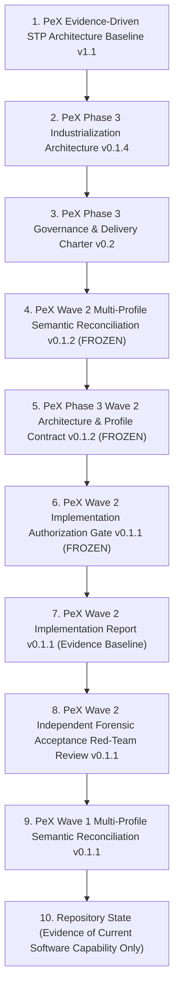
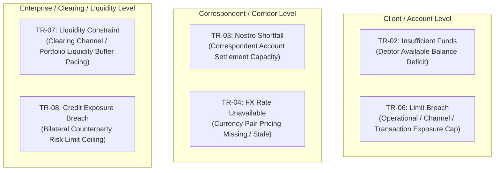
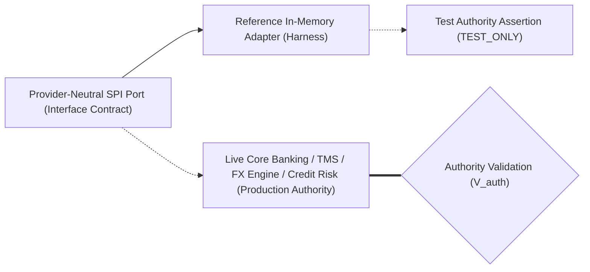
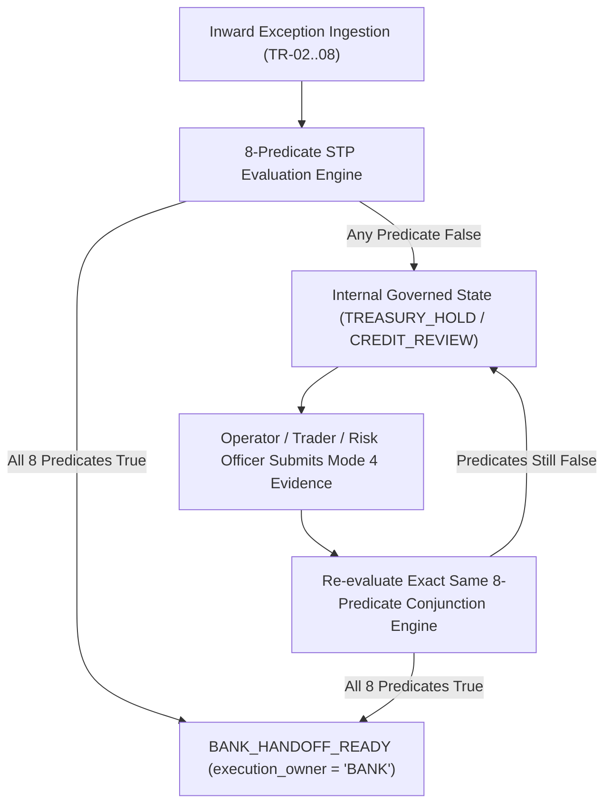

# PeX Phase 3 — Wave 3 Industrialization Architecture & Profile Contract
## Architecture, Semantic Contracts, Authority Requirements, and Resolution Patterns for Wave 3 Profiles (TR-02, TR-03, TR-04, TR-06, TR-07, TR-08)

**Document Version:** v0.1.1 (Remediated Governance Baseline)  
**Status:** REMEDIATED ARCHITECTURE & PROFILE CONTRACT BASELINE (PRE-IMPLEMENTATION GATE)  
**Governance Authority:** Principal Architecture, Governance, and Forensic Design Authority  
**Repository Working Directory:** `C:\Users\pawan\.gemini\antigravity\scratch\pex_platform`  
**Git Baseline:** Branch `phase3/wave2-implementation` | Tag `pex-phase3-wave2-20261008`  
**Cumulative Test Baseline:** 726 passed / 0 failed / 3 warnings (100% Green in 237.16s)  
**Engineering Implementation Authorization:** **STRICTLY NOT GRANTED BY THIS DOCUMENT**  
**Production Autonomous STP Authorization:** **STRICTLY BLOCKED**  
**Execution Ownership Boundary:** `execution_owner = "BANK"` (Mandatory across all outputs)  

---

## 1. Executive Summary

### 1.1 Context & Industrialization Lineage
The PeX (Payment Exception Resolution) platform has progressively industrialized:
1. **Phase 2 Baseline**: 11 canonical profiles (`DQ-01`, `DQ-02`, `DQ-05`, `DQ-06`, `DQ-08`, `PR-01`, `PR-03`, `PR-05`, `PR-08`, `CO-04`, `ST-01`) backed by 423 regression tests (Closed & Frozen).
2. **Wave 0A Baseline**: Platform contracts, canonical schemas, reference adapters, and Scenarios 1–12.
3. **Wave 0B Baseline**: Dynamic Bank Evidence Required JSON, fail-closed governance compilation, content-addressable SHA-256 evidence store, Modes 1–4 acquisition, PeX-native HITL closed loop, and Scenarios 13–18.
4. **Wave 1 Baseline**: 9 canonical profiles (`DQ-03`, `DQ-04`, `DQ-07`, `DQ-09`, `PR-02`, `PR-04`, `PR-07`, `PR-09`, `CO-07`) across `AccountMasterEngine`, `RoutingClearingEngine`, and `RemittanceDocumentEngine`, backed by 630 regression tests (Signed Off under `PeX_Wave1_Multi_Profile_Semantic_Reconciliation_and_Governance_Signoff_v0.1.1.md`).
5. **Wave 2 Baseline**: 3 canonical profiles (`PR-06`, `ST-02`, `ST-03`) across `SettlementReconciliationEngine` and `AccountMasterEngine`, introducing 4 SPI ports, 6 E2E canonical scenarios (Scenarios 28A–30B), 96 dedicated tests (726 cumulative tests green), and signed off under `PeX_Wave2_Multi_Profile_Semantic_Reconciliation_and_Governance_Signoff_v0.1.2.md` (**Ready with Conditions**).

### 1.2 Purpose of This Document
This document establishes the remediated, authoritative **Architecture and Profile Contract** for **Phase 3 Wave 3**. Wave 3 addresses the **Treasury, Liquidity, and Exposure Management** domain by industrializing **EXACTLY SIX** canonical exception profiles under the primary ownership of the existing **`TreasuryExposureEngine`**:

1. `TR-02` — **Insufficient Funds**
2. `TR-03` — **Nostro Shortfall**
3. `TR-04` — **FX Rate Unavailable**
4. `TR-06` — **Limit Breach**
5. `TR-07` — **Liquidity Constraint**
6. `TR-08` — **Credit Exposure Breach**

> [!IMPORTANT]
> **GOVERNANCE MATURITY INVARIANT:**  
> $$\text{Architecture Validated} \neq \text{Implementation Validated} \neq \text{Forensic Acceptance} \neq \text{Governance Sign-Off} \neq \text{Production Release}$$  
> This artifact defines the architectural specifications, semantic boundaries, evidence contracts, provider-neutral SPI ports, policy envelopes, and provisional resolution patterns for Wave 3. It serves as the controlling architecture baseline for the subsequent `PeX_Wave3_Implementation_Authorization_Gate_v0.1.md`. **Engineering implementation authorization is strictly NOT granted by this document.**

---

## 2. Governance Status

```
+----------------------------------------------------------------------------------------------------+
|                                  WAVE 3 GOVERNANCE STATUS SUMMARY                                  |
+-----------------------------------+----------------------------------------------------------------+
| Governance Dimension              | Status & Operational Boundary                                  |
+-----------------------------------+----------------------------------------------------------------+
| Phase 2 Baseline (11 Profiles)    | CLOSED & FROZEN (Strict No-Reengineering Protection)           |
| Wave 0A / Wave 0B Baseline        | COMPLETE (Platform Contracts & Dynamic Engine Layer Frozen)    |
| Wave 1 Baseline (9 Profiles)      | COMPLETE & SIGNED OFF (Signed off under MPSR-GS v0.1.1)        |
| Wave 2 Baseline (3 Profiles)      | COMPLETE & SIGNED OFF (Ready with Conditions under MPSR-GS v0.1.2)|
| Wave 3 Engineering Authorization  | STRICTLY NOT GRANTED (Requires separate Authorization Gate)    |
| Production Autonomous STP Gate    | STRICTLY BLOCKED (Zero-touch autonomous release forbidden)    |
| Execution Ownership Boundary      | execution_owner = "BANK" (Mandatory across all outputs)        |
| Cumulative Verified Tests         | 726 passed / 0 failed / 3 warnings (100% Green in 237.16s)     |
| Active Reconciled Profiles        | 23 Profiles (11 Phase 2 + 9 Wave 1 + 3 Wave 2)                |
| Wave 3 Target Scope               | EXACTLY 6 Profiles: TR-02, TR-03, TR-04, TR-06, TR-07, TR-08  |
| Primary Engine Exercised          | TreasuryExposureEngine (Primary for all 6 Wave 3 Profiles)     |
| Supporting Engines Exercised      | AccountMasterEngine, RoutingClearingEngine, ComplianceDossier, |
|                                   | SettlementReconciliationEngine                                 |
| Closed Canonical Universe         | EXACTLY 41 Profiles (23 Active + 18 Remaining = 41 Total)      |
+-----------------------------------+----------------------------------------------------------------+
```

---

## 3. Authoritative Source Precedence

In accordance with Section 3 of the Phase 3 Delivery Charter, all architectural determinations, authority boundaries, and resolution patterns in this document are governed strictly by the following hierarchy:



---

## 4. Wave 3 Scope & Closed Canonical Taxonomy

Wave 3 encompasses **EXACTLY SIX** canonical exception profiles within the Client/Treasury domain:

```
+---------------------------------------------------------------------------------------------------------------------------+
|                                                   WAVE 3 PROFILE SCOPE                                                    |
+-------+-----------------------------+-------------------------------+------------------------------+----------------------+
| Code  | Canonical Profile Name      | Primary Capability Engine     | Supporting Capability        | Provisional Pattern  |
+-------+-----------------------------+-------------------------------+------------------------------+----------------------+
| TR-02 | Insufficient Funds          | TreasuryExposureEngine        | AccountMasterEngine          | PAT-C (Pacing)       |
| TR-03 | Nostro Shortfall            | TreasuryExposureEngine        | SettlementReconciliationEng  | PAT-C (Pacing/Sweep) |
| TR-04 | FX Rate Unavailable         | TreasuryExposureEngine        | RoutingClearingEngine        | PAT-C (Pacing/Book)  |
| TR-06 | Limit Breach                | TreasuryExposureEngine        | ComplianceDossierEngine      | PAT-C / PAT-D (Comp) |
| TR-07 | Liquidity Constraint        | TreasuryExposureEngine        | RoutingClearingEngine        | PAT-C (Pacing)       |
| TR-08 | Credit Exposure Breach      | TreasuryExposureEngine        | ComplianceDossierEngine      | PAT-D (Risk Dossier) |
+-------+-----------------------------+-------------------------------+------------------------------+----------------------+
```

### Taxonomy Invariants:
- **Scope Integrity**: Wave 3 consists **ONLY** of `TR-02`, `TR-03`, `TR-04`, `TR-06`, `TR-07`, and `TR-08`.
- **Other Waves Protected**: `TR-01`, `TR-05`, and `ST-06` belong strictly to Wave 4. `CO-01`, `CO-02`, `CO-03`, `CO-05`, `CO-06`, and `CO-08` belong strictly to Wave 5. `ST-04`, `ST-05`, and `ST-07` belong strictly to Wave 6.
- **Closed 41-Profile Universe**: No other profiles exist. The 41 canonical profiles break down into **23 active profiles** (Phase 2, Wave 1, Wave 2) and **18 remaining profiles** (Waves 3, 4, 5, 6).

---

## 5. Critical Treasury Semantic Discipline

To prevent domain model collapse, PeX enforces strict semantic separation among the six Wave 3 profiles. They must **never** be reduced to generic "balance problems":



### Granular Semantic Boundaries:
1. **`TR-02` (Insufficient Funds)**:
   - *Core Meaning*: Insufficient available funding in the debtor/originating account to execute the payment instruction.
   - *Epistemic Boundary*: Concerns customer account available funding; does **not** involve Nostro clearing accounts or interbank risk caps. Specific DDA features (overdraft facilities, sweeps) are illustrative reference mechanisms, not universal architectural mandates.
2. **`TR-03` (Nostro Shortfall)**:
   - *Core Meaning*: Insufficient available settlement balance or liquidity capacity in the bank's Nostro/correspondent clearing account in the target currency corridor.
   - *Epistemic Boundary*: Concerns interbank correspondent clearing accounts; does **not** concern customer debtor solvency. Formats like `camt.053` and automated sweeps represent reference patterns rather than mandatory bank integration constraints.
3. **`TR-04` (FX Rate Unavailable)**:
   - *Core Meaning*: Required foreign exchange conversion rate or pricing quote for a cross-currency payment is missing, expired/stale, outside tolerance bands, or unquoted.
   - *Epistemic Boundary*: Concerns market data pricing availability and rate tolerance; does **not** concern balance availability. Specific freshness windows (e.g. 60s) and spread thresholds (e.g. 50 bps) are policy-parameterized reference defaults.
4. **`TR-06` (Limit Breach)**:
   - *Core Meaning*: Payment exceeds a configured debtor account, client entity, corridor, or transaction-level operational exposure limit.
   - *Epistemic Boundary*: Concerns operational limit governance; distinct from institutional bilateral counterparty credit facility limits (`TR-08`).
5. **`TR-07` (Liquidity Constraint)**:
   - *Core Meaning*: Generic liquidity constraint affecting payment processing or settlement across a clearing channel, central bank reserve buffer, or currency portfolio.
   - *Epistemic Boundary*: Concerns clearing-channel-wide liquidity pacing and settlement queues; distinct from individual customer funds. Central Bank RTGS reserve pacing is an illustrative rail context, not a universal redefinition of the profile.
6. **`TR-08` (Credit Exposure Breach)**:
   - *Core Meaning*: Transaction exceeds bilateral counterparty credit exposure, credit facility ceiling, or institutional risk limit.
   - *Epistemic Boundary*: Concerns institutional credit risk and requires Credit Officer / Approver adjudication; **autonomous STP is strictly prohibited**.

---

## 6. Primary Capability Engine: `TreasuryExposureEngine` Architecture

The `TreasuryExposureEngine` is one of the **six primary capability engines** defined in the Phase 3 industrialization architecture:

```
+----------------------------------------------------------------------------------------------------+
|                               SIX PRIMARY CAPABILITY ENGINES (PHASE 3)                             |
+---+------------------------------+----------------------------------+------------------------------+
| # | Capability Engine            | Domain Authority                 | Industrialization Wave       |
+---+------------------------------+----------------------------------+------------------------------+
| 1 | AccountMasterEngine          | Account validity, status, CoP/VoP| Phase 2 / Wave 1 / Wave 2    |
| 2 | RoutingClearingEngine        | Clearing rails, cutoffs, hops    | Phase 2 / Wave 1             |
| 3 | RemittanceDocumentEngine     | Invoices, remittance, reporting  | Phase 2 / Wave 1             |
| 4 | ComplianceDossierEngine      | Sanctions, AML, legal dossiers   | Phase 2 / Wave 2 / Wave 5    |
| 5 | TreasuryExposureEngine       | Balance, Nostro, FX, limits, liq | Phase 3 Wave 3 (THIS WAVE)   |
| 6 | SettlementReconciliationEng  | Inward returns, reroute, suspense| Phase 2 / Wave 2             |
+---+------------------------------+----------------------------------+------------------------------+
```

### 6.1 `TreasuryExposureEngine` Core Responsibilities
- **Balance & Position Inquiry**: Evaluates real-time available balances vs. ledger balances and active intraday reservations.
- **Nostro Position Monitoring**: Tracks correspondent account balances, pending settlement credits, and automated sweep candidates.
- **FX Rate & Pricing Validation**: Evaluates market data rate quotes, timestamp freshness, and bank spread tolerance bands.
- **Operational Limit Evaluation**: Evaluates transaction amounts against multi-tiered client, product, and channel limits.
- **Liquidity Buffer Evaluation**: Evaluates clearing channel reserve balances against configured intraday liquidity buffer policies.
- **Credit Exposure Packaging**: Compiles bilateral counterparty credit risk exposure dossiers for human credit officer adjudication.
- **Pacing & Retry Candidate Derivation**: Derives governed queue pacing candidates for temporary intraday liquidity/limit reset cycles.

### 6.2 Strict Anti-Theft Boundaries for `TreasuryExposureEngine`
- **No Account Master Mutation**: Does not create, modify, or close accounts (belongs strictly to `AccountMasterEngine`).
- **No Clearing Rail Selection**: Does not determine clearing corridor reachability or intermediary BICs (belongs to `RoutingClearingEngine`).
- **No Sanctions Screening**: Does not adjudicate OFAC/AML sanctions alerts (belongs to `ComplianceDossierEngine`).
- **No Ledger Journal Mutation**: Does not post direct debits/credits or mutate core bank GLs (belongs to bank accounting systems).

### 6.3 Supporting Engine Roles for Wave 3 Profiles
```
+----------------------------------------------------------------------------------------------------+
|                               WAVE 3 SUPPORTING ENGINE ROLES MATRIX                                |
+-------+--------------------------+-----------------------------------------------------------------+
| Code  | Supporting Engine        | Specific Technical & Architectural Rationale                    |
+-------+--------------------------+-----------------------------------------------------------------+
| TR-02 | AccountMasterEngine      | Validates debtor account standing, currency alignment, and      |
|       |                          | reference overdraft / sweep mandate agreements.                 |
+-------+--------------------------+-----------------------------------------------------------------+
| TR-03 | SettlementReconciliation | Correlates Nostro account statement feeds to verify pending     |
|       | Engine                   | settlement credits and correspondent account identity.          |
+-------+--------------------------+-----------------------------------------------------------------+
| TR-04 | RoutingClearingEngine    | Verifies currency clearing rail operating hours and value-date  |
|       |                          | settlement windows for cross-currency instructions.             |
+-------+--------------------------+-----------------------------------------------------------------+
| TR-06 | ComplianceDossierEngine  | Packages operational limit waiver dossiers for Credit Officer   |
|       |                          | Maker-Checker dual authorization when limits are breached.      |
+-------+--------------------------+-----------------------------------------------------------------+
| TR-07 | RoutingClearingEngine    | Evaluates clearing rail network operating schedules and cutoff  |
|       |                          | buffer windows during liquidity queue pacing cycles.            |
+-------+--------------------------+-----------------------------------------------------------------+
| TR-08 | ComplianceDossierEngine  | Assembles formal institutional credit exposure dossiers for     |
|       |                          | Senior Credit Officer adjudication (Autonomous STP Prohibited). |
+-------+--------------------------+-----------------------------------------------------------------+
```

---

## 7. Resolution Pattern Families & Wave 3 Mappings

The Phase 3 architecture defines **seven (7) bounded resolution pattern families**. Wave 3 profiles map cleanly into existing pattern families without pattern forcing (classified as **PROPOSED / PROVISIONAL** pending implementation and forensic acceptance):

```
+----------------------------------------------------------------------------------------------------+
|                                    RESOLUTION PATTERN FAMILIES                                     |
+---------+-----------------------------------+------------------------------------------------------+
| Family  | Pattern Family Name               | Bounded Sub-Behaviors & Scope                        |
+---------+-----------------------------------+------------------------------------------------------+
| PAT-A   | Reference, Rule & Structural      | Master DDA, Directory, Tag Derivation, CoP / Syntax. |
| PAT-B   | Temporal & Queue Recalculation    | Cutoff Date Roll (T+1), Socket Retry, Queue Unblock. |
| PAT-C   | Threshold & Balance Pacing Family | Balance Inquiry, Liquidity Pacing, Nostro Sweep Sync,|
|         |                                   | FX Spread Booking, and Intraday Limit Reset Pacing.  |
| PAT-D   | Compliance & Risk Dossier         | Legal Dossier Package, Sanctions, Credit Risk Dossier|
|         | Adjudication Family               | for Governed Human Dual-Authorization.               |
| PAT-E   | Ledger Matching & Settlement      | Return Matching, Return Packaging, GL Suspense Break.|
| PAT-F   | Intermediary & Claims Tracking    | Inward Reject Tracking, Alternate Hop Route.        |
| PAT-G   | Mandate & Entitlement Clearance   | Corporate Signatory Mandates, KYC Entitlements.      |
+---------+-----------------------------------+------------------------------------------------------+
```

### Wave 3 Provisional Resolution Pattern Allocations:
1. **`TR-02` (Insufficient Funds)**:
   - *Primary Pattern*: `PAT-C` (Threshold & Balance Pacing Family — available balance inquiry, funding reservation, intraday retry pacing).
   - *Supporting Pattern*: `PAT-B` (Temporal queue pacing).
2. **`TR-03` (Nostro Shortfall)**:
   - *Primary Pattern*: `PAT-C` (Threshold & Balance Pacing Family — nostro balance inquiry, rebalancing/sweep candidate derivation).
   - *Supporting Pattern*: `PAT-B` (Temporal sweep synchronization).
3. **`TR-04` (FX Rate Unavailable)**:
   - *Primary Pattern*: `PAT-C` (Threshold & Balance Pacing Family — market rate inquiry, spread tolerance verification, pricing booking candidate).
   - *Supporting Pattern*: `PAT-A` (Market data feed derivation).
4. **`TR-06` (Limit Breach)**:
   - *Composite Resolution*:
     - *Primary*: `PAT-C` (Threshold & Balance Pacing — for temporary intraday reset cycle pacing within bank buffer).
     - *Supporting / Escalation*: `PAT-D` (Risk Dossier Adjudication — for formal Credit Officer limit waiver packaging).
5. **`TR-07` (Liquidity Constraint)**:
   - *Primary Pattern*: `PAT-C` (Threshold & Balance Pacing Family — liquidity reserve inquiry, clearing channel queue pacing).
   - *Supporting Pattern*: `PAT-B` (Temporal queue release).
6. **`TR-08` (Credit Exposure Breach)**:
   - *Primary Pattern*: `PAT-D` (Compliance & Risk Dossier Adjudication Family — bilateral credit risk exposure dossier assembly for Credit Approver).
   - *Supporting Pattern*: `PAT-C` (Credit exposure threshold tracking).

---

## 8. Reusable Treasury Capability Model

Rather than creating six monolithic implementations, Wave 3 establishes a reusable capability model within `TreasuryExposureEngine`:

```
+----------------------------------------------------------------------------------------------------+
|                               REUSABLE TREASURY CAPABILITY INVENTORY                               |
+---+------------------------------------+----------------------------------+------------------------+
| # | Reusable Capability Component      | Functional Scope                 | Consuming Profiles     |
+---+------------------------------------+----------------------------------+------------------------+
| 1 | AvailableBalanceEvaluator          | Real-time balance vs ledger check| TR-02, TR-06           |
| 2 | NostroPositionEvaluator            | Correspondent balance & credits  | TR-03                  |
| 3 | FXRatePricingEvaluator             | Rate freshness & spread bounds   | TR-04                  |
| 4 | OperationalLimitEvaluator          | Client/account/corridor limits   | TR-06                  |
| 5 | CounterpartyCreditRiskEvaluator    | Bilateral risk exposure ceilings | TR-08                  |
| 6 | RTGSLiquidityBufferEvaluator       | Liquidity reserve queue pacing   | TR-07                  |
| 7 | PacingRetryCandidateDeriver        | Governed retry pacing candidate  | TR-02, TR-06, TR-07    |
| 8 | SweepCandidatePackager             | Nostro rebalancing candidate     | TR-03                  |
| 9 | RiskWaiverDossierAssembler         | Credit officer waiver dossier    | TR-06, TR-08           |
| 10| ValueDateTemporalCorrelator        | Intraday reset & cutoff timing   | TR-02, TR-04, TR-07    |
+---+------------------------------------+----------------------------------+------------------------+
```

---

## 9. Wave 3 Canonical Profile Contracts

### 9.1 TR-02 — Insufficient Funds

```
====================================================================================================
CANONICAL PROFILE CARD: TR-02 (Insufficient Funds)
====================================================================================================
Canonical Profile ID:       TR-02
Canonical Profile Name:     Insufficient Funds
Problem Meaning:            Inbound or outbound payment instruction exceeds the currently available
                            funding balance in the debtor / ordering customer account.
Trigger Condition:          Core Banking balance inquiry returns available_balance < payment_amount,
                            or payment hub rejects wire with insufficient funds status (e.g. MS03 / AM04).
Primary Engine:             TreasuryExposureEngine
Supporting Engine(s):       AccountMasterEngine (validates account standing & authorized overdraft/sweep mandate)
Resolution Pattern Family:  Primary: PAT-C (Threshold & Balance Pacing Family) [PROVISIONAL]
                            Supporting: PAT-B (Temporal Queue Recalculation) [PROVISIONAL]
Why Pattern Fits:           Evaluates available balance against bank intraday pacing policy. If expected
                            clearing credits or intraday sweep buffers exist and amount <= policy threshold,
                            derives a governed pacing retry candidate (PAT-C). If deficit persists beyond
                            pacing window or overdraft is unauthorized, escalates to HITL Maker-Checker.
Evidence Required:          AccountBalanceRecord (ledger_balance, available_balance, currency, as_of_timestamp),
                            IntradayReservationRecord (active_holds, pending_credits, available_headroom),
                            DeterministicCorrelationMatch (uetr, amount, currency, debtor_account).
Evidence Acquisition Modes: Mode 2 (Automated Core SPI Query), Mode 1 (Bank Pre-Supplied Position),
                            Mode 4 (Operator Mode 4 Evidence Submission in HITL Workspace).
Evidence Trust Tier(s):     Tier 1 (Authoritative Core Banking Ledger Position).
Resolution Determination:   R_det = True when either a valid pacing retry candidate is derived OR
                            an authorized sweep/funding candidate is derived. (False if unresolvable deficit).
Resolution Uniqueness:      R_uniq = True when single pacing schedule or single authorized sweep account is resolved.
Technical Validation:       V_det = True when payment amount and currency align with account configuration.
Authority Validation:       V_auth = True when TreasuryPositionPort confirms authoritative position and
                            client agreement authorizes intraday queuing / overdraft buffer.
Bank Policy Dependency:     W3-BPD-01 attached to BankPolicyEnvelope (TEST / REFERENCE DEFAULTS):
                            - allow_auto_retry_pacing: True
                            - max_pacing_retry_seconds: 1800.0 (30 minutes) [BANK POLICY DECISION REQUIRED]
                            - min_available_balance_buffer: 0.0 [BANK POLICY DECISION REQUIRED]
                            - max_auto_pacing_amount: 100000.0 [BANK POLICY DECISION REQUIRED]
Compliance Dependency:      C_comp = True; account is in good standing and not subject to sanctions/fraud holds.
Execution Preconditions:    X_pre = True; account is active and clearing rail remains within operating window.
Non-Negotiable Boundaries:  1. Zero Direct Mutation: PeX derives pacing and reservation candidates; PeX does
                               NOT execute ledger debits, overdraft bookings, or payment releases directly.
                            2. AI Prohibition: AI cannot synthesize phantom balances or approve funding.
HITL Trigger Conditions:    Deficit exceeds policy cap ($100k), pacing window expires without funding, missing account
                            authority, or account subject to administrative hold.
STP Automation Potential:   High (for policy-compliant temporary intraday timing mismatches with incoming credits).
STP Eligibility Condition:  E_suff ∧ R_det ∧ R_uniq ∧ V_det ∧ V_auth ∧ P_bank ∧ C_comp ∧ X_pre == True.
Bank Execution Boundary:    execution_owner = "BANK"; emits BANK_HANDOFF_READY with pacing retry candidate.
AI Role:                    Observational pattern matching on historical deposit timing only (0% credit authority).
Semantic Status:            REMEDIATED SPECIFICATION (Pre-Implementation Baseline)
====================================================================================================
```

---

### 9.2 TR-03 — Nostro Shortfall

```
====================================================================================================
CANONICAL PROFILE CARD: TR-03 (Nostro Shortfall)
====================================================================================================
Canonical Profile ID:       TR-03
Canonical Profile Name:     Nostro Shortfall
Problem Meaning:            Outbound cross-border payment instruction cannot settle because the bank's
                            Nostro / correspondent account at the overseas clearing bank lacks sufficient
                            available settlement currency balance or intraday credit capacity.
Trigger Condition:          Nostro position inquiry returns nostro_available_balance < payment_amount,
                            or payment hub suspends dispatch due to correspondent settlement queue depletion.
Primary Engine:             TreasuryExposureEngine
Supporting Engine(s):       SettlementReconciliationEngine (correlates Nostro statement feeds / pending credits)
Resolution Pattern Family:  Primary: PAT-C (Threshold & Balance Pacing Family) [PROVISIONAL]
                            Supporting: PAT-B (Temporal Queue Recalculation) [PROVISIONAL]
Why Pattern Fits:           Evaluates Nostro liquidity position against bank treasury rebalancing agreements.
                            If pending incoming correspondent credits exist or authorized automated sweep
                            agreements are active, derives a Nostro sweep / rebalancing candidate (PAT-C).
Evidence Required:          NostroPositionRecord (nostro_bic, currency, available_balance, minimum_operating_target),
                            PendingCorrespondentCreditRecord (expected_credits, settlement_rail, arrival_window),
                            DeterministicCorrelationMatch (uetr, amount, currency, target_correspondent_bic).
Evidence Acquisition Modes: Mode 2 (Automated Treasury / Nostro SPI Query), Mode 1 (Bank Pre-Supplied Position),
                            Mode 4 (Treasury Desk Mode 4 Rebalancing Authorization in HITL Workspace).
Evidence Trust Tier(s):     Tier 1 (Authoritative Treasury Management System / Nostro Ledger).
Resolution Determination:   R_det = True when a valid Nostro sweep rebalancing candidate or pacing window is derived.
Resolution Uniqueness:      R_uniq = True when single funding sweep source or single pacing window is resolved.
Technical Validation:       V_det = True when currency and correspondent BIC comply with clearing corridor rules.
Authority Validation:       V_auth = True when NostroPositionPort confirms authoritative correspondent position
                            and treasury policy authorizes automated Nostro sweep execution.
Bank Policy Dependency:     W3-BPD-02 attached to BankPolicyEnvelope (TEST / REFERENCE DEFAULTS):
                            - allow_auto_nostro_sweep: True
                            - min_nostro_operating_balance: 1000000.0 [BANK POLICY DECISION REQUIRED]
                            - max_auto_sweep_amount: 500000.0 [BANK POLICY DECISION REQUIRED]
                            - allowed_sweep_funding_accounts: ["NOSTRO-MASTER-EUR", "NOSTRO-CENTRAL-USD"] [REF DEFAULT]
Compliance Dependency:      C_comp = True; correspondent institution and corridor are not subject to sanctions.
Execution Preconditions:    X_pre = True; funding Nostro account is active and interbank transfer corridor is open.
Non-Negotiable Boundaries:  1. Zero Direct Execution: PeX packages Nostro sweep candidates; the bank treasury
                               desk / payment hub executes interbank liquidity transfers and funding wires.
                            2. Reachability != Solvency: Directory presence of a Nostro account != funded position.
HITL Trigger Conditions:    Nostro shortfall exceeds sweep cap ($500k), no viable funding Nostro account available,
                            pending credit fails to arrive within SLA, or correspondent bank under liquidity freeze.
STP Automation Potential:   Medium (for standard intraday sweeps between pre-authorized correspondent accounts).
STP Eligibility Condition:  E_suff ∧ R_det ∧ R_uniq ∧ V_det ∧ V_auth ∧ P_bank ∧ C_comp ∧ X_pre == True.
Bank Execution Boundary:    execution_owner = "BANK"; emits BANK_HANDOFF_READY with Nostro sweep candidate.
AI Role:                    Observational liquidity flow forecasting only (0% treasury movement authority).
Semantic Status:            REMEDIATED SPECIFICATION (Pre-Implementation Baseline)
====================================================================================================
```

---

### 9.3 TR-04 — FX Rate Unavailable

```
====================================================================================================
CANONICAL PROFILE CARD: TR-04 (FX Rate Unavailable)
====================================================================================================
Canonical Profile ID:       TR-04
Canonical Profile Name:     FX Rate Unavailable
Problem Meaning:            Cross-currency payment instruction cannot be processed because the required
                            foreign exchange conversion rate / pricing quote is missing, stale (expired TTL),
                            exceeds allowable spread tolerance, or the currency pair is unquoted.
Trigger Condition:          FX pricing gateway returns RATE_UNAVAILABLE, STALE_RATE, or rate timestamp
                            exceeds maximum allowed age (e.g. rate_age > 60 seconds).
Primary Engine:             TreasuryExposureEngine
Supporting Engine(s):       RoutingClearingEngine (verifies currency rail settlement cutoffs and market hours)
Resolution Pattern Family:  Primary: PAT-C (Threshold & Balance Pacing Family) [PROVISIONAL]
                            Supporting: PAT-A (Reference Rule / Market Data Derivation) [PROVISIONAL]
Why Pattern Fits:           Queries bank-authorized FX market data feeds for a refreshed rate quote. If a fresh
                            quote is obtained within bank spread tolerance and amount <= policy threshold,
                            derives an FX pricing booking candidate (PAT-C). If rate is unquoted, escalates to FX Desk.
Evidence Required:          FXRateQuoteRecord (currency_pair, base_rate, bid_rate, ask_rate, quote_timestamp, rate_source),
                            FXSpreadPolicyRecord (max_allowed_spread_bps, max_rate_age_seconds, allow_auto_booking),
                            DeterministicCorrelationMatch (uetr, instructed_amount, instructed_ccy, settlement_ccy).
Evidence Acquisition Modes: Mode 2 (Automated FX Pricing SPI Query), Mode 1 (Bank Pre-Supplied Market Quote),
                            Mode 4 (FX Trader Mode 4 Special Rate Booking in HITL Workspace).
Evidence Trust Tier(s):     Tier 2 (Official Bank FX Pricing Engine / Market Data Provider).
Resolution Determination:   R_det = True when a valid, unexpired rate quote within spread tolerance is derived.
Resolution Uniqueness:      R_uniq = True when single authoritative rate quote is resolved for the currency pair.
Technical Validation:       V_det = True when computed target settlement amount satisfies ISO 20022 currency decimals.
Authority Validation:       V_auth = True when FXPricingPort confirms quote is from a bank-approved pricing source.
Bank Policy Dependency:     W3-BPD-03 attached to BankPolicyEnvelope (TEST / REFERENCE DEFAULTS):
                            - allow_auto_rate_booking: True
                            - max_fx_rate_age_seconds: 60.0 [BANK POLICY DECISION REQUIRED]
                            - max_fx_spread_tolerance_bps: 50.0 (0.50%) [BANK POLICY DECISION REQUIRED]
                            - max_auto_fx_amount: 250000.0 [BANK POLICY DECISION REQUIRED]
Compliance Dependency:      C_comp = True; currency corridor is not subject to FX capital controls or sanctions.
Execution Preconditions:    X_pre = True; foreign exchange dealing market is open for the instructed currency pair.
Non-Negotiable Boundaries:  1. No Phantom Rates: AI and historical lookup engines are STRICTLY PROHIBITED from
                               inventing, synthesizing, or interpolating FX rates.
                            2. Stale Rate Fail-Closed: Stale rate quotes exceeding TTL evaluate to E_suff = False.
HITL Trigger Conditions:    FX market data feed down, spread exceeds policy tolerance, currency pair illiquid/unquoted,
                            transaction amount > policy cap, or rate age exceeds allowable window.
STP Automation Potential:   High (for major/minor currency pairs with active live streaming market data feeds).
STP Eligibility Condition:  E_suff ∧ R_det ∧ R_uniq ∧ V_det ∧ V_auth ∧ P_bank ∧ C_comp ∧ X_pre == True.
Bank Execution Boundary:    execution_owner = "BANK"; emits BANK_HANDOFF_READY with structured FX booking candidate.
AI Role:                    Observational market volatility telemetry only (0% rate derivation authority).
Semantic Status:            REMEDIATED SPECIFICATION (Pre-Implementation Baseline)
====================================================================================================
```

---

### 9.4 TR-06 — Limit Breach

```
====================================================================================================
CANONICAL PROFILE CARD: TR-06 (Limit Breach)
====================================================================================================
Canonical Profile ID:       TR-06
Canonical Profile Name:     Limit Breach
Problem Meaning:            Payment instruction exceeds an applicable operational risk limit, including
                            debtor daily transaction limit, account overdraft cap, corridor velocity ceiling,
                            or channel threshold.
Trigger Condition:          Limit management system returns LIMIT_EXCEEDED, DAILY_CAP_BREACHED, or
                            VELOCITY_THRESHOLD_REACHED.
Primary Engine:             TreasuryExposureEngine
Supporting Engine(s):       ComplianceDossierEngine (assembles Credit/Risk Officer limit waiver dossier)
Resolution Pattern Family:  Composite: Primary PAT-C (Threshold & Balance Pacing) [PROVISIONAL] /
                                       Supporting PAT-D (Compliance & Risk Dossier Adjudication) [PROVISIONAL]
Why Pattern Fits:           Evaluates whether the breach is due to a temporary intraday cycle that will clear
                            upon scheduled limit reset (PAT-C Pacing). If the breach is a hard operational limit,
                            compiles an operational limit waiver dossier for Credit Officer dual authorization (PAT-D).
Evidence Required:          LimitUtilizationRecord (limit_id, limit_type, current_utilization, limit_cap, reset_schedule),
                            ClientLimitProfileRecord (debtor_entity, approved_overdraft_facility, waiver_preauthorization),
                            DeterministicCorrelationMatch (uetr, amount, currency, debtor_account).
Evidence Acquisition Modes: Mode 2 (Automated Limit Management SPI Query), Mode 1 (Pre-Supplied Limit Waiver),
                            Mode 4 (Credit Risk Officer Mode 4 Limit Waiver in HITL Workspace).
Evidence Trust Tier(s):     Tier 1 (Authoritative Bank Limit Management System).
Resolution Determination:   R_det = True when either an intraday reset pacing window is derived OR
                            a structured limit waiver dossier is assembled. (False if unresolvable breach).
Resolution Uniqueness:      R_uniq = True when single reset schedule or single waiver authority package is resolved.
Technical Validation:       V_det = True when transaction parameters align with limit governance schemas.
Authority Validation:       V_auth = True when LimitManagementPort confirms limit rules; waiver requires Credit Approver.
Bank Policy Dependency:     W3-BPD-04 attached to BankPolicyEnvelope (TEST / REFERENCE DEFAULTS):
                            - allow_intraday_limit_reset_pacing: True
                            - max_limit_reset_pacing_seconds: 3600.0 (1 hour) [BANK POLICY DECISION REQUIRED]
                            - max_limit_waiver_threshold: 500000.0 [BANK POLICY DECISION REQUIRED]
                            - require_credit_officer_dual_auth: True [BANK POLICY DECISION REQUIRED]
Compliance Dependency:      C_comp = True; limit breach is operational and not triggered by AML structuring flags.
Execution Preconditions:    X_pre = True; account limit reset cycle active and debtor in good standing.
Non-Negotiable Boundaries:  1. Zero Autonomous Limit Override: PeX is STRICTLY PROHIBITED from increasing,
                               bypassing, or overriding operational limits autonomously.
                            2. Mandatory Maker-Checker for Waivers: Limit waivers require Credit Officer dual-auth.
HITL Trigger Conditions:    Hard limit breach exceeding pacing buffer, amount > policy waiver cap, unapproved facility,
                            or limit reset failure.
STP Automation Potential:   Low-to-Medium (STP viable only for transient intraday reset pacing; waivers require HITL).
STP Eligibility Condition:  E_suff ∧ R_det ∧ R_uniq ∧ V_det ∧ V_auth ∧ P_bank ∧ C_comp ∧ X_pre == True.
Bank Execution Boundary:    execution_owner = "BANK"; emits BANK_HANDOFF_READY with pacing or waiver payload.
AI Role:                    Observational limit utilization analytics only (0% limit waiver authority).
Semantic Status:            REMEDIATED SPECIFICATION (Pre-Implementation Baseline)
====================================================================================================
```

---

### 9.5 TR-07 — Liquidity Constraint

```
====================================================================================================
CANONICAL PROFILE CARD: TR-07 (Liquidity Constraint)
====================================================================================================
Canonical Profile ID:       TR-07
Canonical Profile Name:     Liquidity Constraint
Problem Meaning:            Payment instruction cannot be immediately dispatched to the clearing channel
                            because the bank's intraday liquidity reserve, central bank buffer, or currency
                            portfolio funding is constrained below policy minimums.
Trigger Condition:          Liquidity management system returns LIQUIDITY_BUFFER_CONSTRAINED, QUEUE_HELD,
                            or reserve headroom falls below minimum operating threshold.
Primary Engine:             TreasuryExposureEngine
Supporting Engine(s):       RoutingClearingEngine (evaluates settlement windows and clearing cutoff buffers)
Resolution Pattern Family:  Primary: PAT-C (Threshold & Balance Pacing Family) [PROVISIONAL]
                            Supporting: PAT-B (Temporal Queue Recalculation) [PROVISIONAL]
Why Pattern Fits:           Applies bank liquidity pacing algorithms to place the payment in an intraday
                            liquidity pacing queue (PAT-C). Releases the payment candidate once clearing
                            inflows or liquidity facilities restore required buffer headroom.
Evidence Required:          LiquidityReserveRecord (clearing_rail, currency, current_reserve_balance, minimum_buffer_target),
                            RTGSQueueStatusRecord (active_queue_depth, priority_tier, expected_inflow_volume),
                            DeterministicCorrelationMatch (uetr, amount, currency, priority_level).
Evidence Acquisition Modes: Mode 2 (Automated Liquidity Reserve SPI Query), Mode 1 (Bank Pre-Supplied Reserve Status),
                            Mode 4 (Liquidity Desk Officer Mode 4 Release Authorization in HITL Workspace).
Evidence Trust Tier(s):     Tier 1 (Authoritative Bank Liquidity Management / Clearing Position).
Resolution Determination:   R_det = True when a valid liquidity pacing queue candidate and release schedule are derived.
Resolution Uniqueness:      R_uniq = True when single clearing priority queue and pacing window are resolved.
Technical Validation:       V_det = True when payment priority tags satisfy clearing format specifications.
Authority Validation:       V_auth = True when LiquidityReservePort confirms systemic reserve status and
                            treasury policy authorizes automated liquidity pacing release.
Bank Policy Dependency:     W3-BPD-05 attached to BankPolicyEnvelope (TEST / REFERENCE DEFAULTS):
                            - allow_auto_liquidity_pacing: True
                            - min_rtgs_liquidity_buffer: 5000000.0 [BANK POLICY DECISION REQUIRED]
                            - max_liquidity_hold_seconds: 7200.0 (2 hours) [BANK POLICY DECISION REQUIRED]
                            - priority_release_tier: "STANDARD_COMMERCIAL" [BANK POLICY DECISION REQUIRED]
Compliance Dependency:      C_comp = True; clearing rail corridor is operational and not subject to sovereign sanctions.
Execution Preconditions:    X_pre = True; clearing operational window open; reserve replenishment active.
Non-Negotiable Boundaries:  1. Zero Direct Dispatch: PeX manages pacing candidates; bank payment hub releases
                               instructions into clearing network queues.
                            2. Cutoff Protection: Liquidity pacing must fail closed to HITL before clearing cutoff.
HITL Trigger Conditions:    Liquidity buffer exhausted beyond max hold window, payment approaching rail
                            cutoff buffer (AD-02), transaction amount exceeds systemic pacing threshold, or high-priority wire.
STP Automation Potential:   High (for automated intraday queue pacing during peak clearing cycles).
STP Eligibility Condition:  E_suff ∧ R_det ∧ R_uniq ∧ V_det ∧ V_auth ∧ P_bank ∧ C_comp ∧ X_pre == True.
Bank Execution Boundary:    execution_owner = "BANK"; emits BANK_HANDOFF_READY with liquidity release candidate.
AI Role:                    Observational queue throughput analytics only (0% liquidity release authority).
Semantic Status:            REMEDIATED SPECIFICATION (Pre-Implementation Baseline)
====================================================================================================
```

---

### 9.6 TR-08 — Credit Exposure Breach

```
====================================================================================================
CANONICAL PROFILE CARD: TR-08 (Credit Exposure Breach)
====================================================================================================
Canonical Profile ID:       TR-08
Canonical Profile Name:     Credit Exposure Breach
Problem Meaning:            Payment instruction causes total outstanding credit exposure to a corporate
                            borrower or interbank counterparty to breach approved credit facility ceilings.
Trigger Condition:          Credit risk management system returns COUNTERPARTY_EXPOSURE_BREACH, FACILITY_CAP_EXCEEDED,
                            or RISK_RATING_DOWNGRADE_HOLD.
Primary Engine:             TreasuryExposureEngine
Supporting Engine(s):       ComplianceDossierEngine (assembles credit risk adjudication package)
Resolution Pattern Family:  Primary: PAT-D (Compliance & Risk Dossier Adjudication Family) [PROVISIONAL]
                            Supporting: PAT-C (Threshold & Balance Tracking) [PROVISIONAL]
Why Pattern Fits:           Assembles an authoritative Credit Risk Dossier containing counterparty exposure
                            utilization, parent guarantee records, and risk rating metrics (PAT-D). Escalates
                            cases to Senior Credit Approver for governed human dual-authorization.
Evidence Required:          CounterpartyExposureRecord (counterparty_bic, credit_rating, total_facility_limit, current_exposure),
                            CreditFacilityRecord (facility_id, collateral_coverage, expiry_date, approval_tier),
                            DeterministicCorrelationMatch (uetr, amount, currency, counterparty_bic).
Evidence Acquisition Modes: Mode 2 (Automated Credit Risk SPI Query), Mode 1 (Bank Pre-Supplied Credit Dossier),
                            Mode 4 (Senior Credit Officer Mode 4 Credit Approval in HITL Workspace).
Evidence Trust Tier(s):     Tier 1 (Authoritative Enterprise Credit Risk Management System).
Resolution Determination:   R_det = True when a complete, verified Credit Risk Dossier is compiled for human review.
Resolution Uniqueness:      R_uniq = True when single counterparty credit hierarchy is resolved.
Technical Validation:       V_det = True when exposure metrics align with bank credit risk schemas.
Authority Validation:       V_auth = False for autonomous execution; V_auth = True ONLY upon Senior Credit Officer approval.
Bank Policy Dependency:     W3-BPD-06 attached to BankPolicyEnvelope (TEST / REFERENCE DEFAULTS):
                            - zero_auto_stp_on_credit_breach: True (MANDATORY: Autonomous STP Prohibited)
                            - require_senior_risk_approver: True [MANDATORY]
                            - max_dossier_compilation_seconds: 300.0 [BANK POLICY DECISION REQUIRED]
Compliance Dependency:      C_comp = True; counterparty is not on credit watch, insolvency hold, or sanctions list.
Execution Preconditions:    X_pre = True; credit facility is active and credit officer approval token is verified.
Non-Negotiable Boundaries:  1. ZERO AUTONOMOUS STP (Autonomous STP Prohibited): PeX is STRICTLY PROHIBITED from approving credit
                               exposure breaches autonomously. All TR-08 exceptions require human Credit Approver.
                            2. AI Prohibition: AI cannot waive credit exposure or modify risk ratings.
HITL Trigger Conditions:    All credit exposure breach cases trigger internal PeX HITL Credit Review Workspace.
STP Automation Potential:   Zero (Governed Human Adjudication — Mandatory Maker-Checker / Approver Sign-off).
STP Eligibility Condition:  Evaluates to FALSE autonomously; requires Mode 4 Senior Credit Officer authorization.
Bank Execution Boundary:    execution_owner = "BANK"; handoff requires dual-signed credit waiver token.
AI Role:                    Observational risk rating summary extraction only (0% credit decision authority).
Semantic Status:            REMEDIATED SPECIFICATION (Pre-Implementation Baseline)
====================================================================================================
```

---

## 10. Evidence Acquisition, Trust Tiers & Provider-Neutral SPI Architecture

### 10.1 Provider-Neutral SPI Port Catalog for Wave 3

Wave 3 introduces **six (6) new provider-neutral SPI ports**, expanding the PeX port catalog from 11 to **17 abstract interfaces**:

```
+----------------------------------------------------------------------------------------------------+
|                               PROVIDER-NEUTRAL SPI PORT INVENTORY                                  |
+----+-----------------------------+------------------------------------+------------------+---------+
| #  | SPI Port Identifier         | Abstract Domain Interface Name     | Introducing Wave | Status  |
+----+-----------------------------+------------------------------------+------------------+---------+
| 1  | SPI-ACCOUNT-MASTER-PORT     | AccountMasterPort                  | Wave 0A / Wave 1 | PROVEN  |
| 2  | SPI-ROUTING-DIRECTORY-PORT  | RoutingDirectoryPort               | Wave 0A / Wave 1 | PROVEN  |
| 3  | SPI-REMITTANCE-DOCUMENT     | RemittanceDocumentPort             | Wave 0A / Wave 1 | PROVEN  |
| 4  | SPI-CLEARING-CALENDAR-PORT  | ClearingCalendarPort               | Wave 1           | PROVEN  |
| 5  | SPI-GATEWAY-SOCKET-PROBE    | GatewaySocketProbePort             | Wave 1           | PROVEN  |
| 6  | SPI-REPAIR-QUEUE-PORT       | RepairQueuePort                    | Wave 1           | PROVEN  |
| 7  | SPI-REGULATORY-DIRECTORY    | RegulatoryDirectoryPort            | Wave 1           | PROVEN  |
| 8  | SPI-CORRESPONDENT-GATEWAY   | CorrespondentGatewayPort           | Wave 2           | PROVEN  |
| 9  | SPI-SETTLEMENT-RETURN-PORT  | SettlementReturnPort               | Wave 2           | PROVEN  |
| 10 | SPI-LEGAL-REGISTRY-PORT     | LegalRegistryPort                  | Wave 2           | PROVEN  |
| 11 | SPI-GENERAL-LEDGER-SUSPENSE | GeneralLedgerSuspensePort          | Wave 2           | PROVEN  |
| 12 | SPI-TREASURY-POSITION-PORT  | TreasuryPositionPort               | Wave 3           | SPECIFIED|
| 13 | SPI-NOSTRO-POSITION-PORT    | NostroPositionPort                 | Wave 3           | SPECIFIED|
| 14 | SPI-FX-PRICING-PORT         | FXPricingPort                      | Wave 3           | SPECIFIED|
| 15 | SPI-LIMIT-MANAGEMENT-PORT   | LimitManagementPort                | Wave 3           | SPECIFIED|
| 16 | SPI-CREDIT-RISK-PORT        | CreditRiskPort                     | Wave 3           | SPECIFIED|
| 17 | SPI-LIQUIDITY-RESERVE-PORT  | LiquidityReservePort               | Wave 3           | SPECIFIED|
+----+-----------------------------+------------------------------------+------------------+---------+
```

### 10.2 Evidence Trust Tiers for Treasury
- **Tier 1 (Authoritative Core & Treasury Systems)**: Direct feeds from Core Banking, Treasury Management Systems (TMS), Nostro Ledgers, Limit Engines, and Enterprise Credit Risk Platforms.
- **Tier 2 (Official Market & Central Bank Data)**: Streaming FX market data pricing feeds, clearing channel liquidity position feeds, and clearing rail operating schedules.
- **Tier 3 (Client ERP & Counterparty Assertions)**: Client-provided funding notifications, commercial remittance payloads, and indicative FX quotes (requires verification).
- **Tier 4 (Historical Precedent Context)**: Historical deposit timing patterns, past liquidity cycles (advisory only; **0% execution authority**).

### 10.3 Evidence Freshness & TTL Rules (Test / Reference Defaults)
- Real-time balances (`TR-02`, `TR-03`): Maximum age $\le 30\text{ seconds}$ `[REF DEFAULT]`.
- FX Rates (`TR-04`): Maximum age $\le 60\text{ seconds}$ `[REF DEFAULT]`.
- Operational Limits (`TR-06`): Maximum age $\le 300\text{ seconds}$ `[REF DEFAULT]`.
- Liquidity Buffer (`TR-07`): Maximum age $\le 120\text{ seconds}$ `[REF DEFAULT]`.
- Credit Risk Exposure (`TR-08`): Maximum age $\le 600\text{ seconds}$ `[REF DEFAULT]`.

---

## 11. Authority Model & Interface Separation ($V_{\text{auth}}$)



### Key Epistemic Principles:
1. **SPI Port $\neq$ Authority**: An SPI port (`TreasuryPositionPort`, `FXPricingPort`, etc.) is an abstract interface contract. It defines data structures and query signatures but does not confer authority.
2. **Authority Resides in the System of Record**: $V_{\text{auth}}$ is satisfied only when the bank-designated system of record (Core Banking, TMS, Dealing Desk, Credit Risk Committee) authorizes the transaction or state.
3. **Reference Adapters**: Reference adapters are in-memory harnesses for test hermeticity (`environment = "TEST_ONLY"`). Live production $V_{\text{auth}}$ requires binding to enterprise production connectors.

---

## 12. Bank Policy Envelope & Parameterization ($P_{\text{bank}}$)

Wave 3 establishes the `W3PolicyThresholds` schema attached to `BankPolicyEnvelope`. All values are classified as **TEST / REFERENCE DEFAULTS** subject to institutional policy configuration:

```
+----------------------------------------------------------------------------------------------------+
|                               WAVE 3 BANK POLICY ENVELOPE (W3-BPD)                                 |
+----+-----------------------------+------------------------------------+------------------+---------+
| #  | Policy Parameter Identifier | Target Profile / Domain            | Reference Default| Status  |
+----+-----------------------------+------------------------------------+------------------+---------+
| 1  | W3-BPD-01                   | TR-02 (Insufficient Funds Pacing)  | Max Pacing: 1800s| TEST    |
|    |                             |                                    | Cap: $100,000.00 | DEFAULT |
+----+-----------------------------+------------------------------------+------------------+---------+
| 2  | W3-BPD-02                   | TR-03 (Nostro Sweep Rebalancing)   | Target: $1,000k  | TEST    |
|    |                             |                                    | Cap: $500,000.00 | DEFAULT |
+----+-----------------------------+------------------------------------+------------------+---------+
| 3  | W3-BPD-03                   | TR-04 (FX Rate & Spread Tolerance) | Max Age: 60s     | TEST    |
|    |                             |                                    | Spread: 50 bps   | DEFAULT |
+----+-----------------------------+------------------------------------+------------------+---------+
| 4  | W3-BPD-04                   | TR-06 (Limit Reset & Waiver Policy)| Max Pacing: 3600s| TEST    |
|    |                             |                                    | Cap: $500,000.00 | DEFAULT |
+----+-----------------------------+------------------------------------+------------------+---------+
| 5  | W3-BPD-05                   | TR-07 (Liquidity Pacing Policy)    | Min Buffer: $5M  | TEST    |
|    |                             |                                    | Max Hold: 7200s  | DEFAULT |
+----+-----------------------------+------------------------------------+------------------+---------+
| 6  | W3-BPD-06                   | TR-08 (Credit Exposure Policy)     | Auto-STP Blocked | MANDAT- |
|    |                             |                                    | Dual-Auth: TRUE  | ORY     |
+----+-----------------------------+------------------------------------+------------------+---------+
```

> **FAIL-CLOSED POLICY INVARIANT:**  
> If bank policy is missing, unparseable, or expired, $P_{\text{bank}}$ evaluates strictly to `False`, forcing the transaction into internal HITL Maker-Checker review.

---

## 13. 8-Predicate STP Conjunction Formula Invariant

The canonical STP decision formula remains absolute, immutable, and non-bypassable across all Wave 3 profiles:

$$\Huge \text{STP\_ELIGIBLE} = E_{\text{suff}} \land R_{\text{det}} \land R_{\text{uniq}} \land V_{\text{det}} \land V_{\text{auth}} \land P_{\text{bank}} \land C_{\text{comp}} \land X_{\text{pre}}$$

```
+----------------------------------------------------------------------------------------------------+
|                                 8-PREDICATE CONJUNCTION INVARIANT                                  |
+---+-----------------------------+------------------------------------------------------------------+
| # | Predicate Symbol            | Wave 3 Contextual Evaluation Scope                               |
+---+-----------------------------+------------------------------------------------------------------+
| 1 | E_suff (Evidence Sufficient)| Authoritative position, FX quote, limit, or reserve data present |
| 2 | R_det (Resolution Determin) | Valid pacing schedule, sweep, FX booking, or waiver candidate    |
| 3 | R_uniq (Resolution Unique)  | Exactly one resolution candidate derived without ambiguity       |
| 4 | V_det (Technical Validation)| Payment currency decimals, message formatting, schema validation |
| 5 | V_auth (Authority Validated)| Authoritative system confirms balance/pricing/credit authority   |
| 6 | P_bank (Bank Policy Satis)  | Amount <= policy cap; spread <= tolerance; buffer >= minimum     |
| 7 | C_comp (Compliance Passed)  | Sanctions/AML cleared; zero capital control or structuring flags |
| 8 | X_pre (Preconditions Met)   | Clearing rail open; dealing desk active; clearing window open    |
+---+-----------------------------+------------------------------------------------------------------+
```

---

## 14. Human-in-the-Loop (HITL) Closed-Loop Model



### Verified Closed-Loop Invariants:
1. **Zero External Ejection**: Exceptions remain inside PeX throughout the remediation lifecycle.
2. **Re-Evaluation Parity**: Human-supplied Mode 4 evidence passes through the exact same 8-predicate evaluation pipeline.
3. **Terminal State Realism**: Only eligible handoffs reach `BANK_HANDOFF_READY`. Ineligible cases remain in internal governed states (`TREASURY_HOLD`, `CREDIT_REVIEW_REQUIRED`, `MAKER_CHECKER_PENDING`).

---

## 15. AI Boundary & Zero Decision Authority

- **Zero Autonomous Authority**: AI models possess 0% decision authority and 0% bypass capability across all 8 predicates.
- **Strict Prohibitions**: AI is strictly prohibited from inventing account balances, generating phantom FX rates, overriding operational limits, approving credit exposure breaches, or authorizing payment releases.
- **Telemetry-Only Scoring**: `ai_confidence` is observational telemetry only and does not influence the boolean conjunction gate.

---

## 16. Bank Execution Boundary & Immutability of `execution_owner = "BANK"`

- **Mandatory Handoff Invariant**: All positive resolution fixtures terminate with `execution_owner = "BANK"`.
- **Zero Direct Mutation**: PeX derives deterministic pacing schedules, sweep packages, FX booking payloads, and credit dossiers; bank execution engines (Payment Hub, Core Banking, TMS) execute money movements, ledger bookings, and FX transactions.
- **Production Autonomous STP Strictly Blocked**: Autonomous straight-through release into clearing networks is strictly forbidden.

---

## 17. Cross-Profile Treasury Interactions & Governed Multi-Exception Evaluation

In production payment processing, transactions frequently encounter multi-dimensional exceptions (e.g. concurrent FX pricing staleness, client balance shortfall, and corridor limits). Rather than hardcoding an immutable, universal global execution precedence, PeX applies **governed multi-exception evaluation principles** based on payment state, rail operating rules, and bank policy:

```
+----------------------------------------------------------------------------------------------------+
|                       CROSS-PROFILE TREASURY MULTI-EXCEPTION PRINCIPLES                            |
+--------------------------+-------------------------------------------------------------------------+
| Exception Pair           | Interaction Dynamics & Governed Evaluation Principle                    |
+--------------------------+-------------------------------------------------------------------------+
| TR-02 vs TR-03           | TR-02 concerns debtor funding; TR-03 concerns Nostro clearing capacity. |
| (Debtor vs Nostro Funds) | Governed Principle: Debtor funding sufficiency (TR-02) is verified prior|
|                          | to committing interbank Nostro liquidity (TR-03) under standard policy. |
+--------------------------+-------------------------------------------------------------------------+
| TR-02 vs TR-07           | TR-02 is account-level; TR-07 is clearing channel liquidity pacing.     |
| (Debtor vs Channel Liq)  | Governed Principle: Unfunded debtor payments do not occupy systemic     |
|                          | clearing liquidity pacing queues; TR-02 deficit takes operational hold. |
+--------------------------+-------------------------------------------------------------------------+
| TR-04 vs TR-02           | TR-04 concerns FX pricing quote; TR-02 concerns settlement debit balance|
| (FX Rate vs Funding)     | Governed Principle: Authoritative FX rate quote (TR-04) is required to  |
|                          | establish exact settlement debit amount before TR-02 balance validation.|
+--------------------------+-------------------------------------------------------------------------+
| TR-06 vs TR-08           | TR-06 is operational limit; TR-08 is bilateral credit risk ceiling.    |
| (Limit vs Credit Risk)   | Governed Principle: Counterparty credit risk breach (TR-08) is a hard   |
|                          | institutional freeze requiring Risk Approver adjudication before limits.|
+--------------------------+-------------------------------------------------------------------------+
| TR-07 vs TR-08           | TR-07 is liquidity pacing; TR-08 is institutional credit breach.        |
| (Liquidity vs Credit)    | Governed Principle: Credit freeze (TR-08) halts processing immediately; |
|                          | payment cannot enter liquidity queue pacing (TR-07) while credit frozen.|
+--------------------------+-------------------------------------------------------------------------+
```

---

## 18. Wave 3 Architecture & Bank Policy Decisions Required

### 18.1 Architecture Decisions Required Prior to Implementation
1. **`ADR-W3-01` (Treasury Position Data Freshness & Intraday Reservation Abstraction)**: Formalize data models for available balance vs ledger balance vs active intraday reservations across multi-currency accounts.
2. **`ADR-W3-02` (Multi-Tier Limit & Exposure Hierarchy Modeling)**: Define canonical schemas representing account-level, client-level, corridor-level, and counterparty-level risk limits.
3. **`ADR-W3-03` (FX Market Data Feed Staleness & Spread Tolerance Model)**: Formalize rate quote TTL verification and spread calculation against bank reference rate curves.
4. **`ADR-W3-04` (Multi-Exception Treasury Correlation & Queue Orchestration)**: Establish the execution engine pipeline sequence when an instruction encounters concurrent FX, funding, and limit exceptions.

### 18.2 Bank Policy Decisions Required Prior to Implementation
1. **`POL-W3-01` (Insufficient Funds Pacing Window)**: Bank operations must establish max pacing duration (e.g. 30 mins) and maximum auto-pacing amount caps.
2. **`POL-W3-02` (Nostro Sweep & Rebalancing Policy)**: Bank treasury desk must define approved sweep funding accounts and minimum operating target balances.
3. **`POL-W3-03` (FX Rate Freshness & Spread Tolerance)**: Bank dealing desk must configure max quote age (e.g. 60s) and allowable spread tolerance bands.
4. **`POL-W3-04` (Operational Limit Reset & Waiver Governance)**: Bank risk management must define dual-authorization thresholds for limit waivers.
5. **`POL-W3-05` (Liquidity Pacing Buffers)**: Bank treasury must establish minimum clearing reserve buffers and queue priority rules.
6. **`POL-W3-06` (Credit Risk Approver Dual Authorization)**: Bank credit committee must designate authorized Senior Credit Approvers (Autonomous STP Prohibited).

---

## 19. Production Integration Dependencies (Illustrative & Non-Binding Targets)

The target enterprise technologies listed below are **ILLUSTRATIVE / CANDIDATE / NON-BINDING EXAMPLES** for future production integration. The core PeX architecture remains strictly provider-neutral:

```
+----------------------------------------------------------------------------------------------------+
|                         PROTOTYPE-TO-PRODUCTION INTEGRATION BOUNDARIES                             |
+---+------------------------------------+----------------------------------+------------------------+
| # | Boundary Name                      | Abstract SPI Port in PeX         | Candidate Target (Ill.)|
+---+------------------------------------+----------------------------------+------------------------+
| 1 | Core Banking Balance Feed          | TreasuryPositionPort             | Core Banking Platform  |
| 2 | Nostro / Correspondent Position    | NostroPositionPort               | TMS / SWIFT camt.053   |
| 3 | Live FX Market Data Pricing Feed   | FXPricingPort                    | Market Data Provider   |
| 4 | Operational Limit Management Engine| LimitManagementPort              | Bank Limit Engine / DDA|
| 5 | Enterprise Credit Risk Platform    | CreditRiskPort                   | Enterprise Risk Engine |
| 6 | Clearing Liquidity Reserve Feed    | LiquidityReservePort             | Clearing / RTGS Hub    |
+---+------------------------------------+----------------------------------+------------------------+
```

---

## 20. Wave 3 Testing Strategy & Architecture (Pre-Implementation)

The testing architecture for Wave 3 must cover 20 discrete test dimensions prior to acceptance:

```
+----------------------------------------------------------------------------------------------------+
|                                  WAVE 3 TESTING ARCHITECTURE                                       |
+----+----------------------------------+------------------------------------------------------------+
| #  | Test Category                    | Testing Scope & Verification Focus                         |
+----+----------------------------------+------------------------------------------------------------+
| 1  | Treasury Engine Unit Tests       | Core resolution logic across TR-02, 03, 04, 06, 07, 08     |
| 2  | Wave 3 Port Contract Tests       | 6 new SPI abstract port contracts and reference adapters   |
| 3  | Evidence Sufficiency Tests       | Freshness, TTL expiration, and missing evidence handling   |
| 4  | Contradictory Evidence Tests     | Conflicting balance / limit feeds fail closed to HITL      |
| 5  | Stale FX Rate Tests              | Rates exceeding configured TTL fail closed immediately     |
| 6  | Limit Breach Pacing Tests        | Transient reset cycle pacing vs hard limit escalation      |
| 7  | Credit Exposure Zero-STP Tests   | Fail-closed verification for TR-08 without Approver token  |
| 8  | Bank Policy Envelope Tests       | Missing or unparseable policy envelope forces fail-closed  |
| 9  | 8-Predicate Mutation Matrix      | 24+ permutations verifying every single predicate failure  |
| 10 | Provider-Neutrality AST Tests    | AST analysis proving 0 vendor SDK imports in Wave 3 ports  |
| 11 | Closed-Loop HITL Re-evaluation   | Mode 4 operator evidence re-evaluates exact 8 predicates   |
| 12 | Segregation of Duties (SoD)      | Maker cannot Checker credit risk / limit waiver handoffs   |
| 13 | Cross-Profile Interaction Tests  | Concurrent FX, balance, limit, and Nostro exception tests  |
| 14 | Canonical E2E Positive Scenarios | Scenarios 31A, 32A, 33A, 34A, 35A, 36A                     |
| 15 | Canonical E2E Negative Scenarios | Scenarios 31B, 32B, 33B, 34B, 35B, 36B                     |
| 16 | Cumulative Regression Suite      | 100% green execution across prior 726 baseline tests       |
+----+----------------------------------+------------------------------------------------------------+
```

---

## 21. Wave 3 E2E Canonical Scenario Suite Design

Wave 3 introduces **twelve (12) canonical scenarios** (Scenarios 31A through 36B), continuing sequentially from Wave 2 (which concluded at Scenario 30B):

```
+----------------------------------------------------------------------------------------------------+
|                                    WAVE 3 CANONICAL E2E SCENARIOS                                  |
+----+-------------+-------+--------------------------------------+----------------------------------+
| #  | Scenario ID | Code  | Scenario Name & Test Focus           | Expected Governed Output State   |
+----+-------------+-------+--------------------------------------+----------------------------------+
| 1  | Scenario 31A| TR-02 | Insufficient Funds [Intraday Pacing] | STP_ELIGIBLE=True / HANDOFF_READY|
| 2  | Scenario 31B| TR-02 | Unfunded Deficit [Fail-Closed HITL]  | STP_ELIGIBLE=False / HITL_REQUIRED|
| 3  | Scenario 32A| TR-03 | Nostro Shortfall [Sweep Rebalancing] | STP_ELIGIBLE=True / HANDOFF_READY|
| 4  | Scenario 32B| TR-03 | Unfunded Nostro [Treasury Hold]      | STP_ELIGIBLE=False / TREASURY_HOLD|
| 5  | Scenario 33A| TR-04 | FX Rate Available [Fresh Market Rate]| STP_ELIGIBLE=True / HANDOFF_READY|
| 6  | Scenario 33B| TR-04 | Stale FX Rate [Fail-Closed Market]   | STP_ELIGIBLE=False / HITL_REQUIRED|
| 7  | Scenario 34A| TR-06 | Limit Reset Pacing [Intraday Cycle]  | STP_ELIGIBLE=True / HANDOFF_READY|
| 8  | Scenario 34B| TR-06 | Hard Limit Breach [Credit Dossier]   | STP_ELIGIBLE=False / CREDIT_REVIEW|
| 9  | Scenario 35A| TR-07 | Liquidity Buffer [Pacing Release]    | STP_ELIGIBLE=True / HANDOFF_READY|
| 10 | Scenario 35B| TR-07 | Liquidity Exhaustion [Channel Hold]  | STP_ELIGIBLE=False / LIQUIDITY_HLD|
| 11 | Scenario 36A| TR-08 | Credit Exposure Dossier [Governed PKG| STP_ELIGIBLE=False / APPROVER_HOLD|
| 12 | Scenario 36B| TR-08 | Critical Counterparty Breach [Hold]  | STP_ELIGIBLE=False / CREDIT_FREEZE|
+----+-------------+-------+--------------------------------------+----------------------------------+
```

---

## 22. Definition of Done for Future Wave 3 Implementation

Before Wave 3 implementation can be formally accepted, all of the following criteria must be independently verified:

1. **Profile Implementation**: All six profiles (`TR-02`, `TR-03`, `TR-04`, `TR-06`, `TR-07`, `TR-08`) implemented within `TreasuryExposureEngine`.
2. **SPI Ports & Reference Adapters**: All six new SPI ports (`SPI-TREASURY-POSITION`, `SPI-NOSTRO-POSITION`, `SPI-FX-PRICING`, `SPI-LIMIT-MANAGEMENT`, `SPI-CREDIT-RISK`, `SPI-LIQUIDITY-RESERVE`) and in-memory reference adapters fully implemented.
3. **Evidence Schemas**: Pydantic evidence schemas defined and published in `backend/app/schemas/contracts/`.
4. **Dynamic Configuration**: Wave 3 profiles registered in `InMemoryConfigurationAdapter` with schema, TTL, and trust tier validation.
5. **Bank Policy Envelope**: `W3PolicyThresholds` implemented and integrated into `BankPolicyEnvelope`.
6. **Immutable 8-Predicate Conjunction**: Mathematical conjunction enforced across all six profiles.
7. **HITL Closed-Loop**: Internal PeX HITL workspace integration with zero predicate bypass on resubmission.
8. **AI Boundary**: Zero autonomous decision authority; 0% synthetic balance/FX/credit creation.
9. **Bank Execution Boundary**: `execution_owner = "BANK"` asserted on 100% of terminal handoffs.
10. **Provider Neutrality AST Verification**: 0 vendor SDK imports in Wave 3 ports and adapters.
11. **E2E Canonical Scenarios**: All 12 canonical scenario fixtures (31A–36B) verified passing.
12. **Zero Regression**: 100% green execution across all 726 cumulative baseline tests.
13. **Forensic Acceptance**: Independent forensic red-team acceptance review completed.
14. **Semantic Reconciliation**: Multi-profile cross-wave semantic reconciliation completed.
15. **Governance Sign-Off**: Formal governance sign-off achieved before production release.

---

## 23. Phase 2, Wave 1, and Wave 2 Protection Invariants

- **Phase 2 Protected**: 11 profiles (`DQ-01`, `DQ-02`, `DQ-05`, `DQ-06`, `DQ-08`, `PR-01`, `PR-03`, `PR-05`, `PR-08`, `CO-04`, `ST-01`) remain closed, frozen, and protected against re-engineering.
- **Wave 1 Protected**: 9 profiles (`DQ-03`, `DQ-04`, `DQ-07`, `DQ-09`, `PR-02`, `PR-04`, `PR-07`, `PR-09`, `CO-07`) remain closed, frozen, and protected.
- **Wave 2 Protected**: 3 profiles (`PR-06`, `ST-02`, `ST-03`) remain closed, frozen, and protected under the sign-off baseline `v0.1.2`.
- **Zero Drift**: No modification to earlier profile semantics, schemas, tests, or capability engine assignments.

---

## 24. Document Governance Status & Next Governed Step

```
====================================================================================================
                                  GOVERNANCE STATUS SUMMARY
====================================================================================================
Wave 3 Architecture & Profile Contract: REMEDIATED (v0.1.1) / READY FOR AUTHORIZATION REVIEW
Engineering Authorization:              NOT GRANTED BY THIS DOCUMENT
Wave 3 Implementation:                  NOT STARTED
Production Autonomous STP:              STRICTLY BLOCKED
Execution Owner:                        BANK (Mandatory)
----------------------------------------------------------------------------------------------------
Next Governed Step:                     Drafting of PeX Phase 3 Wave 3 Implementation
                                        Authorization Gate (PeX_Wave3_Implementation_
                                        Authorization_Gate_v0.1.md)
====================================================================================================
```

> **GOVERNANCE DIRECTIVE:**  
> Wave 3 Architecture and Profile Contract is **REMEDIATED (v0.1.1)** and ready for authorization gate review. Engineering implementation remains **STRICTLY NOT AUTHORIZED** until the formal `PeX_Wave3_Implementation_Authorization_Gate_v0.1.md` is drafted, reviewed, and approved.
