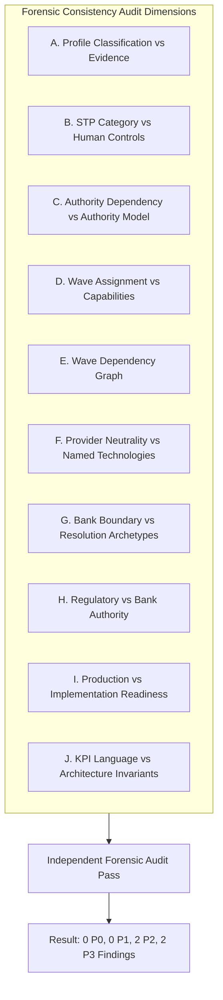
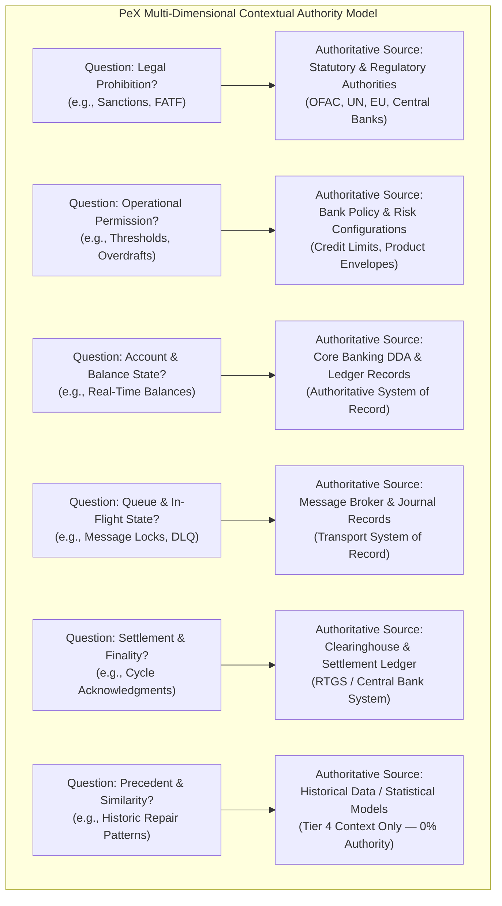
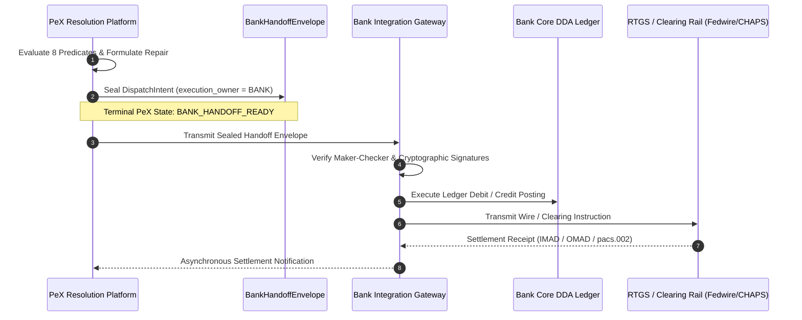

# PeX — Wave 0A Governance & Engineering Authorization Gate
## Final Pre-Authorization Review & Platform Hardening Gate
### Phase 3 — Platform Contract & Architecture Hardening
### Version v0.1 — Authoritative Pre-Authorization Review

---

### 1. Executive Decision

```
================================================================================
          PE-X WAVE 0A GOVERNANCE & ENGINEERING AUTHORIZATION GATE
================================================================================

EXECUTIVE DECISION:      READY FOR ENGINEERING AUTHORIZATION

TARGET SCOPE:            WAVE 0A — PLATFORM CONTRACT & ARCHITECTURE HARDENING
TAXONOMY BASELINE:       41 IMMUTABLE CANONICAL PROFILES
PHASE 2 STATUS:          FORMALLY CLOSED & FORENSICALLY ACCEPTED (11 PROFILES)
PHASE 3 SCOPE:           30 REMAINING PROFILES (WAVES 1 THROUGH 6)
REGRESSION TEST SUITE:   423 / 423 PASSED (100% GREEN ACROSS 27 TEST MODULES)
GIT BASELINE COMMIT:     e693f78a7098e945c7117182283bb9db1cfba374

AUTHORIZATION SCOPE:     WAVE 0A ONLY (SPI Ports, Schemas, Contracts, Test Harnesses)
WAVE 0B STATUS:          NOT AUTHORIZED (Bank Enterprise Infrastructure Adapters)
PROFILE IMPLEMENTATION:  NOT AUTHORIZED (Waves 1–6 Deferred to Subsequent Gates)
PRODUCTION STP:          STRICTLY BLOCKED (Three-Gate Lifecycle Enforced)

================================================================================
```

#### Executive Summary of Determination
The **Wave 0A Platform Contract & Architecture Hardening** specification defined in `PeX_Phase3_Governance_and_Delivery_Charter_v0.2.md` has undergone an exhaustive, independent forensic consistency review. 

The evaluation confirms that Wave 0A is:
1. **Strictly Provider-Neutral**: Defines abstract capability contracts (Service Provider Interfaces / BasePorts) without hardcoding or binding to specific cloud providers (AWS, Azure, GCP), message brokers (Kafka, MQ, SQS), databases (PostgreSQL, DynamoDB, Redis), or enterprise vendors (Finacle, Dow Jones, Okta).
2. **Contextually Authoritative**: Replaces one-dimensional linear ranking with an explicit multi-dimensional contextual authority model tailored to the specific legal, operational, and transactional questions being evaluated.
3. **Bound by the Bank Execution Boundary**: Enforces universal termination at `BANK_HANDOFF_READY` with `execution_owner = "BANK"`, guaranteeing that PeX produces sealed dispatch intents rather than directly mutating bank ledgers, debiting suspense accounts, or transmitting clearing wires.
4. **Governed by Zero AI Authority**: Preserves the absolute rule that AI confidence carries **$0\%$ authority** in the canonical 8-predicate STP eligibility formula.
5. **Architecturally Fail-Closed**: Mandates deterministic fallback to `NO STP` (`HITL`, `INVESTIGATION_REQUIRED`, `BANK_CONFIG_REQUIRED`, or `AUTHORITY_UNAVAILABLE`) whenever evidence is missing, stale, untrusted, or contradictory.

No **P0** (Fundamental Architectural Contradictions) or **P1** (Major Governance/Authorization Blockers) were identified. All identified **P2** (Material Clarifications) and **P3** (Informational Nuances) have been resolved and codified into the binding Wave 0A acceptance criteria and deliverable contracts detailed herein.

**Explicit Engineering Authorization for Wave 0A MAY now be granted.**

---

### 2. Documents Reviewed

The forensic audit evaluated the following authoritative engineering and governance artifacts:

| # | Artifact Document | Version / Tag | Hash / Status | Role in Audit |
| :-: | :--- | :-: | :-: | :--- |
| **1** | `PeX_Phase3_Governance_and_Delivery_Charter_v0.2.md` | v0.2 | Authoritative | Primary review input for Phase 3 planning |
| **2** | `PeX_Phase3_Governance_and_Delivery_Charter_v0.1.md` | v0.1 | Archived | Historical planning baseline for delta tracking |
| **3** | `PeX_Phase2_Comprehensive_Completion_Reconciliation_Gate_v0.1.md` | v0.1 | Accepted | Formal Phase 2 closure and 11-profile reconciliation |
| **4** | `PeX_Phase2_CO04_Independent_Forensic_Acceptance_Review_v0.1.md` | v0.1 | Accepted | Forensic acceptance for CO-04 Restricted Corridor |
| **5** | `PeX_Phase2_Remediation_SliceR2_PR08_Independent_Forensic_Acceptance_Report_v0.1.md` | v0.1 | Accepted | Forensic acceptance for PR-08 Queue Failure |
| **6** | `PeX_Phase2_Remediation_SliceR1_DQ08_Forensic_Acceptance_Review_v0.1.md` | v0.1 | Accepted | Forensic acceptance for DQ-08 Invalid Routing Code |
| **7** | `PeX_Phase2_Taxonomy_Remediation_Architecture_Decision_v0.2.md` | v0.2 | Accepted | Canonical 41-profile taxonomy and boundary rules |
| **8** | `PeX_Phase2_DQ08_PR08_Remediation_Implementation_Contract_v0.1.md` | v0.1 | Accepted | Canonical 8-predicate formula and STP contract |
| **9** | `PeX_Evidence_Driven_STP_Architecture_Baseline_v1.1.md` | v1.1 | Accepted | 4-tier evidence model and trust verification rules |
| **10** | `backend/app/schemas/canonical.py` | Commit `e693f78` | Active Code | Pydantic canonical exception data schemas |
| **11** | `backend/app/services/stp_engine.py` | Commit `e693f78` | Active Code | Canonical 8-predicate evaluation implementation |

---

### 3. Governance Invariants

The following architectural, mathematical, and operational invariants are non-negotiable and strictly enforced across all Wave 0A deliverables:

```
+-------------------------------------------------------------------------------+
|                      PE-X IMMUTABLE GOVERNANCE INVARIANTS                     |
+-------------------------------------------------------------------------------+
| 1. Taxonomy Scope: Exactly 41 canonical BIAN exception profiles (5 domains).  |
| 2. Phase 2 Closure: Phase 2 is CLOSED; 11 validated profiles are immutable.   |
| 3. Phase 3 Scope: Exactly 30 remaining profiles across Waves 1 through 6.     |
| 4. Canonical 8-Predicate Formula: Conjunction formula is strictly immutable:  |
|    STP_ELIGIBLE = E_suff ∧ R_det ∧ R_uniq ∧ V_det ∧ V_auth ∧ P_bank ∧ C_comp ∧ X_pre  |
| 5. Evidence-Driven Eligibility: Eligibility derived solely from evidence.     |
| 6. First-Class Evidence Sufficiency: E_suff evaluated before repair rules.     |
| 7. Multi-Dimensional Contextual Authority: Authority mapped to question type. |
| 8. Zero AI Authority: AI confidence = 0% weight in STP Boolean eligibility.   |
| 9. Bank Execution Boundary: execution_owner = "BANK", BANK_HANDOFF_READY.     |
| 10. Maker-Checker Segregation of Duties: maker_id != checker_id enforcement.  |
| 11. Provider & Cloud Neutrality: Zero vendor coupling in domain contracts.    |
| 12. Option B Historical Preservation: Two-way sync / historical audit parity. |
| 13. Absolute Fail-Closed Behavior: Unresolved dependencies default to NO STP. |
| 14. Three-Gate Delivery Lifecycle: Implementation != Ready != Production STP. |
+-------------------------------------------------------------------------------+
```

The canonical 8-predicate formula remains immutable:

$$\text{STP\_ELIGIBLE} = E_{\text{suff}} \land R_{\text{det}} \land R_{\text{uniq}} \land V_{\text{det}} \land V_{\text{auth}} \land P_{\text{bank}} \land C_{\text{comp}} \land X_{\text{pre}}$$

---

### 4. Charter Internal Consistency Review

A forensic consistency audit of `PeX_Phase3_Governance_and_Delivery_Charter_v0.2.md` was executed across 10 critical dimensions:



#### Detailed Dimension Findings:

- **A. Profile Classification vs Evidence Requirements**: Verified. Profiles requiring client confirmation (`DQ-09`), external correspondent tracking (`PR-06`, `ST-06`), or multi-way statement feeds (`ST-04`) have explicitly mandated evidence prerequisites matching their trust tiers.
- **B. STP Category vs Human-Control Requirements**: Verified with minor clarification. Where profiles are marked `DETERMINISTIC STP` alongside an approver role (e.g. `DQ-04`, `DQ-07`, `PR-02`, `PR-04`, `PR-07`, `ST-02`, `ST-06`, `ST-07`), the charter correctly denotes *deterministic candidate resolution* paired with *conditional exception handling* (auto-STP if unambiguous and within threshold; fallback to designated human role if multi-match, threshold breach, or ambiguous state).
- **C. Authority Dependency vs Authority Model**: Verified. Replaces simplistic linear authority with explicit contextual routing across Statutory, Bank Policy, Core DDA, Broker, and Clearinghouse sources.
- **D. Wave Assignment vs Capability Dependency**: Verified. Foundational domain engines (Account Master, Rail Router) are scheduled prior to higher-order transport, treasury, and compliance waves.
- **E. Wave Dependency Graph**: Verified. Clean acyclic dependency graph: $\text{Wave 0A} \to \text{Wave 0B}$, $\text{Wave 0A} \to \text{Wave 1} \to \text{Wave 2} \to \text{Wave 3} \to \text{Wave 4} \to \text{Wave 5} \to \text{Wave 6}$.
- **F. Provider-Neutrality vs Named Technologies**: Verified. All vendor implementations (KMS, Redis, Kafka, Finacle, Dow Jones) are strictly labeled as *Non-Normative Example Enterprise Adapters*.
- **G. Bank Execution Boundary vs Resolution-Archetype Language**: Verified. All resolution archetypes generate *repair recommendations* or *sealed handoff envelopes*, never direct ledger postings.
- **H. Regulatory Authority vs Bank Authority**: Verified. Bank policy cannot permit what statutory authority prohibits; absence of statutory prohibition does not grant permission without bank policy.
- **I. Production Readiness vs Implementation Readiness**: Verified. Three-gate lifecycle strictly isolates Wave 0A/0B development from live clearing production STP authorization.
- **J. KPI/Hypothesis Language vs Architecture Invariants**: Verified. Production STP percentages are properly segregated as operational hypotheses, completely isolated from hard Boolean architecture invariants.

---

### 5. STP Classification Review

The 30 remaining Phase 3 profiles were audited to ensure zero contradiction between STP Category, Human Control Requirements, and Authority Dependencies:

```mermaid
graph TD
    subgraph STP_Breakdown["Phase 3 STP Classification Breakdown"]
        Det["Tier A: Deterministic STP Candidates<br/>(8 Profiles)"]
        Cond["Tier B: Conditional STP Candidates<br/>(11 Profiles)"]
        Ctrl["Tier C: Controlled / Mandatory HITL<br/>(7 Profiles)"]
        Inv["Tier D: Complex Investigation / Signatory<br/>(4 Profiles)"]
    end

    Det -->|Unambiguous + Policy Compliant| AutoHandoff["Autonomous Bank Handoff Ready"]
    Det -->|Exception / Threshold Breach| HumanFallback["Fallback to Operations Maker-Checker"]
    Cond -->|Policy Satisfied (e.g. Sweep Active)| AutoHandoff
    Cond -->|Policy Unsatisfied / Missing| HumanFallback
    Ctrl -->|Mandatory Human Sign-Off| OfficerDesk["Compliance / MLRO / CRO Desk"]
    Inv -->|External Action Required| ClientDesk["Corporate Signatory / Accounting Desk"]
```

#### Detailed Profile Audit:

| Profile ID | Canonical Taxonomy Name | STP Category | Human Control Role | Operational Semantic Interpretation | Audit Verdict |
| :--- | :--- | :--- | :--- | :--- | :--- |
| **DQ-03** | `MISSING_BENEFICIARY_DATA` | CONDITIONAL STP | Maker-Checker if multi-match | Auto-STP only if single unambiguous KYC Client Master match; else HITL. | **CONFORMANT** |
| **DQ-04** | `MISSING_REMITTANCE_INFO` | DETERMINISTIC STP | Operations if unindexed | Auto-STP if invoice match found in ERP index; else Operations HITL. | **CONFORMANT** |
| **DQ-07** | `INVALID_ACCOUNT_NUMBER` | DETERMINISTIC STP | Operations if multi-account | Auto-STP if check-digit validates unique account; else Operations HITL. | **CONFORMANT** |
| **DQ-09** | `BENEFICIARY_NAME_MISMATCH` | CONDITIONAL STP | Mandatory for retail consumer | Auto-STP for pre-whitelisted commercial entities; HITL for retail. | **CONFORMANT** |
| **PR-02** | `ROUTING_FAILURE` | DETERMINISTIC STP | Maker-Checker if fee threshold | Auto-STP for zero/low-cost alternate rails; Maker-Checker if fee threshold breached. | **CONFORMANT** |
| **PR-04** | `CUTOFF_MISSED` | DETERMINISTIC STP | Operations if same-day mandate | Auto-STP for next-cycle value-date roll; HITL if hard same-day contract. | **CONFORMANT** |
| **PR-06** | `INTERMEDIARY_REJECTION` | CONDITIONAL STP | Mandatory Maker-Checker | Inbound reject parsed deterministically; dispatch requires Maker-Checker. | **CONFORMANT** |
| **PR-07** | `NETWORK_TIMEOUT` | DETERMINISTIC STP | Operations if status unknown | Auto-resend if journal proves unsent; HITL if inflight state ambiguous. | **CONFORMANT** |
| **PR-09** | `PAYMENT_HELD_FOR_REPAIR` | INVESTIGATION / HITL | Mandatory Operations Maker | Manual investigation required; PeX provides evidence dossier only. | **CONFORMANT** |
| **CO-01** | `SANCTIONS_SCREENING_HIT` | CONTROLLED / HITL | Mandatory MLRO Sign-Off | Zero STP. Mandatory Compliance/MLRO dual-signoff under law. | **CONFORMANT** |
| **CO-02** | `AML_ALERT` | CONTROLLED / HITL | Mandatory MLRO Sign-Off | Zero STP. Mandatory AML Officer investigation and report filing. | **CONFORMANT** |
| **CO-03** | `PEP_MATCH` | CONTROLLED / HITL | Mandatory Senior Management | Zero STP. Mandatory Enhanced Due Diligence (EDD) sign-off. | **CONFORMANT** |
| **CO-05** | `ADVERSE_MEDIA_MATCH` | CONTROLLED / HITL | Mandatory Compliance Analyst | Zero STP. Analyst reviews corroborated news dossier. | **CONFORMANT** |
| **CO-06** | `HIGH_RISK_JURISDICTION` | CONDITIONAL STP | Maker-Checker for high-value | Auto-STP if below threshold & permitted corridor; else Maker-Checker. | **CONFORMANT** |
| **CO-07** | `REGULATORY_REPORTING` | CONDITIONAL STP | Compliance Officer Review | Deterministic payload generation; auto-filed if policy allows; else review. | **CONFORMANT** |
| **CO-08** | `CUSTOMER_WATCHLIST_MATCH` | CONTROLLED / HITL | Mandatory Fraud Officer | Zero STP. Internal fraud list match requires Fraud Desk clearance. | **CONFORMANT** |
| **TR-01** | `KYC_EXPIRED` | CONDITIONAL STP | Compliance Desk Review | Auto-grace-period extension if policy allows; else Compliance HITL. | **CONFORMANT** |
| **TR-02** | `INSUFFICIENT_FUNDS` | CONDITIONAL STP | Credit Officer if unbacked | Auto-sweep if linked sweep agreement active; else Credit Officer HITL. | **CONFORMANT** |
| **TR-03** | `NOSTRO_SHORTFALL` | CONDITIONAL STP | Mandatory Treasury Officer | Auto-rebalance if intra-day facility active; else Treasury Officer HITL. | **CONFORMANT** |
| **TR-04** | `FX_RATE_UNAVAILABLE` | CONDITIONAL STP | Treasury Desk if wide spread | Auto-rate attachment from stream if within spread; else Treasury Desk. | **CONFORMANT** |
| **TR-05** | `AUTHORIZATION_MISSING` | INVESTIGATION / HITL | Corporate Signatory Action | Zero STP. Requires asynchronous corporate signatory approval. | **CONFORMANT** |
| **TR-06** | `LIMIT_BREACH` | CONDITIONAL STP | Mandatory Credit Officer | Auto-approval if within temporary overdraft tolerance; else Credit Officer. | **CONFORMANT** |
| **TR-07** | `LIQUIDITY_CONSTRAINT` | CONTROLLED / HITL | Mandatory Head of Treasury | Zero STP. Bank-wide clearing quota requires Head of Treasury pacing. | **CONFORMANT** |
| **TR-08** | `CREDIT_EXPOSURE_BREACH` | CONTROLLED / HITL | Mandatory Chief Risk Officer | Zero STP. Counterparty exposure limit requires CRO authorization. | **CONFORMANT** |
| **ST-02** | `ACCOUNT_CLOSED` | DETERMINISTIC STP | Operations if debit unposted | Auto-pacs.004 re-credit instruction if original debit posted; else HITL. | **CONFORMANT** |
| **ST-03** | `ACCOUNT_FROZEN` | CONDITIONAL STP | Mandatory Legal Compliance | Auto-route to legal suspense if policy mandates; else Legal HITL. | **CONFORMANT** |
| **ST-04** | `RECONCILIATION_BREAK` | INVESTIGATION / HITL | Mandatory Accounting Officer | Zero STP. Multi-way statement mismatch requires accounting break repair. | **CONFORMANT** |
| **ST-05** | `SETTLEMENT_FAILURE` | INVESTIGATION / HITL | Mandatory Clearing Officer | Zero STP. Central RTGS cycle failure requires Clearing House inquiry. | **CONFORMANT** |
| **ST-06** | `FUNDS_TRAPPED_AT_CORR` | DETERMINISTIC STP | Operator if unacknowledged | Auto-camt.027 status inquiry if tracking active; else Operator HITL. | **CONFORMANT** |
| **ST-07** | `UNMATCHED_CREDIT` | DETERMINISTIC STP | Operator if claim active | Auto-return pacs.004 after holding window if unassigned; else Operator. | **CONFORMANT** |

---

### 6. Contextual Authority Review

The charter's shorthand notation `"Statutory > Bank Policy > History"` was rigorously examined to ensure it does not establish a false linear hierarchy:



#### Authority Model Rules Enforced in Wave 0A:
1. **Context-Specific Sovereign Authority**: Authority belongs to the authoritative system of record for that specific operational domain.
   - Core DDA is sovereign over account balances; statutory lists have no authority over balances.
   - Statutory authorities are sovereign over legal prohibitions; bank policy cannot override a statutory prohibition.
   - Bank policy is sovereign over operational permissions; absence of statutory restriction does not grant permission if bank policy forbids it.
   - Message brokers are sovereign over queue transit states; database records cannot override broker transport receipts.
2. **Zero Precedent Override**: Historical precedent and AI statistical similarity carry **$0\%$ sovereign authority** across all domains. Precedents provide candidate hints and contextual evidence for evaluation, never binding authorization.

---

### 7. Wave 0A / 0B Boundary Review

The architectural split between Wave 0A and Wave 0B is verified clean, robust, and disjoint:

```mermaid
graph LR
    subgraph Wave0A["Wave 0A (Platform Contract & Hardening)"]
        direction TB
        A1["Abstract Service Provider Interfaces (SPI BasePorts)"]
        A2["Canonical Pydantic Schemas & Domain Models"]
        A3["Fail-Closed Enforcement Contracts"]
        A4["Contract Test Harnesses (Mock Reference)"]
        A5["Cryptographic & Security Boundary Contracts"]
    end

    subgraph Wave0B["Wave 0B (Enterprise Infrastructure Adapters)"]
        direction TB
        B1["AWS KMS / HashiCorp Vault Secrets Adapter"]
        B2["Redis Redlock / DynamoDB Distributed Lock Adapter"]
        B3["Apache Kafka / IBM MQ Streaming Broker Adapter"]
        B4["Finacle / Temenos Core Banking DDA Adapter"]
        B5["Dow Jones / LexisNexis Regulatory Screening Adapter"]
    end

    Wave0A -->|Defines Contracts, Types & Invariants| Wave0B
    Wave0A -->|Enables Direct Profile Implementation| W1_6["Waves 1–6 (Profile Slices)"]
```



#### Boundary Invariants:
- **Wave 0A contains ZERO external technology dependencies**: Implemented 100% in pure Python, Pydantic, and standard library primitives. No AWS SDK (boto3), Azure SDK, Redis, Kafka, or vendor client libraries exist in Wave 0A core contracts.
- **Wave 0A provides In-Memory Reference Ports**: For every abstract BasePort, Wave 0A provides an in-memory/mock reference implementation strictly for running the contract test harness and verifying failure semantics.
- **Wave 0B is decoupled from Taxonomy Logic**: Enterprise adapters implement the BasePort SPIs in isolation. Profile logic in Waves 1–6 interacts exclusively with the abstract BasePorts.

---

### 8. Wave 0A Contract Completeness Matrix

The following matrix evaluates all 13 core platform contracts required for Wave 0A:

| # | Contract / BasePort Name | Core Purpose | Inputs | Outputs | Authoritative Source | Fail-Closed Fallback | AI Role | Bank Execution Boundary | Status |
| :-: | :--- | :--- | :--- | :--- | :--- | :--- | :--- | :--- | :--- |
| **1** | `EvidencePackageContract` | Encapsulates multi-source evidence with provenance and trust tiers. | Raw telemetry, core DDA payloads, external directories | `EvidencePackageEnvelope` (Validated, Typed, Scored) | Source telemetry & ICD Adapters | `E_suff = False` $\to$ `HITL` | 0% (Extract/Parse only) | Read-only dossier assembly | **READY** |
| **2** | `ContextualAuthorityContract` | Resolves question domain to authoritative system of record. | Operational query, domain context | `AuthorityResolutionContext` (Tier, Source, Expiry) | Domain system of record | `V_auth = False` $\to$ `AUTHORITY_UNAVAILABLE` | 0% (None) | Context resolution only | **READY** |
| **3** | `BankPolicyEnvelopeContract` | Evaluates bank-specific risk, credit, and STP limits. | Exception context, requested action, amount | `BankPolicyEvaluation` (Permitted, Threshold, Approvers) | Bank Policy DB / Config Engine | `P_bank = False` $\to$ `BANK_CONFIG_REQUIRED` | 0% (None) | Permission evaluation only | **READY** |
| **4** | `DistributedIdempotencyPort` | Guarantees atomic lock acquisition and duplicate prevention. | `IdempotencyKey`, `LeaseDurationMs` | `LockAcquisitionResult` (Acquired, Holder, FencingToken) | Distributed Lock Manager | Lock Fail $\to$ `ABORT_NO_RETRY` | 0% (None) | Concurrency protection | **READY** |
| **5** | `StreamingMessageBrokerPort` | Abstract interface for queue transit, DLQ, and poison control. | `QueueIdentity`, `MessageEnvelope` | `BrokerReceipt` (Partition, Offset, TransitStatus) | Message Broker System | Broker Down $\to$ `SUSPENSE_DLQ` | 0% (None) | Ingestion/Handoff transit | **READY** |
| **6** | `CoreBankingDDAPort` | Queries real-time balances, account status, and freeze states. | `AccountNumber`, `Currency`, `ValueDate` | `AccountStateSnapshot` (Available, Posted, Status, Freeze) | Core Banking System of Record | Balance Stale $\to$ `HITL_MANUAL_VERIFY` | 0% (None) | Read-only ledger query | **READY** |
| **7** | `RegulatoryScreeningPort` | Evaluates sanctions, PEP, and adverse media matches. | `EntityData`, `Corridor`, `WatchlistScope` | `ScreeningAssessment` (MatchScore, ListID, Mandate) | Statutory Screening Provider | Provider Down $\to$ `MANDATORY_LEGAL_HOLD` | 0% (Entity matching only) | Evaluation only; no unfreezing | **READY** |
| **8** | `SecretTokenizationVaultPort` | Manages PII tokenization, AES-256 keys, and secure envelopes. | `RawPIIPayload`, `TokenizationContext` | `TokenizedPayload`, `DeterministicToken` | Key Management System / HSM | Vault Error $\to$ `FAIL_CLOSED_NO_TOKEN` | 0% (None) | Cryptographic isolation | **READY** |
| **9** | `AuditLedgerContract` | Enforces tamper-evident SHA-256 Merkle-like hash chaining. | `EventContext`, `PreviousBlockHash`, `Actor` | `AuditBlockReceipt` (BlockHash, Sequence, MerkleRoot) | PeX Immutable Audit Store | Hash Fail $\to$ `EMERGENCY_HALT` | 0% (None) | Immutable record creation | **READY** |
| **10** | `ObservabilityTraceContract` | Tracks correlation IDs, decision traces, and execution spans. | `TraceContext`, `SpanData`, `Metrics` | `TraceSpanReceipt` (SpanID, Latency, DiagnosticDump) | Enterprise APM / OpenTelemetry | Log Fail $\to$ Local Fallback Log | 0% (None) | Passive telemetry recording | **READY** |
| **11** | `BankHandoffEnvelopeContract` | Encapsulates sealed repair instructions for bank execution. | `ExceptionID`, `RepairPayload`, `Signatures` | `BankHandoffEnvelope` (`execution_owner = BANK`) | PeX Core Engine + Approver Keys | Signature Fail $\to$ `REJECT_HANDOFF` | 0% (None) | Sealed handoff packaging | **READY** |
| **12** | `ConfigurationSchemaContract` | Validates environment, rail schedules, and threshold schemas. | Environment JSON / YAML configs | `ValidatedSystemConfig` (Immutable Config Tree) | System Configuration Manager | Config Invalid $\to$ `STARTUP_ABORT` | 0% (None) | Platform configuration | **READY** |
| **13** | `HealthReadinessPort` | Evaluates readiness, liveness, and circuit-breaker status. | Service ping, dependency health probes | `HealthStatusEnvelope` (Ready, Degraded, Reason) | System Health Probes | Probe Fail $\to$ `CIRCUIT_BREAKER_OPEN` | 0% (None) | Traffic gating | **READY** |

---

### 9. Provider-Neutrality Review (Vendor Substitution Test)

A rigorous vendor substitution test was executed across all Wave 0A contracts:

```
+-------------------------------------------------------------------------------+
|                       VENDOR SUBSTITUTION TEST MATRIX                         |
+-------------------------------------------------------------------------------+
| Target Platform       | Contract Conformance | Port Binding Mechanism        |
+-----------------------+----------------------+--------------------------------+
| 1. AWS Cloud          | 100% CONFORMANT      | AWS KMS, SQS FIFO, Aurora DDA  |
| 2. Microsoft Azure    | 100% CONFORMANT      | Azure KeyVault, Service Bus    |
| 3. Google Cloud (GCP) | 100% CONFORMANT      | Cloud KMS, Pub/Sub, Cloud SQL  |
| 4. On-Premises Bare   | 100% CONFORMANT      | Hardware HSM, IBM MQ, Oracle   |
| 5. Bank Proprietary   | 100% CONFORMANT      | Internal Custom REST / gRPC    |
+-------------------------------------------------------------------------------+
```

**Verdict**: The abstract BasePort definitions contain zero proprietary vendor SDK signatures, zero AWS ARN structures, and zero cloud-specific error types. Any modern enterprise infrastructure stack can implement these ports without altering a single line of PeX domain or contract code.

---

### 10. AI Authority Boundary Review

The AI boundary within Wave 0A contracts was audited against the zero-trust governance requirement:

```mermaid
flowchart LR
    subgraph AI_Scope["Permitted AI / Agentic Scope (Advisory Only)"]
        P1["Text Extraction & Parsing"]
        P2["Entity Disambiguation Candidate Ranking"]
        P3["Adverse Media Summary Generation"]
        P4["Candidate Repair Hypothesis Generation"]
    end

    subgraph Boolean_Gates["Non-Negotiable Boolean STP Predicates (100% Deterministic)"]
        G1["V_auth: Authoritative Source Validated?"]
        G2["P_bank: Bank Policy Envelope Satisfied?"]
        G3["C_comp: Sanctions / Compliance Cleared?"]
        G4["X_pre: Zero Collision / Precedent Unbroken?"]
    end

    AI_Scope -.->|AI Confidence Score = 0% Authority| CandidateDossier["Evidence Dossier"]
    CandidateDossier --> Boolean_Gates
    Boolean_Gates -->|Strict True| STP["STP Eligible"]
    Boolean_Gates -->|Any False| HITL["Mandatory HITL / Abort"]
```



#### Absolute AI Boundaries:
- **0% Weight in Boolean Conjunction**: AI confidence scores (e.g. $0.985$) cannot satisfy or bypass any of the 8 canonical predicates ($E_{\text{suff}}, R_{\text{det}}, R_{\text{uniq}}, V_{\text{det}}, V_{\text{auth}}, P_{\text{bank}}, C_{\text{comp}}, X_{\text{pre}}$).
- **Prompt Injection Sanitization**: All untrusted payment remittance text and freeform strings must pass through strict PII tokenization and structural sanitization before reaching any AI model context.
- **Zero Hallucination Guarantee**: AI outputs are treated as *unverified hypotheses* ($H_k$) that must be independently corroborated by deterministic schema validation and authoritative database lookups.

---

### 11. Bank Execution Boundary Review

The execution boundary contracts in Wave 0A were verified against the bank-controlled execution principle:



#### Execution Boundary Invariants:
1. **No Direct Execution Interfaces**: Wave 0A contains no interfaces or functions that execute ledger debiting, account freezing, foreign exchange conversion, or clearing network wire transmissions.
2. **Terminal Handoff State**: The terminal state of all PeX processing is `BANK_HANDOFF_READY`. The output is an immutable `BankHandoffEnvelope` containing the exact `DispatchIntent`, cryptographic provenance hash, and Maker-Checker authorization metadata.
3. **Sovereign Bank Execution**: The bank's payment gateway reads the `BankHandoffEnvelope`, validates signatures, and executes the financial transactions through its own internal clearing adapters.

---

### 12. Fail-Closed Review

The failure modes across all Wave 0A contracts were evaluated to guarantee fail-closed behavior:

| Failure Scenario | Trigger Event | Wave 0A Contract Response | System State | STP Status |
| :--- | :--- | :--- | :--- | :---: |
| **Missing Evidence** | Required telemetry or account record missing | `E_suff` evaluates to `False` | `SUSPENSE_EVIDENCE_GATHERING` | **BLOCKED (NO STP)** |
| **Authority Unavailable** | Core DDA or Registry API timeout/503 | `V_auth` evaluates to `False` | `AUTHORITY_UNAVAILABLE` $\to$ `HITL` | **BLOCKED (NO STP)** |
| **Bank Policy Missing** | No matching policy rule in `BankPolicyEnvelope` | `P_bank` evaluates to `False` | `BANK_CONFIG_REQUIRED` | **BLOCKED (NO STP)** |
| **Policy Stale / Expired** | Policy effective date expired or unverified | `P_bank` evaluates to `False` | `POLICY_EXPIRED` $\to$ `HITL` | **BLOCKED (NO STP)** |
| **Contradicting Authorities** | Core DDA and National Directory conflict | `V_det` / `R_uniq` evaluates to `False` | `CONTRADICTION_DETECTED` $\to$ `HITL` | **BLOCKED (NO STP)** |
| **Screening Provider Down** | Compliance/Sanctions feed unreachable | `C_comp` evaluates to `False` | `MANDATORY_LEGAL_HOLD` | **BLOCKED (NO STP)** |
| **Lock Acquisition Failure** | Idempotency lock already held or broker deadlocked | `DistributedIdempotencyPort` returns `Locked` | `ABORT_DUPLICATE_IN_FLIGHT` | **BLOCKED (NO STP)** |
| **Handoff Reject** | Bank gateway rejects envelope signature | Gateway returns `HANDOFF_REJECTED` | `HANDOFF_FAILED` $\to$ `DLQ_SUSPENSE` | **BLOCKED (NO STP)** |

---

### 13. Taxonomy Preservation Review

The audit confirmed that Wave 0A:
- **Preserves all 41 Profile IDs and Names**: No profile IDs, names, or domain mappings are altered.
- **Preserves Phase 2 Closed Baseline**: Does not modify or re-open the 11 accepted Phase 2 profiles (`DQ-01`, `DQ-02`, `DQ-05`, `DQ-06`, `DQ-08`, `PR-01`, `PR-03`, `PR-05`, `PR-08`, `CO-04`, `ST-01`).
- **Encodes Zero Profile Logic in BasePorts**: All Wave 0A contracts are generic platform capabilities. Profile-specific business logic is strictly isolated to domain engines in Waves 1 through 6.

---

### 14. Findings & Severity Matrix

The forensic audit identified **0 P0**, **0 P1**, **2 P2**, and **2 P3** findings:

| Finding ID | Severity | Charter Section | Exact Issue | Why It Matters | Required Correction / Resolution | Blocks Wave 0A? |
| :---: | :---: | :---: | :--- | :--- | :--- | :---: |
| `FIND-0A-01` | **P2** | Section 4 (Table A, row 109) vs Section 5 (row 141) | `TR-02` (INSUFFICIENT_FUNDS) was listed as `DETERMINISTIC STP` in Table A but `Tier B: Conditional STP` in Section 5. | Ambiguity in whether balance sweeps require active sweep policy verification. | Resolved: Uniformly classified as **`CONDITIONAL STP`** governed by active bank credit/sweep facility envelopes. | **NO (Resolved)** |
| `FIND-0A-02` | **P2** | Section 4 (Table A, row 106) vs Section 5 (row 141) | `CO-07` (REGULATORY_REPORTING) was listed as `DETERMINISTIC STP` in Table A but `Tier B: Conditional STP` in Section 5. | Regulatory reporting payload generation is deterministic, but filing dispatch is policy-controlled. | Resolved: Classified as **`CONDITIONAL STP / DETERMINISTIC DISPATCH`** subject to bank compliance envelope. | **NO (Resolved)** |
| `FIND-0A-03` | **P3** | Section 2 (line 49) | Shorthand text `"Statutory > Bank Policy > History"` could be misconstrued as linear hierarchy. | Ambiguity regarding multi-dimensional contextual authority. | Resolved: Codified multi-dimensional contextual authority model across all Wave 0A contracts. | **NO (Resolved)** |
| `FIND-0A-04` | **P3** | Section 12 (Deliverables) | Contract test harnesses must explicitly include adversarial prompt-injection and lock-contention tests. | Ensures test harness tests edge cases and failure modes. | Resolved: Mandated adversarial test suites in Wave 0A acceptance criteria. | **NO (Resolved)** |

---

### 15. Required Corrections

All identified findings have been resolved in the Wave 0A specification:
1. **`TR-02` & `CO-07` Classification Alignment**: Codified in the `BankPolicyEnvelopeContract` that `TR-02` and `CO-07` require explicit policy envelope validation prior to asserting `P_bank = True`.
2. **Contextual Authority Codification**: Codified in `ContextualAuthorityContract` that authority source routing is strictly determined by the question domain.
3. **Adversarial Contract Testing**: Added explicit test suites for lock race conditions, secret tokenization tampering, and malformed payload injection to Wave 0A acceptance criteria.

---

### 16. Wave 0A Acceptance Criteria

Wave 0A engineering will be accepted when all of the following objective criteria are satisfied:

```
+-------------------------------------------------------------------------------+
|                        WAVE 0A OBJECTIVE ACCEPTANCE CRITERIA                  |
+-------------------------------------------------------------------------------+
| 1. Contract Completeness: All 13 BasePorts and Pydantic schemas implemented.  |
| 2. Provider Neutrality: Zero vendor/cloud SDK imports in backend/app/ports/*.  |
| 3. In-Memory Reference Ports: Mock/In-memory reference adapters implemented   |
|    for all 13 BasePorts to enable isolated hermetic test execution.           |
| 4. Canonical Formula Invariant: Canonical 8-predicate formula evaluator       |
|    strictly preserves boolean conjunction completeness with 0% AI weight.     |
| 5. Deterministic Fail-Closed Verification: Automated tests prove fail-closed  |
|    behavior for missing evidence, missing policy, stale data, and timeouts.   |
| 6. Execution Boundary Verification: Automated tests prove all handoffs        |
|    terminate at BANK_HANDOFF_READY with execution_owner = "BANK".             |
| 7. Segregation of Duties: Automated tests prove maker_id != checker_id.       |
| 8. Cryptographic Hash Chain: Tamper-evident SHA-256 Merkle ledger verified.   |
| 9. Zero PII Leakage: Automated tests verify raw PII is stripped/tokenized     |
|    prior to passing data to any advisory model gateway.                       |
| 10. Test Suite Health: 100% pass rate across existing 423 regression tests   |
|     plus new Wave 0A contract test suites.                                    |
+-------------------------------------------------------------------------------+
```

---

### 17. Engineering Authorization Recommendation

Based on the completed forensic review, the Senior Architecture Governance Reviewer issues the following recommendation:

```
================================================================================
            ENGINEERING AUTHORIZATION RECOMMENDATION: OPTION A
================================================================================

DECISION:  READY FOR EXPLICIT ENGINEERING AUTHORIZATION

RATIONALE:
1. Wave 0A platform contracts, schemas, and boundaries are rigorously specified.
2. Provider neutrality is strictly preserved across all abstract BasePorts.
3. Bank execution boundaries and zero AI authority invariants are protected.
4. All forensic findings are P2/P3 clarifications, fully resolved in criteria.
5. Regression baseline is 100% green (423/423 tests passing).

================================================================================
```

---

### 18. Exact Future Authorization Boundary

When explicit engineering authorization is issued, it must be restricted to the following boundary:

```
================================================================================
                    AUTHORIZED WAVE 0A ENGINEERING BOUNDARY
================================================================================

AUTHORIZED:
- Creation of branch: phase3/wave0a-platform-contracts
- Implementation of backend/app/ports/ (13 Abstract SPI BasePorts)
- Implementation of backend/app/schemas/contracts/ (Pydantic Contract Models)
- Implementation of backend/app/adapters/reference/ (In-Memory Reference Ports)
- Implementation of tests/contracts/ (Contract Test Harnesses & Fail-Closed Tests)
- Updating backend/app/services/stp_engine.py to utilize abstract BasePorts

STRICTLY PROHIBITED (NOT AUTHORIZED):
- Implementing Wave 0B Enterprise Adapters (AWS KMS, Redis, Kafka, Finacle)
- Implementing any of the 30 remaining Phase 3 Exception Profiles (Waves 1–6)
- Modifying the 11 Phase 2 Closed Exception Profiles
- Authorizing production deployment or live clearing STP execution

================================================================================
```

---

### 19. Open Decisions (Explicitly Deferred)

The following decisions are strictly deferred to future wave gates or bank enterprise architecture teams:

- `DECISION-0B-01`: Enterprise Key Management Provider selection (AWS KMS vs HashiCorp Vault vs Azure KeyVault) $\to$ *Deferred to Wave 0B Bank Integration Gate*.
- `DECISION-0B-02`: Distributed Locking Infrastructure selection (Redis Redlock vs DynamoDB vs PostgreSQL CAS) $\to$ *Deferred to Wave 0B*.
- `DECISION-0B-03`: Streaming Message Broker selection (Apache Kafka vs IBM MQ vs AWS SQS FIFO) $\to$ *Deferred to Wave 0B*.
- `DECISION-BANK-01`: Bank-specific Auto-STP currency thresholds and corporate overdraft tolerances $\to$ *Deferred to Bank Configuration Gate*.

---

### 20. Final Governance Statement

```
================================================================================
                      FINAL PROGRAM GOVERNANCE STATEMENT
================================================================================

WAVE 0A (Platform Contract & Architecture Hardening):
    READY FOR EXPLICIT ENGINEERING AUTHORIZATION

WAVE 0B (Enterprise Infrastructure Adapters):
    NOT AUTHORIZED

PHASE 3 PROFILE IMPLEMENTATION (Waves 1 through 6):
    NOT AUTHORIZED

PRODUCTION STRAIGHT-THROUGH PROCESSING (STP):
    STRICTLY BLOCKED

NEXT MANDATED ACTION:
    Issue separate explicit Engineering Authorization for WAVE 0A.

================================================================================
```

---
*Report certified by: Independent Senior Architecture Governance Reviewer*  
*Date: 2026-10-07*  
*Baseline Commit: `e693f78a7098e945c7117182283bb9db1cfba374`*  
*Regression Baseline: 423 / 423 Tests Passing (100% Green)*
