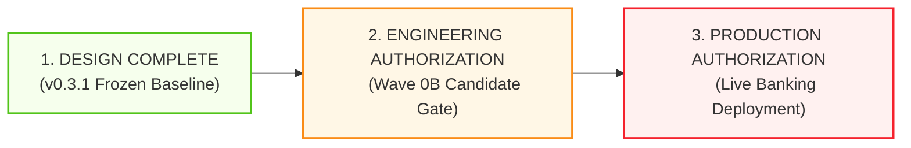
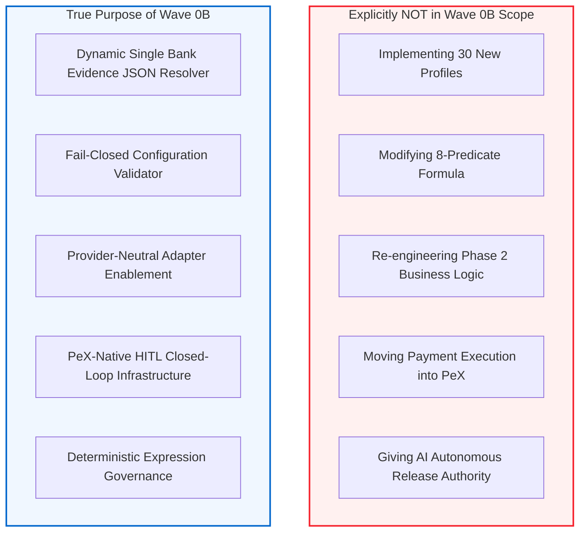
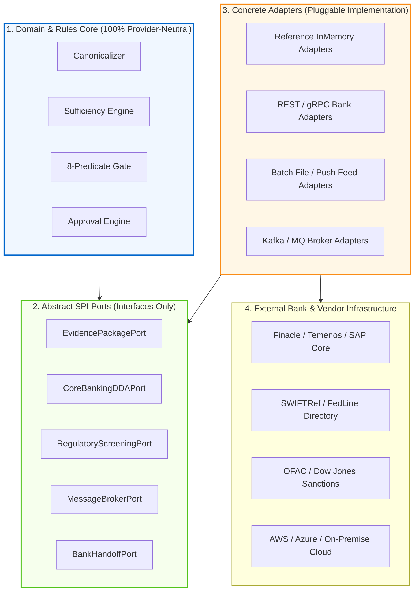
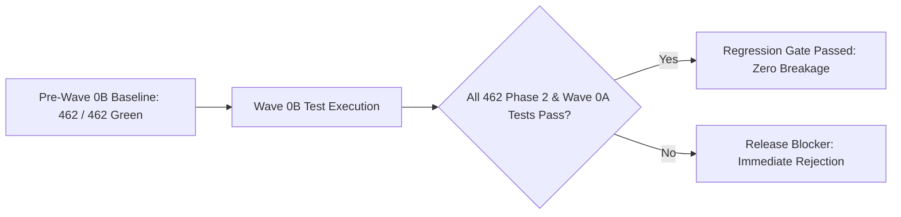
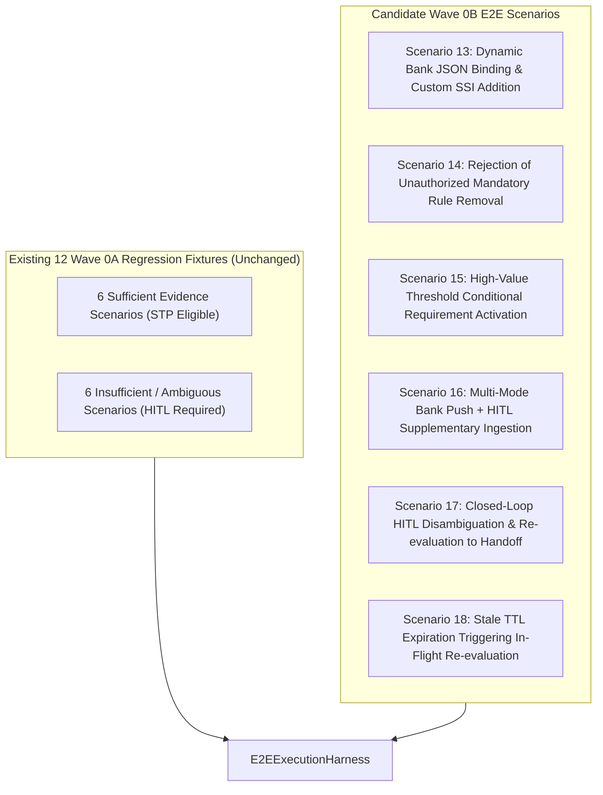

# PeX — Wave 0B Implementation Authorization Gate
## Governance & Implementation Authorization Specification
### Platform Runtime & Infrastructure Enablement Gate (Remediated Baseline)
**Document Version:** v0.1.1  
**Status:** DESIGN / AUTHORIZATION GATE COMPLETE — ENGINEERING NOT AUTHORIZED  
**Authoritative Baseline:** PeX Evidence Acquisition & Resolution Contract v0.3.1 (Frozen Baseline)  
**Precedence Lineage:** PeX Master PRD & Technical Blueprint v1.1 $\to$ Phase 2 Implementation Contract v1.3 $\to$ Phase 3 Governance Charter v0.2 $\to$ Wave 0A Platform Contracts (`3ee708d`) $\to$ E2E Execution Validation Report v0.1 $\to$ Contract v0.3.1 $\to$ Authorization Gate v0.1.1.

---

## 1. Document Change Log (v0.1 $\to$ v0.1.1 Targeted Governance Clarification)

This document incorporates three targeted governance clarifications identified during forensic review:

1. **Clarified Mode 2 / Direct API as Progressive & Optional (Remediation #1)**: Wave 0B operationalizes the governed four-mode acquisition architecture at the contract/interface level and implements only authorized adapters and reference/test integrations. Mode 2 (Automated Direct API) remains an optional, progressive SPI capability; production bank API integrations are separately deployable. Modes 1, 3, and 4 remain fully viable on Day 1 without requiring direct bank API access.
2. **Clarified Core Banking / Ledger Adapter Scope (Remediation #2)**: Wave 0B scope is limited to provider-neutral adapter contracts and controlled reference/in-memory adapters for validation. Production Core Banking, clearing gateway, or ledger connectors require separate bank-specific integration authorization; PeX does not become a system of record or obtain payment execution/accounting authority through Wave 0B.
3. **Clarified Four-Mode Acceptance Criteria (Remediation #3)**: Acceptance criteria verify contract/interface capability and authorized reference/test adapters rather than requiring live production bank connectors. The test matrix explicitly distinguishes contract capability, reference adapter capability, and production bank-specific integration.

*No architectural invariants changed. No implementation authorization granted. No source code or test changes authorized.*

---

## 2. Executive Summary & Authorization State

This document establishes the formal **Implementation Authorization Gate for Wave 0B (Platform Runtime & Infrastructure Enablement)**. 

Wave 0B serves as the technical and operational bridge between the abstract platform contracts established in Wave 0A and the business profile expansion scheduled for Wave 1. Its sole purpose is to operationalize the frozen architecture defined in [`PeX_Evidence_Acquisition_and_Resolution_Contract_v0.3.1.md`](file:///C:/Users/pawan/.gemini/antigravity/brain/c3f5b955-db50-474b-abe4-7055d673abfa/PeX_Evidence_Acquisition_and_Resolution_Contract_v0.3.1.md).

> [!IMPORTANT]
> **GOVERNANCE NOTICE: THIS DOCUMENT DOES NOT GRANT ENGINEERING AUTHORIZATION**  
> This artifact defines precisely what Wave 0B *would be authorized* to implement if and only if explicit, separate engineering authorization is granted. No source code, tests, schemas, or adapters may be modified based on the existence of this document alone.

### Formal Governance Tri-State Distinction:



1. **DESIGN COMPLETE**: Achieved with the publication of [`PeX_Evidence_Acquisition_and_Resolution_Contract_v0.3.1.md`](file:///C:/Users/pawan/.gemini/antigravity/brain/c3f5b955-db50-474b-abe4-7055d673abfa/PeX_Evidence_Acquisition_and_Resolution_Contract_v0.3.1.md).
2. **ENGINEERING AUTHORIZED**: **PENDING / NOT GRANTED** (Requires explicit human governance decision).
3. **PRODUCTION AUTHORIZED**: **STRICTLY BLOCKED** (Production autonomous STP and live core banking dispatch remain prohibited).

---

## 3. Current Governance Baseline & Lineage

| Platform Milestone | Governance Status | Cumulative Test Baseline | Authoritative Source Artifact |
|:---|:---:|:---:|:---|
| **Phase 2 Closure** | **CLOSED & ACCEPTED** | 423 / 423 Green | [`PeX_Phase2_Comprehensive_Completion_Reconciliation_Gate_v0.1.md`](file:///C:/Users/pawan/.gemini/antigravity/brain/c3f5b955-db50-474b-abe4-7055d673abfa/PeX_Phase2_Comprehensive_Completion_Reconciliation_Gate_v0.1.md) |
| **Wave 0A Contracts** | **CLOSED & ACCEPTED** | 462 / 462 Green | [`PeX_Wave0A_Implementation_Report_v0.1.md`](file:///C:/Users/pawan/.gemini/antigravity/brain/c3f5b955-db50-474b-abe4-7055d673abfa/PeX_Wave0A_Implementation_Report_v0.1.md) |
| **E2E JSON Validation** | **CLOSED & ACCEPTED** | 12 / 12 Fixtures Green | [`PeX_E2E_Execution_Validation_Report_v0.1.md`](file:///C:/Users/pawan/.gemini/antigravity/brain/c3f5b955-db50-474b-abe4-7055d673abfa/PeX_E2E_Execution_Validation_Report_v0.1.md) |
| **Evidence Contract v0.3.1**| **FROZEN & IMMUTABLE**| Design Approved | [`PeX_Evidence_Acquisition_and_Resolution_Contract_v0.3.1.md`](file:///C:/Users/pawan/.gemini/antigravity/brain/c3f5b955-db50-474b-abe4-7055d673abfa/PeX_Evidence_Acquisition_and_Resolution_Contract_v0.3.1.md) |
| **Wave 0B Enablement** | **AUTHORIZATION PENDING** | Baseline: 462 Green | *This Document* |
| **41-Profile Expansion** | **NOT AUTHORIZED** | Wave 1+ Scope | Deferred |
| **Production Autonomous STP**| **STRICTLY BLOCKED** | N/A | Invariant Platform Constraint |

---

## 4. Purpose & Boundaries of Wave 0B

Wave 0B is strictly an **infrastructure, runtime binding, and adapter enablement wave**.



### Core Purpose:
1. **Dynamic Configuration Binding**: Replace Wave 0A static test runner scaffolding (`mandatory_map`) with the dynamic runtime resolution of the **Single Published Bank Evidence Required JSON** per `(tenant_id, profile_id)`.
2. **Fail-Closed Governance Validation**: Implement schema and policy compilers that block any bank configuration attempting to weaken mandatory industry/regulatory controls or bypass Maker-Checker.
3. **Multi-Mode Evidence Enablement**: Operationalize the 4 acquisition modes (Inbound Payload, Automated API, Bank Push/Feed, Human-Assisted HITL) behind provider-neutral ports without mandating live bank API access.
4. **HITL Closed-Loop Tooling**: Provide the runtime infrastructure to re-evaluate dossiers dynamically when human operators submit supplementary evidence inside PeX.

---

## 5. Candidate Wave 0B Implementation Scope

If authorized, Wave 0B engineering will be strictly confined to the following 13 architectural components:

### A. Dynamic Evidence Configuration Binding
* Implement the runtime configuration resolver:
  $$\text{Resolver}: (\text{tenant\_id}, \text{profile\_id}) \longrightarrow \text{Published Bank Evidence Required JSON}$$
* The runtime consumes **exactly one** effective published JSON document (zero 3-way runtime dynamic merging).
* Preserves complete lineage, obligation levels (`MANDATORY`, `CONDITIONAL`, `OPTIONAL`), trust tiers, freshness TTLs, and validation rules.
* Enforces that bank onboarding is strictly additive or parameter-tightening.

### B. Evidence Configuration Validation & Governance Compiler
* Implement a fail-closed configuration validator that validates candidate Bank JSONs before publication.
* Detects and rejects:
  * Malformed syntax or missing mandatory contract attributes.
  * Attempts to remove or weaken mandatory Industry or Regulatory requirements.
  * Attempts to downgrade trust tiers (e.g. replacing `TIER_1_CORE_RECORD` with `TIER_4_HISTORICAL_AI`).
  * Attempts to make historical/statistical context authoritative ($V_{\text{auth}}$).
  * Attempts to bypass Maker-Checker dual authorization or alter the 8-predicate formula.

### C. Conditional Evidence Requirements Engine
* Implement a bounded, deterministic expression evaluator for `condition_expression` (e.g. `transaction.amount >= 250000.00`).
* **Strict Boundary**: Expressions determine *only whether an evidence requirement is active*. They cannot evaluate STP eligibility, alter payment amounts, or bypass bank policy.
* Side-effect free, deterministic, sandboxed, and incapable of arbitrary code execution. (Recommend evaluation of Google Common Expression Language - CEL).

### D. Evidence Acquisition Ports & Multi-Mode Enablement
* Wave 0B must operationalize the governed four-mode acquisition architecture at the contract/interface level and implement only authorized adapters and reference/test integrations required for Wave 0B:
  * **Mode 1 (Inbound Payload)**: Direct extraction from raw payment telemetry (`pacs.008`, `MT103`, `Fedwire`).
  * **Mode 2 (Automated Direct API)**: Progressive SPI connectors (`CoreBankingDDAPort`, `RegulatoryScreeningPort`). Production bank API integrations are optional and separately deployable. A bank is not required to expose direct APIs for PeX to operate.
  * **Mode 3 (Bank Push / Feed / File)**: Ingestion from batch JSON drop directories, SFTP feeds, or message brokers.
  * **Mode 4 (Human-Assisted HITL)**: Form-based supplementary evidence submission via internal PeX worklists.
* **Direct Bank API Integration is OPTIONAL**: Modes 1, 3, and 4 must remain viable without requiring direct bank API integration.

### E. Contextual Evidence Store & Cache
* Implement provider-neutral repository infrastructure for:
  * In-memory / relational persistence of `EvidencePackageEnvelope`.
  * Tracking SHA-256 provenance hashes, acquisition timestamps, validation states, and contradiction flags.
* **Boundary**: PeX evidence storage is contextual transient infrastructure, **not an alternative bank system of record**.

### F. External Authoritative Source Connectors (SPI Layer)
* Implement reference and pluggable adapters for external reference directories (e.g., SWIFTRef BIC, FedLine ABA routing, national sort codes, OFAC sanctions lists) strictly behind abstract ports (`backend/app/ports/`).
* Zero vendor SDK dependencies leaking into the domain layer.

### G. Bank System Integration Adapters (Hexagonal Boundary)
* Provide provider-neutral adapter contracts and, where required for Wave 0B validation, controlled reference/in-memory adapters for bank-system integration boundaries.
* Production Core Banking, clearing-gateway, ledger, or other bank-specific adapters are separately deployable capabilities and require explicit bank-specific integration authorization.
* PeX must not become a system of record and must not obtain payment execution or accounting authority through Wave 0B.
* Enforce architectural decoupling: Domain and port layers must have zero dependencies on AWS, Azure, GCP, Kafka, Oracle, or proprietary bank APIs.

### H. PeX-Native HITL Closed-Loop Workflow Engine
* Operationalize the internal HITL workflow lifecycle:
  $$\text{Missing Evidence} \longrightarrow E_{\text{suff}} = \text{False} \longrightarrow \text{PeX Worklist} \longrightarrow \text{Maker Submit} \longrightarrow \text{Re-evaluate} \longrightarrow \text{Checker Sign-Off} \longrightarrow \text{BANK\_HANDOFF\_READY}$$
* Cases with missing evidence **never escape PeX**; they remain governed work items in PeX.

### I. Deterministic Evidence Re-Evaluation Engine
* Provide closed-loop re-evaluation: When human operators or push feeds supply supplementary evidence, PeX computes the SHA-256 provenance hash, executes deterministic validation ($V_{\text{det}}$), re-evaluates $E_{\text{suff}}$, and re-runs the canonical 8 predicates.
* No prior STP decision may be retained if underlying evidence changes.

### J. Configuration Versioning & Rollback Store
* Implement immutable configuration lifecycle state management:
  $$\text{DRAFT} \longrightarrow \text{VALIDATING} \longrightarrow \text{BANK\_REVIEW} \longrightarrow \text{APPROVED} \longrightarrow \text{PUBLISHED} \longrightarrow \text{SUPERSEDED / ROLLED\_BACK}$$
* Every published version is assigned an immutable SHA-256 content hash and recorded in the audit ledger.

### K. Cryptographic Audit & Observability Integration
* Extend the existing `AuditLedgerPort` and `ObservabilityTracePort` to record:
  * Evidence requested vs. acquired, acquisition mode, source identity, and provenance hashes.
  * Validation results, authority confirmations, and 8-predicate evaluation breakdown.
  * Maker-Checker approval signatures and handoff status.
* Zero logging of raw unmasked PII/PAN data.

### L. Secret Tokenization & Vault Integration
* Integrate `SecretTokenizationVaultPort` across all new adapter boundaries.
* Zero hardcoded credentials, API keys, or plaintext secrets in code, JSON configuration, or audit logs.

### M. Fail-Closed Resilience & Error Isolation
* The engine must fail closed under all infrastructure anomalies (e.g. configuration store unreachable, directory offline, contradiction detected, stale TTL exceeded).
* Infrastructure failures must **never** be treated as successful validation ($V_{\text{det}} = \text{False}$, $E_{\text{suff}} = \text{False}$).

---

## 6. Explicit Non-Scope (Strictly Prohibited in Wave 0B)

The following activities are **STRICTLY OUT OF SCOPE** for Wave 0B engineering:

1. **No 41-Profile Expansion**: Implementing the remaining 30 exception profiles is prohibited (deferred to Wave 1+).
2. **No Taxonomy Modification**: Renaming, reclassifying, or altering the 41-profile BIAN taxonomy is prohibited.
3. **No Phase 2 Re-engineering**: Modifying the approved Phase 2 profile logic (`DQ-01`, `PR-08`, `CO-04`, etc.) is prohibited.
4. **No Formula Changes**: Altering, extending, or simplifying the 8-predicate STP formula is prohibited.
5. **No AI Payment Release Authority**: Granting generative AI autonomous execution or payment release authority is prohibited.
6. **No PeX Payment Execution**: PeX must not post to central bank rails or internal ledgers directly; execution remains with the bank.
7. **No Maker-Checker Bypasses**: Waiving or circumventing dual-authorization controls is prohibited.
8. **No System of Record Replacement**: PeX must not act as a permanent bank DDA system of record.
9. **No Synthetic Authority**: Creating artificial authority records or bypassing $V_{\text{auth}}$ is prohibited.
10. **No Authoritative Historical Precedent**: Treating Tier 4 historical context as authoritative ($0\%$ authority) is prohibited.
11. **No Vendor Lock-In**: Introducing cloud-specific SDKs (AWS Boto3, GCP Cloud, Azure SDKs) into the domain layer is prohibited.
12. **No Unrestricted Scripting**: Introducing dynamic Python `eval()`, JavaScript, or unrestricted code execution is prohibited.
13. **No Mandatory Direct Bank APIs**: Forcing banks to expose live REST/gRPC APIs to use PeX is prohibited.
14. **No External HITL Routing**: Routing unresolvable or missing-evidence exceptions outside PeX is prohibited.
15. **No Production Autonomous STP**: Enabling production autonomous STP execution is strictly blocked.
16. **No Contract v0.3.1 Alterations**: Modifying or creating a v0.4 of the frozen contract is prohibited.

---

## 7. Immutable Platform Invariants

The following platform invariants are immutable and must be preserved across all Wave 0B artifacts:

$$\begin{aligned}
\textbf{1. The Canonical 8-Predicate STP Formula:} \quad & \text{STP\_ELIGIBLE} = E_{\text{suff}} \land R_{\text{det}} \land R_{\text{uniq}} \land V_{\text{det}} \land V_{\text{auth}} \land P_{\text{bank}} \land C_{\text{comp}} \land X_{\text{pre}} \\
\textbf{2. Sufficiency Distinction:} \quad & E_{\text{suff}} \ne \text{STP\_ELIGIBLE} \\
\textbf{3. Authority Rigor:} \quad & \text{Technical Validity } (V_{\text{det}}) \ne \text{ Business Authority } (V_{\text{auth}}) \\
\textbf{4. AI Boundary:} \quad & \text{AI Statistical Confidence Score } \ne \text{ Authoritative Validation Authority} \\
\textbf{5. Historical Boundary:} \quad & \text{Historical Precedent / Statistical Similarity } = 0\% \text{ Authority (Tier 4 Context Only)} \\
\textbf{6. Execution Boundary:} \quad & \text{PeX terminates at } \text{BANK\_HANDOFF\_READY} \text{ with } \text{execution\_owner} = \text{"BANK"}
\end{aligned}$$

---

## 8. Provider Neutrality & Hexagonal Architecture

Wave 0B must maintain strict architectural decoupling across all four layers:



### Architectural Guardrails:
* **AST / Linting Checks**: Automated CI checks must scan `backend/app/domain/`, `backend/app/ports/`, and `backend/app/services/` for prohibited vendor imports (`boto3`, `google.cloud`, `azure`, `psycopg2`, `kafka`, `openai`, `anthropic`).
* All cloud and vendor specific code must be isolated entirely within `backend/app/adapters/`.

---

## 9. Backward Compatibility & Test Suite Baseline

Wave 0B engineering must guarantee **100% backward compatibility** against all existing baselines:



### Immutable Test Rules:
1. **Zero Regression Tolerance**: All 423 Phase 2 tests and 39 Wave 0A platform tests (462 total) must remain 100% green.
2. **No Test Weakening**: Existing test assertions must not be commented out, loosened, or replaced with mocks merely to achieve passing status.
3. **Additive Testing**: Wave 0B must introduce comprehensive unit, integration, and contract tests for all newly added capabilities.

---

## 10. Comprehensive Testing Matrix

Wave 0B acceptance requires green verification across 11 test categories:

| # | Test Category | Specific Verification Scope | Target Assertion / Invariant |
|:---:|:---|:---|:---|
| **1** | **Regression** | Cumulative suite execution. | 462 / 462 tests pass without modification. |
| **2** | **Configuration Compiler** | Schema, versioning, provenance, and safety rules. | Rejects malformed JSON; blocks weakening of mandatory rules. |
| **3** | **Dynamic JSON Binding** | Runtime resolution for `(tenant_id, profile_id)`. | Correct JSON loaded; missing/superseded configs fail closed. |
| **4** | **Evidence Acquisition** | Contract/interface and reference/test verification for Inbound (Mode 1), Bank Push (Mode 3), Human-Assisted HITL (Mode 4), and optional SPI (Mode 2). | Demonstrates contract/interface capability and controlled reference/test adapters across all 4 modes without requiring live production bank connectors. |
| **5** | **Evidence States** | `AVAILABLE`, `MISSING`, `STALE`, `INVALID`, `CONTRADICTORY`, `UNAVAILABLE`. | Correct state transitions; invalid/stale/missing trip $E_{\text{suff}} = \text{False}$. |
| **6** | **HITL Closed Loop** | Missing evidence $\to$ Worklist $\to$ Maker $\to$ Re-evaluation $\to$ Checker. | Case resolves inside PeX; supplementary evidence triggers 8-predicate re-run. |
| **7** | **Fail-Closed Behavior** | Infrastructure outages, broker partition corrupt, directory down. | Fail closed with zero autonomous release ($E_{\text{suff}} = \text{False}$). |
| **8** | **Security & Tokenization** | Token vault isolation, credential leakage prevention. | Zero secrets or raw PII in logs, payloads, or audit records. |
| **9** | **Provider Neutrality** | AST code analysis of domain and port modules. | 0 forbidden vendor imports in domain/port layers. |
| **10** | **Concurrency / Idempotency** | Duplicate evidence pushes, replay attacks, concurrent Maker edits. | Idempotency lock acquired; replays safely rejected. |
| **11** | **Audit Ledger Integrity** | Merkle-like SHA-256 event chains. | All configuration edits, evidence events, and predicate results hashed. |

---

## 11. E2E Fixture Requirements & Scenario Expansions

The existing 12 canonical E2E JSON fixtures implemented in Wave 0A remain the authoritative regression baseline. Wave 0B will add specialized E2E scenarios to verify runtime enablement:



---

## 12. Acceptance & Governance Gates

Wave 0B will be evaluated against 12 formal acceptance gates prior to engineering closure:

| Gate | Dimension | Gate Acceptance Standard | Verification Method |
|:---:|:---|:---|:---|
| **GATE 1** | **Architecture** | 100% compliant with Contract v0.3.1 single-JSON model. | Architectural Inspection & AST Scan. |
| **GATE 2** | **Governance** | Zero immutable invariants altered or bypassed. | Governance Audit & Rule Comparison. |
| **GATE 3** | **Configuration** | Dynamic JSON loading active; fail-closed validation enforced. | Schema Validation & Negative Injection Tests. |
| **GATE 4** | **Evidence Acquisition** | Evidence acquisition architecture is operational across the four governed acquisition modes at the contract/interface level, with Wave 0B implementation limited to authorized adapters and controlled reference/test integrations. Production bank-specific connectors remain separately authorized. Wave 0B acceptance demonstrates that the architecture can represent, route, validate, and govern all four acquisition modes without making direct bank API integration a prerequisite. | Contract & Reference Adapter Ingestion Integration Tests. |
| **GATE 5** | **HITL** | Insufficient evidence cases remain 100% inside PeX. | Workflow State Machine Verification. |
| **GATE 6** | **Authority** | Technical validity strictly separated from business authority. | MOD-97 vs Core DDA Verification Tests. |
| **GATE 7** | **STP Gate** | 8-predicate formula preserved and uncompromised. | Conjunction Logic Tests ($E_{\text{suff}} \ne \text{STP}$). |
| **GATE 8** | **Execution** | Bank remains execution owner (`execution_owner = "BANK"`). | Bank Handoff Envelope Schema Validation. |
| **GATE 9** | **Neutrality** | Zero vendor/cloud SDKs in domain or port layers. | Automated AST Code Import Scanner. |
| **GATE 10** | **Security** | Zero secrets in configuration; Token Vault integrated. | Secret Scanner & Tokenization Audits. |
| **GATE 11** | **Regression** | Cumulative test suite remains 100% green (462/462+). | Automated Full Suite Test Execution. |
| **GATE 12** | **Forensic Review** | Independent principal architect review and acceptance. | Formal Forensic Acceptance Report. |

---

## 13. Required Implementation Deliverables

Upon completion of Wave 0B engineering, the following 16 artifacts must be produced:

1. `PeX_Wave0B_Implementation_Plan_v0.1.md`
2. `PeX_Wave0B_Architecture_Delta_Report_v0.1.md`
3. `PeX_Evidence_Required_JSON_Schema_v0.1.json`
4. `PeX_Dynamic_Evidence_Binding_Design_v0.1.md`
5. `PeX_Wave0B_Port_and_Adapter_Inventory_v0.1.md`
6. `PeX_Wave0B_Security_and_Tokenization_Design_v0.1.md`
7. `PeX_HITL_Closed_Loop_Workflow_Design_v0.1.md`
8. `PeX_Wave0B_Test_Plan_v0.1.md`
9. `backend/app/schemas/contracts/canonical_fixtures_wave0b.py` (New E2E Fixtures)
10. `PeX_Wave0B_Cumulative_Regression_Report_v0.1.md`
11. `PeX_Wave0B_Provider_Neutrality_Validation_Report_v0.1.md`
12. `PeX_Wave0B_Security_and_Secret_Audit_Report_v0.1.md`
13. `PeX_Wave0B_Audit_and_Observability_Validation_v0.1.md`
14. `PeX_Wave0B_Implementation_Report_v0.1.md`
15. `PeX_Wave0B_Independent_Forensic_Validation_Report_v0.1.md`
16. Git Lineage & Release Tag Record (`pex-phase3-wave0b-runtime-<YYYYMMDD>`)

---

## 14. Authorization Model & Implementation Safety Rule

```
============================================================
CURRENT GOVERNANCE AUTHORIZATION BLOCK

CURRENT STATUS:
    WAVE 0B AUTHORIZATION PENDING

ENGINEERING STATUS:
    NOT AUTHORIZED

IMPLEMENTATION STATUS:
    NOT STARTED

PRODUCTION STATUS:
    BLOCKED
============================================================
```

> [!CAUTION]
> **MANDATORY IMPLEMENTATION SAFETY RULE FOR CODING AGENTS**:  
> If an AI agent or software engineer receives this document, they **MUST STOP** and verify whether explicit engineering authorization has been granted by human leadership.
> 
> In the absence of an explicit authorization prompt granting permission to begin code implementation, the agent **MUST NOT**:
> - Modify source code files.
> - Create git branches or commits.
> - Modify tests or configuration schemas.
> - Install external packages or dependencies.
> - Alter Wave 0A or Phase 2 implementations.

---

## 15. Governance Recommendation & Decision Options

### Governance Decision Options:
* **OPTION A (Recommended)**: Authorize Wave 0B implementation under the strict boundaries and 12 acceptance gates established in this document.
* **OPTION B**: Return for architectural refinement or governance clarification.
* **OPTION C**: Reject / defer Wave 0B.

### Strategic Recommendation:
The Architecture Governance Agent recommends **OPTION A (Subject to Explicit Human Leadership Authorization)**. The frozen baseline v0.3.1 is mathematically and architecturally sound, and the candidate Wave 0B scope is tightly bounded, provider-neutral, and fail-closed.

---

## 16. Final Document Status

```
============================================================
FINAL DOCUMENT STATUS

STATUS:
    DESIGN / AUTHORIZATION GATE COMPLETE

WAVE 0B:
    DEFINED BUT NOT AUTHORIZED

ENGINEERING:
    NOT AUTHORIZED

IMPLEMENTATION:
    NOT STARTED

41-PROFILE EXPANSION:
    NOT AUTHORIZED

PRODUCTION AUTONOMOUS STP:
    BLOCKED

AUTHORITATIVE EVIDENCE ACQUISITION BASELINE:
    PeX_Evidence_Acquisition_and_Resolution_Contract_v0.3.1.md

NEXT GOVERNANCE ACTION:
    Explicit human decision to authorize or defer Wave 0B engineering.
============================================================
```
