# PeX — Wave 0B Implementation Plan v0.1
## Platform Runtime & Infrastructure Enablement Plan
**Status:** APPROVED & AUTHORIZED UNDER HUMAN GOVERNANCE GATE  
**Target Branch:** `phase3/wave0b-runtime-infrastructure`  
**Starting Commit:** `3ee708d` (Tag: `pex-phase3-wave0a-contracts-20261008`)  
**Authoritative Design Baseline:** [`PeX_Evidence_Acquisition_and_Resolution_Contract_v0.3.1.md`](file:///C:/Users/pawan/.gemini/antigravity/brain/c3f5b955-db50-474b-abe4-7055d673abfa/PeX_Evidence_Acquisition_and_Resolution_Contract_v0.3.1.md)  
**Authorization Basis:** [`PeX_Wave0B_Implementation_Authorization_Gate_v0.1.1.md`](file:///C:/Users/pawan/.gemini/antigravity/brain/c3f5b955-db50-474b-abe4-7055d673abfa/PeX_Wave0B_Implementation_Authorization_Gate_v0.1.1.md)  
**Regression Baseline:** 462 / 462 Tests Green across 32 modules.

---

## 1. Executive Summary

This document defines the formal, slice-by-slice engineering implementation plan for **PeX Wave 0B (Platform Runtime & Infrastructure Enablement)**. 

Wave 0B transitions the abstract platform contracts established in Wave 0A into an operational, fail-closed runtime engine that implements the **Single Published Bank Evidence Required JSON** architecture defined in Contract v0.3.1.

```mermaid
flowchart TD
    subgraph PlanStructure["Wave 0B Sliced Engineering Plan"]
        S0[Slice 0: Baseline Capture & Architecture Delta] --> S1[Slice 1: Configuration Schema & Dynamic Resolver]
        S1 --> S2[Slice 2: Governance Compiler & Fail-Closed Validator]
        S2 --> S3[Slice 3: Bounded Conditional Evidence Evaluation]
        S3 --> S4[Slice 4: Evidence Persistence, Provenance & Versioning]
        S4 --> S5[Slice 5: Acquisition Mode Enablement & Reference Adapters]
        S5 --> S6[Slice 6: PeX-Native HITL Closed-Loop Workflow]
        S6 --> S7[Slice 7: Deterministic Evidence Re-Evaluation Engine]
        S7 --> S8[Slice 8: Audit, Observability & Secret Vault Integration]
        S8 --> S9[Slice 9: E2E Scenarios 13-18 & Cumulative Regression]
        S9 --> S10[Slice 10: Forensic Deliverables & Release Package]
    end
```

---

## 2. Immutable Platform Invariants

Wave 0B engineering is strictly governed by the following immutable architectural rules:
1. **8-Predicate STP Gate**: $\text{STP\_ELIGIBLE} = E_{\text{suff}} \land R_{\text{det}} \land R_{\text{uniq}} \land V_{\text{det}} \land V_{\text{auth}} \land P_{\text{bank}} \land C_{\text{comp}} \land X_{\text{pre}}$.
2. **Sufficiency Distinction**: $E_{\text{suff}} \ne \text{STP\_ELIGIBLE}$.
3. **Evidence Authority**: Technical validity ($V_{\text{det}}$) $\ne$ Business authority ($V_{\text{auth}}$). Tier 4 historical context carries $0\%$ authority.
4. **AI Boundary**: Statistical confidence $\ne$ Validation authority. AI has $0\%$ payment release authority.
5. **Bank Execution Boundary**: PeX terminates at `BANK_HANDOFF_READY` with `execution_owner = "BANK"`.
6. **Zero Test Weakening**: All 462 baseline tests must remain green with zero regressions.

---

## 3. Slice-by-Slice Engineering Breakdown

### Slice 0: Baseline Capture, Branching & Initial Planning
* **Objective**: Establish git lineage, verify clean 462/462 test baseline, and publish initial planning deliverables.
* **Deliverables**:
  * Git branch `phase3/wave0b-runtime-infrastructure`.
  * [`PeX_Wave0B_Implementation_Plan_v0.1.md`](file:///C:/Users/pawan/.gemini/antigravity/brain/c3f5b955-db50-474b-abe4-7055d673abfa/PeX_Wave0B_Implementation_Plan_v0.1.md)
  * [`PeX_Wave0B_Architecture_Delta_Report_v0.1.md`](file:///C:/Users/pawan/.gemini/antigravity/brain/c3f5b955-db50-474b-abe4-7055d673abfa/PeX_Wave0B_Architecture_Delta_Report_v0.1.md)
  * [`PeX_Wave0B_Port_and_Adapter_Inventory_v0.1.md`](file:///C:/Users/pawan/.gemini/antigravity/brain/c3f5b955-db50-474b-abe4-7055d673abfa/PeX_Wave0B_Port_and_Adapter_Inventory_v0.1.md)

### Slice 1: Dynamic Configuration Schema & Published JSON Resolver
* **Objective**: Define Pydantic models for Industry Evidence JSON and Bank Evidence Required JSON (`EvidenceRequiredEnvelope`, `EvidenceRequirementItem`, `ObligationLevel`, `RequirementSource`, etc.), and implement the runtime configuration resolver port and in-memory adapter (`ConfigurationStorePort`, `DynamicEvidenceConfigResolver`).
* **Key Files**:
  * `backend/app/schemas/contracts/evidence_config_schemas.py`
  * `backend/app/ports/configuration_port.py`
  * `backend/app/adapters/reference/reference_configuration_adapter.py`
* **Test Scope**: `tests/wave0b/test_dynamic_config_resolver.py`

### Slice 2: Configuration Governance Compiler & Fail-Closed Validator
* **Objective**: Implement the compiler service that validates candidate Bank JSON configurations at onboarding/design time. Rejects unauthorized rule removal, trust tier downgrades, and attempts to make historical evidence authoritative.
* **Key Files**:
  * `backend/app/services/governance_compiler.py`
* **Test Scope**: `tests/wave0b/test_governance_compiler.py`

### Slice 3: Bounded Deterministic Conditional Evidence Engine
* **Objective**: Implement a sandboxed, deterministic expression evaluator for `condition_expression` (evaluating attributes like `transaction.amount >= 250000.00`). Ensures expressions are side-effect free and cannot modify payment data or evaluate STP.
* **Key Files**:
  * `backend/app/services/conditional_expression_engine.py`
* **Test Scope**: `tests/wave0b/test_conditional_expressions.py`

### Slice 4: Contextual Evidence Persistence, Provenance & Versioning
* **Objective**: Operationalize evidence storage and cache tracking (`EvidencePackageEnvelope`), tracking SHA-256 provenance hashes, acquisition timestamps, validation states (`AVAILABLE`, `MISSING`, `STALE`, `INVALID`, `CONTRADICTORY`, `UNAVAILABLE`), and version history.
* **Key Files**:
  * `backend/app/ports/evidence_port.py`
  * `backend/app/adapters/reference/reference_evidence_adapter.py`
  * `backend/app/services/evidence_store.py`
* **Test Scope**: `tests/wave0b/test_evidence_store_and_states.py`

### Slice 5: Four-Mode Acquisition Enablement & Reference Adapters
* **Objective**: Operationalize provider-neutral acquisition behind SPI ports for Mode 1 (Inbound Payload), Mode 2 (Automated API SPI), Mode 3 (Bank Push / Feed), and Mode 4 (Human-Assisted HITL). Ensure Modes 1, 3, 4 operate with zero live API dependencies.
* **Key Files**:
  * `backend/app/ports/core_banking_port.py`, `regulatory_port.py`, `broker_port.py`
  * `backend/app/services/acquisition_gateway.py`
* **Test Scope**: `tests/wave0b/test_acquisition_modes.py`

### Slice 6: PeX-Native HITL Closed-Loop Workflow Engine
* **Objective**: Implement the internal HITL case state machine: when evidence is missing/stale/contradictory, route case to PeX worklist; allow human operators to submit supplementary evidence without routing out of PeX.
* **Key Files**:
  * `backend/app/services/hitl_workflow_service.py`
  * `backend/app/api/endpoints/cases.py`
* **Test Scope**: `tests/wave0b/test_hitl_closed_loop.py`

### Slice 7: Deterministic Evidence Re-Evaluation Engine
* **Objective**: Implement closed-loop re-evaluation: when supplementary evidence is provided, recompute provenance hash, execute $V_{\text{det}}$, re-evaluate $E_{\text{suff}}$, re-run the 8 predicates, and update the case status to `BANK_HANDOFF_READY` upon dual authorization.
* **Key Files**:
  * `backend/app/services/e2e_runner.py`
  * `backend/app/services/sufficiency_engine.py`
* **Test Scope**: `tests/wave0b/test_evidence_reevaluation.py`

### Slice 8: Audit, Observability & Secret Vault Integration
* **Objective**: Wire `AuditLedgerPort`, `ObservabilityTracePort`, and `SecretTokenizationVaultPort` across all new runtime components. Enforce zero plaintext secrets and zero unmasked PII leakage.
* **Key Files**:
  * `backend/app/services/audit_service.py`
  * `backend/app/core/tokenization.py`
* **Test Scope**: `tests/wave0b/test_audit_security_integration.py`

### Slice 9: E2E Scenario Expansion (Scenarios 13–18) & Regression Gate
* **Objective**: Wire `e2e_runner.py` to resolve mandatory evidence dynamically from the Bank Evidence Required JSON; add 6 new Wave 0B E2E JSON scenarios (Scenarios 13–18) and verify 100% green status across all 462+ tests.
* **Key Files**:
  * `backend/app/schemas/contracts/canonical_fixtures_wave0b.py`
  * `e2e_fixtures/input/*`, `e2e_fixtures/output/*`
  * `tests/contracts/test_e2e_json_execution.py`
* **Test Scope**: Full regression suite (462 baseline + Wave 0B tests).

### Slice 10: Forensic Readiness, Documentation & Release Tagging
* **Objective**: Produce all 16 required deliverables, verify 0 forbidden vendor imports, generate regression reports, and propose the release tag `pex-phase3-wave0b-runtime-20261008`.

---

## 4. Deliverable Mapping & Tracking Matrix

| Deliverable Name | File Path | Target Slice | Status |
|:---|:---|:---:|:---:|
| 1. Implementation Plan | `PeX_Wave0B_Implementation_Plan_v0.1.md` | Slice 0 | **COMPLETED** |
| 2. Architecture Delta Report | `PeX_Wave0B_Architecture_Delta_Report_v0.1.md` | Slice 0 | **COMPLETED** |
| 3. Evidence Required JSON Schema | `PeX_Evidence_Required_JSON_Schema_v0.1.json` | Slice 1 | In Progress |
| 4. Dynamic Evidence Binding Design | `PeX_Dynamic_Evidence_Binding_Design_v0.1.md` | Slice 1 | In Progress |
| 5. Port/Adapter Inventory | `PeX_Wave0B_Port_and_Adapter_Inventory_v0.1.md` | Slice 0 | **COMPLETED** |
| 6. Security & Tokenization Design | `PeX_Wave0B_Security_and_Tokenization_Design_v0.1.md` | Slice 8 | Planned |
| 7. HITL Workflow Design | `PeX_HITL_Closed_Loop_Workflow_Design_v0.1.md` | Slice 6 | Planned |
| 8. Wave 0B Test Plan | `PeX_Wave0B_Test_Plan_v0.1.md` | Slice 0 | **COMPLETED** |
| 9. Wave 0B E2E Fixtures | `backend/app/schemas/contracts/canonical_fixtures_wave0b.py` | Slice 9 | Planned |
| 10. Cumulative Regression Report | `PeX_Wave0B_Cumulative_Regression_Report_v0.1.md` | Slice 9 | Planned |
| 11. Provider Neutrality Validation | `PeX_Wave0B_Provider_Neutrality_Validation_Report_v0.1.md` | Slice 10 | Planned |
| 12. Security Audit Report | `PeX_Wave0B_Security_and_Secret_Audit_Report_v0.1.md` | Slice 10 | Planned |
| 13. Audit Validation Report | `PeX_Wave0B_Audit_and_Observability_Validation_v0.1.md` | Slice 10 | Planned |
| 14. Implementation Report | `PeX_Wave0B_Implementation_Report_v0.1.md` | Slice 10 | Planned |
| 15. Forensic Validation Report | `PeX_Wave0B_Independent_Forensic_Validation_Report_v0.1.md` | Slice 10 | Planned |
| 16. Git Lineage & Release Tag | `pex-phase3-wave0b-runtime-20261008` | Slice 10 | Planned |

---

## 5. Stop Conditions

Engineering will immediately cease and report an escalation finding if any of the following conditions occur:
1. Dynamic JSON binding requires changing the 8-predicate formula.
2. Direct bank API access is found to be structurally mandatory.
3. Provider-specific SDKs leak into domain or port layers.
4. Existing Phase 2 or Wave 0A test assertions are broken.
5. Contract v0.3.1 requires architectural alteration.

---

### Sign-Off & Execution Authority
* **Implementation Lead**: PeX Architecture & Runtime Enablement Engineer
* **Governance Basis**: `PeX_Wave0B_Implementation_Authorization_Gate_v0.1.1.md`
* **Status**: Authorization Confirmed $\implies$ Slice 0 Completed.
