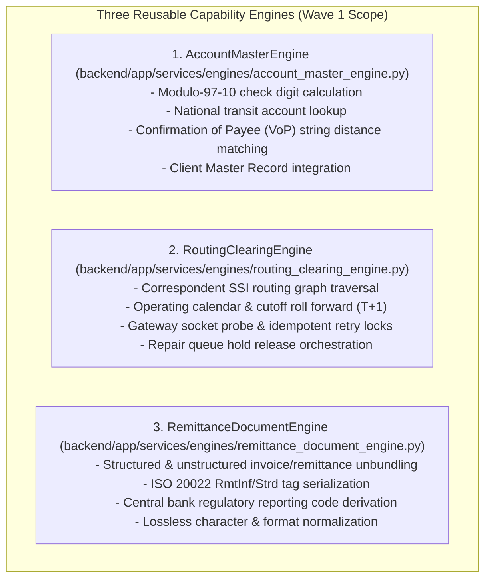

# PeX Wave 1 — Implementation Authorization Gate v0.1.1
## Governance & Implementation Authorization Gate for Wave 1 Industrialization

**Version:** v0.1.1  
**Status:** Governance Authorization Gate — Remediated  
**Target Wave:** Wave 1 (Data Quality & Routing Foundation — 9 Canonical Profiles)  
**Authoritative Architectural Baseline:** `PeX_Phase3_Industrialization_Architecture_v0.1.4.md`  
**Current Platform State:** Phase 2 Closed / Wave 0A Complete / Wave 0B Complete / 495 Tests Green  
**Authorization Recommendation:** **OPTION B — AUTHORIZED WITH CONDITIONS**  

---

======================================================================
1. EXECUTIVE DECISION & AUTHORIZATION SUMMARY
======================================================================

### 1.1 Governance Decision
Based on the authoritative architectural baseline established in `PeX_Phase3_Industrialization_Architecture_v0.1.4.md` and the verified runtime platform state from Wave 0B (495 / 495 green regression tests), this authorization gate formally issues:

$$\mathbf{GOVERNANCE\ DECISION:\ OPTION\ B\ —\ AUTHORIZED\ WITH\ CONDITIONS}$$

### 1.2 Purpose of This Gate
This artifact establishes the precise implementation boundary, profile contracts, test obligations, security controls, regression firewalls, and stop conditions under which Wave 1 engineering is permitted to commence.

### 1.3 Authorized Scope
Wave 1 engineering is authorized **strictly and exclusively** for the following **9 canonical exception profiles**:

```
+---------------------------------------------------------------------------------------------------+
|                                 WAVE 1 AUTHORIZED CANONICAL PROFILES                              |
+---+-------+-------------------------------+--------------------------+----------------------------+
| # | Code  | Canonical Profile Name        | Domain                   | Primary Capability Engine  |
+---+-------+-------------------------------+--------------------------+----------------------------+
| 1 | DQ-03 | Missing Beneficiary Data      | Data Quality             | AccountMasterEngine        |
| 2 | DQ-04 | Missing Remittance Info       | Data Quality             | RemittanceDocumentEngine   |
| 3 | DQ-07 | Invalid Account Number        | Data Quality             | AccountMasterEngine        |
| 4 | DQ-09 | Beneficiary Name Mismatch     | Data Quality             | AccountMasterEngine        |
| 5 | PR-02 | Routing Failure               | Processing               | RoutingClearingEngine      |
| 6 | PR-04 | Cutoff Missed                 | Processing               | RoutingClearingEngine      |
| 7 | PR-07 | Network Timeout               | Processing               | RoutingClearingEngine      |
| 8 | PR-09 | Payment Held for Repair       | Processing               | RoutingClearingEngine      |
| 9 | CO-07 | Regulatory Reporting Required | Compliance               | RemittanceDocumentEngine   |
+---+-------+-------------------------------+--------------------------+----------------------------+
```

### 1.4 Strict Non-Authorized Scope
1. **Phase 2 Baseline (11 Profiles)**: `DQ-01`, `DQ-02`, `DQ-05`, `DQ-06`, `DQ-08`, `PR-01`, `PR-03`, `PR-05`, `PR-08`, `CO-04`, `ST-01` are **CLOSED and PROTECTED**. Zero re-engineering, refactoring, or behavioral alteration is authorized.
2. **Phase 3 Waves 2–6 (21 Profiles)**: All remaining Phase 3 profiles (`PR-06`, `ST-02..07`, `TR-01..08`, `CO-01..03`, `CO-05..06`, `CO-08`) remain **NOT AUTHORIZED**.
3. **Production STP**: Autonomous release of production payments remains **STRICTLY BLOCKED**.
4. **Direct Payment Execution / Ledger Mutation**: PeX never directly executes payments; `BANK_HANDOFF_READY` is the execution-boundary state with `execution_owner = "BANK"`.

---

======================================================================
2. AUTHORITATIVE SOURCE PRECEDENCE
======================================================================

All Wave 1 engineering activities are governed strictly by the following precedence hierarchy:

```
1. PeX Evidence-Driven STP Architecture Baseline v1.1
   ↓
2. PeX Phase 2 Implementation Contract v1.3 & Taxonomy Remediation v0.2
   ↓
3. PeX Phase 2 DQ-08 & PR-08 Remediation Implementation Contract v0.1
   ↓
4. PeX Evidence Acquisition & Resolution Contract v0.3.1
   ↓
5. PeX Wave 0A & Wave 0B Implementation Reports v0.1
   ↓
6. PeX Phase 3 Governance and Delivery Charter v0.2
   ↓
7. PeX Phase 3 Industrialization Architecture v0.1.4 (Immediate Architectural Baseline)
```

If an implementation detail conflicts with a higher-priority source, engineering must halt immediately.

---

======================================================================
3. IMMUTABLE ARCHITECTURAL INVARIANTS
======================================================================

During Wave 1 engineering, the following invariants are absolute:

```
+---------------------------------------------------------------------------------------------------+
|                                IMMUTABLE ARCHITECTURAL INVARIANTS                                 |
+----+----------------------------------------------------------------------------------------------+
| 1  | 41-Profile Canonical Taxonomy is immutable. No profile codes or names may change.            |
| 2  | Phase 2 is closed and protected from re-engineering.                                         |
| 3  | Phase 3 delivery scope consists exclusively of the 30 remaining profiles (Wave 1: 9 profiles)|
| 4  | 8-Predicate Formula is immutable:                                                            |
|    | STP_ELIGIBLE = E_suff ∧ R_det ∧ R_uniq ∧ V_det ∧ V_auth ∧ P_bank ∧ C_comp ∧ X_pre           |
| 5  | Evidence sufficiency (E_suff) does NOT equal STP eligibility.                                |
| 6  | Historical precedent carries 0% execution authority (advisory context only).                |
| 7  | AI / LLM confidence carries 0% autonomous execution authority.                              |
| 8  | AI cannot independently establish authority or authorize execution.                         |
| 9  | HITL adjudication and Maker-Checker workspaces remain strictly inside PeX.                  |
| 10 | For cases that satisfy the execution boundary and are eligible for bank handoff,             |
|    | BANK_HANDOFF_READY is the terminal PeX execution-boundary state, with execution_owner = BANK|
|    | (Not every case reaches handoff; unresolvable cases remain in governed internal states).     |
| 11 | Execution ownership (execution_owner) remains permanently "BANK".                            |
| 12 | PeX never directly executes payments or mutates bank ledgers autonomously.                   |
| 13 | Production autonomous STP remains strictly blocked.                                          |
| 14 | Provider-neutral, cloud-neutral, and model-neutral architecture via abstract SPI ports.       |
+----+----------------------------------------------------------------------------------------------+
```

---

======================================================================
4. WAVE 1 PROFILE CONTRACT MATRIX
======================================================================

> **GOVERNANCE NOTE ON AUTOMATION POTENTIAL:**  
> **Automation Potential is an architectural planning classification. It is NOT a determination of STP eligibility, autonomous execution authority, or production approval.** Runtime STP eligibility is determined exclusively by the full conjunction of all eight predicates: $\text{STP\_ELIGIBLE} = E_{\text{suff}} \land R_{\text{det}} \land R_{\text{uniq}} \land V_{\text{det}} \land V_{\text{auth}} \land P_{\text{bank}} \land C_{\text{comp}} \land X_{\text{pre}}$.

| Profile | Canonical Name | Primary Engine | Supporting Engine | Pattern Family | Pattern Sub-Behavior | Evidence Contract | Authority Contract | Bank Policy Dependencies | External Integration Dependencies | Resolution Candidate | Automation Potential | HITL Path | Implementation Risk | Authorization Status |
|---|---|---|---|---|---|---|---|---|---|---|---|---|---|---|
| **DQ-03** | Missing Beneficiary Data | `AccountMasterEngine` | `RemittanceDocumentEngine` | `PAT-A` | Master / Directory Resolution | `CLIENT_MASTER_RECORD` (T1), `ERP_INVOICE_PAYLOAD` (T3) | Bank-designated Client Master / approved directory via `AccountMasterPort` SPI *(e.g. GLEIF)* | Client directory match policy | Core DDA Account SPI / ERP Payload SPI | Complete Creditor Name, Address, Country | **HIGH** | Multiple creditor matches route to PeX Maker | LOW | **AUTHORIZED** |
| **DQ-04** | Missing Remittance Info | `RemittanceDocumentEngine` | None | `PAT-A` | Deterministic Rule / Tag Derivation | `ERP_INVOICE_PAYLOAD` (T3), `CLIENT_ERP_ADVICE` (T3) | Bank-designated ERP / Billing System via `RemittanceDocumentPort` SPI | Mandatory remittance tag format | ERP Ingestion SPI / Document Parser Port | Structured ISO 20022 `<RmtInf><Strd>` | **HIGH** | Unparseable invoice routes to Operator Review | MEDIUM | **AUTHORIZED** |
| **DQ-07** | Invalid Account Number | `AccountMasterEngine` | None | `PAT-A` | Master / Directory Resolution | `CORE_DDA_ACCOUNT` (T1) | Core Banking DDA Master via `AccountMasterPort` SPI | National transit check table rules | Core Banking DDA Port | Validated account number / check digits | **HIGH** | Multiple account matches route to DDA Ops | LOW | **AUTHORIZED** |
| **DQ-09** | Beneficiary Name Mismatch | `AccountMasterEngine` | None | `PAT-A` | Deterministic Matching / CoP Verification | `CORE_DDA_ACCOUNT_TITLE` (T1), `NATIONAL_COP_DIRECTORY` (T2)| Bank-designated Verification of Payee Scheme / DDA Title via `VoPDirectoryPort` SPI | Fuzzy matching threshold bands (`W1-POL-01`) | VoP Directory Port / DDA Title SPI | Verified Account Title / Match Status | **MEDIUM** | Close match / discrepancy routes to VoP Desk | MEDIUM | **AUTHORIZED** |
| **PR-02** | Routing Failure | `RoutingClearingEngine` | None | `PAT-A` | Master / Directory Resolution | `SWIFTREF_DIRECTORY` (T2), `CORRESPONDENT_SSI_MASTER` (T1) | Bank-designated Routing Directory & SSI Master via `RoutingClearingPort` SPI *(e.g. SWIFTRef)* | Permitted correspondent hierarchy | Routing Directory SPI / Clearing Rail SPI | Next-best valid transit hop BIC / rail | **HIGH** | All paths blocked routes to Routing Desk | LOW | **AUTHORIZED** |
| **PR-04** | Cutoff Missed | `RoutingClearingEngine` | None | `PAT-B` | Temporal / Operating Recalculation | `RAIL_SCHEDULE_MASTER` (T1), `CENTRAL_BANK_CALENDAR` (T1) | Bank-designated RTGS Rail Calendar via `RailSchedulePort` SPI | Cutoff buffer window before roll (`W1-POL-02`) | Rail Calendar SPI / Time Server Port | Value Date roll forward ($T+1$) & queue reset | **HIGH** | Value date outside client auth routes to Ops | LOW | **AUTHORIZED** |
| **PR-07** | Network Timeout | `RoutingClearingEngine` | None | `PAT-B` | Temporal / Queue Retry | `GATEWAY_SOCKET_LOG` (T1), `IDEMPOTENCY_LOCK` (T1) | Bank-designated Gateway Probe & Outbox Journal via `GatewaySocketProbePort` SPI | Maximum retries & backoff schedule | Socket Probe SPI / Idempotency Store Port | Confirmed network unblock & safe retry envelope | **HIGH** | Ambiguous gateway status routes to Admin | LOW | **AUTHORIZED** |
| **PR-09** | Payment Held for Repair | `RoutingClearingEngine` | `AccountMasterEngine` | `PAT-B` | Temporal / Repair Queue Recalculation | `PARSER_SYNTAX_ERROR_LOG` (T1), `REPAIR_STATION_HOLD` (T1) | Bank-designated Payment Hub Queue via `PaymentHubQueuePort` SPI | Repair queue release checklist | Payment Hub Queue SPI | Hold release instruction to processing pipeline | **HIGH** | Unresolved syntax error remains in Repair Desk | LOW | **AUTHORIZED** |
| **CO-07** | Regulatory Reporting Required | `RemittanceDocumentEngine` | `ComplianceDossierEngine` | `PAT-A` | Deterministic Rule / Tag Derivation | `PURPOSE_CODE_DIRECTORY` (T2), `REGULATORY_REPORT_RULES` (T1)| Bank-designated Regulatory Directory via `RegulatoryDirectoryPort` SPI | Mandatory statutory report thresholds | Central Bank Regulatory Directives Port | Populated `<RgltryRptg>` & Purpose tags | **HIGH** | Missing statutory trade doc routes to Officer | LOW | **AUTHORIZED** |

---

======================================================================
5. CAPABILITY ENGINE & RESOLUTION PATTERN IMPLEMENTATION SCOPE
======================================================================

### 5.1 Three Capability Engines Implemented in Wave 1
Wave 1 introduces and implements the first three domain capability engines in `backend/app/services/engines/`:



### 5.2 Resolution Pattern Families Implemented in Wave 1
1. **`PAT-A` (Reference, Rule & Structural Resolution Family)**:
   - Sub-Behavior A: *Master / Directory Resolution* (`DQ-03`, `DQ-07`, `PR-02`)
   - Sub-Behavior B: *Deterministic Rule / Tag Derivation* (`DQ-04`, `CO-07`)
   - Sub-Behavior C: *Governed Structural / Syntax Transformation* (Shared utility for schema repair)
   - Sub-Behavior D: *Deterministic Matching / CoP Verification* (`DQ-09`)
2. **`PAT-B` (Temporal & Queue Recalculation Family)**:
   - Schedule & cutoff roll forward (`PR-04`)
   - Network timeout retry lock (`PR-07`)
   - Repair station queue recalculation (`PR-09`)

---

======================================================================
6. EVIDENCE & AUTHORITY REQUIREMENTS (PROVIDER-NEUTRAL HIERARCHY)
======================================================================

### 6.1 Epistemic Source Classification
To preserve clean provider neutrality, all evidence and authority sources are classified into four distinct levels:
1. **Architecture Fact**: Abstract provider-neutral SPI port contracts (e.g. `AccountMasterPort`, `RoutingClearingPort`).
2. **Authority Source Category**: Domain classification of authoritative data (e.g. Core DDA Master, VoP Scheme, Clearing Calendar).
3. **Illustrative / Candidate Production Source**: Industry examples (e.g. SWIFTRef, GLEIF, Fedwire, CHAPS) subject to bank integration decisions.
4. **Production Integration Dependency**: External connectors required for live deployment, isolated strictly behind SPI adapters.

### 6.2 Single Published Bank Evidence Required JSON Model
Wave 1 consumes the dynamic configuration model established in Wave 0B:
- **Published Configuration**: Each Wave 1 profile is bound to a single published JSON schema defining required evidence types, trust tiers, acquisition modes, freshness TTLs, and conditional predicates.
- **Fail-Closed Governance Compilation**: The `GovernanceCompiler` compiles and validates all published configurations at startup. Any missing or malformed contract causes fail-closed suspense.
- **Dynamic Configuration Resolver**: Resolves effective evidence requirements per `(tenant_id, profile_id)` at runtime.

### 6.3 Evidence Acquisition Modes (Modes 1–4)
- **Mode 1 (Inbound Payload)**: Direct extraction of error codes, UETR, account numbers, and remittance text.
- **Mode 2 (Direct Query via SPI)**: Reference SPI adapters for Core DDA, Routing Directory, VoP Directory, and Rail Schedules.
- **Mode 3 (Bank Push / Event)**: File/event payload attachment via `EvidenceStoreService`.
- **Mode 4 (Human-Assisted via HITL)**: Interactive submission of missing invoices or client identity documents via PeX HITL workspace.

---

======================================================================
7. BANK POLICY & CONFIGURATION REQUIREMENTS (W1-POL NAMESPACE)
======================================================================

> **GOVERNANCE NOTE ON POLICY IDENTIFIERS:**  
> **Wave 1 policy identifiers (`W1-POL-*`) are scoped to this authorization gate and do not replace or redefine architecture decision identifiers `AD-01` through `AD-04`.**

```
+---------------------------------------------------------------------------------------------------+
|                                  WAVE 1 BANK POLICY PARAMETERIZATION                              |
+-----------+-------------------------+----------------------------------+--------------------------+
| Policy ID | Profile Scope           | Policy Parameter Description     | Parameterized JSON Field |
+-----------+-------------------------+----------------------------------+--------------------------+
| W1-POL-01 | DQ-09 (Name Mismatch)   | VoP fuzzy matching threshold     | match_threshold_bands    |
| (AD-01)   |                         | bands (Exact, Close, No Match)   | (e.g. {"exact": 0.95})   |
+-----------+-------------------------+----------------------------------+--------------------------+
| W1-POL-02 | PR-04 (Cutoff Missed)   | Minimum buffer window before RTGS| cutoff_buffer_minutes    |
| (AD-02)   |                         | cutoff to trigger T+1 roll       | (e.g. 15)                |
+-----------+-------------------------+----------------------------------+--------------------------+
| W1-POL-03 | Wave 1 General Policy   | Maximum autonomous STP value     | max_stp_amount_threshold |
|           |                         | thresholds for Wave 1 profiles   | per currency in P_bank   |
+-----------+-------------------------+----------------------------------+--------------------------+
| W1-POL-04 | Wave 1 Segregation      | Mandatory Dual-Authorization     | maker_checker_role_map   |
|           | of Duties Policy        | roles per profile and value tier | in published Bank JSON   |
+-----------+-------------------------+----------------------------------+--------------------------+
```

---

======================================================================
8. EXTERNAL INTEGRATION DEPENDENCIES (SPI CLASSIFICATION)
======================================================================

All external integrations sit strictly behind provider-neutral abstract SPI interfaces in `backend/app/ports/`:

```
+---------------------------------------------------------------------------------------------------+
|                                  EXTERNAL INTEGRATION SPI MATRIX                                  |
+------------------------------+---------------------------+----------------------------------------+
| Interface Port SPI           | Authority Source Category | Candidate Production Example (Non-Bind)|
+------------------------------+---------------------------+----------------------------------------+
| AccountMasterPort            | Core Banking DDA Master   | Finacle / Temenos / SAP Banking        |
+------------------------------+---------------------------+----------------------------------------+
| VoPDirectoryPort             | Verification of Payee     | UK CoP Directory / SEPA VoP Scheme     |
+------------------------------+---------------------------+----------------------------------------+
| RoutingClearingPort          | Routing Directory & SSI   | SWIFTRef / Bankers Almanac / SSI Master|
+------------------------------+---------------------------+----------------------------------------+
| RailSchedulePort             | RTGS Operating Calendar   | Central Bank Rail Schedules            |
+------------------------------+---------------------------+----------------------------------------+
| GatewaySocketProbePort       | Message Broker / Outbox   | MQ / Kafka / Socket Gateway Probe      |
+------------------------------+---------------------------+----------------------------------------+
| RemittanceDocumentPort       | Client Billing / ERP      | SAP ERP / Oracle Financials / EDI 820  |
+------------------------------+---------------------------+----------------------------------------+
| RegulatoryDirectoryPort      | Regulatory Purpose Direct.| Central Bank Directives & BoP Codes    |
+------------------------------+---------------------------+----------------------------------------+
```

*Direct live bank API integration is NOT a prerequisite for Wave 1 engineering; reference adapters behind abstract SPI ports are fully authorized for development and test verification.*

---

======================================================================
9. PE_X-NATIVE HITL & AI GOVERNANCE BOUNDARIES
======================================================================

### 9.1 HITL Closed Loop Inside PeX
- When any of the 8 predicates evaluates to `FALSE` (e.g. missing invoice, ambiguous VoP match, threshold breach), the exception is routed to the **PeX-Native HITL Workspace**.
- Operators review evidence dossiers, attach missing documents via Mode 4, or execute Maker-Checker dual authorization.
- Re-evaluation occurs entirely inside PeX. The exception remains within the PeX governed workflow until it either reaches `BANK_HANDOFF_READY` for eligible bank handoff or remains in an appropriate governed internal state such as HITL, investigation, compliance hold, or unresolved.

### 9.2 AI Role and Absolute Bounds
- **Permitted AI Activities**: Extracting invoice attributes from unstructured text, suggesting entity aliases, clustering remittance narratives, ranking historical precedent relevance.
- **Strictly Prohibited AI Activities**: AI carries **$0\%$ autonomous execution authority**. AI cannot independently satisfy $V_{\text{auth}}$, bypass $P_{\text{bank}}$ or $C_{\text{comp}}$, or trigger `STP_ELIGIBLE = TRUE`.

---

======================================================================
10. PROFILE-SPECIFIC ACCEPTANCE CRITERIA & 8-PREDICATE ADVERSARIAL MATRIX
======================================================================

### 10.1 Complete 8-Predicate Conjunction Rule
A payment exception is eligible for zero-touch handoff if and only if **all eight predicates evaluate to `TRUE` simultaneously**:

$$\text{STP\_ELIGIBLE} = E_{\text{suff}} \land R_{\text{det}} \land R_{\text{uniq}} \land V_{\text{det}} \land V_{\text{auth}} \land P_{\text{bank}} \land C_{\text{comp}} \land X_{\text{pre}}$$

$$\begin{cases} \mathbf{STP\_ELIGIBLE = TRUE} & \iff E_{\text{suff}}=\text{T} \land R_{\text{det}}=\text{T} \land R_{\text{uniq}}=\text{T} \land V_{\text{det}}=\text{T} \land V_{\text{auth}}=\text{T} \land P_{\text{bank}}=\text{T} \land C_{\text{comp}}=\text{T} \land X_{\text{pre}}=\text{T} \\ \mathbf{STP\_ELIGIBLE = FALSE} & \text{otherwise (Any single predicate FALSE routes immediately to HITL)} \end{cases}$$

### 10.2 Adversarial 8-Predicate Failure Matrix
The test suite must explicitly verify that omission or failure of ANY single predicate forces `STP_ELIGIBLE = FALSE`:

```
+---------------------------------------------------------------------------------------------------------------------------+
|                                        ADVERSARIAL 8-PREDICATE FAILURE TEST MATRIX                                        |
+---+----------------------+-----------+-------------------------+--------------------+-------------------------------------+
| # | Tested Predicate     | Set Value | Other 7 Predicates      | Expected Outcome   | Mandatory Governed Action           |
+---+----------------------+-----------+-------------------------+--------------------+-------------------------------------+
| 1 | Evidence (E_suff)    | FALSE     | All 7 evaluate TRUE     | STP_ELIGIBLE=FALSE | Routes to HITL Mode 4 acquisition   |
| 2 | Determinism (R_det)  | FALSE     | All 7 evaluate TRUE     | STP_ELIGIBLE=FALSE | Routes to HITL candidate review     |
| 3 | Uniqueness (R_uniq)  | FALSE     | All 7 evaluate TRUE     | STP_ELIGIBLE=FALSE | Routes to HITL disambiguation desk  |
| 4 | Validity (V_det)     | FALSE     | All 7 evaluate TRUE     | STP_ELIGIBLE=FALSE | Fail-closed format suspense in HITL |
| 5 | Authority (V_auth)   | FALSE     | All 7 evaluate TRUE     | STP_ELIGIBLE=FALSE | SoR verification lock in HITL       |
| 6 | Bank Policy (P_bank) | FALSE     | All 7 evaluate TRUE     | STP_ELIGIBLE=FALSE | Value cap breach routes to Risk Desk|
| 7 | Compliance (C_comp)  | FALSE     | All 7 evaluate TRUE     | STP_ELIGIBLE=FALSE | Statutory hold routes to Compliance |
| 8 | Precondition (X_pre) | FALSE     | All 7 evaluate TRUE     | STP_ELIGIBLE=FALSE | Idempotency collision stop in HITL  |
+---+----------------------+-----------+-------------------------+--------------------+-------------------------------------+
```

### 10.3 Twelve Profile-Specific Acceptance Dimensions
Each Wave 1 profile must address all mandatory acceptance dimensions, with profile-specific expected behavior derived from its approved profile contract:

```
+---------------------------------------------------------------------------------------------------+
|                               PROFILE-SPECIFIC ACCEPTANCE TEST SUITE                              |
+---+---------------------------------+-------------------------------------------------------------+
| # | Test Case Dimension             | Profile-Specific Expected Behavior                          |
+---+---------------------------------+-------------------------------------------------------------+
| 1 | Positive Happy Path             | Complete 8-predicate conjunction TRUE -> STP_ELIGIBLE=TRUE  |
| 2 | Missing Evidence                | Missing primary evidence -> Routes to PeX HITL Mode 4       |
| 3 | Invalid / Corrupted Evidence    | Malformed payload/data -> Fail-closed suspense in HITL      |
| 4 | Contradictory Evidence          | Conflicting evidence sources -> Collision alert in HITL     |
| 5 | Non-Unique Candidate Match      | Ambiguous match -> Disambiguation workflow in PeX HITL      |
| 6 | Sovereign Authority Unavailable | SoR SPI unreachable -> Temporary hold / retry lock in HITL  |
| 7 | Bank Risk Policy Breach         | Value/corridor policy breach -> Routes to Risk Approver     |
| 8 | Idempotency / Precondition Fail | Idempotency lock breach -> Duplicate stop prevents handoff  |
| 9 | Explicit HITL Routing Action    | Manual operator override -> Routes via Segregation of Duties|
| 10| Successful HITL Re-Evaluation   | Manual evidence upload -> Re-triggers 8-predicate evaluation|
| 11| Terminal BANK_HANDOFF_READY     | Eligible envelope generated with execution_owner="BANK"     |
| 12| Explicit Zero-Execution Check   | Assert zero socket payment dispatch or direct DB mutation   |
+---+---------------------------------+-------------------------------------------------------------+
```

*Profile-Specific Focus Examples*:
- **`DQ-09`**: Test exact match, close match within `W1-POL-01` threshold band, and no-match rejection.
- **`PR-04`**: Test cutoff boundary within `W1-POL-02` buffer, schedule availability, and $T+1$ value-date roll.
- **`PR-07`**: Test network timeout, safe retry eligibility, retry exhaustion, and idempotency collision.
- **`DQ-04`**: Test structured invoice parsing, mandatory `RmtInf` population, and unparseable document fallback.

---

======================================================================
11. WAVE 1 TEST STRATEGY & CUMULATIVE REGRESSION FIREWALL
======================================================================

### 11.1 Test Coverage Strategy
Wave 1 engineering must implement a comprehensive multi-layer test suite:
1. **Unit Tests**: Modulo-97 algorithms, routing graph shortest-path, cutoff calendar arithmetic, regex invoice parsers.
2. **Contract Tests**: Verification of abstract SPI interfaces and Pydantic schema validation.
3. **Governance Compiler & AST Tests**: AST scanning ensuring zero forbidden third-party vendor SDK imports (`boto3`, `google-cloud`, `azure-storage`) in domain packages.
4. **Adversarial & Negative Tests**: Tampered evidence hashes, prompt injection in remittance text, replay attacks, duplicate UETR collision.
5. **E2E Canonical Execution Suite**: Expansion of the E2E harness from 18 scenarios to **27 scenarios** (adding Scenarios 19–27 covering the 9 Wave 1 profiles).

### 11.2 Cumulative Regression Firewall
```
+---------------------------------------------------------------------------------------------------+
|                                   CUMULATIVE REGRESSION FIREWALL                                  |
+--------------------------+------------------------------------+-----------------------------------+
| Baseline Category        | Current State (Pre-Wave 1)         | Wave 1 Acceptance Requirement     |
+--------------------------+------------------------------------+-----------------------------------+
| Phase 2 Baseline         | 11 Profiles / 423 Tests Passing    | 100% Green / Zero Regression      |
+--------------------------+------------------------------------+-----------------------------------+
| Wave 0A / Wave 0B State  | Runtime Infra / 495 Tests Passing  | 100% Green / Zero Regression      |
+--------------------------+------------------------------------+-----------------------------------+
| Cumulative Suite Pass    | 495 / 495 (100%)                   | 100% Green Pass Rate Across All   |
|                          |                                    | Inherited and New Wave 1 Tests    |
|                          |                                    | (Final count is implementation-   |
|                          |                                    | derived; 0 failures permitted)    |
+--------------------------+------------------------------------+-----------------------------------+
```

---

======================================================================
12. SECURITY, AUDIT & OBSERVABILITY REQUIREMENTS
======================================================================

### 12.1 Security & Tokenization Contracts
- **Token Vault Contract**: Sensitive account numbers and PII are replaced with cryptographic surrogates (`tok_...`) before entering AI context or logs, implemented via `TokenVaultService`.
- **Zero Hardcoded Secrets**: All configuration and test stubs use environment variables or explicit test fixtures.

### 12.2 Tamper-Evident Audit & Evidence Hashing
- **Audit Ledger Contract**: Tamper-evident audit integrity must be preserved according to the `AuditLedgerContract`, maintaining an immutable SHA-256 Merkle-like hash chain across all state transitions and handoff envelopes.
- **Evidence Store Contract**: Content-addressable SHA-256 evidence hashing implemented in `EvidenceStoreService` to guarantee cryptographic provenance.

---

======================================================================
13. WAVE 1 DEFINITION OF DONE (DoD)
======================================================================

Wave 1 implementation will be accepted if and only if all of the following criteria are satisfied:

```
[ ] 1. Architecture: All 9 Wave 1 profiles implemented strictly under v0.1.4 contracts.
[ ] 2. Capability Engines: AccountMasterEngine, RoutingClearingEngine, RemittanceDocumentEngine implemented in backend/app/services/engines/.
[ ] 3. Provider Neutrality: AST validation passes with 0 forbidden vendor SDK imports.
[ ] 4. Phase 2 Protection: 11 Phase 2 profiles remain 100% untouched and green.
[ ] 5. Dynamic JSON Resolution: Bank Evidence Required JSON models published and validated for all 9 profiles.
[ ] 6. Bank Policy Parameters: W1-POL-01 (VoP thresholds) and W1-POL-02 (Cutoff buffer) parameterized in JSON config.
[ ] 7. 8-Predicate Integrity: Exact 8-predicate formula evaluated without modification.
[ ] 8. HITL Closed Loop: In-platform Maker-Checker and Mode 4 evidence upload validated.
[ ] 9. E2E Validation: 27-scenario canonical E2E test harness passing 100% green.
[ ] 10. Regression Suite: Cumulative test suite passes 100% green across all inherited and Wave 1 tests.
[ ] 11. Security & Audit: SHA-256 Merkle audit trail and tokenization verified.
[ ] 12. Terminal Boundary: BANK_HANDOFF_READY remains terminal state with execution_owner = "BANK".
[ ] 13. Independent Forensic Acceptance: Forensic review report completed with zero P0/P1 findings.
[ ] 14. Formal Governance Sign-Off: Wave 1 Implementation Report published and signed off.
```

---

======================================================================
14. MANDATORY STOP CONDITIONS (20 STOP CONDITIONS)
======================================================================

Wave 1 engineering **MUST STOP IMMEDIATELY** if any of the following events occur:

```
1. Phase 2 behavior or contracts change.
2. Phase 2 regression tests fail or show behavioral drift.
3. The 41-profile canonical taxonomy is altered or renamed.
4. The 8-predicate conjunction formula is modified.
5. AI / LLM is granted autonomous execution or release authority.
6. Direct payment execution or socket dispatch is introduced into PeX.
7. Bank ledger mutation is introduced into PeX.
8. Maker-Checker Segregation of Duties controls are bypassed.
9. Evidence sufficiency requirements are weakened.
10. Sovereign authority (V_auth) is replaced with advisory historical precedent.
11. Synthetic test data is treated as production authority.
12. A new capability engine is introduced without architecture approval.
13. A new resolution pattern is introduced without architecture approval.
14. A third-party vendor SDK enters the core domain package.
15. Provider neutrality or cloud neutrality is violated.
16. A mandatory bank policy parameter (e.g. W1-POL-01, W1-POL-02) is silently hardcoded.
17. An external direct API dependency becomes mandatory for core operation.
18. Any P0 or P1 security, PII leakage, or governance finding appears.
19. An unhandled contradiction between evidence and authority arises.
20. STP becomes eligible without all eight predicates evaluating to TRUE.
```

---

======================================================================
15. BLOCKING & NON-BLOCKING CONDITIONS
======================================================================

### 15.1 Blocking Conditions (Must be satisfied during Wave 1 implementation)
- **BC-01 (Regression Firewall)**: 495/495 inherited tests must remain 100% green throughout development.
- **BC-02 (Policy Parameterization)**: `W1-POL-01` (CoP thresholds) and `W1-POL-02` (Cutoff buffers) must be parameterized in published JSON schemas, with zero hardcoded defaults that could trigger unsafe STP.
- **BC-03 (Provider Neutrality)**: Core domain contracts must remain decoupled from third-party vendor SDKs.
- **BC-04 (Bank Boundary)**: All terminal dispatch handlers must emit `BANK_HANDOFF_READY` envelopes with `execution_owner = "BANK"`.
- **BC-05 (Production STP Block)**: Production autonomous release switches must remain disabled.

### 15.2 Non-Blocking Conditions (Permitted for Development & Reference Testing)
- **NBC-01 (Mock SPI Adapters)**: In-memory and synthetic SPI reference adapters (`MockAccountMasterPort`, `MockVoPPort`, `MockRoutingPort`) are permitted for unit, contract, and E2E testing.
- **NBC-02 (Synthetic Test Payloads)**: Scenarios 19–27 may use synthetic test payloads explicitly flagged as `TEST_ONLY`.
- **NBC-03 (Dev Tools & Scripts)**: Development scripts for AST checking and schema generation are permitted.

---

======================================================================
16. v0.1 → v0.1.1 REMEDIATION SUMMARY
======================================================================

The following targeted governance remediations were applied in v0.1.1:

1. **Provider-Neutral Authority Reclassification**: Reclassified named external systems (GLEIF, SWIFTRef, etc.) as candidate production sources, describing authority contracts in provider-neutral SPI terms.
2. **Policy Identifier Namespace Separation**: Introduced `W1-POL-*` namespace (`W1-POL-01` to `W1-POL-04`) to prevent collision with architecture decision identifiers `AD-01` through `AD-04`.
3. **Removal of Arbitrary Test Forecasts**: Removed numerical target counts (`>= 75`, `>= 570`); mandated 100% green cumulative pass rate where final count is implementation-derived.
4. **Profile-Specific Acceptance Dimensions**: Derived expected acceptance behaviors from individual profile contracts rather than a rigid generic template.
5. **Enforcement of Full 8-Predicate Formula**: Required all 8 predicates to be explicitly true for STP eligibility and added the Adversarial 8-Predicate Failure Matrix.
6. **Refined `BANK_HANDOFF_READY` Execution Boundary**: Clarified that `BANK_HANDOFF_READY` is the terminal state for eligible handoff cases, while unresolvable cases remain in governed internal states.
7. **Automation Potential Planning Status**: Added explicit governance note clarifying that Automation Potential is an architectural planning category, not STP authorization.
8. **Security Contract vs Implementation Distinction**: Refined security language to distinguish abstract audit/tokenization contracts from inherited implementation mechanisms.

---

======================================================================
17. FORMAL AUTHORIZATION DECISION
======================================================================

```
======================================================================
PEX WAVE 1 IMPLEMENTATION AUTHORIZATION GATE

VERSION:                  v0.1.1
WAVE:                     1 (Data Quality & Routing Foundation)

AUTHORIZED PROFILES:
1. DQ-03 — Missing Beneficiary Data
2. DQ-04 — Missing Remittance Info
3. DQ-07 — Invalid Account Number
4. DQ-09 — Beneficiary Name Mismatch
5. PR-02 — Routing Failure
6. PR-04 — Cutoff Missed
7. PR-07 — Network Timeout
8. PR-09 — Payment Held for Repair
9. CO-07 — Regulatory Reporting Required

PHASE 2 STATUS:           CLOSED / PROTECTED (NO RE-ENGINEERING)
PRODUCTION STP:           BLOCKED
PAYMENT EXECUTION:        NOT AUTHORIZED
BANK LEDGER MUTATION:     NOT AUTHORIZED
AI RELEASE AUTHORITY:     ZERO
BANK EXECUTION OWNERSHIP: BANK

AUTHORIZATION DECISION:
OPTION B — AUTHORIZED WITH CONDITIONS

CONDITIONS SUMMARY:
1. Implementation restricted strictly to the 9 authorized Wave 1 profiles.
2. 495 / 495 green regression firewall strictly enforced.
3. W1-POL-01 (VoP thresholds) and W1-POL-02 (Cutoff buffers) parameterized in JSON config.
4. Provider-neutral SPI ports implemented without vendor SDK lock-in.
5. Terminal state remains BANK_HANDOFF_READY (execution_owner = "BANK").
6. Production autonomous STP remains blocked.

NEXT CONTROLLED STAGES:
Wave 1 Implementation
→ Verification Testing
→ Independent Forensic Acceptance
→ Multi-Profile Semantic Reconciliation
→ Wave 1 Acceptance Sign-Off
======================================================================
```

**Next Governance Action:**  
Upon receipt of explicit human engineering authorization to execute under this gate (v0.1.1), engineering may proceed with Wave 1 implementation following the authorized scope, test strategy, and Definition of Done.
