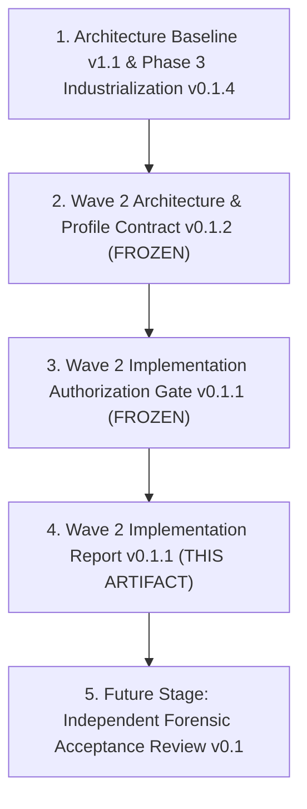
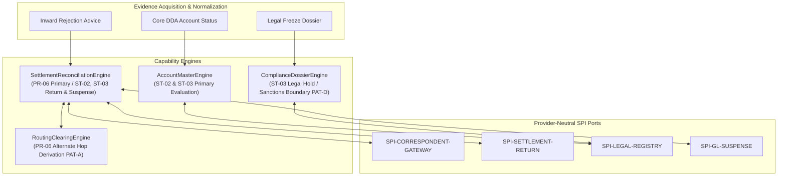
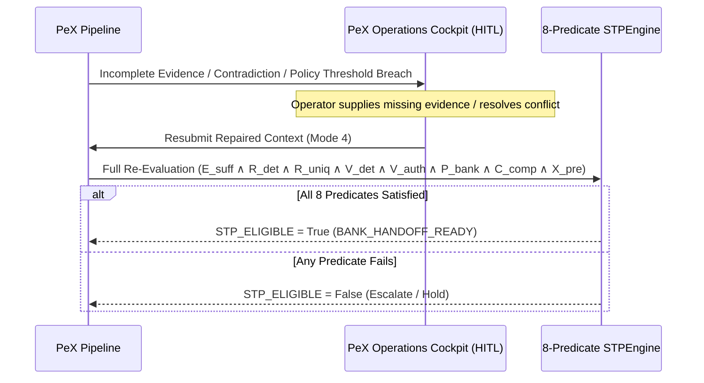

# PeX Phase 3 — Wave 2 Controlled Engineering Implementation Report

**Document ID**: `PeX_Wave2_Implementation_Report_v0.1.1`  
**Document Revision**: `v0.1.1` (Reconciled Governance Baseline)  
**Status**: `CONTROLLED IMPLEMENTATION COMPLETED`  
**Governance Precedence**:
1. `PeX_Phase3_Wave2_Industrialization_Architecture_and_Profile_Contract_v0.1.2.md` (Controlling Wave 2 Architecture Baseline — FROZEN)
2. `PeX_Wave2_Implementation_Authorization_Gate_v0.1.1.md` (Controlling Authorization Gate — `OPTION B — AUTHORIZED WITH CONDITIONS`)
3. `PeX_Phase3_Industrialization_Architecture_v0.1.4.md` (Phase 3 Core Architecture)
4. `PeX_Evidence_Driven_STP_Architecture_Baseline_v1.1.md` (Foundational Baseline)

**Authoring Authority**: Principal Engineering Lead & PeX Implementation Report Reconciliation Authority  
**Date**: October 8, 2026  
**Target Profiles**: Exactly Three Canonical Profiles:
- **`PR-06`** — Intermediary Bank Rejection
- **`ST-02`** — Account Closed
- **`ST-03`** — Beneficiary Account Frozen

---

## 1. Executive Summary

Under the controlling authority of `PeX_Wave2_Implementation_Authorization_Gate_v0.1.1.md`, controlled engineering implementation for **PeX Phase 3 Wave 2** has been completed, tested, and reconciled.

All implementation deliverables conform strictly to the architectural boundaries, mathematical invariants, provider-neutrality constraints, and verification mandates established in `PeX_Phase3_Wave2_Industrialization_Architecture_and_Profile_Contract_v0.1.2.md`.

```
========================================================================================
                         PEX WAVE 2 IMPLEMENTATION SCORECARD (v0.1.1)
========================================================================================
Implementation Scope:         EXACTLY 3 Profiles (PR-06, ST-02, ST-03) — COMPLETE
Phase 2 & Wave 1 Protection:  630/630 Baseline Tests Preserved Green — 100% REGRESSION-FREE
Wave 2 Test Suite:            96/96 Dedicated Tests Passed — 100% PASS
Cumulative Test Suite:        726 Passed / 0 Failed / 3 Warnings (100% Green in 237.16s)
AST Dependency Analysis:      0 Prohibited Vendor SDK Imports in Inspected Wave 2 Scope
Production Autonomous STP:    STRICTLY BLOCKED (execution_owner = "BANK" on all handoffs)
Forensic Acceptance:          PENDING (Recommended as Immediate Next Governed Stage)
Multi-Profile Reconciliation: PENDING
Formal Governance Sign-Off:   PENDING
========================================================================================
```

---

## 2. Governance Precedence & Source Hierarchy

Implementation and reconciliation artifacts are governed strictly by the following hierarchy:



1. **`PeX_Phase3_Wave2_Industrialization_Architecture_and_Profile_Contract_v0.1.2.md`** controls all Wave 2 capability ownership, domain schemas, resolution patterns, policy thresholds, and authority requirements.
2. **`PeX_Wave2_Implementation_Authorization_Gate_v0.1.1.md`** establishes the exact 3-profile scope boundary, verification gates, and conditions of authorization.
3. **`PeX_Wave2_Implementation_Report_v0.1.1.md`** records the verified engineering evidence without modifying architecture, introducing new profiles, or granting production STP authorization.

---

## 3. Authorization Reference & Scope Boundary

Controlled engineering implementation is bounded strictly to:

$$\boxed{\text{Wave 2 Scope} = \{\text{PR-06}, \text{ST-02}, \text{ST-03}\}}$$

- **Authorized Profiles**:
  1. `PR-06` — Intermediary Bank Rejection
  2. `ST-02` — Account Closed
  3. `ST-03` — Beneficiary Account Frozen
- **Unauthorized Profiles**: All remaining 18 BIAN profiles remain strictly unauthorized for engineering implementation.
- **Production STP Mandate**: Production autonomous Straight-Through Processing (STP) remains **STRICTLY BLOCKED**. `execution_owner = "BANK"` is mandatory on all outputs; eligible resolutions terminate at `BANK_HANDOFF_READY`.

---

## 4. Repository & Git Baseline

The engineering implementation was executed directly within the active repository workspace:
- **Workspace Root**: `C:\Users\pawan\.gemini\antigravity\scratch\pex_platform`
- **Active Environment**: `.venv` (Python 3.13)
- **Modified & Added Core Modules**:
  - `backend/app/schemas/contracts/wave2_schemas.py`
  - `backend/app/schemas/contracts/policy_schemas.py`
  - `backend/app/ports/correspondent_gateway_port.py`
  - `backend/app/ports/settlement_return_port.py`
  - `backend/app/ports/legal_registry_port.py`
  - `backend/app/ports/general_ledger_suspense_port.py`
  - `backend/app/adapters/reference/reference_correspondent_gateway_adapter.py`
  - `backend/app/adapters/reference/reference_settlement_return_adapter.py`
  - `backend/app/adapters/reference/reference_legal_registry_adapter.py`
  - `backend/app/adapters/reference/reference_general_ledger_suspense_adapter.py`
  - `backend/app/services/engines/settlement_reconciliation_engine.py`
  - `backend/app/services/engines/compliance_dossier_engine.py`
  - `backend/app/services/engines/account_master_engine.py`
  - `backend/app/services/engines/routing_clearing_engine.py`
  - `backend/app/services/e2e_runner.py`
  - `tests/wave2/` (9 test modules comprising 96 test functions/parameters)
  - `e2e_fixtures/input/` & `e2e_fixtures/output/` (6 Wave 2 fixtures)

---

## 5. Profile-by-Profile Implementation

### 5.1 Profile PR-06 — Intermediary Bank Rejection
- **Primary Capability Engine**: [`SettlementReconciliationEngine`](file:///C:/Users/pawan/.gemini/antigravity/scratch/pex_platform/backend/app/services/engines/settlement_reconciliation_engine.py)
- **Supporting Capability Engine**: [`RoutingClearingEngine`](file:///C:/Users/pawan/.gemini/antigravity/scratch/pex_platform/backend/app/services/engines/routing_clearing_engine.py)
- **Primary Resolution Pattern**: `PAT-F` (Intermediary & Claims Tracking) with `PAT-A` (Alternate Correspondent Routing) / `PAT-E` (Settlement Return Packaging)
- **Core Invariants & Verification**:
  - **Telemetry Boundary**: Raw socket drops, network timeouts, or unconfirmed telemetry cannot establish rejection. Authoritative processing evidence via `SPI-CORRESPONDENT-GATEWAY` is required.
  - **Correlation Matching**: Matches incoming rejection reference to original transaction keys ($UETR$, amount, currency, counterparty BICs) with deterministic precision.
  - **Resolution Pathways**:
    - *Branch A (Alternate Hop)*: Evaluates routing directory reachability and cutoff schedules for viable alternate intermediary BICs under `W2-BPD-01`.
    - *Branch B (Governed Return)*: If no alternate route is viable, compiles outward cancellation/return package (`RC01`).

### 5.2 Profile ST-02 — Account Closed
- **Primary Capability Engine**: [`AccountMasterEngine`](file:///C:/Users/pawan/.gemini/antigravity/scratch/pex_platform/backend/app/services/engines/account_master_engine.py)
- **Supporting Capability Engine**: [`SettlementReconciliationEngine`](file:///C:/Users/pawan/.gemini/antigravity/scratch/pex_platform/backend/app/services/engines/settlement_reconciliation_engine.py)
- **Primary Resolution Pattern**: `PAT-E` (Ledger Reversal & Return Packaging)
- **Core Invariants & Verification**:
  - **Zero Synthetic Account Generation**: Strict prohibition against autonomous synthesis of replacement accounts (`W2-AD-02`). Historical payee data or customer name similarity confers zero authority to redirect funds.
  - **Governed Return to Sender (Default)**: Compiles compliant return package (`AC04`) under `W2-BPD-02` policy limits.
  - **Corporate Rollover Mandate Exception**: Successor account rollover is permitted only when an authenticated mandate is present in `SPI-LEGAL-REGISTRY-PORT` and Maker-Checker dual authorization is verified.

### 5.3 Profile ST-03 — Beneficiary Account Frozen
- **Primary Capability Engine**: [`AccountMasterEngine`](file:///C:/Users/pawan/.gemini/antigravity/scratch/pex_platform/backend/app/services/engines/account_master_engine.py)
- **Supporting Capability Engines**: [`ComplianceDossierEngine`](file:///C:/Users/pawan/.gemini/antigravity/scratch/pex_platform/backend/app/services/engines/compliance_dossier_engine.py), [`SettlementReconciliationEngine`](file:///C:/Users/pawan/.gemini/antigravity/scratch/pex_platform/backend/app/services/engines/settlement_reconciliation_engine.py)
- **Primary Resolution Pattern**: `PAT-E` (Ledger Reversal & Return / Legal Suspense Booking) supported by `PAT-D` (Compliance & Legal Freeze Dossier)
- **Core Invariants & Verification**:
  - **Statutory Sanctions Isolation**: Credit restrictions stemming from statutory sanctions/embargoes (`STATUTORY_SANCTIONS_BLOCK`) are strictly detected and diverted to `CO-01` governance (No Return).
  - **Credit vs. Debit Restriction Scope**: `DEBIT_ONLY` restrictions permit credit posting and do not trigger return.
  - **Governed Disposition Pathways**:
    - *Branch A (Governed Return)*: Compiles return package (`POST_NO_CREDITS` / `FR01`) under `W2-BPD-03`.
    - *Branch B (Internal Legal Suspense Booking)*: Books balanced double-entry escrow break (`GL-2180`) when court order or bank policy mandates retention.

---

## 6. Capability Engine Architecture & Ownership



---

## 7. Provider-Neutral SPI Ports & Reference Adapters

Four new provider-neutral SPI ports were established:

1. **`CorrespondentGatewayPort` (`SPI-CORRESPONDENT-GATEWAY`)**:
   - Contract: [`backend/app/ports/correspondent_gateway_port.py`](file:///C:/Users/pawan/.gemini/antigravity/scratch/pex_platform/backend/app/ports/correspondent_gateway_port.py)
   - Reference Adapter: [`InMemoryCorrespondentGatewayAdapter`](file:///C:/Users/pawan/.gemini/antigravity/scratch/pex_platform/backend/app/adapters/reference/reference_correspondent_gateway_adapter.py)
2. **`SettlementReturnPort` (`SPI-SETTLEMENT-RETURN-PORT`)**:
   - Contract: [`backend/app/ports/settlement_return_port.py`](file:///C:/Users/pawan/.gemini/antigravity/scratch/pex_platform/backend/app/ports/settlement_return_port.py)
   - Reference Adapter: [`InMemorySettlementReturnAdapter`](file:///C:/Users/pawan/.gemini/antigravity/scratch/pex_platform/backend/app/adapters/reference/reference_settlement_return_adapter.py)
3. **`LegalRegistryPort` (`SPI-LEGAL-REGISTRY-PORT`)**:
   - Contract: [`backend/app/ports/legal_registry_port.py`](file:///C:/Users/pawan/.gemini/antigravity/scratch/pex_platform/backend/app/ports/legal_registry_port.py)
   - Reference Adapter: [`InMemoryLegalRegistryAdapter`](file:///C:/Users/pawan/.gemini/antigravity/scratch/pex_platform/backend/app/adapters/reference/reference_legal_registry_adapter.py)
4. **`GeneralLedgerSuspensePort` (`SPI-GENERAL-LEDGER-SUSPENSE`)**:
   - Contract: [`backend/app/ports/general_ledger_suspense_port.py`](file:///C:/Users/pawan/.gemini/antigravity/scratch/pex_platform/backend/app/ports/general_ledger_suspense_port.py)
   - Reference Adapter: [`InMemoryGeneralLedgerSuspenseAdapter`](file:///C:/Users/pawan/.gemini/antigravity/scratch/pex_platform/backend/app/adapters/reference/reference_general_ledger_suspense_adapter.py)

---

## 8. Schema vs. Authority Model Distinction

To maintain strict epistemic discipline, PeX distinguishes between data structures, evidence packages, and authoritative systems of record:

| Architectural Concept | Definition | Example in Wave 2 |
| :--- | :--- | :--- |
| **Domain Schema / Model** | Typed Pydantic data structure used for in-memory serialization and type safety. | [`IntermediaryRejectionAdvice`](file:///C:/Users/pawan/.gemini/antigravity/scratch/pex_platform/backend/app/schemas/contracts/wave2_schemas.py#L18-L38), [`AccountClosedRecord`](file:///C:/Users/pawan/.gemini/antigravity/scratch/pex_platform/backend/app/schemas/contracts/wave2_schemas.py#L67-L80) |
| **Evidence Payload** | Transaction-specific factual data provided to PeX. | Structured JSON payload delivered via Mode 1, 2, 3, or 4. |
| **Authoritative Source ($V_{\text{auth}}$)** | Bank-designated external system of record possessing statutory or operational authority. | Core Banking DDA ledger, Official Court Docket Registry, Central Bank RTGS directory. |

> [!IMPORTANT]
> A schema models evidence received; authority is conferred solely by the bank-designated authoritative source via the corresponding SPI port.

---

## 9. Dynamic Published Evidence Configuration

Reference evidence configurations are registered in [`backend/app/adapters/reference/reference_configuration_adapter.py`](file:///C:/Users/pawan/.gemini/antigravity/scratch/pex_platform/backend/app/adapters/reference/reference_configuration_adapter.py):

| Profile ID | Mandatory Evidence Types | Optional Evidence Types | Reference Freshness TTL (`TEST_ONLY`) | Reference Contradiction Guard |
| :--- | :--- | :--- | :--- | :--- |
| **`PR-06`** | `INWARD_REJECTION_ADVICE`, `OUTBOUND_PAYMENT_RECORD`, `CORRESPONDENT_SSI_DIRECTORY`, `RAIL_CUTOFF_SCHEDULE` | `INWARD_PAYMENT_TELEMETRY`, `ALTERNATE_ROUTE_DIRECTORY` | 3,600s (1 hr) | `rejecting_institution == current_destination` |
| **`ST-02`** | `CORE_DDA_ACCOUNT_STATUS`, `INWARD_PAYMENT_RECORD`, `CLEARING_RETURN_SCHEDULE` | `CORPORATE_ROLLOVER_MANDATE`, `EXTERNAL_DIRECTORY_STATUS` | 86,400s (24 hrs) | `core_dda_status != auxiliary_directory_status` |
| **`ST-03`** | `CORE_ACCOUNT_RESTRICTION_FLAG`, `LEGAL_FREEZE_DOSSIER`, `INWARD_PAYMENT_RECORD`, `SUSPENSE_LEDGER_MATRIX` | `COURT_ORDER_REGISTRY_VERIFICATION`, `COMPLIANCE_SIGN_OFF` | 43,200s (12 hrs) | `is_credit_prohibited != restriction_scope_flag` |

> [!NOTE]
> The TTL values listed above represent reference/test configuration (`environment = "TEST_ONLY"`). Production freshness parameters are bank- and rail-configured. Missing mandatory freshness policy fails closed to HITL.

---

## 10. Bank Policy Configuration & Parameter Classification

Bank policy parameters are modeled in [`W2PolicyThresholds`](file:///C:/Users/pawan/.gemini/antigravity/scratch/pex_platform/backend/app/schemas/contracts/policy_schemas.py#L48-L66) attached to `BankPolicyEnvelope`:

| Parameter Key | Policy Dimension | Reference / Test Value | Epistemic Classification |
| :--- | :--- | :--- | :--- |
| `max_auto_reroute_amount` | `W2-BPD-01` Reroute Limit | `$50,000.00` | `TEST_ONLY / Reference Value` |
| `allowed_correspondent_tiers` | `W2-BPD-01` Eligible Tiers | `["TIER_1_NOSTRO", "PRIMARY_CORRESPONDENT"]` | `TEST_ONLY / Reference Value` |
| `allow_auto_reroute` | `W2-BPD-01` Enablement Flag | `True` | `TEST_ONLY / Reference Value` |
| `allow_closed_account_auto_return` | `W2-BPD-02` Return Enablement | `True` | `TEST_ONLY / Reference Value` |
| `max_closed_account_auto_return_amount` | `W2-BPD-02` Return Ceiling | `$100,000.00` | `TEST_ONLY / Reference Value` |
| `allow_mandate_rollover` | `W2-BPD-02` Rollover Flag | `False` | `TEST_ONLY / Reference Value` |
| `require_dual_auth_for_rollover` | `W2-BPD-02` Dual-Auth Control | `True` | `TEST_ONLY / Reference Value` |
| `allow_frozen_account_auto_return` | `W2-BPD-03` Return Enablement | `True` | `TEST_ONLY / Reference Value` |
| `allow_legal_suspense_booking` | `W2-BPD-03` Escrow Enablement | `True` | `TEST_ONLY / Reference Value` |
| `max_frozen_account_auto_return_amount` | `W2-BPD-03` Return Ceiling | `$100,000.00` | `TEST_ONLY / Reference Value` |
| `require_legal_officer_signoff_for_suspense` | `W2-BPD-03` Legal Signoff Flag | `False` | `TEST_ONLY / Reference Value` |

> [!WARNING]
> These parameters are reference/test values only (`environment = "TEST_ONLY"`) and do NOT constitute production bank policy defaults. Specifically, `require_legal_officer_signoff_for_suspense = False` is a test harness setting and does NOT authorize autonomous production legal suspense booking without institutional signoff.

---

## 11. End-to-End Canonical Fixtures & Scenarios

Six canonical E2E test fixtures are maintained in [`e2e_fixtures/input/`](file:///C:/Users/pawan/.gemini/antigravity/scratch/pex_platform/e2e_fixtures/input/):

```
e2e_fixtures/input/
├── PR-06_intermediary_bank_rejection_sufficient.json          [Scenario 28A: STP Reroute Path]
├── PR-06_intermediary_bank_rejection_unverified_telemetry.json  [Scenario 28B: Fail-Closed Telemetry]
├── ST-02_account_closed_sufficient.json                       [Scenario 29A: STP Governed Return AC04]
├── ST-02_account_closed_contradictory.json                    [Scenario 29B: Fail-Closed Contradiction]
├── ST-03_account_frozen_sufficient.json                       [Scenario 30A: STP Governed Return PNC]
└── ST-03_account_frozen_conflicting_order.json                [Scenario 30B: Fail-Closed Judicial Conflict]
```

### 11.1 Positive Scenarios (STP-Eligible Handoffs)
- **Scenario 28A (`PR-06`)**: Correlated rejection advice `RC01` resolved via alternate correspondent hop `DEUTDEDDXXX`. Amount within fast-lane limit. Output: `stp_eligible = True`, `execution_owner = "BANK"`, `bank_handoff_status = "BANK_HANDOFF_READY"`.
- **Scenario 29A (`ST-02`)**: Core DDA confirms `CLOSED`. Zero replacement account synthesis. Standard `AC04` return package compiled. Output: `stp_eligible = True`, `execution_owner = "BANK"`, `bank_handoff_status = "BANK_HANDOFF_READY"`.
- **Scenario 30A (`ST-03`)**: Core DDA confirms `POST_NO_CREDITS` judicial restriction with validated single court injunction. Standard `PNC` return package compiled. Output: `stp_eligible = True`, `execution_owner = "BANK"`, `bank_handoff_status = "BANK_HANDOFF_READY"`.

### 11.2 Negative Scenarios (Fail-Closed / HITL Escalation)
- **Scenario 28B (`PR-06`)**: Raw socket drop telemetry without authoritative rejection advice fails closed: `stp_eligible = False`, `hitl_required = True`.
- **Scenario 29B (`ST-02`)**: Core DDA `CLOSED` vs. auxiliary directory `ACTIVE` contradiction fails closed: `stp_eligible = False`, `evidence_status = "CONTRADICTORY"`.
- **Scenario 30B (`ST-03`)**: Conflicting state vs. federal judicial orders fail closed: `stp_eligible = False`, `compliance_status = "LEGAL_REVIEW_REQUIRED"`.

---

## 12. Human-in-the-Loop (HITL) Closed-Loop Architecture

HITL operations operate strictly within the closed-loop governance boundary:



Human input never bypasses the 8-predicate formula; resubmitted evidence triggers full re-evaluation.

---

## 13. AI Boundary & Zero-Bypass Authority

- **Zero Autonomous Execution**: AI models possess 0% bypass authority over any predicate.
- **Zero Hallucination Tolerance**: Resolution candidates cannot be synthesized from LLM heuristics or ungrounded historical patterns.
- **Formula Invariance**: Even with an AI confidence score of `0.99`, if any of $E_{\text{suff}}, R_{\text{det}}, R_{\text{uniq}}, V_{\text{det}}, V_{\text{auth}}, P_{\text{bank}}, C_{\text{comp}}, X_{\text{pre}}$ evaluates to `False`, `STP_ELIGIBLE` evaluates strictly to `False`.

---

## 14. Provider Neutrality & AST Verification

Provider neutrality was verified via static AST inspection ([`tests/wave2/test_wave2_provider_neutrality_ast.py`](file:///C:/Users/pawan/.gemini/antigravity/scratch/pex_platform/tests/wave2/test_wave2_provider_neutrality_ast.py)):
- **Inspected Scope**: All Wave 2 SPI port contracts and reference adapters.
- **Prohibited SDKs Checked**: `boto3`, `botocore`, `google.cloud`, `azure`, `confluent_kafka`, `pika`, `redis`.
- **Result**: `0` prohibited cloud/vendor imports detected within the tested AST boundary.

---

## 15. Complete Test Execution & Mathematical Reconciliation

### 15.1 Actual Test Execution Totals
- **Actual Total Tests Executed**: `726`
- **Actual Passed**: `726`
- **Actual Failed**: `0`
- **Actual Warnings**: `3` (Starlette/FastAPI deprecation warnings)
- **Actual Execution Duration**: `237.16s` (03:57 min)

### 15.2 Mathematical Subtotal Reconciliation

The cumulative 726 tests reconcile exactly across all sub-suites without arithmetic discrepancies:

```
========================================================================================
                          EXACT TEST COUNT RECONCILIATION TABLE
========================================================================================
Test Suite & Module Location                                          Test Count
----------------------------------------------------------------------------------------
WAVE 2 TEST SUITE (tests/wave2/):
  1. test_settlement_reconciliation_engine.py                                  7
  2. test_account_master_engine_wave2.py                                       8
  3. test_compliance_dossier_engine.py                                         4
  4. test_wave2_ports_contracts.py                                             4
  5. test_wave2_evidence_configs.py                                            3
  6. test_wave2_provider_neutrality_ast.py                                     1
  7. test_wave2_hitl_closed_loop.py                                            2
  8. test_wave2_adversarial_predicates.py (Mutation Matrix)                   27
     - Single-Predicate Failure Mutations (3 profiles x 8 predicates) = 24
     - All-8-Predicates True Positive Conjunction (3 profiles)         =  3
  9. test_wave2_adversarial_predicates.py (Profile Adversarial)               34
     - PR-06 Deep Adversarial Scenarios = 12
     - ST-02 Deep Adversarial Scenarios = 12
     - ST-03 Deep Adversarial Scenarios = 10
 10. test_wave2_e2e_scenarios.py (Canonical Fixtures)                          6
     - Positive STP-Governed Fixtures (28A, 29A, 30A) = 3
     - Negative Fail-Closed Fixtures (28B, 29B, 30B)  = 3
----------------------------------------------------------------------------------------
WAVE 2 SUBTOTAL:                                                              96

REGRESSION BASELINES:
 11. Wave 1 Dedicated Suite (tests/wave1/)                                   135
 12. Wave 0B Dynamic Configuration Suite (tests/wave0b/)                      33
 13. System Contracts Suite (tests/contracts/)                                39
 14. Phase 2 Root E2E & Unit Test Modules (tests/root)                       409
 15. Backend API & Rules Suite (backend/tests/)                               14
----------------------------------------------------------------------------------------
REGRESSION SUBTOTAL (Wave 1 + Wave 0B + Contracts + Phase 2):                630
========================================================================================
CUMULATIVE REPOSITORY TEST TOTAL (96 + 630):                                 726
========================================================================================
```

---

## 16. Security, Invariants & Safety Verification

1. **Production Autonomous STP Strictly Blocked**:
   - `execution_owner = "BANK"` was verified on all Wave 2 E2E fixtures.
   - Autonomous direct ledger mutation is architecturally prohibited.
2. **Immutable 8-Predicate Conjunction**:
   - $\text{STP\_ELIGIBLE} = E_{\text{suff}} \land R_{\text{det}} \land R_{\text{uniq}} \land V_{\text{det}} \land V_{\text{auth}} \land P_{\text{bank}} \land C_{\text{comp}} \land X_{\text{pre}}$
   - Verified across 24 single-predicate mutation tests; 100% forced `STP_ELIGIBLE = False`.
3. **Zero Regression Baseline**:
   - 630 of 630 prior tests passed with zero regression.

---

## 17. Epistemic & Configuration Classification

To avoid misinterpreting test artifacts as production mandates, all material claims are classified:

| Item / Claim | Classification | Governance Interpretation |
| :--- | :--- | :--- |
| **8-Predicate Formula** | `ARCHITECTURE FACT` | Immutable mathematical foundation of PeX STP eligibility. |
| **Wave 2 Scope (PR-06, ST-02, ST-03)** | `IMPLEMENTATION FACT` | Exact bounded implementation scope. |
| **726 Passed / 0 Failed** | `TEST RESULT` | Empirically verified test execution metric. |
| **W2 Policy Thresholds ($50k reroute, etc.)** | `TEST_ONLY / Reference Config` | Test harness parameter; not production bank policy defaults. |
| **Evidence Freshness TTLs (1h, 12h, 24h)** | `TEST_ONLY / Reference Config` | Illustrative reference configuration; production rules are bank-set. |
| **Fedwire, AC04, PNC Examples** | `ILLUSTRATIVE / Rail-Specific Example` | Specific fixture examples; PeX core return model is rail-neutral. |
| **AST Zero-Vendor Dependency** | `TEST RESULT` | Verified within the inspected Wave 2 AST scope. |
| **Independent Forensic Acceptance** | `FUTURE GOVERNANCE GATE` | Required next governance milestone. |

---

## 18. Findings, Gaps & Implementation Deviations

No unmanaged architectural defects or scope breaches were identified. The following implementation findings are noted for subsequent review:

1. **Finding W2-IMP-01 (Reference Policy Default Sensitivity)**:
   - *Observation*: Reference policy parameter `require_legal_officer_signoff_for_suspense` is set to `False` in test fixtures to enable automated harness testing of Branch B.
   - *Resolution*: Reclassified explicitly as `TEST_ONLY / Reference Config`. Production deployment requires bank policy injection.
2. **Finding W2-IMP-02 (Adapter In-Memory Scope)**:
   - *Observation*: Reference adapters utilize thread-safe in-memory dictionaries suitable for test execution.
   - *Resolution*: Production enterprise adapters (connecting to live core banking, FedLine, SWIFT Alliance Gateway) remain deployment integration dependencies.

---

## 19. Architecture Compliance Matrix

| Architecture Requirement | Reference Clause | Implementation Status | Evidence |
| :--- | :--- | :--- | :--- |
| **Exact 3-Profile Scope** | `W2-SCOPE-01` | **COMPLIANT** | `PR-06`, `ST-02`, `ST-03` implemented. |
| **Immutable 8-Predicate Formula** | `W2-INV-01` | **COMPLIANT** | `STPEngine.evaluate_canonical_8_predicates` |
| **0% Autonomous Account Synthesis** | `W2-AD-02` | **COMPLIANT** | `AccountMasterEngine.resolve_st02_account_closed` |
| **Statutory Sanctions Isolation** | `W2-AD-03` | **COMPLIANT** | `ComplianceDossierEngine` diverts to `CO-01`. |
| **Provider-Neutral SPI Ports** | `W2-SPI-01` | **COMPLIANT** | 4 abstract ports, 0 vendor imports in AST. |
| **Production STP Blocked** | `W2-GOV-01` | **COMPLIANT** | `execution_owner = "BANK"` enforced on all handoffs. |

---

## 20. Governance Status & Recommended Next Stage

### 20.1 Current Governance Status
- **Implementation**: `COMPLETE`
- **Tests**: `726 PASSED / 0 FAILED / 3 WARNINGS` (100% Green)
- **Regression**: `PASS` (630/630 prior tests green)
- **Architecture Compliance**: `PASS WITH EVIDENCE-BOUNDED CONDITIONS`
- **Forensic Acceptance**: `PENDING`
- **Multi-Profile Semantic Reconciliation**: `PENDING`
- **Formal Governance Sign-Off**: `PENDING`
- **Production Autonomous STP**: `STRICTLY BLOCKED`
- **Execution Owner**: `BANK`

### 20.2 Recommendation for Immediate Next Stage
In strict adherence to PeX Phase 3 governance rules, the Implementation Authority certifies completion of controlled engineering and recommends transitioning immediately to:

$$\boxed{\textbf{RECOMMENDED NEXT STAGE: Independent Forensic Acceptance Review for PeX Wave 2}}$$
