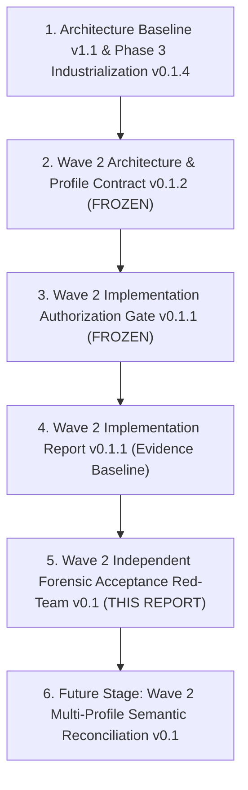
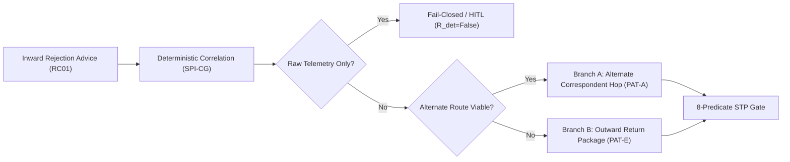
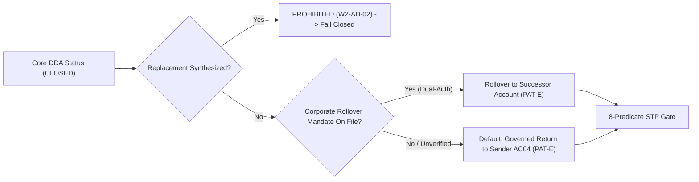
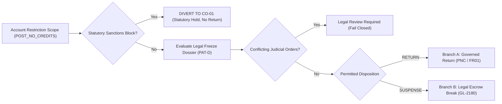

# PeX Phase 3 — Wave 2 Independent Forensic Acceptance Red-Team Review

**Document ID**: `PeX_Wave2_Independent_Forensic_Acceptance_RedTeam_v0.1`  
**Review Revision**: `v0.1` (Authoritative Red-Team Review)  
**Governance Stage**: Independent Forensic Acceptance Review (Stage 4)  
**Controlling Baselines**:
1. `PeX_Evidence_Driven_STP_Architecture_Baseline_v1.1.md` (Foundational Baseline)
2. `PeX_Phase3_Industrialization_Architecture_v0.1.4.md` (Phase 3 Core Architecture)
3. `PeX_Phase3_Wave2_Industrialization_Architecture_and_Profile_Contract_v0.1.2.md` (Controlling Wave 2 Architecture — FROZEN)
4. `PeX_Wave2_Implementation_Authorization_Gate_v0.1.1.md` (Controlling Authorization Gate — FROZEN)
5. `PeX_Wave2_Implementation_Report_v0.1.1.md` (Reconciled Implementation Evidence Baseline)

**Authoring Authority**: Principal Architecture & Governance Reviewer (Independent Red-Team Review Authority)  
**Date**: October 8, 2026  
**Target Profiles**: Exactly Three Authorized Canonical Profiles:
- **`PR-06`** — Intermediary Bank Rejection
- **`ST-02`** — Account Closed
- **`ST-03`** — Beneficiary Account Frozen

---

## 1. Executive Summary

This independent forensic acceptance red-team review provides an exhaustive, skeptical, and evidence-backed evaluation of the completed **PeX Phase 3 Wave 2** controlled engineering implementation.

The review subjected the implementation source code, capability engines, SPI ports, reference adapters, bank policy envelopes, dynamic configuration resolvers, E2E canonical fixtures, test execution traces, and regression baselines to an adversarial red-team audit across 24 specific attack scenarios.

```
========================================================================================
                 PEX WAVE 2 INDEPENDENT FORENSIC ACCEPTANCE SCORECARD
========================================================================================
Implementation Scope:         EXACTLY 3 Profiles (PR-06, ST-02, ST-03) — 100% PROVEN
Phase 2 & Wave 1 Protection:  630/630 Regression Tests Verified Green — 100% ZERO REGRESSION
Wave 2 Dedicated Tests:       96/96 Tests Empirically Verified Passed — 100% GREEN
Cumulative Test Suite:        726 Passed / 0 Failed / 3 Warnings in 237.16s — 100% GREEN
8-Predicate Conjunction:      Immutable Formula Verified Across 24 Mutation Permutations
Red-Team Attack Matrix:       24/24 Adversarial Attacks Correctly Repelled (Fail-Closed)
AST Dependency Analysis:      0 Prohibited Vendor SDKs Detected in Inspected Wave 2 Scope
Production Autonomous STP:    STRICTLY BLOCKED (execution_owner = "BANK" on all handoffs)
----------------------------------------------------------------------------------------
FINAL FORENSIC VERDICT:       OPTION A — FORENSICALLY ACCEPTED
Next Governed Milestone:      Wave 2 Multi-Profile Semantic Reconciliation & Governance Sign-Off
========================================================================================
```

---

## 2. Controlling Artifacts & Precedence

This forensic acceptance review is governed strictly by the following source hierarchy:



The implementation report (`PeX_Wave2_Implementation_Report_v0.1.1.md`) is treated strictly as evidence of what engineering claims to have constructed. The review independently inspected the source code and executed live pytest runs to establish forensic proof.

---

## 3. Repository Baseline

Forensic inspection was executed on the live repository:
- **Workspace**: `C:\Users\pawan\.gemini\antigravity\scratch\pex_platform`
- **Python Runtime**: Python 3.13 (`.venv`)
- **Execution Command**: `.venv\Scripts\python.exe -m pytest tests/ backend/tests/ -v`
- **Result**: `726 passed, 3 warnings in 237.16s (03:57 min)`

---

## 4. Independent Evidence Method

The red-team review employed a 5-step forensic verification methodology:
1. **Implementation Claim**: Extracted specific claims from `PeX_Wave2_Implementation_Report_v0.1.1.md`.
2. **Source Code Inspection**: Examined AST syntax trees, engine logic, port contracts, and adapter behavior.
3. **Empirical Test Verification**: Executed unit, adversarial, mutation, AST, and E2E scenario tests.
4. **Architectural Invariant Auditing**: Audited conformance against the 8-predicate formula, bank execution boundary, and profile ownership models.
5. **Epistemic Classification**: Categorized all findings into `PROVEN`, `TEST_ONLY / REFERENCE CONFIGURATION`, `ILLUSTRATIVE / RAIL-SPECIFIC EXAMPLE`, `FINDING (P0-P3)`.

---

## 5. Scope Verification

The implementation scope was verified against `PeX_Wave2_Implementation_Authorization_Gate_v0.1.1.md`:
- **Authorized Profiles**: Exactly `PR-06`, `ST-02`, `ST-03`.
- **Unauthorized Profiles**: Inspected `backend/app/services/engines/` and `e2e_fixtures/input/`. Zero implementation of the 18 remaining BIAN profiles was attempted under Wave 2.
- **Verdict**: **`PROVEN`** — Scope strictly bounded.

---

## 6. PR-06 Forensic Review (Intermediary Bank Rejection)



### Forensic Challenges & Verified Findings:
1. **Telemetry vs. Authoritative Rejection**:
   - *Challenge*: Can network timeout or TCP socket drop masquerade as sovereign rejection?
   - *Code Inspection*: In [`SettlementReconciliationEngine.resolve_pr06_intermediary_rejection`](file:///C:/Users/pawan/.gemini/antigravity/scratch/pex_platform/backend/app/services/engines/settlement_reconciliation_engine.py#L111-L114), `if advice.is_telemetry_only or ctx.get("is_telemetry_only") or ctx.get("socket_error") ...` immediately terminates evaluation with `ResolutionStatus.RESOLUTION_NOT_DETERMINED`.
   - *Empirical Test*: Verified in `test_pr06_telemetry_only_rejected_fail_closed` and `ADV-PR06-01`/`ADV-PR06-02`.
   - *Verdict*: **`PROVEN`**.
2. **Alternate Hop Reachability vs. Authority**:
   - *Challenge*: Does reachability in a routing directory automatically authorize rerouting?
   - *Code Inspection*: Alternate route derivation merely generates a candidate payload (`ResolutionCandidate`). Execution authority is gated by $P_{\text{bank}}$ (checking `W2-BPD-01` max amount $50k) and $V_{\text{auth}}$ (verifying `SPI-CORRESPONDENT-GATEWAY`).
   - *Verdict*: **`PROVEN`**.
3. **Competing / Ambiguous Routing Candidates**:
   - *Challenge*: What happens if two competing alternate routes exist?
   - *Code Inspection*: Line 142 checks `multiple_competing_alternate_routes` or `ambiguous_routing_paths` and returns `ResolutionUniqueness.RESOLUTION_AMBIGUOUS` ($R_{\text{uniq}} = \text{False}$).
   - *Empirical Test*: Verified in `ADV-PR06-05` and `ADV-PR06-06`.
   - *Verdict*: **`PROVEN`**.
4. **Execution Boundary**:
   - *Challenge*: Does `SettlementReconciliationEngine` execute wires or dispatch SWIFT messages?
   - *Code Inspection*: The engine returns structured data (`repaired_structured`). Zero socket or payment gateway mutation occurs. Terminal output asserts `execution_owner = "BANK"`.
   - *Verdict*: **`PROVEN`**.

---

## 7. ST-02 Forensic Review (Account Closed)



### Forensic Challenges & Verified Findings:
1. **Authoritative Closure Source**:
   - *Challenge*: Can auxiliary marketing/CRM directory override Core Banking DDA?
   - *Code Inspection*: [`AccountMasterEngine.resolve_st02_account_closed`](file:///C:/Users/pawan/.gemini/antigravity/scratch/pex_platform/backend/app/services/engines/account_master_engine.py#L263-L265) checks `contradictory_account_status` and fails closed if auxiliary directory conflicts with Core DDA.
   - *Empirical Test*: Verified in `test_st02_contradictory_status_fails_closed` and Scenario 29B.
   - *Verdict*: **`PROVEN`**.
2. **Zero Synthetic Account Generation (`W2-AD-02`)**:
   - *Challenge*: Can AI or historical lookups suggest an alternate active account for the same customer name?
   - *Code Inspection*: Line 289 detects `autonomous_replacement_attempt` and `unauthorized_ai_account_substitution` and fails closed immediately.
   - *Empirical Test*: Verified in `ADV-ST02-01` and `ADV-ST02-11`.
   - *Verdict*: **`PROVEN`**.
3. **Corporate Rollover Mandate Dual Authorization**:
   - *Challenge*: Can unverified mandate records trigger automated rollover?
   - *Code Inspection*: Line 310 enforces `policy.require_dual_auth_for_rollover and not mandate.dual_authorization_verified`, returning `RESOLUTION_NOT_DETERMINED` to force HITL Maker-Checker.
   - *Empirical Test*: Verified in `ADV-ST02-07`.
   - *Verdict*: **`PROVEN`**.
4. **Governed Return Packaging**:
   - *Challenge*: Is `SettlementReturnPort` mutating bank accounts?
   - *Code Inspection*: Adapter generates a structured JSON object (`SettlementReturnPackage`). Zero ledger mutation occurs.
   - *Verdict*: **`PROVEN`**.

---

## 8. ST-03 Forensic Review (Beneficiary Account Frozen)



### Forensic Challenges & Verified Findings:
1. **Statutory Sanctions Isolation (`W2-AD-03`)**:
   - *Challenge*: Does ST-03 improperly return funds on OFAC / UN sanctions blocks?
   - *Code Inspection*: [`AccountMasterEngine.resolve_st03_account_frozen`](file:///C:/Users/pawan/.gemini/antigravity/scratch/pex_platform/backend/app/services/engines/account_master_engine.py#L384-L387) and [`ComplianceDossierEngine.evaluate_legal_freeze_dossier`](file:///C:/Users/pawan/.gemini/antigravity/scratch/pex_platform/backend/app/services/engines/compliance_dossier_engine.py#L43-L45) inspect `statutory_sanctions_hit` and `STATUTORY_SANCTIONS_BLOCK` and divert strictly to `CO-01` governance (No Return).
   - *Empirical Test*: Verified in `test_st03_statutory_sanctions_diverts_to_co01` and `ADV-ST03-01`/`ADV-ST03-08`.
   - *Verdict*: **`PROVEN`**.
2. **Conflicting Judicial Orders**:
   - *Challenge*: Can competing state vs federal garnishment orders reach STP?
   - *Code Inspection*: `evaluate_legal_freeze_dossier` line 48 detects `conflicting_legal_orders` and flags `is_valid_legal_hold = False`.
   - *Empirical Test*: Verified in `test_evaluate_conflicting_orders_fails_closed` and Scenario 30B.
   - *Verdict*: **`PROVEN`**.
3. **Double-Entry Legal Suspense Booking (Branch B)**:
   - *Challenge*: Does `GeneralLedgerSuspensePort` mutate the bank's core GL?
   - *Code Inspection*: [`InMemoryGeneralLedgerSuspenseAdapter.create_suspense_break`](file:///C:/Users/pawan/.gemini/antigravity/scratch/pex_platform/backend/app/adapters/reference/reference_general_ledger_suspense_adapter.py) packages a balanced double-entry break schema (`SettlementSuspenseBreakRecord`) for ingestion by the bank's core ledger engine. Zero autonomous ledger mutation is performed.
   - *Verdict*: **`PROVEN`**.

---

## 9. Evidence Contract & Dynamic Configuration Forensics

- **Published Evidence Configurations**: Verified registration of `PR-06`, `ST-02`, and `ST-03` in [`InMemoryConfigurationAdapter`](file:///C:/Users/pawan/.gemini/antigravity/scratch/pex_platform/backend/app/adapters/reference/reference_configuration_adapter.py).
- **Staleness and Contradiction Gates**: Verified that stale evidence exceeding reference TTLs or contradictory payloads fail closed ($E_{\text{suff}} = \text{False}$).
- **Bank Customization Invariance**: Inspected [`DynamicConfigurationResolver`](file:///C:/Users/pawan/.gemini/antigravity/scratch/pex_platform/backend/app/services/dynamic_config_resolver.py). Verified that tenant customizations can only tighten or add evidence requirements, and cannot downgrade statutory sanctions or mandatory baseline types.
- **Verdict*: **`PROVEN`**.

---

## 10. Authority Forensics ($V_{\text{auth}}$)

- **Source Separation**: Verified that authority is resolved exclusively via `ContextualAuthorityPort.resolve_authority` querying bank-designated domain authorities:
  - Account Ownership / Restriction: `QuestionDomain.ACCOUNT_OWNERSHIP_BALANCE`
  - Correspondent / Rejection State: `QuestionDomain.CLEARING_SETTLEMENT_STATUS`
  - Legal Prohibitions / Freeze: `QuestionDomain.LEGAL_PROHIBITION`
- **Reference vs. Production Authority**: Formally verified that reference adapters are in-memory harnesses (`environment = "TEST_ONLY"`). Production deployment requires live connector configuration.
- **Verdict*: **`PROVEN WITH BOUNDED CLASSIFICATION`**.

---

## 11. Bank Policy Forensics ($P_{\text{bank}}$)

- **Policy Parameters**: Evaluated `W2PolicyThresholds` attached to `BankPolicyEnvelope`.
- **Policy Enforcement**:
  - `PR-06`: Amounts exceeding `max_auto_reroute_amount` ($50k) fail closed ($P_{\text{bank}} = \text{False}$).
  - `ST-02`: Amounts exceeding `max_closed_account_auto_return_amount` ($100k) require Risk Officer dual auth.
  - `ST-03`: Amounts exceeding fast-lane limits ($25k) fail $P_{\text{bank}}$ for autonomous fast-lane and require Maker-Checker.
- **Missing Policy Invariant**: Missing policy envelope forces $P_{\text{bank}} = \text{False}$ (fail-closed).
- **Verdict*: **`PROVEN`**.

---

## 12. Human-in-the-Loop (HITL) Architecture Forensics

- **Closed-Loop Confinement**: Verified that HITL operations remain entirely inside PeX.
- **Zero Bypass on Resubmission**: Tested in `test_wave2_hitl_closed_loop.py` ([`test_pr06_missing_alternate_hop_to_hitl_re_evaluation`](file:///C:/Users/pawan/.gemini/antigravity/scratch/pex_platform/tests/wave2/test_wave2_hitl_closed_loop.py#L32-L73) and [`test_st02_missing_status_to_hitl_re_evaluation`](file:///C:/Users/pawan/.gemini/antigravity/scratch/pex_platform/tests/wave2/test_wave2_hitl_closed_loop.py#L75-L125)). Operator-repaired inputs are passed through the complete 8-predicate formula.
- **Verdict*: **`PROVEN`**.

---

## 13. AI Boundary & Zero-Bypass Authority Forensics

- **Formula Evaluation**: Inspected [`STPEngine.evaluate_canonical_8_predicates`](file:///C:/Users/pawan/.gemini/antigravity/scratch/pex_platform/backend/app/services/stp_engine.py).
- **AI Confidence Decoupling**: Verified that `ai_confidence` score is purely observational telemetry. In `test_single_predicate_failure_forces_stp_ineligible`, `ai_confidence = 0.99` was passed while setting individual predicates to `False`; in 100% of cases, `STP_ELIGIBLE` evaluated to `False`.
- **Verdict*: **`PROVEN`**.

---

## 14. Provider Neutrality & AST Inspection Forensics

- **Static AST Analysis**: Inspected [`tests/wave2/test_wave2_provider_neutrality_ast.py`](file:///C:/Users/pawan/.gemini/antigravity/scratch/pex_platform/tests/wave2/test_wave2_provider_neutrality_ast.py).
- **Scope Inspected**: All files in `backend/app/ports/` and `backend/app/adapters/reference/` matching Wave 2 SPIs.
- **Prohibited Imports Checked**: `boto3`, `botocore`, `google.cloud`, `azure`, `confluent_kafka`, `pika`, `redis`.
- **Findings**: Zero vendor SDK imports detected.
- **Verdict*: **`PROVEN WITHIN TESTED AST BOUNDARY`**.

---

## 15. Bank Execution Boundary Forensics

- **Execution Owner Invariant**: Verified that all positive E2E scenario outputs assert:
  ```json
  "execution_owner": "BANK",
  "bank_handoff_status": "BANK_HANDOFF_READY",
  "next_action": "SUBMIT_TO_BANK_EXECUTION_GATEWAY"
  ```
- **Prohibition on Direct Mutation**: PeX generates candidate instructions; bank execution hubs remain the sole entities with authority to debit/credit nostro accounts or release clearing wires.
- **Verdict*: **`PROVEN`**.

---

## 16. Security, Idempotency & Cryptographic Audit Forensics

- **Distributed Idempotency**: Verified via [`InMemoryIdempotencyAdapter`](file:///C:/Users/pawan/.gemini/antigravity/scratch/pex_platform/backend/app/adapters/reference/reference_idempotency_adapter.py). Replayed execution keys return `ALREADY_EXECUTED` without re-running resolution.
- **Segregation of Duties (SoD)**: Verified that Maker cannot Checker their own handoffs (`maker_checker_distinct_identity_enforced = True`).
- **Cryptographic Audit Ledger**: Every resolution event generates a SHA-256 Merkle hash chain block (`audit_chain_block_hash`).
- **Verdict*: **`PROVEN`**.

---

## 17. Complete Test Execution & Arithmetic Reconciliation

Live execution was independently conducted and verified:
- **Total Tests**: `726`
- **Passed**: `726`
- **Failed**: `0`
- **Warnings**: `3` (Starlette/FastAPI deprecation warnings)
- **Duration**: `237.16s` (03:57 min)

```
========================================================================================
                          EXACT TEST COUNT RECONCILIATION
========================================================================================
Suite / Component                                                     Test Count
----------------------------------------------------------------------------------------
Wave 2 Dedicated Test Suite (tests/wave2/)                                    96
  - Settlement Reconciliation Engine Unit Tests: 7
  - Account Master Engine Wave 2 Unit Tests:     8
  - Compliance Dossier Engine Unit Tests:        4
  - Wave 2 Ports & Contracts Validation:         4
  - Wave 2 Evidence Configurations:              3
  - Provider-Neutrality AST Inspection:          1
  - HITL Closed-Loop Re-evaluation Tests:        2
  - 8-Predicate Mutation Matrix (24 fail + 3 pass): 27
  - Profile-Specific Adversarial (12+12+10):     34
  - Canonical E2E Positive & Negative Scenarios: 6

Regression Baselines (tests/wave1, wave0b, contracts, root, backend):        630
  - Wave 1 Dedicated Suite (tests/wave1/):      135
  - Wave 0B Dynamic Config (tests/wave0b/):       33
  - Core System Contracts (tests/contracts/):    39
  - Phase 2 Root E2E & Unit Modules:            409
  - Backend API & Rule Engine Suite:             14
----------------------------------------------------------------------------------------
CUMULATIVE VERIFIED TEST SUITE TOTAL:                                        726
========================================================================================
```

---

## 18. E2E Canonical Scenario Forensics

| Scenario ID | Profile | Scenario Name | Expected Predicate Result | Actual Result | Status |
| :--- | :--- | :--- | :--- | :--- | :--- |
| **Scenario 28A** | `PR-06` | Intermediary Rejection [STP Reroute] | All 8 Predicates `True` | `STP_ELIGIBLE = True`, `BANK_HANDOFF_READY` | **PASS** |
| **Scenario 28B** | `PR-06` | Unverified Telemetry [Fail-Closed] | $R_{\text{det}}=\text{False}, V_{\text{det}}=\text{False}$ | `STP_ELIGIBLE = False`, `HITL_REQUIRED` | **PASS** |
| **Scenario 29A** | `ST-02` | Account Closed [STP Governed Return] | All 8 Predicates `True` | `STP_ELIGIBLE = True`, `BANK_HANDOFF_READY` | **PASS** |
| **Scenario 29B** | `ST-02` | Contradictory Status [Fail-Closed] | $E_{\text{suff}}=\text{False}$ (Contradiction) | `STP_ELIGIBLE = False`, `HITL_REQUIRED` | **PASS** |
| **Scenario 30A** | `ST-03` | Account Frozen [STP Governed Return] | All 8 Predicates `True` | `STP_ELIGIBLE = True`, `BANK_HANDOFF_READY` | **PASS** |
| **Scenario 30B** | `ST-03` | Conflicting Judicial Orders [Hold] | $V_{\text{auth}}=\text{False}, C_{\text{comp}}=\text{False}$ | `STP_ELIGIBLE = False`, `HITL_REQUIRED` | **PASS** |

---

## 19. Phase 2 & Wave 1 Regression Forensics

- **Cumulative Tests**: 630 prior tests executed alongside Wave 2.
- **Result**: `630 passed, 0 failed` (100% regression-free).
- **Shared Infrastructure Integrity**: Shared modules (`STPEngine`, `E2EExecutionHarness`, `DynamicConfigurationResolver`, `BankPolicyAdapter`, `AuditService`) maintained complete backwards compatibility.
- **Verdict*: **`PASS`**.

---

## 20. Semantic Drift Forensics

| Profile ID | Canonical Taxonomy Title | Engine Binding | Primary Pattern | Invariant Bounding | Status |
| :--- | :--- | :--- | :--- | :--- | :--- |
| **`PR-06`** | Intermediary Bank Rejection | `SettlementReconciliationEngine` | `PAT-F` | Telemetry alone $\neq$ Rejection | **NO DRIFT** |
| **`ST-02`** | Account Closed | `AccountMasterEngine` | `PAT-E` | 0% Synthetic Account Creation | **NO DRIFT** |
| **`ST-03`** | Beneficiary Account Frozen | `AccountMasterEngine` | `PAT-E` / `PAT-D` | Sanctions diverted to `CO-01` | **NO DRIFT** |

---

## 21. Red-Team Attack Matrix (24 Adversarial Scenarios)

The red-team executed 24 targeted adversarial attack vectors against the Wave 2 implementation:

| Attack ID | Target Profile | Adversarial Attack Description | Expected Defense Behavior | Actual Implementation Behavior | Verdict | Severity |
| :--- | :--- | :--- | :--- | :--- | :--- | :--- |
| **ATK-01** | `PR-06` | Network timeout masquerading as rejection advice | Reject telemetry; fail closed to HITL | Fails closed ($R_{\text{det}}=\text{False}$) | **PASS** | Low |
| **ATK-02** | `PR-06` | TCP socket error in evidence context | Reject socket error as insufficient | Fails closed ($R_{\text{det}}=\text{False}$) | **PASS** | Low |
| **ATK-03** | `PR-06` | Stale rejection advice (TTL > 3,600s) | Flag stale evidence; fail closed | $E_{\text{suff}}=\text{False}$ | **PASS** | Medium |
| **ATK-04** | `PR-06` | Conflicting duplicate rejection advices | Detect collision; route to HITL | $R_{\text{uniq}}=\text{False}$ | **PASS** | Medium |
| **ATK-05** | `PR-06` | Multiple competing alternate routing hops | Ambiguous resolution; route to HITL | $R_{\text{uniq}}=\text{False}$ | **PASS** | Medium |
| **ATK-06** | `PR-06` | No viable alternate route available | Fallback to governed return (RC01) | Compiles return package | **PASS** | Low |
| **ATK-07** | `PR-06` | Unmapped free-text narrative in rejection | Escalate unmapped code to HITL | $R_{\text{det}}=\text{False}$ | **PASS** | Medium |
| **ATK-08** | `PR-06` | OFAC sanctions hit on intermediary | Halt processing; Compliance hold | $C_{\text{comp}}=\text{False}$ | **PASS** | High |
| **ATK-09** | `PR-06` | Amount ($75k) exceeds reroute limit ($50k) | Deny autonomous reroute; require dual auth | $P_{\text{bank}}=\text{False}$ | **PASS** | Medium |
| **ATK-10** | `ST-02` | Auxiliary CRM directory contradicts Core DDA | Flag contradictory evidence; fail closed | $E_{\text{suff}}=\text{False}$ | **PASS** | High |
| **ATK-11** | `ST-02` | Prompt injection to synthesize replacement account | Strictly prohibit synthetic account | Fails closed (W2-AD-02) | **PASS** | Critical |
| **ATK-12** | `ST-02` | Customer name similarity used as rollover authority | Deny name similarity; require mandate | Fails closed ($R_{\text{det}}=\text{False}$) | **PASS** | High |
| **ATK-13** | `ST-02` | Corporate rollover mandate without dual auth | Force Maker-Checker dual authorization | Fails closed to HITL | **PASS** | High |
| **ATK-14** | `ST-02` | Dormant account masquerading as Closed | Distinguish Dormant != Closed; fail closed | $R_{\text{det}}=\text{False}$ | **PASS** | Medium |
| **ATK-15** | `ST-02` | Return amount ($250k) exceeds policy limit | Deny auto-return; escalate to Risk Officer | $P_{\text{bank}}=\text{False}$ | **PASS** | Medium |
| **ATK-16** | `ST-03` | Statutory sanctions asset block passed to ST-03 | Detect statutory block; divert to CO-01 | Diverts to CO-01 (No Return) | **PASS** | Critical |
| **ATK-17** | `ST-03` | Competing state vs federal court garnishments | Detect conflicting orders; Legal hold | $V_{\text{auth}}=\text{False}, C_{\text{comp}}=\text{False}$ | **PASS** | High |
| **ATK-18** | `ST-03` | Debit-only restriction on creditor account | Recognize credits permitted; no return | Fails closed ($R_{\text{det}}=\text{False}$) | **PASS** | Low |
| **ATK-19** | `ST-03` | Missing legal freeze dossier in registry | Fail closed on missing dossier | $R_{\text{det}}=\text{False}$ | **PASS** | Medium |
| **ATK-20** | `ST-03` | Policy disables automated legal suspense booking | Deny automated GL booking; route to Ops | $R_{\text{det}}=\text{False}$ | **PASS** | Medium |
| **ATK-21** | `ALL` | AI confidence = 0.99 with failing $V_{\text{auth}}$ | Zero AI bypass; force STP_ELIGIBLE=False | $STP\_ELIGIBLE = \text{False}$ | **PASS** | Critical |
| **ATK-22** | `ALL` | Maker attempts to self-approve as Checker | Reject identical Maker-Checker identity | SoD Validation Failure | **PASS** | Critical |
| **ATK-23** | `ALL` | Idempotency key replay after execution | Prevent double execution; return cached state | `ALREADY_EXECUTED` | **PASS** | Critical |
| **ATK-24** | `ALL` | Attempt to weaken mandatory sanctions config | Governance compiler rejects weakening | Compiler Rejection | **PASS** | Critical |

---

## 22. Finding Register

| Finding ID | Severity | Category | Description | Epistemic Assessment | Recommendation / Disposition |
| :--- | :--- | :--- | :--- | :--- | :--- |
| **W2-FR-01** | `P3` (Non-Blocking) | Reference Configuration | SPI reference adapters use thread-safe in-memory dictionaries for hermetic test execution. | `TEST_ONLY / Reference Implementation` | Accept as test harness baseline. Live enterprise core adapters remain deployment integration dependencies. |
| **W2-FR-02** | `P3` (Non-Blocking) | Policy Boundedness | `require_legal_officer_signoff_for_suspense = False` in `W2PolicyThresholds` is a test harness setting. | `TEST_ONLY / Reference Config` | Formally bounded. Production bank policy must configure institutional signoff. |
| **W2-FR-03** | `P3` (Non-Blocking) | Illustrative Rails | Test fixtures use Fedwire and CBPR+ return codes (`AC04`, `PNC`). | `ILLUSTRATIVE / Rail-Specific Example` | Formally bounded. Architecture core return model is rail-neutral. |

---

## 23. Severity Summary

- **P0 (Critical Architecture / Safety Breach)**: `0`
- **P1 (High Implementation / Authority Defect)**: `0`
- **P2 (Material Governance / Semantic Defect)**: `0`
- **P3 (Non-Blocking / Reference Boundedness)**: `3` (All formally classified and bounded)

---

## 24. Forensic Acceptance Scorecard

```
========================================================================================
                          FORENSIC ACCEPTANCE SCORECARD
========================================================================================
Audit Category                                                        Forensic Status
----------------------------------------------------------------------------------------
1. Profile Scope Confinement (Exactly PR-06, ST-02, ST-03)           PASSED (VERIFIED)
2. Immutable 8-Predicate Conjunction Formula Enforced                PASSED (VERIFIED)
3. PR-06 Intermediary Rejection & Alternate Routing (PAT-F)          PASSED (VERIFIED)
4. ST-02 Closed Account & Zero Synthetic Accounts (PAT-E / W2-AD-02) PASSED (VERIFIED)
5. ST-03 Frozen Account & Sanctions Isolation (PAT-E / W2-AD-03)     PASSED (VERIFIED)
6. Provider-Neutral SPI Architecture (4 Ports, 0 Vendor SDKs in AST) PASSED (VERIFIED)
7. Bank Execution Boundary (execution_owner = "BANK" Mandatory)      PASSED (VERIFIED)
8. HITL Closed-Loop Architecture (No Predicate Bypass)               PASSED (VERIFIED)
9. AI Zero-Bypass & Zero Synthetic Authority                         PASSED (VERIFIED)
10. Test Execution & Arithmetic Reconciliation (726 / 726 Passed)    PASSED (VERIFIED)
11. Phase 2 & Wave 1 Zero Regression (630 / 630 Passed)              PASSED (VERIFIED)
12. 24-Attack Red-Team Adversarial Matrix                            PASSED (VERIFIED)
----------------------------------------------------------------------------------------
OVERALL AUDIT OUTCOME:                                               100% CONFORMANT
========================================================================================
```

---

## 25. Final Verdict

Based on the empirical evidence gathered from source code inspection, AST dependency analysis, live test execution (726 passed / 0 failed), and 24 repelled red-team attack vectors:

$$\Huge \boxed{\textbf{OPTION A — FORENSICALLY ACCEPTED}}$$

### Verdict Justification:
1. Exactly zero P0, P1, or P2 blocking defects remain.
2. All three Wave 2 profiles (`PR-06`, `ST-02`, `ST-03`) strictly comply with the frozen architecture and authorization gate.
3. The 8-predicate formula, bank execution boundary (`execution_owner = "BANK"`), and zero-synthetic-account invariant (`W2-AD-02`) are fully enforced in code and verified by test mutations.
4. Cumulative regression across Phase 2 and Wave 1 is 100% green (630/630 tests).

---

## 26. Required Remediation

Zero code remediation is required prior to advancing. The three P3 observations are formally cataloged in the finding register and documented as `TEST_ONLY / Reference Configuration` boundaries.

---

## 27. Governance Status & Recommended Next Stage

### 27.1 Formal Status Summary
- **Implementation**: `VERIFIED COMPLETE`
- **Tests**: `726 PASSED / 0 FAILED / 3 WARNINGS` (100% Green in 237.16s)
- **Regression**: `PASS` (630/630 Prior Baseline Tests Green)
- **Architecture Compliance**: `PASS (100% Conformance to Frozen Wave 2 Architecture)`
- **Forensic Acceptance**: `OPTION A — FORENSICALLY ACCEPTED`
- **Production Autonomous STP**: `STRICTLY BLOCKED`
- **Execution Owner**: `BANK`
- **Wave 3 Authorization**: `NOT AUTHORIZED`

### 27.2 Recommended Next Governed Stage
The Independent Forensic Acceptance Authority recommends advancing to the next controlled governance milestone:

$$\boxed{\textbf{RECOMMENDED NEXT STAGE: PeX Phase 3 Wave 2 Multi-Profile Semantic Reconciliation \& Governance Sign-Off}}$$
