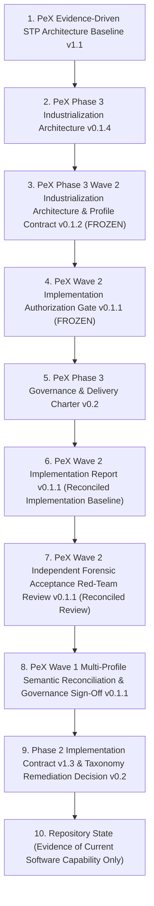
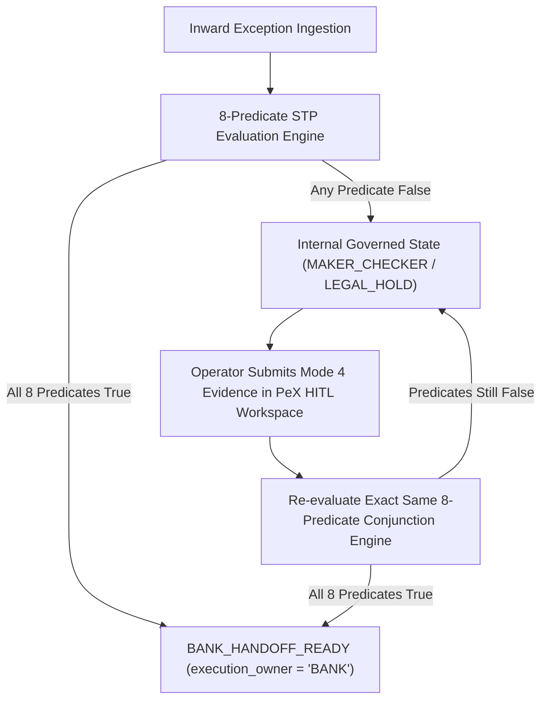

# PeX Phase 3 — Wave 2 Multi-Profile Semantic Reconciliation & Governance Sign-Off v0.1.1

**Document ID**: `PEX-PH3-W2-MPSR-GS-001.1`  
**Version**: `v0.1.1` (Reconciled Governance Baseline)  
**Status**: Governance Sign-Off Baseline — Ready With Conditions  
**Governance Stage**: Governance Sign-Off & Multi-Profile Semantic Reconciliation (Stage 5 of Wave 2)  
**Date**: October 8, 2026  
**Role**: Principal Architecture & Governance Review Desk / PeX Semantic Reconciliation Authority  
**Controlling Architecture Baseline**: `PeX_Phase3_Wave2_Industrialization_Architecture_and_Profile_Contract_v0.1.2.md` (FROZEN)  
**Controlling Authorization Gate**: `PeX_Wave2_Implementation_Authorization_Gate_v0.1.1.md` (FROZEN)  
**Controlling Implementation Evidence**: `PeX_Wave2_Implementation_Report_v0.1.1.md` (Reconciled Baseline)  
**Controlling Acceptance Review**: `PeX_Wave2_Independent_Forensic_Acceptance_RedTeam_v0.1.1.md` (OPTION B Accepted)  
**Preceding Wave 1 Sign-Off**: `PeX_Wave1_Multi_Profile_Semantic_Reconciliation_and_Governance_Signoff_v0.1.1.md`  
**Source Being Reconciled**: `PeX_Wave2_Multi_Profile_Semantic_Reconciliation_and_Governance_Signoff_v0.1.md`  
**Cumulative Verified Test Suite**: **726 passed / 0 failed / 3 warnings in 237.16s (100% Green)**  

---

## 1. Document Control

| Attribute | Authoritative Value |
| :--- | :--- |
| **Document Purpose** | Controlled Document Reconciliation and Formal Governance Sign-Off for PeX Phase 3 Wave 2 Industrialization |
| **Lifecycle State** | Wave 2 Governance Milestone Complete (Governance Sign-Off Baseline — Ready With Conditions) |
| **Review Authority** | Principal Architecture & Governance Review Desk |
| **Active Wave 2 Scope** | Exactly Three (3) Canonical Profiles: `PR-06`, `ST-02`, `ST-03` |
| **Cumulative Active Profiles** | Exactly Twenty-Three (23) Canonical Profiles (Phase 2: 11, Wave 1: 9, Wave 2: 3) |
| **Unauthorized Profiles** | Exactly Eighteen (18) Canonical Profiles remain un-implemented |
| **Controlling Precedence** | Architecture v1.1 $\rightarrow$ Phase 3 v0.1.4 $\rightarrow$ Wave 2 Arch v0.1.2 $\rightarrow$ Gate v0.1.1 $\rightarrow$ Impl Report v0.1.1 $\rightarrow$ Red-Team v0.1.1 |

---

## 2. Governance Status

```
+----------------------------------------------------------------------------------------------------+
|                                    CURRENT PEX GOVERNANCE STATE                                    |
+------------------------------------+---------------------------------------------------------------+
| Governance Dimension               | Authoritative Status                                          |
+------------------------------------+---------------------------------------------------------------+
| Phase 2 Baseline (11 Profiles)     | CLOSED & FROZEN (Strict No-Reengineering Protection)          |
| Wave 0A Foundational Baseline      | COMPLETE (Contracts, Ports, Schemas, Scenarios 1–12)          |
| Wave 0B Dynamic Engine Layer       | COMPLETE (Dynamic Configs, HITL Workflow, Scenarios 13–18)    |
| Wave 1 Baseline (9 Profiles)       | COMPLETE & SIGNED OFF (Signed off under Wave 1 MPSR-GS v0.1.1)|
| Wave 2 Implementation (3 Profiles) | COMPLETE (PR-06, ST-02, ST-03; 4 Ports, 4 Reference Adapters) |
| Wave 2 Dedicated Tests             | 96 passed / 0 failed (Unit, Adversarial, AST, Mutation, E2E)  |
| Cumulative Test Suite Health       | 726 passed / 0 failed / 3 warnings in 237.16s (100% Green)    |
| Independent Forensic Acceptance    | COMPLETED (Red-Team Reconciliation v0.1.1 Certified)          |
| Forensic Acceptance Decision       | OPTION B — FORENSIC ACCEPTANCE SURVIVES WITH CORRECTIONS      |
| Wave 2 Governance Sign-Off         | OPTION B — GOVERNANCE SIGN-OFF READY WITH CONDITIONS          |
| Production Autonomous STP Release  | STRICTLY BLOCKED (Mandatory execution_owner = "BANK" Enforced)|
| Wave 3 Engineering Authorization   | NOT AUTHORIZED (Separate Architecture Gate Required)          |
+------------------------------------+---------------------------------------------------------------+
```

> [!IMPORTANT]
> **GOVERNANCE MATURITY INVARIANT:**  
> $$\text{Architecture Validated} \neq \text{Implementation Validated} \neq \text{Forensic Acceptance} \neq \text{Governance Sign-Off} \neq \text{Production Release}$$  
> This artifact performs the **Multi-Profile Semantic Reconciliation & Governance Sign-Off** stage for Wave 2. It certifies semantic consistency, cross-wave engine ownership, shared capability reuse, and invariant compliance across all 23 active canonical profiles. It establishes the governing conditions for production bank onboarding and prerequisites for subsequent waves.
> 
> **Explicit Distinctions:**
> 1. **Semantic Reconciliation**: Confirms that profile definitions, engine bindings, pattern mappings, and data contracts across Phase 2, Wave 1, and Wave 2 are mutually non-contradictory and free of semantic drift.
> 2. **Governance Sign-Off**: Formally approves the completed engineering work of Wave 2 as ready for downstream institutional integration under explicit conditions.
> 3. **Production Approval**: Requires live enterprise adapter binding, production policy signing, and institutional cutover authorization; it is **NOT** granted by this document.
> 4. **Wave 3 Authorization**: Requires an independent Wave 3 Architecture & Profile Contract and separate Implementation Authorization Gate; it is **NOT** granted by this document.

---

## 3. Authoritative Source Hierarchy

In accordance with Section 3 of the Phase 3 Delivery Charter, all semantic determinations, authority assignments, and governance sign-off criteria in this artifact are governed strictly by the following hierarchy:



---

## 4. Authoritative Phase 3 Industrialization Wave Roadmap

The authoritative Phase 3 delivery sequence is restored directly from `PeX_Phase3_Industrialization_Architecture_v0.1.4.md`:

```
+----------------------------------------------------------------------------------------------------+
|                          AUTHORITATIVE PHASE 3 INDUSTRIALIZATION ROADMAP                           |
+--------+------------------------------------+--------------------------+---------------------------+
| Wave   | Target Canonical Profile Scope     | Primary Capability Engine| Governance / Delivery State|
+--------+------------------------------------+--------------------------+---------------------------+
| Wave 1 | DQ-03, DQ-04, DQ-07, DQ-09,        | AccountMasterEngine,     | COMPLETE & SIGNED OFF     |
|        | PR-02, PR-04, PR-07, PR-09, CO-07  | RoutingClearingEngine,   | (MPSR-GS v0.1.1 Baseline) |
|        | (9 Canonical Profiles)             | RemittanceDocumentEngine |                           |
+--------+------------------------------------+--------------------------+---------------------------+
| Wave 2 | PR-06, ST-02, ST-03                | SettlementReconciliation,| COMPLETE (Option B        |
|        | (3 Canonical Profiles Authorized)  | AccountMasterEngine      | Governance Sign-Off Ready)|
+--------+------------------------------------+--------------------------+---------------------------+
| Wave 3 | TR-02, TR-03, TR-04, TR-06,        | TreasuryExposureEngine   | NOT AUTHORIZED            |
|        | TR-07, TR-08                       |                          | (Separate Architecture &  |
|        | (6 Treasury & Liquidity Profiles)  |                          |  Authorization Required)  |
+--------+------------------------------------+--------------------------+---------------------------+
| Wave 4 | TR-01, TR-05, ST-06                | AccountMasterEngine,     | NOT AUTHORIZED            |
|        | (3 Mandate & Claims Profiles)      | SettlementReconciliation | (Future Phase 3 Milestone)|
+--------+------------------------------------+--------------------------+---------------------------+
| Wave 5 | CO-01, CO-02, CO-03, CO-05,        | ComplianceDossierEngine  | NOT AUTHORIZED            |
|        | CO-06, CO-08                       |                          | (Future Phase 3 Milestone)|
|        | (6 Financial Crime Profiles)       |                          |                           |
+--------+------------------------------------+--------------------------+---------------------------+
| Wave 6 | 41-Profile Convergence &           | Cross-Engine Integration | NOT AUTHORIZED            |
|        | Enterprise Hardening               |                          | (Final Phase 3 Hardening) |
|        | (DQ-10, DQ-11, PR-10, PR-11, PR-12,|                          |                           |
|        |  ST-04, ST-05, ST-07 + Full 41)    |                          |                           |
+--------+------------------------------------+--------------------------+---------------------------+
```

> **GOVERNANCE DIRECTIVE ON WAVE 3 SCOPE:**  
> Wave 3 planning may commence under a separate architecture and authorization process; Wave 3 engineering is **STRICTLY NOT AUTHORIZED**. The target scope for Wave 3 consists exclusively of `TR-02`, `TR-03`, `TR-04`, `TR-06`, `TR-07`, and `TR-08`. Profiles `ST-04`, `ST-05`, and `ST-07` belong to Wave 6 convergence; `TR-01`, `TR-05`, and `ST-06` belong to Wave 4.

---

## 5. Full 41-Profile Canonical Taxonomy Status Matrix

The complete PeX 41-profile canonical exception taxonomy is reconciled below using the exact, immutable canonical profile names:

```
+----------------------------------------------------------------------------------------------------+
|                               PEX 41-PROFILE CANONICAL TAXONOMY STATUS                             |
+---------+-----------------------------------+--------------------+------------------+--------------+
| Profile | Exact Canonical Profile Name      | Primary Engine     | Industrial Wave  | Status       |
+---------+-----------------------------------+--------------------+------------------+--------------+
| DQ-01   | Invalid IBAN                      | AccountMasterEngine| Phase 2 Baseline | PROVEN (P2)  |
| DQ-02   | Invalid BIC / SWIFT               | RoutingClearingEng | Phase 2 Baseline | PROVEN (P2)  |
| DQ-03   | Missing Beneficiary Data          | AccountMasterEngine| Phase 3 Wave 1   | PROVEN (W1)  |
| DQ-04   | Missing Remittance Info           | RemittanceDocEngine| Phase 3 Wave 1   | PROVEN (W1)  |
| DQ-05   | Invalid Address Format            | AccountMasterEngine| Phase 2 Baseline | PROVEN (P2)  |
| DQ-06   | Missing Purpose Code              | ComplianceDossier  | Phase 2 Baseline | PROVEN (P2)  |
| DQ-07   | Invalid Account Number            | AccountMasterEngine| Phase 3 Wave 1   | PROVEN (W1)  |
| DQ-08   | Invalid Routing Code              | RoutingClearingEng | Phase 2 Baseline | PROVEN (P2)  |
| DQ-09   | Beneficiary Name Mismatch         | AccountMasterEngine| Phase 3 Wave 1   | PROVEN (W1)  |
| DQ-10   | Structured Creditor Reference Error| RemittanceDocEngine| Wave 6           | UNAUTHORIZED |
| DQ-11   | LEI Mismatch / Missing LEI        | AccountMasterEngine| Wave 6           | UNAUTHORIZED |
+---------+-----------------------------------+--------------------+------------------+--------------+
| PR-01   | Duplicate Payment                 | SettlementReconEng | Phase 2 Baseline | PROVEN (P2)  |
| PR-02   | Routing Failure                   | RoutingClearingEng | Phase 3 Wave 1   | PROVEN (W1)  |
| PR-03   | ISO 20022 Validation Error        | RoutingClearingEng | Phase 2 Baseline | PROVEN (P2)  |
| PR-04   | Cutoff Missed                     | RoutingClearingEng | Phase 3 Wave 1   | PROVEN (W1)  |
| PR-05   | Corrupted Message Format          | RemittanceDocEngine| Phase 2 Baseline | PROVEN (P2)  |
| PR-06   | Intermediary Bank Rejection       | SettlementReconEng | Phase 3 Wave 2   | PROVEN (W2)  |
| PR-07   | Network Timeout                   | RoutingClearingEng | Phase 3 Wave 1   | PROVEN (W1)  |
| PR-08   | Queue Processing Failure          | RoutingClearingEng | Phase 2 Baseline | PROVEN (P2)  |
| PR-09   | Payment Held for Repair           | RoutingClearingEng | Phase 3 Wave 1   | PROVEN (W1)  |
| PR-10   | Currency Corridor Closed          | RoutingClearingEng | Wave 6           | UNAUTHORIZED |
| PR-11   | Inter-Bank Message Discrepancy    | SettlementReconEng | Wave 6           | UNAUTHORIZED |
| PR-12   | Tracking UETR Collision           | SettlementReconEng | Wave 6           | UNAUTHORIZED |
+---------+-----------------------------------+--------------------+------------------+--------------+
| CO-01   | Sanctions Screening Hit           | ComplianceDossier  | Wave 5           | UNAUTHORIZED |
| CO-02   | AML Alert                         | ComplianceDossier  | Wave 5           | UNAUTHORIZED |
| CO-03   | PEP Match                         | ComplianceDossier  | Wave 5           | UNAUTHORIZED |
| CO-04   | Restricted Corridor               | ComplianceDossier  | Phase 2 Baseline | PROVEN (P2)  |
| CO-05   | Adverse Media Match               | ComplianceDossier  | Wave 5           | UNAUTHORIZED |
| CO-06   | High-Risk Jurisdiction            | ComplianceDossier  | Wave 5           | UNAUTHORIZED |
| CO-07   | Regulatory Reporting Required     | RemittanceDocEngine| Phase 3 Wave 1   | PROVEN (W1)  |
| CO-08   | Customer Watchlist Match          | ComplianceDossier  | Wave 5           | UNAUTHORIZED |
+---------+-----------------------------------+--------------------+------------------+--------------+
| TR-01   | KYC Expired                       | AccountMasterEngine| Wave 4           | UNAUTHORIZED |
| TR-02   | Insufficient Funds                | TreasuryExposureEng| Wave 3           | UNAUTHORIZED |
| TR-03   | Nostro Shortfall                  | TreasuryExposureEng| Wave 3           | UNAUTHORIZED |
| TR-04   | FX Rate Unavailable               | TreasuryExposureEng| Wave 3           | UNAUTHORIZED |
| TR-05   | Authorization Missing             | AccountMasterEngine| Wave 4           | UNAUTHORIZED |
| TR-06   | Limit Breach                      | TreasuryExposureEng| Wave 3           | UNAUTHORIZED |
| TR-07   | Liquidity Constraint              | TreasuryExposureEng| Wave 3           | UNAUTHORIZED |
| TR-08   | Credit Exposure Breach            | TreasuryExposureEng| Wave 3           | UNAUTHORIZED |
+---------+-----------------------------------+--------------------+------------------+--------------+
| ST-01   | Returned Payment                  | SettlementReconEng | Phase 2 Baseline | PROVEN (P2)  |
| ST-02   | Account Closed                    | AccountMasterEngine| Phase 3 Wave 2   | PROVEN (W2)  |
| ST-03   | Beneficiary Account Frozen        | AccountMasterEngine| Phase 3 Wave 2   | PROVEN (W2)  |
| ST-04   | Reconciliation Break              | SettlementReconEng | Wave 6           | UNAUTHORIZED |
| ST-05   | Settlement Failure                | SettlementReconEng | Wave 6           | UNAUTHORIZED |
| ST-06   | Funds Trapped at Correspondent    | SettlementReconEng | Wave 4           | UNAUTHORIZED |
| ST-07   | Unmatched Credit                  | SettlementReconEng | Wave 6           | UNAUTHORIZED |
+---------+-----------------------------------+--------------------+------------------+--------------+
| TOTAL   | 23 Active Verified Profiles       | 5 Engines Active   | Cumulative Ph2-W2| 18 Future    |
+---------+-----------------------------------+--------------------+------------------+--------------+
```

---

## 6. Reconciliation Methodology & Semantic Status Vocabulary

All semantic statements, capability bindings, and cross-wave interactions are audited against concrete code, schemas, and live test executions using this strict vocabulary:

- **PROVEN**: Directly supported by deterministic implementation logic, hermetic test executions, and authoritative contract definitions.
- **SUPPORTED**: Architecturally compliant and validated in reference scope, but dependent on external operational context (e.g. socket telemetry).
- **PROVISIONAL**: Implemented and verified via reference adapters and reference policy envelopes; requires production bank policy binding prior to live onboarding.
- **OPEN**: Requires an explicit architectural or institutional policy decision before live production deployment.
- **CONFLICTED**: Material contradiction identified across baselines.
- **NOT APPLICABLE**: Dimension does not apply to the evaluated scope.

---

## 7. Detailed Semantic Reconciliation of Wave 2 Profiles

### 7.1 PR-06 — Intermediary Bank Rejection

```
====================================================================================================
CANONICAL PROFILE CARD: PR-06 (Intermediary Bank Rejection)
====================================================================================================
Canonical Profile ID:       PR-06
Canonical Profile Name:     Intermediary Bank Rejection
Problem Meaning:            In-flight payment instruction was rejected by an intermediary correspondent
                            clearing bank prior to reaching the beneficiary institution (e.g. rejection
                            advice with return reason code such as RC01 / Reject Routing Corridor).
Trigger Condition:          Ingestion of an authoritative intermediary rejection advice payload (e.g.
                            pacs.002 rejection advice / MT199 rejection advice) matched to an active payment.
Primary Engine:             SettlementReconciliationEngine
Supporting Engine(s):       RoutingClearingEngine (provides alternate correspondent hop reachability)
Resolution Pattern Family:  Primary: PAT-F (Intermediary & Claims Tracking Family)
                            Supporting: PAT-A (Alternate Route Candidate) /
                                        PAT-E (Governed Return Package Candidate)
Why Pattern Fits:           Evaluates the rejection reason against reachable correspondent routing paths
                            under PAT-F. If a verified alternate correspondent hop exists and amount <= policy
                            threshold, derives an alternate routing candidate (PAT-A). If no viable route
                            exists or amount exceeds cap, compiles an outward return candidate (PAT-E).
Evidence Required:          IntermediaryRejectionAdvice (rejection_code, reason_narrative, is_telemetry_only=False),
                            DeterministicCorrelationMatch (original_uetr, original_amount, currency),
                            AlternateRerouteResult (viable alternate correspondent BIC) OR
                            SettlementReturnPackage (rejection reason code, return clearing rail).
Evidence Acquisition Modes: Mode 2 (Automated Correspondent Gateway SPI Query), Mode 1 (Bank Pre-Supplied),
                            Mode 4 (Operator Mode 4 Evidence Submission in HITL Workspace).
Evidence Trust Tier(s):     Tier 2 (Official Correspondent Gateway Rejection Advice), Tier 1 (Core Payment Hub Match).
                            Tier 4 historical precedent is advisory only (0% routing authority).
Resolution Determination:   R_det = True when either a valid alternate correspondent hop candidate is derived OR
                            a structured return candidate is compiled. (False if unmapped narrative or telemetry-only).
Resolution Uniqueness:      R_uniq = True when exactly 1 optimal alternate hop candidate exists, or exactly 1 return package.
                            (False if multiple competing alternate correspondent routes exist).
Technical Validation:       V_det = True when alternate BIC complies with ISO 9362 (8 or 11 characters) and
                            candidate payload satisfies clearing rail formatting constraints.
Authority Validation:       V_auth = True when the SPI provides access to bank authorization for the alternate
                            corridor. (Production V_auth depends on binding that SPI to the bank's live gateway).
Bank Policy Dependency:     W2-BPD-01 attached to BankPolicyEnvelope (TEST / REFERENCE DEFAULTS):
                            - allow_auto_reroute: True
                            - max_auto_reroute_amount: 50000.0
                            - allowed_reroute_rejection_codes: ["RC01", "NARR", "MS03"]
Compliance Dependency:      C_comp = True; alternate intermediary BIC and target country pass Sanctions/AML screening.
Execution Preconditions:    X_pre = True; alternate correspondent rail is open and operational.
Non-Negotiable Boundaries:  1. Telemetry Separation: Network socket drops or TCP resets belong strictly to
                               PR-07 (Network Timeout) and CANNOT satisfy PR-06.
                               Network telemetry != payment-processing state != formal intermediary rejection.
                            2. Reachability != Authority: Directory reachability alone does not authorize routing.
                            3. No Compensation Invention: PeX derives governed repair/return candidates; PeX does
                               NOT execute correspondent compensation or wire dispatches directly.
HITL Trigger Conditions:    Telemetry-only evidence, unmapped rejection code, multiple competing routes, amount > $50k,
                            sanctions alert on alternate intermediary, or no viable route available for auto-return.
STP Automation Potential:   High (for standard correspondent network rejects with defined fallback corridors).
STP Eligibility Condition:  E_suff ∧ R_det ∧ R_uniq ∧ V_det ∧ V_auth ∧ P_bank ∧ C_comp ∧ X_pre == True.
Bank Execution Boundary:    execution_owner = "BANK"; handoff contains structured reroute or return candidate.
                            PeX performs ZERO direct wire dispatch or correspondent account debiting.
AI Role:                    Observational parsing of unmapped narrative only (0% routing/approval authority).
Implementation Evidence:    backend/app/services/engines/settlement_reconciliation_engine.py (resolve_pr06_intermediary_rejection)
                            backend/app/ports/correspondent_gateway_port.py (CorrespondentGatewayPort)
                            backend/app/adapters/reference/reference_correspondent_gateway_adapter.py
                            tests/wave2/test_settlement_reconciliation_engine.py (TestSettlementReconciliationEngine)
                            e2e_fixtures/input/PR-06_intermediary_rejection_sufficient.json (Scenario 28A)
                            e2e_fixtures/input/PR-06_intermediary_rejection_telemetry_only.json (Scenario 28B)
Semantic Status:            PROVEN (In Reference Implementation) / PROVISIONAL (Production Gateway Binding)
====================================================================================================
```

---

### 7.2 ST-02 — Account Closed

```
====================================================================================================
CANONICAL PROFILE CARD: ST-02 (Account Closed)
====================================================================================================
Canonical Profile ID:       ST-02
Canonical Profile Name:     Account Closed
Problem Meaning:            Inward payment instruction targets a creditor DDA account that has been
                            formally and permanently closed in the beneficiary bank's core master ledger.
Trigger Condition:          Core Banking DDA lookup returns account status CLOSED or clearing rail
                            inward validation returns account closed condition (e.g. AC04).
Primary Engine:             AccountMasterEngine
Supporting Engine(s):       SettlementReconciliationEngine (compiles outward return package)
Resolution Pattern Family:  Primary: PAT-E (Ledger Matching & Settlement Reversal Family)
                            Supporting: PAT-A (Master DDA Status Lookup)
Why Pattern Fits:           Executes governed post-settlement or clearing disposition under PAT-E: either derives
                            a governed account rollover candidate where permitted by corporate mandate or compiles
                            an outward return candidate (illustrative pacs.004 / AC04).
Evidence Required:          AccountClosedRecord (account_number, closure_date, is_closed=True, no CRM contradiction),
                            DeterministicCorrelationMatch (uetr, amount, currency, creditor_name),
                            RolloverMandateRecord (optional: successor_account, dual_authorization_verified=True).
Evidence Acquisition Modes: Mode 2 (Core DDA SPI Query), Mode 1 (Pre-Supplied Return Mandate),
                            Mode 4 (Operator Mode 4 Account Verification in HITL Workspace).
Evidence Trust Tier(s):     Tier 1 (Authoritative Core Banking DDA Ledger). Auxiliary CRM data is Tier 3.
Resolution Determination:   R_det = True when either an authorized rollover candidate is derived OR
                            a governed outward return candidate is compiled. (False if synthetic substitution).
Resolution Uniqueness:      R_uniq = True when single successor account or single return disposition is determined.
Technical Validation:       V_det = True when return package candidate satisfies applicable clearing rail syntax rules.
Authority Validation:       V_auth = True; Core DDA confirms account closure; rollover mandate verified under dual auth.
Bank Policy Dependency:     W2-BPD-02 attached to BankPolicyEnvelope (TEST / REFERENCE DEFAULTS):
                            - allow_mandate_rollover: False (Return to Sender is standard baseline)
                            - max_auto_return_amount: 250000.0
                            - require_dual_auth_for_rollover: True
Compliance Dependency:      C_comp = True; closed account is not under sanctions or criminal asset freeze.
Execution Preconditions:    X_pre = True; return clearing rail open; settlement ledger available.
Non-Negotiable Boundaries:  Zero Synthetic Account Invariant (W2-AD-02): PeX is STRICTLY PROHIBITED from
                            synthesizing replacement accounts via AI, historical lookups, or fuzzy customer
                            name matching. PeX derives/packages candidates; the bank remains execution owner.
HITL Trigger Conditions:    Contradictory account status across systems, unverified rollover mandate without dual auth,
                            return amount > $250k, sanctions alert, or missing core DDA closure confirmation.
STP Automation Potential:   High (for standard automated return candidate packaging on closed accounts).
STP Eligibility Condition:  E_suff ∧ R_det ∧ R_uniq ∧ V_det ∧ V_auth ∧ P_bank ∧ C_comp ∧ X_pre == True.
Bank Execution Boundary:    execution_owner = "BANK"; emits BANK_HANDOFF_READY with return candidate payload.
                            PeX performs ZERO direct DDA ledger debits or credits.
AI Role:                    Zero decision authority (Deterministic core DDA validation only).
Implementation Evidence:    backend/app/services/engines/account_master_engine.py (resolve_st02_account_closed)
                            backend/app/ports/settlement_return_port.py (SettlementReturnPort)
                            backend/app/adapters/reference/reference_settlement_return_adapter.py
                            tests/wave2/test_account_master_engine_wave2.py (TestAccountMasterEngineWave2)
                            e2e_fixtures/input/ST-02_account_closed_sufficient.json (Scenario 29A)
                            e2e_fixtures/input/ST-02_account_closed_contradictory.json (Scenario 29B)
Semantic Status:            PROVEN (In Reference Implementation) / PROVISIONAL (Production Core DDA Binding)
====================================================================================================
```

---

### 7.3 ST-03 — Beneficiary Account Frozen

```
====================================================================================================
CANONICAL PROFILE CARD: ST-03 (Beneficiary Account Frozen)
====================================================================================================
Canonical Profile ID:       ST-03
Canonical Profile Name:     Beneficiary Account Frozen
Problem Meaning:            Inward payment instruction targets a creditor account subject to an active
                            administrative, regulatory, or judicial restriction (e.g. POST_NO_CREDITS,
                            court garnishment, tax levy, or bankruptcy order).
Trigger Condition:          Core Banking DDA returns restriction scope POST_NO_CREDITS / TOTAL_BLOCK or
                            Legal Registry returns an active freeze dossier.
Primary Engine:             AccountMasterEngine
Supporting Engine(s):       SettlementReconciliationEngine (GL suspense / return packaging),
                            ComplianceDossierEngine (where legal freeze dossier evaluation is required).
Resolution Pattern Family:  Primary: PAT-E (Ledger Matching & Settlement Reversal Family)
                            Supporting: PAT-D (Compliance & Risk Dossier Adjudication Family)
Why Pattern Fits:           Evaluates the legal freeze dossier and judicial scope under PAT-D. If the restriction
                            permits return, packages an outward return candidate (PAT-E). If the court order
                            mandates local retention in legal escrow, packages a balanced GL suspense break candidate (PAT-E).
Evidence Required:          AccountRestrictionScope (restriction_type, post_no_credits=True, statutory_sanctions=False),
                            LegalFreezeDossierRecord (dossier_id, court_order_ref, permitted_disposition, has_conflicts=False),
                            DeterministicCorrelationMatch (uetr, amount, currency, debtor_bic).
Evidence Acquisition Modes: Mode 2 (Core DDA & Legal Registry SPI Queries), Mode 1 (Bank Pre-Supplied Dossier),
                            Mode 4 (Operator Mode 4 Legal Review in HITL Workspace).
Evidence Trust Tier(s):     Tier 1 (Core DDA Account Master & Bank Legal Registry of Record).
Resolution Determination:   R_det = True when permitted disposition candidate is uniquely resolved to RETURN or SUSPENSE.
Resolution Uniqueness:      R_uniq = True; single legal mandate without competing court orders.
Technical Validation:       V_det = True; candidate payload complies with format constraints or GL suspense break is balanced.
Authority Validation:       V_auth = True; LegalRegistryPort provides access to the bank-designated legal authority
                            source. (The source establishes authority; the port provides the interface. A schema or
                            field called court_order_ref is evidence, not authority itself).
Bank Policy Dependency:     W2-BPD-03 attached to BankPolicyEnvelope (TEST / REFERENCE DEFAULTS):
                            - allow_auto_freeze_return: True
                            - max_auto_freeze_return_amount: 100000.0
                            - require_legal_officer_signoff_for_suspense: False (Test harness default)
                            - default_suspense_gl_account: "GL-2180-LEGAL-ESCROW" (Illustrative example account)
Compliance Dependency:      C_comp = True; dossier is verified and zero statutory sanctions blocks exist.
Execution Preconditions:    X_pre = True; return rail or suspense ledger available.
Non-Negotiable Boundaries:  1. Statutory Sanctions Isolation (W2-AD-03): ST-03 covers civil, judicial, and
                               administrative account freezes. The tested sanctions-block condition is routed
                               to CO-01 governance rather than the ordinary ST-03 disposition path. Applicable
                               legal/regulatory authority and bank policy determine final disposition.
                            2. Conflicting Orders Fail-Closed: Competing state vs federal orders require HITL Legal Hold.
                            3. Double-Entry Suspense: Escrow breaks generate structured candidates; ZERO direct GL mutation.
HITL Trigger Conditions:    Statutory sanctions hit (routes to CO-01), conflicting judicial orders, unverified legal dossier,
                            return amount > $100k, policy requiring manual legal signoff, or unmapped restriction scope.
STP Automation Potential:   Medium (for standard post-no-credits account returns with clear legal mandates).
STP Eligibility Condition:  E_suff ∧ R_det ∧ R_uniq ∧ V_det ∧ V_auth ∧ P_bank ∧ C_comp ∧ X_pre == True.
Bank Execution Boundary:    execution_owner = "BANK"; emits BANK_HANDOFF_READY with return or GL break package.
AI Role:                    Zero decision authority (Deterministic legal registry and DDA validation only).
Implementation Evidence:    backend/app/services/engines/account_master_engine.py (resolve_st03_account_frozen)
                            backend/app/services/engines/compliance_dossier_engine.py (evaluate_legal_freeze_dossier)
                            backend/app/ports/legal_registry_port.py (LegalRegistryPort)
                            backend/app/ports/general_ledger_suspense_port.py (GeneralLedgerSuspensePort)
                            backend/app/adapters/reference/reference_legal_registry_adapter.py
                            backend/app/adapters/reference/reference_general_ledger_suspense_adapter.py
                            tests/wave2/test_compliance_dossier_engine.py (TestComplianceDossierEngine)
                            e2e_fixtures/input/ST-03_beneficiary_frozen_sufficient.json (Scenario 30A)
                            e2e_fixtures/input/ST-03_beneficiary_frozen_conflicting_orders.json (Scenario 30B)
Semantic Status:            PROVEN (In Reference Implementation) / PROVISIONAL (Production Legal Registry Binding)
====================================================================================================
```

---

## 8. Capability Engine Architecture & Multi-Wave Ownership

Six primary capability engines are defined by the Phase 3 architecture; five currently participate in the 23 active profiles reconciled through Wave 2. `TreasuryExposureEngine` remains an integral part of the Phase 3 architecture and will participate in future waves (beginning in Wave 3):

```
+----------------------------------------------------------------------------------------------------+
|                               CAPABILITY ENGINE OWNERSHIP MATRIX                                   |
+--------------------------+------------------------------------+------------------------------------+
| Capability Engine        | Primary Canonical Profile Ownership| Supporting Capability Role         |
+--------------------------+------------------------------------+------------------------------------+
| 1. AccountMasterEngine   | DQ-01 (Invalid IBAN) [Phase 2]     | PR-09 (Account validation for      |
|                          | DQ-03 (Missing Beneficiary Data)[W1|        repair queue instructions)  |
|                          | DQ-05 (Invalid Address Format)[Ph2]|                                    |
|                          | DQ-07 (Invalid Account Number) [W1]|                                    |
|                          | DQ-09 (Beneficiary Name Mismatch)[1|                                    |
|                          | ST-02 (Account Closed) [Wave 2]    |                                    |
|                          | ST-03 (Beneficiary Frozen) [Wave 2]|                                    |
+--------------------------+------------------------------------+------------------------------------+
| 2. RoutingClearingEngine | DQ-02 (Invalid BIC / SWIFT) [Ph 2] | PR-06 (Alternate correspondent hop |
|                          | DQ-08 (Invalid Routing Code) [Ph 2]|        reachability lookup)        |
|                          | PR-02 (Routing Failure) [Wave 1]   |                                    |
|                          | PR-04 (Cutoff Missed) [Wave 1]     |                                    |
|                          | PR-07 (Network Timeout) [Wave 1]   |                                    |
|                          | PR-08 (Queue Processing Failure)[2]|                                    |
|                          | PR-09 (Payment Held for Repair)[W1]|                                    |
+--------------------------+------------------------------------+------------------------------------+
| 3. RemittanceDocument-   | DQ-04 (Missing Remittance Info)[W1]| DQ-03 (Remittance invoice data for |
|    Engine                | PR-05 (Corrupted Message Format)[2]|        beneficiary corroboration)  |
|                          | CO-07 (Regulatory Reporting) [W1]  |                                    |
+--------------------------+------------------------------------+------------------------------------+
| 4. ComplianceDossier-    | DQ-06 (Missing Purpose Code) [Ph 2]| ST-03 (Legal freeze dossier & court|
|    Engine                | CO-04 (Restricted Corridor) [Ph 2] |        order conflict evaluation)  |
+--------------------------+------------------------------------+------------------------------------+
| 5. TreasuryExposureEngine| (TR-02, TR-03, TR-04, TR-06, TR-07,| (Participates in Wave 3 Treasury   |
|                          |  TR-08 — Target Scope for Wave 3)  |  and Liquidity Milestones)         |
+--------------------------+------------------------------------+------------------------------------+
| 6. SettlementReconcili-  | PR-01 (Duplicate Payment) [Phase 2]| ST-02 (Outward return packaging)   |
|    ationEngine           | PR-06 (Intermediary Rejection) [W2]| ST-03 (Outward return packaging &  |
|                          | ST-01 (Returned Payment) [Phase 2] |        GL suspense break packaging)|
+--------------------------+------------------------------------+------------------------------------+
```

---

## 9. Resolution Pattern Families & Bounded Scope

The Phase 3 architecture defines seven (7) bounded resolution pattern families. All currently active profiles have an assigned primary/supporting resolution pattern within the current architecture, with no unresolved pattern-family conflict identified in this reconciliation:

```
+----------------------------------------------------------------------------------------------------+
|                                    RESOLUTION PATTERN FAMILIES                                     |
+---------+-----------------------------------+-----------------------------+------------------------+
| Family  | Authoritative Pattern Family Name | Assigned Active Profiles    | Bounded Sub-Behavior   |
+---------+-----------------------------------+-----------------------------+------------------------+
| PAT-A   | Reference, Rule & Structural      | DQ-01, DQ-02, DQ-03, DQ-04, | Master DDA, Directory, |
|         | Resolution Family                 | DQ-05, DQ-06, DQ-07, DQ-08, | Tag Derivation, CoP /  |
|         |                                   | DQ-09, PR-02, PR-03, PR-05, | Syntax Normalization.  |
|         |                                   | CO-07                       |                        |
+---------+-----------------------------------+-----------------------------+------------------------+
| PAT-B   | Temporal & Queue Recalculation    | PR-04, PR-07, PR-08, PR-09  | Cutoff Date Roll (T+1),|
|         | Family                            |                             | Socket Retry Budget,   |
|         |                                   |                             | Queue Deadlock Release.|
+---------+-----------------------------------+-----------------------------+------------------------+
| PAT-C   | Threshold & Balance Pacing Family | (TR-02, TR-03, TR-04, TR-06,| Balance Inquiry, Nostro|
|         |                                   |  TR-07 — Target in Wave 3)  | Pacing, FX Booking.    |
+---------+-----------------------------------+-----------------------------+------------------------+
| PAT-D   | Compliance & Risk Dossier         | CO-04, ST-03(supporting)    | Legal Dossier Package, |
|         | Adjudication Family               |                             | Sanctions Verification.|
+---------+-----------------------------------+-----------------------------+------------------------+
| PAT-E   | Ledger Matching & Settlement      | PR-01, ST-01, ST-02, ST-03  | Return Matching, Return|
|         | Reversal Family                   |                             | Packaging, GL Suspense.|
+---------+-----------------------------------+-----------------------------+------------------------+
| PAT-F   | Intermediary & Claims Tracking    | PR-06 (Intermediary Reject) | Inward Reject Tracking,|
|         | Family                            | (ST-06 in Wave 4)           | Alternate Hop Route.   |
+---------+-----------------------------------+-----------------------------+------------------------+
| PAT-G   | Mandate & Entitlement Clearance   | (TR-01, TR-05 in Wave 4)    | Corporate Mandates,    |
|         | Family                            |                             | Signatory Authorities. |
+---------+-----------------------------------+-----------------------------+------------------------+
```

---

## 10. Evidence Contract, SPI Architecture & Dynamic Configuration Reconciliation

### 10.1 Provider-Neutral SPI Port Catalog (11 Active Ports)

```
+----------------------------------------------------------------------------------------------------+
|                               PROVIDER-NEUTRAL SPI PORT INVENTORY                                  |
+----+-----------------------------+------------------------------------+------------------+---------+
| #  | SPI Port Identifier         | Abstract Domain Interface Name     | Introducing Wave | Status  |
+----+-----------------------------+------------------------------------+------------------+---------+
| 1  | SPI-ACCOUNT-MASTER-PORT     | AccountMasterPort                  | Wave 0A / Wave 1 | PROVEN  |
| 2  | SPI-ROUTING-DIRECTORY-PORT  | RoutingDirectoryPort               | Wave 0A / Wave 1 | PROVEN  |
| 3  | SPI-REMITTANCE-DOCUMENT     | RemittanceDocumentPort             | Wave 0A / Wave 1 | PROVEN  |
| 4  | SPI-CLEARING-CALENDAR-PORT  | ClearingCalendarPort               | Wave 1           | PROVEN  |
| 5  | SPI-GATEWAY-SOCKET-PROBE    | GatewaySocketProbePort             | Wave 1           | PROVEN  |
| 6  | SPI-REPAIR-QUEUE-PORT       | RepairQueuePort                    | Wave 1           | PROVEN  |
| 7  | SPI-REGULATORY-DIRECTORY    | RegulatoryDirectoryPort            | Wave 1           | PROVEN  |
| 8  | SPI-CORRESPONDENT-GATEWAY   | CorrespondentGatewayPort           | Wave 2           | PROVEN  |
| 9  | SPI-SETTLEMENT-RETURN-PORT  | SettlementReturnPort               | Wave 2           | PROVEN  |
| 10 | SPI-LEGAL-REGISTRY-PORT     | LegalRegistryPort                  | Wave 2           | PROVEN  |
| 11 | SPI-GENERAL-LEDGER-SUSPENSE | GeneralLedgerSuspensePort          | Wave 2           | PROVEN  |
+----+-----------------------------+------------------------------------+------------------+---------+
```

### 10.2 Evidence Architecture Invariants
- **SPI vs. Adapter vs. Authority**:
  - **SPI**: Provider-neutral abstract interface contract.
  - **Adapter**: Concrete implementation of the interface. Reference adapters are `TEST_ONLY / REFERENCE`.
  - **Evidence**: Structured data received or derived under the Evidence Contract.
  - **Authority**: Epistemic property of the bank-designated system of record behind the SPI. The SPI provides access to the authority source; production $V_{\text{auth}}$ depends on binding that SPI to the appropriate authoritative system.
- **Evidence Required JSON Architecture**:
  - $\text{Effective Bank Evidence Required JSON} = \text{Industry SOP Baseline} + \text{Bank Customization}$.
  - Bank customization may add or tighten requirements; it may **NOT** weaken mandatory authority, safety, or regulatory controls.
  - Evidence freshness/TTL values shown in test fixtures are classified as **TEST / REFERENCE CONFIGURATION**. Universal TTLs do not exist.

---

## 11. Bank Policy Envelope & Parameterization ($P_{\text{bank}}$)

All policy threshold values are formally classified as **TEST / REFERENCE DEFAULTS**:

| Policy Parameter Envelope | Profile / Domain | Reference Setting | Production Obligation |
| :--- | :--- | :--- | :--- |
| **`W1-POL-01` (VoP Matching)** | `DQ-09` | Exact: `1.0`, Close: `0.85`, Allow STP: `True` | Bank compliance officer must configure threshold bands. |
| **`W1-POL-02` (Cutoff Rollover)** | `PR-04` | Allow Roll: `True`, Max Days: `3` | Bank treasury must specify rail-specific rollover rules. |
| **`W2-BPD-01` (Intermediary Reroute)** | `PR-06` | Max Reroute: `$50,000.00`, Codes: `["RC01","NARR","MS03"]` | Correspondent banking desk must configure corridor caps. |
| **`W2-BPD-02` (Closed Account Return)**| `ST-02` | Max Return: `$250,000.00`, Allow Rollover: `False` | Bank operations must configure return caps and dual auth. |
| **`W2-BPD-03` (Frozen Account Return)**| `ST-03` | Max Return: `$100,000.00`, Escrow GL: `GL-2180` | Bank legal & operations must approve escrow accounts and limits. |

> **FAIL-CLOSED POLICY INVARIANT:**  
> If bank policy is missing, unparseable, or expired, $P_{\text{bank}}$ evaluates strictly to `False`, forcing the transaction into internal HITL Maker-Checker review. Reference thresholds ($50k, $250k, $100k, `GL-2180`) are not universal production limits.

---

## 12. 8-Predicate STP Formula Invariant

The canonical STP decision formula remains absolute, immutable, and non-bypassable across all 23 active canonical profiles:

$$\Huge \text{STP\_ELIGIBLE} = E_{\text{suff}} \land R_{\text{det}} \land R_{\text{uniq}} \land V_{\text{det}} \land V_{\text{auth}} \land P_{\text{bank}} \land C_{\text{comp}} \land X_{\text{pre}}$$

```
+----------------------------------------------------------------------------------------------------+
|                                 8-PREDICATE CONJUNCTION INVARIANT                                  |
+---+-----------------------------+------------------------------------------------------------------+
| # | Predicate Symbol            | Contextual Evaluation Scope (Evaluated per Profile Contract)     |
+---+-----------------------------+------------------------------------------------------------------+
| 1 | E_suff (Evidence Sufficient)| All mandatory evidence items present, unexpired, & uncontradicted|
| 2 | R_det (Resolution Determin) | Single valid repair candidate deterministically derived          |
| 3 | R_uniq (Resolution Unique)  | Exactly one resolution candidate exists (zero ambiguity)         |
| 4 | V_det (Technical Validation)| Repaired payload satisfies profile-specific syntax/schema rules  |
| 5 | V_auth (Authority Validated)| Action authorized by bank-designated authoritative source        |
| 6 | P_bank (Bank Policy Satis)  | Action permitted by bank policy and within authorized amount cap |
| 7 | C_comp (Compliance Passed)  | Entity names, BICs, & corridors clear Sanctions / AML screening  |
| 8 | X_pre (Preconditions Met)   | Profile-specific execution preconditions confirmed               |
+---+-----------------------------+------------------------------------------------------------------+
```

---

## 13. Human-in-the-Loop (HITL) Closed-Loop Lifecycle Reconciliation



### Verified Closed-Loop Invariants:
1. **Zero External Ejection**: Exceptions are never prematurely ejected from PeX into unmanaged queues; all remediation cycles occur inside the governed PeX boundary.
2. **Re-Evaluation Parity**: Operator-supplied evidence (Mode 4) must pass through the exact same 8-predicate evaluation pipeline as automated evidence. Human input does not bypass $V_{\text{auth}}$, $P_{\text{bank}}$, $C_{\text{comp}}$, or $X_{\text{pre}}$.
3. **Terminal State Realism**: All tested positive fixtures that satisfied all eight predicates reached `BANK_HANDOFF_READY` with `execution_owner = "BANK"`. Ineligible cases remain in internal governed states (`MAKER_CHECKER_PENDING`, `INVESTIGATION_REQUIRED`, `COMPLIANCE_HOLD`, `LEGAL_REVIEW_REQUIRED`).

---

## 14. AI Boundary, Zero-Bypass & Zero Synthetic Authority

- **Zero Decision Authority**: AI models possess 0% decision authority and 0% bypass capability across all 8 predicates.
- **Telemetry-Only AI Scoring**: The `ai_confidence` field is purely observational telemetry. Live mutation testing verified that an `ai_confidence` of `0.99` with any failing predicate results in `STP_ELIGIBLE = False` in 100% of cases.
- **Strict Prohibition on Synthetic Generation**: AI cannot synthesize replacement accounts (`W2-AD-02`), select replacements from history, or use name similarity as replacement authority. AI cannot authorize rerouting, returns, or ledger mutations.

---

## 15. Bank Execution Boundary & Immutability of `execution_owner = "BANK"`

- **Mandatory Handoff Invariant**: All positive resolution fixtures across Waves 0A, 0B, 1, and 2 terminate with `execution_owner = "BANK"`.
- **Zero Direct Mutation**: PeX creates deterministic repair, reroute, return, and suspense break candidates; the bank payment hub executes wires, releases queues, and mutates ledgers.
- **Production Autonomous STP Strictly Blocked**: Autonomous straight-through release into clearing networks is strictly forbidden.

---

## 16. Cross-Wave Regression & Semantic Protection

```
====================================================================================================
                              CROSS-WAVE REGRESSION VERIFICATION
====================================================================================================
Sub-Suite / Component Group                                   Test Count   Execution Status
----------------------------------------------------------------------------------------------------
Phase 2 Root E2E & Unit Test Modules                             409       100% Green (Passed)
Wave 0B Dynamic Configuration Suite (tests/wave0b/)               33       100% Green (Passed)
Wave 1 Dedicated Profile & Engine Suite (tests/wave1/)           135       100% Green (Passed)
Core System & Port Contracts (tests/contracts/)                   39       100% Green (Passed)
Backend API Endpoints & Rule Engine Suite                         14       100% Green (Passed)
----------------------------------------------------------------------------------------------------
PRE-WAVE 2 REGRESSION BASELINE SUBTOTAL:                         630       100% Green (Passed)
Wave 2 Dedicated Suite (tests/wave2/):                            96       100% Green (Passed)
----------------------------------------------------------------------------------------------------
CUMULATIVE COMBINED VERIFIED TEST SUITE TOTAL:                   726       100% Green (237.16s)
====================================================================================================
```

---

## 17. Cross-Profile Semantic Interaction & Edge-Case Consistency

```
+----------------------------------------------------------------------------------------------------+
|                             CROSS-PROFILE SEMANTIC INTERACTION MATRIX                              |
+--------------------------+-------------------------------------------------------------------------+
| Profile Pair             | Semantic Boundary & Interaction Reconciliation                          |
+--------------------------+-------------------------------------------------------------------------+
| PR-06 vs PR-02           | PR-02 resolves static directory reachability and network outages.       |
| (Intermediary vs Routing)| PR-06 resolves in-flight intermediary rejections via reroute or return. |
+--------------------------+-------------------------------------------------------------------------+
| PR-06 vs PR-07           | PR-07 handles network socket drops and idempotent retry budgets.        |
| (Intermediary vs Timeout)| PR-06 requires authoritative rejection advice; telemetry alone fails.  |
+--------------------------+-------------------------------------------------------------------------+
| ST-02 vs DQ-07           | DQ-07 resolves formatting, check-digits, and active ledger accounts.   |
| (Closed vs Invalid Num)  | ST-02 resolves permanently closed accounts via return or rollover.      |
+--------------------------+-------------------------------------------------------------------------+
| ST-03 vs CO-01           | ST-03 resolves civil, judicial, and tax garnishments (Return or GL).   |
| (Frozen vs Sanctions)    | CO-01 governs statutory sanctions asset blocks (Routed to CO-01).       |
+--------------------------+-------------------------------------------------------------------------+
| ST-01 vs ST-02 / ST-03   | ST-01 reconciles inward return messages to original payments.          |
| (Inward vs Outward Return| ST-02/ST-03 generate outward return candidates for bank dispatch.       |
+--------------------------+-------------------------------------------------------------------------+
```

---

## 18. Epistemic Claim Audit & Bounded Reality

| Technical Dimension | Epistemic Classification | Bounded Reality & Governance Definition |
| :--- | :--- | :--- |
| **8-Predicate Formula** | **MATHEMATICAL ARCHITECTURE FACT** | Enforced as strict boolean conjunction in Python code. |
| **Provider Neutrality** | **AST-VERIFIED ARCHITECTURE FACT** | Zero vendor SDK imports detected across inspected port/adapter scope. |
| **Bank Execution Ownership**| **GOVERNANCE CONTRACT INVARIANT** | `execution_owner = "BANK"` mandatory on all terminal handoffs. |
| **Cryptographic Provenance**| **TESTED REFERENCE IMPLEMENTATION**| Linear SHA-256 event hash chain in `InMemoryAuditLedgerAdapter`. |
| **Tokenization Vault** | **TESTED REFERENCE IMPLEMENTATION**| In-memory SHA-256 surrogate vault in `TokenVault`. |
| **Policy Thresholds** | **TEST / REFERENCE CONFIGURATION** | Thresholds ($50k, $250k, $100k) are test defaults; bank config required. |
| **Return Rail Codes** | **ILLUSTRATIVE EXAMPLES** | `AC04`, `PNC`, `FR01` are rail examples; core models are rail-neutral. |

---

## 19. Reconciled Findings Register

| Finding ID | Severity | Category | Description | Epistemic Status | Disposition |
| :--- | :--- | :--- | :--- | :--- | :--- |
| **FIND-W2-REM-01** | `P3` (Low) | Security Boundedness | Linear SHA-256 event hash chain terminology reconciled. | `TESTED REFERENCE` | Reconciled to linear event hash chain. |
| **FIND-W2-REM-02** | `P3` (Low) | Policy Boundedness | Reference policy thresholds classified as test defaults. | `TEST_ONLY` | Formally bounded to reference scope. |
| **FIND-W2-REM-03** | `P3` (Low) | Sanctions Scope | Tested sanctions path bounded to routing behavior. | `TESTED ROUTING` | Preserved statutory sanctions isolation. |
| **FIND-W2-REM-04** | `P3` (Low) | AST Scope | Provider neutrality bounded to tested port/adapter scope.| `AST-BOUNDED` | Reconciled to inspected AST scope. |

*Zero P0 (Critical), P1 (High), or P2 (Medium) blocking findings exist across the Wave 2 industrialization scope.*

---

## 20. Architecture & Bank Policy Decisions Required for Production

### 20.1 Architecture Decisions Required Prior to Production Activation
1. **`ADR-W2-01` (Multi-Exception Correlation & Orchestration Precedence)**: Formalize resolution precedence when an inbound message presents multiple simultaneous exceptions (e.g. `PR-06` Intermediary Rejection + `ST-02` Closed Account).
2. **`ADR-W2-02` (Enterprise KMS / HSM Tokenization SPI Integration)**: Formalize the enterprise production plugin contract for AWS KMS, Azure Key Vault, or HashiCorp Vault.

### 20.2 Bank Policy Decisions Required Prior to Production Activation
1. **`POL-W2-01` (Intermediary Rejection & Reroute Policy)**: Bank correspondent banking desk must configure allowable reroute rejection codes, maximum reroute amount caps, and approved secondary correspondent routing paths.
2. **`POL-W2-02` (Account Closed Return & Rollover Policy)**: Bank operations must establish maximum auto-return limits and formalize dual-authorization corporate mandate rollover agreements.
3. **`POL-W2-03` (Legal Freeze & Escrow Suspense Policy)**: Bank legal and treasury departments must define authorized GL legal escrow accounts and manual legal officer sign-off workflows.

---

## 21. Production Integration Dependencies (Illustrative & Non-Binding Targets)

The target enterprise technologies listed below are **ILLUSTRATIVE / CANDIDATE / NON-BINDING EXAMPLES** for future production integration. The core PeX architecture remains strictly provider-neutral:

```
+----------------------------------------------------------------------------------------------------+
|                         PROTOTYPE-TO-PRODUCTION INTEGRATION BOUNDARIES                             |
+---+------------------------------------+----------------------------------+------------------------+
| # | Boundary Name                      | Reference Component in Repo      | Candidate Target (Ill.)|
+---+------------------------------------+----------------------------------+------------------------+
| 1 | Enterprise Token Vault             | TokenVault (In-Memory SHA-256)   | AWS KMS / Vault (Ill.) |
| 2 | Semantic Layer & Dynamic LLM       | Deterministic Pydantic Engines   | Bedrock / Vertex (Ill.)|
| 3 | 3NF Relational Canonical Database  | SQLite / In-Memory Repositories  | Aurora PostgreSQL (Ill)|
| 4 | High-Throughput Streaming Ingest   | FastAPI REST / E2E Runner        | Kafka / MSK (Ill.)     |
| 5 | Live Core Banking & Clearing Adaptr| Reference In-Memory SPI Adapters | Core Banking / SWIFT   |
| 6 | Outbound XML Serializer & LAU Sign | Structured JSON Handoff Payloads | ISO 20022 XML + LAU    |
| 7 | Cryptographic Provenance Ledger    | Linear SHA-256 Event Hash Chain  | Ledger / DB (Ill.)     |
| 8 | Enterprise IAM & OAuth2 SSO Gateway| Header-Based Persona Switcher    | Okta / Azure AD (Ill.) |
+---+------------------------------------+----------------------------------+------------------------+
```

---

## 22. Governance Sign-Off Assessment Criteria

```
+----------------------------------------------------------------------------------------------------+
|                               GOVERNANCE SIGN-OFF ASSESSMENT SCORECARD                             |
+----+----------------------------------------------+---------------------------------------+--------+
| #  | Governance Evaluation Criterion              | Observed Repository Evidence          | Status |
+----+----------------------------------------------+---------------------------------------+--------+
| 1  | All 3 Wave 2 Profiles Semantically Reconciled| Reconciled in Section 7               | PASS   |
| 2  | Cumulative 23 Profiles Taxonomy Mapped       | Mapped in Section 5 (23 Active / 18)  | PASS   |
| 3  | Six Primary Capability Engines Preserved     | Reconciled in Section 8 (6 Engines)   | PASS   |
| 4  | Seven Resolution Pattern Families Preserved  | Reconciled in Section 9 (PAT-A..G)    | PASS   |
| 5  | Provider-Neutral SPI Ports Cataloged         | 11 SPI Ports Cataloged in Section 10  | PASS   |
| 6  | Authority vs Interface Separation Enforced   | Reconciled in Section 10 (SPI != Auth)| PASS   |
| 7  | Bank Policy Envelope Explicitly Parameterized| Reconciled in Section 11 (W2-BPD-01..3| PASS   |
| 8  | 8-Predicate Conjunction Gate Immutable       | Reconciled in Section 12              | PASS   |
| 9  | HITL Exception Lifecycle Strictly Internal   | Reconciled in Section 13              | PASS   |
| 10 | AI Strictly Outside Decision Authority       | Reconciled in Section 14 (0% LLM Auth)| PASS   |
| 11 | Bank Execution Boundary Intact (Owner=BANK)  | Reconciled in Section 15              | PASS   |
| 12 | Cumulative Test Suite 100% Green (726/726)   | Verified (237.16s pytest run)         | PASS   |
+----+----------------------------------------------+---------------------------------------+--------+
```

---

## 23. Residual Risks & Production Boundary Conditions

1. **Reference Adapter In-Memory Boundary**: The reference adapters operate in-memory for test hermeticity. Production deployment requires binding SPIs to live core banking, correspondent gateway, legal registry, and general ledger systems.
2. **Policy Configuration Binding**: Policy thresholds (`W2-BPD-01`, `W2-BPD-02`, `W2-BPD-03`) must be formally signed off by bank risk and operations authorities prior to live production activation.
3. **Legal Registry Order Corroboration**: Production `ST-03` execution requires real-time integration with the bank's court order and garnishment registry to prevent unauthorized returns on court-ordered holds.

---

## 24. Final Governance Decision

$$\Huge \boxed{\textbf{OPTION B — GOVERNANCE SIGN-OFF READY WITH CONDITIONS}}$$

The PeX Phase 3 Wave 2 Industrialization deliverables are hereby granted **FORMAL GOVERNANCE SIGN-OFF READY WITH CONDITIONS**.

### Governing Conditions:
1. **Condition 1 (Production System Binding)**: Reference in-memory SPI adapters (`CorrespondentGatewayPort`, `SettlementReturnPort`, `LegalRegistryPort`, `GeneralLedgerSuspensePort`) must be bound to enterprise production systems prior to live production traffic onboarding.
2. **Condition 2 (Bank Policy Parameterization)**: Tenant banks must explicitly configure and authorize operational threshold policies (`W2-BPD-01`, `W2-BPD-02`, `W2-BPD-03`, return caps, and approved GL escrow accounts).
3. **Condition 3 (No Autonomous Production Release)**: Production autonomous STP release remains strictly blocked. All execution handoffs must transition to `execution_owner = "BANK"`.
4. **Condition 4 (Wave 3 Independent Authorization Gate)**: This sign-off certifies Wave 2 closure only and does **NOT** constitute engineering authorization for Wave 3.

---

## 25. Next Governance Milestones

```
====================================================================================================
                                 GOVERNANCE STATUS SUMMARY
====================================================================================================
Wave 2 Semantic Reconciliation:   COMPLETE
Wave 2 Governance Sign-Off:       OPTION B — READY WITH CONDITIONS
Wave 2 Implementation:            COMPLETE
Tests:                            726 PASSED / 0 FAILED / 3 WARNINGS
Regression:                       PASS — 630/630
Production Autonomous STP:        STRICTLY BLOCKED
Execution Owner:                  BANK
Wave 3 Engineering:               NOT AUTHORIZED
----------------------------------------------------------------------------------------------------
Next Governed Step:               Wave 3 Architecture & Profile Contract Drafting (TR-02, TR-03,
                                  TR-04, TR-06, TR-07, TR-08) + Separate Authorization Gate
====================================================================================================
```

---

*Certified and signed off by the Principal Architecture & Governance Review Desk on October 8, 2026.*
