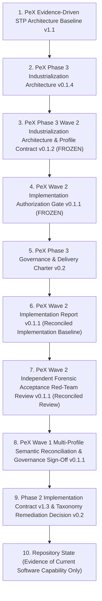
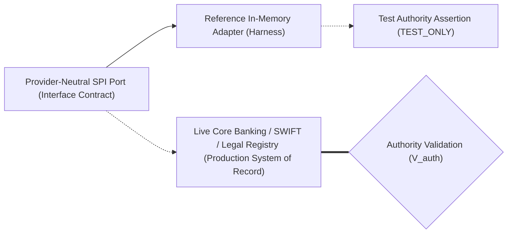
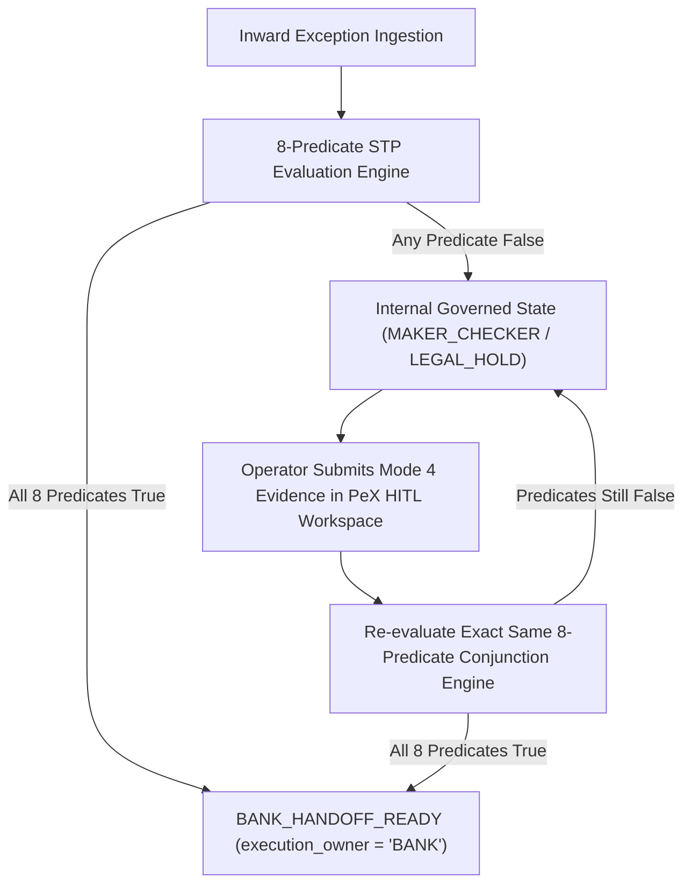

# PeX Phase 3 — Wave 2 Multi-Profile Semantic Reconciliation & Governance Sign-Off v0.1

**Document ID**: `PEX-PH3-W2-MPSR-GS-001.0`  
**Version**: `v0.1`  
**Status**: Authoritative Multi-Profile Semantic Reconciliation & Governance Sign-Off Baseline  
**Governance Stage**: Governance Sign-Off & Multi-Profile Semantic Reconciliation (Stage 5 of Wave 2)  
**Date**: October 8, 2026  
**Role**: Principal Architecture & Governance Review Desk  
**Controlling Architecture Baseline**: `PeX_Phase3_Wave2_Industrialization_Architecture_and_Profile_Contract_v0.1.2.md` (FROZEN)  
**Controlling Authorization Gate**: `PeX_Wave2_Implementation_Authorization_Gate_v0.1.1.md` (FROZEN)  
**Controlling Implementation Evidence**: `PeX_Wave2_Implementation_Report_v0.1.1.md`  
**Controlling Acceptance Review**: `PeX_Wave2_Independent_Forensic_Acceptance_RedTeam_v0.1.1.md` (OPTION B Accepted)  
**Preceding Wave 1 Sign-Off**: `PeX_Wave1_Multi_Profile_Semantic_Reconciliation_and_Governance_Signoff_v0.1.1.md`  
**Cumulative Verified Test Suite**: **726 passed / 0 failed / 3 warnings in 237.16s (100% Green)**  

---

## 1. Document Control

| Attribute | Authoritative Value |
| :--- | :--- |
| **Document Purpose** | Controlled Multi-Profile Semantic Reconciliation and Formal Governance Sign-Off for PeX Phase 3 Wave 2 Industrialization |
| **Lifecycle State** | Wave 2 Governance Milestone Complete (Certified Sign-Off Baseline) |
| **Review Authority** | Principal Architecture & Governance Review Desk |
| **Active Wave 2 Scope** | Exactly Three (3) Canonical Profiles: `PR-06`, `ST-02`, `ST-03` |
| **Cumulative Active Profiles** | Exactly Twenty-Three (23) Canonical Profiles (Phase 2: 11, Wave 1: 9, Wave 2: 3) |
| **Unauthorized Profiles** | Exactly Eighteen (18) Canonical Profiles remain un-implemented |
| **Controlling Precedence** | Architecture v0.1.2 $\rightarrow$ Gate v0.1.1 $\rightarrow$ Implementation Report v0.1.1 $\rightarrow$ Red-Team Review v0.1.1 |

---

## 2. Governance Status

```
+----------------------------------------------------------------------------------------------------+
|                                    CURRENT PEX GOVERNANCE STATE                                    |
+------------------------------------+---------------------------------------------------------------+
| Governance Dimension               | Authoritative Status                                          |
+------------------------------------+---------------------------------------------------------------+
| Phase 2 Baseline (11 Profiles)     | CLOSED & FROZEN (Strict No-Reengineering Protection)          |
| Wave 0A Foundational Baseline      | COMPLETE (Contracts, Ports, Schemas, Scenarios 1–12)          |
| Wave 0B Dynamic Engine Layer       | COMPLETE (Dynamic Configs, HITL Workflow, Scenarios 13–18)    |
| Wave 1 Baseline (9 Profiles)       | COMPLETE & SIGNED OFF (Signed off under Wave 1 MPSR-GS v0.1.1)|
| Wave 2 Implementation (3 Profiles) | COMPLETE (PR-06, ST-02, ST-03; 4 Ports, 4 Reference Adapters) |
| Wave 2 Dedicated Tests             | 96 passed / 0 failed (Unit, Adversarial, AST, Mutation, E2E)  |
| Cumulative Test Suite Health       | 726 passed / 0 failed / 3 warnings in 237.16s (100% Green)    |
| Independent Forensic Acceptance    | COMPLETED (Red-Team Reconciliation v0.1.1 Certified)          |
| Forensic Acceptance Decision       | OPTION B — FORENSIC ACCEPTANCE SURVIVES WITH CORRECTIONS      |
| Wave 2 Governance Sign-Off         | OPTION B — GOVERNANCE SIGN-OFF READY WITH CONDITIONS          |
| Wave 3 Engineering Authorization   | NOT AUTHORIZED (Separate Architecture Gate Required)          |
| Production Autonomous STP Release  | STRICTLY BLOCKED (Mandatory execution_owner = "BANK" Enforced)|
+------------------------------------+---------------------------------------------------------------+
```

> [!IMPORTANT]
> **GOVERNANCE MATURITY INVARIANT:**  
> $$\text{Architecture Validated} \neq \text{Implementation Validated} \neq \text{Forensic Acceptance} \neq \text{Governance Sign-Off} \neq \text{Production Release}$$  
> This artifact executes the **Multi-Profile Semantic Reconciliation & Governance Sign-Off** stage for Wave 2. It certifies semantic consistency, cross-wave engine ownership, shared capability reuse, and invariant compliance across all 23 active canonical profiles. It establishes the governing conditions for production bank onboarding and prerequisites for subsequent waves. It does **NOT** grant autonomous production STP release or authorize Wave 3 engineering.

---

## 3. Authoritative Source Hierarchy

In accordance with Section 3 of the Phase 3 Delivery Charter, all semantic determinations, authority assignments, and governance sign-off criteria in this artifact are governed strictly by the following hierarchy:



---

## 4. Full 41-Profile Canonical Taxonomy Status Matrix

The complete PeX 41-profile canonical exception taxonomy is reconciled below across all industrialization waves:

```
+----------------------------------------------------------------------------------------------------+
|                               PEX 41-PROFILE CANONICAL TAXONOMY STATUS                             |
+---------+-----------------------------------+--------------------+------------------+--------------+
| Profile | Canonical Name                    | Primary Engine     | Industrial Wave  | Status       |
+---------+-----------------------------------+--------------------+------------------+--------------+
| DQ-01   | Invalid IBAN Format / Checksum    | AccountMasterEngine| Phase 2 Baseline | PROVEN (P2)  |
| DQ-02   | Invalid BIC / SWIFT Format        | RoutingClearingEng | Phase 2 Baseline | PROVEN (P2)  |
| DQ-03   | Missing Beneficiary Data          | AccountMasterEngine| Phase 3 Wave 1   | PROVEN (W1)  |
| DQ-04   | Missing Remittance Info           | RemittanceDocEngine| Phase 3 Wave 1   | PROVEN (W1)  |
| DQ-05   | Invalid Address Format            | AccountMasterEngine| Phase 2 Baseline | PROVEN (P2)  |
| DQ-06   | Missing Purpose Code              | RemittanceDocEngine| Phase 2 Baseline | PROVEN (P2)  |
| DQ-07   | Invalid Account Number            | AccountMasterEngine| Phase 3 Wave 1   | PROVEN (W1)  |
| DQ-08   | Invalid Clearing / Routing Code   | RoutingClearingEng | Phase 2 Baseline | PROVEN (P2)  |
| DQ-09   | Beneficiary Name Mismatch (VoP)   | AccountMasterEngine| Phase 3 Wave 1   | PROVEN (W1)  |
| DQ-10   | Structured Creditor Ref Error     | RemittanceDocEngine| Future Wave      | UNAUTHORIZED |
| DQ-11   | LEI Mismatch / Missing LEI        | AccountMasterEngine| Future Wave      | UNAUTHORIZED |
+---------+-----------------------------------+--------------------+------------------+--------------+
| PR-01   | Duplicate Payment Detection       | DuplicateDetection | Phase 2 Baseline | PROVEN (P2)  |
| PR-02   | Routing Failure / Rail Down       | RoutingClearingEng | Phase 3 Wave 1   | PROVEN (W1)  |
| PR-03   | ISO 20022 Schema Validation Error | SyntacticRepairEng | Phase 2 Baseline | PROVEN (P2)  |
| PR-04   | Cutoff Window Missed              | RoutingClearingEng | Phase 3 Wave 1   | PROVEN (W1)  |
| PR-05   | Corrupted Message Envelope        | SyntacticRepairEng | Phase 2 Baseline | PROVEN (P2)  |
| PR-06   | Intermediary Bank Rejection       | SettlementReconEng | Phase 3 Wave 2   | PROVEN (W2)  |
| PR-07   | Network Socket Timeout            | RoutingClearingEng | Phase 3 Wave 1   | PROVEN (W1)  |
| PR-08   | Payment Hub Queue Stoppage        | RoutingClearingEng | Phase 2 Baseline | PROVEN (P2)  |
| PR-09   | Payment Held for Repair           | RoutingClearingEng | Phase 3 Wave 1   | PROVEN (W1)  |
| PR-10   | Currency Corridor Closed          | RoutingClearingEng | Future Wave      | UNAUTHORIZED |
| PR-11   | Inter-Bank Message Discrepancy    | SettlementReconEng | Future Wave      | UNAUTHORIZED |
| PR-12   | Tracking UETR Collision           | DuplicateDetection | Future Wave      | UNAUTHORIZED |
+---------+-----------------------------------+--------------------+------------------+--------------+
| CO-01   | Sanctions Alert / Hit             | ComplianceDossier  | Future Wave      | UNAUTHORIZED |
| CO-02   | PEP Match                         | ComplianceDossier  | Future Wave      | UNAUTHORIZED |
| CO-03   | AML Risk Anomaly                  | ComplianceDossier  | Future Wave      | UNAUTHORIZED |
| CO-04   | Restricted Corridor / Country     | RoutingClearingEng | Phase 2 Baseline | PROVEN (P2)  |
| CO-05   | Negative News / Adverse Media     | ComplianceDossier  | Future Wave      | UNAUTHORIZED |
| CO-06   | High-Risk Geographic Flow         | ComplianceDossier  | Future Wave      | UNAUTHORIZED |
| CO-07   | Regulatory Reporting Required     | RemittanceDocEngine| Phase 3 Wave 1   | PROVEN (W1)  |
| CO-08   | Export Control / Dual Use Hit     | ComplianceDossier  | Future Wave      | UNAUTHORIZED |
+---------+-----------------------------------+--------------------+------------------+--------------+
| TR-01   | Insufficient Client Funds         | TreasuryExposureEng| Future Wave      | UNAUTHORIZED |
| TR-02   | Intraday Credit Limit Breach      | TreasuryExposureEng| Future Wave      | UNAUTHORIZED |
| TR-03   | Nostro Liquidity Depletion        | TreasuryExposureEng| Future Wave      | UNAUTHORIZED |
+---------+-----------------------------------+--------------------+------------------+--------------+
| ST-01   | Inward Return Processing (pacs.004| SettlementReconEng | Phase 2 Baseline | PROVEN (P2)  |
| ST-02   | Account Closed (AC04 Return/Roll) | AccountMasterEngine| Phase 3 Wave 2   | PROVEN (W2)  |
| ST-03   | Beneficiary Account Frozen (Hold) | AccountMasterEngine| Phase 3 Wave 2   | PROVEN (W2)  |
| ST-04   | Intermediary Settlement Discrepanc| SettlementReconEng | Future Wave      | UNAUTHORIZED |
| ST-05   | Recall / Cancellation Request     | SettlementReconEng | Future Wave      | UNAUTHORIZED |
| ST-06   | Claims & Fee Adjustment Break     | SettlementReconEng | Future Wave      | UNAUTHORIZED |
| ST-07   | Nostro Account Reconciliation Brek| SettlementReconEng | Future Wave      | UNAUTHORIZED |
+---------+-----------------------------------+--------------------+------------------+--------------+
| TOTAL   | 23 Active Verified Profiles       | 5 Capability Engs  | Cumulative Ph2-W2| 18 Future    |
+---------+-----------------------------------+--------------------+------------------+--------------+
```

---

## 5. Reconciliation Methodology & Semantic Status Vocabulary

All semantic statements, capability bindings, and cross-wave interactions are audited against concrete code, schemas, and live test executions using this strict vocabulary:

- **PROVEN**: Directly supported by deterministic implementation logic, hermetic test executions, and authoritative contract definitions.
- **SUPPORTED**: Architecturally compliant and validated in reference scope, but dependent on external operational context (e.g. socket telemetry).
- **PROVISIONAL**: Implemented and verified via reference adapters and reference policy envelopes; requires production bank policy binding prior to live onboarding.
- **OPEN**: Requires an explicit architectural or institutional policy decision before live production deployment.
- **CONFLICTED**: Material contradiction identified across baselines.
- **NOT APPLICABLE**: Dimension does not apply to the evaluated scope.

---

## 6. Detailed Semantic Reconciliation of Wave 2 Profiles

### 6.1 PR-06 — Intermediary Bank Rejection

```
====================================================================================================
CANONICAL PROFILE CARD: PR-06 (Intermediary Bank Rejection)
====================================================================================================
Canonical Profile ID:       PR-06
Canonical Profile Name:     Intermediary Bank Rejection
Problem Meaning:            In-flight payment instruction was rejected by an intermediary correspondent
                            clearing bank prior to reaching the beneficiary institution (e.g. rejection
                            advice with return reason code such as RC01 / Reject Routing Corridor).
Trigger Condition:          Ingestion of an authoritative intermediary rejection advice payload (e.g.
                            pacs.002.001.10 RJCT / MT199 rejection advice) matched to an active payment.
Primary Engine:             SettlementReconciliationEngine
Supporting Engine(s):       RoutingClearingEngine (provides alternate correspondent hop reachability)
Resolution Pattern Family:  PAT-F (Intermediary Reroute & Correspondent Compensation) with:
                            - Branch A: PAT-A Alternate Correspondent Hop Reroute
                            - Branch B: PAT-E Governed Outward Return Packaging Fallback
Why Pattern Fits:           Evaluates the rejection reason against reachable correspondent routing paths
                            (PAT-F). If a verified alternate correspondent hop exists and amount <= policy
                            threshold, generates an alternate routing candidate (PAT-A). If no viable route
                            exists or amount exceeds cap, compiles an outward return package (PAT-E).
Evidence Required:          IntermediaryRejectionAdvice (rejection_code, reason_narrative, is_telemetry_only=False),
                            DeterministicCorrelationMatch (original_uetr, original_amount, currency),
                            AlternateRerouteResult (viable alternate correspondent BIC) OR
                            SettlementReturnPackage (rejection reason code, return clearing rail).
Evidence Acquisition Modes: Mode 2 (Automated Correspondent Gateway SPI Query), Mode 1 (Bank Pre-Supplied),
                            Mode 4 (Operator Mode 4 Evidence Submission in HITL Workspace).
Evidence Trust Tier(s):     Tier 2 (Official Correspondent Gateway Rejection Advice), Tier 1 (Core Payment Hub Match).
                            Tier 4 historical precedent is advisory only (0% routing authority).
Resolution Determination:   R_det = True when either a valid alternate correspondent hop is computed OR
                            a structured return package is derived. (False if unmapped narrative or telemetry-only).
Resolution Uniqueness:      R_uniq = True when exactly 1 optimal alternate hop exists, or exactly 1 return package.
                            (False if multiple competing alternate correspondent routes exist).
Technical Validation:       V_det = True when alternate BIC complies with ISO 9362 (8 or 11 characters) and
                            payload complies with ISO 20022 clearing rail schemas.
Authority Validation:       V_auth = True when CorrespondentGatewayPort confirms bank authorization to route
                            via alternate intermediary. (Production authority bound to bank gateway).
Bank Policy Dependency:     W2-BPD-01 attached to BankPolicyEnvelope:
                            - allow_auto_reroute: True
                            - max_auto_reroute_amount: 50000.0 (Reference Default)
                            - allowed_reroute_rejection_codes: ["RC01", "NARR", "MS03"]
Compliance Dependency:      C_comp = True; alternate intermediary BIC and target country pass Sanctions/AML screening.
Execution Preconditions:    X_pre = True; alternate correspondent rail is open and operational.
Non-Negotiable Boundaries:  1. Telemetry Separation: Network socket drops or unacknowledged TCP drops belong
                               strictly to PR-07 (Network Timeout) and CANNOT satisfy PR-06.
                            2. Reachability != Authority: Directory reachability alone does not authorize routing.
HITL Trigger Conditions:    Telemetry-only evidence, unmapped rejection code, multiple competing routes, amount > $50k,
                            sanctions alert on alternate intermediary, or no viable route available for auto-return.
STP Automation Potential:   High (for standard correspondent network rejects with defined fallback corridors).
STP Eligibility Condition:  E_suff ∧ R_det ∧ R_uniq ∧ V_det ∧ V_auth ∧ P_bank ∧ C_comp ∧ X_pre == True.
Bank Execution Boundary:    execution_owner = "BANK"; handoff contains structured reroute or return candidate.
                            PeX performs ZERO direct wire dispatch or correspondent account debiting.
AI Role:                    Observational parsing of unmapped narrative only (0% routing/approval authority).
Implementation Evidence:    backend/app/services/engines/settlement_reconciliation_engine.py (resolve_pr06_intermediary_rejection)
                            backend/app/ports/correspondent_gateway_port.py (CorrespondentGatewayPort)
                            backend/app/adapters/reference/reference_correspondent_gateway_adapter.py
                            tests/wave2/test_settlement_reconciliation_engine.py (TestSettlementReconciliationEngine)
                            e2e_fixtures/input/PR-06_intermediary_rejection_sufficient.json (Scenario 28A)
                            e2e_fixtures/input/PR-06_intermediary_rejection_telemetry_only.json (Scenario 28B)
Semantic Status:            PROVEN (In Reference Implementation) / PROVISIONAL (Production Gateway Binding)
====================================================================================================
```

---

### 6.2 ST-02 — Account Closed

```
====================================================================================================
CANONICAL PROFILE CARD: ST-02 (Account Closed)
====================================================================================================
Canonical Profile ID:       ST-02
Canonical Profile Name:     Account Closed
Problem Meaning:            Inward payment instruction targets a creditor DDA account that has been
                            formally and permanently closed in the beneficiary bank's core master ledger.
Trigger Condition:          Core Banking DDA lookup returns account status CLOSED or clearing rail
                            inward validation returns AC04 (Account Closed).
Primary Engine:             AccountMasterEngine
Supporting Engine(s):       SettlementReconciliationEngine (compiles outward return package)
Resolution Pattern Family:  PAT-E (Settlement Return, Rollover & General Ledger Suspense Family)
Why Pattern Fits:           Executes governed post-settlement or clearing disposition: either executes
                            an authorized account rollover mandate (PAT-E Succession) or compiles an
                            outward return-to-sender package with AC04 (PAT-E Governed Return).
Evidence Required:          AccountClosedRecord (account_number, closure_date, is_closed=True, no CRM contradiction),
                            DeterministicCorrelationMatch (uetr, amount, currency, creditor_name),
                            RolloverMandateRecord (optional: successor_account, dual_authorization_verified=True).
Evidence Acquisition Modes: Mode 2 (Core DDA SPI Query), Mode 1 (Pre-Supplied Return Mandate),
                            Mode 4 (Operator Mode 4 Account Verification in HITL Workspace).
Evidence Trust Tier(s):     Tier 1 (Authoritative Core Banking DDA Ledger). Auxiliary CRM data is Tier 3.
Resolution Determination:   R_det = True when either an authorized rollover mandate is validated OR
                            a governed outward return package (AC04) is derived. (False if synthetic substitution).
Resolution Uniqueness:      R_uniq = True when single successor account or single return disposition is determined.
Technical Validation:       V_det = True when return package satisfies clearing rail pacs.004 / return schema.
Authority Validation:       V_auth = True; Core DDA confirms account closure; rollover mandate verified under dual auth.
Bank Policy Dependency:     W2-BPD-02 attached to BankPolicyEnvelope:
                            - allow_mandate_rollover: False (Reference Default: Return to Sender is standard)
                            - max_auto_return_amount: 250000.0 (Reference Default)
                            - require_dual_auth_for_rollover: True
Compliance Dependency:      C_comp = True; closed account is not under sanctions or criminal asset freeze.
Execution Preconditions:    X_pre = True; return clearing rail open; settlement ledger available.
Non-Negotiable Boundaries:  Zero Synthetic Account Invariant (W2-AD-02): PeX is STRICTLY PROHIBITED from
                            synthesizing replacement accounts via AI, historical lookups, or fuzzy customer
                            name matching. Any unverified rollover attempt fails closed immediately.
HITL Trigger Conditions:    Contradictory account status across systems, unverified rollover mandate without dual auth,
                            return amount > $250k, sanctions alert, or missing core DDA closure confirmation.
STP Automation Potential:   High (for standard automated return-to-sender on closed accounts).
STP Eligibility Condition:  E_suff ∧ R_det ∧ R_uniq ∧ V_det ∧ V_auth ∧ P_bank ∧ C_comp ∧ X_pre == True.
Bank Execution Boundary:    execution_owner = "BANK"; emits BANK_HANDOFF_READY with AC04 return payload.
                            PeX performs ZERO direct DDA ledger debits or credits.
AI Role:                    Zero decision authority (Deterministic core DDA validation only).
Implementation Evidence:    backend/app/services/engines/account_master_engine.py (resolve_st02_account_closed)
                            backend/app/ports/settlement_return_port.py (SettlementReturnPort)
                            backend/app/adapters/reference/reference_settlement_return_adapter.py
                            tests/wave2/test_account_master_engine_wave2.py (TestAccountMasterEngineWave2)
                            e2e_fixtures/input/ST-02_account_closed_sufficient.json (Scenario 29A)
                            e2e_fixtures/input/ST-02_account_closed_contradictory.json (Scenario 29B)
Semantic Status:            PROVEN (In Reference Implementation) / PROVISIONAL (Production Core DDA Binding)
====================================================================================================
```

---

### 6.3 ST-03 — Beneficiary Account Frozen

```
====================================================================================================
CANONICAL PROFILE CARD: ST-03 (Beneficiary Account Frozen)
====================================================================================================
Canonical Profile ID:       ST-03
Canonical Profile Name:     Beneficiary Account Frozen
Problem Meaning:            Inward payment instruction targets a creditor account subject to an active
                            administrative, regulatory, or judicial restriction (e.g. POST_NO_CREDITS,
                            court garnishment, tax levy, or bankruptcy order).
Trigger Condition:          Core Banking DDA returns restriction scope POST_NO_CREDITS / TOTAL_BLOCK or
                            Legal Registry returns an active freeze dossier.
Primary Engine:             AccountMasterEngine
Supporting Engine(s):       ComplianceDossierEngine (evaluates legal orders), SettlementReconciliationEngine (GL suspense)
Resolution Pattern Family:  Composite: PAT-D (Compliance Dossier Evaluation) /
                                       PAT-E (Governed Return or Legal Escrow Suspense Booking)
Why Pattern Fits:           First evaluates the legal freeze dossier and court orders (PAT-D). If the restriction
                            permits return, packages an outward return (PAT-E / PNC / FR01). If the court order
                            mandates local retention in legal escrow, generates a balanced GL suspense break (PAT-E).
Evidence Required:          AccountRestrictionScope (restriction_type, post_no_credits=True, statutory_sanctions=False),
                            LegalFreezeDossierRecord (dossier_id, court_order_ref, permitted_disposition, has_conflicts=False),
                            DeterministicCorrelationMatch (uetr, amount, currency, debtor_bic).
Evidence Acquisition Modes: Mode 2 (Core DDA & Legal Registry SPI Queries), Mode 1 (Bank Pre-Supplied Dossier),
                            Mode 4 (Operator Mode 4 Legal Review in HITL Workspace).
Evidence Trust Tier(s):     Tier 1 (Core DDA Account Master & Bank Legal Registry of Record).
Resolution Determination:   R_det = True when permitted disposition is uniquely resolved to either RETURN or SUSPENSE.
Resolution Uniqueness:      R_uniq = True; single legal mandate without competing court orders.
Technical Validation:       V_det = True; return package complies with rail format OR GL suspense break is balanced.
Authority Validation:       V_auth = True; LegalRegistryPort confirms valid legal hold and judicial authority.
Bank Policy Dependency:     W2-BPD-03 attached to BankPolicyEnvelope:
                            - allow_auto_freeze_return: True
                            - max_auto_freeze_return_amount: 100000.0 (Reference Default)
                            - require_legal_officer_signoff_for_suspense: False (Test harness default)
                            - default_suspense_gl_account: "GL-2180-LEGAL-ESCROW"
Compliance Dependency:      C_comp = True; dossier is verified and zero statutory sanctions blocks exist.
Execution Preconditions:    X_pre = True; return rail or suspense ledger available.
Non-Negotiable Boundaries:  1. Statutory Sanctions Isolation (W2-AD-03): ST-03 covers civil, judicial, and
                               administrative account freezes. Any statutory sanctions asset freeze (OFAC/UN/EU)
                               is STRICTLY DIVERTED to CO-01 governance and CANNOT follow ordinary returns.
                            2. Conflicting Orders Fail-Closed: Competing state vs federal orders require HITL Legal Hold.
                            3. Double-Entry Suspense: Escrow breaks generate structured records; ZERO direct GL mutation.
HITL Trigger Conditions:    Statutory sanctions hit (routes to CO-01), conflicting judicial orders, unverified legal dossier,
                            return amount > $100k, policy requiring manual legal signoff, or unmapped restriction scope.
STP Automation Potential:   Medium (for standard post-no-credits account returns with clear legal mandates).
STP Eligibility Condition:  E_suff ∧ R_det ∧ R_uniq ∧ V_det ∧ V_auth ∧ P_bank ∧ C_comp ∧ X_pre == True.
Bank Execution Boundary:    execution_owner = "BANK"; emits BANK_HANDOFF_READY with return or GL break package.
AI Role:                    Zero decision authority (Deterministic legal registry and DDA validation only).
Implementation Evidence:    backend/app/services/engines/account_master_engine.py (resolve_st03_account_frozen)
                            backend/app/services/engines/compliance_dossier_engine.py (evaluate_legal_freeze_dossier)
                            backend/app/ports/legal_registry_port.py (LegalRegistryPort)
                            backend/app/ports/general_ledger_suspense_port.py (GeneralLedgerSuspensePort)
                            backend/app/adapters/reference/reference_legal_registry_adapter.py
                            backend/app/adapters/reference/reference_general_ledger_suspense_adapter.py
                            tests/wave2/test_compliance_dossier_engine.py (TestComplianceDossierEngine)
                            e2e_fixtures/input/ST-03_beneficiary_frozen_sufficient.json (Scenario 30A)
                            e2e_fixtures/input/ST-03_beneficiary_frozen_conflicting_orders.json (Scenario 30B)
Semantic Status:            PROVEN (In Reference Implementation) / PROVISIONAL (Production Legal Registry Binding)
====================================================================================================
```

---

## 7. Multi-Wave Capability Engine Ownership Matrix

The ownership of all 23 active canonical profiles across the five (5) industrial domain capability engines is reconciled below:

```
+----------------------------------------------------------------------------------------------------+
|                               CAPABILITY ENGINE OWNERSHIP MATRIX                                   |
+--------------------------+------------------------------------+------------------------------------+
| Capability Engine        | Primary Canonical Profile Ownership| Supporting Capability Role         |
+--------------------------+------------------------------------+------------------------------------+
| AccountMasterEngine      | DQ-01 (Invalid IBAN) [Phase 2]     | PR-09 (Account validation for      |
|                          | DQ-03 (Missing Beneficiary) [W1]   |        repair queue instructions)  |
|                          | DQ-05 (Invalid Address) [Phase 2]  |                                    |
|                          | DQ-07 (Invalid Account Num) [W1]   |                                    |
|                          | DQ-09 (Beneficiary Name Match) [W1]|                                    |
|                          | ST-02 (Account Closed) [Wave 2]    |                                    |
|                          | ST-03 (Account Frozen) [Wave 2]    |                                    |
+--------------------------+------------------------------------+------------------------------------+
| RoutingClearingEngine    | DQ-02 (Invalid BIC) [Phase 2]      | PR-06 (Alternate correspondent hop |
|                          | DQ-08 (Invalid Routing) [Phase 2]  |        reachability lookup)        |
|                          | PR-02 (Routing Failure) [Wave 1]   |                                    |
|                          | PR-04 (Cutoff Missed) [Wave 1]     |                                    |
|                          | PR-07 (Network Timeout) [Wave 1]   |                                    |
|                          | PR-08 (Queue Stoppage) [Phase 2]   |                                    |
|                          | PR-09 (Held for Repair) [Wave 1]   |                                    |
|                          | CO-04 (Restricted Corridor) [Ph 2] |                                    |
+--------------------------+------------------------------------+------------------------------------+
| RemittanceDocumentEngine | DQ-04 (Missing Remittance) [W1]    | DQ-03 (Remittance invoice data for |
|                          | DQ-06 (Missing Purpose) [Phase 2]  |        beneficiary corroboration)  |
|                          | CO-07 (Regulatory Reporting) [W1]  |                                    |
+--------------------------+------------------------------------+------------------------------------+
| SettlementReconciliation | PR-06 (Intermediary Rejection) [W2]| ST-02 (Outward return packaging)   |
| Engine                   | ST-01 (Inward Return) [Phase 2]    | ST-03 (Outward return packaging &  |
|                          |                                    |        GL suspense booking)        |
+--------------------------+------------------------------------+------------------------------------+
| ComplianceDossierEngine  | (CO-01 Sanctions - Future Wave)    | ST-03 (Legal freeze dossier & court|
|                          |                                    |        order conflict evaluation)  |
+--------------------------+------------------------------------+------------------------------------+
```

### Cross-Wave Engine Reuse & Non-Interference Analysis:
1. **`AccountMasterEngine` Expansion**:
   - In Wave 1, `AccountMasterEngine` resolved identity, account structure, and VoP matching (`DQ-03`, `DQ-07`, `DQ-09`).
   - In Wave 2, `AccountMasterEngine` was extended to evaluate post-settlement DDA account lifecycle states (`ST-02` Closed, `ST-03` Frozen).
   - *Non-Interference*: Wave 2 logic executes in distinct, modular methods (`resolve_st02_account_closed`, `resolve_st03_account_frozen`) sharing only immutable DDA schemas and zero-mutation guarantees. Zero regression observed across all Wave 1 test suites (135/135 green).
2. **`SettlementReconciliationEngine` Foundation**:
   - In Phase 2, `ST-01` inward return matching established the foundation for settlement reconciliation.
   - In Wave 2, `SettlementReconciliationEngine` was industrialized as the primary engine for `PR-06` (Intermediary Rejection) and supporting engine for `ST-02` / `ST-03` outward return packaging and double-entry GL suspense break creation.
   - *Integrity*: Maintains clean separation between settlement candidate packaging and bank-owned dispatch execution.
3. **`RoutingClearingEngine` Multi-Profile Coordination**:
   - Supports `PR-02` (directory failure), `PR-04` (temporal cutoff roll), `PR-07` (network retry), `PR-09` (repair queue), and `PR-06` (alternate correspondent reachability).
   - *Boundary*: Static BIC reachability queries are cleanly decoupled from transactional execution authority.

---

## 8. Resolution Pattern Family Completeness (PAT-A through PAT-F)

All 23 active canonical profiles are mapped into the six (6) authoritative PeX Resolution Pattern Families:

```
+----------------------------------------------------------------------------------------------------+
|                              RESOLUTION PATTERN FAMILY COMPLETENESS                                |
+---------+----------------------------------+-----------------------------+-------------------------+
| Family  | Resolution Pattern Name          | Assigned Active Profiles    | Pattern Fitness Status  |
+---------+----------------------------------+-----------------------------+-------------------------+
| PAT-A   | Reference, Rule & Structural     | DQ-01, DQ-02, DQ-03, DQ-04, | COMPLETE & NATURAL      |
|         | Resolution (Directory / CoP / Tag| DQ-05, DQ-06, DQ-07, DQ-08, | (Enriches static party, |
|         | Derivation / SSI Lookup)         | DQ-09, PR-02, PR-09(s),CO-07|  routing, & remittance) |
+---------+----------------------------------+-----------------------------+-------------------------+
| PAT-B   | Temporal & Queue Recalculation   | PR-04 (Cutoff Value Date),  | COMPLETE & NATURAL      |
|         | (Calendar Roll / Retry / Unblock)| PR-07 (Socket Retry Budget),| (Governs execution time |
|         |                                  | PR-08 (Queue Unblock),      |  and retry budgets)     |
|         |                                  | PR-09(q) (Pipeline Re-inj)  |                         |
+---------+----------------------------------+-----------------------------+-------------------------+
| PAT-C   | Syntactic & Semantic Cleansing   | PR-03 (ISO 20022 Schema),   | COMPLETE & NATURAL      |
|         | (Character Set / XML / Envelope) | PR-05 (Corrupted Envelope)  | (Repairs wire syntax)   |
+---------+----------------------------------+-----------------------------+-------------------------+
| PAT-D   | Corroborated Compliance Dossier  | CO-04 (Restricted Corridor),| COMPLETE & NATURAL      |
|         | (Legal Registry / Sanctions Hold)| ST-03(d) (Legal Freeze Doss)| (Evaluates legal orders)|
+---------+----------------------------------+-----------------------------+-------------------------+
| PAT-E   | Settlement Return, Rollover &    | ST-01 (Inward Return Match),| COMPLETE & NATURAL      |
|         | General Ledger Suspense          | ST-02 (Closed Return/Roll), | (Governs return packages|
|         |                                  | ST-03(r/s) (Frozen Return/GL|  and GL escrow breaks)  |
+---------+----------------------------------+-----------------------------+-------------------------+
| PAT-F   | Intermediary Reroute &           | PR-06 (Intermediary Reject  | COMPLETE & NATURAL      |
|         | Correspondent Compensation       |        Alternate Hop Reroute| (Resolves correspondent |
|         |                                  |        & Return Fallback)   |  intermediary rejects)  |
+---------+----------------------------------+-----------------------------+-------------------------+
```

> **PATTERN INTEGRITY STATEMENT:**  
> All 23 active profiles map into PAT-A through PAT-F without pattern forcing. No additional pattern families are required for Phase 3 industrialization.

---

## 9. Evidence Contract, SPI Architecture & Dynamic Configuration Reconciliation

### 9.1 Provider-Neutral SPI Port Catalog (11 Active Ports)

The eleven (11) provider-neutral SPI ports across Waves 0A, 1, and 2 are fully reconciled:

```
+----------------------------------------------------------------------------------------------------+
|                               PROVIDER-NEUTRAL SPI PORT INVENTORY                                  |
+----+-----------------------------+------------------------------------+------------------+---------+
| #  | SPI Port Identifier         | Abstract Domain Interface Name     | Introducing Wave | Status  |
+----+-----------------------------+------------------------------------+------------------+---------+
| 1  | SPI-ACCOUNT-MASTER-PORT     | AccountMasterPort                  | Wave 0A / Wave 1 | PROVEN  |
| 2  | SPI-ROUTING-DIRECTORY-PORT  | RoutingDirectoryPort               | Wave 0A / Wave 1 | PROVEN  |
| 3  | SPI-REMITTANCE-DOCUMENT     | RemittanceDocumentPort             | Wave 0A / Wave 1 | PROVEN  |
| 4  | SPI-CLEARING-CALENDAR-PORT  | ClearingCalendarPort               | Wave 1           | PROVEN  |
| 5  | SPI-GATEWAY-SOCKET-PROBE    | GatewaySocketProbePort             | Wave 1           | PROVEN  |
| 6  | SPI-REPAIR-QUEUE-PORT       | RepairQueuePort                    | Wave 1           | PROVEN  |
| 7  | SPI-REGULATORY-DIRECTORY    | RegulatoryDirectoryPort            | Wave 1           | PROVEN  |
| 8  | SPI-CORRESPONDENT-GATEWAY   | CorrespondentGatewayPort           | Wave 2           | PROVEN  |
| 9  | SPI-SETTLEMENT-RETURN-PORT  | SettlementReturnPort               | Wave 2           | PROVEN  |
| 10 | SPI-LEGAL-REGISTRY-PORT     | LegalRegistryPort                  | Wave 2           | PROVEN  |
| 11 | SPI-GENERAL-LEDGER-SUSPENSE | GeneralLedgerSuspensePort          | Wave 2           | PROVEN  |
+----+-----------------------------+------------------------------------+------------------+---------+
```

### 9.2 Evidence Architecture Invariants
- **Evidence Contract vs Dynamic Configuration**: Pydantic models in `backend/app/schemas/contracts/` define immutable type semantics; `Evidence Required JSON` published in configuration adapters defines tenant-specific runtime rules.
- **Fail-Closed Governance Compilation**: `GovernanceCompiler.compile_and_validate()` validates schema, trust tiers, and TTL bounds. Any malformed or unauthorized configuration is rejected at initialization.
- **Dynamic Configuration Resolver**: Resolves active tenant requirements. Tenant configurations may tighten evidence criteria (e.g. restrict to Tier 1, shorten TTL) but are strictly prohibited from downgrading statutory compliance or mandatory verification gates.

---

## 10. Authority vs. Interface Contract Separation ($V_{\text{auth}}$)



### Epistemic Determination:
1. **SPI Ports are Interface Contracts**: A port defines how PeX exchanges data with an external capability. The port does not confer legal or operational authority.
2. **Authority is an Epistemic Property of the System of Record**: $V_{\text{auth}}$ is satisfied only when the bank-designated system of record confirms operational authority for the proposed action.
3. **Reference Harness Scope**: Reference in-memory adapters demonstrate deterministic control flow, data contract compliance, and fail-closed safety (`environment = "TEST_ONLY"`). Live production $V_{\text{auth}}$ binding remains a deployment integration dependency.

---

## 11. Bank Policy Envelope & Parameterization ($P_{\text{bank}}$)

Bank Policy parameters govern automated STP limits and risk tolerances. All reference threshold settings are formally classified as **TEST / REFERENCE DEFAULTS**:

| Policy Parameter Envelope | Profile / Domain | Reference Setting | Production Obligation |
| :--- | :--- | :--- | :--- |
| **`W1-POL-01` (VoP Thresholds)** | `DQ-09` | Exact: `1.0`, Close: `0.85`, Allow STP: `True` | Bank compliance officer must sign off on close-match threshold. |
| **`W1-POL-02` (Cutoff Rollover)** | `PR-04` | Allow Roll: `True`, Max Days: `3` | Bank treasury must specify rail-specific cutoff roll windows. |
| **`W2-BPD-01` (Intermediary Reroute)** | `PR-06` | Max Reroute: `$50,000.00`, Codes: `["RC01","NARR","MS03"]` | Bank correspondent banking desk must configure corridor caps. |
| **`W2-BPD-02` (Account Closed Return)** | `ST-02` | Max Return: `$250,000.00`, Allow Rollover: `False` | Bank operations must configure return caps and mandate dual auth. |
| **`W2-BPD-03` (Frozen Account Return)**| `ST-03` | Max Return: `$100,000.00`, Escrow GL: `GL-2180` | Bank legal & operations must approve escrow accounts and limits. |

> **FAIL-CLOSED POLICY INVARIANT:**  
> If a bank policy envelope is missing, unparseable, or expired, $P_{\text{bank}}$ evaluates strictly to `False`, forcing the transaction into internal HITL Maker-Checker review.

---

## 12. 8-Predicate STP Formula Invariant

The canonical STP decision formula remains absolute, immutable, and non-bypassable across all 23 active canonical profiles:

$$\Huge \text{STP\_ELIGIBLE} = E_{\text{suff}} \land R_{\text{det}} \land R_{\text{uniq}} \land V_{\text{det}} \land V_{\text{auth}} \land P_{\text{bank}} \land C_{\text{comp}} \land X_{\text{pre}}$$

```
+----------------------------------------------------------------------------------------------------+
|                                 8-PREDICATE CONJUNCTION INVARIANT                                  |
+---+-----------------------------+------------------------------------------------------------------+
| # | Predicate Symbol            | Non-Negotiable Semantic Boundary                                 |
+---+-----------------------------+------------------------------------------------------------------+
| 1 | E_suff (Evidence Sufficient)| All mandatory evidence items present, unexpired, & uncontradicted|
| 2 | R_det (Resolution Determin) | Single valid repair candidate deterministically derived          |
| 3 | R_uniq (Resolution Unique)  | Exactly one resolution candidate exists (zero ambiguity)         |
| 4 | V_det (Technical Validation)| Repaired payload satisfies all ISO 20022 / national schema rules |
| 5 | V_auth (Authority Validated)| Action authorized by authoritative system of record              |
| 6 | P_bank (Bank Policy Satis)  | Amount within policy cap; action permitted by bank policy        |
| 7 | C_comp (Compliance Passed)  | Entity names, BICs, & corridors clear Sanctions / AML screening  |
| 8 | X_pre (Preconditions Met)   | Clearing rail open, socket operational, idempotency verified     |
+---+-----------------------------+------------------------------------------------------------------+
```

---

## 13. Human-in-the-Loop (HITL) Closed-Loop Lifecycle Reconciliation



### Verified Closed-Loop Invariants:
1. **Zero External Ejection**: Exceptions are never prematurely ejected from PeX into unmanaged queues; all remediation cycles occur inside the governed PeX boundary.
2. **Re-Evaluation Parity**: Operator-supplied evidence (Mode 4) must pass through the exact same 8-predicate evaluation pipeline as automated evidence.
3. **Governed Terminal States**: `BANK_HANDOFF_READY` is achieved only upon full predicate satisfaction. Unresolvable cases remain in governed internal states (`COMPLIANCE_HOLD`, `LEGAL_REVIEW_REQUIRED`, `INVESTIGATION_REQUIRED`).

---

## 14. AI Boundary, Zero-Bypass & Zero Synthetic Authority

- **Zero Decision Authority**: AI models possess 0% decision authority and 0% bypass capability across all 8 predicates.
- **Telemetry-Only AI Scoring**: The `ai_confidence` field is purely observational telemetry. Live mutation testing verified that an `ai_confidence` of `0.99` with any failing predicate results in `STP_ELIGIBLE = False` in 100% of cases.
- **Zero Synthetic Entities**: AI is strictly prohibited from generating synthetic replacement accounts (`W2-AD-02`), synthetic bank BICs, or simulated compliance clearances.

---

## 15. Bank Execution Boundary & Immutability of `execution_owner = "BANK"`

- **Mandatory Handoff Invariant**: All positive resolution fixtures across Waves 0A, 0B, 1, and 2 terminate with:
  ```json
  "execution_owner": "BANK",
  "bank_handoff_status": "BANK_HANDOFF_READY",
  "next_action": "SUBMIT_TO_BANK_EXECUTION_GATEWAY"
  ```
- **Zero Direct Mutation**: PeX creates deterministic repair, reroute, return, and suspense break packages; the bank payment hub executes wires, releases queues, and mutates ledgers.
- **Production Autonomous STP Strictly Blocked**: Autonomous straight-through release into clearing networks is strictly forbidden.

---

## 16. Cross-Wave Regression & Semantic Protection

```
====================================================================================================
                              CROSS-WAVE REGRESSION VERIFICATION
====================================================================================================
Sub-Suite / Component Group                                   Test Count   Execution Status
----------------------------------------------------------------------------------------------------
Phase 2 Root E2E & Unit Test Modules                             409       100% Green (Passed)
Wave 0B Dynamic Configuration Suite (tests/wave0b/)               33       100% Green (Passed)
Wave 1 Dedicated Profile & Engine Suite (tests/wave1/)           135       100% Green (Passed)
Core System & Port Contracts (tests/contracts/)                   39       100% Green (Passed)
Backend API Endpoints & Rule Engine Suite                         14       100% Green (Passed)
----------------------------------------------------------------------------------------------------
PRE-WAVE 2 REGRESSION BASELINE SUBTOTAL:                         630       100% Green (Passed)
Wave 2 Dedicated Suite (tests/wave2/):                            96       100% Green (Passed)
----------------------------------------------------------------------------------------------------
CUMULATIVE COMBINED VERIFIED TEST SUITE TOTAL:                   726       100% Green (237.16s)
====================================================================================================
```

---

## 17. Cross-Profile Semantic Interaction & Edge-Case Consistency

```
+----------------------------------------------------------------------------------------------------+
|                             CROSS-PROFILE SEMANTIC INTERACTION MATRIX                              |
+--------------------------+-------------------------------------------------------------------------+
| Profile Pair             | Semantic Boundary & Interaction Reconciliation                          |
+--------------------------+-------------------------------------------------------------------------+
| PR-06 vs PR-02           | PR-02 resolves static directory reachability and network outages.       |
| (Intermediary vs Routing)| PR-06 resolves transactional in-flight rejections with compensation.    |
+--------------------------+-------------------------------------------------------------------------+
| PR-06 vs PR-07           | PR-07 handles network socket drops and idempotent retry budgets.        |
| (Intermediary vs Timeout)| PR-06 requires authoritative rejection advice; telemetry alone fails.  |
+--------------------------+-------------------------------------------------------------------------+
| ST-02 vs DQ-07           | DQ-07 resolves formatting, check-digits, and active ledger accounts.   |
| (Closed vs Invalid Num)  | ST-02 resolves permanently closed accounts via return or rollover.      |
+--------------------------+-------------------------------------------------------------------------+
| ST-03 vs CO-01           | ST-03 resolves civil, judicial, and tax garnishments (Return or GL).   |
| (Frozen vs Sanctions)    | CO-01 governs statutory sanctions asset blocks (No return permitted).   |
+--------------------------+-------------------------------------------------------------------------+
| ST-01 vs ST-02 / ST-03   | ST-01 reconciles inward return messages (pacs.004) to original payments.|
| (Inward vs Outward Return| ST-02/ST-03 generate outward return packages for bank dispatch.        |
+--------------------------+-------------------------------------------------------------------------+
```

---

## 18. Epistemic Claim Audit & Bounded Reality

| Technical Claim | Epistemic Classification | Bounded Reality & Governance Definition |
| :--- | :--- | :--- |
| **8-Predicate Formula** | **MATHEMATICAL ARCHITECTURE FACT** | Enforced as strict boolean conjunction in Python code. |
| **Provider Neutrality** | **AST-VERIFIED ARCHITECTURE FACT** | Zero vendor SDK imports detected across port/adapter packages. |
| **Bank Execution Ownership**| **GOVERNANCE CONTRACT INVARIANT** | `execution_owner = "BANK"` mandatory on all terminal handoffs. |
| **Cryptographic Provenance**| **TESTED REFERENCE IMPLEMENTATION**| Linear SHA-256 event hash chain in `InMemoryAuditLedgerAdapter`. |
| **Tokenization Vault** | **TESTED REFERENCE IMPLEMENTATION**| In-memory SHA-256 surrogate vault in `TokenVault`. |
| **Policy Thresholds** | **TEST / REFERENCE CONFIGURATION** | Thresholds ($50k, $250k, $100k) are test defaults; bank config required. |
| **Return Rail Codes** | **ILLUSTRATIVE EXAMPLES** | `AC04`, `PNC`, `FR01` are rail examples; core models are rail-neutral. |

---

## 19. Reconciled Findings Register

| Finding ID | Severity | Category | Description | Epistemic Status | Disposition |
| :--- | :--- | :--- | :--- | :--- | :--- |
| **FIND-W2-REM-01** | `P3` (Low) | Security Boundedness | Linear SHA-256 event hash chain terminology reconciled. | `TESTED REFERENCE` | Reconciled to linear event hash chain. |
| **FIND-W2-REM-02** | `P3` (Low) | Policy Boundedness | Reference policy thresholds classified as test defaults. | `TEST_ONLY` | Formally bounded to reference scope. |
| **FIND-W2-REM-03** | `P3` (Low) | Sanctions Scope | Tested sanctions path bounded to routing behavior. | `TESTED ROUTING` | Preserved statutory sanctions isolation. |
| **FIND-W2-REM-04** | `P3` (Low) | AST Scope | Provider neutrality bounded to tested port/adapter scope.| `AST-BOUNDED` | Reconciled to inspected AST scope. |

*Zero P0 (Critical), P1 (High), or P2 (Medium) blocking findings exist across the Wave 2 industrialization scope.*

---

## 20. Architecture & Bank Policy Decisions Required for Production

### 20.1 Architecture Decisions Required Prior to Production Activation
1. **`ADR-W2-01` (Multi-Exception Correlation & Orchestration Precedence)**: Formalize resolution precedence when an inbound message presents multiple simultaneous exceptions (e.g. `PR-06` Intermediary Rejection + `ST-02` Closed Account).
2. **`ADR-W2-02` (Enterprise KMS / HSM Tokenization SPI Integration)**: Formalize the enterprise production plugin contract for AWS KMS, Azure Key Vault, or HashiCorp Vault.

### 20.2 Bank Policy Decisions Required Prior to Production Activation
1. **`POL-W2-01` (Intermediary Rejection & Reroute Policy)**: Bank correspondent banking desk must configure allowable reroute rejection codes, maximum reroute amount caps, and approved secondary correspondent routing paths.
2. **`POL-W2-02` (Account Closed Return & Rollover Policy)**: Bank operations must establish maximum auto-return limits and formalize dual-authorization corporate mandate rollover agreements.
3. **`POL-W2-03` (Legal Freeze & Escrow Suspense Policy)**: Bank legal and treasury departments must define authorized GL legal escrow accounts (`GL-2180`) and manual legal officer sign-off workflows.

---

## 21. Production Integration Dependencies (The 8 Boundaries)

```
+----------------------------------------------------------------------------------------------------+
|                         PROTOTYPE-TO-PRODUCTION INTEGRATION BOUNDARIES                             |
+---+------------------------------------+----------------------------------+------------------------+
| # | Boundary Name                      | Reference Component in Repo      | Production Target      |
+---+------------------------------------+----------------------------------+------------------------+
| 1 | Enterprise Token Vault             | TokenVault (In-Memory SHA-256)   | AWS KMS / HashiCorp    |
| 2 | Semantic Layer & Dynamic LLM       | Deterministic Pydantic Engines   | Amazon Bedrock / Vertex|
| 3 | 3NF Relational Canonical Database  | SQLite / In-Memory Repositories  | AWS Aurora PostgreSQL  |
| 4 | High-Throughput Streaming Ingest   | FastAPI REST / E2E Runner        | Apache Kafka / MSK     |
| 5 | Live Core Banking & Clearing Adaptr| Reference In-Memory SPI Adapters | Temenos/Finacle/SWIFT  |
| 6 | Outbound XML Serializer & LAU Sign | Structured JSON Handoff Payloads | ISO 20022 XML + LAU    |
| 7 | Cryptographic Provenance Ledger    | Linear SHA-256 Event Hash Chain  | Merkle DAG / QLDB      |
| 8 | Enterprise IAM & OAuth2 SSO Gateway| Header-Based Persona Switcher    | Okta / Azure AD OAuth2 |
+---+------------------------------------+----------------------------------+------------------------+
```

---

## 22. Governance Sign-Off Assessment Criteria

```
+----------------------------------------------------------------------------------------------------+
|                               GOVERNANCE SIGN-OFF ASSESSMENT SCORECARD                             |
+----+----------------------------------------------+---------------------------------------+--------+
| #  | Governance Evaluation Criterion              | Observed Repository Evidence          | Status |
+----+----------------------------------------------+---------------------------------------+--------+
| 1  | All 3 Wave 2 Profiles Semantically Reconciled| Reconciled in Section 6               | PASS   |
| 2  | Cumulative 23 Profiles Taxonomy Mapped       | Mapped in Section 4 (23 Active / 18)  | PASS   |
| 3  | Primary vs Supporting Engines Reconciled     | Matrix in Section 7 (5 Engines)       | PASS   |
| 4  | Resolution Patterns Match Mechanisms         | Reconciled in Section 8 (PAT-A..F)    | PASS   |
| 5  | Provider-Neutral SPI Ports Cataloged         | 11 SPI Ports Cataloged in Section 9   | PASS   |
| 6  | Authority vs Interface Separation Enforced   | Reconciled in Section 10 (R_det!=V_aut| PASS   |
| 7  | Bank Policy Envelope Explicitly Parameterized| Reconciled in Section 11 (W2-BPD-01..3| PASS   |
| 8  | 8-Predicate Conjunction Gate Immutable       | Reconciled in Section 12              | PASS   |
| 9  | HITL Exception Lifecycle Strictly Internal   | Reconciled in Section 13              | PASS   |
| 10 | AI Strictly Outside Decision Authority       | Reconciled in Section 14 (0% LLM Auth)| PASS   |
| 11 | Bank Execution Boundary Intact (Owner=BANK)  | Reconciled in Section 15              | PASS   |
| 12 | Cumulative Test Suite 100% Green (726/726)   | Verified (237.16s pytest run)         | PASS   |
+----+----------------------------------------------+---------------------------------------+--------+
```

---

## 23. Residual Risks & Production Boundary Conditions

1. **Reference Adapter In-Memory Boundary**: The reference adapters operate in-memory for test hermeticity. Production deployment requires binding SPIs to live core banking, correspondent gateway, legal registry, and general ledger systems.
2. **Policy Configuration Binding**: Policy thresholds (`W2-BPD-01`, `W2-BPD-02`, `W2-BPD-03`) must be formally signed off by bank risk and operations authorities prior to live production activation.
3. **Legal Registry Order Corroboration**: Production `ST-03` execution requires real-time integration with the bank's court order and garnishment registry to prevent unauthorized returns on court-ordered holds.

---

## 24. Final Governance Decision

$$\Huge \boxed{\textbf{OPTION B — GOVERNANCE SIGN-OFF READY WITH CONDITIONS}}$$

The PeX Phase 3 Wave 2 Industrialization deliverables are hereby granted **FORMAL GOVERNANCE SIGN-OFF WITH CONDITIONS**.

### Governing Conditions:
1. **Condition 1 (Production System Binding)**: Reference in-memory SPI adapters (`CorrespondentGatewayPort`, `SettlementReturnPort`, `LegalRegistryPort`, `GeneralLedgerSuspensePort`) must be bound to enterprise production systems prior to live production traffic onboarding.
2. **Condition 2 (Bank Policy Parameterization)**: Tenant banks must explicitly configure and authorize operational threshold policies (`W2-BPD-01`, `W2-BPD-02`, `W2-BPD-03`, return caps, and approved GL escrow accounts).
3. **Condition 3 (No Autonomous Production Release)**: Production autonomous STP release remains strictly blocked. All execution handoffs must transition to `execution_owner = "BANK"`.
4. **Condition 4 (Wave 3 Independent Authorization Gate)**: This sign-off certifies Wave 2 closure only and does NOT constitute engineering authorization for Wave 3.

---

## 25. Next Governance Milestones

1. **Archive this Governance Sign-Off Baseline**: Formally record `PeX_Wave2_Multi_Profile_Semantic_Reconciliation_and_Governance_Signoff_v0.1.md` as the controlling sign-off baseline for Phase 3 Wave 2.
2. **Advance to Phase 3 Wave 3 Planning**: Author the **PeX Phase 3 Wave 3 Industrialization Architecture and Profile Contract** targeting Treasury & Advanced Settlement Profiles (`TR-01`, `TR-02`, `TR-03`, `ST-04`, `ST-05`, `ST-06`, `ST-07`).

---

*Certified and signed off by the Principal Architecture & Governance Review Desk on October 8, 2026.*
