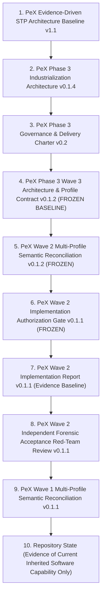
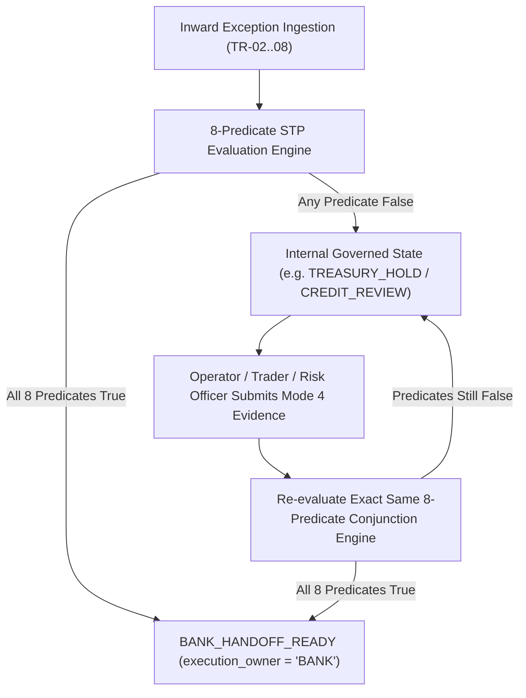

# PeX Phase 3 — Wave 3 Implementation Authorization Gate
## Formal Governance Authorization Gate for Engineering Implementation of Wave 3 Exception Profiles (TR-02, TR-03, TR-04, TR-06, TR-07, TR-08)

**Document Version:** v0.1  
**Status:** IMPLEMENTATION AUTHORIZATION GATE (GOVERNANCE EVALUATION)  
**Governance Authority:** Principal Architecture, Governance, and Forensic Design Authority  
**Repository Working Directory:** `C:\Users\pawan\.gemini\antigravity\scratch\pex_platform`  
**Controlling Architecture Baseline:** `PeX_Phase3_Wave3_Industrialization_Architecture_and_Profile_Contract_v0.1.2.md`  
**Git Baseline:** Branch `phase3/wave2-implementation` | Tag `pex-phase3-wave2-20261008`  
**Cumulative Inherited Test Baseline:** 726 passed / 0 failed / 3 warnings (Inherited from Prior Waves)  
**Production Autonomous STP Authorization:** **STRICTLY BLOCKED**  
**Execution Ownership Boundary:** `execution_owner = "BANK"` (Mandatory across all outputs)  

---

## 1. Document Control

```
+----------------------------------------------------------------------------------------------------+
|                                    DOCUMENT CONTROL METADATA                                       |
+-----------------------------------+----------------------------------------------------------------+
| Dimension                         | Detail                                                         |
+-----------------------------------+----------------------------------------------------------------+
| Artifact Name                     | PeX_Wave3_Implementation_Authorization_Gate_v0.1.md            |
| Program Stage                     | Phase 3 — Industrialization Stream (Wave 3 Pre-Implementation) |
| Authorizing Role                  | Principal Architecture & Governance Authority                  |
| Target Engineering Scope          | Wave 3 Profiles: TR-02, TR-03, TR-04, TR-06, TR-07, TR-08      |
| Gate Evaluation Date              | October 2026                                                   |
| Controlling Architecture Baseline | PeX_Phase3_Wave3_Industrialization_Architecture_and_Profile_   |
|                                   | Contract_v0.1.2.md (Freeze-Ready Baseline)                     |
+-----------------------------------+----------------------------------------------------------------+
```

---

## 2. Purpose

The purpose of this document is to establish the formal, governed decision on whether engineering implementation for **Phase 3 Wave 3** may proceed. 

This gate:
- Evaluates the architectural readiness, boundary integrity, and contract completeness of the frozen Wave 3 architecture baseline.
- Defines the exact authorized implementation scope (strictly limited to six profiles).
- Establishes non-negotiable architectural invariants, safety constraints, stop conditions, and acceptance criteria.
- Authorizes controlled engineering implementation under explicit governance conditions.

> [!IMPORTANT]
> **GOVERNANCE INVARIANT:**  
> Approval of this gate authorizes **engineering implementation and testing only**. It does NOT authorize production deployment, live bank integration, production autonomous STP, live payment execution, or the delegation of bank credit approval authority.

---

## 3. Controlling Artifacts

All determinations within this authorization gate are governed strictly by the following authoritative hierarchy:



---

## 4. Governance Maturity Model

PeX enforces strict separation between lifecycle governance stages. Progression through one stage does not imply completion of downstream stages:

$$\Huge \text{Architecture Validated} \neq \text{Implementation Validated} \neq \text{Forensic Acceptance} \neq \text{Governance Sign-Off} \neq \text{Production Release}$$

```
+----------------------------------------------------------------------------------------------------+
|                                    GOVERNANCE MATURITY MATRIX                                      |
+----+-----------------------------+-----------------------+-----------------------------------------+
| #  | Governance Milestone        | Wave 3 Current Status | Operational Scope                       |
+----+-----------------------------+-----------------------+-----------------------------------------+
| 1  | Architecture Validated      | COMPLETE (v0.1.2)     | Semantic contracts & SPIs specified     |
| 2  | Implementation Authorized   | SUBJECT OF THIS GATE  | Governed engineering permission         |
| 3  | Implementation Validated    | NOT STARTED           | Code, schemas, reference adapters, tests|
| 4  | Forensic Acceptance         | FUTURE REQUIREMENT    | Independent red-team acceptance review  |
| 5  | Governance Sign-Off         | FUTURE REQUIREMENT    | Multi-profile cross-wave reconciliation |
| 6  | Production Release          | STRICTLY BLOCKED      | Separate production integration gate    |
+----+-----------------------------+-----------------------+-----------------------------------------+
```

---

## 5. Current Baseline

```
+----------------------------------------------------------------------------------------------------+
|                                      CURRENT PROGRAM BASELINE                                      |
+-----------------------------------+----------------------------------------------------------------+
| Baseline Stream                   | Verified Status & Operational Boundary                         |
+-----------------------------------+----------------------------------------------------------------+
| Phase 2 Baseline (11 Profiles)    | CLOSED & FROZEN (Protected against re-engineering)             |
| Wave 0A / Wave 0B Baseline        | COMPLETE (Platform Contracts & Dynamic Engine Layer Frozen)    |
| Wave 1 Baseline (9 Profiles)      | COMPLETE & SIGNED OFF (Signed off under MPSR-GS v0.1.1)        |
| Wave 2 Baseline (3 Profiles)      | IMPLEMENTATION COMPLETE (Ready with Conditions under v0.1.2)   |
| Cumulative Inherited Tests        | 726 passed / 0 failed / 3 warnings (100% Green in 235.53s)     |
| Active Reconciled Profiles        | 23 Profiles (11 Phase 2 + 9 Wave 1 + 3 Wave 2)                |
| Wave 3 Implementation Status      | NOT STARTED / NOT AUTHORIZED PRIOR TO THIS GATE                |
| Wave 3 Target Scope               | EXACTLY 6 Profiles: TR-02, TR-03, TR-04, TR-06, TR-07, TR-08  |
| Closed Canonical Universe         | EXACTLY 41 Profiles (23 Active + 18 Remaining = 41 Total)      |
| Production Autonomous STP Gate    | STRICTLY BLOCKED                                               |
| Execution Owner                   | BANK (Mandatory across all outputs)                            |
+-----------------------------------+----------------------------------------------------------------+
```

---

## 6. Wave 3 Exact Scope

Wave 3 encompasses **EXACTLY SIX** canonical exception profiles within the Client/Treasury domain:

1. `TR-02` — **Insufficient Funds**
2. `TR-03` — **Nostro Shortfall**
3. `TR-04` — **FX Rate Unavailable**
4. `TR-06` — **Limit Breach**
5. `TR-07` — **Liquidity Constraint**
6. `TR-08` — **Credit Exposure Breach**

### Scope Invariants:
- **No Additional Profiles**: No profile other than these six is authorized for Wave 3 implementation.
- **Taxonomy Integrity**: The 41-profile canonical universe is closed and immutable ($23\text{ Active} + 18\text{ Remaining} = 41\text{ Total}$).
- **Protected Waves**:
  - Wave 4 profiles (`TR-01`, `TR-05`, `ST-06`) remain protected and unauthorized.
  - Wave 5 profiles (`CO-01`, `CO-02`, `CO-03`, `CO-05`, `CO-06`, `CO-08`) remain protected and unauthorized.
  - Wave 6 profiles (`ST-04`, `ST-05`, `ST-07`) remain protected and unauthorized.

---

## 7. Profile Authorization Matrix

```
+----------------------------------------------------------------------------------------------------------------------------------------------------+
|                                                       WAVE 3 PROFILE AUTHORIZATION MATRIX                                                          |
+-------+-----------------------------+------------------------+--------------------------+-------------+----------------------+---------------------+
| Code  | Canonical Meaning           | Primary Engine         | Supporting Engine        | Pattern     | Authority Category   | Bank Policy Area    |
+-------+-----------------------------+------------------------+--------------------------+-------------+----------------------+---------------------+
| TR-02 | Insufficient available      | TreasuryExposureEngine | AccountMasterEngine      | PAT-C       | Core Banking / DDA   | Pacing duration, cap|
|       | funding in account context  |                        |                          | [PROPOSED]  | Ledger Position      | and balance buffer  |
+-------+-----------------------------+------------------------+--------------------------+-------------+----------------------+---------------------+
| TR-03 | Nostro / correspondent      | TreasuryExposureEngine | SettlementReconciliation | PAT-C       | Treasury Management  | Operating target,   |
|       | settlement capacity deficit |                        | Engine                   | [PROPOSED]  | System / Nostro Feed | rebalancing cap     |
+-------+-----------------------------+------------------------+--------------------------+-------------+----------------------+---------------------+
| TR-04 | FX pricing quote missing,   | TreasuryExposureEngine | RoutingClearingEngine    | PAT-C       | Official FX Pricing  | Rate freshness TTL, |
|       | stale, or out of tolerance  |                        |                          | [PROVISION] | Engine / Market Feed | spread tolerance    |
+-------+-----------------------------+------------------------+--------------------------+-------------+----------------------+---------------------+
| TR-06 | Configured operational      | TreasuryExposureEngine | ComplianceDossierEngine  | PAT-C / D   | Bank Limit Management| Reset pacing, waiver|
|       | risk limit exceeded         |                        |                          | [PROVISION] | System               | dual authorization  |
+-------+-----------------------------+------------------------+--------------------------+-------------+----------------------+---------------------+
| TR-07 | Liquidity constrained in    | TreasuryExposureEngine | RoutingClearingEngine    | PAT-C       | Liquidity Management | Buffer minimums,    |
|       | applicable clearing context |                        |                          | [PROPOSED]  | / Clearing Position  | hold windows, queues|
+-------+-----------------------------+------------------------+--------------------------+-------------+----------------------+---------------------+
| TR-08 | Credit facility / risk      | TreasuryExposureEngine | ComplianceDossierEngine  | PAT-D       | Enterprise Credit    | STP Prohibited;     |
|       | ceiling exceeded            |                        |                          | [PROVISION] | Risk System          | Credit Approver req.|
+-------+-----------------------------+------------------------+--------------------------+-------------+----------------------+---------------------+
```

---

## 8. Engine Ownership

The **six primary capability engines** established in Phase 3 remain immutable:

```
+----------------------------------------------------------------------------------------------------+
|                               SIX PRIMARY CAPABILITY ENGINES (PHASE 3)                             |
+---+------------------------------+----------------------------------+------------------------------+
| # | Capability Engine            | Domain Authority                 | Wave 3 Ownership Role        |
+---+------------------------------+----------------------------------+------------------------------+
| 1 | AccountMasterEngine          | Account validity, status, CoP/VoP| Supporting Engine (TR-02)    |
| 2 | RoutingClearingEngine        | Clearing rails, cutoffs, hops    | Supporting Engine (TR-04, 07)|
| 3 | RemittanceDocumentEngine     | Invoices, remittance, reporting  | Supporting Engine (General)  |
| 4 | ComplianceDossierEngine      | Sanctions, AML, legal dossiers   | Supporting Engine (TR-06, 08)|
| 5 | TreasuryExposureEngine       | Balance, Nostro, FX, limits, liq | PRIMARY ENGINE (ALL 6 PROFS) |
| 6 | SettlementReconciliationEng  | Inward returns, reroute, suspense| Supporting Engine (TR-03)    |
+---+------------------------------+----------------------------------+------------------------------+
```

### Engine Responsibilities & Prohibitions:
- **`TreasuryExposureEngine` Responsibilities**:
  - Balance and position evaluation against authoritative ledger feeds.
  - Nostro position monitoring and candidate rebalancing package derivation.
  - FX market data rate quote validation against freshness and spread policies.
  - Operational limit evaluation and reset pacing candidate derivation.
  - Liquidity constraint evaluation across clearing/portfolio contexts.
  - Credit exposure dossier packaging for human credit officer adjudication.
  - Governed queue pacing and retry candidate derivation.
- **Strict Prohibitions for `TreasuryExposureEngine`**:
  - Must NOT mutate account master data or create/close accounts.
  - Must NOT execute payments or release instructions directly to rails.
  - Must NOT post ledger entries or mutate core bank GLs.
  - Must NOT move funds or book foreign exchange directly.
  - Must NOT execute Nostro sweeps or liquidity transfers autonomously.
  - Must NOT override operational limits or approve credit breaches autonomously.

---

## 9. Resolution Pattern Boundaries

Implementation must utilize only the **seven (7) established resolution pattern families**:

```
+----------------------------------------------------------------------------------------------------+
|                                    RESOLUTION PATTERN FAMILIES                                     |
+---------+-----------------------------------+------------------------------------------------------+
| Family  | Pattern Family Name               | Bounded Sub-Behaviors & Scope                        |
+---------+-----------------------------------+------------------------------------------------------+
| PAT-A   | Reference, Rule & Structural      | Master DDA, Directory, Tag Derivation, CoP / Syntax. |
| PAT-B   | Temporal & Queue Recalculation    | Cutoff Date Roll (T+1), Socket Retry, Queue Unblock. |
| PAT-C   | Threshold & Balance Pacing Family | Balance Inquiry, Liquidity Pacing, Nostro Sweep Sync,|
|         |                                   | FX Spread Booking, and Intraday Limit Reset Pacing.  |
| PAT-D   | Compliance & Risk Dossier         | Legal Dossier Package, Sanctions, Credit Risk Dossier|
|         | Adjudication Family               | for Governed Human Dual-Authorization.               |
| PAT-E   | Ledger Matching & Settlement      | Return Matching, Return Packaging, GL Suspense Break.|
| PAT-F   | Intermediary & Claims Tracking    | Inward Reject Tracking, Alternate Hop Route.        |
| PAT-G   | Mandate & Entitlement Clearance   | Corporate Signatory Mandates, KYC Entitlements.      |
+---------+-----------------------------------+------------------------------------------------------+
```

### Pattern Mapping Discipline:
- All Wave 3 pattern allocations remain **PROPOSED** or **PROVISIONAL** until validated through implementation and independent forensic acceptance.
- Do NOT create an eighth or additional resolution pattern family.
- If implementation reveals an allocated pattern is architecturally inadequate, engineering must **STOP AND RAISE A GOVERNANCE FINDING** rather than refactoring pattern definitions in code.

---

## 10. Evidence Contract Requirements

Wave 3 implementation must utilize the existing PeX dynamic evidence model where required evidence is compiled from:

$$\text{Effective Evidence Requirements} = \text{Industry SOP Baseline} + \text{Bank Customization}$$

### Required Evidence Categories by Profile:
1. **`TR-02` (Insufficient Funds)**: Available balance, ledger position, active reservations, currency, payment correlation data.
2. **`TR-03` (Nostro Shortfall)**: Nostro position, settlement/funding state, pending correspondent credits, currency corridor correlation.
3. **`TR-04` (FX Rate Unavailable)**: Authoritative FX quote, currency pair, quote timestamp, pricing source, applicable bank pricing policy.
4. **`TR-06` (Limit Breach)**: Applicable limit definition, current utilization, limit state, reset schedule, client authorization profile.
5. **`TR-07` (Liquidity Constraint)**: Available liquidity position, buffer state, queue depth, currency/clearing context.
6. **`TR-08` (Credit Exposure Breach)**: Credit exposure metrics, credit facility ceiling, current utilization, risk rating, credit decision evidence.

### Evidence Acquisition Modes:
- **Mode 1**: Bank pre-supplied evidence payload.
- **Mode 2**: Authorized automated query via SPI port.
- **Mode 3**: Bank batch feed or stream push.
- **Mode 4**: Human-assisted evidence acquisition in PeX HITL workspace.

---

## 11. SPI & Authority Requirements

### Provider-Neutral SPI Port Catalog for Wave 3:
Wave 3 implementation is authorized to introduce **six (6) abstract SPI ports** and in-memory reference adapters:

```
+----------------------------------------------------------------------------------------------------+
|                                 AUTHORIZED WAVE 3 SPI PORTS                                        |
+----+-----------------------------+------------------------------------+------------------+---------+
| #  | SPI Port Identifier         | Abstract Domain Interface Name     | Target Module    | Status  |
+----+-----------------------------+------------------------------------+------------------+---------+
| 12 | SPI-TREASURY-POSITION-PORT  | TreasuryPositionPort               | ports/treasury.py| PLANNED |
| 13 | SPI-NOSTRO-POSITION-PORT    | NostroPositionPort                 | ports/nostro.py  | PLANNED |
| 14 | SPI-FX-PRICING-PORT         | FXPricingPort                      | ports/fx.py      | PLANNED |
| 15 | SPI-LIMIT-MANAGEMENT-PORT   | LimitManagementPort                | ports/limit.py   | PLANNED |
| 16 | SPI-CREDIT-RISK-PORT        | CreditRiskPort                     | ports/credit.py  | PLANNED |
| 17 | SPI-LIQUIDITY-RESERVE-PORT  | LiquidityReservePort               | ports/liquid.py  | PLANNED |
+----+-----------------------------+------------------------------------+------------------+---------+
```

### Invariants:
1. **SPI Contract $\neq$ Authority**: An SPI port is an abstract interface contract. Authority ($V_{\text{auth}}$) exists only when the port is bound to a bank-designated authoritative system of record.
2. **Reference Adapters**: Reference adapters are in-memory harnesses for test hermeticity (`environment = "TEST_ONLY"`).
3. **Zero Vendor Lock-In**: Ports and reference adapters must contain zero vendor SDK imports (no AWS, Azure, GCP, or proprietary bank SDKs in core modules).

---

## 12. Bank Policy Envelope Requirements

Wave 3 establishes the `W3PolicyThresholds` schema within `BankPolicyEnvelope`. All reference numbers in architecture are **TEST / REFERENCE DEFAULTS** subject to bank configuration:

```
+----------------------------------------------------------------------------------------------------+
|                               WAVE 3 BANK POLICY ENVELOPE PARAMETERS                               |
+----+-----------------------------+------------------------------------+----------------------------+
| #  | Policy Parameter Identifier | Target Profile / Domain            | Configurable Policy Fields |
+----+-----------------------------+------------------------------------+----------------------------+
| 1  | W3-BPD-01                   | TR-02 (Insufficient Funds Pacing)  | max_pacing_seconds, cap    |
| 2  | W3-BPD-02                   | TR-03 (Nostro Rebalancing Policy)  | min_target, max_sweep_cap  |
| 3  | W3-BPD-03                   | TR-04 (FX Rate & Spread Tolerance) | max_age_sec, spread_tol_bps|
| 4  | W3-BPD-04                   | TR-06 (Limit Reset & Waiver Policy)| max_reset_sec, waiver_cap  |
| 5  | W3-BPD-05                   | TR-07 (Liquidity Pacing Policy)    | min_buffer, max_hold_sec   |
| 6  | W3-BPD-06                   | TR-08 (Credit Exposure Policy)     | zero_auto_stp, dual_auth   |
+----+-----------------------------+------------------------------------+----------------------------+
```

### Fail-Closed Policy Invariant:
If bank policy is missing, malformed, expired, or unparseable, $P_{\text{bank}}$ evaluates strictly to `False`. The implementation must NOT silently substitute test defaults in production mode.

---

## 13. Human-in-the-Loop (HITL) Requirements



### HITL Invariants:
1. **Zero External Ejection**: Exceptions remain inside PeX throughout remediation.
2. **Governed States**: Ineligible cases remain in internal states (`HITL_REQUIRED`, `TREASURY_HOLD`, `CREDIT_REVIEW`, `MAKER_CHECKER_PENDING`, `INVESTIGATION_REQUIRED`, `POLICY_HOLD`, `UNRESOLVED`).
3. **Re-Evaluation Parity**: Human-supplied Mode 4 evidence passes through the exact same 8-predicate evaluation pipeline with zero predicate bypass.

---

## 14. AI Boundary

- **No Decision Authority**: AI models possess no decision authority across any of the 8 predicates.
- **Allowed Capabilities**: AI may classify, extract, summarize, search historical evidence, identify patterns, rank candidates, and explain evidence.
- **Strict Prohibitions**: AI may NOT invent balances, invent FX rates, invent liquidity, override limits, approve credit exposure, establish authority, bypass policy, release payments, or mutate bank systems.
- **Telemetry Only**: `ai_confidence` is observational telemetry only and does not participate in the boolean conjunction gate.

---

## 15. 8-Predicate Invariant

The canonical STP decision formula remains absolute, immutable, and non-bypassable across all Wave 3 profiles:

$$\Huge \text{STP\_ELIGIBLE} = E_{\text{suff}} \land R_{\text{det}} \land R_{\text{uniq}} \land V_{\text{det}} \land V_{\text{auth}} \land P_{\text{bank}} \land C_{\text{comp}} \land X_{\text{pre}}$$

```
+----------------------------------------------------------------------------------------------------+
|                                 8-PREDICATE CONJUNCTION INVARIANT                                  |
+---+-----------------------------+------------------------------------------------------------------+
| # | Predicate Symbol            | Wave 3 Contextual Evaluation Scope                               |
+---+-----------------------------+------------------------------------------------------------------+
| 1 | E_suff (Evidence Sufficient)| Authoritative position, FX quote, limit, or reserve data present |
| 2 | R_det (Resolution Determin) | Valid pacing schedule, sweep, FX booking, or waiver candidate    |
| 3 | R_uniq (Resolution Unique)  | Exactly one resolution candidate derived without ambiguity       |
| 4 | V_det (Technical Validation)| Payment currency decimals, message formatting, schema validation |
| 5 | V_auth (Authority Validated)| Authoritative system confirms balance/pricing/credit authority   |
| 6 | P_bank (Bank Policy Satis)  | Amount <= policy cap; spread <= tolerance; buffer >= minimum     |
| 7 | C_comp (Compliance Passed)  | Sanctions/AML cleared; zero capital control or structuring flags |
| 8 | X_pre (Preconditions Met)   | Clearing rail open; dealing desk active; clearing window open    |
+---+-----------------------------+------------------------------------------------------------------+
```

Implementation must prove through mutation testing that each predicate can independently fail closed.

---

## 16. Bank Execution Boundary

- **Mandatory Handoff Invariant**: All positive resolution fixtures terminate with `execution_owner = "BANK"`.
- **PeX Capability Boundary**: PeX detects exceptions, acquires evidence, normalizes data, evaluates rules, derives candidate resolutions, packages evidence, routes HITL tasks, and prepares governed bank handoffs.
- **PeX Execution Prohibitions**: PeX may NOT execute payments, release payments, post ledger entries, move funds, book FX, execute Nostro sweeps, override limits, approve credit, or mutate bank systems.
- **Production Autonomous STP Strictly Blocked**: Autonomous straight-through release into clearing networks is strictly forbidden.

---

## 17. Security & Safety Requirements

Implementation must preserve existing PeX security and safety controls:
1. **No Synthetic Authority**: Authority cannot be synthesized by AI, mock services, or operator assertion without system backing.
2. **No Direct Mutation**: Zero endpoints capable of releasing money or mutating bank ledgers.
3. **Maker-Checker Segregation of Duties**: Maker cannot Checker own limit waivers or credit approvals.
4. **Fail-Closed Default**: System fails closed on missing authority, missing policy, contradictory evidence, or stale mandatory data.
5. **Deterministic Auditability**: All evidence evaluations and state transitions must be immutably recorded.
6. **Reference Security Scoping**: Security controls in reference adapters must be accurately described as reference/test controls without unverified enterprise claims.

---

## 18. Test Strategy & Proposed E2E Scenarios

The implementation must extend the inherited baseline (**726 passed / 0 failed / 3 warnings**) and maintain 100% green execution. Actual test counts will be reported upon implementation.

### Required Test Dimensions:
- **Unit Tests**: Core resolution logic across `TR-02`, `03`, `04`, `06`, `07`, `08`.
- **Contract Tests**: 6 new abstract SPI ports and reference adapters.
- **Evidence Sufficiency**: Missing, stale, contradictory, invalid, unavailable, and sufficient evidence states.
- **Policy Envelope**: Missing, malformed, expired, valid, and bank-specific policy configurations.
- **Authority Validation**: Authoritative, non-authoritative, unavailable, and conflicting authority feeds.
- **8-Predicate Mutation**: 24+ permutations independently forcing every single predicate to `False`.
- **Closed-Loop HITL**: Operator Mode 4 evidence submission re-evaluates through the exact 8-predicate pipeline.
- **AI Boundary**: Verification that AI cannot synthesize financial values or override decisions.
- **Provider Neutrality AST**: Verification of zero vendor SDK imports in core ports.
- **Bank Boundary**: Verification of `execution_owner = "BANK"` on all terminal handoffs.
- **Adversarial / Security**: Idempotency, replay, authority spoofing, and Segregation of Duties checks.

### Proposed Future Canonical E2E Scenarios (Implementation Targets):
```
+----------------------------------------------------------------------------------------------------+
|                               PROPOSED FUTURE E2E SCENARIOS                                        |
+----+-------------+-------+--------------------------------------+----------------------------------+
| #  | Scenario ID | Code  | Scenario Name & Test Focus           | Expected Governed Output State   |
+----+-------------+-------+--------------------------------------+----------------------------------+
| 1  | Scenario 31A| TR-02 | Insufficient Funds [Intraday Pacing] | STP_ELIGIBLE=True / HANDOFF_READY|
| 2  | Scenario 31B| TR-02 | Unfunded Deficit [Fail-Closed HITL]  | STP_ELIGIBLE=False / HITL_REQUIRED|
| 3  | Scenario 32A| TR-03 | Nostro Shortfall [Sweep Rebalancing] | STP_ELIGIBLE=True / HANDOFF_READY|
| 4  | Scenario 32B| TR-03 | Unfunded Nostro [Treasury Hold]      | STP_ELIGIBLE=False / TREASURY_HOLD|
| 5  | Scenario 33A| TR-04 | FX Rate Available [Fresh Market Rate]| STP_ELIGIBLE=True / HANDOFF_READY|
| 6  | Scenario 33B| TR-04 | Stale FX Rate [Fail-Closed Market]   | STP_ELIGIBLE=False / HITL_REQUIRED|
| 7  | Scenario 34A| TR-06 | Limit Reset Pacing [Intraday Cycle]  | STP_ELIGIBLE=True / HANDOFF_READY|
| 8  | Scenario 34B| TR-06 | Hard Limit Breach [Credit Dossier]   | STP_ELIGIBLE=False / CREDIT_REVIEW|
| 9  | Scenario 35A| TR-07 | Liquidity Buffer [Pacing Release]    | STP_ELIGIBLE=True / HANDOFF_READY|
| 10 | Scenario 35B| TR-07 | Liquidity Exhaustion [Channel Hold]  | STP_ELIGIBLE=False / LIQUIDITY_HLD|
| 11 | Scenario 36A| TR-08 | Credit Exposure Dossier [Governed PKG| STP_ELIGIBLE=False / APPROVER_HOLD|
| 12 | Scenario 36B| TR-08 | Critical Counterparty Breach [Hold]  | STP_ELIGIBLE=False / CREDIT_FREEZE|
+----+-------------+-------+--------------------------------------+----------------------------------+
```
*(Execution and verification of these scenarios occur during Wave 3 implementation.)*

---

## 19. Stop Conditions

Engineering **MUST STOP AND ESCALATE** if any of the following 20 conditions occur:

1. A seventh Wave 3 profile is requested or deemed necessary.
2. A canonical profile meaning requires alteration.
3. A new resolution pattern family appears necessary.
4. Primary engine ownership must be moved away from `TreasuryExposureEngine`.
5. The 8-predicate formula requires modification or predicate bypass.
6. Phase 2 behavior, schemas, or tests are modified.
7. Wave 1 behavior, schemas, or tests are modified.
8. Wave 2 behavior, schemas, or tests are modified.
9. Bank policy parameters are silently hardcoded into code rather than parameterized.
10. A reference adapter is treated as production authority.
11. Vendor-specific SDKs enter the core domain or port contracts.
12. Direct payment execution endpoints are introduced.
13. Core bank ledger mutation logic is introduced into PeX.
14. AI obtains decision authority or modifies boolean predicate states.
15. Maker-Checker Segregation of Duties controls are bypassed.
16. A missing evidence condition is converted into `STP_ELIGIBLE = True`.
17. A contradictory authority condition is converted into `STP_ELIGIBLE = True`.
18. A treasury-domain example is elevated into a universal semantic rule.
19. Cross-profile precedence is hard-coded without governing bank policy.
20. A production-specific integration is introduced without separate governance authorization.

---

## 20. Acceptance Criteria

Wave 3 engineering implementation may be considered complete only when all of the following criteria are independently verified:

1. **Profile Implementation**: All six profiles (`TR-02`, `TR-03`, `TR-04`, `TR-06`, `TR-07`, `TR-08`) implemented within `TreasuryExposureEngine`.
2. **Zero Scope Expansion**: No unauthorized profiles implemented.
3. **Engine Ownership Integrity**: `TreasuryExposureEngine` ownership preserved across all six profiles.
4. **Provider-Neutral SPI Ports**: All six abstract SPI ports and in-memory reference adapters implemented without vendor SDKs.
5. **Evidence Required JSON**: Dynamic evidence requirements integrated with schema, freshness, and trust tier validation.
6. **Bank Policy Envelope**: `W3PolicyThresholds` implemented; missing policy fails closed.
7. **Authority Validation**: $V_{\text{auth}}$ formally decoupled from SPI interface structure.
8. **8-Predicate Mutation**: All 8 predicates independently mutation tested and proved fail-closed.
9. **HITL Closed-Loop**: Operator Mode 4 evidence submission passes through the exact same 8-predicate pipeline.
10. **AI Boundary Enforced**: AI verified to possess zero decision authority.
11. **Bank Execution Boundary**: `execution_owner = "BANK"` asserted on 100% of positive handoffs.
12. **Provider Neutrality AST Verification**: Static AST analysis proving 0 vendor SDK imports in core modules.
13. **Scenario Verification**: All 12 proposed canonical scenarios (31A–36B) executed and passing.
14. **Zero Regression**: 100% green execution maintained across all 726 inherited baseline tests.
15. **Forensic Acceptance**: Independent forensic red-team acceptance review completed.
16. **Semantic Reconciliation**: Multi-profile cross-wave semantic reconciliation completed.
17. **Governance Sign-Off**: Formal governance sign-off achieved before production release.

---

## 21. Implementation Authorization Conditions

Engineering implementation for Phase 3 Wave 3 is authorized subject to the following **MANDATORY GOVERNANCE CONDITIONS**:

1. **Scope Restriction**: Implementation is strictly limited to `TR-02`, `TR-03`, `TR-04`, `TR-06`, `TR-07`, and `TR-08`.
2. **Reference Adapters Only**: All new SPI ports must be backed by in-memory reference adapters marked `TEST_ONLY`. Production adapter bindings remain separately governed.
3. **No Production Release**: This gate does not authorize production deployment or live clearing connections.
4. **Production Autonomous STP Blocked**: Zero-touch autonomous dispatch into clearing networks remains strictly forbidden.
5. **Bank Execution Ownership**: `execution_owner = "BANK"` must be asserted on all terminal handoff payloads.
6. **Regression Invariant**: All 726 inherited baseline tests must remain green.
7. **Downstream Gate Enactment**: Implementation completion must be followed by an Implementation Report, an Independent Forensic Acceptance Review, and a Governance Sign-Off.

---

## 22. Authorization Decision

```
====================================================================================================
                                 FORMAL AUTHORIZATION DECISION
====================================================================================================
Decision:                               OPTION B — AUTHORIZED WITH CONDITIONS

Scope of Authorization:                 Controlled engineering implementation of EXACTLY six Wave 3
                                        profiles (TR-02, TR-03, TR-04, TR-06, TR-07, TR-08) within
                                        TreasuryExposureEngine under the frozen v0.1.2 architecture.

Authorized Work:                        1. Implement Wave 3 evidence schemas and contracts.
                                        2. Implement 6 provider-neutral SPI ports and reference adapters.
                                        3. Implement TreasuryExposureEngine resolution logic.
                                        4. Implement W3PolicyThresholds within BankPolicyEnvelope.
                                        5. Implement unit, contract, mutation, HITL, and E2E test suites.
                                        6. Produce Wave 3 Implementation Report.

Explicitly Prohibited Work:             1. No implementation of profiles outside Wave 3.
                                        2. No production clearing or payment dispatch integration.
                                        3. No autonomous STP release to live payment networks.
                                        4. No direct ledger posting or account mutation.
                                        5. No modification of Phase 2, Wave 1, or Wave 2 baselines.
====================================================================================================
```

---

## 23. Next Governed Step

```
====================================================================================================
                                    NEXT GOVERNED STEP
====================================================================================================
Authorized Action:                      Execution of Controlled Wave 3 Engineering Implementation
                                        in strict accordance with the conditions of this gate.

Subsequent Governance Artifact:         PeX_Wave3_Implementation_Report_v0.1.md
====================================================================================================
```

> **GOVERNANCE DIRECTIVE:**  
> Phase 3 Wave 3 engineering implementation is **AUTHORIZED WITH CONDITIONS (OPTION B)**. Engineering may now proceed with the implementation of the six authorized profiles and associated test suites.
