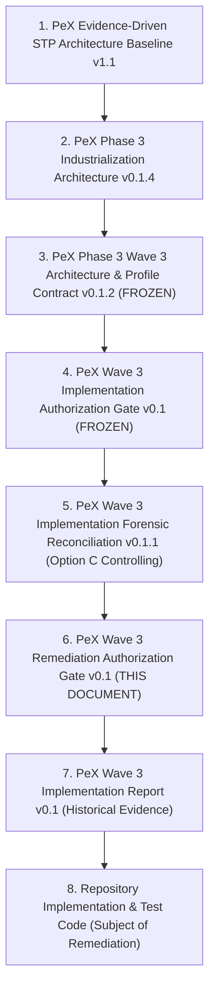

# PeX Phase 3 — Wave 3 Remediation Authorization Gate v0.1
## Formal Governance Authorization Gate for Controlled Remediation of Wave 3 Forensic Blockers (W3-FOR-01 & W3-FOR-03)

**Document Version:** v0.1  
**Status:** REMEDIATION AUTHORIZATION GATE (GOVERNANCE EVALUATION)  
**Governance Authority:** PeX Principal Solution Architect, Senior Payments Domain Engineer, Test Assurance Lead, and Independent Governance Documentation Specialist  
**Repository Working Directory:** `C:\Users\pawan\.gemini\antigravity\scratch\pex_platform`  
**Controlling Architecture Baseline:** `PeX_Phase3_Wave3_Industrialization_Architecture_and_Profile_Contract_v0.1.2.md` (FROZEN)  
**Controlling Authorization Gate Baseline:** `PeX_Wave3_Implementation_Authorization_Gate_v0.1.md` (FROZEN)  
**Controlling Forensic Review:** `PeX_Wave3_Implementation_Forensic_Reconciliation_v0.1.1.md` (Verdict: Option C — Forensic Acceptance Blocked)  
**Remediation Target Scope:** STRICTLY LIMITED to Workstream A (W3-FOR-03) & Workstream B (W3-FOR-01)  
**Production Autonomous STP Authorization:** **STRICTLY BLOCKED**  
**Execution Ownership Boundary:** `execution_owner = "BANK"` (Mandatory across all outputs)  

---

## 1. Document Control

```
┌──────────────────────────────────────────────────────────────────────────────────────────────────┐
│                                    DOCUMENT CONTROL METADATA                                     │
├───────────────────────────────────┬──────────────────────────────────────────────────────────────┤
│ Dimension                         │ Detail                                                       │
├───────────────────────────────────┼──────────────────────────────────────────────────────────────┤
│ Artifact Name                     │ PeX_Wave3_Remediation_Authorization_Gate_v0.1.md             │
│ Program Stage                     | Phase 3 — Wave 3 Post-Forensic Remediation Gate              │
│ Authorizing Roles                 │ Principal Solution Architect, Senior Payments Domain         │
│                                   │ Engineer, Test Assurance Lead, Governance Specialist         │
│ Target Remediation Scope          │ Workstream A: W3-FOR-03 (TR-02 Read-Only State Isolation)    │
│                                   │ Workstream B: W3-FOR-01 (24+ Isolated Predicate Mutations)   │
│ Controlling Forensic Verdict      │ Option C — Forensic Acceptance Blocked (v0.1.1 Audit)        │
│ Date of Gate Formulation          │ October 8, 2026                                              │
│ Baseline Code Commit              │ 01026e2 (Git working tree contains uncommitted Wave 2 & 3)   │
│ Cumulative Test Baseline          │ 785 passed / 0 failed / 3 warnings in 252.66s                │
└───────────────────────────────────┴──────────────────────────────────────────────────────────────┘
```

---

## 2. Executive Decision

Following the second-pass independent forensic audit (`PeX_Wave3_Implementation_Forensic_Reconciliation_v0.1.1.md`), which established **Option C — FORENSIC ACCEPTANCE BLOCKED**, this Remediation Authorization Gate formally defines the bounded conditions under which engineering may remediate the two blocking P2 findings.

```
┌──────────────────────────────────────────────────────────────────────────────────────────────────┐
│                                  REMEDIATION GATE DETERMINATION                                  │
├──────────────────────────┬───────────────────────────────────────────────────────────────────────┤
│ Formal Gate Decision     │ OPTION B — AUTHORIZE WITH CONDITIONS (RECOMMENDED)                    │
├──────────────────────────┼───────────────────────────────────────────────────────────────────────┤
│ Remediation Scope        │ STRICTLY LIMITED to:                                                  │
│                          │ 1. Workstream A (W3-FOR-03): Refactor TR-02 candidate derivation to be│
│                          │    purely read-only; eliminate adapter state mutation in derivation.  │
│                          │ 2. Workstream B (W3-FOR-01): Implement >=24 isolated 8-predicate      │
│                          │    adversarial mutation tests covering all 8 predicates.              │
├──────────────────────────┼───────────────────────────────────────────────────────────────────────┤
│ Explicit Prohibitions    │ Zero scope expansion; zero profile additions; zero changes to 8-pred   │
│                          │ formula; zero modification of Phase 2, Wave 0A/0B, Wave 1, or Wave 2;│
│                          │ zero live payment/clearing execution; zero production autonomous STP. │
├──────────────────────────┼───────────────────────────────────────────────────────────────────────┤
│ Governance Condition     │ Drafting this gate does NOT constitute permission to modify code.     │
│                          │ Engineering implementation may begin ONLY upon explicit approval by   │
│                          │ the designated Governance Authority.                                  │
└──────────────────────────┴───────────────────────────────────────────────────────────────────────┘
```

---

## 3. Purpose and Scope

### 3.1 Purpose
The purpose of this document is to establish a narrow, auditable, and enforceable governance firewall for remediating the two acceptance-blocking P2 defects identified during Wave 3 forensic review.

This gate enforces strict separation of lifecycle stages:
$$\Huge \text{Remediation Authorized} \neq \text{Code Remediated} \neq \text{Forensic Acceptance} \neq \text{Governance Sign-Off} \neq \text{Production STP}$$

### 3.2 Bounded Scope
Remediation is authorized for **EXACTLY TWO (2) WORKSTREAMS**:
1. **Workstream A (W3-FOR-03)**: Eliminate in-memory balance state mutation during candidate derivation in `TreasuryExposureEngine.resolve_tr02_insufficient_funds`.
2. **Workstream B (W3-FOR-01)**: Author and execute at least 24 independently isolated predicate-mutation test scenarios covering all eight predicates ($E_{\text{suff}}, R_{\text{det}}, R_{\text{uniq}}, V_{\text{det}}, V_{\text{auth}}, P_{\text{bank}}, C_{\text{comp}}, X_{\text{pre}}$) across the six Wave 3 profiles (`TR-02`, `TR-03`, `TR-04`, `TR-06`, `TR-07`, `TR-08`).

---

## 4. Controlling Artifacts and Precedence

All activities, constraints, and evaluations under this remediation gate are controlled by the following authoritative hierarchy:



### Order of Precedence:
1. The **Frozen Architecture Baseline (v0.1.2)** and **Authorization Gate (v0.1)** outrank all implementation code and reports.
2. The **Forensic Reconciliation (v0.1.1)** dictates the exact blocking findings requiring remediation.
3. No remediation code change may redefine, loosen, or reinterpret any architectural invariant.

---

## 5. Forensic Findings Being Remediated

The second-pass forensic audit (`PeX_Wave3_Implementation_Forensic_Reconciliation_v0.1.1.md`) identified four findings, of which two are acceptance-blocking P2 defects:

```
┌──────────────────────────────────────────────────────────────────────────────────────────────────┐
│                                 WAVE 3 FORENSIC FINDING DISPOSITION MATRIX                       │
├────────────┬──────────┬──────────┬────────────────────────────────────────┬──────────────────────┤
│ Finding ID │ Severity │ Profile  │ Description                            │ Remediation Scope    │
├────────────┼──────────┼──────────┼────────────────────────────────────────┼──────────────────────┤
│ W3-FOR-01  │ P2       │ ALL W3   │ 8-Predicate mutation test density gap  │ WORKSTREAM B (BLOCK) │
│ W3-FOR-03  │ P2       │ TR-02    │ Core engine invokes adapter mutation   │ WORKSTREAM A (BLOCK) │
│ W3-FOR-02  │ P3       │ TR-02/03 │ Active verb phrases in candidate labels│ GOVERNANCE CLEANUP   │
│ W3-FOR-04  │ P3       │ REPORT   │ Implementation report baseline labels  │ GOVERNANCE CLEANUP   │
└────────────┴──────────┴──────────┴────────────────────────────────────────┴──────────────────────┘
```

### Detailed Summary of Blockers:
- **Finding W3-FOR-01 (P2 — Test Density Deficit)**: Gate v0.1 (Section 18 & 20.8) mandated 24+ isolated mutation tests. Only 4 explicit tests exist in `tests/wave3/test_wave3_adversarial_predicates.py`, leaving $R_{\text{uniq}}, V_{\text{det}}, V_{\text{auth}}, C_{\text{comp}}$ completely unexercised in the Wave 3 directory.
- **Finding W3-FOR-03 (P2 — State Mutation Leak)**: `TreasuryExposureEngine.resolve_tr02_insufficient_funds` (`treasury_exposure_engine.py:345`) invokes `self.treasury_port.reserve_intraday_funds(...)` during positive candidate derivation. This mutates `self._balances` in `InMemoryTreasuryPositionAdapter` prior to bank authorization, contaminating subsequent balance lookups on shared adapter instances.

---

## 6. Authorized Workstream A — TR-02 State Isolation

### 6.1 Objective
Refactor `TreasuryExposureEngine.resolve_tr02_insufficient_funds` and associated contracts to guarantee that candidate derivation is **strictly read-only, functional, and side-effect free**.

### 6.2 Architectural & Code Mandates:
1. **Zero State Mutation During Derivation**: Candidate derivation must **never** invoke `reserve_intraday_funds`, `release_intraday_reservation`, debit accounts, credit accounts, or alter any balance or hold dictionary.
2. **Pure Candidate Generation**: When `eval_result["is_covered"]` is True, the engine must generate a structured candidate reservation proposal (e.g. `reservation_id = f"RES-PROP-{uuid.uuid4().hex[:8].upper()}"` or candidate payload) without invoking port mutation.
3. **Idempotent & Commutative Evaluation**: Repeated evaluations of the same account with identical inputs must produce identical decisions without altering underlying available balance.
4. **Shared Instance Integrity**: Multiple evaluations sharing the same `TreasuryPositionPort` instance must never degrade available balances or cause subsequent transactions to falsely report deficits.
5. **Port Interface Integrity**: If `reserve_intraday_funds` remains on `TreasuryPositionPort` for post-authorization simulation testing, it must be explicitly decoupled from resolution candidate derivation.

### 6.3 Required Targeted Verification Tests:
Engineering must implement focused regression tests in `tests/wave3/test_wave3_tr02_state_isolation.py` demonstrating:
- **Test 1 (Repeated Evaluation Invariance)**: Evaluate `resolve_tr02_insufficient_funds` 10 times consecutively against `ACCT-CORP-USD-001` ($450,000 balance). Assert that `available_balance` remains exactly $450,000 after all 10 calls.
- **Test 2 (Multi-Transaction State Independence)**: Evaluate two consecutive $250,000 payment candidates on an account with $450,000 available balance. Assert that both evaluations independently determine `is_covered = True` without the first evaluation draining funds for the second.
- **Test 3 (Order-Invariance Test)**: Evaluate payments of varying sizes in forward and reverse order. Assert that candidate derivation decisions and adapter balances are completely invariant to execution order.

---

## 7. Authorized Workstream B — Predicate-Mutation Testing

### 7.1 Objective
Expand `tests/wave3/test_wave3_adversarial_predicates.py` to contain **at least twenty-four (24) independently isolated predicate-mutation/adversarial test scenarios**, rigorously proving that each of the 8 canonical predicates independently blocks STP eligibility when forced to `False`.

### 7.2 The Canonical 8-Predicate Invariant:
$$\Huge \text{STP\_ELIGIBLE} = E_{\text{suff}} \land R_{\text{det}} \land R_{\text{uniq}} \land V_{\text{det}} \land V_{\text{auth}} \land P_{\text{bank}} \land C_{\text{comp}} \land X_{\text{pre}}$$

### 7.3 Required 24-Scenario Predicate Mutation Matrix:

```
┌──────────────────────────────────────────────────────────────────────────────────────────────────┐
│                                 24+ PREDICATE MUTATION SCENARIO PLAN                             │
├────┬───────────┬─────────┬───────────────────────────────────────┬───────────────────────────────┤
│ #  │ Predicate │ Profile │ Test Scenario & Forced False Condition│ Target Assertion              │
├────┼───────────┼─────────┼───────────────────────────────────────┼───────────────────────────────┤
│ 1  │ E_suff    │ TR-02   │ Missing Core DDA Balance Record       │ e_suff=False, stp=False, HITL │
│ 2  │ E_suff    │ TR-03   │ Missing Nostro Position Statement     │ e_suff=False, stp=False, HITL │
│ 3  │ E_suff    │ TR-04   │ Missing FX Market Rate Quote Feed     │ e_suff=False, stp=False, HITL │
│ 4  │ E_suff    │ TR-06   │ Missing Limit Utilization Record      │ e_suff=False, stp=False, HITL │
│ 5  │ E_suff    │ TR-07   │ Missing Liquidity Reserve Record      │ e_suff=False, stp=False, HITL │
│ 6  │ E_suff    │ TR-08   │ Missing Counterparty Exposure Record  │ e_suff=False, stp=False, HITL │
├────┼───────────┼─────────┼───────────────────────────────────────┼───────────────────────────────┤
│ 7  │ R_det     │ TR-02   │ Persistent Deficit without Pending Cr │ r_det=False, stp=False, HITL  │
│ 8  │ R_det     │ TR-03   │ Nostro Deficit exceeding Sweep Cap    │ r_det=False, stp=False, HITL  │
│ 9  │ R_det     │ TR-04   │ Stale Market Quote (Age > 60.0s)      │ r_det=False, stp=False, HITL  │
│ 10 │ R_det     │ TR-07   │ Liquidity Reserve Exhausted           │ r_det=False, stp=False, HITL  │
├────┼───────────┼─────────┼───────────────────────────────────────┼───────────────────────────────┤
│ 11 │ R_uniq    │ TR-02   │ Conflicting Core Ledger Replicas (N>1)│ r_uniq=False, stp=False, HITL │
│ 12 │ R_uniq    │ TR-03   │ Unreconciled Nostro Ledger Breaks     │ r_uniq=False, stp=False, HITL │
│ 13 │ R_uniq    │ TR-04   │ FX Market Volatility Circuit Breaker  │ r_uniq=False, stp=False, HITL │
├────┼───────────┼─────────┼───────────────────────────────────────┼───────────────────────────────┤
│ 14 │ V_det     │ TR-02   │ Invalid Currency Decimal Formatting   │ v_det=False, stp=False, HITL  │
│ 15 │ V_det     │ TR-04   │ Inverted / Negative Currency Quote    │ v_det=False, stp=False, HITL  │
│ 16 │ V_det     │ TR-06   │ Corrupted Limit Identifier Syntax     │ v_det=False, stp=False, HITL  │
├────┼───────────┼─────────┼───────────────────────────────────────┼───────────────────────────────┤
│ 17 │ V_auth    │ TR-02   │ Non-Authoritative DDA Balance Feed    │ v_auth=False, stp=False, HITL │
│ 18 │ V_auth    │ TR-04   │ Non-Authoritative FX Pricing Source   │ v_auth=False, stp=False, HITL │
│ 19 │ V_auth    │ TR-08   │ Unverified Risk Rating Telemetry      │ v_auth=False, stp=False, HITL │
├────┼───────────┼─────────┼───────────────────────────────────────┼───────────────────────────────┤
│ 20 │ P_bank    │ TR-02   │ Amount Exceeds Auto-Pacing Policy Cap │ p_bank=False, stp=False, HITL │
│ 21 │ P_bank    │ TR-04   │ FX Spread Exceeds Policy Max (50 bps) │ p_bank=False, stp=False, HITL │
│ 22 │ P_bank    │ TR-08   │ TR-08 Zero Autonomous STP Invariant   │ p_bank=False, stp=False, DUAL │
├────┼───────────┼─────────┼───────────────────────────────────────┼───────────────────────────────┤
│ 23 │ C_comp    │ TR-06   │ Counterparty Sanctions Screening Match│ c_comp=False, stp=False, HITL │
│ 24 │ C_comp    │ TR-08   │ AML High-Risk / Structuring Flagged   │ c_comp=False, stp=False, HITL │
├────┼───────────┼─────────┼───────────────────────────────────────┼───────────────────────────────┤
│ 25 │ X_pre     │ TR-02   │ Idempotency Lock Collision Active     │ x_pre=False, stp=False, HITL  │
│ 26 │ X_pre     │ TR-07   │ Clearing Rail Emergency Settlement Hlt│ x_pre=False, stp=False, HITL  │
└────┴───────────┴─────────┴───────────────────────────────────────┴───────────────────────────────┘
```

### 7.4 Isolation Mandate:
- In each test case, **EXACTLY ONE** target predicate must be forced `False` while all other 7 predicates evaluate `True` (unless a domain constraint mandates dependent evaluation).
- Tests must assert:
  1. `out.stp_eligible is False`
  2. `getattr(out.predicate_breakdown, target_predicate) is False`
  3. `out.hitl_required is True` (or `out.approval_requirement == "MAKER_CHECKER_DUAL_AUTH"` for TR-08)
  4. `out.execution_owner == "BANK"`
- Tests must exercise the **real evaluation pipeline** via `E2EExecutionHarness` or `TreasuryExposureEngine`, not disconnected mock stubs.

---

## 8. Frozen Architecture and Invariants

Remediation must strictly preserve all frozen architecture baselines and core invariants:

```
┌──────────────────────────────────────────────────────────────────────────────────────────────────┐
│                                 FROZEN ARCHITECTURAL INVARIANTS                                  │
├──────────────────────────┬───────────────────────────────────────────────────────────────────────┤
│ Invariant Dimension      │ Non-Negotiable Architectural Rule                                     │
├──────────────────────────┼───────────────────────────────────────────────────────────────────────┤
│ 41-Profile Taxonomy      │ Strictly closed. Wave 3 = exactly TR-02, TR-03, TR-04, TR-06, TR-07,  │
│                          │ TR-08. Zero additional profiles authorized.                           │
│ 6 Capability Engines     │ TreasuryExposureEngine owns all 6 Wave 3 profiles. Zero engine shifts.│
│ 7 Pattern Families       │ Must use PAT-C, PAT-B, PAT-D, PAT-A. Zero new pattern families.       │
│ 8-Predicate Formula      │ Universal boolean conjunction formula is immutable. Zero bypasses.    │
│ TR-08 Zero-STP Rule      │ Credit Exposure Breach MUST NEVER achieve autonomous STP.             │
│ Bank Execution Boundary  │ execution_owner = "BANK" on 100% of terminal handoffs.                 │
│ Provider Neutrality      │ Zero vendor SDKs (AWS, Azure, GCP, LangChain, Kafka) in core modules. │
│ Production STP Block     │ Zero live payment release or clearing network integration authorized. │
└──────────────────────────┴───────────────────────────────────────────────────────────────────────┘
```

---

## 9. Explicitly Excluded Work

The following activities are **EXPLICITLY PROHIBITED** under this remediation authorization:

```
┌──────────────────────────────────────────────────────────────────────────────────────────────────┐
│                                    EXPLICITLY EXCLUDED WORK                                      │
├───────────────────────────────────┬──────────────────────────────────────────────────────────────┤
│ Prohibited Item                   │ Operational Rationale                                        │
├───────────────────────────────────┼──────────────────────────────────────────────────────────────┤
│ 1. Taxonomy Expansion             │ Canonical 41-profile universe is frozen. No new profiles.    │
│ 2. Engine Refactoring             │ No modifications to AccountMaster, RoutingClearing, etc.     │
│ 3. Pattern Redesign               │ No new pattern families (no PAT-H).                          │
│ 4. Formula Alteration             │ 8-predicate formula cannot be modified, reordered, or relaxed│
│ 5. Prior-Wave Code Modification   │ Phase 2, Wave 0A/0B, Wave 1, Wave 2 code and tests are frozen│
│ 6. Production Connectivity        │ No live bank API, HSM, live clearing, or live DDA adapters.  │
│ 7. Production Autonomous STP      │ Production autonomous execution remains strictly forbidden.  │
│ 8. General Wave 3 Redesign        │ Remediation is limited strictly to W3-FOR-01 & W3-FOR-03.    │
│ 9. Weakening of Safety Controls   │ No lowering of thresholds or bypassing of Maker-Checker rules│
└───────────────────────────────────┴──────────────────────────────────────────────────────────────┘
```

---

## 10. Baseline and Regression Protocol

### 10.1 Pre-Remediation Baseline Capture:
- **Baseline Git Commit**: `01026e2`
- **Reported Cumulative Test Baseline**: **785 passed / 0 failed / 3 warnings in 252.66s**
- **Reported Wave 3 Test Baseline**: **59 passed / 0 failed / 3 warnings in 17.18s**

### 10.2 Regression Execution Protocol:
Before declaring remediation complete, engineering must execute:
1. **Targeted Workstream A Suite**: `pytest tests/wave3/test_wave3_tr02_state_isolation.py -v`
2. **Targeted Workstream B Suite**: `pytest tests/wave3/test_wave3_adversarial_predicates.py -v` (Asserting 24+ passing tests)
3. **Full Wave 3 Suite**: `pytest tests/wave3/ -v`
4. **Canonical Wave 3 E2E Suite**: `pytest tests/wave3/test_wave3_e2e_scenarios.py -v` (Scenarios 31A–36B)
5. **Full Cumulative Platform Regression**: `pytest tests/ backend/tests/ -q`

### 10.3 Zero-Regression Invariant:
- All 726 inherited baseline tests must remain **100% green**.
- Total cumulative test count must equal:
  $$\text{Cumulative Tests} \ge 785 + \Delta_{\text{State Isolation Tests}} + \Delta_{\text{New Adversarial Mutation Tests}}$$
- Zero test failures, zero test errors, zero new deprecation warnings.

---

## 11. Deliverables and Evidence Requirements

Upon completion of the remediation sprint, engineering must produce and deliver the following evidence package:

```
┌──────────────────────────────────────────────────────────────────────────────────────────────────┐
│                                 REQUIRED REMEDIATION DELIVERABLES                                │
├────┬──────────────────────────────────┬──────────────────────────────────────────────────────────┤
│ #  │ Deliverable Artifact             │ Description & Required Verification Evidence             │
├────┼──────────────────────────────────┼──────────────────────────────────────────────────────────┤
│ 1  │ Remediation Authorization Gate   │ `PeX_Wave3_Remediation_Authorization_Gate_v0.1.md`       │
│    │ (This Document)                  │ Formally approved prior to engineering kickoff.          │
│ 2  │ TR-02 Read-Only Code Changes     │ Refactored `treasury_exposure_engine.py` with code trace │
│    │                                  │ proving zero adapter state mutation during derivation.   │
│ 3  │ TR-02 State Isolation Test Suite │ `tests/wave3/test_wave3_tr02_state_isolation.py` proving │
│    │                                  │ repeated evaluation invariance and instance isolation.   │
│ 4  │ Expanded Predicate Mutation Suite│ `tests/wave3/test_wave3_adversarial_predicates.py` with  │
│    │                                  │ >=24 distinct isolated mutation test functions.          │
│ 5  │ Full Regression Test Run Log     │ Pytest execution logs proving 100% green cumulative run. │
│ 6  │ Remediation Implementation Report│ `PeX_Wave3_Remediation_Implementation_Report_v0.1.md`    │
│    │                                  │ Documenting exact changes, traceability, and metrics.    │
│ 7  │ Post-Remediation Forensic Package│ Ready for independent read-only review under v0.1.2 audit│
└────┴──────────────────────────────────┴──────────────────────────────────────────────────────────┘
```

---

## 12. Acceptance Criteria

Remediation will be considered complete and ready for forensic re-audit only when all of the following exit criteria are independently verified:

### 12.1 Workstream A (W3-FOR-03) Exit Criteria:
1. `TreasuryExposureEngine.resolve_tr02_insufficient_funds` contains zero calls that mutate `self.treasury_port` state during candidate derivation.
2. `InMemoryTreasuryPositionAdapter.reserve_intraday_funds` is not invoked during candidate derivation.
3. 10 consecutive evaluations of `ACCT-CORP-USD-001` leave `available_balance` exactly unchanged at $450,000.00.
4. Consecutive transactions sharing the same adapter instance evaluate without cross-transaction balance leakage.
5. All 12 canonical E2E scenario fixtures (31A–36B) pass without regression.

### 12.2 Workstream B (W3-FOR-01) Exit Criteria:
1. `tests/wave3/test_wave3_adversarial_predicates.py` contains **at least 24 independently named and executed test functions**.
2. All 8 predicates ($E_{\text{suff}}, R_{\text{det}}, R_{\text{uniq}}, V_{\text{det}}, V_{\text{auth}}, P_{\text{bank}}, C_{\text{comp}}, X_{\text{pre}}$) have at least one dedicated, isolated test proving fail-closed blocking behavior.
3. Every test asserts `stp_eligible is False` and verifies the target predicate boolean in `predicate_breakdown`.
4. High AI confidence or plausible candidate data is proved incapable of overriding a failed predicate.
5. All 24+ adversarial tests execute cleanly and pass.

### 12.3 Cumulative Program Exit Criteria:
1. Full cumulative regression suite passes with **zero failures and zero regressions** across all inherited tests.
2. AST static analysis confirms **zero vendor SDK imports** across all modified modules.
3. `execution_owner = "BANK"` is asserted on 100% of positive resolution handoffs.
4. `PeX_Wave3_Remediation_Implementation_Report_v0.1.md` is authored and submitted.

---

## 13. Roles and Approval Authority

```
┌──────────────────────────────────────────────────────────────────────────────────────────────────┐
│                                 GOVERNANCE & APPROVAL ROLES                                      │
├───────────────────────────────────┬──────────────────────────────────────────────────────────────┤
│ Role Title                        │ Governance Authority & Responsibilities                      │
├───────────────────────────────────┼──────────────────────────────────────────────────────────────┤
│ Principal Solution Architect      │ Authorizes remediation gate; enforces architectural boundary │
│ Senior Payments Domain Engineer   │ Reviews domain semantics, RTGS, DDA, Nostro, and FX logic    │
│ Test Assurance Lead               │ Audits test isolation, predicate coverage, and regression    │
│ Independent Forensic Auditor      │ Performs independent post-remediation forensic audit (v0.1.2)│
│ Core Engineering Team             │ Executes authorized code refactoring and test implementation │
└───────────────────────────────────┴──────────────────────────────────────────────────────────────┘
```

---

## 14. Stop Conditions and Escalation

Engineering **MUST IMMEDIATELY HALT WORK AND ESCALATE TO GOVERNANCE** if any of the following 10 conditions occur:

1. Remediation of TR-02 requires altering the canonical definition of `TR-02` or `PAT-C`.
2. The 8-predicate STP formula requires modification, relaxation, or predicate bypass.
3. The state isolation fix cannot be achieved without modifying inherited Phase 2, Wave 1, or Wave 2 files.
4. A predicate mutation test cannot exercise real evaluation code without live network mocks.
5. Any remediation change introduces direct ledger mutation or external financial side effects.
6. The cumulative test suite experiences unresolvable regression failures in prior-wave tests.
7. Remediation requires adding new SPI ports or vendor SDK dependencies.
8. A new exception profile is deemed necessary to resolve a test scenario.
9. Pre-remediation baseline test execution diverges from reported 785 passing tests.
10. The scope of changes exceeds `treasury_exposure_engine.py`, `reference_treasury_position_adapter.py`, and `tests/wave3/`.

---

## 15. Residual Risks and Limitations

```
┌──────────────────────────────────────────────────────────────────────────────────────────────────┐
│                                 RESIDUAL RISK & MITIGATION REGISTER                              │
├────┬────────────────────────────┬──────────┬─────────────────────────────────────────────────────┤
│ #  │ Identified Residual Risk   │ Severity │ Governed Mitigation Strategy                        │
├────┼────────────────────────────┼──────────┼─────────────────────────────────────────────────────┤
│ 1  │ Reference Adapter Drift    │ Medium   │ Clearly label in-memory adapters as TEST_ONLY.      │
│    │ vs Live Bank Ledger APIs   │          │ Live banking connectors deferred to production gate.│
│ 2  │ Test Suite Execution Time  │ Low      │ 24+ new tests add ~5-10s to pytest run. Optimize    │
│    │ Expansion                  │          │ in-memory fixture construction.                     │
│ 3  │ Downstream Wave Scope      │ Low      │ Strict governance firewall prevents Wave 4 leakage. │
│    │ Boundary Contamination     │          │ Waves 4-6 remain protected and unauthorized.        │
└────┴────────────────────────────┴──────────┴─────────────────────────────────────────────────────┘
```

---

## 16. Authorization Decision Record

```
====================================================================================================
                             FORMAL REMEDIATION AUTHORIZATION RECORD
====================================================================================================
Decision Recommendation:                OPTION B — AUTHORIZE WITH CONDITIONS

Scope of Authorized Work:               1. Workstream A: Refactor TreasuryExposureEngine TR-02
                                           candidate derivation to be purely functional and
                                           read-only; eliminate reference adapter state mutation.
                                        2. Workstream B: Implement >=24 isolated 8-predicate
                                           mutation tests covering all 8 predicates in tests/wave3/.
                                        3. Author PeX_Wave3_Remediation_Implementation_Report_v0.1.md.

Mandatory Conditions:                   1. Zero scope expansion beyond Workstream A and B.
                                        2. Zero live payment/clearing execution integration.
                                        3. Zero production autonomous STP enablement.
                                        4. 100% green execution across full cumulative test suite.
                                        5. Formal independent post-remediation forensic review required.

Governance Status:                      RECOMMENDED BY PRINCIPAL REVIEWER PENDING EXPLICIT APPROVAL
====================================================================================================
```

---

## 17. Post-Implementation Forensic Review

Upon completion of remediation and publication of `PeX_Wave3_Remediation_Implementation_Report_v0.1.md`, an independent red-team reviewer will perform:
**`PeX_Wave3_Implementation_Forensic_Reconciliation_v0.1.2.md`**

The forensic reviewer will independently audit:
1. Code-level elimination of state mutation in `resolve_tr02_insufficient_funds`.
2. Traceability and execution of all 24+ predicate mutation tests.
3. Proof of isolation for all 8 predicates.
4. Cumulative regression suite execution (asserting 100% green status).
5. AST provider neutrality verification.

If all criteria are met, the forensic reviewer will issue **OPTION A — FORENSICALLY ACCEPTED**, clearing Wave 3 for Governance Sign-Off (`PeX_Wave3_Multi_Profile_Semantic_Reconciliation_and_Governance_Signoff_v0.1.md`).

---

## 18. Final Governance Status

```
┌──────────────────────────────────────────────────────────────────────────────────────────────────┐
│                                   FINAL GOVERNANCE POSITION                                      │
├───────────────────────────────────┬──────────────────────────────────────────────────────────────┤
│ Dimension                         │ Authoritative Determination                                  │
├───────────────────────────────────┼──────────────────────────────────────────────────────────────┤
│ Wave 3 Implementation Status      │ FORENSIC ACCEPTANCE BLOCKED (Pending Authorized Remediation) │
│ Governance Sign-Off Status        │ BLOCKED PENDING REMEDIATION & FORENSIC CLOSURE               │
│ Production Autonomous STP Status  │ STRICTLY BLOCKED (Zero Live Execution Authorized)            │
│ Live Payment Network Integration  │ STRICTLY PROHIBITED (Test / Simulation Only)                 │
│ Code Remediation Permission       │ PENDING EXPLICIT GOVERNANCE APPROVAL OF THIS GATE            │
│ Next Authorized Milestone         │ Engineering Kickoff of Workstreams A & B upon Gate Approval  │
└───────────────────────────────────┴──────────────────────────────────────────────────────────────┘
```

> **GOVERNANCE DIRECTIVE:**  
> This artifact establishes the strict, non-negotiable boundaries for Wave 3 remediation. **Drafting this document does NOT authorize code modification.** Engineering may commence implementation of Workstreams A and B only after explicit governance approval is recorded.
