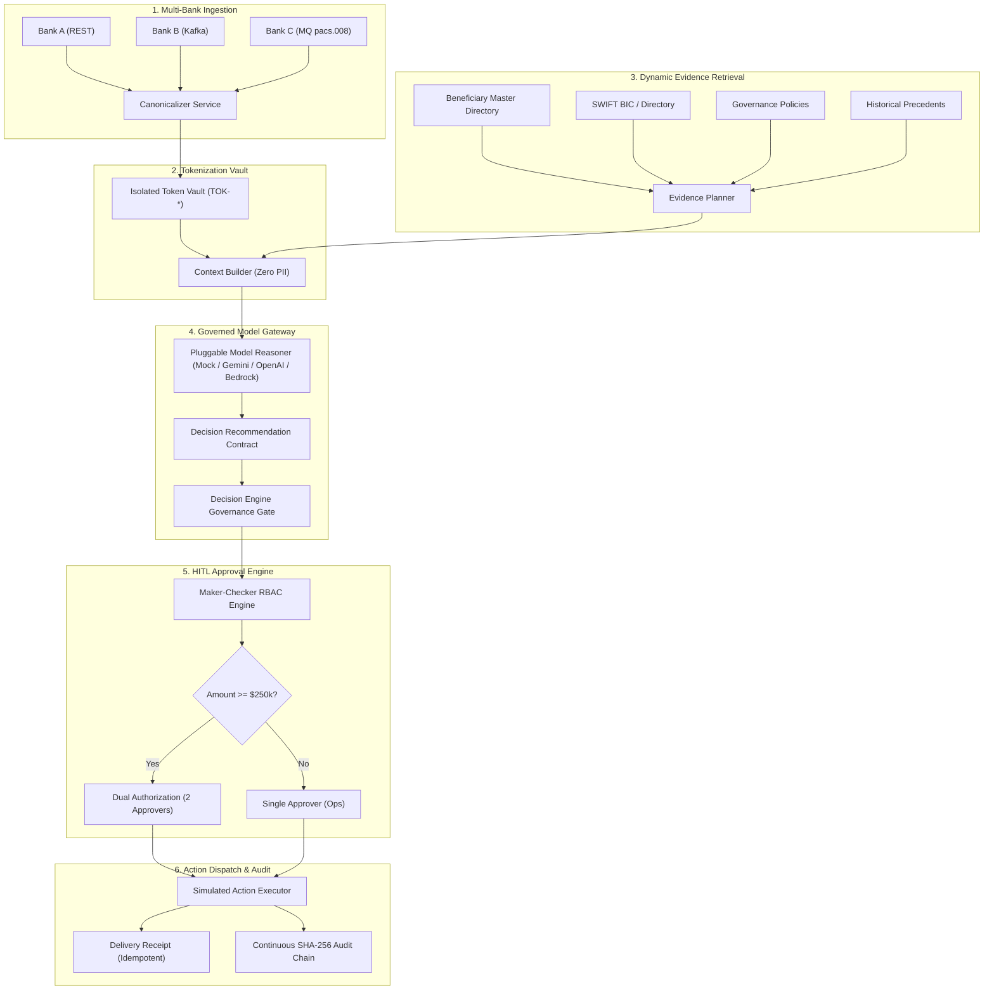

# PeX — Payment Exception Resolution Platform

Institutional-grade, cloud-agnostic, model-neutral AI platform for automated and assisted payment exception repair, compliance escalation, and delivery settlement across SWIFT CBPR+, ISO 20022 (`pacs.008`, `pacs.004`, `camt.056`), Fedwire, and SEPA clearing rails.

---

## Key Architectural Principles

1. **Zero-Trust Privacy & Sensitive Data Boundary**:
   - Debtor and Creditor identities are tokenized into format-preserving pseudonyms (`TOK-PARTY-...`, `TOK-IBAN-...`).
   - Downstream AI Model Gateway contexts never receive raw PII or unmasked account numbers.
2. **Cloud-Provider & Model-Provider Independence**:
   - Core domain is strictly decoupled from cloud infrastructure and LLM vendors via Hexagonal Architecture (Ports & Adapters).
   - Seamlessly executes across Replit Sandbox, Local Workstation, AWS, Google Cloud Platform (GCP), and Microsoft Azure without code changes.
   - Pluggable AI Model Gateway supports deterministic synthetic reasoning, Google Gemini, OpenAI, and AWS Bedrock.
3. **Deterministic Evidence Planning**:
   - Collects corroborating records from Beneficiary Master Directory, SWIFT BIC Directory, Bundesbank/Fedwire routing registries, and Historical Precedents.
4. **Enforced Segregation of Duties & Dual Authorization**:
   - Maker-Checker rules strictly forbid Operators from approving their own initiated repairs (`MST-040`, `MST-043`).
   - High-Value exceptions ($\ge \$250,000$) mandate Dual Authorization by two distinct officers (`MST-041`).
5. **Continuous Cryptographic Provenance (SHA-256)**:
   - Every state change across all 20 lifecycle stages is hashed and chained into a tamper-evident audit trail with real-time Merkle integrity verification (`MST-009`, `MST-034`).
6. **Simulated Bank Dispatch with Idempotency**:
   - Safe execution of repaired payments against simulated clearing ledger with guaranteed idempotency keys and bank delivery receipts.

---

## System Architecture



---

## Quick Start in Replit

PeX is pre-configured for instant zero-dependency execution in Replit:

1. **Import Repository** into Replit.
2. **Install Dependencies**:
   ```bash
   pip install -r requirements.txt
   ```
3. **Run Unified Server** (Backend API + Frontend SPA):
   ```bash
   python -m uvicorn app.main:app --app-dir backend --host 0.0.0.0 --port 8000
   ```
4. **Open Webview** at `http://localhost:8000/`.
5. **Run Automated Test Suites**:
   ```bash
   python -m pytest tests/ backend/tests/ -v
   ```

*For detailed setup and walkthrough scripts, see [REPLIT_SETUP.md](file:///C:/Users/pawan/.gemini/antigravity/scratch/pex_platform/docs/REPLIT_SETUP.md) and [REPLIT_DEMO.md](file:///C:/Users/pawan/.gemini/antigravity/scratch/pex_platform/docs/REPLIT_DEMO.md).*

---

## Local Development & Verification

### 1. Automated Test Suites (111 / 111 Passing Tests)
Run all unit, contract, state-machine, payment domain, and Replit readiness tests:
```powershell
.\.venv\Scripts\pytest tests/ backend/tests/ -v
```

### 2. Start Unified Backend Server
```powershell
.\.venv\Scripts\python -m uvicorn app.main:app --app-dir backend --host 0.0.0.0 --port 8000
```
*Backend API documentation available at: `http://localhost:8000/docs`*

### 3. Start Standalone Frontend (Vite Dev Server)
```powershell
cd frontend
npm run dev
```
*Open `http://localhost:5173` for Vite HMR development.*

---

## Institutional RBAC Persona Matrix

| User ID | Persona Name | Role | Max Approval Limit | Key Responsibilities |
|---|---|---|---|---|
| `OP-9012` | **Amina Okafor** | `OPERATOR` | Maker Only ($0) | Payment Intake, Exception Triage, Investigation Initiation |
| `APR-3191` | **Daniel Osei** | `OPERATIONS_APPROVER` | $250,000 | Repair Approval, Value Modification, Resubmission |
| `CMP-4401` | **Marisol Vega** | `COMPLIANCE_APPROVER` | $5,000,000 | Sanctions Hit Review, KYC Waivers, Dual Authorization |
| `RSK-7714` | **Kenji Watanabe** | `RISK_APPROVER` | $2,000,000 | Dual Authorization Tier-2 Approver for High-Value Repairs |
| `ADM-0001` | **Alex Whitfield** | `ADMIN` | Unlimited | Governance Policy Management, Audit Integrity Recompute |

---

## Architectural & Audit Reference Documentation

- [Cloud-Provider Agnostic Architecture Specification](file:///C:/Users/pawan/.gemini/antigravity/scratch/pex_platform/docs/PEX_CLOUD_PROVIDER_AGNOSTIC_ARCHITECTURE.md)
- [Enterprise Cloud Provider Capability Matrix (AWS / GCP / Azure)](file:///C:/Users/pawan/.gemini/antigravity/scratch/pex_platform/validation_audit/PEX_CLOUD_PROVIDER_CAPABILITY_MATRIX.md)
- [Provider Dependency & Environment Inventory](file:///C:/Users/pawan/.gemini/antigravity/scratch/pex_platform/validation_audit/PEX_PROVIDER_DEPENDENCY_INVENTORY.md)
- [Deployment Boundary: Prototype/Replit vs Enterprise Production](file:///C:/Users/pawan/.gemini/antigravity/scratch/pex_platform/validation_audit/PEX_DEPLOYMENT_BOUNDARY.md)
- [Replit Setup & Operational Execution Guide](file:///C:/Users/pawan/.gemini/antigravity/scratch/pex_platform/docs/REPLIT_SETUP.md)
- [20-Step Deterministic Replit Demo Script](file:///C:/Users/pawan/.gemini/antigravity/scratch/pex_platform/docs/REPLIT_DEMO.md)
- [Master Remediation Register](file:///C:/Users/pawan/.gemini/antigravity/scratch/pex_platform/validation_audit/PEX_MASTER_REMEDIATION_REGISTER_FINAL.md)
