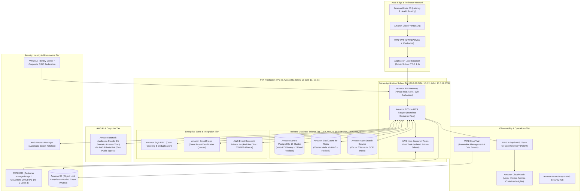

# 🟧 PeX — AWS Reference Architecture

**Document ID:** `PEX-REF-ARCH-AWS-v0.1`  
**Governing Baseline:** PeX `v1.9.4` (`9e9184b`) / Enterprise Architecture `v0.2`  
**Scope:** Concrete Amazon Web Services (AWS) Production Implementation Blueprint  
**Date:** September 28, 2026  
**Status:** Approved Reference Architecture Blueprint  

---

## 1. Executive Summary

This document specifies the concrete implementation of the **PeX Cloud Reference Architecture on Amazon Web Services (AWS)**. It maps all provider-neutral capabilities and secondary ports to native, enterprise-grade AWS services while preserving the portable PeX domain core, zero-PII security boundary, and Maker-Checker governance.

---

## 2. AWS Reference Architecture Topology



---

## 3. AWS Service Mapping & Component Specifications

| Provider-Neutral Logical Component | AWS Implementation Service | Configuration & Operational Specification |
|---|---|---|
| **Anycast DNS & Routing** | **Amazon Route 53** | Latency-based global routing with automated DNS health checks and failover routing. |
| **DDoS & Web Application Firewall** | **AWS WAF + AWS Shield Advanced** | OWASP Top 10 rule group, rate limiting (2,000 req/5 min/IP), and strict API schema validation. |
| **Ingress Load Balancing** | **Application Load Balancer (ALB)** | Multi-AZ ALB with TLS 1.3 policy (`ELBSecurityPolicy-TLS13-1-2-2021-06`), HTTP/2 enabled. |
| **API Management & Ingress** | **Amazon API Gateway (HTTP / REST)** | Private REST API with Lambda/JWT Authorizer validating OIDC claims issued by corporate IdP. |
| **Compute & Container Runtime** | **Amazon ECS on AWS Fargate** | Multi-AZ serverless container deployment across 3 AZs; autoscaled on CPU/Memory ($\ge 70\%$) and SQS depth. |
| **Token Vault Isolation Enclave** | **AWS Nitro Enclaves / Fargate Enclave** | Isolated CPU/memory enclave with zero network routing; communicates strictly via local `vsock`. |
| **Relational Transactional Database** | **Amazon Aurora PostgreSQL 16** | Multi-AZ cluster (1 Writer, 2 Readers); range-partitioned tables; 35-day continuous PITR; Storage Auto-expand to 128TB. |
| **Distributed Cache & Locking** | **Amazon ElastiCache for Redis (Cluster)** | Multi-AZ Redis 7.1 with auto-failover; executes `Redlock` distributed locking for state machine transitions. |
| **Vector & Semantic SOP Index** | **Amazon OpenSearch Service (Serverless)** | k-NN vector search engine indexing BIAN SOP playbooks and historical resolution precedents. |
| **Distributed FIFO Messaging** | **Amazon SQS FIFO + Amazon SNS FIFO** | Guaranteed FIFO ordering by `MessageGroupId` (`case_id`); technical deduplication window (5 mins); DLQ after 3 retries. |
| **Event Routing & Event Bus** | **Amazon EventBridge** | Enterprise event routing for asynchronous lifecycle notifications and external compliance webhook dispatch. |
| **Key Management & HSM** | **AWS KMS + AWS CloudHSM** | FIPS 140-2 Level 3 HSM backing Customer Managed Keys (CMKs); envelope encryption; 90-day key rotation. |
| **Secrets Management** | **AWS Secrets Manager** | Centralized credentials store with automated rotation for database passwords and external API tokens. |
| **Enterprise Identity Federation** | **AWS IAM Identity Center (SAML 2.0 / OIDC)**| Federated authentication against Microsoft Entra ID / Okta; propagates user ID, department, and role claims. |
| **WORM Regulatory Object Storage** | **Amazon S3 Object Lock (Compliance Mode)**| 7-year immutable retention; Write-Once-Read-Many (WORM); cross-region replication to secondary DR bucket. |
| **Private Foundation Model (AI)** | **Amazon Bedrock (Claude 3.5 Sonnet / Titan)**| Private inference accessed strictly over AWS PrivateLink VPC Endpoints with zero data retention and zero training egress. |
| **External Payment Rail Connectivity** | **AWS Direct Connect + AWS PrivateLink** | Dedicated 10 Gbps private fiber circuits connecting to FedLine Direct, SWIFT Alliance Gateway, and Core Banking. |
| **Distributed Tracing & Telemetry** | **AWS Distro for OpenTelemetry (ADOT)** | Traces injected with `uetr` correlation IDs exported to AWS X-Ray and CloudWatch ServiceLens. |
| **Log Ingestion & Metrics** | **Amazon CloudWatch Logs & Metrics** | Centralized log group with 365-day retention; Prometheus metrics exported to CloudWatch Container Insights. |
| **Security Monitoring & Threat Detection**| **Amazon GuardDuty + AWS Security Hub** | Continuous machine learning threat detection on CloudTrail, VPC Flow Logs, and DNS queries. |

---

## 4. Secondary Port Adapter Implementations on AWS

```python
# AWS Concrete Adapter Implementations (Hexagonal Port Bindings)

class AWSPersistenceRepositoryAdapter(PersistenceRepository):
    """Binds to Amazon Aurora PostgreSQL via SQLAlchemy / asyncpg connection pool."""
    def __init__(self, db_url: str):
        self.engine = create_async_engine(db_url, pool_size=50, max_overflow=20)

class AWSKeyManagementServiceAdapter(KeyManagementService):
    """Binds to AWS KMS CMK backed by CloudHSM for envelope encryption."""
    def __init__(self, kms_client, cmk_key_id: str):
        self.kms = kms_client
        self.cmk_key_id = cmk_key_id

    def generate_data_key(self) -> Tuple[bytes, bytes]:
        res = self.kms.generate_data_key(KeyId=self.cmk_key_id, KeySpec='AES_256')
        return res['Plaintext'], res['CiphertextBlob']

class AWSEventBusAdapter(EventBus):
    """Binds to Amazon SQS FIFO for ordered transaction event publishing."""
    def __init__(self, sqs_client, queue_url: str):
        self.sqs = sqs_client
        self.queue_url = queue_url

class AWSObjectEvidenceStoreAdapter(ObjectEvidenceStore):
    """Binds to Amazon S3 Object Lock for 7-year immutable WORM archival."""
    def __init__(self, s3_client, bucket_name: str):
        self.s3 = s3_client
        self.bucket = bucket_name

class AWSBedrockLLMGatewayAdapter(LLMGateway):
    """Binds to Amazon Bedrock Claude 3.5 Sonnet over private VPC endpoint."""
    def __init__(self, bedrock_runtime_client, model_id="anthropic.claude-3-5-sonnet-20240620-v1:0"):
        self.client = bedrock_runtime_client
        self.model_id = model_id
```

---

## 5. AWS High Availability & Disaster Recovery Topology

- **Multi-AZ HA (Local):** Active-active compute across 3 Availability Zones (`us-east-1a`, `us-east-1b`, `us-east-1c`) with Aurora PostgreSQL synchronous replication.
- **Regional DR (Pilot Light / Warm Standby in `us-west-2`):**
  - **Aurora Global Database:** Sub-second asynchronous replication to `us-west-2` replica.
  - **S3 Cross-Region Replication (CRR):** Real-time replication of WORM compliance buckets with identical retention locks.
  - **Target RTO:** $< 15\text{ minutes}$ (Automated Aurora Global DB promote via Route 53 Application Recovery Controller).
  - **Target RPO:** $< 1\text{ second}$ (Continuous WAL streaming).
