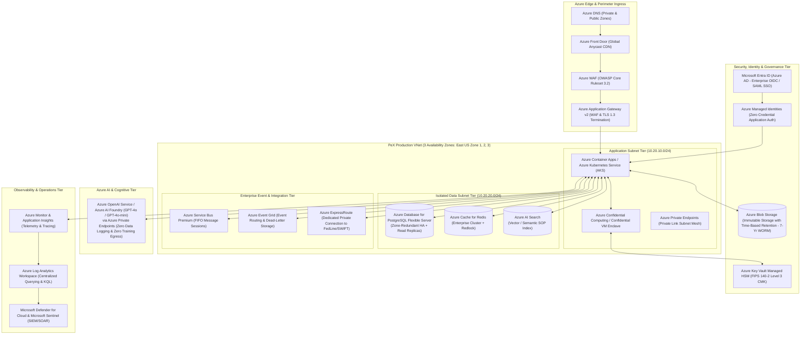

# 🟦 PeX — Microsoft Azure Reference Architecture

**Document ID:** `PEX-REF-ARCH-AZURE-v0.1`  
**Governing Baseline:** PeX `v1.9.4` (`9e9184b`) / Enterprise Architecture `v0.2`  
**Scope:** Concrete Microsoft Azure Production Implementation Blueprint  
**Date:** September 28, 2026  
**Status:** Approved Reference Architecture Blueprint  

---

## 1. Executive Summary

This document specifies the concrete implementation of the **PeX Cloud Reference Architecture on Microsoft Azure**. It maps all provider-neutral capabilities and secondary ports to native, enterprise-grade Azure services while preserving the portable PeX domain core, zero-PII security boundary, and Maker-Checker governance.

---

## 2. Azure Reference Architecture Topology



---

## 3. Azure Service Mapping & Component Specifications

| Provider-Neutral Logical Component | Azure Implementation Service | Configuration & Operational Specification |
|---|---|---|
| **Anycast DNS & Routing** | **Azure DNS (Traffic Manager)** | Global latency-based routing with automated health probe endpoints and failover profiles. |
| **DDoS & Web Application Firewall** | **Azure WAF + Azure DDoS Protection** | Microsoft Default Rule Set 2.1, custom IP allowlists, and per-client rate limiting. |
| **Ingress Load Balancing** | **Azure Application Gateway v2** | Zone-redundant Layer 7 load balancer with mutual TLS (mTLS) and custom SSL policy. |
| **API Management & Ingress** | **Azure API Management (APIM Premium)**| OAuth2/OIDC JWT validation against Entra ID; mTLS client certificate verification; API rate-limiting. |
| **Compute & Container Runtime** | **Azure Container Apps (or AKS)** | Serverless microservices running on Envoy proxy; autoscaled via KEDA on CPU ($\ge 70\%$) and Service Bus queue length. |
| **Token Vault Isolation Enclave** | **Azure Confidential VMs (AMD SEV-SNP)** | Hardware memory encryption enclave (`DCasv5` series) preventing hypervisor memory dumps. |
| **Relational Transactional Database** | **Azure Database for PostgreSQL Flex** | Zone-Redundant High Availability (Primary + Standby in separate AZ); continuous 35-day PITR; Customer-Managed Keys (CMK). |
| **Distributed Cache & Locking** | **Azure Cache for Redis (Enterprise)** | Multi-AZ Redis cluster running Redis 7.2 with in-memory replication and `Redlock` distributed locks. |
| **Vector & Semantic SOP Index** | **Azure AI Search (formerly Cognitive Search)**| Vector index executing cosine similarity over embedded BIAN playbooks and settlement history. |
| **Distributed FIFO Messaging** | **Azure Service Bus (Premium Tier)** | Guaranteed FIFO ordering using **Message Sessions** (`SessionId = case_id`); technical duplicate detection (5 mins); DLQ routing. |
| **Event Routing & Event Bus** | **Azure Event Grid** | High-throughput event routing for asynchronous state changes and external banking webhooks. |
| **Key Management & HSM** | **Azure Key Vault Managed HSM** | FIPS 140-2 Level 3 single-tenant HSM backing Customer-Managed Keys (CMK); automated key rotation. |
| **Secrets Management** | **Azure Key Vault (Secrets)** | Centralized secrets management accessed seamlessly via Azure Managed Identities (zero code passwords). |
| **Enterprise Identity Federation** | **Microsoft Entra ID (Azure AD)** | Native corporate directory integration with MFA, Conditional Access, and SCIM user provisioning. |
| **WORM Regulatory Object Storage** | **Azure Blob Storage (Immutable Storage)**| Time-based retention policies locked in Legal Hold / Compliance Mode for 7 years; GRS geo-redundancy. |
| **Private Foundation Model (AI)** | **Azure OpenAI Service / AI Foundry** | Private inference deployed inside VNet via Azure Private Endpoints; zero prompt logging; zero training on bank data. |
| **External Payment Rail Connectivity** | **Azure ExpressRoute** | Private dedicated 10 Gbps circuit connecting to FedLine Direct, SWIFT Alliance, and Core Banking. |
| **Distributed Tracing & Telemetry** | **Application Insights & OpenTelemetry** | OpenTelemetry SDK instrumentation with `uetr` correlation IDs exported to Azure Monitor. |
| **Log Ingestion & Metrics** | **Azure Log Analytics Workspace** | Centralized KQL log analytics with 365-day operational retention and automated alert rules. |
| **Security Monitoring & Threat Detection**| **Microsoft Defender for Cloud + Sentinel** | Real-time threat protection across containers, databases, and key vaults integrated with SIEM. |

---

## 4. Secondary Port Adapter Implementations on Azure

```python
# Azure Concrete Adapter Implementations (Hexagonal Port Bindings)

class AzurePersistenceRepositoryAdapter(PersistenceRepository):
    """Binds to Azure Database for PostgreSQL Flexible Server via async connection pool."""
    def __init__(self, db_url: str):
        self.engine = create_async_engine(db_url, pool_size=50, max_overflow=20)

class AzureKeyManagementServiceAdapter(KeyManagementService):
    """Binds to Azure Key Vault Managed HSM for envelope encryption."""
    def __init__(self, key_client, key_name: str):
        self.client = key_client
        self.key_name = key_name

    def wrap_key(self, plaintext_dek: bytes) -> bytes:
        wrap_result = self.client.wrap_key("RSA-OAEP-256", plaintext_dek)
        return wrap_result.encrypted_key

class AzureServiceBusEventBusAdapter(EventBus):
    """Binds to Azure Service Bus Premium with Sessions for ordered FIFO eventing."""
    def __init__(self, servicebus_client, queue_name: str):
        self.client = servicebus_client
        self.queue_name = queue_name

class AzureObjectEvidenceStoreAdapter(ObjectEvidenceStore):
    """Binds to Azure Blob Storage with Immutable Storage Policy for 7-year WORM compliance."""
    def __init__(self, blob_service_client, container_name: str):
        self.client = blob_service_client
        self.container = self.client.get_container_client(container_name)

class AzureOpenAILLMGatewayAdapter(LLMGateway):
    """Binds to Azure OpenAI Service (GPT-4o) via Azure Private Endpoints."""
    def __init__(self, endpoint_url: str, deployment_name="gpt-4o-2024-08-06"):
        self.endpoint_url = endpoint_url
        self.deployment_name = deployment_name
```

---

## 5. Azure High Availability & Disaster Recovery Topology

- **Multi-Zone HA (Local in `East US`):** Active-active compute across Availability Zones 1, 2, and 3 with PostgreSQL Flexible Server Zone-Redundant High Availability (sub-60s automated failover).
- **Cross-Region DR (Standby in `Central US`):**
  - **PostgreSQL Geo-Redundant Read Replica:** Promotable replica in `Central US` with continuous asynchronous replication.
  - **Azure Storage Geo-Zone-Redundant Storage (GZRS):** Real-time replication of WORM compliance blobs across primary and secondary regions.
  - **Target RTO:** $< 15\text{ minutes}$ (Automated Front Door backend pool switch).
  - **Target RPO:** $< 1\text{ second}$ (Continuous WAL streaming).
