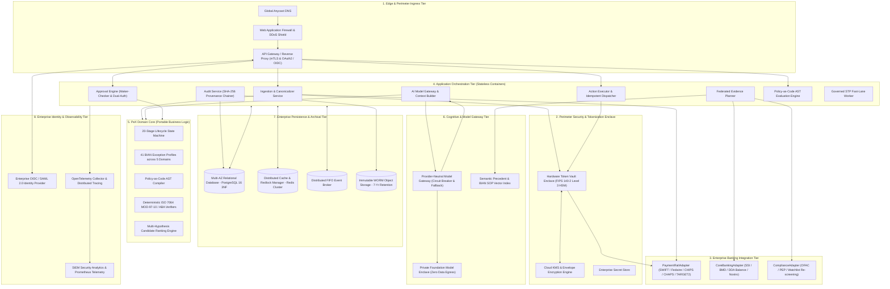

# ☁️ PeX — Provider-Neutral Cloud Logical Architecture

**Document ID:** `PEX-CLOUD-LOGICAL-ARCH-v0.1`  
**Governing Baseline:** PeX `v1.9.4` (`9e9184b`) / Enterprise Architecture `v0.2`  
**Scope:** Canonical Cloud-Agnostic Logical Architecture Across All Layers  
**Date:** September 28, 2026  
**Status:** Approved Reference Logical Architecture  

---

## 1. Architectural Principles & Invariants

1. **Domain Isolation (Hexagonal Architecture):** The PeX domain core (41 BIAN exception profiles, canonical ISO 20022 schemas, 20-stage state machine, Policy-as-Code AST compiler, Maker-Checker governance) has zero dependencies on cloud provider SDKs (`boto3`, `google-cloud-*`, `azure-*`).
2. **Zero-PII Perimeter Boundary:** Customer PII (account numbers, IBANs, names, PANs) is tokenized into format-preserving surrogate tokens (`TOK_IBAN_...`) at the perimeter before any message payload enters core application memory or context builders.
3. **Pluggable Secondary Ports:** All infrastructure capabilities (persistence, KMS, secret storage, identity, eventing, WORM archival, AI gateway, clearing adapters) are accessed exclusively via abstract Python interface contracts.
4. **Advisory Cognitive Layer:** The AI Reasoner and its `ReasoningResult` contract are strictly advisory (\$0.00 approval authority). AI cannot release payments, grant compliance waivers, or bypass deterministic validation.
5. **Deterministic Checksum Precedence:** ISO 7064 MOD-97-10 IBAN checksums and ABA 9-digit routing checks unconditionally overrule AI confidence scores.
6. **Continuous Cryptographic Provenance:** Every state transition across all 20 lifecycle stages generates an immutable `AuditNode` chained via SHA-256 linear hashing, backed by 7-year WORM cloud object storage.
7. **Two-Tier Idempotency:** Technical transport deduplication on message brokers (effectively-once delivery) paired with business-level payment release idempotency on distributed database locks (exactly-once wire execution).

---

## 2. Provider-Neutral Logical Architecture Topology

---

## 3. Layer-by-Layer Architectural Specifications

### 3.1. Edge & Perimeter Ingress Tier
- **Function:** TLS 1.3 termination, DDoS protection, IP whitelisting, Web Application Firewall (WAF) rule evaluation (OWASP Top 10), and routing.
- **Protocols:** HTTPS (Port 443) for UI and API clients; Mutual TLS (mTLS) for bank integration endpoints.
- **Authentication:** Ingress gateway validates OAuth2 / OIDC JSON Web Tokens (JWTs) issued by the corporate IdP.

### 3.2. Perimeter Security & Tokenization Enclave
- **Function:** Immediate perimeter surrogate tokenization of sensitive bank accounts, IBANs, and party names before payload ingestion.
- **Token Vault Isolation:** Deployed inside a dedicated private subnet with zero public internet connectivity.
- **Envelope Encryption:** Each customer token record is encrypted with an ephemeral Data Encryption Key (DEK), which is wrapped by a Customer-Managed Key (CMK) rooted in a Cloud HSM.
- **Detokenization Interceptor:** Restricted strictly to the `ActionExecutor` microservice during outbound payment dispatch.

### 3.3. Enterprise Banking Integration Tier
- **Function:** Mediates bi-directional communication between PeX and external banking systems.
- **Secondary Ports:**
  - `PaymentRailAdapter`: Formats and parses SWIFT MT/MX (`pacs.008`, `pacs.004`, `camt.056`, `camt.029`), Fedwire FAIM variable-block, and CHIPS/CHAPS/TARGET2 messages.
  - `CoreBankingAdapter`: Queries internal Beneficiary Master Directories (BMD), Standard Settlement Instructions (SSI), and account balances.
  - `ComplianceAdapter`: Interfaces with real-time sanctions screening engines (OFAC, UN, EU watchlists).

### 3.4. Application Orchestration Tier
- **Function:** Stateless container fleet executing workflow steps, coordinating evidence aggregation, triggering AI analysis, evaluating approval policies, and recording audit nodes.
- **Concurrency & Locking:** Distributed locks (`Redlock` algorithm) prevent race conditions on simultaneous Maker/Checker operations.

### 3.5. PeX Domain Core
- **Function:** Authoritative, cloud-independent business logic.
- **Components:**
  - **41 BIAN Exception Profiles:** Classifies breaks across Data Quality, Processing, Compliance, Client Treasury, and Settlement Returns.
  - **20-Stage State Machine:** Enforces strict monotonic lifecycle transitions (`INGESTED` $\to$ `INVESTIGATING` $\to$ `PENDING_APPROVAL` $\to$ `APPROVED` $\to$ `DISPATCHED` $\to$ `SETTLED`).
  - **Policy-as-Code AST Engine:** Evaluates institutional JSON AST rules to determine dual-authorization requirements, routing policies, and STP eligibility.
  - **Deterministic Checksum Verifiers:** Mathematically calculates ISO 7064 MOD-97-10 and ABA routing check digits.

### 3.6. Cognitive & Model Gateway Tier
- **Function:** Formats zero-PII prompts, validates structured JSON outputs against `ReasoningResult`, and handles fallback.
- **Advisory Principle:** AI outputs are non-authoritative recommendations that require deterministic validation and human/policy sign-off.
- **Fallback Circuit Breaker:** Times out after 3,000ms; automatically routes cases to deterministic AST policy rules or human investigation desks during model outages.

### 3.7. Enterprise Persistence & Archival Tier
- **Transactional Database:** Multi-AZ Relational PostgreSQL 16 (3NF schema) with quarterly partitioning, ACID compliance, and continuous Point-in-Time Recovery (PITR).
- **Distributed Event Bus:** FIFO message broker with message deduplication, correlation ID propagation, and dead-letter queues.
- **WORM Object Storage:** Write-Once-Read-Many storage enforcing a 7-year regulatory retention lock on raw payment files, delivery receipts, and audit snapshots.

### 3.8. Enterprise Identity & Observability Tier
- **IAM Federation:** OIDC / SAML 2.0 integration with corporate directories (Active Directory / Okta / Entra ID).
- **Telemetry:** OpenTelemetry SDK exporting traces, business metrics (SLA radar, STP velocity), and audit logs to enterprise monitoring platforms.
