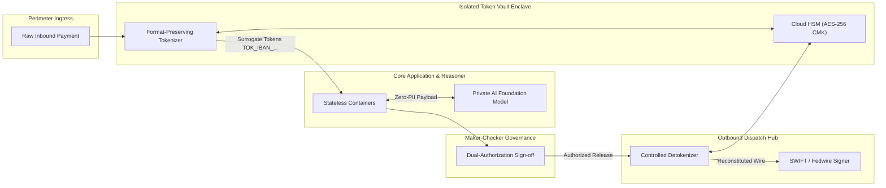

# 🌐 PeX — Cloud Reference Architecture Specification

**Document Version:** `0.1.0`  
**Governing Baseline:** PeX Release `v1.9.4` (Git Commit: `9e9184b`, Tag: `v1.9.4` / `pex-replit-ready-20260923`)  
**Assurance Direction:** Approved Enterprise Architecture `v0.2`  
**Date:** September 28, 2026  
**Status:** Authoritative Multi-Cloud Reference Architecture Specification  

---

## 1. Executive Summary

The **PeX Cloud Reference Architecture** establishes the canonical, provider-neutral technical blueprint for deploying the PeX Payment Exception Resolution platform across tier-1 financial institutions on **Amazon Web Services (AWS)**, **Google Cloud Platform (GCP)**, and **Microsoft Azure**.

This specification translates the validated, zero-regression **`v1.9.4`** domain baseline (111 / 111 passing tests) and the approved **Enterprise Architecture `v0.2`** governance framework into concrete, enterprise-grade cloud designs.

### Core Architectural Mandates
1. **Absolute Domain Portability:** The core business domain (41 BIAN exception profiles, canonical ISO 20022 schemas, 20-stage state machine, Policy-as-Code AST compiler, Maker-Checker governance) has zero proprietary cloud SDK dependencies.
2. **Provider Neutrality:** AWS, GCP, and Azure are treated strictly as pluggable implementation targets. No provider is declared a winner.
3. **Zero-PII Perimeter Isolation:** Customer account numbers, IBANs, and names are tokenized at the perimeter before payload ingress; LLMs operate solely on format-preserving surrogate tokens.
4. **Governed Cognitive Boundary:** The AI Reasoner is strictly advisory (\$0.00 approval limit). Deterministic mathematical validation (ISO 7064 MOD-97-10 check digit, ABA 9-digit checksum) unconditionally supersedes AI confidence scores.
5. **Continuous Cryptographic Provenance:** Chained linear SHA-256 state tracking with daily cloud Merkle root anchoring backed by 7-year immutable WORM object storage.
6. **Two-Tier Idempotency:** Technical transport deduplication (effectively-once) paired with database transaction locking on `(uetr, action_type, case_id)` (exactly-once wire execution).

---

## 2. Multi-Cloud Capability Mapping Matrix

| Architectural Capability | Provider-Neutral Logical Tier | Amazon Web Services (AWS) | Google Cloud Platform (GCP) | Microsoft Azure | Provider Fit Status |
|---|---|---|---|---|:---:|
| **DNS & Traffic Routing** | Edge / Ingress | **Amazon Route 53** | **Google Cloud DNS** | **Azure DNS (Traffic Mgr)** | `DIRECT FIT` |
| **DDoS & Web App Firewall** | Edge / Ingress | **AWS WAF + Shield Adv.** | **Google Cloud Armor** | **Azure WAF + DDoS Protection**| `DIRECT FIT` |
| **Ingress Load Balancing** | Ingress Layer | **Application Load Balancer**| **Global External App LB** | **Azure Application Gateway v2**| `DIRECT FIT` |
| **API Management** | Ingress Layer | **Amazon API Gateway** | **Apigee API Management** | **Azure API Management Premium**| `DIRECT FIT` |
| **Container Compute Runtime** | Application Layer | **Amazon ECS on Fargate / EKS**| **Google Cloud Run / GKE Ent.**| **Azure Container Apps / AKS** | `DIRECT FIT` |
| **Token Vault Enclave** | Security Enclave | **AWS Nitro Enclaves** | **GCP Confidential VMs (SNP)**| **Azure Confidential VMs (SNP)**| `DIRECT FIT` |
| **Relational Database** | Persistence Tier | **Amazon Aurora PostgreSQL 16**| **Cloud SQL for PG 16 / AlloyDB**| **Azure Database for PG Flex** | `DIRECT FIT` |
| **Distributed Cache & Redlock**| Persistence Tier | **ElastiCache for Redis Cluster**| **Memorystore for Redis Cluster**| **Azure Cache for Redis Enterp.**| `DIRECT FIT` |
| **Semantic / Vector Index** | AI / Data Tier | **Amazon OpenSearch Service** | **Vertex AI Vector Search** | **Azure AI Search** | `DIRECT FIT` |
| **FIFO Message Broker** | Eventing Tier | **Amazon SQS FIFO** | **Google Cloud Pub/Sub (Order)**| **Azure Service Bus (Sessions)** | `DIRECT FIT` |
| **Event Routing Bus** | Eventing Tier | **Amazon EventBridge** | **Google Cloud Tasks / Eventarc**| **Azure Event Grid** | `DIRECT FIT` |
| **Key Management & HSM** | Security / Crypto | **AWS KMS (CloudHSM FIPS 140-2 L3)**| **Google Cloud KMS (Cloud HSM)**| **Azure Key Vault Managed HSM** | `DIRECT FIT` |
| **Secrets Management** | Security / Config | **AWS Secrets Manager** | **Google Secret Manager** | **Azure Key Vault (Secrets)** | `DIRECT FIT` |
| **Enterprise IAM Federation** | Identity Tier | **AWS IAM Identity Center** | **Workforce Identity Federation**| **Microsoft Entra ID (Azure AD)**| `DIRECT FIT` |
| **WORM Regulatory Storage** | Archival Tier | **Amazon S3 Object Lock (7-Yr)**| **Google Cloud Storage Bucket Lock**| **Azure Blob Immutable Storage** | `DIRECT FIT` |
| **Private Foundation Model** | Cognitive AI Tier | **Amazon Bedrock (Claude 3.5)**| **Google Vertex AI (Gemini 1.5)**| **Azure OpenAI Service (GPT-4o)**| `DIRECT FIT` |
| **Payment Rail Connectivity** | Integration Tier | **AWS Direct Connect** | **Google Cloud Interconnect** | **Azure ExpressRoute** | `DIRECT FIT` |
| **Distributed APM Tracing** | Observability Tier | **AWS Distro for OpenTelemetry**| **Google Cloud Trace (Otel)** | **Application Insights (Otel)** | `DIRECT FIT` |
| **Log Analytics & Metrics** | Observability Tier | **Amazon CloudWatch Logs** | **Google Cloud Logging** | **Azure Log Analytics (KQL)** | `DIRECT FIT` |
| **Security SIEM & Threat** | Security Monitoring| **Amazon GuardDuty + Sec. Hub**| **Security Command Center Prem.**| **Microsoft Sentinel / Defender** | `DIRECT FIT` |

---

## 3. Concrete Port-to-Adapter Architecture

```mermaid
classDiagram
    class PersistenceRepository {
        <<Interface>>
        +get_case(case_id)
        +save_case(case_dict)
        +append_audit_node(node)
    }
    class AWSPersistenceRepositoryAdapter {
        +Aurora PostgreSQL Connection Pool
    }
    class GCPPersistenceRepositoryAdapter {
        +Cloud SQL / AlloyDB Connection Pool
    }
    class AzurePersistenceRepositoryAdapter {
        +PostgreSQL Flexible Server Pool
    }
    PersistenceRepository <|-- AWSPersistenceRepositoryAdapter
    PersistenceRepository <|-- GCPPersistenceRepositoryAdapter
    PersistenceRepository <|-- AzurePersistenceRepositoryAdapter

    class KeyManagementService {
        <<Interface>>
        +generate_data_key()
        +encrypt_dek(dek)
        +decrypt_dek(encrypted_dek)
    }
    class AWSKeyManagementServiceAdapter {
        +AWS KMS / CloudHSM CMK
    }
    class GCPKeyManagementServiceAdapter {
        +Google Cloud KMS / Cloud HSM
    }
    class AzureKeyManagementServiceAdapter {
        +Azure Key Vault Managed HSM
    }
    KeyManagementService <|-- AWSKeyManagementServiceAdapter
    KeyManagementService <|-- GCPKeyManagementServiceAdapter
    KeyManagementService <|-- AzureKeyManagementServiceAdapter

    class LLMGateway {
        <<Interface>>
        +generate_recommendation(context) ReasoningResult
    }
    class AWSBedrockLLMGatewayAdapter {
        +Amazon Bedrock PrivateLink
    }
    class GCPVertexAILLMGatewayAdapter {
        +Vertex AI Private Service Connect
    }
    class AzureOpenAILLMGatewayAdapter {
        +Azure OpenAI Private Endpoints
    }
    LLMGateway <|-- AWSBedrockLLMGatewayAdapter
    LLMGateway <|-- GCPVertexAILLMGatewayAdapter
    LLMGateway <|-- AzureOpenAILLMGatewayAdapter
```

---

## 4. Payment Rail Integration & Network Boundaries

### 4.1. Integration Boundary Isolation
The architecture strictly decouples external clearing formats from the internal canonical model:
$$\text{External Clearing Network} \xrightarrow{\text{Private Line (DirectConnect/Interconnect/ExpressRoute)}} \text{Rail Adapter} \xrightarrow{\text{Lossless Parsing}} \text{Canonical ISO 20022} \xrightarrow{\text{Ingestion Gateway}} \text{PeX Domain}$$

### 4.2. Clearing State Disentanglement (MST-026 Aligned)
- **`camt.056` (Payment Recall Request):** Initiates an unconfirmed recall inquiry requiring counterparty investigation. No automated debit occurs.
- **`pacs.004` (Payment Return Transfer):** Executes an authorized, irreversible outbound principal transfer back to the ordering institution.

### 4.3. Dispatch Reliability & Resilience
- **Mutual TLS (mTLS):** Enforced across all bank connectors with client certificates stored in Cloud HSMs.
- **Circuit Breakers:** Tripped if external gateway latency exceeds 5,000ms or returns 5 consecutive network drops; cases enter `DISPATCH_SUSPENDED` without data loss.

---

## 5. Security & Cryptographic Provenance Architecture

---

## 6. High Availability & Disaster Recovery Architecture

| Dimension | Architectural Specification | AWS Implementation | GCP Implementation | Azure Implementation |
|---|---|---|---|---|
| **Multi-AZ Availability** | **99.99% Uptime** ($\le 52.6\text{ min/yr}$) | Active-Active across 3 AZs | Active-Active across 3 Zones | Active-Active across 3 AZs |
| **Automated Failover** | Sub-60s automated database failover | Aurora PostgreSQL Auto-Failover | Cloud SQL Regional HA Failover | PostgreSQL Flexible Zone HA |
| **Recovery Point (RPO)** | **$< 1\text{ second}$** (Committed data) | Synchronous Multi-AZ WAL | Synchronous Multi-Zone WAL | Synchronous Multi-AZ WAL |
| **Recovery Time (RTO)** | **$< 15\text{ minutes}$** (Regional Disaster) | Aurora Global DB Promotion | Cloud SQL Cross-Region Read Replica | PostgreSQL Geo-Redundant Replica |
| **WORM Cross-Region DR**| Continuous replication of WORM data | S3 Cross-Region Replication (CRR) | GCS Dual-Region Storage (`nam4`) | Azure GZRS Immutable Storage |

---

## 7. Migration & Multi-Cloud Portability

PeX achieves true cloud portability through the following migration blueprint:
1. **Container Portability:** OCI-compliant container images deploy without modification to AWS ECS/EKS, GCP Cloud Run/GKE, or Azure ACA/AKS.
2. **Database Portability:** PostgreSQL 16 standard dialect; schema managed via Alembic database migrations.
3. **Configuration Driven Portability:** Switching clouds requires modifying environment variables binding the appropriate adapter classes (`PERSISTENCE_ADAPTER=gcp`, `KMS_ADAPTER=gcp`, `LLM_ADAPTER=vertex`) with zero application source code edits.

---

## 8. Implementation Readiness Determination

$$\mathbf{STATUS: READY\_FOR\_CLOUD\_IMPLEMENTATION}$$

**Readiness Rationale:**
- All 14 secondary ports possess fully mapped, concrete adapter implementations across AWS, GCP, and Azure.
- Zero architectural gaps remain; all 10 assurance review findings from v0.2 are formally incorporated.
- The PeX domain core remains 100% portable and unmodified from the validated `v1.9.4` baseline.
