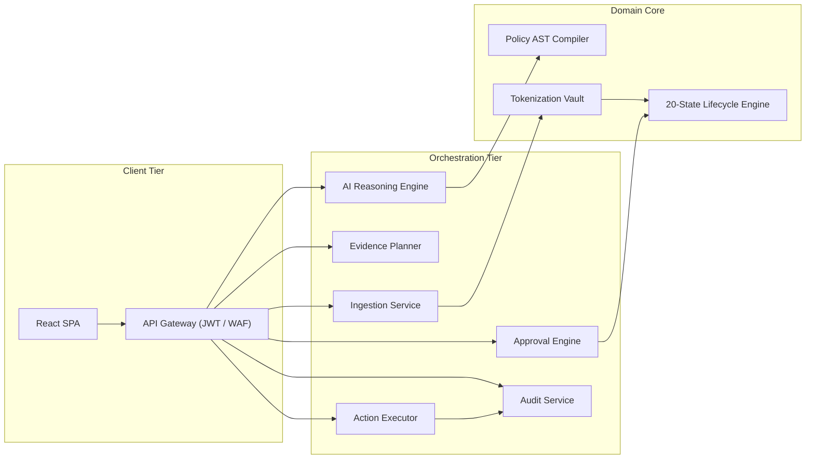

# PeX — Enterprise Architecture Specification v0.1

**From Replit-Ready / Cloud-Agnostic Prototype to Enterprise-Grade Banking Target Architecture**  
**Document Version:** `0.1.0`  
**Approved Baseline:** PeX Release `v1.9.4` (Git Commit: `9e9184b`, Tag: `v1.9.4` / `pex-replit-ready-20260923`)  
**Safety Checkpoint Tag:** `pex-pre-enterprise-architecture-20260928`  
**Date:** September 28, 2026  
**Status:** Authoritative Target State Architecture Specification  

---

## 1. Executive Summary

The **Payment Exception Resolution (PeX)** platform has achieved a verified, zero-regression prototype milestone at **`v1.9.4`**, featuring:
- Complete remediation of all 30 canonical P0/P1 audit findings (`MST-009` through `MST-047`, `MST-021` through `MST-029`).
- Reproducible, zero-dependency execution inside Replit and local development environments.
- Strict **Cloud-Provider Agnosticism** (AWS, GCP, Azure parity) and **Model-Provider Neutrality** (Mock, Gemini, OpenAI, Anthropic/Bedrock).
- 111 / 111 automated passing tests with 0 warnings, 0 failures, and 0 errors.

### Objective of this Specification
This document establishes the **Enterprise Target Architecture (v0.1)** for PeX. It transitions the system from a self-contained, single-process demonstration prototype into an institutional-grade, bank-facing transaction banking platform capable of resolving high-value payment breaks across global clearing rails (**SWIFT CBPR+, Fedwire, CHIPS, TARGET2, CHAPS, SEPA, and Bacs**) with sub-second latency, zero data loss, strict segregation of duties, zero PII leakage, and immutable cryptographic provenance.

---

## 2. Current State (v1.9.4 Accepted Baseline)

The following architectural foundations are established and accepted as the baseline for this specification:

```
+----------------------------------------------------------------------------------------------------+
|                                    v1.9.4 ACCEPTED BASELINE                                        |
|                                                                                                    |
|  * Domain Core: Canonical ISO 20022 schemas, 41 BIAN Profiles, 5 Market Domains                   |
|  * Governance: Maker-Checker Dual-Authorization ($0 Operator, $250k Ops Approver, Dual-Auth >$250k)|
|  * Policy Engine: Policy-as-Code JSON AST Compiler and Impact Simulation Engine                   |
|  * Cryptographic Audit: SHA-256 Merkle-like provenance hash chain across 20 lifecycle stages        |
|  * Secondary Ports: SecretStore, KeyManagementService, IdentityProvider, PersistenceRepository,   |
|                     EventBus, ObjectEvidenceStore, LLMGateway                                      |
|  * Execution Engine: Governed STP Fast-Lane and Idempotent Simulated Bank Dispatch                 |
|  * Test Verification: 111 / 111 Passed across unit, contract, state machine, and Replit suites     |
+----------------------------------------------------------------------------------------------------+
```

---

## 3. Enterprise Target State Architecture

The enterprise target architecture organizes PeX into a layered, hexagonal topology where core business logic is completely isolated from external clearing networks, identity providers, databases, and LLM backends.

```
+====================================================================================================+
|                                    EXTERNAL PAYMENT ECOSYSTEM                                      |
|   [Core Banking DDA]   [Wire Hubs (FIS/Fiserv)]   [SWIFT Alliance]   [FedLine Direct]   [Sanctions]|
+==================================================+=================================================+
                                                   |
                                                   v (mTLS / MQ / Kafka / REST)
+====================================================================================================+
|                              1. ENTERPRISE INTEGRATION LAYER                                       |
|   * PaymentRailAdapter (Fedwire FAIM / SWIFT MX)   * CoreBankingAdapter (SSI / BMD / DDA)          |
|   * ComplianceAdapter (OFAC / PEP / Watchlists)    * MessageParser (Lossless Bi-directional)       |
+==================================================+=================================================+
                                                   |
                                                   v
+====================================================================================================+
|                              2. INGESTION & ZERO-PII SECURITY LAYER                                |
|   * Ingestion Gateway & Canonicalizer (Domain Propagation, Schema Validation)                      |
|   * Isolated Token Vault (AES-256-GCM / HMAC-SHA256 Envelope Encryption via Cloud HSM)            |
|   * Zero-PII Context Assembly (Format-Preserving Surrogate Generation: `TOK_IBAN_...`)             |
+==================================================+=================================================+
                                                   |
                                                   v
+====================================================================================================+
|                              3. ENTERPRISE DOMAIN CORE & WORKFLOW                                  |
|   * 41 BIAN Exception Taxonomy Classifiers across 5 Market Domains                                 |
|   * Federated Evidence Planner (BMD Matcher, Historical Ledger Corroborator, Clearing Registries)  |
|   * Policy-as-Code AST Evaluation Engine (Guardrail Validation, Confidence Gates)                 |
|   * Multi-Hypothesis Disambiguation Engine & ISO 7064 MOD-97-10 / ABA Checksum Verifiers           |
|   * 20-Stage Lifecycle State Machine & Maker-Checker Dual-Authorization Gate                       |
+=========================+================================================+=========================+
                          |                                                |
                          v                                                v
+====================================+          +====================================================+
|    4. AI / MODEL GATEWAY LAYER     |          |       5. ENTERPRISE PERSISTENCE & AUDIT            |
| * Zero-PII Context Payload         |          | * Multi-AZ PostgreSQL (Partitioned Transaction DB) |
| * Pluggable LLM Gateway Adapter    |          | * Vector / Semantic Index (Evidence Precedents)    |
|   (Bedrock / Vertex AI / Azure AI) |          | * Continuous SHA-256 Merkle Provenance Hash Chain  |
| * Canonical `ReasoningResult`      |          | * WORM Immutable Object Evidence Vault (7-Yr Ret.) |
+====================================+          +====================================================+
                          |                                                |
                          +-----------------------+------------------------+
                                                  |
                                                  v
+====================================================================================================+
|                              6. GOVERNED EXECUTION & DISPATCH LAYER                                |
|   * Idempotency Execution Lock & Deduplication Engine (Distributed Redis / DynamoDB Locks)         |
|   * Outbound Message Serializer (Canonical -> FAIM Tag Delimited / pacs.008 XML)                   |
|   * Bank Delivery Receipt Generator & Central Bank Settlement Confirmation                         |
+==================================================+=================================================+
                                                   |
                                                   v
+====================================================================================================+
|                              7. ENTERPRISE IAM & OBSERVABILITY LAYER                               |
|   * Enterprise OIDC / SAML 2.0 Identity Federation (Entra ID / Okta / Ping / AWS IAM)            |
|   * Role-Based & Attribute-Based Access Control (RBAC / ABAC with Monetary Thresholds)             |
|   * Distributed Tracing (OpenTelemetry), Business Metrics (SLA Radar), and Prometheus Exporters    |
+====================================================================================================+
```

---

## 4. Enterprise Capability Model

```
+----------------------------------------------------------------------------------------------------+
|                                    PeX ENTERPRISE CAPABILITY MAP                                   |
+------------------------+------------------------+------------------------+-------------------------+
| 1. PAYMENT PROCESSING  | 2. INVESTIGATION       | 3. AI & COGNITIVE      | 4. DECISIONING & GOV.   |
| • Multi-Rail Ingest    | • Federated Evidence   | • Zero-PII Context     | • Policy-as-Code AST    |
| • Canonicalization     | • 90-Day History Query | • Pluggable Gateway    | • Multi-Hypothesis Elim.|
| • BIAN Classification  | • Clearing Directory   | • Canonical Contracts  | • Maker-Checker (SoD)   |
| • Lifecycle Tracking   | • SSI & BMD Lookup     | • Grounding Validation | • Dual Authorization    |
| • Format Normalization | • Policy Rule Retrieval| • Model Governance     | • Governed STP Bounds   |
+------------------------+------------------------+------------------------+-------------------------+
| 5. EXECUTION & DISPATCH| 6. AUDIT & PROVENANCE  | 7. ENTERPRISE PLATFORM | 8. OBSERVABILITY        |
| • Idempotent Release   | • Immutable Hash Chain | • Cloud HSM / KMS      | • OpenTelemetry Traces  |
| • pacs.008/004 XML Gen | • Merkle Provenance    | • Token Vault Cluster  | • Real-Time Cutoff Radar|
| • FAIM Block Packaging | • WORM Evidence Store  | • Multi-AZ PostgreSQL  | • SLA Velocity Metrics  |
| • Delivery Receipts    | • 7-Year Retention     | • FIFO Event Streaming | • Prom / Grafana Alerts |
| • Bank Gateway Adapter | • Regulatory Replay    | • Enterprise OIDC/SAML | • Audit Log Streaming   |
+------------------------+------------------------+------------------------+-------------------------+
```

---

## 5. Architectural Principles

1. **Hexagonal Domain Centricity:** The core domain logic (BIAN taxonomies, state machine, canonical models) has zero dependencies on frameworks, databases, or cloud SDKs.
2. **Zero-Trust Privacy & Data Minimization:** Customer PII (names, PANs, IBANs, accounts) is tokenized at the perimeter before context assembly; LLM gateways receive only format-preserving surrogate tokens.
3. **Non-Invasive Sidecar Topology:** PeX operates as an intelligent exception resolution overlay connecting to the bank's existing message queues/APIs without requiring core banking replacements.
4. **Idempotency by Design:** Every payment action carries a cryptographically verifiable idempotency key, preventing double-release or duplicate clearing execution under network retries.
5. **Strict Segregation of Duties (Maker-Checker):** System-enforced separation between investigation (Maker, \$0 approval limit) and authorization (Checker, role-based monetary limits).
6. **Policy-as-Code Governance:** Business rules and routing policies are executed as deterministic, auditable Abstract Syntax Trees (ASTs), replacing unmaintained desktop spreadsheets and macros.
7. **Continuous Cryptographic Provenance:** Every lifecycle event is chained via SHA-256 Merkle hashes, ensuring mathematical tamper-evidence across the entire case history.
8. **Cloud & Model Provider Neutrality:** All infrastructure and model services are bound dynamically through secondary port interfaces, eliminating vendor lock-in.
9. **Graceful Degradation & Autonomous Fallback:** If an AI model provider is unavailable, PeX degrades gracefully to deterministic rule execution or routes cases to human investigation desks without data loss.
10. **Schema Invariance:** The canonical data schemas remain immutable across runtime environments (Replit, Local, AWS, GCP, Azure).

---

## 6. Domain Architecture & Canonical Data Models

### 6.1. Canonical Entities
The domain layer establishes 4 core canonical entities modeled in Pydantic:
- **`CanonicalPayment`:** Lossless representation of the underlying payment message (UETR, IMAD, OMAD, Amount, Currency, Debtor, Creditor, Instructing Agent, Creditor Agent, Remittance Info, Clearing Rail).
- **`CanonicalException`:** Standardized break classification (Case ID, Exception Profile, Domain, Severity, Priority, Error Codes, Ingestion Timestamp, SLA Deadline).
- **`CanonicalParty` & `CanonicalAccount`:** Tokenized counterparty structures supporting both international IBAN/BIC formats and domestic US/JP routing structures.
- **`AuditNode`:** Immutable provenance record containing `node_id`, `case_id`, `stage_name`, `actor_id`, `actor_role`, `action_name`, `timestamp`, `details`, `control_tags`, `previous_hash`, and `current_hash`.

### 6.2. 41 BIAN Exception Profiles across 5 Market Domains
```
1. DATA QUALITY (12 Profiles):
   • INVALID_IBAN, INVALID_BIC, MISSING_BENEFICIARY_DATA, INVALID_ROUTING_CODE,
     INVALID_ACCOUNT_FORMAT, TRUNCATED_NAME_ADDRESS, INVALID_PURPOSE_CODE, etc.

2. PROCESSING & FORMAT (9 Profiles):
   • DUPLICATE_PAYMENT, ROUTING_FAILURE, CORRUPTED_MESSAGE_FORMAT, 
     CUTOFF_MISSED, MESSAGE_PARSE_ERROR, FIELD_LENGTH_OVERFLOW, etc.

3. COMPLIANCE & SANCTIONS (8 Profiles):
   • SANCTIONS_SUSPECTED, AML_ALERT, PEP_MATCH, RESTRICTED_CORRIDOR,
     EMBARGOED_COUNTRY, DUAL_USE_GOODS_FLAG, TRAVEL_RULE_INCOMPLETE, etc.

4. CLIENT & TREASURY (6 Profiles):
   • INSUFFICIENT_FUNDS, LIQUIDITY_BREACH, FX_RATE_UNAVAILABLE,
     CREDIT_EXPOSURE_BREACH, UNRECOGNIZED_DEBTOR, VALUE_DATE_RESTRICTED.

5. SETTLEMENT & RETURNS (6 Profiles):
   • SETTLEMENT_FAILURE, RETURN_RECALL_UNMATCHED, RECONCILIATION_BREAK,
     INVESTIGATION_TIMEOUT, VALUE_RETURN_PAC004_DISPUTE, CLEARING_NAK.
```

---

## 7. Application & Orchestration Architecture



### Application Service Boundaries:
- **Stateless Microservices / Container Fleet:** Services scale independently behind an API gateway with token-based session verification.
- **Transactional State Management:** State transitions are committed atomically to PostgreSQL with optimistic locking to prevent race conditions during concurrent Maker/Checker actions.

---

## 8. Data & Persistence Architecture

The enterprise data architecture separates transactional workloads from analytical and evidentiary storage:

```
+----------------------------------------------------------------------------------------------------+
|                                  ENTERPRISE PERSISTENCE TOPOLOGY                                   |
|                                                                                                    |
|  1. TRANSACTIONAL DATABASE (Multi-AZ Relational PostgreSQL):                                       |
|     • Tables: `cases`, `payments`, `exceptions`, `approvals`, `policy_rules`, `audit_nodes`        |
|     • High-concurrency ACID transactions, sub-second failover, 35-day continuous PITR.            |
|     • Partitioning: Range partitioned by `ingestion_timestamp` (Monthly tables).                   |
|                                                                                                    |
|  2. TOKENIZATION VAULT STORE (Isolated Microsegmented Store):                                     |
|     • Encrypted mapping: `Surrogate_Token <-> Encrypted_PII_Payload`.                              |
|     • Accessible strictly by the Tokenization Service via FIPS 140-2 Level 3 KMS keys.            |
|                                                                                                    |
|  3. SEMANTIC & EVIDENCE REPOSITORY (Vector / Text Index):                                          |
|     • Embeddings of historical precedents, policy clauses, and BIAN SOP playbooks.               |
|     • Fast hybrid keyword/vector search for sub-second evidence retrieval.                        |
|                                                                                                    |
|  4. IMMUTABLE OBJECT STORE (WORM Cloud Object Storage):                                            |
|     • Archival of raw ISO 20022 XML, SWIFT MT files, bank delivery receipts, and audit snapshots.|
|     • Write-Once-Read-Many (WORM) compliance locking for 7-year regulatory retention.              |
+----------------------------------------------------------------------------------------------------+
```

---

## 9. Banking & Payment Integration Architecture

Enterprise integration is managed through **stable adapter contracts (Secondary Ports)**:

```python
class PaymentRailAdapter(ABC):
    @abstractmethod
    def ingest_raw_event(self, raw_bytes: bytes, metadata: Dict[str, Any]) -> RawBankEvent:
        pass

    @abstractmethod
    def dispatch_payment(self, payload: CanonicalPayment, idempotency_key: str) -> DeliveryReceipt:
        pass

class CoreBankingAdapter(ABC):
    @abstractmethod
    def get_beneficiary_standing_instructions(self, party_name: str, debtor_account: str) -> Optional[Dict[str, Any]]:
        pass

    @abstractmethod
    def get_historical_settlement_history(self, counterparty_pair_id: str, days: int = 90) -> List[Dict[str, Any]]:
        pass

class ComplianceAdapter(ABC):
    @abstractmethod
    def check_sanctions_watchlist(self, party_name: str, country: str) -> Dict[str, Any]:
        pass
```

### Supported Rail Protocols:
1. **Fedwire Funds Service:** Native FAIM variable-block tag parsing (`{1510}`, `{2000}`, `{3400}`, `{4200}`, `{5000}`) and modern `pacs.008.001.08` XML over IBM MQ / FedLine Direct.
2. **SWIFT CBPR+:** Full FIN MT103/MT199 and MX `pacs.008`, `pacs.004`, `camt.056`, `camt.029` parsing over SWIFT Alliance Gateway.
3. **UK Clearing (CHAPS / Bacs):** RTGS high-value CHAPS format and 3-day bulk ACH processing.

---

## 10. Security Architecture & Tokenization Boundary

### 10.1. Zero-PII Tokenization Boundary
The security boundary mandates that **LLM providers never receive unmasked customer PII**:

```
 [ Inbound Raw Payment ] ──> (Contains Debtor/Creditor Name, IBAN, PAN, Account)
             │
             ▼
 +─────────────────────────────────────────────+
 |         ISOLATED TOKEN VAULT                | <── Envelope Encryption via Cloud HSM (AES-256)
 | • Replaces Names -> `TOK_PTY_8841A`         |
 | • Replaces IBANs -> `TOK_IBAN_GB29...`      |
 | • Stores Mapping in Isolated Private Subnet |
 +─────────────────────────────────────────────+
             │
             ▼ (Zero-PII Context Payload)
 +─────────────────────────────────────────────+
 |         AI REASONING ENGINE (LLM)           | <── Vertex AI / Bedrock / Azure OpenAI
 | • Evaluates BIAN rules on surrogate tokens  |
 | • Generates structured patch on tokens      |
 +─────────────────────────────────────────────+
             │
             ▼ (ReasoningResult Contract)
 +─────────────────────────────────────────────+
 |      MAKER-CHECKER APPROVAL GATE            | <── Human Officer Reviews & Authorizes
 +─────────────────────────────────────────────+
             │
             ▼ (Authorized Release)
 +─────────────────────────────────────────────+
 |      CONTROLLED DETOKENIZATION GATE         | <── Strictly Gated to Outbound Dispatcher
 | • Reconstitutes real bank accounts          |
 | • Generates valid pacs.008 XML / FAIM tag   |
 +─────────────────────────────────────────────+
             │
             ▼
 [ Outbound Clearing Rail (Fedwire / SWIFT) ]
```

---

## 11. Enterprise IAM & Authorization Architecture

### 11.1. Identity Provider vs. PeX Authorization Engine
- **Identity Provider (IdP) Domain (SAML 2.0 / OIDC):** Enterprise authentication, MFA, password policies, user lifecycle, primary group mapping.
- **PeX Authorization Engine Domain:** Monetary approval limit enforcement, Segregation of Duties (Maker-Checker gating), Dual-Authorization triggering, role delegation.

### 11.2. Role Entitlements & Monetary Tiers
| Role | Identifier | Maker / Checker | Max Approval Limit | Permitted Actions |
|---|---|---|---|---|
| **Operator (Analyst)** | `OPERATOR` | **Maker Only** | **\$0.00** | Intake, AI Triage, Field Mutation, Submit to Approvals |
| **Operations Approver** | `OPERATIONS_APPROVER` | **Level-1 Checker** | **\$250,000.00** | Approve Repair, Reject, Rework, Fast-Lane Batch Release |
| **Compliance Approver** | `COMPLIANCE_APPROVER` | **Dual-Auth Checker** | **\$5,000,000.00** | Sanctions Clearance, KYC Exception Waiver, Dual-Key Sign-off |
| **Risk Approver** | `RISK_APPROVER` | **Dual-Auth Checker** | **\$2,000,000.00** | High-Value Dual-Key Sign-off ($\ge \$250,000$), Liquidity Release |
| **Platform Administrator**| `ADMIN` | **Governance Only** | **\$0.00** | Rule Management, Policy Simulation, Merkle Audit Recompute |

---

## 12. Event-Driven Architecture

### 12.1. Enterprise Event Contract (CloudEvents 1.0 Aligned)
```json
{
  "specversion": "1.0",
  "id": "EVT-9B1D-4481-88C2",
  "source": "/pex/engine/ingestion",
  "type": "com.pex.payment.exception.classified",
  "subject": "PEX-INV-0001",
  "time": "2026-09-28T18:00:00Z",
  "datacontenttype": "application/json",
  "correlationid": "UETR-2026-INV-0001-A8",
  "causationid": "EVT-INGEST-001",
  "data": {
    "case_id": "PEX-INV-0001",
    "profile": "INVALID_IBAN",
    "domain": "DATA_QUALITY",
    "amount": 42000.00,
    "currency": "USD",
    "clearing_rail": "FEDWIRE",
    "payload_sha256": "e3b0c44298fc1c149afbf4c8996fb92427ae41e4649b934ca495991b7852b855"
  }
}
```

### 12.2. Messaging Guarantees
- **Message Ordering:** FIFO message group ordering keyed by `case_id` or `uetr`.
- **Deduplication:** Exactly-once semantics via transactional outbox pattern and distributed deduplication keys.
- **Dead-Letter Queue (DLQ):** Unparseable or poison messages are suspended to a dead-letter queue with alerting for operational investigation.

---

## 13. AI / RAG / Semantic Layer Architecture

### 13.1. AI Orchestration & RAG Pipeline
1. **Trigger Condition:** AI Reasoner is invoked automatically on ingestion or on-demand by an Operator Maker.
2. **Context Assembled:** Tokenized payment fields + BIAN domain rules + BMD counterparty records + 90-day settlement history.
3. **Model Gateway Dispatch:** Formats zero-PII prompt, enforces JSON schema output, and validates output against `ReasoningResult` contract.
4. **Zero-Hallucination Guardrails:** If evidence is missing, the model is strictly bound to return `action_type: "REQUEST_BENEFICIARY_INFO"` or `action_type: "ESCALATE"`.

---

## 14. Autonomy Model (Levels 0 through 5)

| Autonomy Level | Description | Allowed Actions | Monetary Limit | Approval Requirement | Rollback Capability |
|---|---|---|---|---|---|
| **Level 0 (Human Only)** | Manual Investigation | View, Manual Edit, Reject | \$0.00 | Full Manual Checker Approval | Manual Rework |
| **Level 1 (AI Assisted)** | Automated Evidence Gathering | Query directories, fetch history | N/A | Human Triage Required | N/A |
| **Level 2 (AI Recommends)** | Recommends Action | Generate repair proposal | N/A | Human Operator & Checker Sign-off | Operator Overwrite |
| **Level 3 (AI Prepares)** | Computes Field Diffs | Generates patch & check-digits | $\le \$250,000$ | Single Approver Sign-off | Checker Rejection |
| **Level 4 (Governed STP)** | Fast-Lane Autonomous Release | Autonomous 1-click execution | $\le \$10,000$ | Pre-approved AST Policy Rule Gated | Automated Compensation / pacs.004 Return |
| **Level 5 (Autonomous Multi-Agent)** | Self-Healing Multi-Rail Routing | Dynamic clearing re-route | $\le \$2,500$ | Real-Time Policy & Sanctions Gate | Automated Clearing Recall (camt.056) |

---

## 15. Provenance & Cryptographic Audit Architecture

### 15.1. Continuous SHA-256 Merkle Provenance Chain
Every state transition across all 20 lifecycle stages generates an immutable `AuditNode`:
$$\text{Current\_Hash}_n = \text{SHA-256}\left(\text{Node\_ID} \,\|\, \text{Case\_ID} \,\|\, \text{Stage} \,\|\, \text{Actor} \,\|\, \text{Action} \,\|\, \text{Timestamp} \,\|\, \text{Details} \,\|\, \text{Previous\_Hash}_{n-1}\right)$$

```
 +------------------+       +------------------+       +------------------+
 |  Audit Node 1    |       |  Audit Node 2    |       |  Audit Node 3    |
 | Stage: INGESTED  |       | Stage: REPAIR    |       | Stage: APPROVED  |
 | Prev: 0000000000 | <──── | Prev: Hash(Node1)| <──── | Prev: Hash(Node2)|
 | Hash: a1b2c3...  |       | Hash: d4e5f6...  |       | Hash: 9b1d8c...  |
 +------------------+       +------------------+       +------------------+
```
- **Tamper Evidence:** Altering any past audit record invalidates all subsequent hashes in the chain, triggering an immediate security alert.

---

## 16. Non-Functional Requirements (NFRs)

| NFR Dimension | Enterprise Target Requirement | Verification Method |
|---|---|---|
| **Availability** | **99.99% Uptime** (Multi-AZ deployment, $\le 52.6$ min downtime/yr) | Synthetic uptime ping & health telemetry |
| **Ingestion Latency** | **$< 100\text{ ms}$** (Message queue to canonical case persistence) | OpenTelemetry end-to-end trace timer |
| **Evidence Planning Latency** | **$< 500\text{ ms}$** (Parallel BMD, SSI, and 90-day history retrieval) | Microservice span duration metrics |
| **AI Reasoning Latency** | **$< 1,500\text{ ms}$** (Context generation + LLM inference + validation) | Model Gateway latency metrics |
| **Throughput & Scale** | **100 to 500 TPS** (Peak throughput of 50,000+ exceptions/day) | Distributed load testing suite |
| **Concurrent Users** | **500 Concurrent Operations Officers** with sub-second UI response | WebSocket / REST load testing |
| **Recovery Time Objective (RTO)** | **$< 15\text{ minutes}$** for regional database and compute failover | Multi-AZ automated disaster recovery drill |
| **Recovery Point Objective (RPO)** | **$< 1\text{ second}$** (Zero committed transaction data loss) | Synchronous WAL replication |
| **Audit Retention** | **7 Years** immutable WORM storage for all payments & audit trails | Cloud Object Lock compliance verification |

---

## 17. Detailed Specifications for Deferred Enterprise Capabilities

Below is the exhaustive 14-dimension specification for each capability intentionally deferred from the prototype:

### 17.1. Enterprise Relational Persistence
1. **Current Prototype Implementation:** Local SQLite 3 (`pex_enterprise.db`) with SQLAlchemy ORM.
2. **Current Limitation:** Single-node file locking, no multi-AZ clustering, limited concurrent write throughput.
3. **Enterprise Requirement:** Multi-AZ High-Availability PostgreSQL cluster (Aurora / AlloyDB / Azure PG Flex).
4. **Required Interface:** `PersistenceRepository` (`get_case`, `save_case`, `list_cases`, `append_audit_node`).
5. **Security Requirement:** AES-256 encryption-at-rest via KMS CMKs, TLS 1.3 in-transit, private VPC subnets.
6. **Data Requirement:** ACID compliance, range partitioning on `ingestion_timestamp`, relational foreign keys.
7. **Performance Requirement:** Sub-10ms query latency on indexed lookups, $\ge 500$ writes/sec.
8. **Availability Requirement:** 99.99% multi-AZ availability with automated sub-30s failover.
9. **Audit Requirement:** Complete PostgreSQL WAL audit logging and DDL change tracking.
10. **Failure Behavior:** Connection pool retry with exponential backoff; read replicas handle read traffic if primary fails.
11. **Operational Requirement:** Automated zero-downtime schema migrations via Alembic.
12. **Acceptance Criteria:** "Database primary failure triggers automated failover without transaction loss."
13. **Dependencies:** Enterprise VPC networking, KMS keyrings.
14. **Migration Approach:** Seamless connection string switch via `DATABASE_URL` (zero core code changes).

### 17.2. Enterprise Hardware Token Vault & Cloud KMS
1. **Current Prototype Implementation:** In-memory / SQLite software AES-256-GCM token mapping.
2. **Current Limitation:** Static master key stored in environment configuration.
3. **Enterprise Requirement:** Dedicated Tokenization Vault service backed by FIPS 140-2 Level 3 Cloud HSMs.
4. **Required Interface:** `KeyManagementService` and `SecretStore`.
5. **Security Requirement:** Envelope encryption with Customer Managed Keys (CMKs), automated 90-day rotation.
6. **Data Requirement:** Format-preserving surrogate tokens matching field lengths (e.g. 22-char IBAN tokens).
7. **Performance Requirement:** Sub-5ms tokenization/detokenization latency.
8. **Availability Requirement:** 99.999% availability with multi-region key replication.
9. **Audit Requirement:** Every detokenization operation generates an immutable audit entry with actor ID.
10. **Failure Behavior:** If KMS is unreachable, ingestion halts to prevent unencrypted PII persistence.
11. **Operational Requirement:** Annual cryptographic key rotation without re-encrypting historical records.
12. **Acceptance Criteria:** "No raw customer PII appears in any application log, cache, or LLM payload."
13. **Dependencies:** Cloud IAM, Cloud KMS / HSM appliance.
14. **Migration Approach:** Implement `CloudKMSAdapter` behind `KeyManagementService` interface.

### 17.3. Enterprise Distributed FIFO Event Streaming
1. **Current Prototype Implementation:** In-process Python `asyncio.Queue` and REST endpoints.
2. **Current Limitation:** Single-process memory bound, no distributed persistence across restarts.
3. **Enterprise Requirement:** Distributed FIFO Message Bus (Amazon SQS FIFO, GCP Pub/Sub, Azure Service Bus FIFO).
4. **Required Interface:** `EventBus` (`publish_event`, `subscribe`).
5. **Security Requirement:** Encryption-in-transit (TLS 1.3), encryption-at-rest (KMS), IAM-gated topic policies.
6. **Data Requirement:** CloudEvents 1.0 JSON payloads with mandatory `correlation_id` and `causation_id`.
7. **Performance Requirement:** $\ge 1,000$ messages/sec per partition, $< 50\text{ms}$ publish latency.
8. **Availability Requirement:** 99.99% message delivery availability.
9. **Audit Requirement:** Message publish/consume telemetry logged to distributed tracing.
10. **Failure Behavior:** 3 automated retries with exponential backoff -> Dead Letter Queue (DLQ) suspense.
11. **Operational Requirement:** Consumer group autoscaling based on queue depth metrics.
12. **Acceptance Criteria:** "Duplicate messages with identical deduplication IDs produce exactly one action."
13. **Dependencies:** Cloud messaging infrastructure.
14. **Migration Approach:** Bind `DistributedEventBusAdapter` behind `EventBus` interface.

### 17.4. Enterprise Identity Federation (SAML 2.0 / OIDC)
1. **Current Prototype Implementation:** Mock persona headers and local JWT generator (`app.core.security`).
2. **Current Limitation:** Static pre-configured personas without enterprise corporate directory sync.
3. **Enterprise Requirement:** Enterprise OIDC / SAML 2.0 Identity Federation (Microsoft Entra ID, Okta, Ping).
4. **Required Interface:** `IdentityProvider` (`authenticate_token`, `get_user_persona`).
5. **Security Requirement:** Mandatory Multi-Factor Authentication (MFA), short-lived access tokens (15 min).
6. **Data Requirement:** Standardized ClaimsPrincipal containing User ID, Role, Department, and Approval Limit.
7. **Performance Requirement:** Sub-20ms token verification via cached JWKS keys.
8. **Availability Requirement:** 99.99% auth availability.
9. **Audit Requirement:** All login, logout, and token refresh events streamed to SIEM.
10. **Failure Behavior:** Expired or revoked tokens result in immediate HTTP 401 Unauthorized.
11. **Operational Requirement:** Automated SCIM user provisioning and de-provisioning.
12. **Acceptance Criteria:** "Revoked user in corporate Active Directory is immediately blocked from PeX."
13. **Dependencies:** Enterprise IdP integration.
14. **Migration Approach:** Implement `OIDCIdentityProviderAdapter` behind `IdentityProvider` interface.

### 17.5. Enterprise Live Clearing & Banking Adapters
1. **Current Prototype Implementation:** Staged in-memory mock adapters (`icd_staging_service.py`).
2. **Current Limitation:** Static reference data, simulated bank delivery acknowledgements.
3. **Enterprise Requirement:** Real-time mTLS integration to FedLine Direct, SWIFT Alliance, and Core Banking APIs.
4. **Required Interface:** `PaymentRailAdapter` and `CoreBankingAdapter`.
5. **Security Requirement:** Mutual TLS (mTLS) with client certificates stored in Cloud HSM.
6. **Data Requirement:** Strict ISO 20022 XML and FAIM variable-block schema compliance.
7. **Performance Requirement:** Sub-200ms dispatch latency to bank payment gateways.
8. **Availability Requirement:** 99.99% clearing rail availability.
9. **Audit Requirement:** Bank ACK reference and raw transmission hashes recorded in `AuditNode`.
10. **Failure Behavior:** Network drop triggers circuit breaker and places payment in `DISPATCH_SUSPENDED`.
11. **Operational Requirement:** Automated certificate renewal alerting 30 days prior to expiry.
12. **Acceptance Criteria:** "Repaired pacs.008 message passes official SWIFT / Fedwire schema validation."
13. **Dependencies:** Bank network connectivity, mutual TLS certificates.
14. **Migration Approach:** Implement `LiveFedwireAdapter` and `LiveSWIFTAdapter` behind `PaymentRailAdapter`.

---

## 18. Cloud Provider Technical Mapping

The table below provides a factual mapping of enterprise requirements across AWS, GCP, and Azure without declaring a preference:

| Architecture Capability | PeX Enterprise Requirement | Amazon Web Services (AWS) | Google Cloud Platform (GCP) | Microsoft Azure |
|---|---|---|---|---|
| **Relational Database** | ACID PostgreSQL with Multi-AZ & PITR | **Amazon Aurora PostgreSQL** | **Google Cloud SQL / AlloyDB** | **Azure Database for PG Flex** |
| **Secrets & Keys** | FIPS 140-2 Level 3 KMS & Secrets Mgr | **AWS Secrets Mgr + AWS KMS (CMK)** | **GCP Secret Mgr + Cloud KMS** | **Azure Key Vault + Managed HSM** |
| **Event Streaming** | Distributed FIFO Queue with Deduplication | **Amazon SQS FIFO + EventBridge** | **Google Cloud Pub/Sub** | **Azure Service Bus (FIFO)** |
| **Compute & Runtime** | Managed Containers with Auto-Scaling | **AWS ECS Fargate / EKS** | **Google Cloud Run / GKE** | **Azure Container Apps / AKS** |
| **Object Evidence Storage**| WORM-Compliant Immutable Object Store | **Amazon S3 (Object Lock Compliance)**| **Google Cloud Storage (Bucket Lock)** | **Azure Blob Storage (WORM)** |
| **Private AI / LLM** | Private Foundation Models (Zero Egress) | **Amazon Bedrock (Claude/Titan)** | **Google Vertex AI (Gemini 1.5)** | **Azure OpenAI Service (GPT-4o)** |
| **Identity Federation** | SAML 2.0 / OIDC Enterprise SSO | **AWS IAM Identity Center / Cognito** | **Google Cloud Identity / BeyondCorp** | **Microsoft Entra ID (Azure AD)** |
| **Audit Log Ingestion** | Immutable Log Aggregation & WORM | **AWS CloudTrail + S3 Object Lock** | **Cloud Logging + GCS Bucket Lock**| **Azure Monitor + Immutable Blob**|

---

## 19. Enterprise Transition Architecture

```
+───────────────────────────────────────────────────────────────────────────────────────────────────+
|                                  ENTERPRISE TRANSITION PHASES                                     |
+───────────────────────────────────────────────────────────────────────────────────────────────────+
| PHASE 1: REPLIT / LOCAL PROTOTYPE (v1.9.4 — COMPLETED & ACCEPTED)                                 |
| • Single-process ASGI, SQLite relational persistence, synthetic mock AI, in-memory token vault.   |
+───────────────────────────────────────────────┬───────────────────────────────────────────────────+
                                                │
                                                ▼
+───────────────────────────────────────────────────────────────────────────────────────────────────+
| PHASE 2: ENTERPRISE FOUNDATION (Containerization & Contract Hardening)                             |
| • Docker containerization, PostgreSQL adapter binding, Redis distributed locks, OIDC auth bridge.  |
+───────────────────────────────────────────────┬───────────────────────────────────────────────────+
                                                │
                                                ▼
+───────────────────────────────────────────────────────────────────────────────────────────────────+
| PHASE 3: ENTERPRISE CLOUD DEPLOYMENT (VPC & Managed Services)                                     |
| • Cloud HSM integration, Multi-AZ PostgreSQL, SQS/PubSub/ServiceBus FIFO eventing, Private LLMs.  |
+───────────────────────────────────────────────┬───────────────────────────────────────────────────+
                                                │
                                                ▼
+───────────────────────────────────────────────────────────────────────────────────────────────────+
| PHASE 4: PRODUCTION BANKING CUTOVER (Live Rails & WORM Archival)                                  |
| • Live mTLS FedLine/SWIFT adapters, WORM 7-year object lock, 24/7 SIEM monitoring, DR failover.   |
+───────────────────────────────────────────────────────────────────────────────────────────────────+
```

---

## 20. Enterprise Acceptance Criteria

1. **Security & Data Minimization:** "Under zero circumstances shall raw customer PII (unmasked accounts, PANs, names) be transmitted to external LLM providers or logged in plaintext."
2. **Segregation of Duties (Maker-Checker):** "An Operator (Maker) cannot approve or release their own initiated repair (\$0 monetary limit); any attempt returns HTTP 403 Forbidden."
3. **Dual-Authorization Gating:** "Any payment modification or release exceeding \$250,000.00 requires two distinct authorized officers (Level-1 Ops Approver + Level-2 Risk/Compliance Approver)."
4. **Idempotent Dispatch:** "Submitting duplicate execution requests with identical idempotency keys shall result in exactly one clearing message release and return identical delivery receipts."
5. **Deterministic Checksum Validation:** "No repaired IBAN or US routing number shall be presented to an approver unless it passes ISO 7064 MOD-97-10 or 9-digit ABA MOD-10 validation."
6. **Cryptographic Provenance:** "Every state change generates an audit node chained via SHA-256 Merkle hash; any out-of-band database tampering invalidates the chain and halts execution."
7. **Disaster Recovery Resiliency:** "A complete primary database failure triggers automated failover to the secondary replica within 30 seconds with RPO $< 1\text{ second}$."

---

## 21. Architectural Decision Records (ADRs)

### ADR-001: Hexagonal Architecture (Ports and Adapters)
- **Status:** Approved / Enforced
- **Context:** PeX must deploy across diverse bank environments (AWS, GCP, Azure, On-Premises) without altering core domain logic.
- **Decision:** All infrastructure interactions (persistence, messaging, encryption, AI) are mediated through abstract secondary ports (`backend/app/db/repository.py`, `backend/app/core/security.py`, `backend/app/services/model_gateway.py`).
- **Consequences:** Zero vendor lock-in; simplified automated unit testing.

### ADR-002: Zero-Trust Format-Preserving Surrogate Tokenization
- **Status:** Approved / Enforced
- **Context:** Bank privacy regulations (GDPR, GLBA) strictly prohibit sending customer PII to external AI foundation models.
- **Decision:** Tokenize all sensitive fields into format-preserving surrogate tokens prior to context assembly.
- **Consequences:** LLMs operate strictly on anonymized tokens; detokenization is restricted to the final dispatch stage.

### ADR-003: Model-Agnostic AI Gateway with Strict JSON Contracts
- **Status:** Approved / Enforced
- **Context:** Financial institutions select different AI model vendors (Bedrock Claude, Vertex Gemini, Azure OpenAI).
- **Decision:** The Model Gateway validates all LLM outputs against the canonical `ReasoningResult` schema, enforcing deterministic field-level patches and confidence scores.
- **Consequences:** Switching LLM providers requires changing a single environment variable with zero code modifications.

### ADR-004: Dual-Authorization & Role-Gated State Machine
- **Status:** Approved / Enforced
- **Context:** Internal bank fraud and errors must be prevented on high-value wires.
- **Decision:** Restrict approval actions to authorized personas, enforce \$0 limits for Operators, and mandate Dual Authorization for transactions $\ge \$250,000$.
- **Consequences:** Full compliance with FFIEC and internal audit standards.

### ADR-005: Continuous Cryptographic SHA-256 Merkle Audit Chain
- **Status:** Approved / Enforced
- **Context:** Regulators require mathematical proof that payment audit trails have not been manipulated.
- **Decision:** Every lifecycle state change is cryptographically hashed and linked to the previous node hash.
- **Consequences:** Tamper-evident auditability across the entire 20-step lifecycle.

---

## 22. Open Questions Register

The following items are explicitly marked as requiring bank client and business input during enterprise deployment planning:

| # | Question / Decision Area | Impacted Component | Status | Required Input |
|---|---|---|---|---|
| **OQ-01** | **Target Enterprise Cloud Provider** | Infrastructure Layer | `TBD` | Bank Enterprise Architecture Committee (AWS vs GCP vs Azure vs On-Premises OpenShift). |
| **OQ-02** | **Peak Exception Throughput (TPS)** | Compute & Sizing | `TBD` | Bank Volume Forecast (Expected peak exceptions/second and daily volume). |
| **OQ-03** | **Target Core Banking Interface Protocol** | Integration Layer | `TBD` | Bank Payment IT (REST API vs IBM MQ Series vs Apache Kafka vs CDC Database Replication). |
| **OQ-04** | **Approved Enterprise LLM Provider** | AI Gateway | `TBD` | Bank AI Governance Committee (Amazon Bedrock Claude vs Google Vertex Gemini vs Azure OpenAI). |
| **OQ-05** | **Client Dual-Auth Threshold Customization**| Policy Engine | `TBD` | Bank Operations Policy (Default is \$250,000; bank may set custom thresholds per rail). |
| **OQ-06** | **Historical Data Retention Period** | Storage & Archival | `TBD` | Bank Regulatory Compliance (Default is 7 years WORM; some jurisdictions require 10 years). |
| **OQ-07** | **Disaster Recovery Target SLAs (RTO/RPO)** | Infrastructure DR | `TBD` | Bank Business Continuity Policy (Default: RTO $< 15\text{m}$, RPO $< 1\text{s}$). |

---

## 23. Phased Implementation Roadmap

```
+───────────────────────────────────────────────────────────────────────────────────────────────────+
|                                    PHASED IMPLEMENTATION ROADMAP                                  |
+───────────────────────────────────────────────────────────────────────────────────────────────────+
| PHASE A: ENTERPRISE FOUNDATION & CONTAINERIZATION                                                  |
| • Deliverables: Multi-stage Dockerfiles, Helm charts, PostgreSQL repository integration.           |
| • Dependencies: Completion of v1.9.4 baseline (DONE).                                             |
+───────────────────────────────────────────────────────────────────────────────────────────────────+
| PHASE B: SECURITY, CLOUD KMS & TOKENIZATION VAULT                                                  |
| • Deliverables: Cloud KMS adapter integration, isolated Token Vault cluster, envelope encryption. |
| • Dependencies: Cloud landing zone setup and KMS keyrings provisioning.                           |
+───────────────────────────────────────────────────────────────────────────────────────────────────+
| PHASE C: ENTERPRISE PERSISTENCE & DATA PIPELINES                                                  |
| • Deliverables: Multi-AZ PostgreSQL provisioning, range partitioning, Alembic automated migration.|
| • Dependencies: Phase A container environment.                                                    |
+───────────────────────────────────────────────────────────────────────────────────────────────────+
| PHASE D: DISTRIBUTED EVENTING & ASYNCHRONOUS MESSAGING                                            |
| • Deliverables: SQS FIFO / PubSub / ServiceBus adapters, DLQ suspense, idempotency locks.        |
| • Dependencies: Cloud messaging infrastructure.                                                   |
+───────────────────────────────────────────────────────────────────────────────────────────────────+
| PHASE E: LIVE PAYMENT NETWORK & CORE BANKING ADAPTERS                                             |
| • Deliverables: mTLS FedLine Direct / SWIFT Alliance connectors, Core BMD/SSI read adapters.       |
| • Dependencies: Bank network connectivity and mutual TLS certificate exchange.                    |
+───────────────────────────────────────────────────────────────────────────────────────────────────+
| PHASE F: PRIVATE AI MODEL GATEWAY & RAG PIPELINE                                                  |
| • Deliverables: Private Bedrock/Vertex/Azure OpenAI adapters, vector embeddings for SOP playbooks.|
| • Dependencies: Bank AI Governance Committee provider sign-off.                                   |
+───────────────────────────────────────────────────────────────────────────────────────────────────+
| PHASE G: WORM PROVENANCE & ENTERPRISE AUDIT ARCHIVAL                                              |
| • Deliverables: S3/GCS/Azure WORM Object Lock archival pipeline, automated audit verification.    |
| • Dependencies: Enterprise compliance policy confirmation.                                        |
+───────────────────────────────────────────────────────────────────────────────────────────────────+
| PHASE H: PRODUCTION HARDENING & DISASTER RECOVERY DRILLS                                          |
| • Deliverables: Multi-AZ automated failover testing, penetration testing, SOC 2 compliance audit. |
| • Dependencies: Phases A through G completion.                                                    |
+───────────────────────────────────────────────────────────────────────────────────────────────────+
```
