# 🟦 PeX — Google Cloud Platform (GCP) Reference Architecture

**Document ID:** `PEX-REF-ARCH-GCP-v0.1`  
**Governing Baseline:** PeX `v1.9.4` (`9e9184b`) / Enterprise Architecture `v0.2`  
**Scope:** Concrete Google Cloud Platform (GCP) Production Implementation Blueprint  
**Date:** September 28, 2026  
**Status:** Approved Reference Architecture Blueprint  

---

## 1. Executive Summary

This document specifies the concrete implementation of the **PeX Cloud Reference Architecture on Google Cloud Platform (GCP)**. It maps all provider-neutral capabilities and secondary ports to native, enterprise-grade GCP services while preserving the portable PeX domain core, zero-PII security boundary, and Maker-Checker governance.

---

## 2. GCP Reference Architecture Topology

```mermaid
flowchart TD
    subgraph Edge["GCP Edge & Global Ingress Network"]
        CloudDNS["Google Cloud DNS (Global Anycast)"]
        CloudCDN["Google Cloud CDN"]
        CloudArmor["Google Cloud Armor (WAF & DDoS Mitigation)"]
        GLB["External Global Application Load Balancer (HTTPS / TLS 1.3)"]
    end

    subgraph VPC["PeX Production Virtual Private Cloud (Multi-Zone: us-central1-a, b, c)"]
        subgraph AppSubnets["Private Serverless & Container Subnets (10.10.10.0/24)"]
            CloudRun["Google Cloud Run / GKE Enterprise (Stateless Container Fleet)"]
            TokenEnclave["GCP Confidential VM / Secure Enclave (Token Vault Service)"]
            PSC["Private Service Connect (Private Backend Mesh)"]
        end

        subgraph DataSubnets["Isolated Data & Cache Subnets (10.10.20.0/24)"]
            CloudSQL[("Google Cloud SQL for PostgreSQL 16 / AlloyDB
(High Availability Multi-Zone Cluster + Read Replicas)")]
            Memorystore[("Google Cloud Memorystore for Redis
(Cluster Mode Multi-Zone + Redlock)")]
            VertexSearch[("Vertex AI Vector Search
(Semantic BIAN SOP Index)")]
        end

        subgraph Messaging["Enterprise Event & Integration Tier"]
            PubSub["Google Cloud Pub/Sub (Ordering Keys & Message Deduplication)"]
            CloudTasks["Google Cloud Tasks (Asynchronous Queue & Retries)"]
            CloudInterconnect["Google Cloud Dedicated Interconnect (FedLine / SWIFT / Core Banking)"]
        end
    end

    subgraph SecurityTier["Security, Identity & Compliance Tier"]
        CloudKMS["Google Cloud KMS + Cloud HSM (FIPS 140-2 Level 3 CMEK)"]
        SecretMgr["Google Secret Manager (Automated Secret Versioning)"]
        WorkforceId["Workforce Identity Federation / Google Cloud Identity (OIDC / SAML)"]
        GCSWORM[("Google Cloud Storage (Bucket Lock Compliance Mode / 7-Yr WORM)")]
    end

    subgraph AITier["Google Cloud AI & Cognitive Tier"]
        VertexAI["Google Vertex AI (Gemini 1.5 Pro / Gemini 1.5 Flash)
via Private Service Connect (Zero Data Training & Zero Egress)"]
    end

    subgraph ObsTier["Observability & Operations Tier"]
        CloudLogging["Google Cloud Logging (Centralized Audit & Application Logs)"]
        CloudMonitoring["Google Cloud Monitoring (Metrics, Dashboards, Uptime Checks)"]
        CloudTrace["Google Cloud Trace & OpenTelemetry (Distributed APM)"]
        SCC["Security Command Center Premium (Threat Detection & SIEM)"]
    end

    CloudDNS --> CloudCDN --> CloudArmor --> GLB --> CloudRun
    CloudRun <--> TokenEnclave
    TokenEnclave <--> CloudKMS
    CloudRun <--> SecretMgr
    CloudRun <--> CloudSQL
    CloudRun <--> Memorystore
    CloudRun <--> VertexSearch
    CloudRun <--> PubSub
    CloudRun <--> CloudTasks
    CloudRun <--> CloudInterconnect
    CloudRun <--> GCSWORM
    CloudRun <--> VertexAI
    CloudRun --> CloudTrace --> CloudMonitoring
    CloudLogging --> GCSWORM
    WorkforceId --> GLB
```



---

## 3. GCP Service Mapping & Component Specifications

| Provider-Neutral Logical Component | GCP Implementation Service | Configuration & Operational Specification |
|---|---|---|
| **Anycast DNS & Routing** | **Google Cloud DNS** | Managed global Anycast DNS with health checking and automatic geo-routing. |
| **DDoS & Web Application Firewall** | **Google Cloud Armor** | Enterprise adaptive DDoS protection, OWASP Core Ruleset 3.3, and strict IP allowlists. |
| **Ingress Load Balancing** | **Global External Application Load Balancer**| Multi-region anycast IPv4/IPv6 VIP with Google-managed TLS certificates and HTTP/3 support. |
| **API Management & Ingress** | **Apigee API Management / Cloud Endpoints**| OAuth2/OIDC JWT validation, API rate limiting, and mTLS client certificate verification. |
| **Compute & Container Runtime** | **Google Cloud Run (or GKE Enterprise)** | Serverless container runtime autoscaling from 0 to 500 instances based on concurrency (80 req/instance). |
| **Token Vault Isolation Enclave** | **GCP Confidential VMs (AMD SEV-SNP)** | Hardware-encrypted memory enclave; isolated VPC subnet with zero internet routing. |
| **Relational Transactional Database** | **Google Cloud SQL for PostgreSQL 16 (or AlloyDB)**| Multi-Zone HA instance with automatic failover (<60s); continuous 35-day PITR; Customer-Managed Encryption Keys (CMEK). |
| **Distributed Cache & Locking** | **Google Cloud Memorystore for Redis (Cluster)**| Managed Redis 7.0 cluster with in-transit encryption and `Redlock` distributed locking. |
| **Vector & Semantic SOP Index** | **Google Vertex AI Vector Search** | Approximate Nearest Neighbor (ANN) index serving embeddings for BIAN SOPs and precedents. |
| **Distributed FIFO Messaging** | **Google Cloud Pub/Sub** | Pub/Sub with mandatory **Ordering Keys** (`case_id`) and exactly-once delivery; Dead Letter Topic after 3 delivery attempts. |
| **Asynchronous Task Queue** | **Google Cloud Tasks** | Managed rate-limited task execution for automated fast-lane batch dispatch. |
| **Key Management & HSM** | **Google Cloud KMS + Cloud HSM** | FIPS 140-2 Level 3 hardware security module backing Customer-Managed Encryption Keys (CMEK). |
| **Secrets Management** | **Google Secret Manager** | Secure, centralized secret storage with fine-grained IAM and automatic version management. |
| **Enterprise Identity Federation** | **Workforce Identity Federation / Cloud Identity**| Single Sign-On integration with corporate Active Directory / Okta using OIDC / SAML 2.0. |
| **WORM Regulatory Object Storage** | **Google Cloud Storage (Bucket Lock)** | Retention policy locked in Compliance Mode for 7 years; dual-region asynchronous replication. |
| **Private Foundation Model (AI)** | **Google Vertex AI (Gemini 1.5 Pro / Flash)** | Private inference over Private Service Connect (PSC); zero data logging; zero model training on bank data. |
| **External Payment Rail Connectivity** | **Google Cloud Dedicated Interconnect** | High-speed 10 Gbps private interconnect connecting to FedLine Direct, SWIFT Alliance, and Core Banking. |
| **Distributed Tracing & Telemetry** | **Google Cloud Trace & OpenTelemetry** | OpenTelemetry traces injected with `uetr` correlation IDs exported to Cloud Trace. |
| **Log Ingestion & Metrics** | **Google Cloud Logging & Cloud Monitoring** | Centralized structured JSON log repository; Prometheus metrics exported to Managed Service for Prometheus. |
| **Security Monitoring & Threat Detection**| **Google Security Command Center (SCC) Premium**| Real-time vulnerability assessment, event threat detection, and continuous compliance monitoring. |

---

## 4. Secondary Port Adapter Implementations on GCP

```python
# GCP Concrete Adapter Implementations (Hexagonal Port Bindings)

class GCPPersistenceRepositoryAdapter(PersistenceRepository):
    """Binds to Google Cloud SQL PostgreSQL / AlloyDB via SQLAlchemy async connection pool."""
    def __init__(self, db_url: str):
        self.engine = create_async_engine(db_url, pool_size=50, max_overflow=20)

class GCPKeyManagementServiceAdapter(KeyManagementService):
    """Binds to Google Cloud KMS backed by Cloud HSM for envelope encryption."""
    def __init__(self, kms_client, key_name: str):
        self.client = kms_client
        self.key_name = key_name

    def encrypt_data_key(self, plaintext_dek: bytes) -> bytes:
        response = self.client.encrypt(request={'name': self.key_name, 'plaintext': plaintext_dek})
        return response.ciphertext

class GCPPubSubEventBusAdapter(EventBus):
    """Binds to Google Cloud Pub/Sub with Ordering Keys for FIFO eventing."""
    def __init__(self, publisher_client, topic_path: str):
        self.publisher = publisher_client
        self.topic_path = topic_path

class GCPObjectEvidenceStoreAdapter(ObjectEvidenceStore):
    """Binds to Google Cloud Storage with Bucket Lock for 7-year WORM compliance."""
    def __init__(self, storage_client, bucket_name: str):
        self.client = storage_client
        self.bucket = self.client.bucket(bucket_name)

class GCPVertexAILLMGatewayAdapter(LLMGateway):
    """Binds to Google Vertex AI Gemini 1.5 Pro via Private Service Connect."""
    def __init__(self, project_id: str, location: str, model_name="gemini-1.5-pro-002"):
        self.project_id = project_id
        self.location = location
        self.model_name = model_name
```

---

## 5. GCP High Availability & Disaster Recovery Topology

- **Multi-Zone HA (Local in `us-central1`):** Active-active compute across `us-central1-a`, `us-central1-b`, `us-central1-c` with Cloud SQL High Availability automated regional failover.
- **Cross-Region DR (Standby in `us-east4`):**
  - **Cloud SQL Cross-Region Read Replica:** Promotable replica in `us-east4` with continuous replication.
  - **GCS Dual-Region Bucket (`nam4`):** Real-time replication of WORM compliance evidence between `us-central1` and `us-east4`.
  - **Target RTO:** $< 15\text{ minutes}$ (Automated DNS swing via Cloud DNS failover routing policy).
  - **Target RPO:** $< 1\text{ second}$ (Synchronous multi-zone WAL replication).
