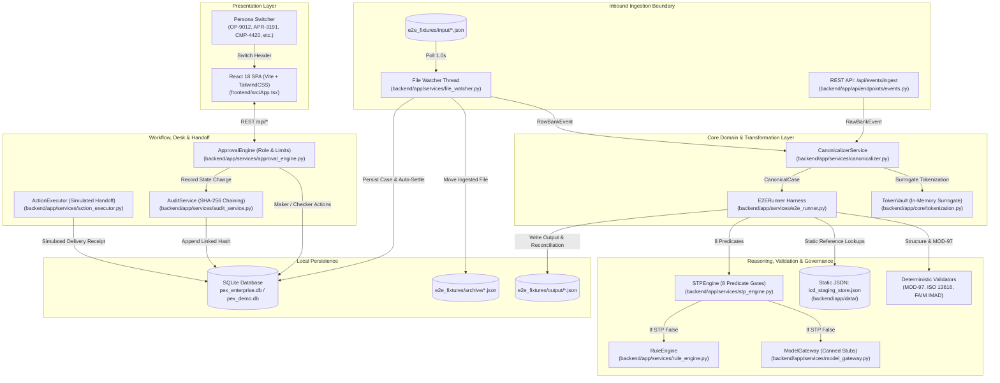
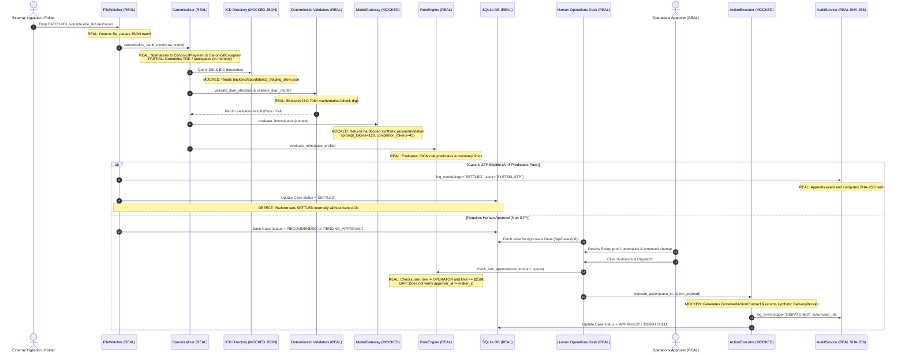

# 02-architecture.md — Architecture as Built

**Document Status:** COMPLETE / EVIDENCE-AUDITED  
**Auditor Mode:** Objective External Review  
**Target Codebase:** `C:\Users\pawan\.gemini\antigravity\scratch\pex_platform`  
**Date of Audit:** October 2026  

---

## 1. System Component Diagram (Real Components & Interfaces)

The real implemented system architecture centers on a single FastAPI monolith with in-memory adapters, a background folder watcher thread, a local SQLite database, and a React frontend served statically or via Vite dev server.



---

## 2. End-to-End Case Execution Sequence Diagram

The following diagram traces a single payment exception case through all stages, explicitly distinguishing **REAL** execution steps from **MOCKED / SIMULATED** execution steps.



---

## 3. Layering Analysis: Domain vs. Adapter vs. UI

The codebase exhibits a hybrid hexagonal / ports-and-adapters architecture introduced during Wave 0A/0B, superimposed on an initial monolithic prototype:

1. **Domain Core (`backend/app/schemas/canonical.py`, `backend/app/services/`):**
   - Pure domain models (`CanonicalPayment`, `CanonicalException`, `LifecycleStage`, `ExceptionProfile`).
   - Business rule engines (`rule_engine.py`, `canonicalizer.py`, `stp_engine.py`).
   - Clean domain separation is maintained in schemas, but violated in `file_watcher.py` (which directly manipulates persistence models and forces lifecycle state transitions).
2. **Ports Layer (`backend/app/ports/`):**
   - 34 clean abstract Python classes using `typing.Protocol` or `abc.ABC` defining provider-neutral interfaces for banking capabilities (e.g. `PaymentHubRepairQueuePort`, `SecretTokenizationVaultPort`, `RegulatoryScreeningPort`).
3. **Reference Adapters Layer (`backend/app/adapters/reference/`):**
   - 34 in-memory implementations providing test fixtures, in-memory queues, and dictionary lookups.
   - **Current Reality**: While the ports are formally defined, the production runtime does not yet load live enterprise adapters; it relies on reference adapters and `icd_staging_service.py`.
4. **Presentation / UI Layer (`frontend/src/`):**
   - Modern React single-page application.
   - Communicates exclusively via HTTP REST endpoints (`/api/*`).
   - Persona switching operates via HTTP request headers (`X-PEX-User-ID`, `X-PEX-User-Role`).

---

## 4. Port and Adapter Interfaces for External Bank Systems

The table below audits the 10 critical external banking interfaces against the codebase, specifying protocol, direction, authentication, integration effort, and architectural gap:

| External System / Domain | Interface Definition File | Implementations Present | Direction | Protocol & Data Format | Authentication Method | Bank Build / Integration Requirement | Shadow Mode Effort (S/M/L) | Live Handoff Effort (S/M/L) | Code Evidence & Notes |
| :--- | :--- | :--- | :--- | :--- | :--- | :--- | :---: | :---: | :--- |
| **Payment Engine / Repair Hub** (Finacle, Temenos, ACI, Pega) | `backend/app/ports/payment_hub_repair_queue_port.py` | `InMemoryPaymentHubRepairQueueAdapter`<br>(Reference) | Bi-directional (Read exceptions, Handoff repairs) | REST / JSON (Target: IBM MQ / pacs.008 XML) | None in ref (Target: mTLS + JWT) | Bank must export exception queue to REST/file feed; provide repair injection webhook. | **S** (1-2 wks via file drop) | **M** (4-6 wks for repair queue ACK) | `backend/app/adapters/reference/reference_payment_hub_adapter.py:1-85`. Uses in-memory dict. |
| **Message Network & Transit Tracker** (SWIFT CBPR+, Fedwire, gpi) | `backend/app/ports/transit_tracker_port.py`<br>`correspondent_gateway_port.py` | `InMemoryTransitTrackerAdapter`<br>`InMemoryCorrespondentGatewayAdapter` | Read (Query transit state & UETR) | JSON (Target: SWIFT Alliance Access / API) | None in ref (Target: SWIFT PKI / LAU) | Bank must route SWIFT gpi tracker status events or Fedwire FAIM confirmations. | **M** (3 wks for gpi API) | **L** (8-10 wks for SWIFT LAU/PKI) | `backend/app/adapters/reference/reference_transit_tracker_adapter.py`. Canned statuses. |
| **Sanctions & Regulatory Screening** (Fircosoft, Actimize, Accuity) | `backend/app/ports/regulatory_port.py` | `InMemoryRegulatoryAdapter`<br>`icd_staging_service.py` | Read (Screen parties, query homonyms) | JSON (Target: REST/gRPC or ISO 20022 camt.029) | None in ref (Target: API key / OAuth2) | Bank provides access to false-positive list or screening engine API. | **S** (1 wk using static export) | **M** (3-4 wks live screening) | `backend/app/services/icd_staging_service.py:54-60` queries static JSON `ofac_sdn_watchlist`. |
| **Core Ledger & Nostro Balance** (SAP, Misys, Temenos DDA) | `backend/app/ports/nostro_position_port.py`<br>`core_banking_port.py` | `InMemoryNostroPositionAdapter`<br>`InMemoryCoreBankingDDAAdapter` | Read (Check account funds, status, nostro) | JSON (Target: Core DDA REST/ISO 20022 camt.053) | None in ref (Target: mTLS) | Bank provides read-only account balance and status inquiry endpoint. | **S** (1-2 wks file/REST) | **M** (4 wks for balance freeze/reserve) | `backend/app/adapters/reference/reference_nostro_position_adapter.py`. Static balances. |
| **Party & SSI Master Directory** (Client Master, FIMS) | `backend/app/ports/account_master_port.py`<br>`kyc_master_port.py` | `InMemoryAccountMasterAdapter`<br>`icd_staging_service.py` | Read (Standing settlement instructions) | JSON (Target: SQL / Enterprise Bus) | None in ref (Target: Kerberos / Service Acct) | Bank exports counterparty standing settlement instruction table. | **S** (3 days via CSV/JSON export) | **S** (Read-only suffices for both) | `backend/app/services/icd_staging_service.py:42-48` queries `core_banking_ssi`. |
| **BIC & National Routing Directory** (SWIFTRef, Fedwire E-Payments) | `backend/app/ports/routing_directory_port.py` | `InMemoryRoutingDirectoryAdapter`<br>`icd_staging_service.py` | Read (BIC, ABA routing validity) | JSON / In-memory table | Local read | Bank mounts monthly SWIFTRef and FedACH/Fedwire directory files. | **S** (3-5 days table mount) | **S** (Read-only reference data) | `backend/app/services/canonicalizer.py:17-28` embeds official ISO 13616 lengths. |
| **Ticketing / Workflow Handoff** (ServiceNow, Jira, Bank Case Tools) | `backend/app/ports/bank_handoff_port.py` | `InMemoryBankHandoffAdapter`<br>`action_executor.py` | Outbound Handoff | JSON payload (Target: Webhook / REST API) | None in ref (Target: OAuth2 Bearer) | Bank configures incident endpoint to receive handed-off repair tickets. | **N/A** (Not used in shadow mode) | **S** (1-2 wks webhook configuration) | `backend/app/services/action_executor.py:45-80` constructs `GovernedActionContract`. |
| **Streaming Message Broker** (Enterprise Ingestion) | `backend/app/ports/message_broker_port.py` | `InMemoryMessageBrokerAdapter` | Inbound Ingestion | Python `collections.deque` (Target: Kafka / IBM MQ) | None in ref (Target: SASL / SSL) | Bank publishes payment exception topics to Kafka or IBM MQ queue. | **M** (2-3 wks Kafka consumer setup) | **M** (Shared ingestion pipeline) | `backend/app/adapters/reference/reference_message_broker_adapter.py:20`. In-memory deque. |
| **Secret Tokenization Vault / HSM** (PII Protection) | `backend/app/ports/token_vault_port.py` | `InMemoryTokenVaultAdapter`<br>`backend/app/core/tokenization.py` | Internal Surrogation | In-memory SHA-256 (Target: HashiCorp Vault / AWS KMS) | None in ref (Target: AppRole / AWS IAM) | Bank security team provisions dedicated KMS key or HashiCorp Vault transit engine. | **S** (Can use local vault in pilot) | **M** (3 wks enterprise HSM onboarding) | `backend/app/core/tokenization.py:10-45`. Ephemeral in-memory dicts. |
| **Distributed Idempotency Manager** | `backend/app/ports/idempotency_port.py` | `InMemoryIdempotencyAdapter` | Distributed Locking | In-memory dict (Target: Redis cluster / DynamoDB) | None in ref (Target: Redis AUTH) | Bank provisions dedicated Redis cache cluster for deduplication locks. | **S** (Single node sufficient) | **S** (1 wk Redis deployment) | `backend/app/adapters/reference/reference_idempotency_adapter.py`. Uses Python dict. |

---

## 5. Deployment Model and Environment Hard-Coding

### Current Desktop / Single-Node Deployment
- **Packaging**: Not containerized (no active Dockerfile or Helm chart in repository root).
- **Execution**: Runs directly inside a local virtual environment (`.\.venv\Scripts\python.exe`).
- **Configuration Hard-Coding**:
  - Operating filesystem paths (`e2e_fixtures/input`, `e2e_fixtures/output`) are configured as local folder paths in `backend/app/config.py`.
  - Database is configured to local SQLite file (`sqlite:///./pex_enterprise.db`).
  - Single-tenant design: there is **no tenant identifier** on database models (`cases`, `audit_events`). All ingested cases share the same tables.
  - Multi-bank routing is simulated via string identifiers (`BANK_A`, `BANK_B`, `BANK_C`) in `canonicalizer.py`, but all records coexist in the same database instance.

### Target Cloud / Production Model Gaps
- **Horizontal Scaling**: In-memory singletons (`token_vault`, `repo.audit_log`, `InMemoryPaymentHubRepairQueueAdapter`) prevent multi-worker horizontal scaling behind a load balancer without architectural migration to Redis, AWS KMS, and PostgreSQL.

---

## 6. Security, Identity & PII Architecture

### Authentication & Session Management
- **Implementation**: Hardcoded demo persona switcher in UI (`frontend/src/components/PersonaSwitcher.tsx`) calling `/api/auth/persona/{user_id}` (`backend/app/api/endpoints/auth.py`).
- **Token Mechanism**: Issues standard HS256 JWT tokens signed with static secret (`settings.JWT_SECRET = "pex-enterprise-secret-key-2026-sha256"`).
- **Session Reality**: No user database exists; any caller can authenticate as `ADM-0001` or `APR-3191` simply by passing the ID to the endpoint.

### PII Protection & Tokenization Audit
The repository documentation claims a *"Strict Zero-PII boundary with AES-256 tokenization."* Code inspection reveals:
1. **Tokenization Mechanism**: `backend/app/core/tokenization.py` implements an in-memory dictionary `_raw_to_token` using a truncated SHA-256 hash (`TOK-{token_type}-{h[:12]}`). It is neither AES-256 encrypted nor persistent across process restarts.
2. **Cleartext Leakage in Canonical Core**:
   - `backend/app/services/canonicalizer.py` (lines 218, 225, 240) sets:
     ```python
     debtor_party = CanonicalParty(..., party_name=debtor_name, token_ref=debtor_tok)
     creditor_account = CanonicalAccount(..., account_number=creditor_iban[-8:], iban=creditor_iban, token_ref=creditor_iban_tok)
     ```
   - Cleartext debtor/creditor names, IBANs, and account numbers are preserved in canonical objects alongside the token reference.
3. **Cleartext Visibility in UI & APIs**:
   - The REST API `/api/cases` returns full unmasked debtor and creditor party names.
   - The UI cockpit directly renders unmasked creditor party names (e.g. `"Nordhavn Components A/S"`, `"HarborView Supplier Ltd"`).
   - Display masking is applied only to the specific field being repaired (e.g. `GB82****760000`), while the rest of the case metadata remains exposed in cleartext.
