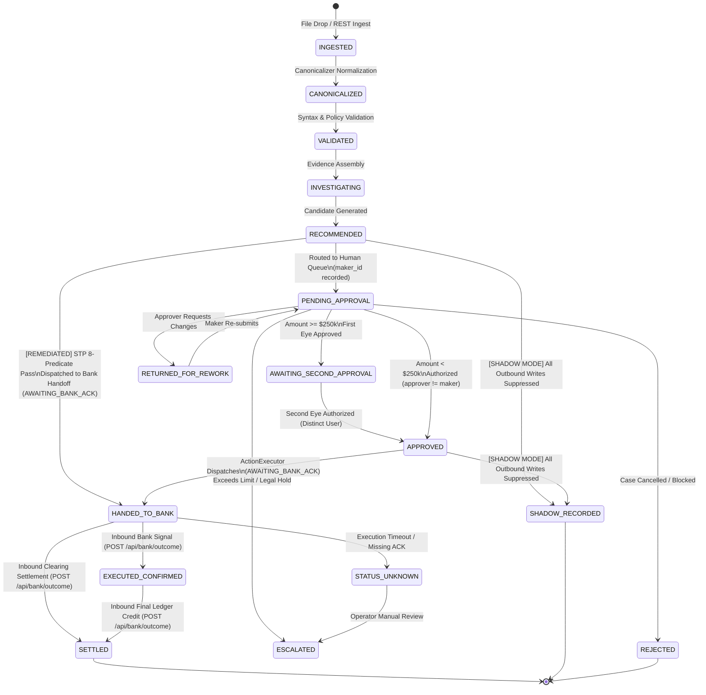

# 03-domain-and-state-machine.md — Domain Model and Lifecycle State Machine

**Document Status:** COMPLETE / EVIDENCE-AUDITED  
**Auditor Mode:** Objective External Review  
**Target Codebase:** `C:\Users\pawan\.gemini\antigravity\scratch\pex_platform`  
**Date of Audit:** October 2026  

---

### 1. Case Lifecycle Statuses and Transition Matrix

The case lifecycle is formally defined by the `LifecycleStage` enumeration in [`backend/app/schemas/canonical.py`](file:///C:/Users/pawan/.gemini/antigravity/scratch/pex_platform/backend/app/schemas/canonical.py#L7-L25). Under **P0 Remediation (P0-1)**, all status modifications must route through the central transition choke point [`transition_case()`](file:///C:/Users/pawan/.gemini/antigravity/scratch/pex_platform/backend/app/services/state_machine.py) with enforced transition table rules.

| Lifecycle Stage String | Canonical Schema Reference | Allowed Next Stages | Trigger / Actor | Enforced Guards & Conditions |
| :--- | :--- | :--- | :--- | :--- |
| `INGESTED` | `canonical.py:8` | `CANONICALIZED`, `FAILED` | Inbound JSON batch drop (`file_watcher.py`) or REST call (`events.py`) | Valid payload structure; unique transaction ID / idempotency lock acquired. |
| `CANONICALIZED` | `canonical.py:9` | `VALIDATED`, `INVESTIGATING`, `RECOMMENDED`, `PENDING_APPROVAL` | `canonicalizer.py` | Raw bank payload successfully mapped into `CanonicalPayment` & `CanonicalException`. |
| `VALIDATED` | `canonical.py:10` | `INVESTIGATING`, `RECOMMENDED`, `PENDING_APPROVAL` | Rule/Policy evaluation | Profile-specific syntax and bank policy constraints verified. |
| `INVESTIGATING` | `canonical.py:11` | `RECOMMENDED`, `ESCALATED`, `FAILED` | Reference lookups started (`e2e_runner.py`) | Directory queries initiated; evidence gathered from SSI, BIC, and DDA lookups. |
| `RECOMMENDED` | `canonical.py:12` | `PENDING_APPROVAL`, `HANDED_TO_BANK`, `SHADOW_RECORDED`, `ESCALATED` | `e2e_runner.py` / `model_gateway.py` | Resolution candidate generated; MOD-97 check; STP 8-predicate evaluation. |
| `PENDING_APPROVAL` | `canonical.py:13` | `APPROVED`, `AWAITING_SECOND_APPROVAL`, `RETURNED_FOR_REWORK`, `REJECTED`, `ESCALATED` | Queue routing or Maker submit | Compliance, Investigation, or Repair desk; Maker submit records `maker_id`. |
| `AWAITING_SECOND_APPROVAL` | `canonical.py:14` | `APPROVED`, `REJECTED`, `ESCALATED` | Tier-1 approver authorizes case > $250k | Requires second approver with distinct role and authority. |
| `RETURNED_FOR_REWORK` | `canonical.py:15` | `PENDING_APPROVAL`, `ESCALATED` | Approver submits `RETURN_TO_MAKER` | Mandatory rework comments provided; returns case to Maker queue. |
| `APPROVED` | `canonical.py:16` | `HANDED_TO_BANK`, `SHADOW_RECORDED`, `FAILED` | Checker / Approver authorizes case | Passes `check_can_approve` and Segregation of Duties (`approver != maker`). |
| `REJECTED` | `canonical.py:17` | *(Terminal State)* | Approver submits `REJECT` | Mandatory rejection justification; non-recoverable payment cancellation. |
| `ESCALATED` | `canonical.py:18` | `PENDING_APPROVAL`, `REJECTED` | Operator / Approver escalates | Exceeds local limit or involves unresolved compliance hold. |
| `HANDED_TO_BANK` | `canonical.py:19` (Value: `"DISPATCHED"`) | `EXECUTED_CONFIRMED`, `SETTLED`, `STATUS_UNKNOWN`, `FAILED` | `action_executor.py` / `stp_engine.py` / `file_watcher.py` | Outbound handoff dispatched. Case status set to `AWAITING_BANK_ACK`. |
| `SHADOW_RECORDED` | `canonical.py:20` | *(Terminal in Shadow Mode)* | Outbound choke point in `SHADOW` mode | `PEX_OPERATION_MODE="SHADOW"` suppresses all outbound traffic. Audit event logged. |
| `EXECUTED_CONFIRMED` | `canonical.py:21` | `SETTLED`, `FAILED` | **Inbound Bank Signal Only** (`POST /api/bank/outcome`) | External clearing engine acknowledges successful execution. |
| `SETTLED` | `canonical.py:22` | *(Terminal State)* | **Inbound Bank Signal Only** (`POST /api/bank/outcome`) | **P0 Remediated**: Platform strictly blocked from setting `SETTLED` internally. Requires signed callback. |
| `STATUS_UNKNOWN` | `canonical.py:23` | `HANDED_TO_BANK`, `FAILED`, `ESCALATED` | Timeout / Network partition handler | Downstream bank engine fails to provide confirmation within SLA. |
| `FAILED` | `canonical.py:24` | `PENDING_APPROVAL` (Manual Retry) | System exception / validation failure | Parsing crash, corrupted payload, or unrecoverable network failure. |

---

## 2. Mermaid State Machine Diagram & Remediated Architecture

The state machine below visualizes the remediated lifecycle flow. Notice that autonomous STP and manual approval both terminate at the platform boundary `HANDED_TO_BANK` (or `SHADOW_RECORDED`), and only authenticated inbound clearing callbacks can produce `EXECUTED_CONFIRMED` or `SETTLED`:



### P0 Remediation & Control Architecture Hardening
1. **The Autonomous `SETTLED` Shortcut Completely Removed (P0-1)**:
   - **Remediation**: `file_watcher.py`, `stp_engine.py`, and `action_executor.py` no longer assign `SETTLED` directly. All transitions route through `transition_case()`.
   - **Strict Guard**: `transition_case` raises `ValueError("SETTLED state can only be set via authenticated bank execution signal...")` if attempted internally.
   - **Grep Test Guard**: A static test (`test_p0_1_grep_no_direct_status_assignment`) verifies zero direct assignments to `status` in core services.
2. **Defensible Terminal Boundary for Bank Execution**:
   - Outbound execution stops at `HANDED_TO_BANK` (canonical string `"DISPATCHED"`).
   - Inbound endpoint `POST /api/bank/outcome` provides the cryptographically verified and idempotent bridge from `HANDED_TO_BANK` to `EXECUTED_CONFIRMED` or `SETTLED`.

---

## 3. Detailed Status Mapping and Actor Analysis

### Who Sets What Status? (Post-P0 Remediation)

| Lifecycle Stage | Setting Actor | Setting Component / File | Confirmed by External Bank Signal? |
| :--- | :--- | :--- | :--- |
| `INGESTED` | `SYSTEM_INGEST` | `file_watcher.py` | **No** (Local filesystem detection) |
| `CANONICALIZED` | `SYSTEM_CANONICALIZER` | `canonicalizer.py` | **No** (Internal transformation) |
| `VALIDATED` | `SYSTEM_POLICY` | `rule_engine.py` | **No** (Internal validation) |
| `RECOMMENDED` | `SYSTEM_AI_REASONER` | `file_watcher.py` / `e2e_runner.py` | **No** (Internal inference) |
| `PENDING_APPROVAL` | `SYSTEM_ROUTER` / `MAKER` | `file_watcher.py` / `cases.py` | **No** (Internal workflow state; stamps `maker_id`) |
| `AWAITING_SECOND_APPROVAL` | `CHECKER_1` | `approval_engine.py` | **No** (Internal workflow state) |
| `RETURNED_FOR_REWORK` | `CHECKER` | `approval_engine.py` | **No** (Internal workflow state) |
| `APPROVED` | `CHECKER` | `approval_engine.py` | **No** (Internal workflow state; verifies `approver != maker`) |
| `HANDED_TO_BANK` | `SYSTEM_DISPATCH` / `SYSTEM_STP` | `action_executor.py` / `stp_engine.py` | **No** (Outbound handoff generated; status `AWAITING_BANK_ACK`) |
| `SHADOW_RECORDED` | `SYSTEM_CHOKE_POINT` | `outbound_port.py` | **No** (Terminal in `SHADOW` mode; outbound suppressed) |
| `EXECUTED_CONFIRMED` | `BANK_CLEARING_ENGINE` | `bank.py` (`POST /api/bank/outcome`) | **YES** (External signed bank callback) |
| `SETTLED` | `BANK_CLEARING_ENGINE` | `bank.py` (`POST /api/bank/outcome`) | **YES** (External signed bank callback) |
| `STATUS_UNKNOWN` | `SYSTEM_TIMEOUT` | `outbound_port.py` | **No** (Execution ACK timed out) |

### Bank Handoff vs. Bank Execution Outcome Modeling
In the remediated codebase:
- **Bank Handoff**: Modeled via `GovernedActionContract` in [`backend/app/schemas/action.py`](file:///C:/Users/pawan/.gemini/antigravity/scratch/pex_platform/backend/app/schemas/action.py). Packages the repaired instruction, audit hash reference, and digital authorization signatures.
- **Execution State**: `ActionExecutor` sets status `AWAITING_BANK_ACK` under lifecycle stage `HANDED_TO_BANK` (canonical value `"DISPATCHED"`). Synthetic `ACK-SIM-` generation has been completely removed.
- **Bank Outcome Ingestion**: Authenticated endpoint `POST /api/bank/outcome` receives HMAC-signed, idempotent bank execution signals and transitions cases to `EXECUTED_CONFIRMED` or `SETTLED`.
- **Legacy Defect (Closed)**: Previously, `action_executor.py` generated local synthetic receipts with `"ACK-SIM-..."` and claimed instant `"SETTLED_CONFIRMED"` settlement without network traffic. This bypass has been eliminated.

---

## 4. Idempotency and Duplicate Handling

Deduplication and idempotency are enforced at multiple levels:

### 1. Inbound Ingestion Idempotency Lock
- **Port**: `backend/app/ports/idempotency_port.py` (`DistributedIdempotencyPort`).
- **Reference Implementation**: `backend/app/adapters/reference/reference_idempotency_adapter.py`.
- **In-Memory Tracking**: Maintains a dictionary `_locks: Dict[str, Dict[str, Any]]` keyed by transaction hash (`hashlib.sha256(payload).hexdigest()`).
- **TTL Lock Window**: 300 seconds (5 minutes). Re-submitting an identical payload within the window returns HTTP 409 Conflict.

### 2. Batch Processing Duplicate Detection
- **Code Reference**: `backend/app/services/file_watcher.py` (lines 515-535).
- **Logic**: During batch parsing, `file_watcher.py` tracks `seen_uetr: Set[str]` and queries `db.query(CaseModel).filter_by(uetr=uetr).first()`.
- **Handling**: If a duplicate UETR or payment reference is detected within the same batch or in the database, the record is flagged:
  ```python
  if uetr in seen_uetr or db_case_exists:
      # Log duplicate suppression audit event
      audit_service.log_event(stage="INGESTION_SKIPPED", details=f"Duplicate UETR {uetr} suppressed")
      continue
  ```
  The duplicate record is bypassed to prevent double-crediting or duplicate exception case creation.
