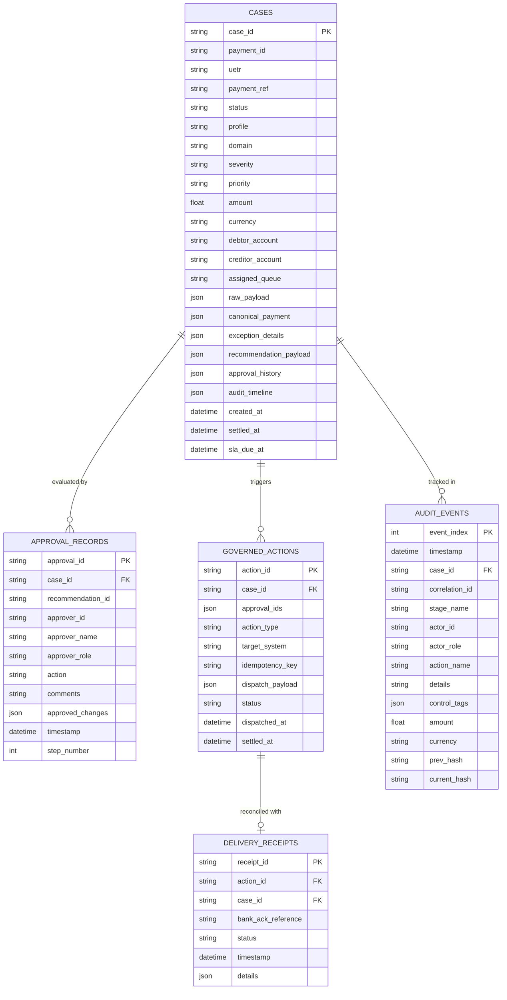

# 10-data-model-and-apis.md — Data Model, Schemas and API Inventory

**Document Status:** COMPLETE / EVIDENCE-AUDITED  
**Auditor Mode:** Objective External Review  
**Target Codebase:** `C:\Users\pawan\.gemini\antigravity\scratch\pex_platform`  
**Date of Audit:** October 2026  

---

## 1. Entity-Relationship (ER) Architecture

The data architecture is implemented across relational SQLite tables ([`backend/app/db/models.py`](file:///C:/Users/pawan/.gemini/antigravity/scratch/pex_platform/backend/app/db/models.py)) and Pydantic canonical domain schemas ([`backend/app/schemas/canonical.py`](file:///C:/Users/pawan/.gemini/antigravity/scratch/pex_platform/backend/app/schemas/canonical.py)).

### Relational Design Audit Finding: JSON Blob Storage
While the database uses SQLite tables, primary domain entities (`CanonicalPayment`, `DecisionRecommendation`, `EvidencePackage`) are serialized as **raw JSON blobs** within `CaseModel.canonical_payment` and `CaseModel.recommendation_payload`. There are no normalized 3NF tables for payment parties, clearing hops, or evidence items.

---

## 2. Comprehensive REST API Inventory

The backend exposes 22 active REST endpoints under the `/api` route prefix:

| Endpoint Path | HTTP Method | Operational Purpose | Authorized Roles / Auth Gating | Request / Response Shape | Cockpit Screen / UI Consumer |
| :--- | :---: | :--- | :--- | :--- | :--- |
| `/api/cases` | `GET` | List cases with queue, domain, profile, and search filters. | Open / Demo Persona | Query params -> `List[CaseSummary]` | Repair Queue, Worklist |
| `/api/cases/{id}` | `GET` | Fetch complete case details, evidence dossier, and audit trail. | Open / Demo Persona | None -> `CaseDetailResponse` | Case Investigation Cockpit |
| `/api/cases/{id}/recommendation` | `POST` | Generate or fetch AI decision recommendation. | Open / Demo Persona | None -> `DecisionRecommendation` | Right-side Resolution Panel |
| `/api/cases/{id}/provenance` | `GET` | Retrieve case cryptographic audit trail. | Open / Demo Persona | None -> `ProvenanceChain` | Audit Provenance Drawer |
| `/api/approvals/submit` | `POST` | Submit Maker or Checker approval action. | Role-gated via `check_can_approve` | `ApprovalSubmission` -> `ApprovalRecord` | Approvals Desk Modal |
| `/api/approvals/queue` | `GET` | List cases awaiting second-eye authorization. | Role-filtered (`MY_DESK` vs `ALL`) | Query params -> `List[CaseSummary]` | Approvals Desk View |
| `/api/actions/execute` | `POST` | Execute governed action handoff to bank systems. | Approver role required | `ExecuteActionRequest` -> `DeliveryReceipt` | Authorize & Dispatch Button |
| `/api/audit` | `GET` | Fetch continuous audit event stream. | Open / Auditor | `limit: int` -> `List[AuditEvent]` | Investigations Hub Ledger |
| `/api/audit/verify` | `GET` | Execute continuous SHA-256 hash chain verification. | Open / Governance | None -> `HashVerificationResult` | Provenance Verification Banner |
| `/api/rules` | `GET` | List governed business rules by status. | Open / Policy Manager | `status: str` -> `List[PolicyRule]` | Rule & Policy Studio |
| `/api/rules/{id}` | `GET` | Retrieve specific business policy rule. | Open | None -> `PolicyRule` | Rule Editor Drawer |
| `/api/rules/synthesize` | `POST` | NLP to JSON AST rule translation. | Open | `SynthesizeRuleRequest` -> AST | Natural Language Rule Input |
| `/api/rules/simulate` | `POST` | Simulate rule impact on live database cases. | Open | `SimulateRuleRequest` -> SimReport | Impact Analysis Modal |
| `/api/rules/submit` | `POST` | Submit candidate rule for governance approval. | Maker role | `SubmitRuleRequest` -> `PolicyRule` | Submit Candidate Rule Modal |
| `/api/rules/{id}/decision` | `POST` | Checker approval/rejection of candidate rule. | Approver / Admin | `CheckerDecisionRequest` -> Status | Rule Governance Approval Desk |
| `/api/stp/eligible` | `GET` | List cases currently qualifying for STP Fast-Lane. | Open / Approver | None -> `List[STPEligibilityItem]` | STP Fast-Lane Worklist |
| `/api/stp/telemetry` | `GET` | Fetch STP adoption metrics and time savings. | Open / Leadership | None -> `STPTelemetryResponse` | STP Operations Radar |
| `/api/stp/batch-release` | `POST` | Authorize 1-click batch release of fast-lane cases. | Approver / Admin required | `BatchSTPRequest` -> `BatchSTPResponse` | 1-Click Fast-Lane Action |
| `/api/events/ingest` | `POST` | Ingest raw heterogeneous payment exception event. | System / API Client | `RawBankEvent` -> `CanonicalCase` | External Payment Engine Feed |
| `/api/analytics/dashboard`| `GET` | Summary statistics, domain distribution, exposure. | Open / CXO | None -> `DashboardMetrics` | Executive Dashboard |
| `/api/auth/persona/{id}` | `POST` | Switch active demo persona and retrieve token. | Open (Demo Switcher) | None -> `UserPersona` + JWT | Persona Switcher Dropdown |

---

## 3. UI KPI Mismatches and Computation Forensic Audit

The UI displays several metrics that appear inconsistent or confusing to external reviewers. Forensic code tracing reveals the exact query or computation source for each:

### A. Repair Queue Count: 88 vs. 26
- **What UI Shows**: The navigation tab badge shows **`88`**, but the list below shows only **`26`** records.
- **Code Trace**:
  - In [`frontend/src/App.tsx`](file:///C:/Users/pawan/.gemini/antigravity/scratch/pex_platform/frontend/src/App.tsx), the tab badge displays `cases.length` (88), which is the **total number of all cases loaded from the database**.
  - The table filter applies `c.assigned_queue === "Repair" && (c.status === "INGESTED" || c.status === "RECOMMENDED")`, which filters the view down to the **26 actionable data-repair cases**.
  - **Verdict**: UI navigation badge defect; it displays total database rows instead of queue-filtered rows.

### B. Approvals Desk Count: 12 vs. 25
- **What UI Shows**: The desk header shows **`12`**, but clicking "All Desk" shows **`25`**.
- **Code Trace**:
  - **12 is `MY_DESK`**: Cases where `amount <= currentPersona.max_approval_amount` and the current user's role is authorized to clear that specific queue ([`security.py:71`](file:///C:/Users/pawan/.gemini/antigravity/scratch/pex_platform/backend/app/core/security.py#L71)).
  - **25 is `ALL`**: The total count of all cases across the bank currently in `PENDING_APPROVAL` status.

### C. Investigations Hub Count: 167 vs. 88
- **What UI Shows**: The Investigations Hub tab displays a badge count of **`167`**, while the total cases count is **`88`**.
- **Code Trace**:
  - In `frontend/src/components/InvestigationsHub.tsx`, the badge displays `auditEvents.length` (167).
  - **167 is the total count of individual audit log events** in the SHA-256 provenance ledger, **not** the number of cases under investigation!
  - **Verdict**: UI labeling defect; displays audit log entries rather than investigation case records.

### D. Cutoff Radar Buckets: 17 + 16 + 10 + 21 = 64 vs. 75 Total
- **What UI Shows**: Four time buckets displaying `<1h: 17`, `1-2h: 16`, `2-4h: 10`, `>4h: 21` (Sum = 64).
- **Code Trace**:
  - Buckets are computed dynamically in the browser against client-side `new Date()` using `setInterval(..., 1000)`.
  - Completed cases (`SETTLED`, `REJECTED`, `DISPATCHED`) are excluded from the radar, meaning the radar tracks only **active in-flight cases with upcoming SLAs**, shifting dynamically as time elapses.

### E. STP Rate (64.2%) and Average Resolution Time (4.2m)
- **Code Trace**: Evaluated in [`backend/app/services/stp_engine.py:610-645`](file:///C:/Users/pawan/.gemini/antigravity/scratch/pex_platform/backend/app/services/stp_engine.py#L610-L645).
- **Finding**: While total settled cases are counted from the database, the operational savings dollar amount (`total_settled * 42.50`) and resolution speed metrics are **derived using hardcoded synthetic multiplier coefficients**.
