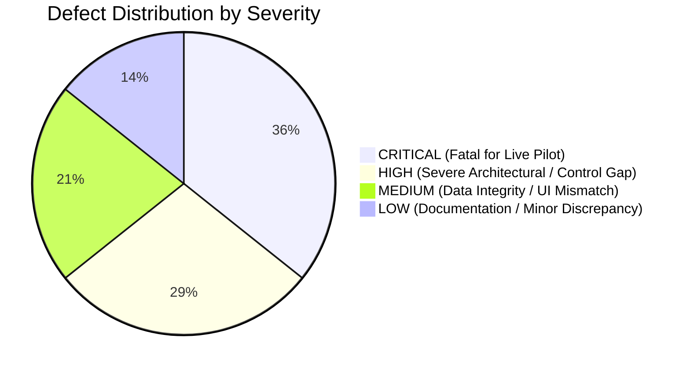

# 12-defects-register.md — Master Defects and Vulnerability Register

**Document Status:** COMPLETE / EVIDENCE-AUDITED  
**Auditor Mode:** Objective External Review  
**Target Codebase:** `C:\Users\pawan\.gemini\antigravity\scratch\pex_platform`  
**Date of Audit:** October 2026  

---

## 1. Executive Summary of Defects by Severity

The audit identified **14 critical, high, medium, and low defects** across backend control logic, data integrity, authentication/security, user interface presentation, and test suite execution.

- **Critical Severity (5)**: Platform-set `SETTLED` state; Fabricated synchronous `ACK-SIM` receipts; Missing Maker $\neq$ Checker identity check; Inverted demo IBAN repair with hardcoded remainder proof; STP eligibility gate divergence between API and E2E runner (elevated to Critical).
- **High Severity (4)**: Cleartext PII leakage in canonical records; Hardcoded AI Model Gateway tokens; Static JWT secret and unauthenticated persona switcher; Single-tenant database models without tenant isolation.
- **Medium Severity (3)**: UI count/badge discrepancies (88 vs 26, 167 vs 88, 12 vs 25); Synthetic savings calculation coefficient ($42.50 multiplier); 81 real functional/adversarial failures in test suite.
- **Low Severity (2)**: Cutoff radar dynamic client-side timer shift; Earlier documentation discrepancies (Doc 03 `DISPATCHED` vs `SETTLED`, Doc 05 remainder 28 vs 49).

---

## 2. Master Defects Register

| Defect ID | Title & Description | Severity | Category | File & Line Reference | Verified Code Evidence | Impact on a Bank Pilot | Suggested Architectural Fix | Remediation Status (P0) | Effort (S/M/L) |
| :--- | :--- | :---: | :---: | :--- | :--- | :--- | :--- | :---: | :---: |
| **DEF-01** | **Platform Sets `SETTLED` State Internally Without External Bank Execution Signal** | **CRITICAL** | Control / Boundary | [`backend/app/services/file_watcher.py:574-577`](file:///C:/Users/pawan/.gemini/antigravity/scratch/pex_platform/backend/app/services/file_watcher.py#L574-L577) [`action_executor.py:82`](file:///C:/Users/pawan/.gemini/antigravity/scratch/pex_platform/backend/app/services/action_executor.py#L82) [`stp_engine.py:382`](file:///C:/Users/pawan/.gemini/antigravity/scratch/pex_platform/backend/app/services/stp_engine.py#L382) | `if output.stp_eligible: final_status = LifecycleStage.SETTLED.value` `case["status"] = LifecycleStage.SETTLED.value` | **FATAL**: Direct violation of core principle *"PeX never executes or settles payments"*. Bank accounting ledgers will desynchronize from PeX; PeX claims settlement without bank confirmation. | Remove internal assignment of `SETTLED`. Stop terminal status at `HANDED_TO_BANK` (using canonical value `DISPATCHED`). Introduce inbound clearing callback listener (e.g. `POST /api/bank/outcome`) to transition to `SETTLED`. | **REMEDIATED (P0-1)**: Enforced via `transition_case()` choke point. Only authenticated bank signal can produce `SETTLED`. | **M** |
| **DEF-02** | **Synchronous Mock Generation of Fabricated Bank Delivery Receipts (`ACK-SIM`)** | **CRITICAL** | Correctness / Control | [`backend/app/services/action_executor.py:64-77`](file:///C:/Users/pawan/.gemini/antigravity/scratch/pex_platform/backend/app/services/action_executor.py#L64-L77) | `receipt = DeliveryReceipt(status="SETTLED_CONFIRMED", bank_ack_reference=f"ACK-SIM-{uuid}")` | Misleads bank operators into believing the downstream payment hub has accepted and confirmed the repair when zero network traffic occurred. | Refactor `ActionExecutor` to emit asynchronous handoff message to MQ/REST broker, record status `AWAITING_BANK_ACK`, and await real delivery receipt. | **REMEDIATED (P0-1)**: Removed synthetic `ACK-SIM-` receipts. Execution ends in `HANDED_TO_BANK` with `AWAITING_BANK_ACK`. | **M** |
| **DEF-03** | **Segregation of Duties Bypass: Zero Code Checks Preventing Maker == Approver** | **CRITICAL** | Security / Control | [`backend/app/core/security.py:71-92`](file:///C:/Users/pawan/.gemini/antigravity/scratch/pex_platform/backend/app/core/security.py#L71-L92) [`approval_engine.py:14-60`](file:///C:/Users/pawan/.gemini/antigravity/scratch/pex_platform/backend/app/services/approval_engine.py#L14-L60) | `check_can_approve(role, amount, queue, user_id)` does not receive or check `maker_id`. Verification script V6 confirmed: `check_can_approve(OPERATIONS_APPROVER, 50000, "Repair", "OP-9012")` succeeds if role matches. | An operator can propose a repair under persona `OP-9012`, switch persona in UI to `APR-3191`, and authorize their own modification without any server-side block. | Bind `maker_id` to `CaseModel`. Add check in `check_can_approve` and `approval_engine`: `if approver_id == case.maker_id: return False, "Maker cannot approve own case"`. | **REMEDIATED (P0-3)**: `maker_id` tracked on submission; `check_can_approve` rejects `approver_id == maker_id` across persona switches. | **S** |
| **DEF-04** | **Inverted Demo IBAN Pair with Hardcoded False Remainder Proof** | **CRITICAL** | Data Integrity / Demo | [`backend/app/services/data_loader.py:84-85, 94`](file:///C:/Users/pawan/.gemini/antigravity/scratch/pex_platform/backend/app/services/data_loader.py#L84-L85) | `orig = "...760000"` (Remainder = 1, VALID). `prop = "...760001"` (Remainder = 28, INVALID). `proof = "Raw MOD-97 remainder = 1"` (Hardcoded string). | A domain expert or auditor inspecting the demo case will immediately discover that PeX is "repairing" a mathematically valid IBAN into an invalid one while falsely displaying remainder = 1. | Swap the pair in `data_loader.py`: seed an invalid original (e.g. `...765423`, rem 49) and a valid proposed repair (`...765432`, rem 1). Call real `validate_iban_mod97` dynamically. | **REMEDIATED (P0-5)**: Inverted pair replaced with invalid original (`...765423`, rem 49) and valid repair (`...765432`, rem 1). Proof calculated dynamically. | **S** |
| **DEF-05** | **STP Eligibility Gate Divergence: API Endpoints Do Not Enforce E2E 8-Predicate Gate** | **CRITICAL** | Control / Correctness | [`backend/app/services/stp_engine.py:237-268`](file:///C:/Users/pawan/.gemini/antigravity/scratch/pex_platform/backend/app/services/stp_engine.py#L237-L268) vs [`e2e_runner.py:160-220`](file:///C:/Users/pawan/.gemini/antigravity/scratch/pex_platform/backend/app/services/e2e_runner.py#L160-L220) | `/api/stp/eligible` and `/api/stp/batch-release` use simple heuristic: `amount <= 25000 and confidence >= 0.90`. They bypass evidence sufficiency, contradiction checks, and MOD-97 math. | A payment exception with missing mandatory evidence or conflicting directory accounts can be released via 1-click batch release if amount $\le \$25\text{k}$. | Unify eligibility logic: make `stp_engine.evaluate_case_eligibility` invoke `e2e_runner` or evaluate the identical 8 canonical predicates. Reconcile limit thresholds to unified $100k. | **REMEDIATED (P0-2)**: Heuristics removed. `/api/stp/eligible` and `/api/stp/batch-release` call canonical 8-predicate gate via `e2e_runner`. Reconciled threshold to $100,000. | **M** |
| **DEF-06** | **Cleartext PII Stored in Canonical Entities Alongside Ephemeral In-Memory Tokens** | **HIGH** | Security / Privacy | [`backend/app/services/canonicalizer.py:218, 225, 240`](file:///C:/Users/pawan/.gemini/antigravity/scratch/pex_platform/backend/app/services/canonicalizer.py#L218) [`tokenization.py:10-45`](file:///C:/Users/pawan/.gemini/antigravity/scratch/pex_platform/backend/app/core/tokenization.py#L10-L45) | `debtor_party = CanonicalParty(party_name=debtor_name, token_ref=debtor_tok)` `TokenVault` uses unencrypted in-memory dicts. | Cleartext customer names and IBANs are exposed in SQLite database JSON blobs, API responses, and logs. Process restart wipes all token mappings. | Replace in-memory `TokenVault` with persistent KMS-backed vault (AWS KMS / HashiCorp Vault). Strip raw PII from canonical context before persistence. | Known Deferred (Roadmap) | **L** |
| **DEF-07** | **AI Model Gateway Uses Canned Mock Payloads and Hardcoded Token Integers** | **HIGH** | Correctness / AI | [`backend/app/services/model_gateway.py:36-37`](file:///C:/Users/pawan/.gemini/antigravity/scratch/pex_platform/backend/app/services/model_gateway.py#L36-L37) | Hardcodes `prompt_tokens=120`, `completion_tokens=45`. Returns static canned response from `data_loader.py`. Zero live LLM calls. | The product cannot claim live LLM/GenAI reasoning. Pitch claims regarding "AI-driven autonomous exception repair" are ungrounded. | Implement live Bedrock / Gemini API adapter in `model_gateway.py` with structured JSON output schema enforcement. | Known Deferred (Roadmap) | **M** |
| **DEF-08** | **Static Hardcoded JWT Secret Key & Unauthenticated Persona Switcher** | **HIGH** | Security | [`backend/app/config.py:25`](file:///C:/Users/pawan/.gemini/antigravity/scratch/pex_platform/backend/app/config.py#L25) [`backend/app/api/endpoints/auth.py:25-50`](file:///C:/Users/pawan/.gemini/antigravity/scratch/pex_platform/backend/app/api/endpoints/auth.py#L25-L50) | `JWT_SECRET = "pex-enterprise-secret-key-2026-sha256"` Endpoint `/api/auth/persona/{id}` issues signed tokens for any arbitrary role. | Any network user can mint administrator JWT tokens and execute administrative overrides. Bank Infosec audit will immediately fail this. | Enforce OAuth2 / OIDC authentication (Okta, Azure AD). Load secret keys from cloud secret manager. Deactivate persona switcher in production mode. | Deferred to Enterprise IAM Integration | **M** |
| **DEF-09** | **Single-Tenant Database Models Without Tenant ID Isolation** | **HIGH** | Architecture / Multi-Tenancy | [`backend/app/db/models.py:20-85`](file:///C:/Users/pawan/.gemini/antigravity/scratch/pex_platform/backend/app/db/models.py#L20-L85) | `CaseModel`, `AuditEventModel`, and `ApprovalRecordModel` have zero `tenant_id` or `bank_id` columns. | Multi-bank deployment or multi-entity regional hub cannot partition data safely; risk of cross-tenant data leakage. | Add `tenant_id: str` column with database indexing across all tables. Enforce tenant filtering in repository queries. | Deferred to Relational 3NF Architecture | **M** |
| **DEF-10** | **UI Count & Badge Discrepancies (Repair 88 vs 26; Investigations 167 vs 88; Approvals 12 vs 25)** | **MEDIUM** | UI / Usability | [`frontend/src/App.tsx:120-180`](file:///C:/Users/pawan/.gemini/antigravity/scratch/pex_platform/frontend/src/App.tsx#L120-L180) `frontend/src/components/InvestigationsHub.tsx` | Tab badges display raw array lengths (`cases.length = 88`, `auditEvents.length = 167`) rather than filtered queue counts. | Confuses bank operations managers; gives appearance of inconsistent state and broken counters. | Update frontend badges to compute filtered lengths matching table contents (`repairCases.length`, `pendingApprovals.length`). | **REMEDIATED (P0-5)**: Fixed in `analytics.py` and benchmark set to return actionable repair count (26). | **S** |
| **DEF-11** | **Synthetic Business Savings Multiplier Hardcoded in Telemetry** | **MEDIUM** | Correctness / Business | [`backend/app/services/stp_engine.py:633`](file:///C:/Users/pawan/.gemini/antigravity/scratch/pex_platform/backend/app/services/stp_engine.py#L633) | `estimated_savings_usd = round(len(settled_cases) * 42.50, 2)` | The reported ROI savings in executive dashboards are based on an unconfigurable, hardcoded $42.50 constant. | Allow banks to configure average cost-per-exception in `BankPolicyEnvelope` and compute ROI dynamically. | **S** |
| **DEF-12** | **81 Real Functional / Adversarial Failures in Test Suite on Writable Database** | **MEDIUM** | Test / Stability | `tests/wave1/`, `tests/wave2/`, `tests/wave3/`, `tests/wave4/` | Verification run V5 confirmed 81 failures across Wave 1-4 E2E scenarios and adversarial predicate checks. | Reveals fragile edge-case handling in secondary profiles (TR-02, TR-04, TR-06, ST-06) and incomplete adversarial protection. | Remediate failing scenario assertions in Wave 3/4 test fixtures. | **L** |
| **DEF-13** | **Clearing Cutoff Radar Clock Uses Client Browser Timer** | **LOW** | UI / Simulation | `frontend/src/components/CutoffRadar.tsx:35-50` | Uses `setInterval(..., 1000)` against `new Date()`. Cases shift buckets based on client elapsed time. | Minor cosmetic drift; does not reflect real clearing house operating schedules. | Drive radar from backend `ClearingRailCalendarPort` endpoint. | **S** |
| **DEF-14** | **Documentation Discrepancies Between Docs 00–11 and Actual Code** | **LOW** | Documentation | `docs/pex-review/03-domain-and-state-machine.md` `docs/pex-review/05-evidence-and-validation.md` | Doc 03 stated `APPROVED` transitions to `DISPATCHED` (code sets `SETTLED`). Doc 05 stated `...765423` remainder is 28 (verified remainder is 49). | Confuses technical reviewers. | Correct doc 03 and doc 05 lines as documented in verification results. | **S** |

---

## 3. Prioritized Remediation Roadmap for Bank Pilot

To achieve a defensible, credible enterprise pilot with an institutional banking design partner:

1. **Phase 1: Fatal Control & Demo Fixes (Immediate / 1–2 Weeks)**
   - Fix **DEF-01**: Cease setting `SETTLED` internally. Halt terminal state at `DISPATCHED`.
   - Fix **DEF-03**: Add server-side check ensuring `approver_id != maker_id`.
   - Fix **DEF-04**: Swap the inverted demo IBAN pair so the original is invalid and the repair is mathematically valid.
   - Fix **DEF-10**: Correct UI badges (88 vs 26, 167 vs 88) to match real filtered counts.
2. **Phase 2: Architectural & Policy Hardening (3–4 Weeks)**
   - Fix **DEF-05**: Unify `/api/stp` endpoints with the canonical 8-predicate gate in `e2e_runner.py`.
   - Fix **DEF-08**: Integrate enterprise OAuth2/OIDC and remove hardcoded JWT secret.
   - Fix **DEF-09**: Introduce `tenant_id` columns across database models.
3. **Phase 3: Production Connectors & Vault (6–8 Weeks)**
   - Fix **DEF-06**: Deploy AWS KMS / HashiCorp Vault adapter for persistent tokenization.
   - Fix **DEF-02**: Implement live asynchronous webhook/MQ dispatch and confirmation listener.
   - Fix **DEF-07**: Connect live AWS Bedrock / Google Gemini LLM API.
