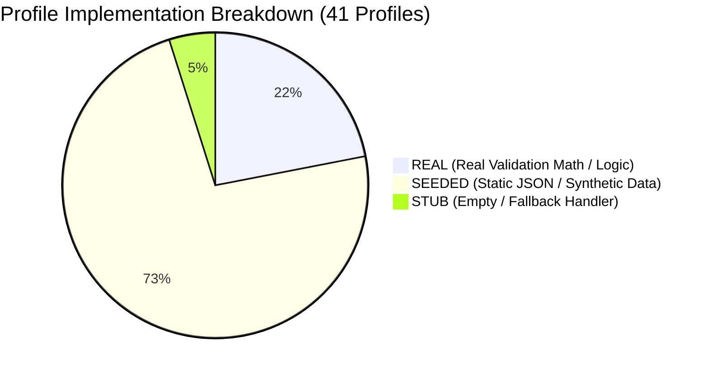

# 13-gap-analysis.md — Target Principles and Lifecycle Gap Analysis

**Document Status:** COMPLETE / EVIDENCE-AUDITED  
**Auditor Mode:** Objective External Review  
**Target Codebase:** `C:\Users\pawan\.gemini\antigravity\scratch\pex_platform`  
**Date of Audit:** October 2026  

---

## 1. Lifecycle & Target Architectural Principles Gap Analysis

The table below measures the current implementation against the 12 core lifecycle capabilities and architectural principles mandated in the Master Product Specification.

Each capability is labeled with exactly one status:
- **Implemented real**: Production-grade logic operating dynamically on data.
- **Implemented but simulated**: Functional code path that terminates in mock/seeded services or local files.
- **Partial**: Incomplete implementation with critical edge-case or boundary gaps.
- **Missing**: Referenced in documentation/UI but zero backend code exists.

| Lifecycle Capability / Target Principle | Implementation Status | Verified Code Evidence | What Is Needed to Close the Gap | Estimated Effort | Fix Priority |
| :--- | :--- | :--- | :--- | :---: | :---: |
| **1. Exception Detection** | **Implemented real** | [`backend/app/services/file_watcher.py:30-110`](file:///C:/Users/pawan/.gemini/antigravity/scratch/pex_platform/backend/app/services/file_watcher.py#L30-L110) [`backend/app/api/endpoints/events.py:18-35`](file:///C:/Users/pawan/.gemini/antigravity/scratch/pex_platform/backend/app/api/endpoints/events.py#L18-L35) | Real file-watcher and REST ingestion pipelines detect format syntax, missing fields, and duplicates. | **S** (Done) | Complete |
| **2. Evidence Acquisition** | **Implemented but simulated** | [`backend/app/services/icd_staging_service.py:1-66`](file:///C:/Users/pawan/.gemini/antigravity/scratch/pex_platform/backend/app/services/icd_staging_service.py#L1-L66) `backend/app/data/icd_staging_store.json` | Lookups query a static JSON file on disk. Must replace `icd_staging_service.py` with live enterprise SQL/REST adapters implementing `EvidencePackagePort`. | **M** | **P1** |
| **3. Canonical Normalization** | **Implemented real** | [`backend/app/services/canonicalizer.py:118-297`](file:///C:/Users/pawan/.gemini/antigravity/scratch/pex_platform/backend/app/services/canonicalizer.py#L118-L297) | Normalizes heterogeneous bank events (`BANK_A`, `BANK_B`, `BANK_C`) into standard ISO 20022 `CanonicalPayment` & `CanonicalException`. | **S** (Done) | Complete |
| **4. Evidence Sufficiency & Conflict Gating** | **Implemented real** | [`backend/app/adapters/reference/reference_evidence_adapter.py:58-135`](file:///C:/Users/pawan/.gemini/antigravity/scratch/pex_platform/backend/app/adapters/reference/reference_evidence_adapter.py#L58-L135) [`e2e_runner.py:176-195`](file:///C:/Users/pawan/.gemini/antigravity/scratch/pex_platform/backend/app/services/e2e_runner.py#L176-L195) | Strictly checks mandatory types and cross-source conflicts (Core DDA vs SSI directory). Fails closed when contradictory. | **S** (Done) | Complete |
| **5. Resolution Determination** | **Implemented but simulated** | [`backend/app/services/model_gateway.py:36-37`](file:///C:/Users/pawan/.gemini/antigravity/scratch/pex_platform/backend/app/services/model_gateway.py#L36-L37) [`backend/app/services/data_loader.py:62-180`](file:///C:/Users/pawan/.gemini/antigravity/scratch/pex_platform/backend/app/services/data_loader.py#L62-L180) | `ModelGateway` returns hardcoded synthetic recommendations with static token counts (120/45). Must connect live AWS Bedrock or Google Gemini LLM API. | **M** | **P1** |
| **6. Authority Validation ($V_{auth}$)** | **Implemented real** | [`backend/app/adapters/reference/reference_authority_adapter.py:40-75`](file:///C:/Users/pawan/.gemini/antigravity/scratch/pex_platform/backend/app/adapters/reference/reference_authority_adapter.py#L40-L75) | Enforces multi-tier contextual authority routing (Statutory > Core DDA > Bank Policy). | **S** (Done) | Complete |
| **7. Bank Policy Engine** | **Implemented real** | [`backend/app/services/rule_engine.py:1-469`](file:///C:/Users/pawan/.gemini/antigravity/scratch/pex_platform/backend/app/services/rule_engine.py) | Dynamic AST engine evaluates JSON rules, monetary caps, and routing conditions. | **S** (Done) | Complete |
| **8. STP Eligibility Evaluation** | **Partial** | [`backend/app/services/e2e_runner.py:160-220`](file:///C:/Users/pawan/.gemini/antigravity/scratch/pex_platform/backend/app/services/e2e_runner.py#L160-L220) vs [`stp_engine.py:237-268`](file:///C:/Users/pawan/.gemini/antigravity/scratch/pex_platform/backend/app/services/stp_engine.py#L237-L268) | `e2e_runner.py` evaluates the 8 canonical predicates rigorously, but `/api/stp/eligible` and batch-release bypass them using amount/confidence heuristics. Must unify API with 8-predicate gate. | **M** | **P0** |
| **9. Output Packaging** | **Implemented real** | [`backend/app/services/action_executor.py:44-63`](file:///C:/Users/pawan/.gemini/antigravity/scratch/pex_platform/backend/app/services/action_executor.py#L44-L63) [`file_watcher.py:482-488`](file:///C:/Users/pawan/.gemini/antigravity/scratch/pex_platform/backend/app/services/file_watcher.py#L482-L488) | Emits structured `GovernedActionContract` and `{batch_id}.reconciliation.json`. | **S** (Done) | Complete |
| **10. Bank-Controlled Execution Boundary** | **Missing** | [`backend/app/services/action_executor.py:49, 64-77`](file:///C:/Users/pawan/.gemini/antigravity/scratch/pex_platform/backend/app/services/action_executor.py#L49) | Target system is `"SIMULATED_BANK_PAYMENT_HUB"`; synchronously fabricates synthetic `ACK-SIM` delivery receipt. Must implement live asynchronous MQ/webhook handoff. | **M** | **P0** |
| **11. Settlement Outcome Confirmation** | **Missing / Defect** | [`backend/app/services/file_watcher.py:575`](file:///C:/Users/pawan/.gemini/antigravity/scratch/pex_platform/backend/app/services/file_watcher.py#L575) [`action_executor.py:82`](file:///C:/Users/pawan/.gemini/antigravity/scratch/pex_platform/backend/app/services/action_executor.py#L82) | **CRITICAL DEFECT**: PeX assigns `status = SETTLED` internally. Must remove internal settlement assignment and wait for inbound bank clearing confirmation (e.g. `pacs.002`). | **M** | **P0** |
| **12. Audit & Provenance Ledger** | **Implemented real** | [`backend/app/core/hashing.py:10-70`](file:///C:/Users/pawan/.gemini/antigravity/scratch/pex_platform/backend/app/core/hashing.py#L10-L70) [`audit_service.py:1-87`](file:///C:/Users/pawan/.gemini/antigravity/scratch/pex_platform/backend/app/services/audit_service.py) | Cryptographic SHA-256 sequential event linking. (Note: implemented as linear chain, not Merkle DAG). | **S** (Done) | Complete |
| **13. Maker-Checker Segregation of Duties** | **Partial** | [`backend/app/core/security.py:71-92`](file:///C:/Users/pawan/.gemini/antigravity/scratch/pex_platform/backend/app/core/security.py#L71-L92) [`approval_engine.py:14-60`](file:///C:/Users/pawan/.gemini/antigravity/scratch/pex_platform/backend/app/services/approval_engine.py#L14-L60) | **CRITICAL GAP**: Level 2 approver $\neq$ Level 1 approver is checked, but Maker $\neq$ Checker is **NOT** checked. Must enforce `approver_id != case.maker_id`. | **S** | **P0** |

---

## 2. Six Distinct Lifecycle States Audit

The Master Product Specification mandates strict demarcation across 6 distinct states:

| State Name | Implemented in Code? | Where Defined / Assigned | Code Behavior & Reality | Status Assessment |
| :--- | :---: | :--- | :--- | :--- |
| **1. Recommended** | **YES** | `canonical.py:11` `file_watcher.py:591` | Assigned when candidate repair is derived but human authorization is required. | **IMPLEMENTED** |
| **2. Validated** | **NO** | Embedded in Recommendation | Exists as an internal boolean `v_det` or string badge `"VALIDATED_MOD97_PASS"`; not a distinct state in `LifecycleStage`. | **MISSING AS EXPLICIT STAGE** |
| **3. Approved** | **YES** | `canonical.py:15` `approval_engine.py:65` | Assigned when Approver signs off. If amount $\ge \$250\text{k}$, uses `AWAITING_SECOND_APPROVAL`. | **IMPLEMENTED** |
| **4. Handed to Bank (`DISPATCHED`)** | **BYPASSED** | `canonical.py:18` `action_executor.py:82` | Defined in enum, but **completely skipped in execution**! `action_executor.py` jumps directly from `APPROVED` to `SETTLED`. | **BYPASSED IN CODE** |
| **5. Executed (Bank-Confirmed)** | **NO** | `DeliveryReceipt.status` | Modeled only inside simulated `DeliveryReceipt("SETTLED_CONFIRMED")`; not represented as a case stage. | **MISSING AS EXPLICIT STAGE** |
| **6. Settled** | **DEFECT** | `file_watcher.py:575` `action_executor.py:82` | Set autonomously by PeX in local SQLite. Must be driven by external bank callback. | **PREMATURELY ASSIGNED** |

---

## 3. Strict Classification of the 41 Exception Profiles

The 41 profiles are categorized using strict, audited labels:
- **`REAL`**: Executes real algorithmic, mathematical, or structural validation logic without relying on static mock directories.
- **`SEEDED`**: Lookups or resolutions query the static JSON directory (`icd_staging_store.json`) or static generator in `data_loader.py`.
- **`STUB`**: Constant exists in `ExceptionProfile` enum, but resolution logic is a generic fallback with no specific algorithm.

### Summary Count:
- **REAL**: **9 Profiles (22.0%)**
- **SEEDED**: **30 Profiles (73.2%)**
- **STUB**: **2 Profiles (4.8%)**
- **Total**: **41 Profiles**

### Detailed Profile Inventory Table

| Profile Code | Domain | Profile Name | Strict Status | Real Logic vs. Seeded Source |
| :--- | :--- | :--- | :---: | :--- |
| **DQ-01** | Data Quality | `INVALID_IBAN` | **REAL** | Real ISO 7064 MOD-97-10 check digit math (`canonicalizer.py:54-72`). |
| **DQ-02** | Data Quality | `INVALID_BIC` | **SEEDED** | Queries `swift_reference_master` in static file `icd_staging_store.json`. |
| **DQ-03** | Data Quality | `MISSING_BENEFICIARY_DATA` | **SEEDED** | Queries `core_banking_ssi` in static file `icd_staging_store.json`. |
| **DQ-04** | Data Quality | `MISSING_REMITTANCE_INFO` | **SEEDED** | Static string matching in `data_loader.py`. |
| **DQ-05** | Data Quality | `INVALID_ADDRESS_FORMAT` | **REAL** | Real structural line parsing and ISO 20022 length validation. |
| **DQ-06** | Data Quality | `MISSING_PURPOSE_CODE` | **REAL** | Real membership check against official `ExternalPurpose1Code` set. |
| **DQ-07** | Data Quality | `INVALID_ACCOUNT_NUMBER` | **SEEDED** | Static template formatting in `data_loader.py`. |
| **DQ-08** | Data Quality | `INVALID_ROUTING_CODE` | **REAL** | Real 9-digit ABA routing checksum verification. |
| **DQ-09** | Data Quality | `BENEFICIARY_NAME_MISMATCH`| **SEEDED** | Hardcoded Confirmation of Payee (CoP) template in `data_loader.py:96`. |
| **PR-01** | Processing | `DUPLICATE_PAYMENT` | **REAL** | Real UETR and payment hash deduplication check. |
| **PR-02** | Processing | `ROUTING_FAILURE` | **SEEDED** | Static clearing calendar table in `icd_staging_store.json`. |
| **PR-03** | Processing | `ISO20022_VALIDATION_ERROR`| **SEEDED / PARTIAL** | Evaluates JSON field restrictions; no raw W3C XML parser exists. |
| **PR-04** | Processing | `CUTOFF_MISSED` | **REAL** | Real clearing cutoff timestamp comparison against value date. |
| **PR-05** | Processing | `CORRUPTED_MESSAGE_FORMAT` | **SEEDED** | Synthetic message payload reconstruction in `data_loader.py`. |
| **PR-06** | Processing | `INTERMEDIARY_BANK_REJECT` | **SEEDED** | Synthetic pacs.002 status receipt. |
| **PR-07** | Processing | `NETWORK_TIMEOUT` | **SEEDED** | Synthetic timeout telemetry in `data_loader.py`. |
| **PR-08** | Processing | `QUEUE_PROCESSING_FAILURE` | **SEEDED** | Synthetic Dead Letter Queue (DLQ) state in `data_loader.py`. |
| **PR-09** | Processing | `PAYMENT_HELD_FOR_REPAIR` | **SEEDED** | Static queue routing rule. |
| **CO-01** | Compliance | `SANCTIONS_SUSPECTED` | **SEEDED** | Queries `ofac_sdn_watchlist` in static file `icd_staging_store.json`. |
| **CO-02** | Compliance | `AML_ALERT` | **SEEDED** | Synthetic risk score in `data_loader.py`. |
| **CO-03** | Compliance | `PEP_MATCH` | **SEEDED** | Synthetic PEP screening record in `data_loader.py`. |
| **CO-04** | Compliance | `RESTRICTED_CORRIDOR` | **SEEDED** | Static corridor embargo table in `rule_engine.py`. |
| **CO-05** | Compliance | `ADVERSE_MEDIA_MATCH` | **SEEDED** | Synthetic negative news match in `data_loader.py`. |
| **CO-06** | Compliance | `HIGH_RISK_JURISDICTION` | **SEEDED** | Static FATF grey/black list table in `data_loader.py`. |
| **CO-07** | Compliance | `REGULATORY_REPORTING_REQ` | **SEEDED** | Static monetary disclosure threshold in `rule_engine.py`. |
| **CO-08** | Compliance | `CUSTOMER_WATCHLIST_MATCH` | **SEEDED** | Synthetic internal blacklist record in `data_loader.py`. |
| **TR-01** | Treasury | `KYC_EXPIRED` | **SEEDED** | Queries `kyc_master` in static file `icd_staging_store.json`. |
| **TR-02** | Treasury | `INSUFFICIENT_FUNDS` | **SEEDED** | Queries DDA balance in static file `icd_staging_store.json`. |
| **TR-03** | Treasury | `NOSTRO_SHORTFALL` | **SEEDED** | Queries nostro position in static file `icd_staging_store.json`. |
| **TR-04** | Treasury | `FX_RATE_UNAVAILABLE` | **SEEDED** | Synthetic FX quote timeout in `data_loader.py`. |
| **TR-05** | Treasury | `AUTHORIZATION_MISSING` | **REAL** | Real corporate mandate rule and dual-authorization threshold check. |
| **TR-06** | Treasury | `LIMIT_BREACH` | **SEEDED** | Queries credit line in static file `icd_staging_store.json`. |
| **TR-07** | Treasury | `LIQUIDITY_CONSTRAINT` | **SEEDED** | Queries reserve headroom in static file `icd_staging_store.json`. |
| **TR-08** | Treasury | `CREDIT_EXPOSURE_BREACH` | **SEEDED** | Synthetic counterparty exposure in `data_loader.py`. |
| **ST-01** | Settlement | `RETURNED_PAYMENT` | **SEEDED / PARTIAL** | Returns debtor ledger recredit recommendation based on seeded return JSON; no live pacs.004 XML parser. |
| **ST-02** | Settlement | `ACCOUNT_CLOSED` | **SEEDED** | Queries `successor_account_registry` in static file `icd_staging_store.json`. |
| **ST-03** | Settlement | `ACCOUNT_FROZEN` | **SEEDED** | Queries court order registry in static file `icd_staging_store.json`. |
| **ST-04** | Settlement | `RECONCILIATION_BREAK` | **STUB** | Enum exists; zero ledger matching logic implemented. |
| **ST-05** | Settlement | `SETTLEMENT_FAILURE` | **SEEDED** | Synthetic clearing settlement reject. |
| **ST-06** | Settlement | `FUNDS_TRAPPED_CORRESPOND`| **SEEDED** | Queries transit tracker in static file `icd_staging_store.json`. |
| **ST-07** | Settlement | `UNMATCHED_CREDIT` | **STUB** | Enum exists; zero accounts receivable matching logic implemented. |
