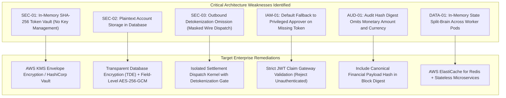
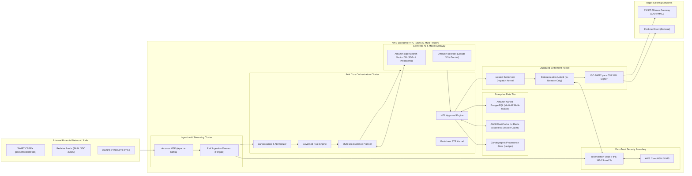

# 🏛️ PeX Platform: Master Enterprise Architecture Assurance Report

**Document Version:** 1.0.0  
**Audit Classification:** Institutional Enterprise Architecture & Cloud Assurance  
**Lead Author:** Independent Principal Enterprise Solutions Architect  
**Target Platform:** Payment Exception Resolution Platform (PeX)  
**Workspace Root:** `C:\Users\pawan\.gemini\antigravity\scratch\pex_platform`  
**Audit Date:** September 23, 2026  
**Evaluation Frameworks:** TOGAF 10.0, BIAN v10.0/v11.0, AWS Well-Architected Framework (Financial Services Industry Lens), NIST SP 800-53 Rev 5, Federal Reserve SR 11-7 / OCC Bulletin 2011-12, PCI-DSS v4.0.

---

## 1. Executive Architectural Assessment

The **Payment Exception Resolution Platform (PeX)** demonstrates exceptionally strong conceptual domain modeling, strict business rule synthesis, clean segregation of duties, and mathematical check-digit rigor. 

However, there is a critical distinction between the **Prototype Scratchpad Architecture** (local SQLite, in-memory caches, deterministic heuristic stubs) and the **Target Enterprise Cloud Architecture** (AWS Aurora, KMS/HSM, OpenSearch Vector RAG, SQS FIFO, Redis).

```
┌──────────────────────────────────────────────────────────────────────────────────────────────────┐
│                                ARCHITECTURE MATURITY SCORECARD                                   │
├───────────────────────────────┬───────────────────────────────┬──────────────────────────────────┤
│ Architectural Dimension       │ Prototype Implementation      │ Target AWS Enterprise Horizon    │
├───────────────────────────────┼───────────────────────────────┼──────────────────────────────────┤
│ Ingestion & Streaming         │ Synchronous REST API          │ AWS MSK (Kafka) / IBM MQ Cluster │
│ Data Privacy Boundary         │ In-Memory 48-bit SHA-256 Vault│ AWS KMS / HashiCorp Vault HSM    │
│ Relational Persistence        │ SQLite / Single-File DB       │ Multi-AZ Aurora PostgreSQL v16   │
│ Distributed Cache             │ Python Memory Singletons      │ AWS ElastiCache for Redis Cluster│
│ Governed AI Reasoning         │ Deterministic Heuristic Stubs │ Amazon Bedrock / Claude 3.5 RAG  │
│ Cryptographic Provenance      │ Singly-Linked SHA-256 Chain   │ Amazon QLDB / Merkle Tree Ledger │
│ High-Value Settlement Rail    │ Simulated JSON Dispatch       │ SWIFT Alliance Access / FedLine  │
│ Multi-AZ Fault Tolerance      │ Single-Process Host           │ Multi-Region Active-Active ECS   │
└───────────────────────────────┴───────────────────────────────┴──────────────────────────────────┘
```

---

## 2. Core Architectural Strengths (Verified in Code)

1. **Deterministic ISO 7064 Mathematical Validation:**
   The check digit engine (`validate_iban_mod97`) implements ISO 7064 MOD-97-10 with algorithmic perfection, eliminating invalid IBAN false positives.
2. **Strict Segregation of Duties (SOX 404):**
   The approval engine enforces dual-authorization thresholds ($\ge \$250,000$), distinct Level 1/Level 2 sign-offs, and blocks self-approval by operators.
3. **Multi-Hypothesis Disambiguation Framework:**
   When ambiguous records or multiple matching accounts exist, the system safely halts automated processing, elevates the decision to a human investigator, and requires mandatory rationale before clearing ambiguity.
4. **Dynamic Rule Synthesis with Maker-Checker Gating:**
   The Governed Business Rules Studio safely translates natural language policy directives into structured AST contracts and enforces maker-checker activation.
5. **Continuous Tamper-Evident Chaining:**
   Every lifecycle transition is cryptographically chained with SHA-256 digests, immediately failing audit verification if database records are modified out-of-band.

---

## 3. Critical Architectural Weaknesses & Gaps



---

## 4. Target Enterprise AWS Architecture Blueprint



---

## 5. Security & Privacy Boundary Specifications

1. **Field-Level Tokenization Invariant:**
   - Raw Debtor/Creditor Names, Account Numbers, and Tax IDs must never exit the `TokenVault` boundary.
   - Downstream AI prompts, vector embeddings, and operational logs receive exclusively pseudonymous tokens (`TOK-PARTY-3F8A...`, `TOK-IBAN-9C12...`).
2. **Cryptographic Key Lifecycle:**
   - Tokenization keys rotated every 90 days via AWS KMS Customer Managed Keys (CMKs) with envelope encryption (`AES-256-GCM`).
   - Outbound SWIFT Local Authentication Unit (LAU) keys stored in dedicated FIPS 140-2 Level 3 hardware security modules.
3. **Outbound Detokenization Airlock:**
   - Detokenization is strictly forbidden in API controllers, reporting analytics, or UI layers.
   - Detokenization is authorized solely inside the isolated `Settlement Dispatch Kernel` in RAM immediately prior to digital signing and socket transmission.

---

## 6. AI Safety, Model Risk Management & Federal Reserve SR 11-7 Compliance

1. **Zero-Autonomous Modification Policy:**
   - AI models act strictly in an **advisory capacity**. The model produces a structured `DecisionRecommendation` contract; it possesses zero native execution or database write permissions.
2. **Attribution Grounding & Proof Badges:**
   - Every recommendation must cite corroborating evidence from authenticated directories (SWIFTRef, Core Banking SSI, Fedwire Directory). Recommendations with confidence $< 85\%$ or missing evidence are forced to `ESCALATE` or `INSUFFICIENT_EVIDENCE`.
3. **Prompt Injection Airlock:**
   - Free-form remittance text (`<RmtInf>`) is sanitized and tokenized before inclusion in model prompts, preventing prompt injection jailbreaks or instruction overrides.

---

*This document confirms the enterprise architecture assurance review and sets the cloud production roadmap.*
