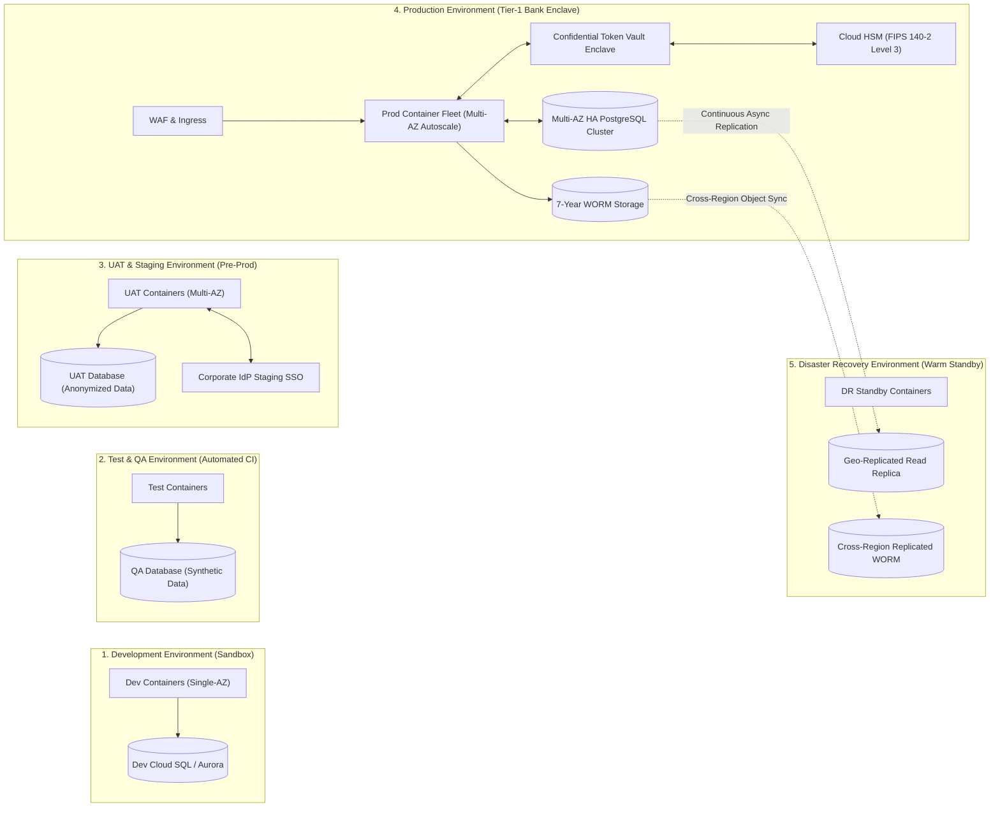

# 🚀 PeX — Cloud Deployment Topology & Environment Architecture

**Document ID:** `PEX-CLOUD-DEPLOYMENT-TOPOLOGY-v0.1`  
**Governing Baseline:** PeX `v1.9.4` (`9e9184b`) / Enterprise Architecture `v0.2`  
**Scope:** Multi-Environment Deployment Topology, CI/CD, and IaC across AWS, GCP, and Azure  
**Date:** September 28, 2026  
**Status:** Approved Reference Deployment Blueprint  

---

## 1. Multi-Environment Staging & Isolation Architecture



---

## 2. Environment Isolation & Infrastructure Specifications

| Environment | Purpose | Infrastructure Scale | High Availability | Data Isolation Policy |
|---|---|---|---|---|
| **Development (`DEV`)** | Feature development and local unit testing. | Single container instance, shared dev database instance. | Single-AZ | Purely synthetic test data; zero real customer records. |
| **Test & QA (`TEST`)** | Automated integration, regression, and CI/CD pipelines. | Ephemeral container instances deployed per pipeline run. | Single-AZ | Automated synthetic transaction generator; refreshed on CI run. |
| **UAT / Staging (`UAT`)** | User acceptance testing, bank officer walkthroughs. | 3 container instances matching production sizing. | Multi-AZ (2 AZs) | Anonymized historical datasets with synthetic PII tokens. |
| **Production (`PROD`)** | Institutional live payment exception resolution. | Autoscaled container fleet (10 to 50 instances across 3 AZs). | Multi-AZ (3 AZs, 99.99%) | Production encrypted vault; FIPS 140-2 Level 3 HSM; WORM storage. |
| **Disaster Recovery (`DR`)**| Regional business continuity standby. | Warm standby container definitions (min 2 instances). | Cross-Region Standby | Continuous asynchronous storage and WORM bucket replication. |

---

## 3. Infrastructure-as-Code (IaC) & CI/CD Pipeline Blueprint

### 3.1. Provider-Neutral Infrastructure-as-Code
- **Framework:** OpenTofu / Terraform $\ge 1.6.0$.
- **Module Structure:**
  ```text
  terraform/
  ├── modules/
  │   ├── network/          # VPC, Subnets, Route Tables, NAT Gateways
  │   ├── compute/          # ECS / Cloud Run / Container Apps Definitions
  │   ├── database/         # Aurora / Cloud SQL / PG Flex PostgreSQL 16
  │   ├── security/         # Cloud KMS, Secrets Manager, IAM Roles
  │   ├── messaging/        # SQS FIFO / PubSub / Service Bus
  │   └── storage/          # WORM S3 / GCS / Azure Blob
  └── environments/
      ├── aws/prod/
      ├── gcp/prod/
      └── azure/prod/
  ```

### 3.2. Automated CI/CD Release Pipeline
1. **Lint & Static Security Analysis:** Flake8, Ruff, Bandit, and SonarQube scanning for zero hardcoded secrets or PII leakage.
2. **Automated Unit & Adversarial Test Gate:** 111 / 111 tests in `tests/` and `backend/tests/` must pass with 0 failures.
3. **Container Image Build & Signing:** Multi-stage Docker build; container images scanned by Trivy/Clair and cryptographically signed with Sigstore / Cosign before pushing to ECR / Artifact Registry / ACR.
4. **Zero-Downtime Deployment Strategy:**
   - **Production Deployment Strategy:** **Blue/Green Deployment with Automated Rollback**.
   - **Traffic Shifting:** 10% canary traffic for 5 minutes; automated health probe verification; 100% cutover upon zero HTTP 5xx errors.
   - **Automated Rollback Trigger:** Triggered immediately if error rate exceeds 0.1% or P99 latency breaches 2,000ms.
