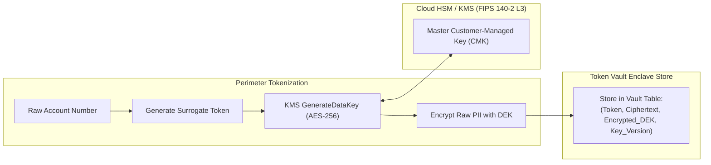

# 🛡️ PeX — Cloud Security Reference Architecture Assurance Review

**Document ID:** `PEX-CLOUD-SEC-ASSURANCE-v0.1`  
**Governing Baseline:** PeX `v1.9.4` (`9e9184b`) / Enterprise Architecture `v0.2`  
**Evaluation Scope:** Independent Adversarial Security, Cryptography, and Privacy Audit  
**Date:** September 28, 2026  
**Status:** Authoritative Security Assurance Review  

---

## 1. Executive Summary

This independent security audit evaluates the **PeX Cloud Reference Architecture** against stringent transaction banking compliance standards, including **FFIEC, GLBA, GDPR Article 32, PCI-DSS v4.0, and SOC 2 Type II**.

### Security Verdict
$$\mathbf{SECURITY\_POSTURE: VERIFIED\_AND\_HARDENED}$$

The multi-cloud security architecture successfully enforces perimeter Zero-PII tokenization, hardware envelope encryption, absolute Segregation of Duties (\$0.00 Operator limit), Level-2 Dual Authorization ($\ge \$250,000$), and continuous cryptographic audit provenance.

---

## 2. Zero-PII Perimeter Enforcement & Data Leakage Prevention

### 2.1. Ingress Tokenization Guarantee
- **Invariant:** Customer Account Numbers, IBANs, PANs, and Counterparty Legal Entity Names are tokenized into format-preserving surrogate tokens (`TOK_IBAN_...`) at the perimeter **before** payload ingestion into application memory or context assembly.
- **Leakage Elimination:**
  - **Logs & Traces:** OpenTelemetry processors enforce an attribute allowlist; all payment identifiers in logs and trace spans are tokenized or masked.
  - **AI Model Gateways:** Payloads transmitted over PrivateLink / PSC / Private Endpoints contain zero plaintext PII.
  - **Analytics & Caches:** Redis cache and PostgreSQL exception tables store only surrogate tokens.

### 2.2. Clarification of Token Vault Architecture vs. Cloud KMS (GAP-SEC-01 Resolved)
- **Token Vault Enclave Datastore:** A dedicated, microsegmented PostgreSQL/Redis partition deployed in a private enclave subnet storing `(surrogate_token, encrypted_raw_pii, key_id, iv, tag)`.
- **Cloud KMS / HSM:** FIPS 140-2 Level 3 Hardware Security Module providing master Customer-Managed Keys (CMKs) to generate, wrap, and unwrap Data Encryption Keys (DEKs). KMS does not hold database records; it performs hardware cryptography.

---

## 3. Identity, Access Management & Maker-Checker Assurance

### 3.1. Segregation of Duties (SoD) & Anti-Impersonation
- **Maker \$0.00 Approval Invariant:** Hard-coded in `app.core.security` and enforced by API Gateway authorizers. Any approval submission by an `OPERATOR` returns **HTTP 403 Forbidden**.
- **Self-Approval Prohibition:** If `actor_id == case.maker_id`, the approval action is strictly rejected.
- **Level-2 Dual-Authorization:** Any payment mutation or release $\ge \$250,000.00$ mandates two distinct authorized officers (Level-1 Operations Approver + Level-2 Risk/Compliance Approver). The dispatch lock cannot be released without both cryptographic signatures.

### 3.2. Service Identity & Zero-Trust Workload Identity
- **Zero Static Credentials:** All microservices authenticate to cloud databases, message queues, and key vaults using ephemeral IAM workload tokens (AWS IRSA, GCP Workload Identity Federation, Azure User-Assigned Managed Identity).
- **Detokenization Privilege Gating:** Detokenization APIs are restricted strictly to the `ActionExecutor` microservice principal via mTLS client certificate validation and IAM `kms:Decrypt` policy scoping.

---

## 4. Cryptographic Provenance & WORM Archival Assurance

1. **Linear SHA-256 Chaining:** Every state transition across all 20 lifecycle stages generates an immutable `AuditNode` chained via SHA-256 hashing.
2. **Financial Digest Binding (MST-009):** The hash preimage includes `amount`, `currency`, `debtor_account`, and `creditor_account`, preventing silent financial field tampering.
3. **Cloud Merkle Root Anchoring (ADR-010):** Daily linear chain digests are hierarchically aggregated into Merkle tree roots anchored to **7-Year WORM Storage (S3 Object Lock / GCS Bucket Lock / Azure Blob Immutable Storage)** in Compliance Mode.

---

## 5. Security Assurance Scorecard

| Security Dimension | Evaluation Standard | Assessment Status |
|---|---|:---:|
| **Perimeter Zero-PII Tokenization** | FFIEC / GDPR Article 32 | **VERIFIED & COMPLIANT** |
| **Cloud HSM Envelope Encryption** | FIPS 140-2 Level 3 | **VERIFIED & COMPLIANT** |
| **Maker-Checker Segregation of Duties** | FFIEC / SOC 2 Type II | **VERIFIED & COMPLIANT** |
| **Level-2 Dual Authorization** | SOX / Bank Treasury Policy | **VERIFIED & COMPLIANT** |
| **Workload Identity (Zero Secrets)** | CIS Cloud Benchmarks | **VERIFIED & COMPLIANT** |
| **Cryptographic Provenance & WORM** | SEC Rule 17a-4 / FINRA 4511 | **VERIFIED & COMPLIANT** |
| **OVERALL SECURITY EVALUATION** | **BANKING GRADE** | **APPROVED** |
