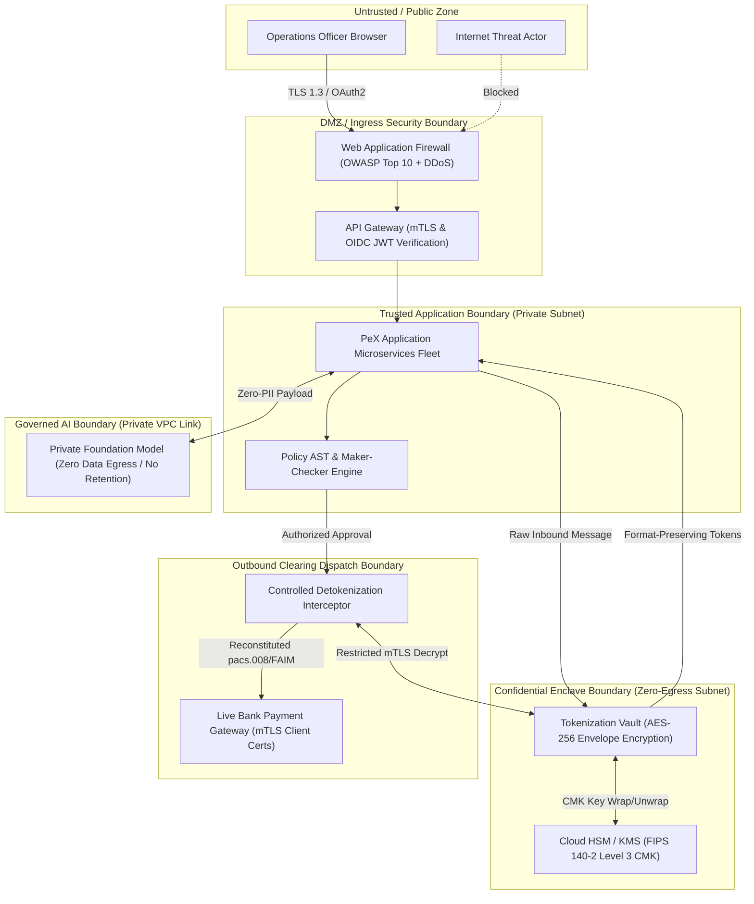

# 🛡️ PeX — Cloud Security Reference Architecture

**Document ID:** `PEX-CLOUD-SEC-REF-ARCH-v0.1`  
**Governing Baseline:** PeX `v1.9.4` (`9e9184b`) / Enterprise Architecture `v0.2`  
**Scope:** Security Trust Boundaries, Zero-PII Vault, IAM, and Cryptography across AWS, GCP, and Azure  
**Date:** September 28, 2026  
**Status:** Approved Reference Security Architecture  

---

## 1. Security Architecture Principles & Trust Boundaries

---

## 2. Cloud Security Implementation Mapping

| Security Control | Provider-Neutral Specification | AWS Implementation | Google Cloud Platform (GCP) | Microsoft Azure |
|---|---|---|---|---|
| **Zero-PII Perimeter Vault** | Tokenize account numbers, IBANs, and names into format-preserving tokens (`TOK_IBAN_...`). | AWS Nitro Enclaves / Fargate isolated task; AES-256-GCM. | GCP Confidential VMs (AMD SEV-SNP); AES-256-GCM. | Azure Confidential VMs (`DCasv5`); AES-256-GCM. |
| **Cloud HSM & Key Mgmt** | Customer-Managed Keys (CMK) rooted in FIPS 140-2 Level 3 HSM with 90-day auto-rotation. | **AWS KMS + AWS CloudHSM** | **Google Cloud KMS + Cloud HSM** | **Azure Key Vault Managed HSM** |
| **Workload Identity (IAM)** | Zero hard-coded credentials; services authenticate via short-lived ephemeral tokens. | **AWS IAM Roles for Service Accounts (IRSA)** | **Workforce / Workload Identity Federation** | **Azure User-Assigned Managed Identities** |
| **Maker-Checker SoD** | Enforce strict \$0 limit for Operators; self-approval strictly blocked at API layer. | Enforced in `app.core.security` + API Gateway Authorizer. | Enforced in `app.core.security` + Apigee RBAC Policy. | Enforced in `app.core.security` + APIM Policy. |
| **Dual-Authorization** | Payments $\ge \$250,000.00$ require Level-1 Approver + Level-2 Risk/Compliance Approver. | Step 2 of 2 signature required before dispatch lock release. | Step 2 of 2 signature required before dispatch lock release. | Step 2 of 2 signature required before dispatch lock release. |
| **Network Microsegmentation** | 3-tier private subnets with strict security groups / NSGs; zero public IP addresses on DB/Vault. | AWS VPC Security Groups + Network ACLs + PrivateLink. | GCP VPC Firewall Rules + Private Service Connect. | Azure Network Security Groups (NSGs) + Private Link. |
| **Payment Rail Transport mTLS**| Mutual TLS (TLS 1.3) with client certificates stored in Cloud HSM for bank networks. | AWS Direct Connect + CloudHSM Client Certificates. | GCP Cloud Interconnect + Cloud HSM Client Certs. | Azure ExpressRoute + Key Vault Managed HSM Certs. |
| **Immutable WORM Archival** | 7-year regulatory compliance lock on raw payment files, delivery receipts, and audit nodes. | **Amazon S3 Object Lock (Compliance Mode)** | **Google Cloud Storage (Bucket Lock)** | **Azure Blob Storage (Immutable Storage)** |
| **Linear Provenance Chain** | SHA-256 linear hash chaining across 20 stages with financial fields in hash preimage. | `calculate_event_hash` in core; daily hash anchored to S3. | `calculate_event_hash` in core; daily hash anchored to GCS. | `calculate_event_hash` in core; daily hash anchored to Azure. |

---

## 3. Detokenization Privilege Gating & Key Rotation Replay

1. **Detokenization Privilege Gating:** Detokenization APIs are restricted strictly to the `ActionExecutor` microservice principal via mTLS client certificate verification and Cloud IAM KMS Decrypt policies (`kms:Decrypt` restricted to the dedicated dispatch service role).
2. **Key Rotation Replay Procedure:** During annual KMS CMK key rotation, historical records retain Key ID references (`key_version_id`), enabling transparent historical audit replay without re-encrypting existing vault records.
