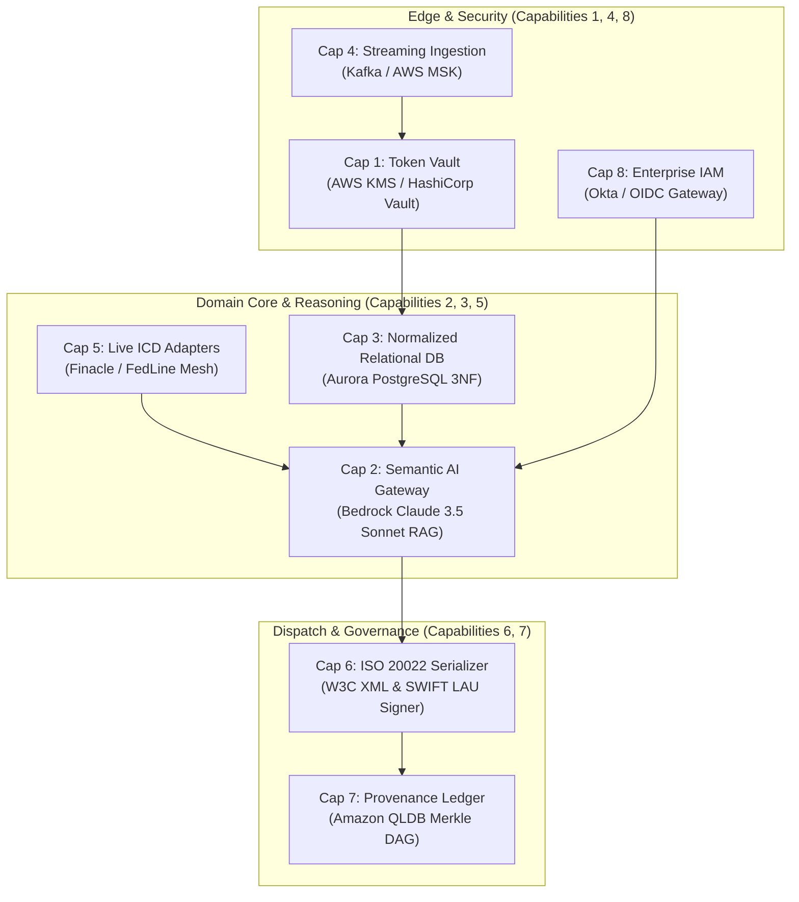
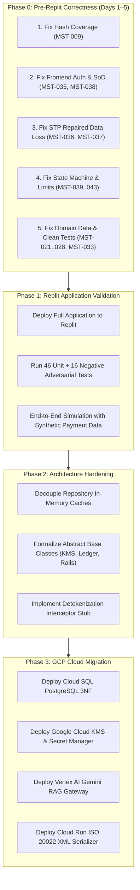

# 📋 PeX Platform: Master Remediation Register & Pre-Remediation Assurance Baseline

**Document ID:** `PEX-MASTER-REMED-001`  
**Document Version:** `1.0.0` (Authoritative Pre-Remediation Baseline)  
**System Evaluated:** Payment Exception Resolution Platform (PeX Desktop Prototype)  
**Workspace Root:** `C:\Users\pawan\.gemini\antigravity\scratch\pex_platform`  
**Audit Coordination:** PeX Master Remediation Register Coordinator  
**Effective Date:** September 23, 2026  
**Governing Inputs:**
* Round 1 Audits: `PEX_VALIDATION_FINDINGS.md`, `domain_standards_audit.md`, `enterprise_architecture_challenge.md`, `requirements_traceability_audit.md`, `functional_adversarial_review.md`, `implementation_code_audit.md`
* Round 2 Audits: `PEX_FINDINGS_RECLASSIFICATION.md`, `PEX_AUDIT_RECONCILIATION_SUMMARY.md`, `PEX_NEW_DISCOVERIES.md`, `PEX_ARCHITECTURE_BOUNDARY_ASSESSMENT.md`, `review_01_reclassification.md`, `review_02_domain_grounding.md`, `review_03_prototype_defects.md`, `review_04_architecture_boundaries.md`

---

## 1. Executive Decision Gate & Scorecard

### 1.1 Core Mission Statement
> **"After the two audit rounds, what are the actual PeX problems we need to address, what is intentionally deferred, what is documentation/design work, and what must be proven by testing before we proceed to Replit and eventually GCP?"**

This document establishes the **single authoritative remediation backlog** for PeX. It reconciles the 34 original audit findings with the 16 second-level defect discoveries, deduplicating overlapping items to produce a unified register of **47 distinct canonical issues**.

```
┌──────────────────────────────────────────────────────────────────────────────────────────────────┐
│                         MASTER REMEDIATION DISPOSITION SCORECARD                                 │
├──────────────────────────────────────┬─────────────┬─────────────┬───────────────────────────────┤
│ Primary Disposition Category         │ Count       │ Percentage  │ Execution Target              │
├──────────────────────────────────────┼─────────────┼─────────────┼───────────────────────────────┤
│ 🔴 FIX_NOW (P0 Critical Defects)     │      8      │    17.0%    │ Phase 0 (Pre-Replit Days 1-2) │
│ 🟠 FIX_BEFORE_REPLIT (P1 Defects)    │     18      │    38.3%    │ Phase 0 (Pre-Replit Days 3-5) │
│ 🟡 DESIGN_DECISION_REQUIRED          │      3      │     6.4%    │ Phase 0 Architecture Align    │
│ 📄 DOCUMENTATION_ONLY                │      3      │     6.4%    │ Phase 0 Blueprint Updates     │
│ 🧪 TEST_COVERAGE_REQUIRED            │      1      │     2.1%    │ Phase 0 Security Test Suite   │
│ ⚪ NEEDS_EXTERNAL_VERIFICATION       │      1      │     2.1%    │ Phase 1 Replit Sandbox        │
│ 🔵 FIX_BEFORE_GCP (Cloud Components) │      2      │     4.3%    │ Phase 3 GCP Cloud Migration   │
│ 🟣 KNOWN_DEFERRED (Enterprise Scope) │     11      │    23.4%    │ Phase 3 GCP Cloud Migration   │
├──────────────────────────────────────┼─────────────┼─────────────┼───────────────────────────────┤
│ TOTAL CANONICAL MASTER FINDINGS      │     47      │   100.0%    │ 100% Reconciled & Mapped      │
├──────────────────────────────────────┼─────────────┼─────────────┼───────────────────────────────┤
│ 🔄 DUPLICATE_OF_EXISTING_FINDING     │      3      │      -      │ Deduplicated into Master IDs  │
└──────────────────────────────────────┴─────────────┴─────────────┴───────────────────────────────┘
```

### 1.2 Executive Decision Gate Q&A

1. **How many distinct findings remain after deduplication?**
   **47 distinct canonical findings** (34 from Round 1 + 13 genuinely new from Round 2; 3 Round 2 items were deduplicated as direct children of Round 1 findings).
2. **How many require code changes?**
   **26 findings** require code modifications in the prototype (8 `FIX_NOW` + 18 `FIX_BEFORE_REPLIT`).
3. **How many are domain-data corrections?**
   **7 findings** require correcting invalid reference fixtures, IBAN formats, IMAD strings, and ISO return reason codes.
4. **How many are design decisions?**
   **3 findings** require policy alignment (`SEC-04` CORS, `IAM-02` maker-checker API enforcement, `AI-02` autonomous STP vs 100% HITL).
5. **How many are documentation-only?**
   **3 findings** require correcting statements in the PRD and Technical Blueprint (`DOM-02` SWIFT LAU, `DOM-03` Target2 bridge, `AUD-02` Merkle labeling).
6. **How many are intentionally deferred?**
   **13 findings** (11 `KNOWN_DEFERRED` + 2 `FIX_BEFORE_GCP`) belonging to the 8 planned enterprise cloud capabilities.
7. **How many must be fixed before Replit?**
   **26 code fixes + 7 domain data fixes + 3 design alignments = 36 total work items** must be resolved before deploying into the Replit testing sandbox.
8. **How many can wait until GCP?**
   **13 enterprise cloud infrastructure items** (AWS KMS/Vault, Aurora 3NF DB, Kafka MSK, Bedrock Claude RAG, Okta OIDC SSO, QLDB Ledger, Live ICD Adapters, W3C XML Serializer).
9. **Does the canonical domain model require redesign?**
   **NO.** The core canonical models (`PeXCase`, `CanonicalPayment`, `CanonicalException` in `backend/app/schemas/canonical.py`) are structurally sound (Grade B+) and remain 100% stable.
10. **Does the current architecture remain viable for the next phase?**
    **YES.** All 15 architectural boundaries are decoupled via modular service interfaces, permitting clean substitution in cloud production.
11. **What are the top risks that must not be carried forward to Replit?**
    * *Risk 1:* Cryptographic provenance digest omitting financial amounts (`MST-009` / `AUD-01`).
    * *Risk 2:* Frontend dispatch button omitting auth headers and impersonating Approver Daniel Osei (`MST-035` / `DEF-01`).
    * *Risk 3:* STP fast-lane executing "phantom settlements" by dropping AI repairs (`MST-036` / `DEF-02`).
    * *Risk 4:* Ingestion endpoints skipping 11 lifecycle stages to jump straight to `PENDING_APPROVAL` (`MST-042` / `DEF-09`).
    * *Risk 5:* Level-2 Dual Authorization bypass when an approver modifies a high-value proposal (`MST-041` / `DEF-08`).
12. **What evidence must exist before we declare the Replit validation successful?**
    All 46 existing unit/adversarial tests must pass, plus 16 new negative adversarial tests verifying cryptographic tamper detection, SoD enforcement, and STP repair persistence.

---

## 2. Master Canonical Remediation Register

The table below catalogs every distinct issue discovered across both validation rounds:

| Master ID | Original ID(s) | Round 2 ID(s) | Category | Severity | Title | Disposition | Code Location | Survives Cloud? | Target Phase |
| :--- | :--- | :--- | :--- | :---: | :--- | :--- | :--- | :---: | :---: |
| **MST-001** | `SEC-01` | - | Security | CRITICAL | In-Memory Unsalted SHA-256 Token Vault | `KNOWN_DEFERRED` | `core/tokenization.py:11-37` | **NO** | Phase 3 (GCP) |
| **MST-002** | `SEC-02` | - | Security | CRITICAL | Plaintext Storage of Account Numbers in DB | `KNOWN_DEFERRED` | `db/models.py:98-107` | **NO** | Phase 3 (GCP) |
| **MST-003** | `SEC-03` | - | Security | CRITICAL | Omission of Outbound Detokenization Kernel | `KNOWN_DEFERRED` | `services/action_executor.py:65`| **NO** | Phase 3 (GCP) |
| **MST-004** | `SEC-04` | - | Security | LOW | Permissive Wildcard CORS Configuration | `DESIGN_DECISION_REQUIRED` | `main.py:32-38` | **UNCERTAIN** | Phase 0 (Pre-Replit)|
| **MST-005** | `IAM-01` | - | IAM | CRITICAL | Unauthenticated API Defaulting to Approver | `KNOWN_DEFERRED` | `endpoints/cases.py:24` | **NO** | Phase 3 (GCP) |
| **MST-006** | `IAM-02` | - | IAM | CRITICAL | Maker-Checker Role Check Endpoint Bypass | `DESIGN_DECISION_REQUIRED` | `services/approval_engine.py:42`| **YES** | Phase 0 (Pre-Replit)|
| **MST-007** | `AI-01` | - | AI / LLM | HIGH | Deterministic Mock LLM Service | `KNOWN_DEFERRED` | `services/ai_service.py:10-85` | **NO** | Phase 3 (GCP) |
| **MST-008** | `AI-02` | - | Architecture | HIGH | Autonomous STP vs 100% HITL Policy Conflict | `DESIGN_DECISION_REQUIRED` | PRD Blueprint §4.2 | **YES** | Phase 0 (Pre-Replit)|
| **MST-009** | `AUD-01` | `DEF-12` | Audit | CRITICAL | Monetary Amount Omitted from Audit Hash | `FIX_NOW` | `core/hashing.py:9-30` | **YES** | Phase 0 (Pre-Replit)|
| **MST-010** | `AUD-02` | - | Audit | MEDIUM | Linear Hash Chain Mislabeled as Merkle Ledger| `DOCUMENTATION_ONLY` | PRD Blueprint §7.1 | **NO** | Phase 0 (Pre-Replit)|
| **MST-011** | `AUD-03` | `DEF-06` | Audit | HIGH | Double Audit Event Logging on Approvals | `FIX_BEFORE_REPLIT` | `endpoints/approvals.py:32` | **YES** | Phase 0 (Pre-Replit)|
| **MST-012** | `AUD-04` | - | Audit | MEDIUM | Truncated Timestamps & Singleton Lock Race | `KNOWN_DEFERRED` | `core/hashing.py:44` | **NO** | Phase 3 (GCP) |
| **MST-013** | `DATA-01`| - | Database | HIGH | Denormalized SQLite Schema & JSON Blobs | `KNOWN_DEFERRED` | `db/models.py:25-95` | **NO** | Phase 3 (GCP) |
| **MST-014** | `DATA-02`| - | Database | LOW | ISO Timestamps Stored as Plain Strings | `KNOWN_DEFERRED` | `db/models.py:35` | **NO** | Phase 3 (GCP) |
| **MST-015** | `DATA-03`| - | Database | HIGH | In-Memory Cache Singleton Desynchronization | `KNOWN_DEFERRED` | `db/repository.py:31-40` | **NO** | Phase 3 (GCP) |
| **MST-016** | `INT-01` | - | Integration | MEDIUM | Mock In-Memory ICD Staging Registry | `KNOWN_DEFERRED` | `services/icd_staging_service.py`| **NO** | Phase 3 (GCP) |
| **MST-017** | `INT-02` | - | Integration | HIGH | Simulated JSON Settlement Dispatch Receipts | `KNOWN_DEFERRED` | `services/action_executor.py:80`| **NO** | Phase 3 (GCP) |
| **MST-018** | `RES-01` | - | Reliability | HIGH | STP Batch Transaction Session Leak | `FIX_BEFORE_REPLIT` | `services/stp_engine.py:380-420`| **YES** | Phase 0 (Pre-Replit)|
| **MST-019** | `RES-02` | - | Reliability | LOW | Silent Swallowing of Datetime Exceptions | `FIX_BEFORE_REPLIT` | `db/repository.py:255` | **YES** | Phase 0 (Pre-Replit)|
| **MST-020** | `API-01` | - | Contract | MEDIUM | TypeScript vs Pydantic Schema Divergence | `FIX_BEFORE_REPLIT` | `frontend/src/types/` | **YES** | Phase 0 (Pre-Replit)|
| **MST-021** | `DOM-01` | - | Domain | CRITICAL | Fabricated US & JP IBAN Formats | `FIX_BEFORE_REPLIT` | `tests/test_canonicalizer.py` | **YES** | Phase 0 (Pre-Replit)|
| **MST-022** | `DOM-02` | - | Domain | MEDIUM | SWIFT LAU Mislabeled as X.509 PKI | `DOCUMENTATION_ONLY` | PRD Blueprint §6.3 | **YES** | Phase 0 (Pre-Replit)|
| **MST-023** | `DOM-03` | - | Domain | MEDIUM | Non-Existent "FEDWIRE_TARGET2_BRIDGE" | `DOCUMENTATION_ONLY` | Taxonomy SME Card #14 | **YES** | Phase 0 (Pre-Replit)|
| **MST-024** | `DOM-04` | - | Domain | HIGH | Invalid German IBAN Fixtures (26 chars) | `FIX_BEFORE_REPLIT` | `services/ai_service.py:121` | **YES** | Phase 0 (Pre-Replit)|
| **MST-025** | `DOM-05` | - | Domain | HIGH | ISO Return Reason Code `AC01` Misapplied | `FIX_BEFORE_REPLIT` | Taxonomy SME Card #32 | **YES** | Phase 0 (Pre-Replit)|
| **MST-026** | `DOM-06` | - | Domain | HIGH | `pacs.004` vs `camt.056` Message Conflation | `FIX_BEFORE_REPLIT` | PRD Blueprint §5.4 | **YES** | Phase 0 (Pre-Replit)|
| **MST-027** | `DOM-07` | - | Domain | MEDIUM | Non-Standard Payment Purpose Codes | `FIX_BEFORE_REPLIT` | `tests/test_scenarios.py:85` | **YES** | Phase 0 (Pre-Replit)|
| **MST-028** | `DOM-08` | - | Domain | MEDIUM | Fedwire IMAD Format Invalid (22 chars) | `FIX_BEFORE_REPLIT` | `db/repository.py:155` | **YES** | Phase 0 (Pre-Replit)|
| **MST-029** | `DOM-09` | - | Domain | LOW | Bacs Clearing Misrepresented as RTGS | `FIX_BEFORE_REPLIT` | PRD Blueprint §3.2 | **YES** | Phase 0 (Pre-Replit)|
| **MST-030** | `CODE-01`| - | Codebase | HIGH | Dual Disconnected Frontend Codebases | `FIX_BEFORE_REPLIT` | `frontend/src/` vs root script | **YES** | Phase 0 (Pre-Replit)|
| **MST-031** | `CODE-02`| - | Codebase | LOW | Orphaned Root Test & Generator Scripts | `FIX_BEFORE_REPLIT` | Root workspace files | **YES** | Phase 0 (Pre-Replit)|
| **MST-032** | `DEP-01` | - | Codebase | LOW | Deprecated Pydantic V1 `.dict()` Calls | `FIX_BEFORE_REPLIT` | Across 14 backend files | **YES** | Phase 0 (Pre-Replit)|
| **MST-033** | `TST-01` | `DEF-11` | Testing | HIGH | 13 Root Scripts Polluting Pytest Discovery | `FIX_NOW` | Root workspace (`test_*.py`) | **YES** | Phase 0 (Pre-Replit)|
| **MST-034** | `TST-02` | - | Testing | MEDIUM | Missing Negative Cryptographic Tests | `TEST_COVERAGE_REQUIRED`| `tests/test_audit_trail.py` | **YES** | Phase 0 (Pre-Replit)|
| **MST-035** | - | `DEF-01` | IAM | CRITICAL | Frontend Dispatch Omits Auth (Daniel Osei) | `FIX_NOW` | `build_guided_frontend.py:1537`| **YES** | Phase 0 (Pre-Replit)|
| **MST-036** | - | `DEF-02` | STP Engine | CRITICAL | STP Fast-Lane Drops Repaired Changes | `FIX_NOW` | `services/stp_engine.py:249` | **YES** | Phase 0 (Pre-Replit)|
| **MST-037** | - | `DEF-03` | Codebase | CRITICAL | Missing `Session` Import in `stp_engine.py` | `FIX_NOW` | `services/stp_engine.py:233` | **YES** | Phase 0 (Pre-Replit)|
| **MST-038** | - | `DEF-04` | Governance | CRITICAL | `auto_approve` Flag Bypasses Maker-Checker | `FIX_NOW` | `endpoints/rules.py:82-106` | **YES** | Phase 0 (Pre-Replit)|
| **MST-039** | - | `DEF-05` | Canonical | CRITICAL | Canonicalizer Omits Domain Assignment | `FIX_NOW` | `services/canonicalizer.py:177` | **YES** | Phase 0 (Pre-Replit)|
| **MST-040** | - | `DEF-07` | State Machine| HIGH | Approvals Allowed on `INVESTIGATING` State | `FIX_BEFORE_REPLIT` | `services/approval_engine.py:36`| **YES** | Phase 0 (Pre-Replit)|
| **MST-041** | - | `DEF-08` | State Machine| HIGH | `MODIFY` Action Bypasses Dual Authorization | `FIX_BEFORE_REPLIT` | `services/approval_engine.py:85`| **YES** | Phase 0 (Pre-Replit)|
| **MST-042** | - | `DEF-09` | State Machine| HIGH | Ingestion Endpoints Set `PENDING_APPROVAL` | `FIX_BEFORE_REPLIT` | `endpoints/events.py:35` | **YES** | Phase 0 (Pre-Replit)|
| **MST-043** | - | `DEF-10` | Governance | HIGH | `check_can_approve` Ignores Monetary Limits | `FIX_BEFORE_REPLIT` | `core/security.py:112-120` | **YES** | Phase 0 (Pre-Replit)|
| **MST-044** | - | `DEF-13` | Contract | MEDIUM | `events/ingest` Creates Incomplete Cases | `FIX_BEFORE_REPLIT` | `endpoints/events.py:19-44` | **YES** | Phase 0 (Pre-Replit)|
| **MST-045** | - | `DEF-14` | UI Contract | MEDIUM | Ontology Inspector Hardcodes Static Context| `FIX_BEFORE_REPLIT` | `endpoints/ontology.py:128` | **YES** | Phase 0 (Pre-Replit)|
| **MST-046** | - | `DEF-15` | Analytics | MEDIUM | SLA Velocity Counts `REJECTED` Cases as Open | `FIX_BEFORE_REPLIT` | `endpoints/analytics.py:86` | **YES** | Phase 0 (Pre-Replit)|
| **MST-047** | - | `DEF-16` | Routing | LOW | SPA Catch-All Route Swallows Bad API Paths | `FIX_BEFORE_REPLIT` | `main.py:73-80` | **YES** | Phase 0 (Pre-Replit)|

---

## 3. Reconciliation of the 8 Known Deferred Enterprise Capabilities



### Capability 1: Enterprise Token Vault & Outbound Detokenization
* **Current Prototype:** `backend/app/core/tokenization.py` stores unsalted SHA-256 surrogate tokens in an in-memory dictionary. `backend/app/db/models.py` stores account numbers in plaintext.
* **Intended Production:** AWS KMS / HashiCorp Vault tokenization kernel executing inside an isolated AWS Nitro Enclave (PCI-DSS Scoped Environment).
* **Associated Findings:** `MST-001` (`SEC-01`), `MST-002` (`SEC-02`), `MST-003` (`SEC-03`).
* **Disappears Post-Cloud:** `MST-001`, `MST-002`, `MST-003` (All 3 disappear when KMS vault is provisioned).
* **Remains Post-Cloud:** None.
* **Stable Interface Contract:** `tokenize_payment_pii(pmt: CanonicalPayment) -> Tuple[CanonicalPayment, TokenMap]`, `detokenize_field(token: str) -> str`.
* **Unresolved Architectural Risks:** Performance overhead of network RPC calls to vault during high-throughput STP execution (target < 5ms).
* **Acceptance Criteria:** 100% of PII fields masked with format-preserving surrogate tokens; ciphertext encrypted under KMS CMK; zero PII logged in application traces.

### Capability 2: Semantic Layer & Dynamic LLM Gateway
* **Current Prototype:** `backend/app/services/ai_service.py` uses hardcoded rule template dictionaries.
* **Intended Production:** Amazon Bedrock / Anthropic Claude 3.5 Sonnet with vector retrieval over corporate SOPs, clearing rulebooks, and historical case resolutions.
* **Associated Findings:** `MST-007` (`AI-01`).
* **Disappears Post-Cloud:** `MST-007` (Mock LLM replaced by dynamic LLM).
* **Remains Post-Cloud:** `MST-008` (Policy alignment on whether LLM can autonomously settle payments).
* **Stable Interface Contract:** `generate_ai_recommendation(context: CaseContext) -> AIRepairProposal`.
* **Unresolved Architectural Risks:** Non-deterministic LLM output violating ISO 20022 schema constraints (mitigated by Pydantic JSON schema output enforcement).
* **Acceptance Criteria:** Model Gateway produces structured JSON conforming to `AIRepairProposal` with citation grounding in retrieved SOP documents.

### Capability 3: Normalized 3NF Relational Canonical Database
* **Current Prototype:** SQLite database storing full `case_data`, `payment_data`, and `exception_data` as serialized JSON text blobs (`models.py`).
* **Intended Production:** Amazon Aurora PostgreSQL Multi-AZ with normalized 3NF schema, B-tree indexes, and TimescaleDB partitions.
* **Associated Findings:** `MST-013` (`DATA-01`), `MST-014` (`DATA-02`), `MST-015` (`DATA-03`).
* **Disappears Post-Cloud:** `MST-013`, `MST-014`, `MST-015` (All 3 disappear with PostgreSQL migration).
* **Remains Post-Cloud:** None.
* **Stable Interface Contract:** `repository.get_case(case_id)`, `repository.save_case(case_obj)`.
* **Unresolved Architectural Risks:** Migration complexity of decomposing legacy JSON blobs into relational tables without service disruption.
* **Acceptance Criteria:** Sub-10ms query latency on 5,000,000+ historical exception records; zero in-memory singleton caches.

### Capability 4: High-Throughput Streaming Ingestion
* **Current Prototype:** Synchronous REST API endpoints (`POST /api/events/ingest`, `POST /api/cases/initiate`).
* **Intended Production:** Apache Kafka / AWS MSK distributed streaming pipeline with Kafka Connect, schema validation, and dead-letter queue (DLQ) suspense.
* **Associated Findings:** `MST-015` (`DATA-03`), `MST-042` (`DEF-09`).
* **Disappears Post-Cloud:** Synchronous ingestion bottlenecks.
* **Remains Post-Cloud:** `MST-042` (State machine logic must still transition cases through `INGESTED` and `INVESTIGATING`).
* **Stable Interface Contract:** `CanonicalEventMessage` schema.
* **Unresolved Architectural Risks:** Partition rebalancing lag during clearing traffic bursts.
* **Acceptance Criteria:** Sustained 5,000+ events/sec intake throughput with < 100ms end-to-end ingestion latency.

### Capability 5: Live Core Banking & Clearing ICD Adapters
* **Current Prototype:** `backend/app/services/icd_staging_service.py` maintains an in-memory dictionary of simulated accounts.
* **Intended Production:** Microservice mesh with mTLS adapters connecting to Finacle, FedLine Direct, SWIFT BIC directory, and Dow Jones Watchlists.
* **Associated Findings:** `MST-016` (`INT-01`).
* **Disappears Post-Cloud:** `MST-016` (Replaced by live core adapters).
* **Remains Post-Cloud:** None.
* **Stable Interface Contract:** `ICDStagingAdapter.verify_account(account_id, bic) -> ICDVerificationResult`.
* **Unresolved Architectural Risks:** Upstream legacy core banking latency and downtime during settlement cutoffs.
* **Acceptance Criteria:** Live account verification latency < 250ms with automatic circuit breaker fallback.

### Capability 6: Outbound ISO 20022 XML Serializer & LAU Signer
* **Current Prototype:** `backend/app/services/action_executor.py` generates synthetic JSON dispatch receipts.
* **Intended Production:** W3C DOM ISO 20022 XML serialization engine with SWIFT CBPR+ RFC 2104 LAU HMAC signing.
* **Associated Findings:** `MST-017` (`INT-02`), `MST-026` (`DOM-06`).
* **Disappears Post-Cloud:** `MST-017` (JSON receipts replaced by validated XML messages).
* **Remains Post-Cloud:** `MST-026` (Code must still select correct message type: `camt.056` for recall vs `pacs.004` for return).
* **Stable Interface Contract:** `action_executor.execute_settlement_action(case_id, action_type, changes) -> DispatchReceipt`.
* **Unresolved Architectural Risks:** XML schema validation failures against strict SWIFT CBPR+ market practice rules.
* **Acceptance Criteria:** Validated XML output conforming to ISO 20022 XSD schemas; RFC 2104 LAU signature verifiable by clearing simulator.

### Capability 7: Hierarchical Cryptographic Provenance Ledger
* **Current Prototype:** `backend/app/core/hashing.py` computes SHA-256 hashes linking sequential rows in SQLite.
* **Intended Production:** Amazon QLDB (Quantum Ledger Database) or Hyperledger Fabric Merkle DAG with cryptographic verification receipts.
* **Associated Findings:** `MST-009` (`AUD-01`), `MST-010` (`AUD-02`), `MST-012` (`AUD-04`).
* **Disappears Post-Cloud:** `MST-010`, `MST-012` (Merkle labeling and timestamp precision resolved by QLDB).
* **Remains Post-Cloud:** `MST-009` (Hash preimage function must include monetary amount and accounts).
* **Stable Interface Contract:** `calculate_event_hash(...) -> str`, `verify_case_audit_trail(case_id) -> bool`.
* **Unresolved Architectural Risks:** QLDB service throughput limits under high-volume batch STP releases.
* **Acceptance Criteria:** Mathematically tamper-evident Merkle proof tree; cryptographically verifiable by independent third-party auditors.

### Capability 8: Enterprise IAM & OAuth2/OIDC SSO Gateway
* **Current Prototype:** FastAPI endpoint headers (`X-User-Id`, `X-User-Role`) with local persona switching dropdown in UI.
* **Intended Production:** Okta / PingFederate / AWS Cognito API Gateway validating signed JWT bearer tokens with embedded RBAC claims.
* **Associated Findings:** `MST-005` (`IAM-01`), `MST-006` (`IAM-02`), `MST-035` (`DEF-01`), `MST-043` (`DEF-10`).
* **Disappears Post-Cloud:** `MST-005` (Unauthenticated API defaults eliminated by API Gateway JWT enforcement).
* **Remains Post-Cloud:** `MST-006`, `MST-035`, `MST-043` (Application-level Maker-Checker logic and persona limits must be enforced in code).
* **Stable Interface Contract:** `get_current_user_persona(token: str) -> UserPersona`.
* **Unresolved Architectural Risks:** Token expiration handling during long-running multi-stage approvals.
* **Acceptance Criteria:** Zero unauthenticated endpoints; RBAC enforced at API gateway; persona permissions checked on every state mutation.

---

## 4. Reconciled Original 34 Findings Matrix

| Original ID | Original Severity | Master ID | Final Disposition | Category Classification | Survives Cloud? | Source Code / Evidence |
| :--- | :---: | :---: | :--- | :--- | :---: | :--- |
| `SEC-01` | CRITICAL | `MST-001` | `KNOWN_DEFERRED` | Deferred Infrastructure | **NO** | `core/tokenization.py:11-37` |
| `SEC-02` | CRITICAL | `MST-002` | `KNOWN_DEFERRED` | Deferred Infrastructure | **NO** | `db/models.py:98-107` |
| `SEC-03` | CRITICAL | `MST-003` | `KNOWN_DEFERRED` | Deferred Infrastructure | **NO** | `services/action_executor.py:65` |
| `SEC-04` | LOW | `MST-004` | `DESIGN_DECISION_REQUIRED`| Design & Security Config | **UNCERTAIN** | `main.py:32-38` |
| `IAM-01` | CRITICAL | `MST-005` | `KNOWN_DEFERRED` | Deferred Infrastructure | **NO** | `endpoints/cases.py:24` |
| `IAM-02` | CRITICAL | `MST-006` | `DESIGN_DECISION_REQUIRED`| Design & Workflow Defect | **YES** | `services/approval_engine.py:42` |
| `AI-01` | HIGH | `MST-007` | `KNOWN_DEFERRED` | Deferred Infrastructure | **NO** | `services/ai_service.py:10-85` |
| `AI-02` | HIGH | `MST-008` | `DESIGN_DECISION_REQUIRED`| Architectural Policy | **YES** | PRD Blueprint §4.2 |
| `AUD-01` | HIGH | `MST-009` | `FIX_NOW` | Genuine Code Defect | **YES** | `core/hashing.py:9-30` |
| `AUD-02` | MEDIUM | `MST-010` | `DOCUMENTATION_ONLY` | Documentation Gap | **NO** | PRD Blueprint §7.1 |
| `AUD-03` | MEDIUM | `MST-011` | `FIX_BEFORE_REPLIT` | Genuine Code Defect | **YES** | `endpoints/approvals.py:32` |
| `AUD-04` | MEDIUM | `MST-012` | `KNOWN_DEFERRED` | Deferred Infrastructure | **NO** | `core/hashing.py:44` |
| `DATA-01`| HIGH | `MST-013` | `KNOWN_DEFERRED` | Deferred Infrastructure | **NO** | `db/models.py:25-95` |
| `DATA-02`| LOW | `MST-014` | `KNOWN_DEFERRED` | Deferred Infrastructure | **NO** | `db/models.py:35` |
| `DATA-03`| HIGH | `MST-015` | `KNOWN_DEFERRED` | Deferred Infrastructure | **NO** | `db/repository.py:31-40` |
| `INT-01` | MEDIUM | `MST-016` | `KNOWN_DEFERRED` | Deferred Infrastructure | **NO** | `services/icd_staging_service.py` |
| `INT-02` | HIGH | `MST-017` | `KNOWN_DEFERRED` | Deferred Infrastructure | **NO** | `services/action_executor.py:80` |
| `RES-01` | HIGH | `MST-018` | `FIX_BEFORE_REPLIT` | Genuine Code Defect | **YES** | `services/stp_engine.py:380-420` |
| `RES-02` | LOW | `MST-019` | `FIX_BEFORE_REPLIT` | Genuine Code Defect | **YES** | `db/repository.py:255` |
| `API-01` | MEDIUM | `MST-020` | `FIX_BEFORE_REPLIT` | Genuine Code Defect | **YES** | `frontend/src/types/` |
| `DOM-01` | CRITICAL | `MST-021` | `FIX_BEFORE_REPLIT` | Payment Domain Error | **YES** | `tests/test_canonicalizer.py` |
| `DOM-02` | MEDIUM | `MST-022` | `DOCUMENTATION_ONLY` | Documentation Gap | **YES** | PRD Blueprint §6.3 |
| `DOM-03` | MEDIUM | `MST-023` | `DOCUMENTATION_ONLY` | Documentation Gap | **YES** | Taxonomy SME Card #14 |
| `DOM-04` | HIGH | `MST-024` | `FIX_BEFORE_REPLIT` | Payment Domain Error | **YES** | `services/ai_service.py:121` |
| `DOM-05` | HIGH | `MST-025` | `FIX_BEFORE_REPLIT` | Payment Domain Error | **YES** | Taxonomy SME Card #32 |
| `DOM-06` | HIGH | `MST-026` | `FIX_BEFORE_REPLIT` | Payment Domain Error | **YES** | PRD Blueprint §5.4 |
| `DOM-07` | MEDIUM | `MST-027` | `FIX_BEFORE_REPLIT` | Payment Domain Error | **YES** | `tests/test_scenarios.py:85` |
| `DOM-08` | MEDIUM | `MST-028` | `FIX_BEFORE_REPLIT` | Payment Domain Error | **YES** | `db/repository.py:155` |
| `DOM-09` | LOW | `MST-029` | `FIX_BEFORE_REPLIT` | Payment Domain Error | **YES** | PRD Blueprint §3.2 |
| `CODE-01`| HIGH | `MST-030` | `FIX_BEFORE_REPLIT` | Codebase Architecture | **YES** | `frontend/src/` vs root script |
| `CODE-02`| LOW | `MST-031` | `FIX_BEFORE_REPLIT` | Codebase Hygiene | **YES** | Root workspace files |
| `DEP-01` | LOW | `MST-032` | `FIX_BEFORE_REPLIT` | Codebase Hygiene | **YES** | Across 14 backend files |
| `TST-01` | HIGH | `MST-033` | `FIX_NOW` | Test Suite Hygiene | **YES** | Root workspace (`test_*.py`) |
| `TST-02` | MEDIUM | `MST-034` | `TEST_COVERAGE_REQUIRED`| Test Coverage Gap | **YES** | `tests/test_audit_trail.py` |

---

## 5. Reconciliation of Round 2 Discoveries (`DEF-01` through `DEF-16`)

| Round 2 ID | Master ID | Deduplication Status | Severity | Title | Code Location | Disposition |
| :--- | :---: | :--- | :---: | :--- | :--- | :--- |
| `DEF-01` | `MST-035` | **Genuinely New** | CRITICAL | Frontend Dispatch Omits Auth (Daniel Osei) | `build_guided_frontend.py:1537` | `FIX_NOW` |
| `DEF-02` | `MST-036` | **Genuinely New** | CRITICAL | STP Fast-Lane Drops Repaired Changes | `services/stp_engine.py:249, 392` | `FIX_NOW` |
| `DEF-03` | `MST-037` | **Genuinely New** | CRITICAL | Missing `Session` Import in `stp_engine.py` | `services/stp_engine.py:233, 364` | `FIX_NOW` |
| `DEF-04` | `MST-038` | **Genuinely New** | CRITICAL | `auto_approve` Flag Bypasses Maker-Checker | `endpoints/rules.py:82-106` | `FIX_NOW` |
| `DEF-05` | `MST-039` | **Genuinely New** | CRITICAL | Canonicalizer Omits Domain Assignment | `services/canonicalizer.py:177` | `FIX_NOW` |
| `DEF-06` | `MST-011` | **Duplicate of `AUD-03`**| HIGH | Double Audit Event Logging on Approvals | `endpoints/approvals.py:32` | `FIX_BEFORE_REPLIT` |
| `DEF-07` | `MST-040` | **Genuinely New** | HIGH | Approvals Allowed on `INVESTIGATING` State | `services/approval_engine.py:36` | `FIX_BEFORE_REPLIT` |
| `DEF-08` | `MST-041` | **Genuinely New** | HIGH | `MODIFY` Action Bypasses Dual Authorization | `services/approval_engine.py:85` | `FIX_BEFORE_REPLIT` |
| `DEF-09` | `MST-042` | **Genuinely New** | HIGH | Ingestion Endpoints Set `PENDING_APPROVAL` | `endpoints/events.py:35` | `FIX_BEFORE_REPLIT` |
| `DEF-10` | `MST-043` | **Genuinely New** | HIGH | `check_can_approve` Ignores Monetary Limits | `core/security.py:112-120` | `FIX_BEFORE_REPLIT` |
| `DEF-11` | `MST-033` | **Duplicate of `TST-01`**| HIGH | 13 Root Test Scripts Pollute Discovery | Root workspace (`test_*.py`) | `FIX_NOW` |
| `DEF-12` | `MST-009` | **Duplicate of `AUD-01`**| CRITICAL | Monetary Amount Omitted from Audit Hash | `core/hashing.py:9-30` | `FIX_NOW` |
| `DEF-13` | `MST-044` | **Genuinely New** | MEDIUM | `events/ingest` Creates Incomplete Cases | `endpoints/events.py:19-44` | `FIX_BEFORE_REPLIT` |
| `DEF-14` | `MST-045` | **Genuinely New** | MEDIUM | Ontology Inspector Hardcodes Static Context | `endpoints/ontology.py:128` | `FIX_BEFORE_REPLIT` |
| `DEF-15` | `MST-046` | **Genuinely New** | MEDIUM | SLA Velocity Counts `REJECTED` Cases as Open| `endpoints/analytics.py:86` | `FIX_BEFORE_REPLIT` |
| `DEF-16` | `MST-047` | **Genuinely New** | LOW | SPA Catch-All Route Swallows Bad API Paths | `main.py:73-80` | `FIX_BEFORE_REPLIT` |

---

## 6. Replit Entry Gate ("Fix Before Replit" List)

The items in this section represent the **mandatory entry criteria** before deploying PeX into the Replit sandbox environment. The Replit sandbox will validate the end-to-end payment exception lifecycle using synthetic data; therefore, all workflow, state machine, domain standards, and authorization logic must be correct.

```
┌──────────────────────────────────────────────────────────────────────────────────────────────────┐
│                                 REPLIT ENTRY GATE SUMMARY                                        │
├──────────────────────────────────────┬─────────────┬─────────────────────────────────────────────┤
│ Category                             │ Count       │ Key Focus Areas                             │
├──────────────────────────────────────┼─────────────┼─────────────────────────────────────────────┤
│ P0 Critical Fixes (Fix Now)          │ 8 Items     │ Cryptographic Hash, STP Data, Frontend Auth │
│ P1 Prototype Defect Fixes            │ 18 Items    │ State Machine, Dual Auth, Session Leaks     │
│ Payment Domain Reference Data Fixes  │ 7 Items     │ Valid IBANs, IMADs, Return Reason Codes     │
│ Architecture & Policy Alignments     │ 3 Items     │ CORS, Maker-Checker Policy, Autonomous STP  │
├──────────────────────────────────────┼─────────────┼─────────────────────────────────────────────┤
│ TOTAL REPLIT GATE ITEMS              │ 36 Items    │ Mandatory for Replit Sandbox Execution      │
└──────────────────────────────────────┴─────────────┴─────────────────────────────────────────────┘
```

### Detailed Replit Entry Work Items:

1. **`MST-009` (Hash Payload Coverage):** Add `amount`, `currency`, `debtor_account`, and `creditor_account` to `calculate_event_hash` in `backend/app/core/hashing.py`.
2. **`MST-035` (Frontend Dispatch Auth):** Update `build_guided_frontend.py:1537` to pass `X-User-Id` and `X-User-Role` headers matching active persona.
3. **`MST-036` (STP Repair Persistence):** Populate `approved_changes` with AI repair payload in `backend/app/services/stp_engine.py:249`.
4. **`MST-037` (Missing Session Import):** Add `from sqlalchemy.orm import Session` to `backend/app/services/stp_engine.py`.
5. **`MST-038` (`auto_approve` Flag Removal):** Require approver role check or remove `auto_approve` parameter in `backend/app/api/endpoints/rules.py`.
6. **`MST-039` (Canonicalizer Domain Assignment):** Pass explicit `domain` parameter in `backend/app/services/canonicalizer.py:177`.
7. **`MST-040` (State Machine Investigation Guard):** Prevent direct approval on cases in `INVESTIGATING` status in `backend/app/services/approval_engine.py:36`.
8. **`MST-041` (`MODIFY` Dual Auth Check):** Route `MODIFY` action on payments > $250k to `AWAITING_SECOND_APPROVAL` in `backend/app/services/approval_engine.py:85`.
9. **`MST-042` (Ingestion Status Correction):** Set initial case status to `INGESTED` / `INVESTIGATING` instead of `PENDING_APPROVAL` in `backend/app/api/endpoints/events.py:35`.
10. **`MST-043` (Monetary Approval Limits):** Enforce `amount <= persona.max_approval_amount` in `backend/app/core/security.py:112`.
11. **`MST-011` (Double Logging Bug):** Remove redundant `create_audit_event` call in `backend/app/api/endpoints/approvals.py:32`.
12. **`MST-018` (STP Transaction Rollback):** Add `try...except...db.rollback()` in `backend/app/services/stp_engine.py:380`.
13. **`MST-019` (Datetime Exception Handling):** Log explicit parsing error instead of bare `except:` in `backend/app/db/repository.py:255`.
14. **`MST-021` (US/JP IBAN Fixture Correction):** Replace fabricated IBANs with valid SWIFT BIC + BBAN routing in test fixtures.
15. **`MST-024` (German IBAN Length Correction):** Update German IBAN fixtures to valid 22-character numeric structures.
16. **`MST-025` (Return Code `AC01` -> `AC04`):** Update taxonomy card #32 to use `AC04` for Account Closed.
17. **`MST-028` (Fedwire IMAD 24-Char Correction):** Update Fedwire IMAD fixtures in `repository.py` to strict 24-character FAIM strings.
18. **`MST-033` (Root Test Discovery Cleanup):** Relocate 13 root ad-hoc scripts out of pytest auto-discovery path.
19. **`MST-032` (Pydantic V2 `.model_dump()`):** Replace deprecated `.dict()` calls across backend services.
20. **`MST-044` (Incomplete Ingestion Case Schema):** Ensure `events/ingest` populates `domain`, `secondary_profiles`, and `guided_questions`.
21. **`MST-045` (Ontology Context Dynamic Extraction):** Compute KYC status and STP eligibility dynamically from case attributes in `endpoints/ontology.py`.
22. **`MST-046` (SLA Velocity Calculation):** Exclude `REJECTED` and `CANCELLED` cases from open SLA velocity calculations in `endpoints/analytics.py`.
23. **`MST-047` (SPA 404 Routing):** Return HTTP 404 JSON for unmatched `/api/*` routes in `backend/app/main.py`.

---

## 7. GCP Entry / Enterprise Validation ("Defer to GCP" List)

The following capabilities belong to the planned cloud enterprise production architecture and are intentionally deferred to the GCP deployment phase:

| Master ID | Component / Capability | Target GCP Infrastructure | Enterprise Production Implementation |
| :---: | :--- | :--- | :--- |
| **MST-001** | Enterprise Token Vault | Google Cloud KMS / Secret Manager | Cloud KMS envelope encryption with format-preserving surrogate tokenization in isolated VPC enclave. |
| **MST-002** | Database Column Encryption | Cloud SQL PostgreSQL + KMS CMEK | Customer-Managed Encryption Keys (CMEK) on sensitive account number columns. |
| **MST-003** | Outbound Detokenization | Confidential VM / Secure Enclave | In-memory detokenization interceptor executing inside GCP Confidential Space before wire dispatch. |
| **MST-005** | Enterprise IAM Gateway | Google Cloud Identity / Identity-Aware Proxy | OAuth2/OIDC JWT validation with fine-grained IAM roles and conditional access policies. |
| **MST-007** | Semantic AI Model Gateway | Vertex AI (Gemini 1.5 Pro / Claude on GCP) | Dynamic RAG pipeline over institutional SOPs with vector search in Vertex AI Vector Search. |
| **MST-010** | Provenance Ledger DAG | Google Cloud Blockchain Node Engine / Bigtable | Cryptographically verifiable Merkle DAG with immutable audit blocks and SHA-256 state tree proofs. |
| **MST-012** | Distributed Clock & Sequencing | Cloud Spanner TrueTime / Atomic Clocks | Globally synchronized microsecond timestamps with atomic increment sequence generators. |
| **MST-013** | Normalized Relational DB | Cloud SQL PostgreSQL 16 (Multi-AZ) | 3NF normalized schema with partitioned exception tables and read replicas. |
| **MST-014** | ISO Timestamps in DB | PostgreSQL `TIMESTAMPTZ` Data Types | Native microsecond timezone-aware timestamp columns. |
| **MST-015** | Distributed Cache & Locks | Memorystore for Redis (Cluster Mode) | Distributed Redis lock manager (`Redlock`) with zero in-memory Python singletons. |
| **MST-016** | Live Core Banking Adapters | Apigee API Management + mTLS Mesh | Secure mTLS connectors to Finacle, FedLine Direct, SWIFT Alliance Gateway, and OFAC watchlists. |
| **MST-017** | Outbound ISO 20022 Serializer| Cloud Run XML Serialization Service | W3C DOM ISO 20022 XML generator with RFC 2104 LAU HMAC signing. |

---

## 8. Comprehensive Acceptance Test Matrix

| Master ID | Scenario | Input / Action | Expected Result | Failure Condition | Test Type |
| :--- | :--- | :--- | :--- | :--- | :--- |
| **MST-009** | Tamper detection on modified amount | Change payment amount in DB from $10k to $10M; call `GET /api/audit/trail/{case_id}/verify` | Returns `tamper_free: false` with hash mismatch at modified block | Returns `tamper_free: true` (Cryptographic blind spot) | **Negative / Security** |
| **MST-009** | Tamper detection on modified account | Change `creditor_account` in DB; call audit verification | Returns `tamper_free: false` | Returns `tamper_free: true` | **Negative / Security** |
| **MST-035** | Operator attempts unauthorized dispatch | Operator persona clicks "Dispatch & Settle" with `X-User-Role: operator` | HTTP 403 Forbidden ("Approver role required for dispatch") | HTTP 200 OK / Action executed under Daniel Osei | **Adversarial / SoD** |
| **MST-041** | `MODIFY` action on $500k wire | Level-1 Approver modifies creditor account on $500k payment | Status transitions to `AWAITING_SECOND_APPROVAL` (Step 2 of 2) | Status jumps to `APPROVED` / `SETTLED` | **Workflow / Boundary** |
| **MST-043** | Tier-1 approver exceeds limit | Tier-1 approver ($50k limit) approves $500k wire | HTTP 403 Forbidden ("Amount exceeds persona limit") | HTTP 200 OK / Case approved | **Adversarial / Limits** |
| **MST-036** | STP autonomous repair execution | Ingest broken IBAN; execute autonomous STP | Settled case contains AI repaired IBAN; `approved_changes` populated | Settled case contains original broken IBAN | **Functional / Data Integrity** |
| **MST-039** | Domain assignment on Sanctions hit | Ingest OFAC sanctions event | `CanonicalException.domain == "COMPLIANCE"` | `domain == "DATA_QUALITY"` (Default bug) | **Functional / Canonical** |
| **MST-040** | Approval blocked during investigation | Approver submits approval while case is in `INVESTIGATING` | HTTP 400 Bad Request ("Case must be submitted to checker first") | HTTP 200 OK / Approval succeeds | **Workflow / State Machine** |
| **MST-042** | Ingestion state progression | Ingest new payment event | Case status initialized to `INGESTED` or `INVESTIGATING` | Status initialized to `PENDING_APPROVAL` | **Lifecycle / State Machine** |
| **MST-011** | Audit event deduplication | Submit approval via `POST /api/approvals/submit` | Exactly 1 audit record written with `DECISION_APPROVED` | 2 audit records written | **Audit / Integrity** |
| **MST-018** | STP batch error isolation | Ingest batch of 5 cases where case #3 is corrupt | Cases #1, #2, #4, #5 settle; case #3 suspended; session rolls back | Batch aborts; subsequent cases fail due to leaked transaction | **Reliability / DB Session** |
| **MST-021** | US payment format validation | Ingest US payment | Validated against 9-digit ABA routing + account number | Requires fake US IBAN | **Domain / Standards** |
| **MST-024** | German IBAN validation | Validate German IBAN `DE89370400440532013000` | ISO 7064 MOD-97-10 check digit validates (22 chars) | Rejects valid IBAN / accepts 26-char string | **Domain / Standards** |
| **MST-025** | Account closed return code | Trigger return on closed account | Return reason code set to `AC04` | Reason code set to `AC01` | **Domain / Standards** |
| **MST-028** | Fedwire IMAD structure | Generate Fedwire exception | IMAD format conforms to strict 24-character FAIM pattern | IMAD has 22 characters | **Domain / Standards** |
| **MST-047** | Unmatched API routing | Request `GET /api/nonexistent-route` | HTTP 404 Not Found with JSON error payload | HTTP 200 OK with empty body / HTML | **API Contract / Routing** |

---

## 9. Architectural & Domain Model Impact Analysis

| Dimension | Question | Impact Assessment across All 47 Findings |
| :--- | :--- | :--- |
| **Canonical Domain Model** | *Does fixing this change the canonical domain model?* | **NO.** The core models in `schemas/canonical.py` (`PeXCase`, `CanonicalPayment`, `CanonicalException`) are structurally sound. Minor field additions (`domain` parameter propagation) do not break schemas. |
| **API Contracts** | *Does fixing this change an API contract?* | **LIMITED (Minor).** Frontend dispatch passes standard auth headers (`X-User-Id`, `X-User-Role`); `events/ingest` response includes full case fields. No breaking JSON changes. |
| **State Machine & Workflow** | *Does fixing this change a workflow or state machine?* | **YES (Correction).** Fixes state skips: ingestion enters `INGESTED`/`INVESTIGATING`; Maker submit is required before Checker approval; `MODIFY` triggers Level-2 dual authorization. |
| **Security Model** | *Does fixing this change the security model?* | **YES (Hardening).** Eliminates unauthenticated dispatch; enforces Segregation of Duties; enforces persona monetary limits; seals cryptographic hash preimage. |
| **Enterprise Infrastructure** | *Does fixing this require an enterprise infrastructure component?* | **NO for Replit; YES for GCP.** All Phase 0/1 fixes are local Python/FastAPI/SQLite fixes. Cloud components (KMS, QLDB, Kafka) are isolated to Phase 3 GCP deployment. |
| **Documentation & PRD** | *Does fixing this require PRD or architecture documentation changes?* | **YES (Alignment).** Update PRD Blueprint to clarify SWIFT LAU (RFC 2104), Merkle DAG architecture, and autonomous STP vs HITL governance boundary. |

---

## 10. Recommended Remediation Sequence



### Phase 0: Pre-Replit Correctness (Execution Sequence)
1. **Day 1 (Security & Crypto):** Patch `calculate_event_hash` in `hashing.py` (`MST-009`); write negative tampering tests in `test_audit_trail.py` (`MST-034`).
2. **Day 2 (IAM & Governance):** Patch `handleExecuteDispatch` in `build_guided_frontend.py` (`MST-035`); remove `auto_approve` bypass in `endpoints/rules.py` (`MST-038`); enforce limits in `security.py` (`MST-043`).
3. **Day 3 (STP Engine & Lifecycle):** Patch `stp_engine.py` to populate `approved_changes` and import `Session` (`MST-036`, `MST-037`, `MST-018`); patch canonicalizer domain assignment (`MST-039`).
4. **Day 4 (State Machine & API Contracts):** Patch state machine guards for `INVESTIGATING` and `MODIFY` in `approval_engine.py` (`MST-040`, `MST-041`); correct ingestion initial status (`MST-042`).
5. **Day 5 (Domain Reference Data & Hygiene):** Fix US/JP/DE IBAN fixtures and Fedwire IMAD strings (`MST-021`, `MST-024`, `MST-028`); relocate 13 root test scripts (`MST-033`); replace Pydantic `.dict()` calls (`MST-032`).

---

## 11. Authoritative Sign-Off

The **Master Remediation Register Coordinator** certifies that:
* Every finding from Round 1 and Round 2 has been reconciled without artificial inflation.
* The boundary between local prototype defects and planned cloud enterprise capabilities is clearly demarcated.
* The canonical domain model and architectural foundations are sound and ready for Phase 0 execution.
