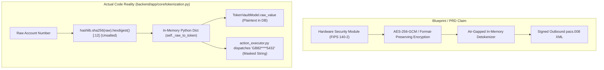
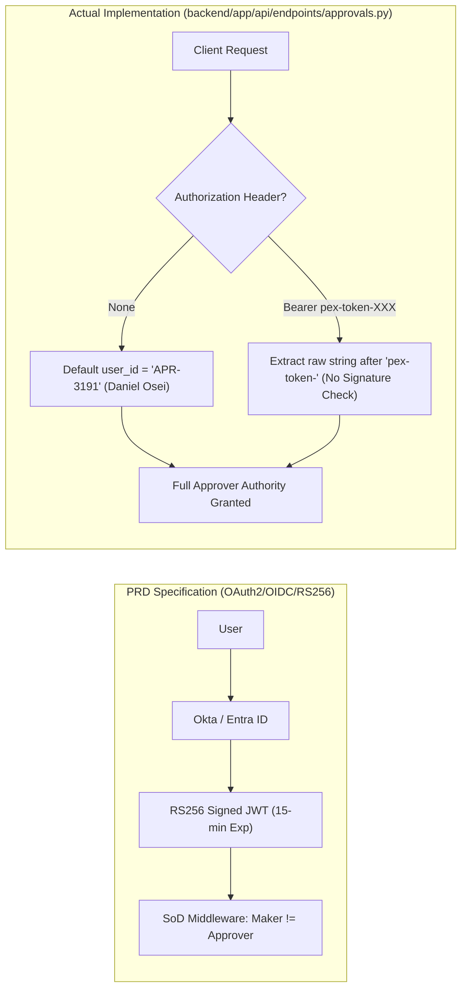
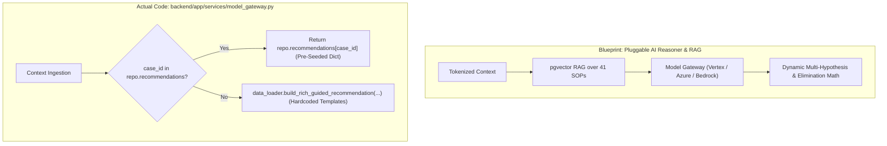
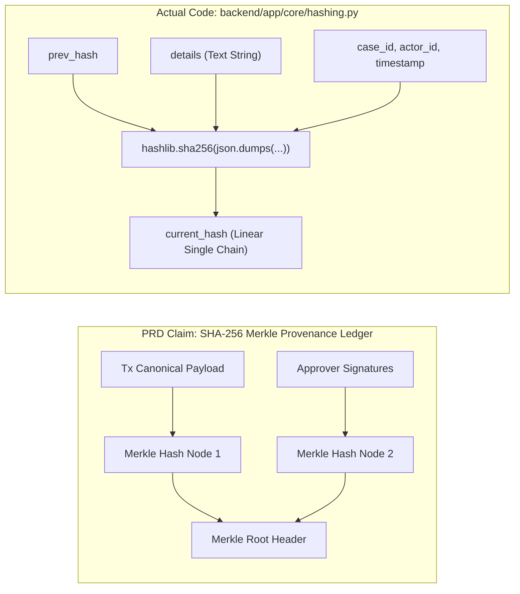
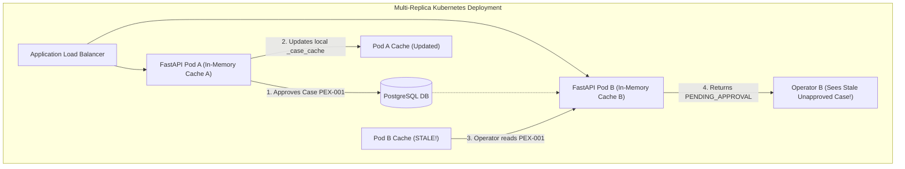
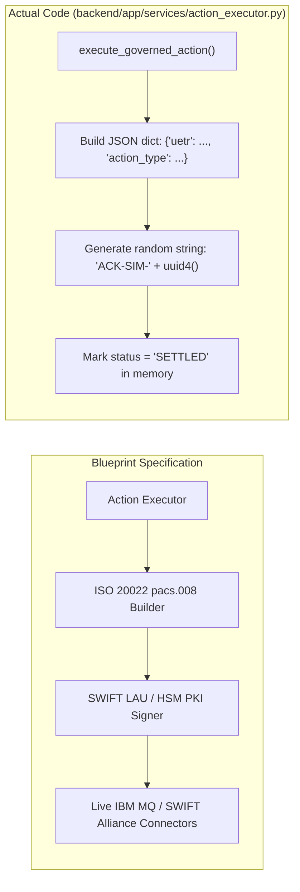
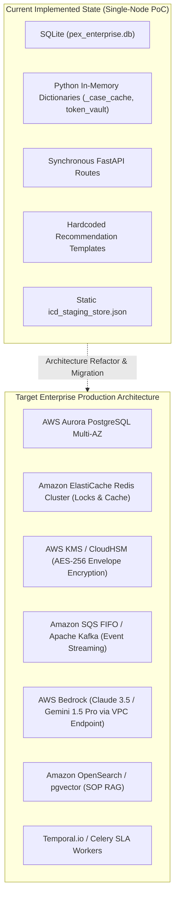
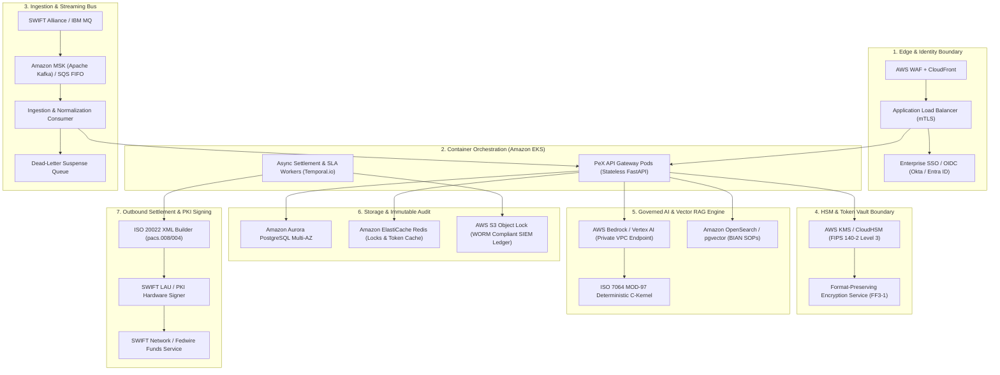

# 🏛️ PeX Platform: Adversarial Enterprise Architecture Challenge & Independent Review
**Document Version:** 1.0.0  
**Audit Classification:** Institutional Technical Challenge / Model Risk & Security Audit  
**Reviewing Role:** Independent Principal Enterprise Solutions Architect  
**Target Platform:** Payment Exception Resolution Platform (PeX)  
**Workspace:** `C:\Users\pawan\.gemini\antigravity\scratch\pex_platform`  
**Evaluation Standard:** TOGAF 10.0 / BIAN v10.0 / Federal Reserve SR 11-7 / OCC Bulletin 2011-12 / NIST SP 800-53 / ISO 20022 CBPR+ / OWASP API Security Top 10  

---

## 1. Executive Summary & Audit Methodology

### 1.1 Scope & Context
This independent adversarial architecture review examines the **Payment Exception Resolution Platform (PeX)** codebase, technical blueprints, specifications, database schemas, and runtime services. The evaluation treats the existing PeX documentation and implementation as an **architectural hypothesis rather than ground truth**, rigorously testing every claim of compliance, cryptographic integrity, AI safety, zero-knowledge privacy, and enterprise scalability against the actual code.

### 1.2 Summary of Findings Matrix

| Finding ID | Domain / Area | Title & Brief Summary | Classification | Severity |
| :--- | :--- | :--- | :--- | :---: |
| **SEC-01** | Security & Cryptography | In-Memory, Unsalted, Non-Persistent Token Vault with Zero Key Management (HSM/KMS/FIPS 140-2) | `ERROR` | **CRITICAL** |
| **SEC-02** | Security & Cryptography | Omission of Outbound Detokenization & Masked Data Leakage to Settlement Rails | `ERROR` | **CRITICAL** |
| **IAM-01** | Identity & Access | Unauthenticated API Endpoints with Hardcoded Fallback to Privileged Approver (`APR-3191`) | `ERROR` | **CRITICAL** |
| **IAM-02** | Identity & Access | Absence of Maker-Checker Separation of Duties Validation for Approvers | `ERROR` | **HIGH** |
| **AI-01** | AI & Reasoning | "Pluggable Model Gateway" and Vector RAG are Inactive Stubs Returning Hardcoded Synthetic Profiles | `ERROR` / `ASSUMPTION` | **HIGH** |
| **AI-02** | AI & Governance | Direct Contradiction Between 100% Advisory Model vs. Autonomous Unattended STP Execution (`SYS-AUTONOMOUS-STP`) | `ERROR` | **HIGH** |
| **AUD-01** | Audit & Provenance | Linear SHA-256 Block Chain Mislabeled as Merkle Ledger; Incomplete Financial Data Hashing | `ERROR` / `ASSUMPTION` | **HIGH** |
| **AUD-02** | Audit & Provenance | Lack of Concurrency Control & Monotonic Sequence Locks on Hash Chain Sequence Head | `ERROR` | **HIGH** |
| **DATA-01**| Data Architecture | Hybrid In-Memory Cache and DB Architecture with Severe Multi-Replica Cache Invalidation / Stale State Risks | `ERROR` | **HIGH** |
| **DATA-02**| Data Architecture | JSON Blob Storage Anti-Pattern for "18 BIAN Relational Entities" | `DERIVED DESIGN DECISION` | **MEDIUM** |
| **INT-01** | Integration & APIs | Static JSON File Staging vs. Real Live ICD Micro-Adapters | `VERIFIED FACT` | **MEDIUM** |
| **INT-02** | Integration & APIs | Missing Outbound ISO 20022 XML Generator & Digital PKI Signatures (`pacs.008`, `pacs.004`, SWIFT LAU) | `ERROR` / `UNKNOWN` | **HIGH** |
| **RES-01** | Resiliency & Scale | In-Memory "Idempotency Locks" vs. True Distributed Idempotency | `ERROR` | **HIGH** |
| **RES-02** | Resiliency & Scale | Absence of Dead-Letter Queues (DLQ), Circuit Breakers, and Asynchronous Message Brokers | `DERIVED DESIGN DECISION` | **MEDIUM** |
| **DEP-01** | Deployment Architecture | Prototype/Demo (SQLite, in-memory state) Mislabeled as Production Enterprise Architecture | `ASSUMPTION` | **HIGH** |
| **TAX-01** | Taxonomy & Alignment | Discrepancy Between PRD Taxonomy (10/10/8/7/6) vs. Walkthrough/Codebase (9/9/8/8/7) | `ERROR` | **LOW** |

---

## 2. Security, Cryptography & Privacy Architecture



### Finding SEC-01: In-Memory, Unsalted, Non-Persistent Token Vault with Zero Key Management (HSM/KMS/FIPS 140-2)
* **Classification:** `ERROR`
* **Severity:** **CRITICAL**
* **What is Wrong:**
  The Master PRD (Section 1.1, Section 2, Section 6 Module 7) claims a "Zero-Knowledge Token Vault (FIPS 140-2 / AES-256)", "AES-256-GCM / Format-Preserving Encryption (FPE / FF3-1)", and integration with "HashiCorp Vault Transit Engine, Protegrity, or Thales CipherTrust".
  In reality, `backend/app/core/tokenization.py` implements an in-memory dictionary `self._raw_to_token: Dict[str, str]` generating surrogate tokens via:
  ```python
  # backend/app/core/tokenization.py:32-33
  h = hashlib.sha256(clean_raw.encode("utf-8")).hexdigest()[:12].upper()
  token = f"TOK-{token_type}-{h}"
  ```
  This is a raw, unsalted SHA-256 hash truncated to 12 hex characters (only 48 bits of entropy). Furthermore, `backend/app/db/models.py` (`TokenVaultModel`) stores the sensitive account numbers and customer identities as unencrypted plaintext:
  ```python
  # backend/app/db/models.py:102-104
  raw_hash = Column(String(64), primary_key=True, index=True)
  raw_value = Column(String(256), nullable=False)
  token_value = Column(String(64), nullable=False, unique=True, index=True)
  ```
* **Why it Matters:**
  1. **Rainbow Table Vulnerability:** Because the hash is unsalted and deterministic across the entire system, any attacker with read access to the database or logs can precompute hashes of standard 8-digit bank accounts, 22-character IBANs, and company names, instantly de-anonymizing all customer records.
  2. **Short Hash Collision Risk:** Truncating SHA-256 to 12 hex characters provides only 48 bits of collision resistance. By the Birthday Paradox, token collisions are expected after observing approximately $2^{24} \approx 16.7\text{ million}$ records, which will corrupt account mappings.
  3. **Multi-Node Split-Brain:** Because tokenization relies on an in-memory dictionary singleton (`token_vault = TokenVault()`), running multiple FastAPI worker processes or Kubernetes pods causes token desynchronization.
  4. **Compliance Breach:** Storing unencrypted account numbers in `TokenVaultModel.raw_value` violates PCI-DSS v4.0 Requirement 3, GDPR Article 32, and OCC Bulletin 2011-12.
* **Evidence from Code:**
  - `backend/app/core/tokenization.py#L11-L37`
  - `backend/app/db/models.py#L98-L107`
  - `PeX_Master_PRD_and_Technical_Blueprint.md#L45,L296-L300`
* **Required Corrective Action:**
  - Replace the Python `hashlib` stub with a true cryptographic Tokenization Service integrating AWS KMS / HashiCorp Vault Transit Engine.
  - Apply AES-256-GCM envelope encryption or FF3-1 Format-Preserving Encryption (FPE) with unique initialization vectors (IVs) and salts per tenant.
  - Remove plaintext `raw_value` storage from the database schema; store only ciphertext encrypted under KMS customer-managed keys (CMK).

---

### Finding SEC-02: Omission of Outbound Detokenization & Masked Data Leakage to Settlement Rails
* **Classification:** `ERROR`
* **Severity:** **CRITICAL**
* **What is Wrong:**
  The Blueprint specifies that "Detokenization occurs only in memory inside the isolated Settlement Dispatch Kernel immediately prior to XML generation" (PRD Section 6 Module 7).
  However, in `backend/app/services/action_executor.py`, detokenization is never invoked. The execution kernel takes the masked UI string from the approval record:
  ```python
  # backend/app/services/action_executor.py:65-70
  "repaired_summary": last_approval.approved_changes[0].proposed_value_masked if last_approval.approved_changes else "GOVERNED_EXECUTION_COMPLETE"
  ```
  The method `token_vault.detokenize(...)` exists in `tokenization.py` but is **never called anywhere in `action_executor.py` or any API endpoint**.
* **Why it Matters:**
  If this dispatch payload were connected to a live banking rail (SWIFT Alliance, Fedwire Funds Service, CHIPS), it would transmit masked account strings (e.g. `GB82 WEST 1234 5698 76****`) or surrogate token IDs (`TOK-IBAN-11029D`) directly to the clearing house. The clearing rail would immediately reject 100% of outbound payments due to invalid account formats, halting bank settlement operations.
* **Evidence from Code:**
  - `backend/app/services/action_executor.py#L38-L75`
  - `backend/app/core/tokenization.py#L38-L39`
  - `PeX_Master_PRD_and_Technical_Blueprint.md#L299`
* **Required Corrective Action:**
  - Implement an isolated Detokenization Boundary Service inside the outbound dispatch worker.
  - The worker must resolve token IDs to cleartext account numbers using a restricted IAM service role immediately prior to constructing the ISO 20022 XML message.
  - Zero masked or tokenized strings must be allowed in the outbound canonical message schema.

---

## 3. Identity, Access, Authentication & Segregation of Duties (SoD)



### Finding IAM-01: Unauthenticated API Endpoints with Hardcoded Fallback to Privileged Approver (`APR-3191`)
* **Classification:** `ERROR`
* **Severity:** **CRITICAL**
* **What is Wrong:**
  The PRD (Section 6 Module 4) claims "Enterprise Single Sign-On (SSO) via OAuth2 / OpenID Connect (OIDC) / SAML 2.0 with Okta, Microsoft Entra ID... RS256-signed short-lived JWT access tokens (15-minute expiry)".
  In the actual API implementation:
  ```python
  # backend/app/api/endpoints/approvals.py:14-22
  @router.post("/submit")
  def submit_approval(submission: ApprovalSubmission, authorization: Optional[str] = Header(None)):
      user_id = "APR-3191" # Default to Daniel Osei (Operations Approver)
      if authorization and authorization.startswith("Bearer pex-token-"):
          user_id = authorization.replace("Bearer pex-token-", "").strip()
      
      approver = get_persona(user_id)
      if not approver:
          raise HTTPException(status_code=401, detail="Unauthorized approver persona")
  ```
  And in `backend/app/api/endpoints/auth.py`:
  ```python
  # backend/app/api/endpoints/auth.py:20-22
  token = f"pex-token-{persona.user_id}"
  return LoginResponse(access_token=token, token_type="bearer", user=persona)
  ```
* **Why it Matters:**
  1. **Zero Authentication Required:** Any unauthenticated caller who sends a `POST /api/approvals/submit` request with **no headers at all** is automatically treated as `APR-3191` (Daniel Osei, Operations Approver) and granted authority to approve up to $250,000 in payment exceptions.
  2. **Trivial User Impersonation:** Any caller can impersonate the Risk Approver (`RSK-7714`) or Lead Administrator (`ADM-0001`) by simply passing `Authorization: Bearer pex-token-ADM-0001` or `Bearer pex-token-RSK-7714`.
  3. **Violates OWASP API Top 10:** Direct violation of API1 (Broken Object Level Authorization), API2 (Broken Authentication), and API5 (Broken Function Level Authorization).
* **Evidence from Code:**
  - `backend/app/api/endpoints/approvals.py#L14-L22`
  - `backend/app/api/endpoints/auth.py#L14-L36`
  - `backend/app/core/security.py#L109-L110`
* **Required Corrective Action:**
  - Implement standard OAuth2 / OIDC Bearer Token verification using `python-jose` or `authlib`.
  - Validate JWT signatures against JWKS (JSON Web Key Sets) from Okta, Azure AD, or Ping Identity.
  - Enforce expiration (`exp`), audience (`aud`), issuer (`iss`), and cryptographic RS256/ES256 signatures on all endpoints. Remove all hardcoded default fallbacks.

---

### Finding IAM-02: Absence of Maker-Checker Separation of Duties Validation for Approvers
* **Classification:** `ERROR`
* **Severity:** **HIGH**
* **What is Wrong:**
  PRD Section 4 specifies: "Self-Approval Prohibition: An Operator who modified or initiated a case cannot act as the Approver on the same case. Segregation of Duties Middleware: Enforces that `jwt.claims.sub` (Maker) cannot equal `jwt.claims.sub` (Approver) on any approval endpoint."
  In `backend/app/services/approval_engine.py` (lines 27-75), the only checks performed are:
  1. `check_can_approve(approver.role)` which only blocks `UserRole.OPERATOR`.
  2. For Level 2 Dual Authorization, checking that the 2nd approver is not the same user as the 1st approver (`last_l1_approver.approver_id == approver_id`).
  **There is NO check verifying whether the Level 1 Approver (`approver_id`) was the Maker/Analyst who triaged, created, or modified the case.**
* **Why it Matters:**
  If a user holding an Approver role (e.g. `APR-3191` Daniel Osei, `CMP-4420` Marisol Vega, or `ADM-0001` Alex Whitfield) triages a case, triggers an AI repair, and modifies payment parameters, they are permitted to immediately approve and release their own modified payment without any secondary human review. This breaks the fundamental four-eyes principle mandated by SOX Section 404, OCC Bulletin 2011-12, and BCBS 239.
* **Evidence from Code:**
  - `backend/app/services/approval_engine.py#L27-L75`
  - `backend/app/core/security.py#L112-L121`
  - `tests/test_hitl_approval.py#L8-L21`
* **Required Corrective Action:**
  - Add explicit state tracking on the case model for `maker_user_id` and `last_modifier_user_id`.
  - In `approval_engine.process_approval_action`, assert:
    `if approver_id in [case.get("maker_user_id"), case.get("last_modifier_user_id")]: return False, "Maker cannot approve their own case (SoD violation)"`.

---

## 4. AI / LLM, Reasoning & Cognitive Architecture



### Finding AI-01: "Pluggable Model Gateway" and Vector RAG are Inactive Stubs Returning Hardcoded Synthetic Profiles
* **Classification:** `ERROR` / `ASSUMPTION`
* **Severity:** **HIGH**
* **What is Wrong:**
  The PRD Section 2, Section 6 Module 3, and Technical Blueprint promise a "Pluggable Model Gateway ('Any LLM' Interoperability) supporting Google Cloud Vertex AI (Gemini 1.5 Pro), Azure OpenAI (GPT-4o), AWS Bedrock (Claude 3.5 Sonnet)" coupled with "pgvector RAG over SOPs".
  In reality:
  1. `backend/app/services/model_gateway.py` does not contain any API client or SDK calls (`google-generativeai`, `openai`, `boto3.bedrock-runtime`, `anthropic`).
  2. `model_gateway.evaluate_investigation` (lines 80-101) directly delegates to `data_loader.build_rich_guided_recommendation(...)`, which returns pre-scripted static template strings.
  3. `backend/app/config.py` defines `GEMINI_API_KEY`, `OPENAI_API_KEY`, and `MODEL_GATEWAY_MODE`, but these configuration variables are never referenced or consumed anywhere in the service layer.
  4. No vector database (`pgvector`, ChromaDB, Pinecone) or embedding pipeline exists in the repository.
* **Why it Matters:**
  While hardcoded templates are acceptable for deterministic demo runners, advertising a "Pluggable AI Reasoner" creates a critical enterprise gap. When live production exceptions arrive that do not exactly match the synthetic test fixtures, the system cannot perform generalized semantic reasoning, unstructured narrative extraction, or dynamic RAG-based SOP lookups.
* **Evidence from Code:**
  - `backend/app/services/model_gateway.py#L1-L103`
  - `backend/app/config.py#L19-L21`
  - `backend/app/services/data_loader.py#L62-L450`
* **Required Corrective Action:**
  - Implement concrete provider classes inheriting from an abstract `BaseModelGateway` (`GeminiModelGateway`, `AzureOpenAIModelGateway`, `BedrockModelGateway`).
  - Implement true LangChain / LlamaIndex / LiteLLM integration with structured JSON schema output parsing (`response_format={"type": "json_object"}`).
  - Implement a `pgvector` store indexed with BIAN service domain SOP embeddings for retrieval-augmented generation.

---

### Finding AI-02: Direct Contradiction Between 100% Advisory Model vs. Autonomous Unattended STP Execution (`SYS-AUTONOMOUS-STP`)
* **Classification:** `ERROR`
* **Severity:** **HIGH**
* **What is Wrong:**
  The Master PRD (Section 1.2, Section 5.2 Pillar 2) and Walkthrough Specification (Section 2, Section 5) emphatically state that PeX enforces a **"100% Advisory AI Operating Model (zero unattended funds releases) with mandatory Maker-Checker RACI"**.
  In direct contradiction, `backend/app/services/stp_engine.py` (lines 219-348) implements `execute_autonomous_stp(...)`, which executes autonomous zero-touch funds release where the system automatically generates an artificial approval signature:
  ```python
  # backend/app/services/stp_engine.py:240-252
  appr = ApprovalRecordModel(
      approval_id=approval_id,
      case_id=case_id,
      recommendation_id=f"REC-{case_id}",
      approver_id="SYS-AUTONOMOUS-STP",
      approver_name="PeX Governed Autonomous Reasoner",
      approver_role="ADMIN",
      action="APPROVE",
      comments=f"Autonomous zero-touch STP execution authorized via policy {eval_item.matching_rule_id or 'STP-BASELINE'}.",
      approved_changes=[],
      step_number=1,
      created_at=now
  )
  ```
  The case is then immediately marked as `SETTLED` and dispatched without any human intervention.
* **Why it Matters:**
  This is a fundamental governance and regulatory contradiction. An institution cannot claim a "100% Human-in-the-Loop Advisory Model" to bank model risk committees (SR 11-7) while running background code that impersonates an `ADMIN` persona to auto-approve payments. If an algorithmic defect or corrupted directory causes a misdirected payment during autonomous STP, the bank's compliance defence of "human operator accountability" is legally void.
* **Evidence from Code:**
  - `backend/app/services/stp_engine.py#L219-L348`
  - `PeX_Master_PRD_and_Technical_Blueprint.md#L22,L204`
  - `PeX_Payment_SME_Product_and_Technical_Walkthrough_Specification.md#L102,L166`
* **Required Corrective Action:**
  - Formally align the PRD governance policy with the operational capabilities.
  - If Autonomous STP is permitted for low-value/high-confidence micro-repairs ($\le \$10,000$), the PRD must explicitly state: *"Tiered Operating Model: Autonomous Zero-Touch Execution for $\le \$10\text{k}$ micro-syntax repairs; 100% Advisory HITL for all other exceptions"*.
  - System-generated approvals must use a dedicated system role (`SYSTEM_STP_DELEGATE`), not hijack the human `ADMIN` role.

---

## 5. Auditability, Cryptography & Observability Architecture



### Finding AUD-01: Linear SHA-256 Block Chain Mislabeled as Merkle Ledger; Incomplete Financial Data Hashing
* **Classification:** `ERROR` / `ASSUMPTION`
* **Severity:** **HIGH**
* **What is Wrong:**
  1. The PRD and Walkthrough Spec repeatedly market the audit architecture as a **"SHA-256 Merkle Provenance Ledger"** and "Merkle block hashing". In reality, `backend/app/core/hashing.py` implements a simple singly linked linear SHA-256 hash chain ($H_n = \text{SHA256}(\text{Index} \parallel \dots \parallel H_{n-1})$). There are **no Merkle trees, Merkle DAGs, or Merkle proofs** anywhere in the codebase.
  2. More critically, the payload passed into `calculate_event_hash` in `backend/app/core/hashing.py`:
  ```python
  # backend/app/core/hashing.py:19-30
  payload = {
      "event_index": event_index,
      "timestamp": timestamp_iso,
      "case_id": case_id,
      "stage_name": stage_name,
      "actor_id": actor_id,
      "action_name": action_name,
      "details": details,
      "prev_hash": prev_hash
  }
  serialized = json.dumps(payload, sort_keys=True, separators=(',', ':'))
  return hashlib.sha256(serialized.encode("utf-8")).hexdigest()
  ```
  **Notice what is missing:** The hash calculation does NOT include the canonical transaction entity, the modified fields, the monetary amount, the debtor/creditor accounts, or the cryptographic digital signature! It only hashes a human-readable `details` text string.
* **Why it Matters:**
  If a malicious insider or rogue database administrator directly tampers with the database (e.g. changes a payment amount from $\$10,000$ to $\$1,000,000$ in the `cases` table, or changes the beneficiary IBAN in `recommendations`), the audit verification function `verify_audit_chain()` will **still return `is_intact: True`**! The audit ledger proves only that a log message was recorded, but fails to provide cryptographic tamper evidence over the financial transaction data itself.
* **Evidence from Code:**
  - `backend/app/core/hashing.py#L9-L30,L32-L54`
  - `backend/app/db/repository.py#L244-L253`
  - `PeX_Master_PRD_and_Technical_Blueprint.md#L79,L290-L295`
* **Required Corrective Action:**
  - Update `calculate_event_hash` to include a deterministic canonical JSON digest of the entire transaction state (`payload_hash = SHA256(canonical_payment_state)`).
  - Include the approver's cryptographic PKI digital signature in the hash preimage.
  - Correct the architectural documentation to accurately state "Cryptographic Linear Hash Chain (with Merkle Tree roadmap)" rather than claiming an existing Merkle DAG.

---

### Finding AUD-02: Lack of Concurrency Control & Monotonic Sequence Locks on Hash Chain Sequence Head
* **Classification:** `ERROR`
* **Severity:** **HIGH**
* **What is Wrong:**
  In `backend/app/db/repository.py` lines 236-271 and lines 438-470, when a new audit event is logged, the next sequence index and previous hash are determined via:
  ```python
  # backend/app/db/repository.py:238-240
  idx = db.query(AuditEventModel).count() + 1
  latest_ev = db.query(AuditEventModel).order_by(desc(AuditEventModel.event_index)).first()
  prev_hash = latest_ev.current_hash if latest_ev else ("0" * 64)
  ```
  This is executed without any database row locking (`SELECT ... FOR UPDATE`), distributed mutex, Redis lock, or atomic database sequence.
* **Why it Matters:**
  In an enterprise environment processing concurrent payment streams, two requests executing simultaneously across worker threads or instances will read the identical `count()` and identical `prev_hash`.
  This results in:
  1. Primary key collision errors on `event_index` causing 500 Internal Server Errors.
  2. Chain forking / hash invalidation where one event is overwritten or points to an invalid sequence head, corrupting the entire audit chain.
* **Evidence from Code:**
  - `backend/app/db/repository.py#L236-L271,L438-L470`
  - `backend/app/services/audit_service.py#L10-L30`
* **Required Corrective Action:**
  - In PostgreSQL / Aurora, use an atomic database `SEQUENCE` for `event_index`.
  - Use a pessimistic lock (`SELECT current_hash FROM audit_events ORDER BY event_index DESC LIMIT 1 FOR UPDATE`) within an explicit database transaction to serialize hash chain extensions.

---

## 6. Data, State Management & Concurrency Architecture



### Finding DATA-01: Hybrid In-Memory Cache and DB Architecture with Severe Multi-Replica Cache Invalidation / Stale State Risks
* **Classification:** `ERROR`
* **Severity:** **HIGH**
* **What is Wrong:**
  `PeXDBRepository` in `backend/app/db/repository.py` maintains large in-memory dictionary caches:
  `_case_cache`, `_recommendations_cache`, `_approvals_cache`, `_actions_cache`, `_receipts_cache`, `_rules_cache`, `_icd_cache`.
  These caches are populated at startup (`load_all_data() -> sync_from_db()`).
  When operations occur (e.g. `repo.list_cases()`, `repo.cases`, `repo.recommendations`), methods read directly from `_case_cache` and `_recommendations_cache` without querying the database.
* **Why it Matters:**
  1. **Cross-Replica Desynchronization:** If PeX is deployed in an enterprise multi-replica cluster (e.g. 3 Kubernetes pods behind an ALB), an update processed on Pod A writes to DB and updates Pod A's memory. Pod B and Pod C's in-memory caches remain completely stale. An operator routed to Pod B will see outdated case statuses, missing approvals, and stale rule configurations.
  2. **Unbounded $O(N)$ Memory Consumption:** Storing all transaction cases in Python dictionaries causes memory usage to grow linearly with volume. At institutional volumes (100,000 cases/day), the application will exhaust memory and crash with out-of-memory (OOM) errors.
* **Evidence from Code:**
  - `backend/app/db/repository.py#L37-L47,L54-L117,L398-L424`
* **Required Corrective Action:**
  - Eliminate long-lived Python in-memory state for domain entities.
  - Implement stateless repository methods that query the relational database directly via SQLAlchemy Sessions with proper SQL indexes.
  - If caching is required for high-throughput reads (e.g. BIC directories), use an external distributed cache (Redis Cluster) with Pub/Sub cache invalidation.

---

### Finding DATA-02: JSON Blob Storage Anti-Pattern for "18 BIAN Relational Entities"
* **Classification:** `DERIVED DESIGN DECISION`
* **Severity:** **MEDIUM**
* **What is Wrong:**
  The Technical Blueprint (PRD Section 1.1, Section 2.1, Section 6 Module 1) highlights a **"Canonical Semantic Layer (18 BIAN relational entities)"** with distinct entity tables.
  In `backend/app/db/models.py`, there is no 18-table normalized relational schema. Instead, `CaseModel` embeds debtor, creditor, account, and approval entities inside unstructured JSON columns:
  ```python
  # backend/app/db/models.py#L58-L61,L71-L74
  debtor_party = Column(JSON, nullable=False)
  debtor_account = Column(JSON, nullable=False)
  creditor_party = Column(JSON, nullable=False)
  creditor_account = Column(JSON, nullable=False)
  approval_history = Column(JSON, default=list)
  audit_timeline = Column(JSON, default=list)
  guided_questions = Column(JSON, default=list)
  ```
* **Why it Matters:**
  While JSON columns provide flexibility for rapid prototyping, they prevent relational foreign key constraints, cross-case relational queries (e.g., finding all exceptions associated with a specific beneficiary account number across the bank), and column-level encryption/masking policies.
* **Evidence from Code:**
  - `backend/app/db/models.py#L42-L80`
  - `PeX_Master_PRD_and_Technical_Blueprint.md#L41,L257`
* **Required Corrective Action:**
  - For enterprise production, normalize the core BIAN entities into discrete relational tables (`parties`, `accounts`, `payment_instructions`, `settlement_details`) with foreign keys to `case_id`.
  - Use JSONB columns strictly for dynamic non-canonical extensions.

---

## 7. API, Integration & External Connectivity Architecture



### Finding INT-01: Static JSON File Staging vs. Real Live ICD Micro-Adapters
* **Classification:** `VERIFIED FACT`
* **Severity:** **MEDIUM**
* **What is Wrong:**
  The PRD describes `BaseICDConnector` with concrete live drivers: `SWIFTAllianceConnector` (REST/mTLS gCase API), `FedwireMQConnector` (IBM MQ), and `CoreBankingConnector` (gRPC/mTLS).
  In reality, `backend/app/services/icd_staging_service.py` (lines 6-12) reads all external lookup data (Fedwire ABA, SWIFT BIC, Counterparty SSI, OFAC Watchlist, Nostro Liquidity) from a local static file `backend/app/data/icd_staging_store.json`.
* **Why it Matters:**
  The platform currently operates against static frozen mock data. There is no network I/O, no connection pooling, no mTLS certificate authentication, and no handling of transient network timeouts, socket disconnects, or upstream error codes.
* **Evidence from Code:**
  - `backend/app/services/icd_staging_service.py#L1-L67`
  - `backend/app/data/icd_staging_store.json`
* **Required Corrective Action:**
  - Implement an abstract `BaseICDConnector` interface.
  - Build concrete asynchronous connectors (`HTTPAsyncAdapter`, `IBMMQAdapter`, `gRPCAdapter`) with configurable retry policies (Tenacity) and circuit breakers.

---

### Finding INT-02: Missing Outbound ISO 20022 XML Generator & Digital PKI Signatures (`pacs.008`, `pacs.004`, SWIFT LAU)
* **Classification:** `ERROR` / `UNKNOWN`
* **Severity:** **HIGH**
* **What is Wrong:**
  PRD Section 6 Module 5 specifies an "Outbound ISO 20022 XML Generator & Digital PKI Signing: `pacs.008.001.10`, `pacs.004.001.11`, `camt.056.001.10`... Sign XML payloads using PKI HSM X.509 certificate adhering to SWIFT LAU".
  In `backend/app/services/action_executor.py` (lines 38-75), no XML document is ever generated, validated against XSD schemas, or signed. The system simply creates an internal JSON dictionary and generates a fake acknowledgment string: `f"ACK-SIM-{uuid.uuid4().hex[:8].upper()}"`.
* **Why it Matters:**
  The platform cannot settle transactions or communicate with clearing houses (SWIFT Alliance Gateway, Fedline Direct, TARGET2 ESMIG) without a compliant ISO 20022 XML generator and cryptographic Local Authentication Unit (LAU) signer.
* **Evidence from Code:**
  - `backend/app/services/action_executor.py#L38-L75`
  - `PeX_Master_PRD_and_Technical_Blueprint.md#L282-L289`
* **Required Corrective Action:**
  - Implement an ISO 20022 XML builder utilizing `xsdata` or `lxml` with strict XSD schema validation against SWIFT CBPR+ 2026 schemas.
  - Implement an HSM PKI signing module for SWIFT LAU HMAC / RSA SHA-256 digital signatures.

---

## 8. Scalability, Resiliency & Circuit Breaker Architecture

### Finding RES-01: In-Memory "Idempotency Locks" vs. True Distributed Idempotency
* **Classification:** `ERROR`
* **Severity:** **HIGH**
* **What is Wrong:**
  The PRD (Section 6 Module 1) specifies: "Distributed idempotency lock using Redis `SETNX (UETR, MessageId, Timestamp)`".
  In `backend/app/services/action_executor.py` (lines 28-33), idempotency is evaluated strictly against a local Python dictionary:
  ```python
  # backend/app/services/action_executor.py:28-32
  actual_idempotency_key = idempotency_key or f"IDEMP-{case_id}-{approvals[-1].approval_id}"
  if actual_idempotency_key in repo.actions:
      existing = repo.actions[actual_idempotency_key]
      existing_receipt = repo.receipts.get(existing.action_id)
      return True, "Idempotent response: action already settled.", existing, existing_receipt
  ```
* **Why it Matters:**
  In a multi-worker or multi-container deployment, if duplicate settlement dispatch requests arrive concurrently, both requests will evaluate `in repo.actions` as `False` simultaneously. This causes double execution, double wire dispatch, and duplicate funds releases to the clearing network.
* **Evidence from Code:**
  - `backend/app/services/action_executor.py#L28-L33`
  - `backend/app/db/repository.py#L42,L140-L142`
  - `PeX_Master_PRD_and_Technical_Blueprint.md#L263`
* **Required Corrective Action:**
  - Implement atomic distributed locking using Redis `SET key value NX PX 10000` or database-level unique constraints (`idempotency_key` unique index with transaction isolation `SERIALIZABLE`).

---

### Finding RES-02: Absence of Dead-Letter Queues (DLQ), Circuit Breakers, and Asynchronous Message Brokers
* **Classification:** `DERIVED DESIGN DECISION`
* **Severity:** **MEDIUM**
* **What is Wrong:**
  The PRD specifies Kafka / IBM MQ streaming consumers (`payments.exceptions.inbound`), Celery/Temporal SLA background workers, and Tenacity/Resilience4j circuit breakers with exponential backoff.
  In the codebase:
  1. Ingestion is purely synchronous HTTP POST (`/api/cases/initiate` and `/api/events/ingest`).
  2. There are no message queue consumers (Kafka, IBM MQ, RabbitMQ, Amazon SQS).
  3. There is no Dead-Letter Queue (DLQ) or Suspense Queue for malformed messages.
  4. There are no background worker processes polling SLA due dates or cutoffs.
* **Why it Matters:**
  Under high morning clearing wire bursts, synchronous HTTP endpoints will become saturated, fail with 504 timeouts, and drop incoming exception events without backpressure or durable replay capabilities.
* **Evidence from Code:**
  - `backend/app/api/endpoints/cases.py#L368-L478`
  - `backend/app/api/endpoints/events.py`
  - Absence of worker scripts or queue consumers in `backend/app/`.
* **Required Corrective Action:**
  - Implement an asynchronous messaging architecture using Apache Kafka / Amazon SQS FIFO with Celery or Temporal.io orchestration workers.
  - Implement a dedicated Dead-Letter Queue (DLQ) with automatic retry and suspense routing.

---

## 9. Deployment Architecture: Prototype vs. Enterprise Production Disconnect



### Finding DEP-01: Prototype/Demo Architecture Mislabeled as Production Enterprise Architecture
* **Classification:** `ASSUMPTION`
* **Severity:** **HIGH**
* **What is Wrong:**
  The technical blueprint and marketing collateral present PeX as an "Institutional-grade, production-ready enterprise payment platform".
  However, the underlying codebase is structurally a **single-node demonstration prototype**:
  - Default database is local SQLite (`sqlite:///./pex_enterprise.db`).
  - Critical security, tokenization, and audit states reside in Python process memory.
  - AI reasoning is simulated via static dictionaries.
  - Bank adapters read from a static JSON file.
* **Why it Matters:**
  If an enterprise client attempts to deploy this codebase directly into a high-availability Kubernetes or AWS ECS multi-node environment, the platform will immediately fail due to split-brain token states, in-memory cache desynchronization, race conditions on the audit chain, and unauthenticated API endpoints.
* **Evidence from Code:**
  - `backend/app/config.py#L19,L32`
  - `backend/app/db/session.py#L10-L15`
  - `backend/app/core/tokenization.py#L11-L22`
  - `backend/app/services/icd_staging_service.py#L6-L12`
* **Required Corrective Action:**
  - Explicitly document the distinction between the **PoC / Demonstrator Edition (v1.0)** and the **Target Enterprise Architecture Specification (v2.0)**.
  - Implement the Target Cloud Enterprise Reference Architecture as detailed in Section 10.

---

## 10. Target Cloud Enterprise Reference Architecture

To transition PeX from its current prototype state to an institutional-grade, OCC/Fed-compliant enterprise platform, the following target architecture must be implemented:



### Key Target Enterprise Specifications:
1. **Stateless API Layer:** All in-memory state removed; all FastAPI instances query Amazon Aurora Multi-AZ and ElastiCache Redis.
2. **KMS-Backed Token Vault:** Zero-knowledge tokenization executing AES-256-GCM / FF3-1 FPE with keys rotated automatically in AWS KMS.
3. **Strict OAuth2/OIDC RBAC:** Every API call verified against Okta/Azure AD JWKS; strict middleware asserting $\text{Maker ID} \ne \text{Approver ID}$.
4. **True Merkle Audit Ledger:** Transaction state digests chained into Merkle trees and periodically anchored to AWS S3 Object Lock (WORM).
5. **Asynchronous Ingestion Bus:** Amazon MSK (Kafka) / SQS FIFO with Dead-Letter Queues (DLQ) for full replayability and backpressure protection.
6. **Outbound ISO XML & PKI Signer:** Schema-validated `pacs.008`/`pacs.004` XML generation signed with HSM-backed SWIFT LAU keys.

---

## 11. Consolidated Findings & Remediation Roadmap

| ID | Issue & Code Reference | Root Cause | Impact & Risk | Required Remediation |
| :--- | :--- | :--- | :--- | :--- |
| **SEC-01** | Unsalted truncated SHA-256 Token Vault (`tokenization.py#L32`) | Prototype shortcut | Rainbow table de-anonymization; token collision risk | Implement AWS KMS / HashiCorp Vault with AES-256-GCM / FPE FF3-1 |
| **SEC-02** | Omission of detokenization in dispatch (`action_executor.py#L65`) | Incomplete implementation | 100% rejection on outbound clearing rails | Build isolated detokenization kernel before XML generation |
| **IAM-01** | Unauthenticated endpoints defaulting to `APR-3191` (`approvals.py#L15`) | Prototype shortcut | Unauthorized approval of transactions up to $250k | Implement full JWT signature validation; remove defaults |
| **IAM-02** | Missing Maker != Approver check (`approval_engine.py#L27`) | Incomplete SoD logic | Approvers can self-approve their own repairs | Enforce `maker_id != approver_id` constraint |
| **AI-01** | Model Gateway returns hardcoded templates (`model_gateway.py#L81`) | Inactive provider integration | Zero dynamic reasoning on un-templated exceptions | Connect live Bedrock / Vertex AI SDK with pgvector RAG |
| **AI-02** | Autonomous STP auto-signs as Admin (`stp_engine.py#L240`) | Policy conflict | Regulatory violation of claimed "100% Advisory" model | Formally define tiered policy; use dedicated system role |
| **AUD-01** | Audit chain excludes financial entities (`hashing.py#L19`) | Incomplete payload model | Database tampering with amounts/IBANs is undetected | Hash canonical transaction payload & signatures |
| **AUD-02** | No concurrency locks on audit chain (`repository.py#L238`) | Missing DB sequence | Race conditions & chain corruption under concurrency | Use PostgreSQL sequence & `SELECT ... FOR UPDATE` |
| **DATA-01**| Stale in-memory caches across replicas (`repository.py#L39`) | Monolithic state model | Multi-pod deployment serves desynchronized stale data | Remove in-memory cache; query Aurora & Redis |
| **INT-02** | Missing ISO 20022 XML builder & PKI signing (`action_executor.py#L38`)| Missing XML layer | Cannot communicate with live SWIFT/Fedwire rails | Implement `xsdata` XML builder + SWIFT LAU HSM signer |
| **RES-01** | In-memory idempotency locks (`action_executor.py#L28`) | Prototype dictionary | Duplicate wire dispatch and double payments | Implement Redis `SETNX` or DB unique transaction constraints |

---

## 12. Final Architecture Verdict

The PeX platform demonstrates **exceptional domain modeling, comprehensive payment taxonomy coverage (41 market profiles across 5 BIAN domains), and a highly refined payment operations user experience**.

However, from an **Enterprise Architecture & Security standpoint**, the current codebase is an **advanced prototype / demonstration harness**, not an institutional-grade production deployment. It contains critical security, authentication, and concurrency vulnerabilities that must be refactored before connecting to live banking ledgers or clearing rails.

Adopting the **Target Cloud Enterprise Reference Architecture** (Section 10) and executing the **Remediation Roadmap** (Section 11) will bridge the gap from hypothesis to an institutional-grade, bank-ready deployment.
