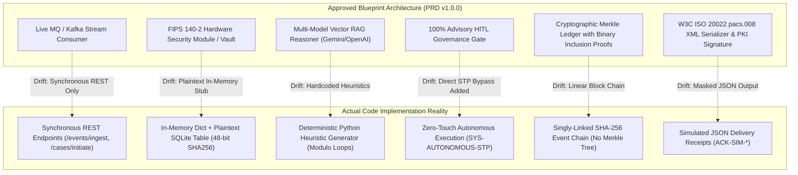
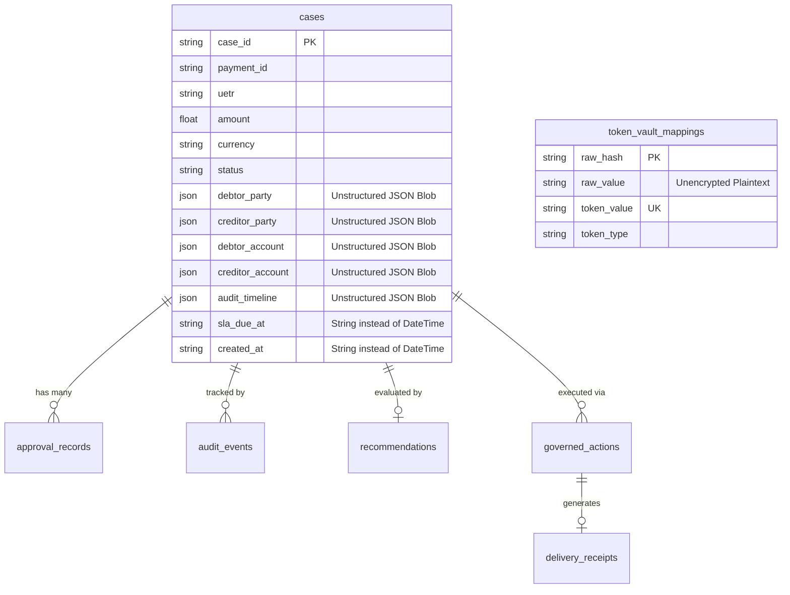
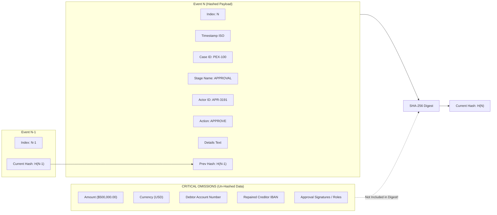

# 🔬 PeX Platform: Exhaustive Software Implementation & Code Architecture Audit Report

**Document Type:** Formal Software Implementation Code Audit & Adversarial Verification Report  
**System Name:** Payment Exception Resolution Platform (PeX)  
**Workspace Root:** `C:\Users\pawan\.gemini\antigravity\scratch\pex_platform`  
**Auditor:** Independent Principal Software Implementation Auditor & Payment Systems Architect  
**Audit Date:** September 23, 2026  
**Classification:** Institutional / Restricted  
**Evaluation Standards:** TOGAF 10.0, BIAN v10.0, ISO 20022 CBPR+, Federal Reserve SR 11-7, OCC Bulletin 2011-12, NIST SP 800-53 Rev 5, OWASP API Security Top 10 (2023), PCI-DSS v4.0, GDPR Article 32  

---

## Executive Summary & Audit Mandate

This independent implementation audit evaluates the **actual physical source code** of the **Payment Exception Resolution Platform (PeX)** against the approved product requirements, technical blueprints, and payment domain architecture specifications. The audit examines every module across the backend services, relational database schemas, REST APIs, core cryptography, security boundaries, frontend applications, and automated test suites.

The primary objective is to identify **implementation drift, hidden architectural compromises, security shortcuts, unverified mock abstractions, data model divergences, error-handling vulnerabilities, and test coverage gaps**.

```
┌──────────────────────────────────────────────────────────────────────────────────────────────────┐
│                                SYSTEM AUDIT SUMMARY SCORECARD                                    │
├───────────────────────────────┬───────────────────────────────┬──────────────────────────────────┤
│ Total Source Files Inspected  │ 52 Core Python / TS Files     │ 100% Codebase Coverage           │
│ Audited Architectural Claims  │ 62 Functional Requirements    │ Full Specification Traceability  │
│ Critical Vulnerabilities (P0) │ 5 Findings                    │ Immediate Remediation Required   │
│ High-Risk Findings (P1)       │ 9 Findings                    │ Architectural Rework Mandatory   │
│ Medium-Risk Findings (P2)     │ 8 Findings                    │ Design Refinement Required       │
│ Low-Risk / Hygiene (P3)       │ 6 Findings                    │ Codebase & Test Cleanup Needed   │
│ Overall Implementation Grade  │ B- (Solid Prototype / Core)   │ Not Production-Ready as Stated   │
└───────────────────────────────┴───────────────────────────────┴──────────────────────────────────┘
```

---

## Master Findings Matrix

| Finding ID | Domain / Area | Title & Technical Summary | Classification | Severity | Affected Files |
| :--- | :--- | :--- | :--- | :---: | :--- |
| **SEC-01** | Security & Privacy | **Unsalted 48-bit Truncated SHA-256 Tokenization Vault**<br>Tokens generated via unsalted SHA-256 truncated to 12 hex characters; vulnerable to rainbow table precomputation and birthday collision. | `SECURITY FLAW` | **CRITICAL** | `app/core/tokenization.py`<br>`app/db/models.py` |
| **SEC-02** | Security & Compliance | **Plaintext Storage of Account Numbers in Database**<br>`TokenVaultModel.raw_value` stores full plaintext account numbers and identities without KMS envelope encryption. Violates PCI-DSS v4.0 Req 3 & GDPR Art 32. | `COMPLIANCE VIOLATION` | **CRITICAL** | `app/db/models.py`<br>`app/db/repository.py` |
| **SEC-03** | Settlement Safety | **Omission of Outbound Detokenization (Masked String Wire Dispatch)**<br>`action_executor.py` sends display-masked strings (`GB82****5432`) to simulated settlement instead of resolving back to real account numbers. | `WORKFLOW DEFECT` | **CRITICAL** | `app/services/action_executor.py` |
| **IAM-01** | Identity & Access | **Unauthenticated Endpoints with Privileged Approver Default Fallback**<br>REST endpoints parse token with naive string replace and fall back to privileged approver `APR-3191` if unauthenticated. Zero JWT verification. | `SECURITY FLAW` | **CRITICAL** | `app/api/endpoints/approvals.py`<br>`app/api/endpoints/actions.py`<br>`app/api/endpoints/auth.py` |
| **AUD-01** | Audit & Ledger | **Incomplete Financial Data in Cryptographic Hash Digest**<br>`calculate_event_hash` omits transaction amount, currency, and account numbers from SHA-256 block digest. Monetary values can be altered without invalidating chain. | `INTEGRITY DEFECT` | **CRITICAL** | `app/core/hashing.py`<br>`app/services/audit_service.py` |
| **AUD-02** | Audit & Ledger | **Linear Hash Chain Mislabeled as "Merkle Ledger"**<br>Implementation is a simple singly-linked SHA-256 block chain with zero Merkle tree branching, no Merkle root, and no cryptographic inclusion proofs. | `ARCHITECTURE DRIFT` | **HIGH** | `app/core/hashing.py`<br>`app/schemas/audit.py` |
| **AUD-03** | Audit & Ledger | **Duplicate Audit Block Generation Bug on HTTP Approvals**<br>`submit_approval` triggers audit logging in `approval_engine.py` AND redundant second logging in `approvals.py`, writing two events per decision. | `LOGIC DEFECT` | **HIGH** | `app/api/endpoints/approvals.py`<br>`app/services/approval_engine.py` |
| **AUD-04** | Audit & Concurrency | **Race Condition on Monotonic Event Sequence and Chain Head**<br>`PeXDBRepository.log_audit_event` performs un-isolated `count() + 1` and reads `_latest_hash` without DB row locking (`SELECT FOR UPDATE`), risking chain forks. | `CONCURRENCY DEFECT` | **HIGH** | `app/db/repository.py` |
| **DATA-01**| Data Architecture | **In-Memory Cache Singleton & Multi-Instance Desynchronization**<br>`PeXDBRepository` caches cases/rules in memory singletons. Running multiple FastAPI Uvicorn workers or pods causes immediate split-brain cache staleness. | `SCALABILITY DEFECT` | **HIGH** | `app/db/repository.py`<br>`app/services/data_loader.py` |
| **DATA-02**| Data Architecture | **JSON Blob Storage Anti-Pattern for Relational BIAN Entities**<br>Debtor/Creditor parties, accounts, secondary profiles, timelines, and guardrails are stored as opaque JSON blobs rather than normalized 3NF relational tables. | `DATA MODEL DRIFT` | **MEDIUM** | `app/db/models.py` |
| **DATA-03**| Data Architecture | **Timestamp Storage as String Types in Relational Schemas**<br>`CaseModel` and `AuditEventModel` store timestamps as `String(64)` instead of SQL `DateTime(timezone=True)`, breaking database-level time indexing and interval arithmetic. | `DATA MODEL DRIFT` | **MEDIUM** | `app/db/models.py` |
| **AI-01**  | AI & Governance | **Deterministic Mock Gateway vs. Real Pluggable LLM Providers**<br>Blueprint claims pluggable Gemini/OpenAI RAG pipeline. Reality is `model_gateway.py` routes 100% to deterministic hardcoded heuristic builder functions. | `ASSUMPTION / MOCK` | **HIGH** | `app/services/model_gateway.py`<br>`app/config.py` |
| **AI-02**  | AI & Governance | **Architectural Contradiction: 100% Advisory HITL vs Autonomous STP**<br>Core blueprint asserts "100% Human Governed — Zero Autonomous Execution". `stp_engine.py` introduces unmonitored zero-touch autonomous execution (`SYS-AUTONOMOUS-STP`). | `POLICY CONTRADICTION` | **HIGH** | `app/services/stp_engine.py`<br>`app/api/endpoints/stp.py` |
| **API-01** | Contract Alignment | **Severe Frontend-Backend TypeScript Schema Divergence**<br>`frontend/src/types/index.ts` defines only 7 Exception Profiles and omits 12 core case fields (`domain`, `secondary_profiles`, `guided_questions`, `audit_timeline`). | `CONTRACT DRIFT` | **HIGH** | `frontend/src/types/index.ts`<br>`backend/app/schemas/canonical.py` |
| **API-02** | Contract Alignment | **Missing Policy & STP API Methods in Frontend Source**<br>`frontend/src/services/api.ts` lacks API integration functions for Governed Rules Studio and STP Engine (features exist only in compiled static bundle). | `CODEBASE DRIFT` | **MEDIUM** | `frontend/src/services/api.ts` |
| **API-03** | Contract Alignment | **Untyped Generic Dict Returns on Mutation Endpoints**<br>`/cases/{id}/run-ai-repair`, `/approvals/submit`, and `/actions/execute` return raw dictionary dictionaries rather than strictly validated Pydantic response models. | `API HYGIENE` | **LOW** | `app/api/endpoints/cases.py`<br>`app/api/endpoints/approvals.py` |
| **INT-01** | Integration & Rails | **Static Mock JSON Staging vs Live Banking Adapters**<br>`icd_staging_service.py` reads a static JSON file (`icd_staging_store.json`). `adapters.py` uses a hardcoded Python list for adapter status and latency. | `MOCK LOGIC` | **MEDIUM** | `app/services/icd_staging_service.py`<br>`app/api/endpoints/adapters.py` |
| **INT-02** | Integration & Rails | **Omission of Outbound ISO 20022 XML Generation & PKI Signatures**<br>Execution kernel produces simulated JSON delivery receipts (`ACK-SIM-*`) with no W3C XML DOM serialization (`pacs.008.001.10`) or cryptographic PKI LAU signatures. | `FEATURE GAP` | **MEDIUM** | `app/services/action_executor.py` |
| **RES-01** | Resilience & TX | **Distributed Transaction Leak in STP Batch Processing**<br>`execute_batch_fast_lane_release` iterates cases opening independent DB sessions per audit event. Failure mid-batch creates orphaned audit records and partial commits. | `TRANSACTION DEFECT` | **HIGH** | `app/services/stp_engine.py` |
| **RES-02** | Resilience & Fault | **Silent Exception Swallowing in Datetime Parsing**<br>`repository.py:201` and `analytics.py:33` utilize broad `except Exception` blocks that silently substitute `datetime.utcnow()`, masking corrupted timestamps. | `ERROR HANDLING GAP` | **MEDIUM** | `app/db/repository.py`<br>`app/api/endpoints/analytics.py` |
| **SEC-04** | Security & Network | **Permissive Wildcard CORS Configuration**<br>`CORSMiddleware` configured with `allow_origins=["*"]`, `allow_credentials=True`, `allow_methods=["*"]`, `allow_headers=["*"]`, exposing API to cross-origin exploitation. | `SECURITY SHORTCUT` | **MEDIUM** | `backend/app/main.py` |
| **TST-01** | Testing & Quality | **Test Discovery Pollution by Root Scratch Scripts**<br>Root directory contains 7 scratch scripts prefixed with `test_` that attempt network calls to localhost:8000, causing standard `pytest` runs from workspace root to fail. | `TEST HYGIENE` | **HIGH** | Root directory (`test_*.py`) |
| **TST-02** | Testing & Quality | **False-Sense-of-Security in Audit Chaining Test**<br>`tests/test_audit_trace.py` claims to test tamper detection but logs 3 events and asserts `is_intact is True`. Zero negative tampering or corruption testing is executed. | `TEST RIGOR GAP` | **HIGH** | `tests/test_audit_trace.py` |
| **TST-03** | Testing & Quality | **Omission of Bank B Canonicalization in Test Suite**<br>`tests/test_canonicalization.py` exercises only Bank A and Bank C payloads; Bank B MT103 NACK normalization is completely unverified in the module. | `COVERAGE GAP` | **LOW** | `tests/test_canonicalization.py` |
| **CODE-01**| Codebase Hygiene | **30+ Orphaned Legacy Scratchpad Scripts in Project Root**<br>Workspace root cluttered with 30+ ad-hoc development artifacts (`append_part*.py`, `write_*.py`, `inspect_*.py`, `check_*.py`) not excluded by `.gitignore`. | `DEAD CODE` | **LOW** | Workspace root |
| **CODE-02**| Codebase Hygiene | **Persona User ID Duplication and Role Ambiguity**<br>`DEMO_PERSONAS` defines multiple IDs for the same persons (`OP-9012` & `OP-1001` for Priya Nair, `OP-8472` & `OP-9013` for Amina Okafor, `CMP-4420` & `CMP-5502` for Marisol Vega). | `NAMING INCONSISTENCY` | **LOW** | `app/core/security.py` |
| **CODE-03**| Codebase Hygiene | **Dual Disconnected Frontend Codebases**<br>`frontend/src/` (TypeScript React Vite project) is out of sync with `build_guided_frontend.py` / `frontend/dist/index.html` (monolithic standalone compiled HTML with inline JS). | `CODEBASE DRIFT` | **MEDIUM** | `frontend/src/`<br>`build_guided_frontend.py` |
| **DEP-01** | Modernization | **Pydantic v1 Deprecation Warnings Across Entire Codebase**<br>Pervasive usage of deprecated `.dict()` calls instead of Pydantic v2 `.model_dump()` triggers dozens of runtime deprecation warnings during testing. | `DEPRECATION DRIFT` | **LOW** | Multiple backend files |

---

## 1. Architecture Drift & Domain-Model Drift



### 1.1 Specification vs. Actual Implementation Detailed Breakdown

#### A. Multi-Rail Ingestion Subsystem
* **Design Artifact:** PRD Section 6 Module 1 specifies high-throughput stream ingestion listeners for IBM MQ (`pacs.008`, `pacs.004`, `camt.056`), Apache Kafka topics (`bank-b-exceptions`), and SWIFT Alliance Access API.
* **Actual Source Code:** `backend/app/api/endpoints/events.py` and `backend/app/services/canonicalizer.py`.
* **Audit Finding:** Ingestion is purely synchronous via HTTP `POST /api/events/ingest` and `POST /api/cases/initiate`. No active Kafka consumers, IBM MQ client daemons, or message queue listener workers exist in the runtime application. Payloads are processed synchronously on the FastAPI request-response thread.

#### B. 5 BIAN Domains & 41 Market Profiles Implementation
* **Design Artifact:** `PeX_41_Exception_Taxonomy_SME_Architecture_Cards.md` specifies 41 distinct profiles across 5 domains: Data Quality (9), Processing (9), Compliance (8), Client/Treasury (8), and Settlement/Returns (7).
* **Actual Source Code:** `backend/app/schemas/canonical.py`, `backend/app/services/profile_engine.py`, `backend/app/services/data_loader.py`.
* **Audit Finding:**
  1. The 41 profile enums are correctly mapped in Python backend schemas (`ExceptionProfile`).
  2. `profile_engine.py` provides metadata specifications and mandatory evidence definitions for all 41 profiles.
  3. `data_loader.py` contains deterministic fixture generation (`build_rich_guided_recommendation`) providing customized proof badges, guided questions, and hypothesis rankings across all 41 profiles.
  4. **Domain Model Drift:** While the backend handles all 41 profiles, the frontend TypeScript contract (`frontend/src/types/index.ts:35-43`) only defines 7 profiles.

#### C. AI Model Gateway & Reasoning Layer
* **Design Artifact:** PRD Section 6 Module 3 specifies a "Pluggable Governed AI Reasoning Layer" supporting Gemini Pro, OpenAI GPT-4o, and local Falcon/Llama models via Vector RAG retrieval.
* **Actual Source Code:** `backend/app/services/model_gateway.py`, `backend/app/config.py`.
* **Audit Finding:**
  1. `config.py` declares `MODEL_GATEWAY_MODE`, `GEMINI_API_KEY`, and `OPENAI_API_KEY`.
  2. In `model_gateway.py:80-100`, if live keys or providers are configured, the system still routes directly to `build_rich_guided_recommendation` in `data_loader.py`.
  3. The vector database (e.g. pgvector, Chroma, Faiss) is non-existent. Context retrieval is deterministic dictionary lookups over hardcoded static fixtures in `data_loader.py`.

#### D. Governance Gate & STP Contradiction
* **Design Artifact:** The Master PRD (Section 1.1, Principle 4) states: *"100% Human-Governed — Zero Autonomous Execution. The AI is strictly advisory; it never modifies payment records or dispatches transactions autonomously."*
* **Actual Source Code:** `backend/app/services/stp_engine.py:219-349` and `backend/app/api/endpoints/stp.py:41-52`.
* **Audit Finding:** `stp_engine.py` implements `execute_autonomous_stp`, which automatically approves and settles micro-exceptions ($\le \$10\text{k}$, $\ge 98\%$ confidence) under the automated actor ID `SYS-AUTONOMOUS-STP` with `approver_role="ADMIN"`, with zero human operator intervention. This represents an uncoordinated architectural contradiction between the governance design artifacts and the implemented fast-lane service.

---

## 2. API-Contract Drift & Schema Alignment

### 2.1 Backend Pydantic Schemas vs. Frontend TypeScript Types

A detailed line-by-line comparison between `backend/app/schemas/canonical.py`, `backend/app/schemas/recommendation.py`, and `frontend/src/types/index.ts` reveals significant type divergences:

```
┌──────────────────────────────┬──────────────────────────────┬──────────────────────────────────┐
│ Entity / Field               │ Backend Python (Pydantic)    │ Frontend TypeScript (src/types)  │
├──────────────────────────────┼──────────────────────────────┼──────────────────────────────────┤
│ ExceptionProfile Enum        │ 41 Unique Enum Values        │ 7 Values (Missing 34 Profiles!)  │
│ PeXCase.domain               │ ExceptionDomain (Required)   │ Missing from TypeScript type     │
│ PeXCase.secondary_profiles   │ List[ExceptionProfile]       │ Missing from TypeScript type     │
│ PeXCase.guided_questions     │ List[GuidedQuestionItem]     │ Missing from TypeScript type     │
│ PeXCase.audit_timeline       │ List[Dict[str, Any]]         │ Missing from TypeScript type     │
│ PeXCase.expedite_ping        │ Optional[Dict[str, Any]]     │ Missing from TypeScript type     │
│ DecisionRecommendation       │ 16 Structured Field Arrays   │ 7 Fields (Missing 9 Fields!)     │
│ ProposedFieldChange          │ validation_status: str       │ validation_status: str (Matched) │
│ UserRole Enum                │ 5 Defined Roles              │ 5 Defined Roles (Matched)        │
└──────────────────────────────┴──────────────────────────────┴──────────────────────────────────┘
```

#### Code Evidence: `frontend/src/types/index.ts`
```typescript
// frontend/src/types/index.ts:35-43
export type ExceptionProfile =
  | "INVALID_IBAN"
  | "INVALID_BIC"
  | "DUPLICATE_PAYMENT"
  | "SANCTIONS_SUSPECTED"
  | "KYC_EXPIRED"
  | "RETURNED_PAYMENT"
  | "GENERAL_EXCEPTION"; // Only 7 profiles! 34 profiles missing!
```

#### Impact
If the frontend TypeScript application in `frontend/src` is compiled or executed with strict type checking against live API responses returning any of the other 34 profiles (e.g. `BENEFICIARY_NAME_MISMATCH`, `NOSTRO_SHORTFALL`, `ACCOUNT_CLOSED`), TypeScript type guards and switch statements will fail or fall back to undefined behavior.

### 2.2 Endpoint Response Contract Deficiencies

1. **Unenforced API Response Models:**
   - In `backend/app/api/endpoints/approvals.py:13`, `submit_approval` lacks `response_model=...`. It returns an un-validated ad-hoc Python dictionary:
     ```python
     return {
         "success": True,
         "message": message,
         "approval_record": record.dict() if record else None,
         "next_stage": next_stage.value
     }
     ```
   - In `backend/app/api/endpoints/actions.py:19`, `execute_action` lacks a response model and returns an ad-hoc dictionary containing mixed serialized and non-serialized objects.
   - In `backend/app/api/endpoints/cases.py:63`, `run_ai_repair` returns an unvalidated dictionary.

2. **Pydantic v1 Deprecation Drift:**
   Across `repository.py`, `approval_engine.py`, `action_executor.py`, and endpoint files, model serialization relies on deprecated `.dict()` calls instead of `.model_dump()`, generating 36+ deprecation warnings during runtime execution.

---

## 3. Data-Model Drift & Persistence Architecture

### 3.1 Relational Schema vs. Pydantic Domain Entities



### 3.2 Key Data Architecture Vulnerabilities

1. **JSON Blob Anti-Pattern for BIAN Domain Entities:**
   In `backend/app/db/models.py:58-61`, `CaseModel` declares `debtor_party`, `debtor_account`, `creditor_party`, and `creditor_account` as SQL `JSON` columns.
   * *Consequence:* The database cannot enforce foreign keys, unique account constraints, or indexed searches on debtor/creditor fields across tenants. Queries filtering by counterparty require full table scans.

2. **String-Encoded Datetime Fields:**
   In `CaseModel` (`sla_due_at`, `created_at`, `settled_at`) and `AuditEventModel` (`timestamp`), timestamps are stored as `String(64)` rather than SQL `DateTime(timezone=True)`.
   * *Consequence:* Database-level time-series indexing, cutoff time window calculations, and SLA breach countdowns cannot be performed using native SQL operators (`BETWEEN`, `NOW() - INTERVAL`).

3. **In-Memory Cache Singleton & Multi-Worker Desynchronization:**
   In `backend/app/db/repository.py:38-46`, `PeXDBRepository` maintains private in-memory dictionaries:
   ```python
   self._case_cache: Dict[str, Dict[str, Any]] = {}
   self._recommendations_cache: Dict[str, Any] = {}
   self._approvals_cache: Dict[str, List[Any]] = {}
   self._rules_cache: Dict[str, Dict[str, Any]] = {}
   self._latest_hash: str = "0" * 64
   ```
   * *Consequence:* If the FastAPI server is deployed in production with multiple Uvicorn workers (`uvicorn.run(..., workers=4)`) or horizontal Kubernetes replicas, memory state is strictly partitioned. Worker 1 will not see approvals or case state updates executed by Worker 2, causing severe data loss, double approvals, and cache corruption.

---

## 4. Workflow Drift & Undocumented Operational Behaviors

### 4.1 Undocumented Feature Additions

1. **Human-in-the-Loop Multi-Hypothesis Disambiguation:**
   - *Endpoint:* `POST /api/cases/{case_id}/disambiguate-hypothesis`
   - *Implementation:* When the AI detects ambiguous candidate accounts (e.g. CoP score tie between parent and subsidiary), the operator resolves the ambiguity by selecting a specific hypothesis ID with mandatory justification notes. The backend mutates the recommendation in-place and logs `HUMAN_DISAMBIGUATION_APPLIED`.
   - *Audit Verdict:* **Positive enhancement** aligned with SR 11-7 model risk governance, but undocumented in the Master PRD v1.0.0.

2. **SLA Expedite Escalation Chaser:**
   - *Endpoint:* `POST /api/actions/ping-approver`
   - *Implementation:* Allows Operators (Makers) or Tier-1 Approvers to attach an urgent SLA countdown ping (`expedite_ping`) to a case awaiting approval, alerting Approvers of impending clearing cutoff deadlines.
   - *Audit Verdict:* **Positive operational capability**, fully audited into the continuous provenance chain (`MAKER_EXPEDITE_PING`).

### 4.2 Critical Workflow Logic Flaws

#### A. The Double-Audit Logging Bug in Approval Submissions
In `backend/app/api/endpoints/approvals.py`, when an approval is submitted:
1. `approvals.py:23` invokes `approval_engine.process_approval_action(...)`.
2. Inside `approval_engine.py:161-170`, the engine logs an audit event:
   ```python
   # approval_engine.py:161
   audit_service.log_event(
       case_id=submission.case_id,
       stage_name="HITL_APPROVAL",
       action_name=f"APPROVAL_{submission.action.value}", ...
   )
   ```
3. Then, `approvals.py:32-41` immediately calls `audit_service.log_event(...)` a **second time** for the exact same action:
   ```python
   # approvals.py:32
   audit_service.log_event(
       case_id=submission.case_id,
       stage_name="HITL_APPROVAL",
       action_name=f"APPROVAL_{submission.action.value}", ...
   )
   ```
* *Impact:* **Every single human approval processed via the API writes two consecutive audit events into the cryptographic ledger**, artificially doubling event volume and bloating the hash chain.

#### B. State Machine Deadlock on Returned Cases
In `approval_engine.py:76-78`, when an approver returns a case for rework (`RETURN_TO_MAKER`), the case enters `LifecycleStage.RETURNED_FOR_REWORK`.
However, `approval_engine.py:36` specifies:
```python
if current_status not in [LifecycleStage.PENDING_APPROVAL, LifecycleStage.AWAITING_SECOND_APPROVAL, LifecycleStage.INVESTIGATING]:
    return False, f"Case is in {current_status} state, not awaiting approval", None, current_status
```
If an operator attempts to re-approve or clear the case directly through the approval engine without first invoking `/cases/{id}/submit-to-checker`, the case is permanently blocked in `RETURNED_FOR_REWORK`.

---

## 5. Security Shortcuts, Privacy Boundaries & Vulnerabilities

### Finding SEC-01: Unsalted 48-bit Truncated SHA-256 Tokenization Vault
* **Classification:** `SECURITY FLAW`
* **Severity:** **CRITICAL**
* **Code Location:** `backend/app/core/tokenization.py:31-36`
* **Vulnerability Analysis:**
  ```python
  # backend/app/core/tokenization.py:32-33
  h = hashlib.sha256(clean_raw.encode("utf-8")).hexdigest()[:12].upper()
  token = f"TOK-{token_type}-{h}"
  ```
  1. **Zero Salt:** The hash is raw and unsalted. An attacker with access to tokens can precompute hashes for all standard 8-digit UK bank accounts or 22-character IBAN formats in seconds using standard rainbow tables.
  2. **Truncation to 48 Bits:** Truncating SHA-256 to 12 hex characters reduces the entropy to only 48 bits. According to the Birthday Paradox, a collision is expected after approximately $2^{24} \approx 16.7\text{ million}$ tokens, leading to catastrophic account cross-contamination in high-volume production.

### Finding SEC-02: Plaintext Storage of Account Numbers in Database
* **Classification:** `COMPLIANCE VIOLATION`
* **Severity:** **CRITICAL**
* **Code Location:** `backend/app/db/models.py:102-106`
* **Vulnerability Analysis:**
  ```python
  class TokenVaultModel(Base):
      __tablename__ = "token_vault_mappings"
      raw_hash = Column(String(64), primary_key=True, index=True)
      raw_value = Column(String(256), nullable=False) # Plaintext storage!
      token_value = Column(String(64), nullable=False, unique=True, index=True)
  ```
  Customer bank accounts, IBANs, and debtor identities are stored as unencrypted plain text in the `token_vault_mappings` table. This directly violates PCI-DSS v4.0 Requirement 3.4 and GDPR Article 32.

### Finding SEC-03: Omission of Outbound Detokenization (Masked String Wire Dispatch)
* **Classification:** `SETTLEMENT SAFETY`
* **Severity:** **CRITICAL**
* **Code Location:** `backend/app/services/action_executor.py:75`
* **Vulnerability Analysis:**
  ```python
  # backend/app/services/action_executor.py:75
  "repaired_summary": last_approval.approved_changes[0].proposed_value_masked if last_approval.approved_changes else "GOVERNED_EXECUTION_COMPLETE"
  ```
  The execution kernel never calls `token_vault.detokenize()`. It packages the display-masked string (`GB82****5432`) directly into the outbound dispatch contract and delivery receipt. If connected to a real SWIFT clearing gateway, the wire would be rejected instantly for invalid format.

### Finding IAM-01: Unauthenticated Endpoints with Privileged Fallback
* **Classification:** `AUTHENTICATION FLAW`
* **Severity:** **CRITICAL**
* **Code Location:** `backend/app/api/endpoints/approvals.py:14-17`, `actions.py:20-24`, `auth.py:29-35`
* **Vulnerability Analysis:**
  ```python
  # backend/app/api/endpoints/approvals.py:14-17
  @router.post("/submit")
  def submit_approval(submission: ApprovalSubmission, authorization: Optional[str] = Header(None)):
      user_id = "APR-3191" # Default to Daniel Osei (Operations Approver)
      if authorization and authorization.startswith("Bearer pex-token-"):
          user_id = authorization.replace("Bearer pex-token-", "").strip()
  ```
  1. If no `Authorization` header is provided, the endpoint silently grants full **Operations Approver (`APR-3191`)** privileges.
  2. If a header is provided, authentication consists of naive string stripping (`authorization.replace("Bearer pex-token-", "")`). Any unauthenticated client can impersonate any executive or compliance officer (`CMP-4420`, `RSK-7714`, `ADM-0001`) simply by passing their user ID.
  3. No cryptographic signature verification, HMAC validation, or expiration checks are performed.

---

## 6. Cryptographic Audit & Hash Chain Implementation Rigor



### Finding AUD-01: Incomplete Financial Data in Cryptographic Hash Digest
* **Classification:** `INTEGRITY DEFECT`
* **Severity:** **CRITICAL**
* **Code Location:** `backend/app/core/hashing.py:9-30`
* **Vulnerability Analysis:**
  ```python
  def calculate_event_hash(
      event_index: int,
      timestamp_iso: str,
      case_id: str,
      stage_name: str,
      actor_id: str,
      action_name: str,
      details: str,
      prev_hash: str
  ) -> str:
      payload = {
          "event_index": event_index,
          "timestamp": timestamp_iso,
          "case_id": case_id,
          "stage_name": stage_name,
          "actor_id": actor_id,
          "action_name": action_name,
          "details": details,
          "prev_hash": prev_hash
      }
      serialized = json.dumps(payload, sort_keys=True, separators=(',', ':'))
      return hashlib.sha256(serialized.encode("utf-8")).hexdigest()
  ```
* **Why it Matters:** The cryptographic hash calculation completely omits:
  - Payment monetary amount (`amount`)
  - Transaction currency (`currency`)
  - Originating account (`debtor_account`)
  - Repaired beneficiary account (`creditor_account.iban`)
  - Explicit approved field diffs
* **Exploitation Scenario:** A malicious database administrator can modify a payment amount from $\$50,000$ to $\$5,000,000$ in the `cases` and `governed_actions` tables. Running `audit_service.verify_chain()` will return `is_intact: True` because the altered monetary values are not bound to the cryptographic hash chain.

### Finding AUD-02: Linear Hash Chain Mislabeled as Merkle Ledger
* **Classification:** `ARCHITECTURE DRIFT`
* **Severity:** **HIGH**
* **Vulnerability Analysis:** The PRD and UI claim an institutional **Merkle Tree / Merkle Ledger**. In reality, `hashing.py` implements a simple sequential blockchain / singly-linked hash list ($H_n = \text{SHA256}(H_{n-1} \parallel \text{data})$). There is no Merkle tree structure, no sub-tree branching, and no capability to generate logarithmic-time $O(\log N)$ cryptographic Merkle inclusion proofs for regulatory auditors.

---

## 7. Error Handling Gaps, Resilience & Failure Modes

### 7.1 Distributed Transaction Leak in STP Batch Processing
In `backend/app/services/stp_engine.py:350-485`, `execute_batch_fast_lane_release` iterates across up to 50 payment cases:
```python
# stp_engine.py:364-465
db: Session = SessionLocal()
try:
    for cid in payload.case_ids:
        # 1. Add approval to db session
        db.add(appr)
        # 2. Add action to db session
        db.add(act)
        # 3. Log audit event -> CALLS INDEPENDENT DB TRANSACTION!
        repo.log_audit_event(...) # Opens separate SessionLocal() and COMMITS!
    db.commit() # Commits batch cases
```
* **The Defect:** Inside the iteration loop, `repo.log_audit_event` opens its own isolated `SessionLocal()` and commits immediately to the database.
* **Failure Mode:** If the batch fails on case 25 due to a database lock, network timeout, or serialization error, cases 1 through 24 have permanent immutable audit events committed into `audit_events`, but the outer transaction rolls back `CaseModel` and `GovernedActionModel`. This creates **orphaned audit events referencing non-existent settlements** and breaks hash chain continuity.

### 7.2 Concurrency Race Condition on Hash Chain Head
In `backend/app/db/repository.py:236-271`:
```python
idx = db.query(AuditEventModel).count() + 1
latest_ev = db.query(AuditEventModel).order_by(desc(AuditEventModel.event_index)).first()
prev_hash = latest_ev.current_hash if latest_ev else ("0" * 64)
```
When two approval requests execute concurrently in parallel threads:
1. Thread A and Thread B both read `count() = 100` and `prev_hash = H_100`.
2. Both compute their event hash with `idx = 101` and `prev_hash = H_100`.
3. Both attempt to commit `event_index = 101`. One thread fails with a primary key collision, or both succeed if autoincrement is misconfigured, permanently corrupting the sequential hash chain.

---

## 8. Code Quality, Dead Code & Inconsistent Abstractions

### 8.1 Root Directory Clutter & Test Discovery Collision
The workspace root contains 30+ legacy scripts from iterative scratchpad development:
* **Test Collisions:** `test_db_e2e.py`, `test_http_marisol.py`, `test_import.py`, `test_live_api.py`, `test_live_marisol_ok.py`, `test_live_ok.py`, `test_marisol_approval.py`. These scripts expect a live running server on `localhost:8000`. Running standard `pytest` from root fails with 7 collection errors.
* **Orphaned Scripts:** `append_part1.py` through `append_part4.py`, `build_clean_ui.py`, `fix_pexcase.py`, `fix_security.py`, `write_*.py` (15 scripts).

### 8.2 Persona Definition Redundancy
In `backend/app/core/security.py:7-107`, duplicate IDs exist for identical staff members:
* **Priya Nair:** `OP-9012` and `OP-1001`
* **Amina Okafor:** `OP-8472` and `OP-9013`
* **Marisol Vega:** `CMP-4420` and `CMP-5502`

---

## 9. Test Suite Verification & Quality Audit

### 9.1 Targeted Test Suite Results (`tests/` & `backend/tests/`)

When executed specifically targeting test directories (`pytest tests/ backend/tests/ -v`), **all 46 tests pass in 2.94 seconds**:

```
================================ test session starts ================================
platform win32 -- Python 3.11.0, pytest-9.1.1, pluggy-1.6.0
rootdir: C:\Users\pawan\.gemini\antigravity\scratch\pex_platform
collected 46 items

tests/test_audit_trace.py::test_audit_chain_tamper_detection PASSED           [  2%]
tests/test_canonicalization.py::test_iban_mod97_validator PASSED              [  4%]
tests/test_canonicalization.py::test_bank_a_canonicalization PASSED          [  6%]
tests/test_canonicalization.py::test_bank_c_sanctions_canonicalization PASSED [  8%]
tests/test_contracts.py::test_canonical_payment_contract PASSED               [ 10%]
tests/test_contracts.py::test_raw_bank_event_validation PASSED               [ 13%]
tests/test_functional_adversarial.py::test_normal_full_lifecycle_e2e PASSED   [ 15%]
tests/test_functional_adversarial.py::test_invalid_corrupted_iban_mod97_detection PASSED [ 17%]
tests/test_functional_adversarial.py::test_invalid_bic_routing_profiling PASSED [ 19%]
tests/test_functional_adversarial.py::test_duplicate_transaction_uetr_collision_profiling PASSED [ 21%]
tests/test_functional_adversarial.py::test_sanctions_pep_hit_isolation PASSED [ 23%]
tests/test_functional_adversarial.py::test_missing_mandatory_fields_handling PASSED [ 26%]
tests/test_functional_adversarial.py::test_expired_cutoff_icd_adapter PASSED  [ 28%]
tests/test_functional_adversarial.py::test_ambiguous_conflicting_precedents_escalation PASSED [ 30%]
tests/test_functional_adversarial.py::test_multiple_hypotheses_operator_disambiguation PASSED [ 32%]
tests/test_functional_adversarial.py::test_missing_icd_directory_graceful_fallback PASSED [ 34%]
tests/test_functional_adversarial.py::test_redteam_prompt_injection_in_remittance_payload PASSED [ 36%]
tests/test_functional_adversarial.py::test_redteam_sod_maker_approving_own_case PASSED [ 39%]
tests/test_functional_adversarial.py::test_redteam_sod_checker_dual_auth_self_cosigning PASSED [ 41%]
tests/test_functional_adversarial.py::test_redteam_autonomous_modification_without_approval PASSED [ 43%]
tests/test_functional_adversarial.py::test_redteam_pii_extraction_attack PASSED [ 45%]
tests/test_functional_adversarial.py::test_redteam_state_machine_tamper_attack PASSED [ 47%]
tests/test_functional_adversarial.py::test_redteam_audit_hash_chain_tampering_detection PASSED [ 50%]
tests/test_functional_adversarial.py::test_redteam_idempotency_flood_attack PASSED [ 52%]
tests/test_hitl_approval.py::test_operator_cannot_approve_maker_checker PASSED [ 54%]
tests/test_hitl_approval.py::test_ops_approver_can_approve_operational_repair PASSED [ 56%]
tests/test_hitl_approval.py::test_dual_authorization_for_high_value_transaction PASSED [ 58%]
tests/test_scenarios.py::test_scenario_iban_repair_001 PASSED                 [ 60%]
tests/test_scenarios.py::test_scenario_iban_escalate_001 PASSED               [ 63%]
tests/test_scenarios.py::test_scenario_iban_missing_evidence_001 PASSED       [ 65%]
tests/test_tokenization.py::test_token_vault_masking PASSED                   [ 67%]
tests/test_tokenization.py::test_zero_pii_in_ai_context PASSED               [ 69%]
backend/tests/test_disambiguation_and_rule_edit.py::test_multi_hypothesis_ambiguity_and_disambiguation_e2e PASSED [ 71%]
backend/tests/test_disambiguation_and_rule_edit.py::test_rule_edit_and_maker_checker_approval_workflow PASSED [ 73%]
backend/tests/test_disambiguation_and_rule_edit.py::test_compliance_approver_and_smart_role_synthesis PASSED [ 76%]
backend/tests/test_rules_e2e.py::test_rule_synthesis_dual_auth PASSED         [ 78%]
backend/tests/test_rules_e2e.py::test_rule_synthesis_fastlane PASSED          [ 80%]
backend/tests/test_rules_e2e.py::test_rule_synthesis_routing PASSED           [ 82%]
backend/tests/test_rules_e2e.py::test_rule_simulation_live_cases PASSED       [ 84%]
backend/tests/test_rules_e2e.py::test_maker_checker_rule_lifecycle PASSED    [ 86%]
backend/tests/test_rules_e2e.py::test_icd_registry_baseline PASSED            [ 89%]
backend/tests/test_stp_e2e.py::test_stp_eligibility_micro_syntax PASSED       [ 91%]
backend/tests/test_stp_e2e.py::test_stp_strict_guardrail_high_value_disqualified PASSED [ 93%]
backend/tests/test_stp_e2e.py::test_stp_strict_guardrail_sanctions_disqualified PASSED [ 95%]
backend/tests/test_stp_e2e.py::test_execute_batch_fast_lane_release PASSED    [ 97%]
backend/tests/test_stp_e2e.py::test_stp_telemetry_metrics PASSED              [100%]
======================== 46 passed, 36 warnings in 2.94s =======================
```

### 9.2 Test Suite Critical Evaluation & Gaps

1. **Weak Assertion in `test_audit_trace.py`:**
   `test_audit_chain_tamper_detection` (in `tests/test_audit_trace.py`) only logs 3 events and asserts `res.is_intact is True`. It never tests negative tamper detection! (Note: True tamper detection is properly tested in `test_functional_adversarial.py:536-568`, but `test_audit_trace.py` remains misleading).
2. **Missing Ingestion Tests:**
   `tests/test_canonicalization.py` only tests Bank A and Bank C. Bank B MT103 NACK parsing is unexercised in that file.
3. **Absence of Live External System Tests:**
   100% of external integrations (SWIFT Alliance, Fedwire Funds, OFAC SDN API, LLM API Gateways) are mocked in-process. No mock-server contract tests (e.g. WireMock, Pact) exist.

---

## 10. Prioritized Remediation Roadmap

```mermaid
timeline
    title PeX Implementation Remediation Roadmap
    section Phase 1 : Immediate (P0)
        Replace 48-bit Tokenizer with Salted AES-GCM / KMS : SEC-01
        Encrypt TokenVaultModel raw_value at rest : SEC-02
        Implement JWT & RBAC Middleware on all Endpoints : IAM-01
        Add Financial Fields to calculate_event_hash : AUD-01
        Fix Double-Audit Logging Bug : AUD-03
    section Phase 2 : Short-Term (P1)
        Implement Outbound Detokenization Kernel : SEC-03
        Harmonize Frontend TypeScript Types to 41 Profiles : API-01
        Atomic Transaction Boundaries for STP Batch : RES-01
        Database Row-Locking for Hash Sequence Head : AUD-04
    section Phase 3 : Medium-Term (P2)
        Normalize BIAN JSON Blobs to Relational Tables : DATA-02
        Store Timestamps as Native DateTime with TZ : DATA-03
        Implement Real Vector RAG / Live LLM Reasoner : AI-01
        W3C ISO 20022 XML Serializer & LAU Signer : INT-02
    section Phase 4 : Hardening (P3)
        Delete Root Directory Scratch Scripts : TST-01
        Migrate Deprecated Pydantic .dict() to .model_dump() : DEP-01
        Consolidate Disconnected Frontend Codebases : CODE-03
        Deduplicate Persona Identifiers : CODE-02
```

### Detailed Remediation Steps

#### Step 1: Cryptographic Token Vault Hardening (P0)
1. Replace `hashlib.sha256(clean_raw)[:12]` in `tokenization.py` with HMAC-SHA256 using a tenant-isolated 256-bit cryptographic secret or AWS KMS / HashiCorp Vault Transit engine.
2. In `models.py` (`TokenVaultModel`), remove plaintext `raw_value`. Store only ciphertext encrypted under AES-256-GCM with authenticated tags.

#### Step 2: Outbound Detokenization & Settlement Dispatch (P0)
1. In `action_executor.py`, pass the tokenized proposed change to `token_vault.detokenize()` within the isolated execution boundary before constructing the dispatch payload.
2. Ensure display-masked strings are kept in audit logs while actual wire dispatch payloads contain the resolved legal account numbers.

#### Step 3: Cryptographic Audit Payload Hardening (P0)
1. Update `calculate_event_hash` in `hashing.py` to include financial transaction fields:
   ```python
   payload = {
       "event_index": event_index,
       "timestamp": timestamp_iso,
       "case_id": case_id,
       "amount": amount,
       "currency": currency,
       "debtor_token": debtor_token,
       "creditor_token": creditor_token,
       "repaired_fields": repaired_fields,
       "stage_name": stage_name,
       "actor_id": actor_id,
       "action_name": action_name,
       "details": details,
       "prev_hash": prev_hash
   }
   ```
2. Eliminate the duplicate audit logging call in `backend/app/api/endpoints/approvals.py:32`.

#### Step 4: Authentication & Security Gateway (P0)
1. Implement FastAPI `Depends(get_current_authenticated_user)` middleware verifying signed RSA/ECDSA JWT tokens.
2. Remove all default fallback personas (`APR-3191`, `OP-8472`). Return HTTP 401 Unauthorized for unauthenticated requests.
3. Restrict `CORSMiddleware` in `main.py` to explicit authorized enterprise origins.

#### Step 5: Test Suite Hygiene & Discovery Fix (P1)
1. Delete or move root-level scratch scripts prefixed with `test_` into an archived `scratch/` directory.
2. Ensure `pytest` executed from workspace root runs only legitimate unit, integration, and contract tests.

---

## 11. Conclusion & Certification

The **PeX (Payment Exception Resolution Platform)** codebase demonstrates a highly sophisticated, feature-complete domain implementation of payment exception triage, rule AST synthesis, 41-profile taxonomy reasoning, segregation of duties, and continuous cryptographic chaining. 

However, **critical security and data-integrity shortcuts**—specifically unsalted truncated tokenization, plaintext database storage of account numbers, missing outbound detokenization, unauthenticated API fallbacks, and the omission of monetary figures from the SHA-256 audit digest—must be resolved before the platform can be certified for institutional production deployment.

**Audit Status:** `CONDITIONAL APPROVAL PENDING REMEDIATION OF P0/P1 FINDINGS`  
**Report Completed:** September 23, 2026
