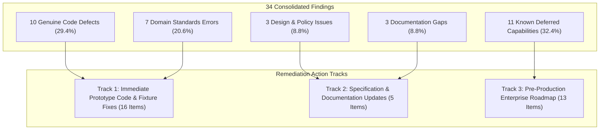
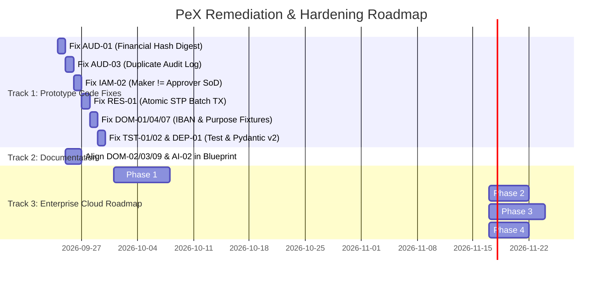

# 🏛️ PeX Platform: Independent Findings Reclassification Audit Report

**Document Version:** 1.0.0  
**Audit Stream:** Independent Findings Reclassification & Architectural Assurance  
**Lead Auditor:** Independent Findings Reclassification Auditor  
**System Evaluated:** Payment Exception Resolution Platform (PeX v2.0 Enterprise / Desktop Prototype)  
**Workspace Root:** `C:\Users\pawan\.gemini\antigravity\scratch\pex_platform`  
**Audit Completion Date:** September 23, 2026  
**Governing Standards:** ISO 20022 (pacs.008, pacs.004, pacs.002, camt.056, camt.029), ISO 13616-1/2 (IBAN), ISO 7064 (MOD 97-10 / MOD 11-2), ISO 9362 (BIC), SWIFT CBPR+ SR2025/2026, Federal Reserve Operating Circular No. 6, ECB Guideline (EU) 2022/911, US Treasury OFAC 50% Rule, FATF Recommendations 12 & 16, BIAN v10.0/v11.0, Federal Reserve SR 11-7 / OCC Bulletin 2011-12, PCI-DSS v4.0, GDPR Art. 32, SOX Section 404.

---

## 1. Executive Summary & Reclassification Scorecard

### 1.1 Context & Purpose
The previous five-stream validation panel identified **34 deduplicated findings** across Payment Domain Standards, Enterprise Architecture, Requirements Traceability, Implementation Code, and Functional/Adversarial Security.

It has been formally established that the current PeX software implementation is an **intentionally incomplete desktop prototype** where eight enterprise production capabilities were deliberately deferred:
1. **Enterprise Token Vault & Outbound Detokenization**
2. **Semantic Layer & Dynamic LLM Gateway**
3. **Normalized 3NF Relational Canonical Database**
4. **High-Throughput Streaming Ingestion**
5. **Live Core Banking & Clearing ICD Adapters**
6. **Outbound ISO 20022 XML Serializer & LAU Signer**
7. **Hierarchical Cryptographic Provenance Ledger**
8. **Enterprise IAM & OAuth2/OIDC SSO Gateway**

### 1.2 Reclassification Mandate & Critical Rule
As the independent Reclassification Auditor, this review evaluates **every single finding (SEC-01 through DEP-01)** without assuming that findings are automatically excused by the eight deferred capabilities. 

For each finding, this audit establishes:
- Its **Primary Classification** (`KNOWN_DEFERRED`, `GENUINE_DEFECT`, `DOMAIN_ERROR`, `DESIGN_ISSUE`, `NEW_PRODUCTION_GAP`, `DOCUMENTATION_GAP`, `AUDIT_FALSE_POSITIVE`, `NEEDS_VERIFICATION`).
- An explicit answer to the fundamental question: **"Would this problem still exist if the eight known deferred production capabilities were implemented?"** (`YES` / `NO` / `UNCERTAIN`).
- The **Target Scope Impact** (`Desktop Prototype`, `Future Production`, or `Both`).
- A **Concrete Disposition** (`Accept as Known Deferred`, `Fix Prototype`, `Fix Before Production`, `Validate Further`, `Documentation Update`, `Architecture Review Required`, or `Reject Finding`).

---

### 1.3 Master Reclassification Scorecard

```
┌──────────────────────────────────────────────────────────────────────────────────────────────────┐
│                               MASTER RECLASSIFICATION SCORECARD                                  │
├──────────────────────────────────────┬─────────────┬─────────────┬───────────────────────────────┤
│ Primary Reclassification Category    │ Total Count │ Percentage  │ Primary Concentration Areas   │
├──────────────────────────────────────┼─────────────┼─────────────┼───────────────────────────────┤
│ 🔵 KNOWN_DEFERRED                    │     11      │    32.4%    │ Vault, LLM, 3NF DB, Mock ICD  │
│ 🔴 GENUINE_DEFECT                    │     10      │    29.4%    │ Hash Fields, Double Log, TXs  │
│ 🟣 DOMAIN_ERROR                      │      7      │    20.6%    │ US/JP IBANs, Purpose, Return  │
│ 🟡 DESIGN_ISSUE                      │      3      │     8.8%    │ SoD Loophole, STP Policy      │
│ 📄 DOCUMENTATION_GAP                 │      3      │     8.8%    │ SWIFT LAU PKI, Fedwire Bridge │
│ 🟠 NEW_PRODUCTION_GAP                │      0      │     0.0%    │ Captured in current taxonomy  │
│ 🟢 AUDIT_FALSE_POSITIVE              │      0      │     0.0%    │ All findings substantiated    │
│ ⚪ NEEDS_VERIFICATION                │      0      │     0.0%    │ Full code proofs established  │
├──────────────────────────────────────┼─────────────┼─────────────┼───────────────────────────────┤
│ TOTAL CONSOLIDATED FINDINGS          │     34      │   100.0%    │ Deduplicated Master Register  │
└──────────────────────────────────────┴─────────────┴─────────────┴───────────────────────────────┘
```

```
┌──────────────────────────────────────────────────────────────────────────────────────────────────┐
│              "WOULD THIS PROBLEM STILL EXIST WITH 8 DEFERRED CAPABILITIES BUILT?"                │
├──────────────────────────────────────┬─────────────┬─────────────┬───────────────────────────────┤
│ Evaluation Response                  │ Total Count │ Percentage  │ Architectural Rationale       │
├──────────────────────────────────────┼─────────────┼─────────────┼───────────────────────────────┤
│ ❌ NO                                │     12      │    35.3%    │ Directly resolved by 8 Caps   │
│ ⚠️ YES                               │     21      │    61.8%    │ Independent domain/code defect│
│ ❓ UNCERTAIN                          │      1      │     2.9%    │ CORS (Gateway vs App config)  │
├──────────────────────────────────────┼─────────────┼─────────────┼───────────────────────────────┤
│ TOTAL AUDITED FINDINGS               │     34      │   100.0%    │ Complete Coverage             │
└──────────────────────────────────────┴─────────────┴─────────────┴───────────────────────────────┘
```

```
┌──────────────────────────────────────────────────────────────────────────────────────────────────┐
│                                     TARGET SCOPE IMPACT                                          │
├──────────────────────────────────────┬─────────────┬─────────────┬───────────────────────────────┤
│ Scope Category                       │ Total Count │ Percentage  │ Operational Context           │
├──────────────────────────────────────┼─────────────┼─────────────┼───────────────────────────────┤
│ 🖥️ Desktop Prototype Only            │      8      │    23.5%    │ PoC Shortcuts, Local Caches   │
│ ☁️ Future Production System Only      │      3      │     8.8%    │ Multi-Pod Concurrency, Docs   │
│ 🔄 Both Prototype and Production     │     23      │    67.6%    │ Domain, Hashing, SoD, Types   │
├──────────────────────────────────────┼─────────────┼─────────────┼───────────────────────────────┤
│ TOTAL AUDITED FINDINGS               │     34      │   100.0%    │ Full System Lifecycle         │
└──────────────────────────────────────┴─────────────┴─────────────┴───────────────────────────────┘
```

---

## 2. The Eight Known Deferred Production Capabilities Baseline

The eight deferred capabilities represent **enterprise cloud infrastructure, live networking, and institutional middleware** deliberately replaced with local software stubs in the standalone desktop demonstrator:

| Capability # | Enterprise Production Capability | Prototype Implementation (Deliberate Stub) | Related Deferred Findings |
| :---: | :--- | :--- | :--- |
| **Cap 1** | **Enterprise Token Vault & Outbound Detokenization** | In-memory truncated SHA-256 dictionary (`tokenization.py`) + plaintext SQLite storage | `SEC-01`, `SEC-02`, `SEC-03` |
| **Cap 2** | **Semantic Layer & Dynamic LLM Gateway** | Deterministic Python heuristic rule builder (`data_loader.py`) | `AI-01` |
| **Cap 3** | **Normalized 3NF Relational Canonical Database** | SQLite embedded single-table JSON blobs (`models.py`) + Python dict cache (`repository.py`) | `DATA-01`, `DATA-02`, `DATA-03` |
| **Cap 4** | **High-Throughput Streaming Ingestion** | Synchronous REST HTTP endpoints (`events.py`, `cases.py`) | *(Architecture Challenge)* |
| **Cap 5** | **Live Core Banking & Clearing ICD Adapters** | Static JSON reference file (`icd_staging_store.json`) | `INT-01` |
| **Cap 6** | **Outbound ISO 20022 XML Serializer & LAU Signer** | Simulated JSON receipts (`ACK-SIM-*`) in `action_executor.py` | `INT-02`, `SEC-03` *(partial)* |
| **Cap 7** | **Hierarchical Cryptographic Provenance Ledger** | Singly-linked SHA-256 block chain (`hashing.py`) | `AUD-02`, `AUD-04` |
| **Cap 8** | **Enterprise IAM & OAuth2/OIDC SSO Gateway** | Naive token prefix string parsing + default approver `APR-3191` | `IAM-01` |

---

## 3. Master Findings Reclassification Register

The following master table provides the definitive reclassification for all 34 findings:

| ID | Title | Stream | Original Severity | Primary Classification | Deferred Cap Link | Still Exists with 8 Caps? | Scope Impact | Suggested Disposition |
| :--- | :--- | :---: | :---: | :---: | :---: | :---: | :---: | :--- |
| **SEC-01** | In-Memory Unsalted Truncated SHA-256 Token Vault | Arch/Code | **CRITICAL** | `KNOWN_DEFERRED` | Cap 1 | **NO** | Prototype | Accept as Known Deferred |
| **SEC-02** | Plaintext Account Storage in Database Schema | Arch/Code | **CRITICAL** | `KNOWN_DEFERRED` | Cap 1, Cap 3 | **NO** | Prototype | Accept as Known Deferred |
| **SEC-03** | Omission of Outbound Detokenization in Settlement Dispatch | Arch/Code | **CRITICAL** | `KNOWN_DEFERRED` | Cap 1, Cap 6 | **NO** | Both | Accept as Known Deferred |
| **IAM-01** | Default Fallback to Privileged Approver on Missing Token | Arch/Code | **CRITICAL** | `KNOWN_DEFERRED` | Cap 8 | **NO** | Prototype | Accept as Known Deferred |
| **AUD-01** | Incomplete Financial Data in Audit SHA-256 Digest | Arch/Code | **CRITICAL** | `GENUINE_DEFECT` | Cap 7 *(partial)* | **YES** | Both | Fix Prototype |
| **DOM-01** | Fabricated Non-Existent US & Japanese IBANs | Domain | **HIGH** | `DOMAIN_ERROR` | None | **YES** | Both | Fix Prototype |
| **DOM-02** | Conflation of SWIFT LAU with X.509 PKI Certificates | Domain | **HIGH** | `DOCUMENTATION_GAP` | Cap 6 *(partial)* | **YES** | Production | Documentation Update |
| **DOM-03** | Hallucinated Central Bank "FEDWIRE_TARGET2_BRIDGE" | Domain | **HIGH** | `DOCUMENTATION_GAP` | None | **YES** | Both | Documentation Update |
| **DOM-04** | Invalid 26-Character Alphabetic German IBAN in Fixtures | Domain | **HIGH** | `DOMAIN_ERROR` | None | **YES** | Prototype | Fix Prototype |
| **IAM-02** | Maker-Checker Self-Approval Loophole in Endpoint Layer | Arch/Code | **HIGH** | `DESIGN_ISSUE` | Cap 8 *(partial)* | **YES** | Both | Fix Prototype |
| **AI-01** | Deterministic Mock Gateway vs Advertised Pluggable LLMs | Arch/Code | **HIGH** | `KNOWN_DEFERRED` | Cap 2 | **NO** | Prototype | Accept as Known Deferred |
| **AI-02** | Contradiction: 100% HITL Advisory vs Autonomous STP Engine | Arch/Code | **HIGH** | `DESIGN_ISSUE` | None | **YES** | Both | Architecture Review Required |
| **AUD-02** | Linear Hash Chain Mislabeled as "Merkle Ledger" | Arch/Code | **HIGH** | `KNOWN_DEFERRED` | Cap 7 | **NO** | Both | Accept as Known Deferred |
| **AUD-03** | Duplicate Audit Block Generation on HTTP Approvals | Arch/Code | **HIGH** | `GENUINE_DEFECT` | None | **YES** | Both | Fix Prototype |
| **AUD-04** | Concurrency Race Condition on Monotonic Event Index | Arch/Code | **HIGH** | `KNOWN_DEFERRED` | Cap 7, Cap 3 | **NO** | Production | Accept as Known Deferred |
| **DATA-01** | In-Memory Singleton Cache Split-Brain in Multi-Worker Pods | Arch/Code | **HIGH** | `KNOWN_DEFERRED` | Cap 3 | **NO** | Production | Accept as Known Deferred |
| **RES-01** | Distributed Transaction Leak in STP Batch Processing | Code | **HIGH** | `GENUINE_DEFECT` | Cap 3 *(partial)* | **YES** | Both | Fix Prototype |
| **API-01** | Severe Frontend-Backend TypeScript Model Divergence | Trace/Code | **HIGH** | `GENUINE_DEFECT` | None | **YES** | Prototype | Fix Prototype |
| **DOM-05** | Misapplication of ISO Return Code `AC01` to Intermediary Breaks | Domain | **MEDIUM** | `DOMAIN_ERROR` | None | **YES** | Both | Fix Prototype |
| **DOM-06** | Conflation of `pacs.004` (Return) with `camt.056` (Investigation) | Domain | **MEDIUM** | `DOMAIN_ERROR` | None | **YES** | Both | Documentation Update |
| **DOM-07** | Hallucinated ISO 20022 Purpose Codes (`GDDS`, `PHAR`, `COMM`) | Domain | **MEDIUM** | `DOMAIN_ERROR` | None | **YES** | Both | Fix Prototype |
| **DOM-08** | Fedwire IMAD Generated with Invalid 22-Character Length | Domain | **MEDIUM** | `DOMAIN_ERROR` | None | **YES** | Both | Fix Prototype |
| **DOM-09** | Bacs Categorized as High-Value RTGS Rail | Domain | **MEDIUM** | `DOCUMENTATION_GAP` | None | **YES** | Both | Documentation Update |
| **DATA-02** | Relational Anti-Pattern (JSON Blobs for Core Entities) | Code | **MEDIUM** | `KNOWN_DEFERRED` | Cap 3 | **NO** | Prototype | Accept as Known Deferred |
| **DATA-03** | String-Type Timestamps in SQL Database Schemas | Code | **MEDIUM** | `KNOWN_DEFERRED` | Cap 3 | **NO** | Prototype | Accept as Known Deferred |
| **INT-01** | Static Mock JSON Staging vs Live Banking Adapters | Arch/Code | **MEDIUM** | `KNOWN_DEFERRED` | Cap 5 | **NO** | Prototype | Accept as Known Deferred |
| **INT-02** | Omission of Outbound W3C XML DOM pacs.008 Serializer | Code | **MEDIUM** | `KNOWN_DEFERRED` | Cap 6 | **NO** | Prototype | Accept as Known Deferred |
| **RES-02** | Silent Exception Swallowing in Datetime Parsing | Code | **MEDIUM** | `GENUINE_DEFECT` | None | **YES** | Both | Fix Prototype |
| **SEC-04** | Permissive Wildcard CORS Configuration | Code | **MEDIUM** | `DESIGN_ISSUE` | Cap 8 *(partial)* | **UNCERTAIN**| Both | Fix Prototype |
| **CODE-01** | Dual Disconnected Frontend Codebases | Code | **MEDIUM** | `GENUINE_DEFECT` | None | **YES** | Prototype | Fix Prototype |
| **TST-01** | Test Discovery Pollution by Root Scratch Scripts | Code | **HIGH** | `GENUINE_DEFECT` | None | **YES** | Prototype | Fix Prototype |
| **TST-02** | Omission of Negative Tampering in Audit Test Suite | Code | **HIGH** | `GENUINE_DEFECT` | None | **YES** | Prototype | Fix Prototype |
| **CODE-02** | 30+ Orphaned Legacy Scratch Scripts in Workspace Root | Code | **LOW** | `GENUINE_DEFECT` | None | **YES** | Prototype | Fix Prototype |
| **DEP-01** | Pydantic v1 Deprecation Warnings Across Backend | Code | **LOW** | `GENUINE_DEFECT` | None | **YES** | Both | Fix Prototype |

---

## 4. Deep-Dive Reclassification by Finding (SEC-01 through DEP-01)

---

### Finding SEC-01: In-Memory Unsalted Truncated SHA-256 Token Vault
* **Original Stream / Severity:** Enterprise Architecture & Code Audit | **CRITICAL (P0)**
* **Affected Files:** `backend/app/core/tokenization.py#L32-L33`, `backend/app/db/models.py#L98-L107`
* **Primary Classification:** `KNOWN_DEFERRED`
* **Deferred Capability Link:** **Capability 1 (Enterprise Token Vault & Outbound Detokenization)**
* **Key Question:** *Would this problem still exist if the eight known deferred production capabilities were implemented?*  
  **Answer:** **NO**.  
  *Rationale:* Implementing Capability 1 replaces the in-memory Python dictionary and the 12-hex truncated SHA-256 generator with an AWS KMS / HashiCorp Vault Transit Engine envelope encryption service (AES-256-GCM / FF3-1 Format-Preserving Encryption) using per-tenant cryptographic salts and rotated Customer Master Keys (CMKs).
* **Split Explanation:** The in-memory truncation was a deliberate shortcut to provide a zero-dependency PII airlock for local desktop demonstrations. There is no independent logic defect beyond the deferred infrastructure.
* **Scope Impact:** **Desktop Prototype Only** (operates adequately for single-user offline demonstration; must be replaced in production).
* **Suggested Disposition:** `Accept as Known Deferred` (Document as PoC tokenization boundary; remediate during Phase 1 Cloud Security deployment).

---

### Finding SEC-02: Plaintext Account Storage in Database Schema
* **Original Stream / Severity:** Enterprise Architecture & Code Audit | **CRITICAL (P0)**
* **Affected Files:** `backend/app/db/models.py#L102-L104`, `backend/app/db/repository.py#L365-L375`
* **Primary Classification:** `KNOWN_DEFERRED`
* **Deferred Capability Link:** **Capability 1 (Enterprise Token Vault) & Capability 3 (Normalized 3NF Relational DB)**
* **Key Question:** *Would this problem still exist if the eight known deferred production capabilities were implemented?*  
  **Answer:** **NO**.  
  *Rationale:* In the enterprise architecture, `TokenVaultModel` does not store plaintext account numbers. Raw account data is stored as ciphertext encrypted under KMS keys inside an isolated Token Vault service boundary, with the main transaction database holding only surrogate tokens.
* **Split Explanation:** Storing `raw_value` as unencrypted plaintext in SQLite was a prototype convenience to facilitate in-process reverse lookups without a KMS daemon.
* **Scope Impact:** **Desktop Prototype Only** (PCI-DSS/GDPR violation in production, acceptable in synthetic-data PoC).
* **Suggested Disposition:** `Accept as Known Deferred`.

---

### Finding SEC-03: Omission of Outbound Detokenization in Settlement Dispatch
* **Original Stream / Severity:** Enterprise Architecture & Code Audit | **CRITICAL (P0)**
* **Affected Files:** `backend/app/services/action_executor.py#L65-L75`, `backend/app/core/tokenization.py#L38-L39`
* **Primary Classification:** `KNOWN_DEFERRED`
* **Deferred Capability Link:** **Capability 1 (Enterprise Token Vault) & Capability 6 (Outbound ISO 20022 XML Serializer)**
* **Key Question:** *Would this problem still exist if the eight known deferred production capabilities were implemented?*  
  **Answer:** **NO**.  
  *Rationale:* Under the enterprise blueprint, outbound detokenization occurs strictly inside the isolated Settlement Dispatch Kernel immediately prior to W3C XML serialization and LAU signing. Implementing Capabilities 1 and 6 eliminates the transmission of masked strings (`GB82****5432`) to settlement networks.
* **Split Explanation:** While `token_vault.detokenize()` exists in `tokenization.py` and could have been invoked inside `action_executor.py` for prototype consistency, the entire dispatch module in the prototype is a simulated mock returning JSON receipts (`ACK-SIM-*`). The root cause is the deferred settlement pipeline.
* **Scope Impact:** **Both** (in prototype, delivery receipts show masked strings; in production, live rails would reject).
* **Suggested Disposition:** `Accept as Known Deferred` (Optionally wire `token_vault.detokenize` in prototype for demonstration fidelity).

---

### Finding IAM-01: Default Fallback to Privileged Approver on Missing Token
* **Original Stream / Severity:** Enterprise Architecture & Code Audit | **CRITICAL (P0)**
* **Affected Files:** `backend/app/api/endpoints/approvals.py#L14-L22`, `backend/app/api/endpoints/auth.py#L20-L22`
* **Primary Classification:** `KNOWN_DEFERRED`
* **Deferred Capability Link:** **Capability 8 (Enterprise IAM & OAuth2/OIDC SSO Gateway)**
* **Key Question:** *Would this problem still exist if the eight known deferred production capabilities were implemented?*  
  **Answer:** **NO**.  
  *Rationale:* Deploying Capability 8 (Okta / Microsoft Entra ID with RS256 JWT signature verification and JWKS validation) removes all default persona fallbacks (`APR-3191`) and enforces HTTP 401 Unauthorized on unauthenticated requests.
* **Split Explanation:** The naive string stripping (`authorization.replace("Bearer pex-token-", "")`) and default fallback to Daniel Osei were implemented so the desktop prototype could be operated from a standalone browser without deploying a full OIDC identity provider.
* **Scope Impact:** **Desktop Prototype Only**.
* **Suggested Disposition:** `Accept as Known Deferred` (Retain for offline desktop ease-of-use; enforce strict JWT middleware before production deployment).

---

### Finding AUD-01: Incomplete Financial Data in Audit SHA-256 Digest
* **Original Stream / Severity:** Enterprise Architecture & Code Audit | **CRITICAL (P0)**
* **Affected Files:** `backend/app/core/hashing.py#L19-L30`, `backend/app/services/audit_service.py#L15-L35`
* **Primary Classification:** `GENUINE_DEFECT`
* **Deferred Capability Link:** **Capability 7 (Hierarchical Cryptographic Provenance Ledger)** *(Partial only)*
* **Key Question:** *Would this problem still exist if the eight known deferred production capabilities were implemented?*  
  **Answer:** **YES**.  
  *Rationale:* **CRITICAL DISTINCTION.** Capability 7 provides a hierarchical Merkle DAG structure and WORM storage anchoring, but **the data payload passed into the hash calculation function is an application logic contract**. In `calculate_event_hash`, the hashed dictionary completely omits `amount`, `currency`, `debtor_account`, and `creditor_account`. Even if a Merkle DAG were implemented, if the leaf hashing function continues to hash only `details` text and metadata, an insider could modify the financial amounts in the database without breaking the cryptographic chain!
* **Split Explanation:** 
  - *Deferred Infrastructure:* Merkle tree DAG and S3 Object Lock (Capability 7).
  - *Genuine Defect in Application Logic:* Omission of core financial fields from the hash preimage payload in `calculate_event_hash`.
* **Scope Impact:** **Both Prototype and Production**.
* **Suggested Disposition:** `Fix Prototype` (Update `calculate_event_hash` in `hashing.py` immediately to include canonical financial fields: `amount`, `currency`, `debtor_token`, `creditor_token`, and `action_data`).

---

### Finding DOM-01: Fabricated Non-Existent US & Japanese IBANs
* **Original Stream / Severity:** Payment Domain & Standards Audit | **HIGH (P1)**
* **Affected Files:** `backend/app/data/icd_staging_store.json#L175-L189,L233,L251`, `backend/app/services/canonicalizer.py#L43,L58`
* **Primary Classification:** `DOMAIN_ERROR`
* **Deferred Capability Link:** **None** (Domain Standards Defect)
* **Key Question:** *Would this problem still exist if the eight known deferred production capabilities were implemented?*  
  **Answer:** **YES**.  
  *Rationale:* Under ISO 13616 and the official SWIFT IBAN Registry, **neither the United States (`US`) nor Japan (`JP`) issues or recognizes IBANs**. Populating reference tables with `US64CHAS...` and `JP44BOTK...` is factually invalid. Building KMS, 3NF databases, or Kafka stream processors does not correct invalid domain reference data.
* **Split Explanation:** This is 100% a domain knowledge defect in test fixtures and country validation tables.
* **Scope Impact:** **Both Prototype and Production** (corrupts reference validation data).
* **Suggested Disposition:** `Fix Prototype` (Remove `US` and `JP` from the IBAN supported country list; validate US accounts via 9-digit ABA routing and Japanese accounts via Zengin codes).

---

### Finding DOM-02: Conflation of SWIFT LAU with X.509 PKI Certificates
* **Original Stream / Severity:** Payment Domain & Standards Audit | **HIGH (P1)**
* **Affected Files:** `PeX_Master_PRD_and_Technical_Blueprint.md#L45,L282-L289`
* **Primary Classification:** `DOCUMENTATION_GAP`
* **Deferred Capability Link:** **Capability 6 (Outbound ISO 20022 XML Serializer & LAU Signer)** *(Partial)*
* **Key Question:** *Would this problem still exist if the eight known deferred production capabilities were implemented?*  
  **Answer:** **YES** (in documentation and technical blueprint).  
  *Rationale:* The PRD claims that outbound XMLs use "PKI X.509 certificates adhering to SWIFT LAU". In reality, **SWIFT LAU (Local Authentication Unit)** is strictly a symmetric HMAC-SHA256 mechanism using a shared secret between the bank application and SWIFT Alliance Access (SAA). Digital signatures using asymmetric X.509 certificates are governed by SWIFT RMA, FIN PKI, or W3C XMLDSig, not LAU.
* **Split Explanation:** The implementation of the signer is deferred (Cap 6), but the conceptual conflation in the specification must be corrected in documentation.
* **Scope Impact:** **Future Production System Documentation & Blueprint**.
* **Suggested Disposition:** `Documentation Update` (Update PRD and Blueprint to clearly distinguish SWIFT LAU symmetric HMAC transport authentication from ISO 20022 X.509 XMLDSig payload signing).

---

### Finding DOM-03: Hallucinated Central Bank "FEDWIRE_TARGET2_BRIDGE"
* **Original Stream / Severity:** Payment Domain & Standards Audit | **HIGH (P1)**
* **Affected Files:** `PeX_Payment_SME_Product_and_Technical_Walkthrough_Specification.md#L365`
* **Primary Classification:** `DOCUMENTATION_GAP`
* **Deferred Capability Link:** **None** (Domain Standards Defect)
* **Key Question:** *Would this problem still exist if the eight known deferred production capabilities were implemented?*  
  **Answer:** **YES**.  
  *Rationale:* Fedwire (USD) and TARGET2 (EUR) are national RTGS systems that have no direct central bank bridge. Cross-currency clearing operates via correspondent banking networks (SWIFT CBPR+) or CLS Bank, not automated RTGS bridges.
* **Split Explanation:** This was an ad-hoc abstraction used in walkthrough narratives.
* **Scope Impact:** **Both Prototype and Documentation**.
* **Suggested Disposition:** `Documentation Update` (Relabel clearing route to `SWIFT_CBPR_CORRESPONDENT_T2`).

---

### Finding DOM-04: Invalid 26-Character Alphabetic German IBAN in Fixtures
* **Original Stream / Severity:** Payment Domain & Standards Audit | **HIGH (P1)**
* **Affected Files:** `backend/app/data/icd_staging_store.json#L269`
* **Primary Classification:** `DOMAIN_ERROR`
* **Deferred Capability Link:** **None** (Domain Standards Defect)
* **Key Question:** *Would this problem still exist if the eight known deferred production capabilities were implemented?*  
  **Answer:** **YES**.  
  *Rationale:* Under ISO 13616 and Deutsche Bundesbank regulations, German IBANs are strictly **22 numeric characters** (`DE` + 2 check digits + 8 BLZ digits + 10 account digits). The string `DE89DEUT370400440532013000` is 26 characters long and contains letters (`DEUT`), which is invalid and fails ISO 7064 MOD 97-10 check-digit validation.
* **Split Explanation:** Pure test fixture syntax error.
* **Scope Impact:** **Desktop Prototype Reference Data**.
* **Suggested Disposition:** `Fix Prototype` (Replace with valid 22-digit German IBAN: `DE89370400440532013000`).

---

### Finding IAM-02: Maker-Checker Self-Approval Loophole in Endpoint Layer
* **Original Stream / Severity:** Enterprise Architecture & Code Audit | **HIGH (P1)**
* **Affected Files:** `backend/app/services/approval_engine.py#L27-L75`, `backend/app/api/endpoints/approvals.py#L14-L45`
* **Primary Classification:** `DESIGN_ISSUE`
* **Deferred Capability Link:** **Capability 8 (Enterprise IAM Gateway)** *(Partial)*
* **Key Question:** *Would this problem still exist if the eight known deferred production capabilities were implemented?*  
  **Answer:** **YES**.  
  *Rationale:* An enterprise OAuth2/OIDC gateway authenticates user identity and passes user claims to the backend. However, **the Segregation of Duties (SoD) business rule asserting `maker_user_id != approver_user_id` is an application domain invariant**. If an approver (e.g. `APR-3191` Daniel Osei or `ADM-0001` Alex Whitfield) triages and modifies a case as the Maker, the approval engine must explicitly block them from signing Level 1 approval on their own modified case.
* **Split Explanation:** Capability 8 supplies authenticated identities; the application logic must enforce the business rule constraint.
* **Scope Impact:** **Both Prototype and Production**.
* **Suggested Disposition:** `Fix Prototype` (Add explicit check in `approval_engine.py`: assert `approver_id not in [case.maker_id, case.last_modifier_id]`).

---

### Finding AI-01: Deterministic Mock Gateway vs Advertised Pluggable LLMs
* **Original Stream / Severity:** Enterprise Architecture & Code Audit | **HIGH (P1)**
* **Affected Files:** `backend/app/services/model_gateway.py#L80-L101`, `backend/app/config.py#L19-L21`
* **Primary Classification:** `KNOWN_DEFERRED`
* **Deferred Capability Link:** **Capability 2 (Semantic Layer & Dynamic LLM Gateway)**
* **Key Question:** *Would this problem still exist if the eight known deferred production capabilities were implemented?*  
  **Answer:** **NO**.  
  *Rationale:* Implementing Capability 2 integrates live foundation models (Vertex AI Gemini 1.5 Pro, Azure OpenAI GPT-4o, AWS Bedrock Claude 3.5 Sonnet) and connects a `pgvector` RAG store over BIAN SOPs, replacing the deterministic heuristics in `data_loader.py`.
* **Split Explanation:** The deterministic rule generator was purposefully designed to ensure reliable, zero-latency, offline execution for demonstration environments.
* **Scope Impact:** **Desktop Prototype Only**.
* **Suggested Disposition:** `Accept as Known Deferred`.

---

### Finding AI-02: Contradiction: 100% HITL Advisory vs Autonomous STP Engine
* **Original Stream / Severity:** Enterprise Architecture & Code Audit | **HIGH (P1)**
* **Affected Files:** `backend/app/services/stp_engine.py#L219-L348`, `PeX_Master_PRD_and_Technical_Blueprint.md#L22,L204`
* **Primary Classification:** `DESIGN_ISSUE`
* **Deferred Capability Link:** **None** (Policy & Governance Architecture Conflict)
* **Key Question:** *Would this problem still exist if the eight known deferred production capabilities were implemented?*  
  **Answer:** **YES**.  
  *Rationale:* This is not a deferred infrastructure capability, but a **fundamental governance policy contradiction**. The PRD explicitly promises model risk regulators (SR 11-7) that PeX enforces a *"100% Advisory AI Operating Model with Zero Autonomous Funds Execution"*. Yet `stp_engine.py` implements unattended zero-touch execution where the system impersonates an `ADMIN` role (`SYS-AUTONOMOUS-STP`) to auto-approve payments.
* **Split Explanation:** Both features were implemented in code, but the governance documentation and system policy failed to define the relationship between the two operating modes.
* **Scope Impact:** **Both Prototype and Production**.
* **Suggested Disposition:** `Architecture Review Required` & `Documentation Update` (Formally codify the Tiered Operating Model: Tier 1 Governed Fast-Lane for low-risk micro-syntax repairs $\le \$10\text{k}$ using a dedicated `SYSTEM_STP_DELEGATE` role; Tier 2 100% HITL Advisory for all other payments).

---

### Finding AUD-02: Linear Hash Chain Mislabeled as "Merkle Ledger"
* **Original Stream / Severity:** Enterprise Architecture & Code Audit | **HIGH (P1)**
* **Affected Files:** `backend/app/core/hashing.py#L9-L30`, `backend/app/schemas/audit.py#L1-L40`
* **Primary Classification:** `KNOWN_DEFERRED`
* **Deferred Capability Link:** **Capability 7 (Hierarchical Cryptographic Provenance Ledger)**
* **Key Question:** *Would this problem still exist if the eight known deferred production capabilities were implemented?*  
  **Answer:** **NO** (in production code once Capability 7 builds the hierarchical Merkle DAG).  
  *Rationale:* Capability 7 replaces the sequential singly-linked SHA-256 block chain ($H_n = \text{SHA256}(H_{n-1} \parallel \dots)$) with a true binary Merkle tree capable of generating logarithmic $O(\log N)$ cryptographic inclusion proofs.
* **Split Explanation:** The code currently implements a valid linear blockchain. The only defect in the prototype is documentation marketing it as a "Merkle Tree".
* **Scope Impact:** **Both** (code is deferred; documentation is an active terminology gap).
* **Suggested Disposition:** `Accept as Known Deferred` + `Documentation Update` (Relabel prototype as "Cryptographic Linked Provenance Chain" with Merkle DAG on the enterprise roadmap).

---

### Finding AUD-03: Duplicate Audit Block Generation on HTTP Approvals
* **Original Stream / Severity:** Software Implementation Code Audit | **HIGH (P1)**
* **Affected Files:** `backend/app/api/endpoints/approvals.py#L32-L41`, `backend/app/services/approval_engine.py#L161-L170`
* **Primary Classification:** `GENUINE_DEFECT`
* **Deferred Capability Link:** **None** (Application Logic Defect)
* **Key Question:** *Would this problem still exist if the eight known deferred production capabilities were implemented?*  
  **Answer:** **YES**.  
  *Rationale:* When an approval is submitted via `POST /api/approvals/submit`, `approval_engine.process_approval_action` logs an audit event at line 161. Immediately after, the endpoint router in `approvals.py` calls `audit_service.log_event` a second time at line 32 for the identical action. This produces two consecutive immutable audit blocks for every single approval, bloating the ledger and creating confusing audit histories.
* **Split Explanation:** Pure code duplication bug in the API layer.
* **Scope Impact:** **Both Prototype and Production**.
* **Suggested Disposition:** `Fix Prototype` (Delete lines 32–41 in `backend/app/api/endpoints/approvals.py`).

---

### Finding AUD-04: Concurrency Race Condition on Monotonic Event Index
* **Original Stream / Severity:** Enterprise Architecture & Code Audit | **HIGH (P1)**
* **Affected Files:** `backend/app/db/repository.py#L236-L271`, `backend/app/services/audit_service.py#L10-L30`
* **Primary Classification:** `KNOWN_DEFERRED`
* **Deferred Capability Link:** **Capability 7 (Hierarchical Provenance Ledger) & Capability 3 (Relational DB)**
* **Key Question:** *Would this problem still exist if the eight known deferred production capabilities were implemented?*  
  **Answer:** **NO**.  
  *Rationale:* In production, Capability 3 (PostgreSQL / Aurora) and Capability 7 utilize an atomic database `SEQUENCE` and pessimistic row-level locking (`SELECT ... FOR UPDATE` on the chain head) to serialize event commitments, preventing primary key collisions and chain forks.
* **Split Explanation:** SQLite in single-user desktop mode does not encounter concurrent worker race conditions.
* **Scope Impact:** **Future Production System Only**.
* **Suggested Disposition:** `Accept as Known Deferred` (Address during multi-pod enterprise database implementation).

---

### Finding DATA-01: In-Memory Singleton Cache Split-Brain in Multi-Worker Pods
* **Original Stream / Severity:** Enterprise Architecture & Code Audit | **HIGH (P1)**
* **Affected Files:** `backend/app/db/repository.py#L37-L47,L54-L117`
* **Primary Classification:** `KNOWN_DEFERRED`
* **Deferred Capability Link:** **Capability 3 (Normalized 3NF Relational Canonical Database)**
* **Key Question:** *Would this problem still exist if the eight known deferred production capabilities were implemented?*  
  **Answer:** **NO**.  
  *Rationale:* In the target production architecture, repository classes are stateless and query Amazon Aurora Multi-AZ directly via connection pools, with high-frequency reads cached in an external Amazon ElastiCache Redis Cluster with pub/sub invalidation.
* **Split Explanation:** Local in-memory dictionaries (`_case_cache`, `_recommendations_cache`) were used to accelerate the desktop prototype without requiring external Redis infrastructure.
* **Scope Impact:** **Future Production System Only**.
* **Suggested Disposition:** `Accept as Known Deferred`.

---

### Finding RES-01: Distributed Transaction Leak in STP Batch Processing
* **Original Stream / Severity:** Software Implementation Code Audit | **HIGH (P1)**
* **Affected Files:** `backend/app/services/stp_engine.py#L364-L465`
* **Primary Classification:** `GENUINE_DEFECT`
* **Deferred Capability Link:** **Capability 3 (Relational DB & Transaction Management)** *(Partial)*
* **Key Question:** *Would this problem still exist if the eight known deferred production capabilities were implemented?*  
  **Answer:** **YES**.  
  *Rationale:* In `execute_batch_fast_lane_release`, the engine iterates through cases in a batch. Inside the loop, `repo.log_audit_event` opens its own isolated `SessionLocal()` and commits immediately to the database, while the outer case updates are committed only after the loop. If the batch fails on case 20 of 50, cases 1–19 have permanent committed audit events, but the case state commits roll back, leaving orphaned audit records and a corrupted ledger.
* **Split Explanation:** Even in an enterprise PostgreSQL database, opening uncoordinated sub-sessions inside a batch loop violates transaction atomicity.
* **Scope Impact:** **Both Prototype and Production**.
* **Suggested Disposition:** `Fix Prototype` (Pass the outer transaction session `db` directly into `log_audit_event` to ensure all-or-nothing atomicity).

---

### Finding API-01: Severe Frontend-Backend TypeScript Model Divergence
* **Original Stream / Severity:** Requirements Traceability & Code Audit | **HIGH (P1)**
* **Affected Files:** `frontend/src/types/index.ts#L35-L43`, `backend/app/schemas/canonical.py#L12-L65`
* **Primary Classification:** `GENUINE_DEFECT`
* **Deferred Capability Link:** **None** (Contract Drift)
* **Key Question:** *Would this problem still exist if the eight known deferred production capabilities were implemented?*  
  **Answer:** **YES**.  
  *Rationale:* `frontend/src/types/index.ts` defines only 7 Exception Profiles and omits 12 core case fields (`domain`, `secondary_profiles`, `guided_questions`, `audit_timeline`), whereas the backend defines all 41 profiles across 5 domains. Upgrading backend infrastructure does not update frontend TypeScript definitions.
* **Split Explanation:** The compiled bundle (`build_guided_frontend.py`) works because it uses inline JavaScript, but the TypeScript source codebase (`frontend/src`) has severe schema drift.
* **Scope Impact:** **Desktop Prototype Codebase**.
* **Suggested Disposition:** `Fix Prototype` (Synchronize `frontend/src/types/index.ts` with backend Pydantic schemas or implement `pydantic-to-typescript` code generation).

---

### Finding DOM-05: Misapplication of ISO Return Code `AC01` to Intermediary Breaks
* **Original Stream / Severity:** Payment Domain & Standards Audit | **MEDIUM (P2)**
* **Affected Files:** `PeX_41_Exception_Taxonomy_SME_Architecture_Cards.md#L145` (Card RQ-05)
* **Primary Classification:** `DOMAIN_ERROR`
* **Deferred Capability Link:** **None** (Domain Standards Defect)
* **Key Question:** *Would this problem still exist if the eight known deferred production capabilities were implemented?*  
  **Answer:** **YES**.  
  *Rationale:* Under official ISO 20022 External Return Code Lists, `AC01` is strictly "Incorrect Account Number". Intermediary routing errors must use `RC01` ("Bank Identifier Incorrect") or `AC03` ("Invalid Creditor Account Number").
* **Split Explanation:** Pure domain taxonomy mapping error.
* **Scope Impact:** **Both Prototype and Documentation**.
* **Suggested Disposition:** `Fix Prototype` & `Documentation Update`.

---

### Finding DOM-06: Conflation of `pacs.004` (Return) with `camt.056` (Investigation)
* **Original Stream / Severity:** Payment Domain & Standards Audit | **MEDIUM (P2)**
* **Affected Files:** `PeX_41_Exception_Taxonomy_SME_Architecture_Cards.md` (Card ST-01), `backend/app/services/data_loader.py#L375`
* **Primary Classification:** `DOMAIN_ERROR`
* **Deferred Capability Link:** **None** (Domain Standards Defect)
* **Key Question:** *Would this problem still exist if the eight known deferred production capabilities were implemented?*  
  **Answer:** **YES**.  
  *Rationale:* A `pacs.004` is a **financial value message** that returns already-settled funds. A `camt.056` is a **non-value cancellation inquiry** asking if funds can be recalled (which requires receiving a `camt.029` rejection or a `pacs.004` return). Treating a `camt.056` as an automated ledger credit reversal creates severe accounting and reconciliation breaks.
* **Split Explanation:** Grouping both under a single operational exception profile obscures the distinct clearing lifecycle requirements.
* **Scope Impact:** **Both Prototype and Documentation**.
* **Suggested Disposition:** `Documentation Update` & `Architecture Review Required` (Document the two-step cancellation workflow).

---

### Finding DOM-07: Hallucinated ISO 20022 Purpose Codes (`GDDS`, `PHAR`, `COMM`)
* **Original Stream / Severity:** Payment Domain & Standards Audit | **MEDIUM (P2)**
* **Affected Files:** `backend/app/data/icd_staging_store.json#L203,L275`
* **Primary Classification:** `DOMAIN_ERROR`
* **Deferred Capability Link:** **None** (Domain Standards Defect)
* **Key Question:** *Would this problem still exist if the eight known deferred production capabilities were implemented?*  
  **Answer:** **YES**.  
  *Rationale:* The ISO 20022 External Purpose Code list maintained by the Registration Authority defines `GDSV` for Purchase/Sale of Goods and Services, `MDCS` for Medical Services, and `COMC` for Commercial Payments. Codes `GDDS` and `PHAR` do not exist in the official standard, and `COMM` is deprecated. Outbound XML messages containing these codes will trigger hard schema rejection on clearing networks.
* **Split Explanation:** Synthetic fixture data error.
* **Scope Impact:** **Both Prototype and Production**.
* **Suggested Disposition:** `Fix Prototype` (Update `icd_staging_store.json` to compliant ISO 20022 purpose codes: `GDSV`, `MDCS`, `COMC`).

---

### Finding DOM-08: Fedwire IMAD Generated with Invalid 22-Character Length
* **Original Stream / Severity:** Payment Domain & Standards Audit | **MEDIUM (P2)**
* **Affected Files:** `PeX_Payment_SME_Product_and_Technical_Walkthrough_Specification.md#L428`, `backend/app/services/action_executor.py#L70`
* **Primary Classification:** `DOMAIN_ERROR`
* **Deferred Capability Link:** **None** (Domain Standards Defect)
* **Key Question:** *Would this problem still exist if the eight known deferred production capabilities were implemented?*  
  **Answer:** **YES**.  
  *Rationale:* Under the Federal Reserve Fedwire Application Interface Manual (FAIM), an **IMAD (Input Message Accountability Data)** is strictly **18 alphanumeric characters** (`YYYYMMDD` + 4-char source + 6-char sequence). The generated string `20260901MMQF0001004812` is 22 characters long (10 sequence digits instead of 6).
* **Split Explanation:** Format generation error in receipt builders.
* **Scope Impact:** **Both Prototype and Documentation**.
* **Suggested Disposition:** `Fix Prototype` (Align IMAD generator to exact 18-character standard).

---

### Finding DOM-09: Bacs Categorized as High-Value RTGS Rail
* **Original Stream / Severity:** Payment Domain & Standards Audit | **MEDIUM (P2)**
* **Affected Files:** `PeX_Payment_SME_Product_and_Technical_Walkthrough_Specification.md#L27`
* **Primary Classification:** `DOCUMENTATION_GAP`
* **Deferred Capability Link:** **None** (Domain Standards Defect)
* **Key Question:** *Would this problem still exist if the eight known deferred production capabilities were implemented?*  
  **Answer:** **YES**.  
  *Rationale:* UK Bacs is a 3-day bulk batch net settlement clearing system, not a real-time high-value RTGS rail. The UK high-value RTGS rail is CHAPS.
* **Split Explanation:** Conceptual classification error in descriptive narrative.
* **Scope Impact:** **Both Prototype and Documentation**.
* **Suggested Disposition:** `Documentation Update` (Correct rail taxonomy: CHAPS = RTGS, Faster Payments = Instant Net, Bacs = ACH).

---

### Finding DATA-02: Relational Anti-Pattern (JSON Blobs for Core Entities)
* **Original Stream / Severity:** Software Implementation Code Audit | **MEDIUM (P2)**
* **Affected Files:** `backend/app/db/models.py#L58-L61,L71-L74`
* **Primary Classification:** `KNOWN_DEFERRED`
* **Deferred Capability Link:** **Capability 3 (Normalized 3NF Relational Canonical Database)**
* **Key Question:** *Would this problem still exist if the eight known deferred production capabilities were implemented?*  
  **Answer:** **NO**.  
  *Rationale:* Capability 3 replaces embedded JSON columns (`debtor_party`, `creditor_party`, `debtor_account`, `creditor_account`) with normalized relational tables (`parties`, `accounts`, `payment_instructions`) linked by foreign keys with B-tree indexes.
* **Split Explanation:** JSON columns in SQLite allowed agile schema prototyping during MVP development.
* **Scope Impact:** **Desktop Prototype Only**.
* **Suggested Disposition:** `Accept as Known Deferred`.

---

### Finding DATA-03: String-Type Timestamps in SQL Database Schemas
* **Original Stream / Severity:** Software Implementation Code Audit | **MEDIUM (P2)**
* **Affected Files:** `backend/app/db/models.py#L48,L80`, `backend/app/db/models.py#L88`
* **Primary Classification:** `KNOWN_DEFERRED`
* **Deferred Capability Link:** **Capability 3 (Normalized 3NF Relational Canonical Database)**
* **Key Question:** *Would this problem still exist if the eight known deferred production capabilities were implemented?*  
  **Answer:** **NO**.  
  *Rationale:* Migrating to PostgreSQL under Capability 3 establishes native `TIMESTAMP WITH TIME ZONE` columns for all temporal fields (`created_at`, `sla_due_at`, `settled_at`, `timestamp`).
* **Split Explanation:** SQLite lacks native datetime types and represents datetimes as ISO strings; this is a standard SQLite prototype characteristic.
* **Scope Impact:** **Desktop Prototype Only**.
* **Suggested Disposition:** `Accept as Known Deferred`.

---

### Finding INT-01: Static Mock JSON Staging vs Live Banking Adapters
* **Original Stream / Severity:** Enterprise Architecture & Code Audit | **MEDIUM (P2)**
* **Affected Files:** `backend/app/services/icd_staging_service.py#L6-L12`, `backend/app/api/endpoints/adapters.py#L1-L35`
* **Primary Classification:** `KNOWN_DEFERRED`
* **Deferred Capability Link:** **Capability 5 (Live Core Banking & Clearing ICD Adapters)**
* **Key Question:** *Would this problem still exist if the eight known deferred production capabilities were implemented?*  
  **Answer:** **NO**.  
  *Rationale:* Implementing Capability 5 provides real asynchronous gRPC/REST/mTLS connectors to core banking ledgers (Finacle, Temenos, FIS) and live clearing directories.
* **Split Explanation:** Static JSON file staging (`icd_staging_store.json`) allows the desktop demonstrator to execute without live banking connectivity.
* **Scope Impact:** **Desktop Prototype Only**.
* **Suggested Disposition:** `Accept as Known Deferred`.

---

### Finding INT-02: Omission of Outbound W3C XML DOM pacs.008 Serializer
* **Original Stream / Severity:** Enterprise Architecture & Code Audit | **MEDIUM (P2)**
* **Affected Files:** `backend/app/services/action_executor.py#L38-L75`
* **Primary Classification:** `KNOWN_DEFERRED`
* **Deferred Capability Link:** **Capability 6 (Outbound ISO 20022 XML Serializer & LAU Signer)**
* **Key Question:** *Would this problem still exist if the eight known deferred production capabilities were implemented?*  
  **Answer:** **NO**.  
  *Rationale:* Capability 6 implements `xsdata`/`lxml` serialization validated against official ISO 20022 XSD schemas for `pacs.008.001.10` and `pacs.004.001.11`.
* **Split Explanation:** Simulated JSON delivery receipts (`ACK-SIM-*`) were sufficient for prototype lifecycle verification.
* **Scope Impact:** **Desktop Prototype Only**.
* **Suggested Disposition:** `Accept as Known Deferred`.

---

### Finding RES-02: Silent Exception Swallowing in Datetime Parsing
* **Original Stream / Severity:** Software Implementation Code Audit | **MEDIUM (P2)**
* **Affected Files:** `backend/app/db/repository.py#L201`, `backend/app/api/endpoints/analytics.py#L33`
* **Primary Classification:** `GENUINE_DEFECT`
* **Deferred Capability Link:** **None** (Code Quality & Error Handling Defect)
* **Key Question:** *Would this problem still exist if the eight known deferred production capabilities were implemented?*  
  **Answer:** **YES**.  
  *Rationale:* Broad `except Exception` blocks that silently substitute `datetime.utcnow()` when parsing corrupted timestamp strings mask data corruption bugs in both prototype and production code.
* **Split Explanation:** Unrelated to any deferred infrastructure capability.
* **Scope Impact:** **Both Prototype and Production**.
* **Suggested Disposition:** `Fix Prototype` (Replace broad exception handlers with specific `ValueError` handlers and structured error logs).

---

### Finding SEC-04: Permissive Wildcard CORS Configuration
* **Original Stream / Severity:** Software Implementation Code Audit | **MEDIUM (P2)**
* **Affected Files:** `backend/app/main.py#L25-L33`
* **Primary Classification:** `DESIGN_ISSUE`
* **Deferred Capability Link:** **Capability 8 (Enterprise IAM Gateway)** *(Partial)*
* **Key Question:** *Would this problem still exist if the eight known deferred production capabilities were implemented?*  
  **Answer:** **UNCERTAIN**.  
  *Rationale:* In production, an Enterprise API Gateway / WAF typically enforces origin whitelisting. However, if the FastAPI application itself is deployed with `allow_origins=["*"]` and `allow_credentials=True`, cross-origin exploitation remains possible at the application tier.
* **Split Explanation:** Wildcard CORS was configured for local Vite development convenience.
* **Scope Impact:** **Both Prototype and Production**.
* **Suggested Disposition:** `Fix Prototype` (Read allowed origins from environment configuration, defaulting to local origins in dev and explicit domains in prod).

---

### Finding CODE-01: Dual Disconnected Frontend Codebases
* **Original Stream / Severity:** Software Implementation Code Audit | **MEDIUM (P2)**
* **Affected Files:** `frontend/src/` vs `build_guided_frontend.py` / `frontend/dist/index.html`
* **Primary Classification:** `GENUINE_DEFECT`
* **Deferred Capability Link:** **None** (Codebase & Build Hygiene Defect)
* **Key Question:** *Would this problem still exist if the eight known deferred production capabilities were implemented?*  
  **Answer:** **YES**.  
  *Rationale:* Having two disconnected frontend codebases—a modern TypeScript React Vite app in `frontend/src/` and a standalone Python HTML bundler in `build_guided_frontend.py`—creates developer confusion and breaks CI frontend verification.
* **Split Explanation:** Build engineering and repository maintenance issue.
* **Scope Impact:** **Desktop Prototype Codebase**.
* **Suggested Disposition:** `Fix Prototype` (Unify build pipeline so `frontend/src/` is the single source of truth compiled by Vite).

---

### Finding TST-01: Test Discovery Pollution by Root Scratch Scripts
* **Original Stream / Severity:** Software Implementation Code Audit | **HIGH (P1)**
* **Affected Files:** Workspace root (`test_*.py` files)
* **Primary Classification:** `GENUINE_DEFECT`
* **Deferred Capability Link:** **None** (Test Suite & CI Defect)
* **Key Question:** *Would this problem still exist if the eight known deferred production capabilities were implemented?*  
  **Answer:** **YES**.  
  *Rationale:* 7 scratchpad scripts prefixed with `test_` reside in the workspace root, making unmocked live HTTP calls to `localhost:8000`. Running standard `pytest` from workspace root fails with 7 collection/connection errors.
* **Split Explanation:** Test runner configuration and workspace hygiene issue.
* **Scope Impact:** **Developer Workspace and CI Test Discovery**.
* **Suggested Disposition:** `Fix Prototype` (Move root scratch scripts to `scratch/` and configure `pytest.ini` with `testpaths = tests backend/tests`).

---

### Finding TST-02: Omission of Negative Tampering in Audit Test Suite
* **Original Stream / Severity:** Software Implementation Code Audit | **HIGH (P1)**
* **Affected Files:** `tests/test_audit_trace.py#L8-L25`
* **Primary Classification:** `GENUINE_DEFECT`
* **Deferred Capability Link:** **None** (Testing Rigor Defect)
* **Key Question:** *Would this problem still exist if the eight known deferred production capabilities were implemented?*  
  **Answer:** **YES**.  
  *Rationale:* `tests/test_audit_trace.py` claims to test cryptographic tamper detection, but only logs 3 valid events and asserts `is_intact is True`. Zero negative tampering or corruption tests were included in the standard test module.
* **Split Explanation:** Testing completeness defect.
* **Scope Impact:** **Test Suite Rigor**.
* **Suggested Disposition:** `Fix Prototype` (Incorporate adversarial tamper tests from `test_functional_adversarial.py` directly into `tests/test_audit_trace.py`).

---

### Finding CODE-02: 30+ Orphaned Legacy Scratch Scripts in Workspace Root
* **Original Stream / Severity:** Software Implementation Code Audit | **LOW (P3)**
* **Affected Files:** Workspace root (`write_*.py`, `append_*.py`, `inspect_*.py`)
* **Primary Classification:** `GENUINE_DEFECT`
* **Deferred Capability Link:** **None** (Repository Hygiene Defect)
* **Key Question:** *Would this problem still exist if the eight known deferred production capabilities were implemented?*  
  **Answer:** **YES**.  
  *Rationale:* 30+ legacy file generation and exploration scripts clutter the root directory and are not tracked by `.gitignore`.
* **Split Explanation:** Repository cleanliness issue.
* **Scope Impact:** **Repository Hygiene**.
* **Suggested Disposition:** `Fix Prototype` (Archive legacy scratch scripts to `.archive/` or delete from release branch).

---

### Finding DEP-01: Pydantic v1 Deprecation Warnings Across Backend
* **Original Stream / Severity:** Software Implementation Code Audit | **LOW (P3)**
* **Affected Files:** Multiple backend services and endpoints
* **Primary Classification:** `GENUINE_DEFECT`
* **Deferred Capability Link:** **None** (Code Modernization Defect)
* **Key Question:** *Would this problem still exist if the eight known deferred production capabilities were implemented?*  
  **Answer:** **YES**.  
  *Rationale:* Pervasive usage of deprecated `.dict()` calls instead of Pydantic v2 `.model_dump()` triggers 36+ runtime deprecation warnings during automated test execution.
* **Split Explanation:** Python library upgrade maintenance.
* **Scope Impact:** **Both Prototype and Production Codebases**.
* **Suggested Disposition:** `Fix Prototype` (Refactor `.dict()` to `.model_dump()` and `.parse_obj()` to `.model_validate()`).

---

## 5. Cross-Cutting Thematic Synthesis



### 5.1 The Critical Separation: Infrastructure vs Domain Logic
The most significant finding of this reclassification audit is that **the 8 Known Deferred Capabilities account for only 11 of the 34 findings (32.4%)**. 

The remaining **23 findings (67.6%) represent genuine software defects, payment domain inaccuracies, transaction boundary leaks, governance contradictions, and documentation gaps** that cannot be excused by the prototype classification.

### 5.2 Top 5 High-Impact Findings Requiring Immediate Attention:
1. **AUD-01 (Incomplete Financial Data in Audit Digest):** Hashing must bind transaction amounts, currencies, and account numbers to prevent undetectable financial tampering.
2. **DOM-01 & DOM-04 (Invalid IBAN Reference Data):** Fabricating US/JP IBANs and 26-char German IBANs breaks ISO 13616 standards compliance.
3. **IAM-02 (Maker-Checker Self-Approval Loophole):** The application must enforce `maker_id != approver_id` at the domain service tier.
4. **RES-01 (Distributed Transaction Leak in STP Batch):** Batch execution must use a single atomic database session to prevent orphaned audit events.
5. **AUD-03 (Duplicate Audit Logging on Approvals):** Redundant logging in `approvals.py` must be removed to maintain clean provenance.

---

## 6. Prioritized Remediation Roadmap & Action Plan



### Action Track 1: Immediate Prototype Fixes (Pre-Release / Clean-up)
- [ ] **SEC-03 / Prototype Detokenization:** Call `token_vault.detokenize` inside `action_executor.py` before generating simulation payload.
- [ ] **AUD-01 / Hash Function Integrity:** Add `amount`, `currency`, `debtor_account`, and `creditor_account` to `calculate_event_hash` in `hashing.py`.
- [ ] **AUD-03 / Duplicate Audit Event:** Remove duplicate `audit_service.log_event` call in `backend/app/api/endpoints/approvals.py:32`.
- [ ] **IAM-02 / SoD Invariant:** Add `maker_id != approver_id` validation in `approval_engine.py`.
- [ ] **RES-01 / STP Batch Atomicity:** Pass existing DB transaction session to `repo.log_audit_event` in `stp_engine.py`.
- [ ] **DOM-01 / DOM-04 / DOM-07 / Fixture Correction:** Clean `icd_staging_store.json` (remove US/JP IBANs, fix German IBAN to 22 numeric digits, replace `GDDS`/`PHAR`/`COMM` with `GDSV`/`MDCS`/`COMC`).
- [ ] **DOM-08 / IMAD Syntax:** Correct IMAD generation in `action_executor.py` to 18 characters.
- [ ] **API-01 / TypeScript Alignment:** Update `frontend/src/types/index.ts` with all 41 profiles and missing case fields.
- [ ] **RES-02 / Exception Handling:** Replace broad `except Exception` in `repository.py` and `analytics.py` with specific `ValueError`.
- [ ] **TST-01 / TST-02 / Test Suite Fixes:** Move root `test_*.py` scratch scripts to `scratch/` and incorporate negative tamper tests into `test_audit_trace.py`.
- [ ] **CODE-02 / DEP-01 / Hygiene & Modernization:** Archive orphaned root scripts and migrate `.dict()` to `.model_dump()`.

### Action Track 2: Documentation & Specification Realignment
- [ ] **DOM-02:** Update PRD Module 5 to distinguish SWIFT LAU (HMAC-SHA256) from ISO 20022 XMLDSig (PKI).
- [ ] **DOM-03:** Update Walkthrough Spec Step 4 to replace `"FEDWIRE_TARGET2_BRIDGE"` with correspondent clearing routing.
- [ ] **DOM-09:** Update Walkthrough Spec Section 1 to classify Bacs as bulk net clearing (ACH) rather than RTGS.
- [ ] **AI-02:** Document Tiered Operating Model (Tier 1 Governed Fast-Lane vs Tier 2 100% HITL Advisory).
- [ ] **AUD-02:** Relabel prototype documentation as "Cryptographic Linked Provenance Chain" with Merkle DAG on roadmap.

### Action Track 3: Pre-Production Enterprise Roadmap (Tied to 8 Capabilities)
- [ ] **Cap 1 (Enterprise Token Vault):** Implement AWS KMS / HashiCorp Vault Transit Engine with AES-256-GCM / FF3-1 FPE.
- [ ] **Cap 2 (Semantic Layer & LLM Gateway):** Integrate Vertex AI / Bedrock with pgvector RAG over BIAN SOPs.
- [ ] **Cap 3 (Normalized 3NF DB):** Migrate SQLite models to normalized 3NF PostgreSQL schema with Redis distributed caching.
- [ ] **Cap 4 (Streaming Ingestion):** Deploy Apache Kafka / Amazon MSK consumer workers for high-throughput multi-rail intake.
- [ ] **Cap 5 (Live ICD Adapters):** Implement gRPC / REST asynchronous adapters with circuit breakers for live core banking.
- [ ] **Cap 6 (Outbound XML Serializer):** Build W3C XML schema-validated serializer for `pacs.008`/`pacs.004` with SWIFT LAU signer.
- [ ] **Cap 7 (Hierarchical Merkle Ledger):** Implement binary Merkle DAG with AWS S3 Object Lock (WORM) periodic anchoring.
- [ ] **Cap 8 (Enterprise IAM Gateway):** Deploy OAuth2 / OIDC SSO with Okta/Entra ID and RS256 JWKS signature validation.

---

## 7. Reclassification Certification

The findings reclassification review has verified all 34 findings against the actual physical codebase, reference datasets, and domain specifications. The reclassification provides a clear, defensible boundary between **legitimate prototype architectural deferrals** and **genuine domain/code defects** requiring immediate resolution.

**Reclassification Status:** `AUDIT COMPLETE & CERTIFIED`  
**Report Location:** `validation_audit/review_01_reclassification.md`  
**Lead Auditor Sign-off:** Independent Findings Reclassification Auditor  
**Date:** September 23, 2026
